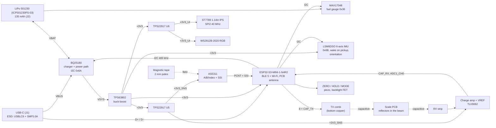

# Architecture

> **Status: rev A in design.** The schematics are captured and ERC clean; nothing has been laid out, built or
> measured. Every current below is a datasheet typical or an *estimate*, never a measurement.

This page explains how the caliper is put together and why: the system blocks, the choices that were made (and
the alternatives that lost), and the power budget. The architecture of record is
[SPEC](../hardware/design/SPEC.md); where this page and SPEC disagree, SPEC wins. The circuit details and part
numbers are in [Schematics and boards](electronics.md).

## 1. Overview

A 150 mm caliper whose slider carries one 4-layer board, 74 × 34 mm (a 62 × 34 body plus two end tabs that the housing clamps next to the sensors). The slider reads its position from an
**AS5311 magnetic linear encoder** over 2 mm-pole magnetic tape glued into the beam, and, as an experiment that can
be cut out with jumpers, from an **8-phase capacitive scale** (a passive 200 × 7 mm PCB bonded into the beam). An
**ESP32-S3-MINI-1** runs everything: the reading on a **1.14 in colour IPS** display, three buttons, an RGB LED and a
piezo, a reading log in flash, **BLE** (HID keyboard + GATT) and **Wi-Fi**. An **LSM6DSO** 6-axis IMU (accelerometer + gyroscope) wakes it on
pickup and tracks how it is held. Power is a 1S 135 mAh LiPo (Renata ICP501230PS-03, chosen 2026-11-09 for the slim housing) charged from **USB-C** by a BQ25180, regulated by a **TPS63802 buck-boost**, and
measured by a **MAX17048** fuel gauge.

## 2. Block diagram



## 3. Decisions and the alternatives that lost

### 3.1 MCU and radio: ESP32-S3 vs nRF52840 + nRF7002

| | ESP32-S3-MINI-1-N4R2 (chosen) | nRF52840 module + nRF7002 Wi-Fi companion |
|---|---|---|
| Radios | BLE 5 + 2.4 GHz Wi-Fi in one module, PCB antenna, certified | BLE from the nRF52840, Wi-Fi 6 from a second chip with its own antenna, RF layout and certification |
| Parts / area | One 15.4 × 20.5 mm module | Two modules (or a module + a QFN with RF matching) on a 74 × 34 mm board that already carries a display, a sensor and a comb |
| USB | Native USB 2.0 FS (CDC + MSC + HID in TinyUSB) | Native USB on the nRF52840 |
| Deep sleep | 7–8 µA (module datasheet v1.7 Table 6-7) | ~1.5–3 µA System ON idle (nRF) |
| Active current | 13–33 mA CPU (modem sleep, 40–80 MHz), 189 mA peak BLE TX at 0 dBm, 355 mA Wi-Fi TX peak | Much lower: nRF BLE TX ~5 mA |
| Cost (LCSC, qty 1) | $5.00 | ~$10 + ~$5 + RF parts |

The caliper needs Wi-Fi for the web page and MQTT/HTTP push (SPEC §1), which the nRF52840 cannot do alone.
Adding an nRF7002 doubles the RF work on a board whose antenna already has to hang clear of a steel beam. The
ESP32-S3 costs more energy while awake, but a caliper is awake for minutes a day and spends the rest in deep
sleep, where the difference (~6 µA) is small next to the buck-boost's 11 µA. The S3 also has the PCNT peripheral
for the AS5311 quadrature and a dedicated-GPIO bundle for the 8-phase drive. **N4R2, not N8R2:** the N8R2 is not
stocked at LCSC; 4 MB of flash holds the firmware plus a LittleFS log of thousands of 16-byte records.

### 3.2 Position sensing: AS5311 vs capacitive vs optical

| | AS5311 magnetic (primary) | Capacitive 8-phase (experimental) | Optical (incremental strip + quadrature sensor) |
|---|---|---|---|
| Resolution | 0.488 µm internal: the 4× quadrature count (1024 edges per 2 mm pole pair = 1.953 µm/count) interpolated with the 12-bit SSI position inside the pole pair (2 mm / 4096 = 0.488 µm) | Set by the ADC/demodulation: ~1/250 of the 2.54 mm half pitch ≈ 10 µm expected | 10–25 µm with hobby-grade strips (e.g. 150–180 LPI) |
| Robustness | Insensitive to coolant, dust, oil, light; 0.3 ± 0.1 mm gap | Sensitive to moisture and contamination in the 0.15 mm gap, and to the slider's tilt | Needs a clean, sealed path; dust and scratches drop counts |
| Absolute? | Within 2 mm (SSI) plus counting; zero on ZERO | Within 2.54 mm (half pitch: the forward/reverse burst that cancels the ADC delay halves the range), then tracked, up to ≈ 25 mm/s | No |
| Parts | One IC + magnetic tape ($12.63 IC, tape extra) | One op-amp + copper (cheap) but a second PCB in the beam and much firmware | Emitter/detector + a strip + optics alignment |
| Risk | Supply: 80 pcs at LCSC; 16 mA while on | Unproven here: it is what commercial calipers use, but their ASICs do the hard part | Mechanical alignment in a printed housing |

The AS5311 is the low-risk route to "electronics are not the limit" (SPEC §1): with the SSI interpolation
(SPEC §4.1, decision D1) its resolution is ~20× finer than the 0.01 mm display (the bare quadrature count, 1.95 µm,
would be ~5× finer) and it is insensitive to the shop environment. The capacitive scale is built alongside it as an
experiment because it is the low-power route (the commercial calipers run for years on a coin cell), and it costs
only an op-amp, 18 jumpers/resistors and copper. With R60–R67 and R80 left off it is electrically absent. Optical
lost on contamination and alignment in a printed slider.

The AS5311 draws 16 mA (21 mA max), so it is powered only while the caliper is awake (+3V3_SNS). The position is
re-established after every wake: the SSI gives the absolute position within the current 2 mm pole, and the firmware
keeps the pole count in RTC memory; a slider moved by more than ±1 mm while asleep (wake-on-motion from the IMU
starts the sensor) needs re-zeroing. *To verify on prototype.*

### 3.3 3V3 regulation: buck-boost vs LDO

A 1S LiPo runs from 4.2 V down to ~3.0 V. An LDO (e.g. a 2 µA-Iq RT9080) works while VBAT > 3.3 V + dropout, so it
loses regulation for the bottom ~25–35 % of the cell's capacity, exactly when the ESP32-S3's Wi-Fi TX peaks (355 mA,
datasheet Table 6-4) pull the cell lower still; the S3 needs 3.0–3.6 V. The **TPS63802** buck-boost keeps +3V3
regulated from 1.3 V to 5.5 V in, with 2 A out. The price is quiescent current: 11 µA Iq plus 5.5 µA in its
feedback divider (the datasheet limits the lower resistor to 100 kΩ), against ~2 µA for an LDO. That is the largest
single line in the sleep budget below, and the reason SPEC's sleep target was set to ≤ 35 µA (the first-draft figure was
below what the buck-boost alone draws; ≤ 40 µA since the gyroscope, §5).

### 3.4 Smaller decisions made during capture

* **LSM6DSO at 0x6B (SA0 high), not 0x6A:** 0x6A is the BQ25180 on the same bus
  ([Schematics §3.6](electronics.md#_3-6-imu-lsm6dso)). Until 2026-11-10 the IMU was a LIS2DW12 accelerometer at
  0x19; the owner asked for a gyroscope, and a 6-axis part in the same place was the smallest change
  ([Schematics §7.15](electronics.md#_7-15-gyroscope-lsm6dso-replaces-the-lis2dw12-2026-11-10)).
* **+3V3_UI switched rail:** the ST7789 still draws 15 + 5 µA typ in sleep-in (DM-TFT114-397 §5.3) and a WS2812
  idles at hundreds of µA in older revisions, so both lose power in deep sleep. No GPIO is free, so the switch
  shares SNS_PWR_EN with the sensor rail.
* **WS2812B-2020-V6 (3.3–5.3 V)** on 3.3 V: no level shifter and no 5 V rail.
* **Buttons with 100 k pull-ups + 100 nF:** no static current, hardware debounce, and they work as ext1 wake sources
  without keeping the RTC pull-ups powered. IMU_INT1 joins them in the same ext1 ANY_LOW mask: the LSM6DSO drives it
  push-pull, active low, latched, and the net has no pull at all (SPEC §5).

### 3.5 Decisions made in the contract reconciliation (SPEC §10)

* **Landscape display, module in the top-left corner (D4).** The portrait glass filled the board's height, which left
  the MINI-1, MODE and the USB-C fighting for the same 23 mm at the right end, and put the antenna over the LiPo
  and 1 mm from the USB-C shell. Now the glass (31 mm along the beam) sits over the beam band, the module's antenna
  is flush with the top edge in the top-left corner with an all-layer keep-out, the battery pocket moves 9.5 mm
  right, and the buttons and USB-C share the upper band. The reading gets the 240 px axis, so the digits are about
  1.8× wider. Espressif's 15 mm side clearance does not fit; 5 mm does, and range is a bring-up test.
* **Clamp tabs (D3).** Nothing can sit under the board over the beam (0.15 mm), so the board grows two end tabs that
  the housing towers pull up against clamp faces with SMT M2 standoffs. They are the board's Z datum, a few mm from
  the AS5311 and the electrodes; the flatness callout (≤ 0.03 mm over the sensor band) covers the span between.
* **LIVE carries the active profile (D6).** 12 bytes instead of 10, then 20 with the capture modes (SPEC §8); the app
  accepts all three, so old firmware still works.

## 4. Power tree

```
USB-C VBUS ─ SMF5.0A/USBLC6 ─ BQ25180 IN ─┬─ SYS → VSYS ─ TPS63802 → +3V3 ─┬─ ESP32-S3, LSM6DSO, I2C pull-ups, piezo, backlight (FET)
                                          │                                ├─ TPS22917 U5 → +3V3_SNS: AS5311, TLV9062, VREF
                                          │                                └─ TPS22917 U6 → +3V3_UI : ST7789 VDD, WS2812
                                          └─ BAT ─ LiPo (J2) ─ MAX17048 (VDD = CELL)
```

Charging is 70 mA (0.52C for the 135 mAh cell, whose standard charge is 0.5C and maximum 1C), set over I2C;
the BQ25180 power path runs the system from USB while it charges. A full charge takes ≈ 2–2.5 h (*estimate*).
The register values and the reasons for them: [Firmware §12.1 and §12.6](firmware.md#_12-6-the-135-mah-cell-charging-and-the-wi-fi-peaks).

## 5. Power budget and battery life

Assumptions: cell 135 mAh typical (130 mAh minimum), **120 mAh usable** (*estimate*: about 90 %, as before,
down to the firmware's 3 % "Battery empty" cut-off at the 0.4–0.5C awake load). Battery-side currents at VBAT ≈ 3.7 V; the
buck-boost is taken as ~90 % efficient at tens of mA (*estimate*; TPS63802 efficiency curves), so a 3.3 V load
of *I* draws ≈ *I* × 3.3 / (3.7 × 0.9) ≈ 1.0 × *I* from the cell. In deep sleep the converter's Iq dominates its
efficiency, so the sleep column lists the quiescent currents directly, plus one line for the conversion loss on
the 3.3 V-side sleep loads (ESP32, LSM6DSO, divider: ≈ 19 µA at an assumed ~80 % light-load efficiency).

| Block | Deep sleep (µA) | Idle, awake (mA) | Measuring (mA) | Basis |
|---|---|---|---|---|
| ESP32-S3-MINI-1 | 8 | 25 | 35 | Deep sleep, RTC peripherals on: 8 µA (Table 6-7). Awake: modem sleep at 80 MHz, 22–36 mA WAITI (Table 6-6) with light-sleep between frames (*estimate*); BLE connection events add ~1–3 mA average (*estimate*) |
| TPS63802 Iq + FB divider | 16.5 | – | – | 11 µA (SLVSEU9D) + 0.5 V / 91 kΩ |
| BQ25180 (battery only) | 3 | – | – | IQ_BAT 3 µA typ with the watchdog and push-button disabled; 4 µA with the push-button on (SLUSE99C Electrical Characteristics, IQ_BAT). Firmware must set it |
| MAX17048 | 3 | 0.023 | 0.023 | 3 µA hibernate with `VRESET.Dis` = 1, else 4 µA; 23 µA active (19-6171 Electrical Characteristics, IDD0). Plus ≤ 2 × 0.4 µA SCL/SDA pull-downs (IPD) against the pull-ups |
| LSM6DSO | 5.5 | 0.30 | 0.30 | Asleep: accelerometer only, ultra-low-power mode at 12.5 Hz, gyroscope powered down: 5.5 µA typ (ST AN5192 Table 9; DS12140 gives its currents at VDD = 1.8 V, the 3.3 V figure is not in it and is *not measured*). Awake: accelerometer + gyroscope at 52 Hz in low-power mode, as the firmware runs them: 0.30 mA typ (AN5192 Table 9; 0.55 mA in high-performance mode, DS12140 Table 4). The LIS2DW12 it replaced: ~1 µA / 0.05 mA |
| TPS22917 ×2 (off) | 0.02 | – | – | ISD,VIN 10 nA typ each (SLVSDW8B; the 0.5 µA figure is the *on*-state IQ) |
| Buck-boost conversion loss on the 3.3 V sleep loads | ≈ 2.2 | – | – | 19 µA × 3.3 / (3.7 × ~0.8) − 19 (*estimate*) |
| AS5311 | 0 | 16 | 16 | 16 mA typ, 21 mA max (rev 1.13, electrical characteristics); off in sleep |
| Capacitive AFE | 0 | 1.1 | 1.2 | TLV9062 2 × 538 µA + 16.5 µA divider; TX drive negligible |
| ST7789 logic | 0 | 8 | 8 | DM-TFT114-397 §5.3; off in sleep (+3V3_UI) |
| Backlight | 0 | 5 | 10 | ≈ 20 mA at 100 % (15 Ω, VF 3.0 V); 25 % / 50 % PWM (*estimate*) |
| WS2812B-2020-V6 | 0 | ~1 | ~1 | Idle current per LCSC listing (*to verify*); off in sleep |
| **Total** | **≈ 38 µA** (≈ 40 µA if the firmware leaves the 4 µA defaults; ≈ 33 µA before the gyroscope) | **≈ 56 mA** | **≈ 71 mA** | |

Battery life (120 mAh usable, *estimates*; the "was" column is the 500 mAh cell with the LIS2DW12 budget):

| Scenario | Average | Runtime | (was, 500 mAh cell) |
|---|---|---|---|
| Deep sleep only (storage, not ship mode) | 38 µA | ≈ 3 100 h ≈ **4 months** | 1.5 years |
| Ship mode (BQ25180 shutdown, MAX17048 asleep) | ≈ 0.5 µA + the pack's PCM | set by the PCM's own drain (not on the sheets we have) and the cell's self-discharge, not by the caliper. Wake by plugging in USB | years |
| Continuous measuring, display on | 71 mA (0.53C) | **≈ 1 h 40 min** | ≈ 6 h |
| Awake, idle | 56 mA | ≈ 2 h 10 min | ≈ 8 h |
| Wi-Fi sync burst (TX capped at 10 dBm: ≈ 0.27 A peaks from the cell, ~100 mA average for a few s) | – | ≈ 0.1–0.3 mAh per sync (0.1–0.25 % of the cell) | |
| **Typical shop day: 30 min awake measuring, 23.5 h asleep** | 35.5 + 0.9 ≈ **36 mAh/day** | **≈ 3.3 days** (3.2 with a 130 mAh cell) | ≈ 12 days |
| Light use: 10 min/day | 11.8 + 0.9 ≈ 12.7 mAh/day | ≈ 9.4 days | ≈ 5 weeks |

A typical day's 36 mAh charges back in under an hour at 70 mA (about 30 min of constant current plus the CV tail). Wi-Fi on battery stops below a 3.40 V cell
reading (it does not start below 3.50 V), roughly the last 10–15 % of the charge (*estimate*); BLE and
measuring carry on to the 3 % cut-off.

What dominates: awake, the ESP32-S3 (~50 %) and the AS5311 (~22 %); asleep, the buck-boost Iq and its divider
(50 %) and the ESP32-S3 (24 %). The cheapest rev-B improvement is the auto-off delay (the IMU sees the caliper put
down), then a lower-Iq buck-boost (e.g. TPS63900 class, 75 nA Iq, if it can supply the Wi-Fi peaks).

Peak current: uncapped, Wi-Fi TX 355 mA (802.11b, 20.5 dBm) + AS5311 21 mA + LCD/backlight ~30 mA ≈ 405 mA at
3.3 V, so ≈ 405 × 3.3 / (3.0 × 0.9) ≈ 500 mA from a 3.0 V cell (≈ 350 mA from a full 4.2 V one). That is inside the
TPS63802's 2 A rating, but 2.6–3.7C for the 135 mAh cell, whose pulse rating is **2C (270 mA)**. The firmware therefore
caps the Wi-Fi TX power at 10 dBm (module peak ≈ 195 mA, *estimate*) and, on battery, keeps Wi-Fi off below a
3.40 V cell reading, which brings the burst to ≈ 210–275 mA from the cell, about 2C at the low end (BLE at 9 dBm,
204 mA module peak, is similar). The BQ25180's battery discharge limit (`IBAT_OCP`) is set to its 1 A reset value
(was 1.5 A): a fault limit at least 2× any peak; its 500 mA step would come within a few percent of an uncapped
burst, and repeated trips latch the battery off until USB is plugged in. A Wi-Fi frame lasts milliseconds,
far longer than any practical ceramic bank can bridge (1 ms at 0.2 A and 0.1 V droop is 2 mF), so the cell carries
the burst. The ≈ 78 µF on +3V3 (C5, C6, C20, C23) only rides through the buck-boost's load-step response.
Details and the arithmetic: [Firmware §12.6](firmware.md#_12-6-the-135-mah-cell-charging-and-the-wi-fi-peaks).

## 6. References

* [SPEC](../hardware/design/SPEC.md), [Schematics and boards](electronics.md)
* Espressif, *ESP32-S3-MINI-1 & MINI-1U Datasheet* v1.7 (pin definitions, Fig. 9-1 peripheral schematic,
  Tables 6-4…6-7 currents): <https://www.espressif.com/sites/default/files/documentation/esp32-s3-mini-1_mini-1u_datasheet_en.pdf>
* ams, *AS5311 High Resolution Magnetic Linear Encoder*, Revision 1.13 (pins, §7.7 supply, Isupp)
* TI, *TPS63802* SLVSEU9D (Fig. 10-1, Tables 10-2, 10-5, DLA0010A land pattern): <https://www.ti.com/lit/ds/symlink/tps63802.pdf>
* TI, *BQ25180* SLUSE99C: <https://www.ti.com/lit/ds/symlink/bq25180.pdf>; *TPS22917* SLVSDW8B: <https://www.ti.com/lit/ds/symlink/tps22917.pdf>;
  *TLV9062* SBOS799: <https://www.ti.com/lit/ds/symlink/tlv9062.pdf>
* Maxim/ADI, *MAX17048/MAX17049* 19-6171 (pin table, Fig. 14, Table 3)
* DisplayModule, *DM-TFT114-397* (1.14 in ST7789 panel pinout, DC characteristics): <https://cdn.shopify.com/s/files/1/0264/7629/files/DM-TFT114-397_Datasheet.pdf>
* ST, *LSM6DSO* DS12140 Rev 3 (pin table 1 and Fig. 3, Table 4 currents, Table 19 pin states): <https://www.st.com/resource/en/datasheet/lsm6dso.pdf>;
  AN5192 (operating modes and their currents, Table 9). Before 2026-11-10: LIS2DW12 DS11811 and AN5038
