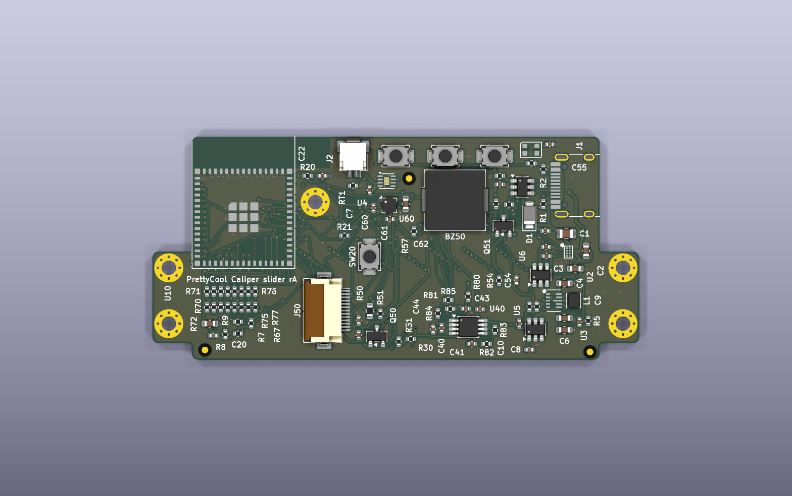
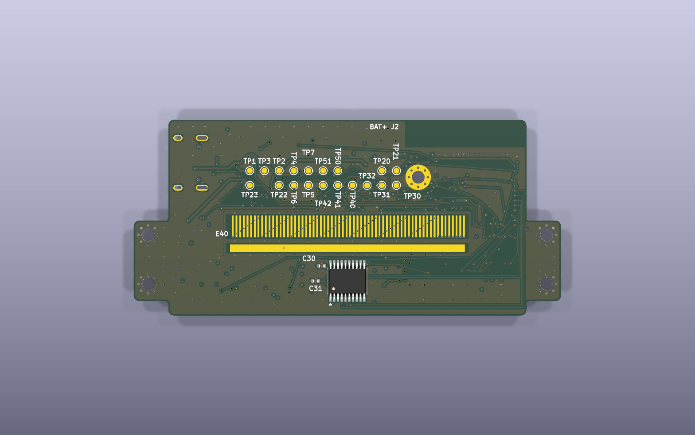
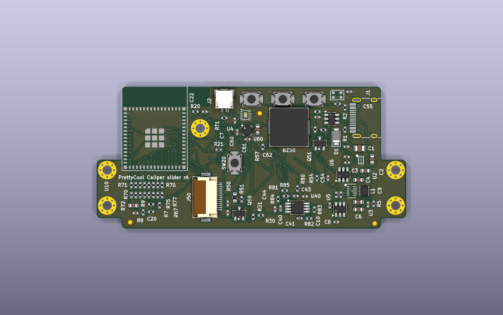
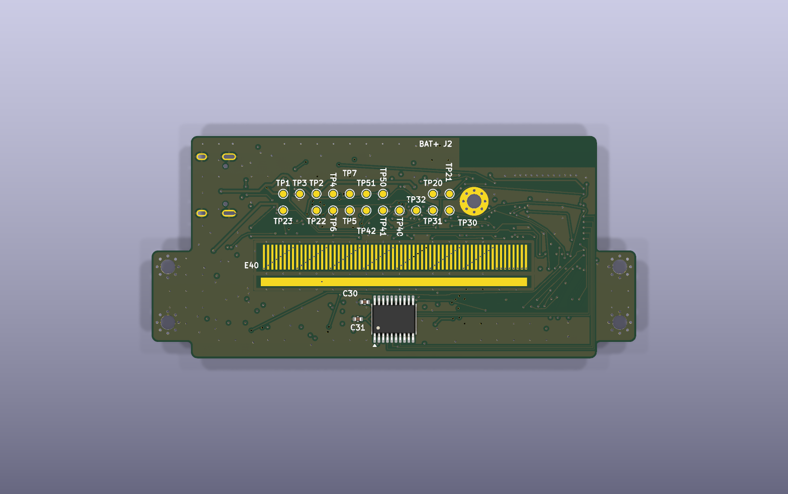
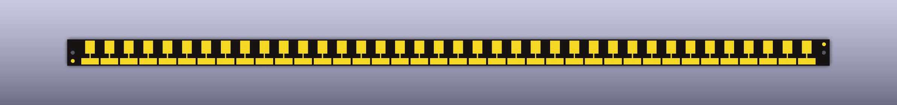

# Schematics and boards

> **Status: rev A schematics captured, ERC clean (2 waived, listed below). Designed, not built or tested.**
> **Layout (§7):** both boards laid out and routed; KiCad 9 and 10 DRC + schematic parity: 0 errors, 0 unconnected.
> The slider's fab package is review-only (a J50 part/footprint mismatch, §7.7); the scale's is released.
> Every current, voltage and part choice here is a datasheet or catalogue figure, not a measurement.

The architecture of record is [SPEC](../hardware/design/SPEC.md); the net names, the ESP32 pin map and the I2C
addresses are in [`nets.py`](https://github.com/tyevco/prettycoolboards/blob/main/caliper/hardware/design/nets.py).
Why the big parts were chosen (and what lost) is in [Architecture](architecture.md).

## 1. How the schematic is made

The KiCad 9 projects are **generated from Python**, with the same toolchain as dial-me-spinner (vendored in
[`tools/`](https://github.com/tyevco/prettycoolboards/tree/main/tools)):

```
caliper/hardware/design/sheets/*.py ──build.py──▶ caliper/hardware/kicad/<board>/*.kicad_sch ──kicad-cli──▶ ERC, netlist, PDF
```

```sh
# in WSL (Ubuntu 24.04, KiCad 9.0.9)
python3 caliper/hardware/design/build.py --render      # both boards: schematic, ERC, netlist, PDF + PNG per sheet
python3 caliper/hardware/design/check_contract.py      # ESP32 pins in the netlist == nets.MCU_PINS
python3 tools/lcsc_check.py caliper/hardware/kicad/slider/prettycool-caliper-slider.net   # LCSC stock/type check
```

The sheets are **drawn with wires**, the way a person draws a schematic, so you can follow a connection by eye
(the toolchain's hard wiring rule, R1–R6 in [`tools/README.md`](https://github.com/tyevco/prettycoolboards/blob/main/tools/README.md#wiring-rule)):

- Each annotated group is a cluster around its anchor IC. Every satellite part sits next to the pin it serves and
  faces it: pull-ups and pull-downs, dividers, RC filters, the TX jumper + series-resistor chains, the CC
  resistors, the ESD part.
- Every connection on a sheet is an orthogonal wire, with a junction dot on every T. No junction joins four
  wires: a pull-up and a pull-down on the same net sit one grid step apart, so they make two T's.
- A pin's wire runs straight out on the pin's own row where it can. A test point or pull-up that would reach into
  the next row moves further out along its wire, and a test point may hang below the wire instead of above it
  (the ESP32's USB_D-/USB_D+ test points, the fuel gauge's ALRT pull-up). Only where a column is too crowded for
  that do the wires jog to fan the rows out: the AS5311 outputs (MAG_DO/A/IDX/INC_N/DEC_N) and the LCD
  connector's backlight pins, where R50 sits about 45 mm below J50 pin 12.
- Decoupling caps hang off the wire of the pin they decouple, and the power symbol sits at the end of that wire.
- A net that leaves the sheet has one global label per cluster, wired to all of that cluster's pins.
- A local net carries one local label as a name tag on its wire, so the net names in the netlist are unchanged.

`build.py` fails if the drawing breaks the rule. The check traces the drawn wires, not the labels, and names the
sheet, net and pins. Do not hand-edit the `.kicad_sch` files: change the sheet module and rebuild.

When the generator moved from "stub + label on every pin" to drawn wires (2026-11-07), `tools/netlist_diff.py`
showed the netlists before and after are **identical**: slider 96 nets, 125 components, 390 net members; scale
1 net, 4 components; same net names, same component fields, same symbol UUIDs. The ERC result did not change.
A second, independent review pass the same day traced the rendered sheets by eye. It fixed a power symbol drawn
over the buzzer's pin, six 4-way junctions, the half-row jogs on the I2C and LCD labels, and the label jumps
around test points on the ESP32 and the fuel gauge. The netlists were again identical to the pre-rework ones.
This is a check of the drawing only: nothing was built or measured.

| Board | KiCad project | Sheets | Rendered schematic |
|---|---|---|---|
| `slider` | `caliper/hardware/kicad/slider/prettycool-caliper-slider.kicad_pro` | power, mcu, sensor_mag, sensor_cap, ui, imu | [PDF](https://github.com/tyevco/prettycoolboards/blob/main/caliper/hardware/kicad/slider/render/prettycool-caliper-slider-schematic.pdf) |
| `scale` | `caliper/hardware/kicad/scale/prettycool-caliper-scale.kicad_pro` | scale | [PDF](https://github.com/tyevco/prettycoolboards/blob/main/caliper/hardware/kicad/scale/render/prettycool-caliper-scale-schematic.pdf) |

Toolchain changes made for this project (backward compatible): the deterministic UUID namespace in `schgen.py`
and `pcbgen.py` is now settable (`schgen.set_uuid_namespace()`, `pcbgen.UUID_NAMESPACE`; the default is still
`dial-me-spinner`), and `symgen.write_library()` takes the generator name. The caliper uses `prettycool-caliper`.

## 2. ERC status

| Board | Result (kicad-cli 9.0.9, `--severity-all`) |
|---|---|
| slider | **0 unwaived**; 2 waived `pin_to_pin` |
| scale | **clean** |

Waivers (in `build.py`, reported as "waived", never dropped silently):

| Violation | Pins | Why it is intended |
|---|---|---|
| pin_to_pin (open collector ↔ power output) | U5 pins 5 (QOD), 6 (VOUT) | TPS22917 QOD tied straight to VOUT, the datasheet's second QOD option (SLVSDW8B Table 6-1): +3V3_SNS is actively discharged when the switch turns off |
| pin_to_pin | U6 pins 5, 6 | Same for +3V3_UI |

`check_contract.py` result: `U10 checked against 42 nets.MCU_PINS entries -> OK` (it was also checked to fail on a
deliberately swapped pin).

## 3. Slider board, sheet by sheet

Reference designators are grouped by sheet: power 1–19, mcu 20s, sensor_mag 30s, sensor_cap 40s/60s–80s, ui 50s, imu 60s
(U60/C60–C62).

### 3.1 power: USB-C, charger, 3V3, rails

| Ref | Part | LCSC | Notes |
|---|---|---|---|
| J1 | HRO TYPE-C-31-M-12, 16-pin USB 2.0 receptacle | C165948 | Right edge (x = 62, y ≈ 26). CC1/CC2 each 5.1 k to GND (R1, R2): sink only, 5 V default USB current |
| U1 | USBLC6-2SC6 | C7519 | ESD on D+/D−/VBUS, flow-through. Within 5 mm of J1 |
| D1 | SMF5.0A TVS | C151296 | VBUS surge (as dial-me-spinner) |
| U2 | BQ25180YBGR (I2C 0x6A) | C3682423 | Linear charger + power path, 250 mA charge set over I2C, ship mode for storage. Battery discharge limit `IBAT_OCP` resets to 1 A; keep it there (≈ 0.5 A Wi-Fi peaks from a low cell). IN 2.2 µF/25 V 0805 X7R, SYS 10 µF/25 V, BAT 4.7 µF (dial-me-spinner's values, which its SPICE suite checked for DC bias). /INT → CHG_INT_N. TS/MR: 10 k NTC RT1 (board temperature next to the battery connector; the datasheet's "no TS" option is a plain 10 k) |
| J2 | JST SM02B-SRSS-TB (SH 2-pin) | C160402 | 1 = BAT+, 2 = GND. **Check every pack's polarity**: hobby packs are not consistent |
| U3 | TPS63802DLAR buck-boost → +3V3 | C2845237 | 2 A, 11 µA Iq. EN = VSYS (always on), MODE = GND (power save), PG unused. TI typical application (SLVSEU9D Fig. 10-1): CIN 10 µF (C4), COUT 22 µF (C5) + 22 µF bulk (C6), feedback R3 511 k / R4 91 k → 3.31 V |
| L1 | Murata DFE201612E-R47M (0.47 µH, 5.5 A Isat) | C668312 | From TI's recommended list (Table 10-2). Footprint = KiCad's DFE201610P land (same 2016 body; the E part is 1.2 mm tall) |
| U4 | MAX17048G+T10 fuel gauge (0x36) | C2682616 | VDD = CELL = VBAT, CTG/QSTRT/EP to GND, 0.1 µF (C7). 3 µA hibernate. ALRT → FG_ALRT_N |
| U5 | TPS22917DBVR → +3V3_SNS | C2681320 | AS5311 + capacitive front-end. ON = SNS_PWR_EN (R5 100 k pull-down), CT 1 nF to VIN, QOD = VOUT |
| U6 | TPS22917DBVR → +3V3_UI | C2681320 | **Added during capture**: LCD logic VDD + RGB LED, also on SNS_PWR_EN (no GPIO is free) |
| R6, R7 | 4.7 k I2C pull-ups to +3V3 | C25900 | Always-on rail: the MAX17048's SCL/SDA have internal pull-downs and read a low bus as "disconnected" |
| R8, R9 | 10 k pull-ups on CHG_INT_N, FG_ALRT_N | C25744 | Open-drain interrupts |
| H1–H4, FID1–3 | M2 plated holes (GND), fiducials | – | Footprints only. H1 is the support hole, H2–H4 tab clamp holes; the fourth tab hole H5 is on the board only (§7.4) |
| TP1–TP7 | VBUS, VBAT, VSYS, +3V3, +3V3_SNS, +3V3_UI, GND | – | Bring-up |

Pinouts: BQ25180 from TI SLUSE99C Table 6-1 (and the YBG0008 land pattern, the footprint is copied from
dial-me-spinner); TPS63802 from SLVSEU9D Table 7-1, footprint drawn from the DLA0010A example board layout (p. 36:
pads 1–5 0.6 × 0.25 mm at x = −0.9, pads 6/7/9/10 0.9 × 0.25 mm at x = +0.75, GND pad 8 1.3 × 0.25 mm);
MAX17048 from the Maxim 19-6171 pin table (TDFN: 1 CTG, 2 CELL, 3 VDD, 4 GND, 5 ALRT, 6 QSTRT, 7 SCL, 8 SDA, EP).

### 3.2 mcu: ESP32-S3-MINI-1

| Ref | Part | LCSC | Notes |
|---|---|---|---|
| U10 | **ESP32-S3-MINI-1-N4R2** (4 MB quad flash, 2 MB quad PSRAM) | C3013941 | The N8R2 is not stocked at LCSC (searched 2026-11-07); the N8 (no PSRAM) is. KiCad's `RF_Module:ESP32-S3-MINI-1` symbol matches the Espressif pin table pad for pad; its footprint is `RF_Module:ESP32-S2-MINI-1`, the same 65-pad 15.4 × 20.5 mm land. That footprint has **no antenna keep-out zone** (its description also wrongly says "external antenna"): the layout must add the all-layer keep-out |
| C20, C21 | 22 µF + 100 nF at pad 3 | C59461, C1525 | Datasheet v1.7 Fig. 9-1 |
| R20, C22 | EN RC 10 k / 1 µF | C25744, C52923 | Datasheet §9: "R = 10 kΩ and C = 1 µF" |
| R21, SW20 | BOOT: 10 k pull-up on GPIO0, button to GND | C25744, C720477 | Recovery only; normal flashing uses USB-Serial-JTAG |

The pin map is exactly `nets.MCU_PINS` ([SPEC §5](../hardware/design/SPEC.md#_5-mcu-pin-map-esp32-s3-mini-1)).
The KiCad symbol names pads 23/24 `USB_D-`/`USB_D+`; the sheet maps the contract's `IO19`/`IO20` to them.
IO26 (the PSRAM chip select on R2 parts) has a no-connect flag. Strapping: GPIO45 has a 100 k pull-down on the BUZZ
gate (R56), GPIO46 a 100 k pull-down on RGB_DIN (R55), GPIO0 the BOOT pull-up, GPIO3 the CHG_INT_N pull-up (harmless
while the JTAG_SEL eFuse is unburnt).

### 3.3 sensor_mag: AS5311

| Ref | Part | LCSC | Notes |
|---|---|---|---|
| U30 | ams AS5311-ATST (TSSOP-20) | C22459687 | **80 pcs in stock** at LCSC on 2026-11-07, Extended, $12.63. Order it early; if it is gone, consign it or hand-place it |
| C30, C31 | 100 nF + 1 µF at VDD5V | C1525, C52923 | Datasheet §7.7 |
| R30, R31 | 10 k pull-ups to +3V3_SNS on MagINCn / MagDECn | C25744 | Open drain (Table 1) |
| TP30–32 | MAG_A, MAG_B, MAG_IDX | – | Scope / logic analyser |

Pinout from the ams datasheet Revision 1.13, Table 1 (checked pin by pin): 1 NC, 2 MagINCn, 3 MagDECn, 4 A, 5 B,
6 NC, 7 Index, 8 VSS, 9 Prog, 10 NC, 11 NC, 12 DO, 13 CLK, 14 CSn, 15 PWM, 16 NC, 17 NC, 18 VDD3V3, 19 VDD5V,
20 NC. "Pins 1, 6, 10, 11, 16, 17 and 20 are for internal use and must not be connected": they carry no-connect
flags, as does the unused PWM output. 3.3 V operation: VDD5V and VDD3V3 both on +3V3_SNS (§7.7, "the LDO must be
bypassed by connecting VDD3V3 with VDD5V"). Prog to VSS ("for factory programming only"). CSn has an internal
~50 k pull-up and must be low for the A/B/Index outputs. Supply current 16 mA typ, 21 mA max.

### 3.4 sensor_cap: capacitive front-end (experimental)

```
CAP_TXn ─ R6n 0R (DNP-able) ─ R7n 100R ─ CAP_EL_TXn (comb phase n)        n = 0…7
CAP_EL_RX ─ R80 0R (DNP-able) ─ CAP_RX_IN ─┬─ U40A − (C40 10p C0G ‖ R81 10M to CAP_AMP_OUT)
                                           U40A + = CAP_VREF (R82/R83 100k/100k + C41 1u, buffered by U40B)
CAP_AMP_OUT ─ R84 390R ─┬─ R85 3.9k ─┬─ CAP_RX (GPIO1, ADC1_CH0)
                       C43 1n       C44 100p C0G
```

* **Op-amp:** TLV9062IDGKR (C398356): dual, 10 MHz GBW, rail-to-rail in/out, 538 µA per amplifier, 1.8–5.5 V.
  It meets SPEC's "≥ 10 MHz GBW, RRIO CMOS" at $0.23. If the bandwidth turns out short, a 50 MHz RRIO dual such as
  the OPA2365 has the same pinout, but LCSC C130011 is the **SOIC-8** OPA2365AIDR, so it is not a footprint drop-in
  for the VSSOP-8 land (a VSSOP version would have to be sourced).
* **Feedback:** 10 pF ‖ 10 MΩ: the gain is −C<sub>coupling</sub>/10 pF and the DC path's corner is
  1/(2π·10 MΩ·10 pF) ≈ 1.6 kHz, far below the 25–100 kHz drive.
* **Low-pass:** two RC poles at 1/(2π·390 Ω·1 nF) ≈ 408 kHz and 1/(2π·3.9 kΩ·100 pF) ≈ 408 kHz; the second stage
  is 10× the impedance so it barely loads the first.
* **Isolation:** with R60–R67 and R80 left off, the experiment is fully disconnected from the ESP32 and the
  op-amp. The rail (+3V3_SNS) is shared with the AS5311, and the op-amp is always fitted.

**Electrodes in the schematic (the approach chosen):** the electrodes are bottom-layer copper, not parts. They are
drawn as one symbol, **E40** (`caliper:CAP_ELECTRODES`), with a footprint of *seed pads*, one per electrode net:
pads 1–8 are eight 0.30 × 5.00 mm fingers at 0.635 mm pitch (TX0…TX7, one 5.08 mm repeat), pad 9 is a
5.08 × 1.20 mm receive strip 3.8 mm below the comb centre (SPEC §2.1: comb y = 12.5…17.5, RX y = 10.6…11.8). The
layout script places E40 on the bottom at the start of the comb and draws the remaining 7 repeats and the full
40 mm RX strip as copper on the same nets. E40 is excluded from the BOM and the CPL. This keeps every electrode a
real net with a pad (ERC checks it, the netlist carries it to the board, DRC sees the copper on its net) without
net-tie footprints or ERC waivers.

### 3.5 ui: display, buttons, LED, piezo

**LCD panel pinout.** The 13-pin 1.14 in ST7789 glass is sold under many part numbers; the pin order used is the
DisplayModule **DM-TFT114-397** datasheet, §3.1 "Panel Pin Description" ([PDF](https://cdn.shopify.com/s/files/1/0264/7629/files/DM-TFT114-397_Datasheet.pdf)):

| Pin | 1 | 2 | 3 | 4 | 5 | 6 | 7 | 8 | 9 | 10 | 11 | 12 | 13 |
|---|---|---|---|---|---|---|---|---|---|---|---|---|---|
| Panel | NC | NC | SDA | SCL | RS (D/C) | RESET | CS | GND | NC | VDD | LEDK | LEDA | GND |
| Net | – | – | LCD_MOSI | LCD_SCK | LCD_DC | LCD_RST_N | LCD_CS_N | GND | – | +3V3_UI | LCD_LEDK | LCD_LEDA | GND |

Same datasheet: VDD 2.4–3.3 V, 8 mA typ; sleep-in 15 + 5 µA typ; backlight 1 white LED, VF 2.9–3.1 V at 20 mA.

| Ref | Part | LCSC | Notes |
|---|---|---|---|
| J50 | 0.5K-AX-13PWB, 13 P 0.5 mm FPC, bottom contact, slide lock, 2.0 mm | C2911931 | 2784 in stock. Footprint is KiCad's Hirose FH12-13S-0.5SH (same class; the FH12 itself is out of stock at LCSC): **check against the C2911931 drawing before layout release** |
| C50, C51 | 1 µF + 100 nF at VDD | | |
| R50 | 15 Ω 0603, +3V3 → LEDA | C22810 | (3.31 V − VF) / 15 Ω ≈ 20 mA at VF 3.0 V (the panel's rated point), ≤ 27 mA at 2.9 V, ~14 mA at 3.1 V. Was 10 Ω at capture, which gave 31–41 mA (changed in review). Only ~0.3 V of headroom, so brightness follows VF and +3V3. Dim by PWM |
| Q50 | AO3400A, low side on LEDK, gate = LCD_BL | C20917 (Basic) | R51 100 k gate pull-down |
| SW50–52 | XUNPU TS-1088-AR02016 (3.9 × 2.9 × 2.0 mm) ZERO/HOLD/MODE | C720477 (Basic) | 100 k pull-up (R52–R54) + 100 nF (C52–C54) = 10 ms RC debounce; RTC GPIOs 17/18/21 wake from deep sleep |
| D50 | WS2812B-2020-V6 RGB LED | C52917434 | LCSC lists 3.3–5.3 V, so it runs on +3V3_UI with a 3.3 V DIN and no level shifter. R55 100 k pull-down (GPIO46 strap) |
| BZ50 | Murata PKMCS0909E4000-R1 piezo (4 kHz, external drive) | C910763 | +3V3 → BZ50 ‖ R57 1 k → Q51 (AO3400A) drain. R56 100 k gate pull-down holds GPIO45 (VDD_SPI strap) low at reset |

### 3.6 imu: LIS2DW12

U60 LIS2DW12TR (C189624) on the system I2C, always powered from +3V3 so it can wake the ESP32 on pickup (INT1 →
GPIO15, an RTC GPIO). 100 nF + 10 µF at VDD, 100 nF at VDD_IO. CS high (I2C), RES to GND.
**SA0 is tied high: address 0x19, not the 0x18 SPEC first asked for.** SDO/SA0 has an internal pull-up that cannot
be disconnected in I2C mode, so a grounded SA0 draws ~60–170 µA permanently (ST AN5038; dial-me-spinner measured
it as a bring-up fault signature). That alone would be several times the sleep budget. `nets.I2C_ADDR` and SPEC
§6 are updated.

## 4. Scale board

No electronics: two plated M2 holes on GND (H1, H2) in the schematic, which the layout turns into the SPEC's Ø1.0
non-plated alignment holes (§7.6), two fiducials and a PWR_FLAG. The reflector pattern and the
back-copper ground plane are drawn by the layout script as copper/graphics (SPEC §2.2). The netlist exists so the
layout can import the holes and fiducials the same way as the slider.

## 5. BOM and sourcing

`tools/lcsc_check.py` against the JLCPCB catalogue on 2026-11-07: **45 BOM lines, 0 flagged** (every code
found, in stock, MPN matches). 20 lines are JLC **Basic**, 25 **Extended** (re-run after the review changed R50 to the Extended 15 Ω C22810).

| Line | LCSC | Type | Stock | $ (qty 1) |
|---|---|---|---|---|
| ESP32-S3-MINI-1-N4R2 | C3013941 | Extended | 7 487 | 5.00 |
| AS5311-ATST | C22459687 | Extended | **80** | 12.63 |
| BQ25180YBGR | C3682423 | Extended | 5 848 | 1.85 |
| MAX17048G+T10 | C2682616 | Extended | 22 821 | 2.01 |
| TPS63802DLAR | C2845237 | Extended | 23 909 | 0.91 |
| TPS22917DBVR (×2) | C2681320 | Extended | 3 637 | 0.37 |
| LIS2DW12TR | C189624 | Extended | 52 010 | 0.90 |
| TLV9062IDGKR | C398356 | Extended | 53 188 | 0.23 |
| WS2812B-2020-V6 | C52917434 | Extended | 740 820 | 0.09 |
| PKMCS0909E4000-R1 | C910763 | Extended | **535** | 1.10 |
| 0.5K-AX-13PWB FPC | C2911931 | Extended | 2 784 | 0.12 |
| AO3400A, TS-1088, 0402 R/C | various | Basic | > 100 k | < 0.09 |

**Parts that are not (reliably) on LCSC:** none is missing, but the **AS5311** has only 80 pieces at LCSC: if they
are gone when the order is placed, the part is consigned or hand-placed (the BOM field `JLC` says so). The LCD panel
itself is not a PCBA part: it plugs into J50 by hand.

## 6. Open risks (schematic)

* **LCD panel pitch / pin order.** The cited pinout comes from a module whose drawing shows a 0.7 mm *solder*
  tail; the board needs a panel with a 0.5 mm, 0.3 mm-thick plug-in tail in the same pin order. Buy the panel
  first and check its drawing; if it differs, change `PANEL_PINS` in `sheets/ui.py`.
* **FPC footprint** is the FH12 land, not the C2911931 vendor drawing (§3.5).
* **WS2812B-2020-V6** pin order and the 3.3 V minimum are from the LCSC listing and the WS2812B-2020 family; the V6
  datasheet could not be downloaded during capture.
* **Backlight headroom**: 3.31 V − 3.0 V VF leaves 0.3 V across 15 Ω + the FET; a 3.1 V LED gets ~14 mA, a 2.9 V
  one ≤ 27 mA. The panel's maximum LED current is not in the cited datasheet: check it on the bought panel.
* **Sleep current** is ≈ 33 µA (estimate) against SPEC's target of ≤ 35 µA
  ([Architecture §5](architecture.md#_5-power-budget-and-battery-life)).
* **Contract reconciliation (SPEC §10, 2026-11-07).** The layout has the clamp tabs (74 × 34 overall), the
  single upper-band hole H1, the module in the top-left corner with an all-layer antenna keep-out, the D5 electrode
  geometry and the scale's Ø1.0 alignment holes (§7). **Not yet in the schematics** (the board carries them as
  board-side edits, §7.9): the fourth tab hole H5, the SMT M2 standoffs (no part chosen), the E40 seed-pad change
  (fingers 0.30 × 3.80, RX 5.08 × 1.30) and the scale holes as NPTH. In the schematics already: RT1 populated and
  TS enabled; IMU_INT1 has no pull (checked in the netlist).
* **Ship mode** can only be left by plugging in USB (TS/MR is not wired to a button).
* **RX electrode ESD**: the receive strip is exposed copper under an open mask, connected through R80 straight to a
  high-impedance op-amp input. It faces the scale, not the user, but a discharge into the beam could reach it.
  Not protected in rev A (a TVS would add pF and leakage at the most sensitive node).
* **Back-powering**: the MAG_*, LCD_* and RGB_DIN lines go into switched rails; the firmware must drive them low
  before SNS_PWR_EN goes low.
* Nothing here has been simulated (the simulation track owns SPICE) or built.

## 7. Layout

> **Status (2026-11-08): both boards laid out, routed and through the DRC + schematic-parity gate (KiCad 9.0.9:
> 0 errors, 0 unconnected, 0 parity errors on both; KiCad 10.0.8 agrees). The slider's fab package is
> REVIEW-ONLY**: JLC's placement check found J50's part (C2911931) does not fit its footprint (§7.7). Designed,
> not built: nothing has been fabricated or measured, and no signal-integrity, RF or thermal analysis was run on
> the layout. An adversarial layout review on 2026-11-08 found and fixed five defects (the USB pair, three
> decoupling placements, a truncated electrode guard) and corrected several claims here; its findings, fixed and
> open, are in §7.10.

The boards are generated from the netlists by
[`layout.py`](https://github.com/tyevco/prettycoolboards/blob/main/caliper/hardware/design/layout.py) (adapted from
dial-me-spinner's) and released by
[`release.py`](https://github.com/tyevco/prettycoolboards/blob/main/caliper/hardware/design/release.py):

```sh
# in WSL (Ubuntu 24.04, KiCad 9.0.9, Freerouting 2.1.0, FREEROUTING_JAR=/opt/freerouting/freerouting.jar)
python3 caliper/hardware/design/layout.py --board scale                                  # place, pour, DRC
python3 caliper/hardware/design/layout.py --board slider --route --minutes 8 --attempts 1 # place, route, pour, DRC
python3 caliper/hardware/design/layout.py --board slider --complete                      # only if any stay open
python3 caliper/hardware/design/release.py [--update-offsets] [--force]                  # gate, fab package
```

Coordinates below are SPEC's: board mm, origin at the lower-left of the 62 × 34 body, +y up (the beam's jaw-side
edge is y = 0). The drill/place origin is the same point, so the CPL is in these coordinates too.

### 7.1 Stack-up and rules (slider)

| Layer | Use |
|---|---|
| F.Cu | parts, signals, GND pour |
| In1.Cu | **solid GND plane** (layer type *power*; every GND SMD pad has its own via to it) |
| In2.Cu | **+3V3 pour**, signals, the 8 electrode **phase buses**, and a **GND** pour inside the electrode ring |
| B.Cu | U30 (AS5311) + C30/C31, the electrode comb and guards, 19 test pads, the MAG bus, signals; GND pour |

1.0 mm, 4 layers, symmetric; JLC's standard 1.0 mm impedance stack is assumed (~0.1 mm L1–L2 prepreg). ENIG.
Net classes: default 0.12 / 0.10 mm, vias 0.40/0.20; Power (VBUS, VSYS, VBAT, the buck-boost switch nodes)
0.30 mm, vias 0.50/0.25; Rail3V3 (+3V3) 0.20 mm (≈ 0.7 A on 1 oz outer copper, with the In2 +3V3 pour in parallel;
the module peaks at ≈ 0.36 A); Supply (+3V3_SNS, +3V3_UI, backlight) 0.20 mm; GND 0.30 mm; **USB 0.14 mm / 0.15 mm
clearance**, the 90 Ω differential estimate for that prepreg (edge-coupled microstrip, εr ≈ 4.1, 35 µm copper,
IPC-2141 approximation; it only holds on F.Cu, and the pair now runs mostly on B.Cu, §7.5). Copper to edge 0.25 mm.
Copper is poured on all four layers over the beam band (y 0–20) where the routing leaves room. Measured in the review
(copper incl. tracks and pads, share of the board area in y 0–20): F.Cu 67 %, In1 93 %, In2 63 %, B.Cu 65 %. The
outer pair is balanced; the inner pair is not (93 / 63 %), a small warp bias against the 0.03 mm flatness callout.

**In1 under the electrode via field.** Each phase's finger vias step 0.635 mm in x and 0.45 mm in y, 0.78 mm apart,
and their 0.8 mm In1 antipads merge, so In1 has eight diagonal slots ≈ 5.5 mm long under y 13.5–17.1. F.Cu tracks
that cross the via field cross those slots (a few mm per net, measured). Harmless for the slow nets; the LCD SPI lines
cross it for ≈ 1 mm each. Not changed in rev A (smaller finger vias would only shrink the slots to 0.08 mm webs).

### 7.2 Slider placement

Everything in SPEC §2.1's table is placed and locked by the script. The rest is placed next to the IC pin it serves
(decoupling, pull-ups, filters) or inside its cluster region. Where the layout differs from the table (SPEC allows
≤ 1 mm when every rule still holds; **bold** = more than that). The SPEC §2.1 table was updated to these
positions on 2026-11-08 (SPEC §11):

| Part | SPEC §2.1 | Layout | Why |
|---|---|---|---|
| U10 module | origin (8.3, 24.25) | (7.85, 24.25) | the electrode comb's left end runs under the module (SPEC places both there). With the module 0.45 mm left, finger 8's via clears the module's right pad column. Antenna still flush with the top edge; body x 0.1–15.6 |
| J50 FPC | (21.5, 8.5) | (21.5, 7.5) | at 8.5 its upper fitting-nail pad sits on the electrode via rows |
| J2 battery | (24.5, 31.4) | (24.5, 30.6), 180° | at 31.4 the front fitting-nail pads cross the top edge (mouth toward +y as SPEC asks) |
| SW20 BOOT | (27, 15.5) | (27, 15.7), 90° | rotated so its pads fall between the finger via rows |
| U1 USB ESD | (53.0, 24.0) | **(50.2, 26.3)** | at 53 its VBUS pin sits under the locked D+/D− crossover behind J1's pads; still 5 mm from J1 |
| D1 TVS, R1/R2 CC | near J1 | (51.3, 22.0) 90°; (53.4, 23.7 / 29.0) | beside J1's pads, clear of its courtyard |
| **C30** (AS5311 100 nF) | (25.5, 6.0) bottom | **(35.45, 8.6)** bottom | review 2026-11-08: at 25.5 it was 8.1 mm from the VDD pins 18/19 (14.9 mm of track); now 1.7 mm, still inside the D2 window x 20–41, y 2.4–9.6. C31 (1 µF) stays at (36.5, 6.0). **SPEC table to update** |
| C8 / C10 (U5 in / out) | in the cluster | (51.3, 1.55) / (49.75, 5.5) | review 2026-11-08: the pin-anchored placer found no room inside the SPEC cluster box (y ≥ 2.5, x ≥ 50.5) and left them 6.5 / 7.0 mm from U5; now 1.9 / 1.6 mm. Both sit up to 0.95 mm outside the box (the 4.2 mm height rule still holds) |
| **U4 fuel gauge** | in the charger cluster | **(29.6, 27.2)**, beside J2 | its CELL/VDD pins then sense VBAT at the cell's connector, its I2C/ALRT lines stay short, and the cluster could not let them out (the electrode ring blocks In2/B.Cu up to x 52.4). **SPEC cluster list to update** |
| **R60–R67, R70–R77** | x 3.5–16, y 2.5–12 | **x 1.8–10.2, y 7.0–11.2** (a ladder of 8 columns, R7n over R6n) | §7.3: with the ladder there, the TX lines reach it down the left side instead of through the corner where the module meets the electrode via field |
| R6–R9 (I2C/alert pull-ups), C20/C21 (module 22 µ + 100 n) | – / at pad 3, < 2 mm | below the TX ladder, x 0.4–9.9, y 2.7–6.8 | the module's 3V3 pad is in its left column, 0.45 mm from the edge, and the bottom is not allowed there. **Deviation from the module datasheet's cap placement** (the module has its own decoupling). Measured in the review: C20 is **20.5 mm** (straight line) from pad 3 and C21 22.4 mm, 21.8 / 24.3 mm of track (a 0.3 mm In2 track down the left edge, the In2 +3V3 pour is broken there by the module's escapes). No top-side spot is closer than ≈ 12 mm (the antenna keep-out is above the pad, the board edge left of it). The fix is a SPEC call: a 0402 100 nF on the **bottom** under pad 3 (0.55 mm tall against the 0.75 mm housing floor gap there) |
| **R50 / Q50 / R51** (backlight) | (25.5, 4.0) | **(27.0, 7.4) / (28.1, 3.6) / (28.7, 7.0)** | beside J50, under the glass, around the electrode feed |
| **Q51 / R56 / R57** (piezo driver) | (40.0, 18.0) | **(47.35, 20.4) / (46.2, 23.7) / (33.7, 19.5)** | around BZ50 instead of under the glass edge; R57 (BUZZ_D pull-up) at BZ50's left |
| **FID3** | (60.5, 32.8) | **(33.0, 27.6)** | SPEC's spot is inside J1's courtyard (it reaches y 31.9 over x 54–63) |
| Charger / buck-boost | x 50.5–61.5, y 2.5–20.5 | U3 (55, 9), L1 (58, 9), U2 (57.2, 16.4), U5 (52.2, 4.6), U6 (53, 12.9) | TPS63802: CIN at VIN, COUT at VOUT, L1 right beside L1/L2, the FB divider R3/R4 at FB on the side away from L1; BQ25180: a locked DSBGA fan-out and its caps around the array; a locked 0.30 mm VBUS run from J1 to C1 and D1. L1 is 16 mm from U40 (SPEC ≥ 10), U60 31 mm from L1 (SPEC ≥ 15) |

**Antenna.** The module's library footprint carries Espressif's 15 mm clearance as a 45 × 19.5 mm rule area and a
matching courtyard. SPEC D4 records a 5 mm deviation, so on this instance both are replaced by the module-body
courtyard, and the SPEC keep-out is a board rule area on all four layers: no tracks, vias, pads or pours in x 0–21,
**y 29.2**–34 (SPEC says 29.0; the module's own top GND pad row reaches 29.1, and the antenna starts at 29.5).

**Escapes.** Before routing, the module's left column (0.45 mm from the edge, so it can only escape inward) and bottom
row, its right column, J50's five LCD pads, U60, U4 and U1's VBUS pin get a locked stub and via. The routers then leave
those pins on In2/B.Cu instead of walling them in on F.Cu; a via the router does not use is pruned afterwards. Five
AS5311 lines (MAG_A/B/IDX/CLK/DO) are a locked B.Cu bus from the module's left column down the left edge to U30,
planned so that no two cross.

### 7.3 Capacitive electrodes (SPEC §2.2)

All of the comb is real copper on the E40 nets, so DRC and parity check it like any other copper:

* **Fingers and RX are E40 pads.** The E40 instance on B.Cu holds 64 finger pads (0.30 × 3.80 at 0.635 mm,
  x 10.68 + 0.635 k, y 13.55–17.35). Pads 1–8 are the library's seed pads resized; 56 more carry the same numbers, so
  the phase is k mod 8. Pad 9 becomes the whole RX strip (40.64 × 1.30, y 11.05–12.35). As pads they get one mask
  aperture each (no aperture spans two nets) and no paste. The library seed still has the pre-D5 geometry, which is
  why DRC reports E40 as differing from its library copy.
* **Vias and buses.** One 0.40/0.20 via per finger. The eight seed fingers (k = 0–7) have theirs in a row at y 13.75,
  just below the module's bottom pad row; every other finger's via is at its phase's bus height. Phase p's In2 bus
  starts at its seed via, climbs at 45° to y = 13.75 + 0.45 (7 − p) and runs under the comb to finger 56 + p. Phase 7
  is the lowest bus and phase 0 the highest, so each new seed, one pitch to the right, finds the earlier buses already
  above it: no crossings, one layer. The buses under the fingers are the SPEC table's "phase bus" exception to the
  solid In2 guard.
* **Feed.** Each seed via drops on F.Cu to y 13.3 − 0.25 n and runs left to its ladder column (x 2.3 + 1.05 n): R7n
  (100 Ω) then R6n (0 Ω). Seed n turns lower the further right it is, so the eight stubs do not cross. The RX feed is a
  via at (42, 11.7) with R80 right under it.
* **Guards.** The inner guard (0.60, y 12.65–13.25, x 9.78–52.22 between the ring's sides) and the closed outer
  ring (0.40) are GND tracks on B.Cu, stitched to In1/In2 every 2.54 mm (not under the module). The routed board
  before the review had the inner guard cut back to x 17.4–50.42 by the clean-up (`pcbgen.trim_dangling` took its
  ends on the ring's sides for open ends), so the first ten fingers had no guard between them and the RX strip.
  Restored, and `trim_dangling` now treats an end on another segment's body as connected. In2 inside the ring is a GND pour around the buses.
  Freerouting gets In2 and B.Cu inside the ring as keep-outs (written into its DSN), the grid router as a temporary
  rule area, so no other net is routed under the electrodes (checked: no foreign track or via inside the ring).
* The finger vias sit inside the finger mask apertures and are open there (ORDER-NOTES says so).

**Bottom side** (SPEC D2): only U30 (AS5311, (31, 6), long axis along x, pads inside y 2.4–9.6) and C30/C31
(C30 at (35.45, 8.6) beside the VDD pins, C31 at (36.5, 6.0)) over the beam band; the 19 test pads on a 2.54 grid
at y 22.6 / 25.14, x 22.5–47.9, assigned by proximity (MCU next to the module, the rails at the charger end; TP22 /
TP23 (D+ / D−) at the east end of the lower row, on the two sides of the USB pair, §7.5); the tab holes H2–H5 have no exposed bottom
copper (B.Mask dropped on the instance pads).

### 7.4 Outline, holes, tabs

74 × 34 overall: the 62 × 34 body with 1 mm corners plus the two 6 × 14 mm end tabs (x −6…0 and 62…68, y 2.5…16.5),
with 0.5 mm fillets at the tab roots (a router bit leaves those anyway). H1 (18.75, 24) is the support hole; H2–H5 are
the tab clamp holes at (−3.5 / 65.5, 5.5 / 14.0), plated GND, Ø4.4 top pads for the SMT standoffs. **H5 is
board-only**: the schematic still has H1–H4. Its footprint is the same and its pad is on GND.

### 7.5 Routing result (slider)

The slider is fully routed: **0 unconnected** in KiCad 9 and KiCad 10. After the review: 2955 mm of track (F.Cu
1054, In2 933, B.Cu 968 mm) and 481 vias, 234 of them locked (electrode comb, escapes, the USB pair, GND fan-out,
stitching). The review's changes were made by moving the parts, ripping up the copper they disturbed and closing it
again with `layout.py --complete`, not by a fresh Freerouting run; `layout.py` carries the same placement and
pre-routes, so a fresh run starts from them (checked with `--place-only`: no pad conflicts, no clearance errors).

How it got there: Freerouting 2.1 (8 min) leaves ≈ 90 connections open on this board, mostly around the module.
Its passes stall, and in some runs it hung after an internal error. The grid router (`tools/finish_route.py`)
connects the rest, with rip-up, then the pours, the clean-up and the GND stitching are added and the loop repeats
until DRC shows nothing open (the logged run needed 15 finisher rounds). Freerouting has some randomness, so a
re-run gives a different but equivalent board. The run also found and fixed three generic toolchain bugs:

* `finish_route`: obstacles were grown by the new net's clearance only; KiCad uses the larger of the two nets'
  (the 0.15 mm USB class), so its new copper failed DRC and was thrown away again. It now also keeps the best round,
  and gives every failing net its turn at rip-up.
* `pcbgen.remove_debris` / `trim_dangling`: a track whose round end overlaps a pad, but whose end point lies just
  outside it, was treated as a floating spur and deleted, re-opening connections after every routing pass.
* `pcbgen` / `release.sync_fields` now copy the symbols' Description and Datasheet into the footprints (KiCad 10's
  parity compares them).

**USB D+/D−.** Before the review they were two independently routed tracks, 85 % on B.Cu: D+ above the test-pad
rows (y 28.6), D− between them (y 23.9), up to 4.7 mm apart, with no adjacent plane under 50 mm (D+) / 47 mm (D−)
of them (In2 there was signal routing, not pour) and about 25 In2 nets crossing broadside 0.1 mm below (LCD_MOSI,
LCD_SCK, LCD_BL and CAP_TX4 among them). The 0.14 mm "90 Ω" class width described none of it. Now
(`preroute_usb_pair`) they are **one locked pair**, 0.14 mm tracks 0.30 mm apart, on B.Cu from the module's escape
vias along y 19.2–19.6 (just above the electrode ring) and up a 45° leg to U1, over an **In2 GND strip**
(`USB_REF_IN2`, 0.6 mm wider than the pair each side, x 15–46.6, tied to In1 by 10 GND vias along its edges; the
routers are kept off it). D+ climbs to F.Cu west of U1 and enters pin 1, so the ESD array is in the line (J1 →
pin 6 → pin 1 → module; before, U1 hung off D+ as a stub); TP22 is a 2.7 mm stub, D− runs through TP23. U1's GND
pin 2 has a locked via of its own beside the D+ climb. Measured: D+ 62.3 mm, D− 64.4 mm (2.1 mm mismatch); length
with no plane directly under it 17.6 / 15.8 mm (the stretch under the module's escape-via field, x 8–15, plus the
short F.Cu ends); In2 nets still under the pair: BTN_ZERO_N 3.6 mm, BTN_HOLD_N 3.1 mm and a few ≤ 1.4 mm. The pair
is an L4-over-L3 structure, not the L1-over-L2 microstrip the class width was estimated for, so ORDER-NOTES no
longer asks for impedance control. Full-speed USB (≥ 4 ns edges) is electrically short at these lengths either
way; the change is about common-mode loop area and crosstalk.

Not optimised by hand: the routing is what the two routers produced. It is dense and in places indirect (look at
the copper PDFs in `fab/slider/`). A hand clean-up pass in KiCad before an order would be worth it, especially
around the module and the charger.

### 7.6 DRC and schematic parity

| Board | KiCad | Errors | Unconnected | Parity errors | Warnings |
|---|---|---|---|---|---|
| slider | 9.0.9 (WSL, the gate) | **0** | **0** | **0** | 10: `lib_footprint_mismatch` ×6 (E40, U10, H2–H5), `silk_edge_clearance` ×4 |
| slider | 10.0.8 (Windows, scratch copy) | **0** | **0** | **0** | 14: the same 10, plus `lib_footprint_mismatch` on FID1–3 and J1 (KiCad 10's own library versions of those footprints differ from 9's) |
| scale | 9.0.9 | **0** | **0** | **0** | 5: `lib_footprint_mismatch` ×2 (H1, H2), `isolated_copper` ×1, `net_conflict` ×2 (parity warning) |
| scale | 10.0.8 | **0** | **0** | **0** | 7: the same 5 plus `lib_footprint_mismatch` on FID1/FID2 (KiCad 10 library) |

Why each warning is intended:

* **E40**: the instance carries the SPEC D5 electrode geometry (64 fingers + the full RX strip as pads); the library
  seed is pre-D5. Fix in `sheets/sensor_cap.py` (below), not on the board.
* **U10**: the library's 15 mm antenna rule area and courtyard are removed on purpose (SPEC D4 deviation, §7.2).
* **H2–H5**: B.Mask removed from the tab-hole pads (no exposed copper 0.15 mm over the beam, SPEC §2.1).
* **silk_edge_clearance**: J1 overhangs the right edge by 1 mm by design, and the module sits 0.1 mm from the left
  edge; the fab clips that silk.
* **Scale H1/H2** (`lib_footprint_mismatch`, `net_conflict` "no pad for pin 1 (GND)"): the netlist still has plated
  M2 holes; the instances are the SPEC Ø1.0 NPTH alignment holes, which have no copper pad for the GND pin.
* **Scale `isolated_copper`**: the back GND plane connects to nothing once the holes are NPTH (the scale is bonded
  with no fastener). Intentional for now; whether to tie it to the beam is an open question (§7.9).

The full reports: `caliper/hardware/kicad/<board>/*-drc.rpt` (KiCad 9, `--severity-all`), `caliper/hardware/fab/<board>/drc-parity.rpt`
(the release gate, errors only) and `fab/<board>/drc-kicad10-second-opinion.rpt`.

### 7.7 Release (fab package)

`release.py` writes, per board: gerbers + drill (zip), PDFs per side and per copper layer, the schematic PDF, 3D
renders and `ORDER-NOTES.md`; for the slider also the JLCPCB BOM and CPL. Order settings: [Assembly](assembly.md).

* **Scale: released** (gate passed; no BOM/CPL: no parts).
* **Slider: REVIEW-ONLY** (`REVIEW-ONLY.txt` in the folder). The DRC/parity gate passed, but the JLC placement
  check (every EasyEDA pad put down at its CPL point must land on copper) failed for **J50**: the C2911931
  (0.5K-AX-13PWB) part's two fitting nails sit 1.95 mm from its contact row, the Hirose FH12 footprint's 3.25 mm, so
  with the contacts aligned the nails land 1.3 mm off their pads. Either the footprint or the part must change
  (schematic track). Every other row passes.
* `jlc_offsets.json`: 42 LCSC parts. 33 fitted from the EasyEDA API on 2026-11-08; 9 copied from dial-me-spinner's
  table (same LCSC code and same KiCad footprint), after EasyEDA rate-limited the first pass with HTTP 403 (each
  entry says where it came from).

### 7.8 Renders

| | Top | Bottom |
|---|---|---|
| Slider (KiCad 9, `release.py`) |  |  |
| Slider (KiCad 10) |  |  |



The module has no 3D body in the render (no model is installed for the KiCad footprint); the display glass, the
battery and the standoffs are not on the board. The KiCad 10 renders are copied into `fab/` by hand after a release
(`release.py` regenerates the folder and runs KiCad 9 only).

### 7.9 Open layout items

* **J50 part vs footprint** (above): the slider package stays review-only until it is fixed.
* **SPEC table updates** for the moves above: done 2026-11-08 (SPEC §2.1 and §11). The mechanics re-extracted the
  envelope from this board and re-ran `clash_check.py`: 0 clashes ([Mechanics](mechanical.md) §12). With the module
  at x 7.85 the PA-CF moving inside jaw is 4.70 mm in plan from the antenna, inside SPEC D4's 5 mm (an RF risk).
* **Schematic-track items the board carries as layout edits**: H5 (board-only), the E40 footprint (should become
  the 64-finger + RX geometry; for a bottom placement at rotation 0 its RX pad must sit at local y −3.75), the scale's
  Ø1.0 NPTH holes, and the SMT M2 standoffs (no part yet).
* **Module 3V3 decoupling**: C20/C21 are 20.5 / 22.4 mm from pad 3 (§7.2); a SPEC call (a bottom-side 0402 under the
  pad) would fix the 100 nF. **USB**: the first 7 mm of the pair, under the module's escape-via field, has no plane
  directly under it (§7.5).
* **Antenna**: 5 mm clearance, not 15 (SPEC D4); BLE/Wi-Fi range test at bring-up.
* **Electrode buses under the fingers** (In2, 0.1 mm under B.Cu): ≈ 17 fF per bus/finger crossing. Every finger and
  every bus is driven through 100 Ω, so this crosstalk between driven nodes does not move a finger's potential; the
  coupling that matters is into the RX strip, and the In2 GND guard sits between the buses and the strip. Worth a
  look at bring-up, not expected to be a fixed offset source.
* **Scale back plane** floats (no fastener); decide whether to tie it to the beam.
* **Freerouting** stalls on this board; the grid router does most of the closing (§7.5). Re-runs differ.
* **Hand review** of the routing in KiCad before ordering (density around the module and the charger).

### 7.10 Layout review (2026-11-08)

An adversarial review of the routed slider and the scale, measured with pcbnew scripts on the board files (KiCad
9.0.9 in WSL) and by looking at per-layer plots and the renders. **Fixed** = changed in `layout.py` / the tools and
on the board, then the DRC/parity gate and `release.py` re-run.

| Check | Finding | Result |
|---|---|---|
| USB pair, ESD, reference plane | two separate tracks up to 4.7 mm apart, no adjacent plane under ≈ 50 mm, In2 signals crossing 0.1 mm below, U1 a stub on D+ | **Fixed** (§7.5): locked coupled pair over an In2 GND strip, U1 in line |
| Decoupling distance (straight line, cap pad to IC pin) | C8 / C10 (U5 in/out) 6.5 / 7.0 mm (the placer's cluster box had no room; the layout run's WARN was not acted on); C30 (AS5311 100 nF) 8.1 mm, 14.9 mm of track | **Fixed**: 1.96 / 1.66 / 1.71 mm |
| | C20 / C21 (module 22 µ / 100 n) 20.5 / 22.4 mm (§7.2 said 13) | open: SPEC call (§7.2) |
| | the rest: BQ25180 C1–C3 2.3–2.6 mm, TPS63802 C4/C5 1.65 mm and C6 3.45 mm, U60 C60–C62 1.65–2.3 mm, U40 C42 1.9 mm, C55 1.5 mm, C12 3.2 mm, C31 4.0 mm, C50/C51 2.1/3.4 mm | acceptable |
| BQ25180 / TPS63802 loops | CIN / COUT 1.65 mm from VIN / VOUT on F.Cu, L1 2.3 mm from the switch pins with short F.Cu leads; the CIN/COUT GND returns reach the IC GND through vias to In1 (0.1 mm below), not on top, because L1 and the VSYS feed sit between them; L1 16 mm from U40, U60 31 mm from L1 | acceptable (not TI's top-layer GND loop; In1 is right under it) |
| Electrode inner guard | cut back to x 17.4–50.42 by the clean-up | **Fixed** (§7.3) |
| Electrode comb vs SPEC §2.2 | 64 fingers 0.30 × 3.80 at 10.68 + 0.635 k, phase k mod 8, mask open, no paste; RX 10.68–51.32 × 11.05–12.35; ring 9.58–52.42 / 10.35–18.05, 0.40 wide; no foreign copper inside the ring on B.Cu or In2; In2 guard pour 189 mm² in one piece; comb and buses identical to a fresh generation | matches |
| Scale vs slider | 38 cells, coupler 4.58 wide at 5.08 pitch from scale x 3.73 (beam 18.23), y 10.85–17.15; Ø1.0 NPTH at scale x 1.5 / 198.5; the front is one mask opening | matches SPEC §2.2 (beam = scale + 14.5; slider electrodes beam 18.68–59.32 at R = 0) |
| Finger vias | 0.40 vias in 0.30 fingers: the annulus is 0.05 wider than the finger each side (under mask), the drill is open in the electrode; their In1 antipads merge into 8 slots (§7.1) | accepted, noted |
| Bottom side, beam band | parts only U30, C30, C31 (inside x 20–41, y 2.4–9.6) and E40; exposed copper in y < 20.5 only on those; every via tented on both sides (no via aperture in either mask gerber) | matches D2 |
| AS5311 vs tape | U30 centre (31.0, 6.0) = tape centre y 6.0, long axis along x, pads y 2.8–9.2, inside the channel window | matches SPEC; the Hall-array position inside the package was not checked against the datasheet drawing |
| Antenna | module body x 0.1–15.6, y 13.95–34.05 (flush with the top edge, top-left corner); no pad, track, via or pour on any layer in x 0–21, y 29.2–34; the pours reach y 29.0–29.2 (0.3 mm short of the antenna area at 29.5; the module's own GND pad row reaches 29.1) | matches the recorded D4 deviation |
| In1 plane under fast lines | solid (one fill outline, 92 % of the beam band) apart from via antipads and the finger-via slots; the USB pair is on B.Cu over its In2 strip; LCD SPI lines cross the slots for ≈ 1 mm each | acceptable |
| Thermal reliefs | all pours thermal (0.3 gap / 0.3 spoke); no starved-thermal or unconnected pad in DRC | acceptable |
| Copper balance (y 0–20) | F 67 %, In1 92 %, In2 65 %, B 66 % | outer pair balanced, inner not (§7.1) |
| Silk | 0.8 mm / 0.15 mm text (JLC's minimum), 34 references hidden where there is no room | legible at the limit |
| CPL rotations | JLC placement simulation on every row: all land on copper except J50 (the known part/footprint mismatch); the moved C8 / C10 / C30 pass | unchanged: review-only |
| Fab notes | asked for impedance control on a structure that did not exist; said vias were tented "on top" (they are tented on both sides) | **Fixed** in `release.py` (ORDER-NOTES) and [Assembly](assembly.md) |
| KiCad 10 | a zero-length track left by the clean-up was a `tracks_crossing` error in KiCad 10 only | **Fixed**: `finish()` drops zero-length segments |

Not checked: no field solver, SI, RF or thermal simulation; the routing outside the areas above was not
hand-reviewed. The mechanical clash check was not part of this review; the mechanics track ran it afterwards on the
reviewed board (C8 / C10 / C30 at their new positions): 0 clashes ([Mechanics](mechanical.md) §12).
