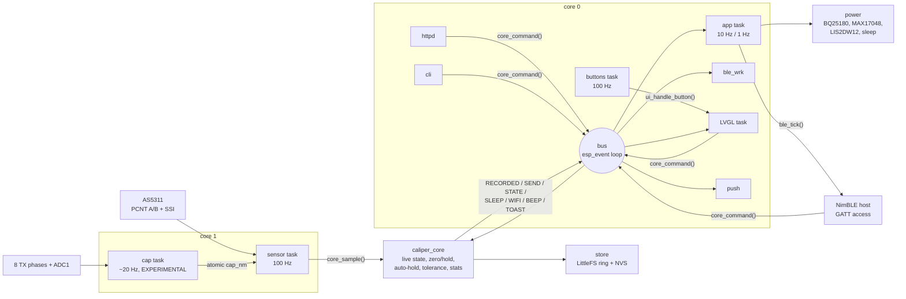
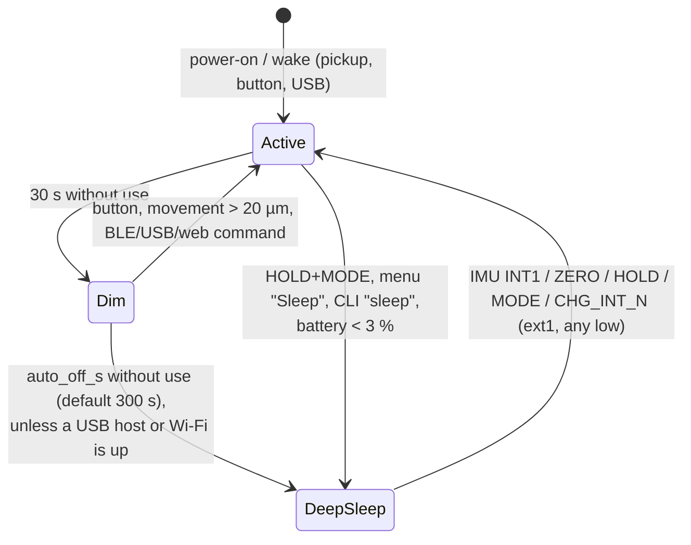

# Firmware

> **Status: written, not built for the target, not run on hardware.** The ESP-IDF project in
> [`caliper/firmware`](../firmware/README.md) is complete in source form, but `idf.py build` has **not**
> been run yet: installing ESP-IDF was blocked in the session that wrote it (§14). The portable core
> (units, rounding, tolerance, statistics, log records, GATT codecs, settings JSON, CSV, button gestures,
> the AS5311 frame logic and the capacitive demodulator) **is** compiled and tested on the host:
> 22 test groups, 649 checks, 0 failures, with AddressSanitizer and UBSan (re-run after the review fixes in
> §14.1). Everything that touches a
> peripheral is unverified. Numbers marked **TVP** are to be verified on the prototype.

The architecture of record is [SPEC](../hardware/design/SPEC.md); the pins come from
[`nets.py`](../hardware/design/nets.py) through a generated header. Where this page and SPEC disagree,
SPEC wins. The companion page that talks to the BLE service is described in [App](app.md).

## 1. Platform and layout

| | |
|---|---|
| SDK | ESP-IDF **v5.4.x** (written against 5.4; any 5.4+ should do), target `esp32s3` |
| Module | ESP32-S3-MINI-1-**N4R2**: 4 MB quad flash, 2 MB quad PSRAM (SPEC §1). An 8 MB (N8R2) overlay exists |
| RTOS | FreeRTOS (dual core), tickless idle, dynamic frequency scaling 40–160 MHz |
| BLE | NimBLE (in IDF), peripheral only, up to 2 connections |
| Display | `esp_lcd` ST7789 driver (in IDF) + `espressif/esp_lvgl_port` 2.x + `lvgl/lvgl` 9.2 |
| USB | `espressif/esp_tinyusb` 1.x: CDC ACM + MSC |
| Storage | `joltwatt/esp_littlefs` for the log and profiles, NVS for settings, FAT + wear levelling for MSC |
| Network | `esp_wifi`, `esp_http_server`, `esp_http_client`, `esp-mqtt` (all in IDF 5.4) |

```
caliper/firmware/
  CMakeLists.txt  sdkconfig.defaults  sdkconfig.defaults.8mb  partitions_4mb.csv  partitions_8mb.csv
  tools/gen_pins.py          nets.py -> main/board_pins.h
  main/                      app_main.c (tasks, wiring), Kconfig.projbuild, idf_component.yml
    board_pins.h             GENERATED, committed
    proto/caliper_gatt.h     the BLE contract (UUIDs, opcodes, layouts, flags)
  components/
    board/                   exposes main/board_pins.h + proto/ to every component; checks pin drift
    measure/                 PORTABLE: measure.c logrec.c gatt_codec.c settings.c csv.c buttons.c hid_keymap.c
    sensor_mag/              AS5311: sensor_mag.c (PCNT, SSI, index) + as5311_proto.c (PORTABLE)
    sensor_cap/              EXPERIMENTAL: sensor_cap.c (bundle drive, ADC) + cap_demod.c (PORTABLE)
    caliper_core/            event bus, live state, commands, settings, profiles, stats
    store/                   LittleFS ring log, profiles file, NVS settings, CSV export
    ui/                      panel + LVGL port, screens, button routing
    ble/                     NimBLE: custom service, BAS/DIS/HID, worker (log stream, typing)
    caliper_wifi/            STA / provisioning AP, HTTP server, MQTT + HTTP POST push
    caliper_usb/             TinyUSB CDC + MSC, CLI
    power/                   BQ25180, MAX17048, LIS2DW12, temperature guard, LEDC, LED, deep sleep
  test/host/                 CMake project: the PORTABLE files + tiny_test.h + test_main.c
```

The components are named `caliper_wifi` / `caliper_usb` rather than `wifi` / `usb` because IDF 5.x already
has a component called `usb` (the PHY and host library that `esp_tinyusb` uses); a project component of the
same name would shadow it.

## 2. Architecture



* **One owner of the state.** `caliper_core` holds the live reading, the zero, hold, unit, active
  profile, statistics, settings and profiles behind one mutex. Readers copy a snapshot
  (`core_get_live()`); writers post a command (`core_command()`), which runs in order on the **bus** task, a
  dedicated `esp_event` loop (queue 32, stack 6 KB, priority 6, core 0). Every front end (buttons, BLE,
  web, CLI) therefore behaves the same way.
* **Events out** of the core go over the same bus: `CAL_EVT_RECORDED` (a `logrec_t`) feeds the BLE log, the
  MQTT/HTTP push and the LED flash; `CAL_EVT_SEND` makes the BLE worker type the reading; `CAL_EVT_SLEEP`,
  `CAL_EVT_WIFI`, `CAL_EVT_BEEP`, `CAL_EVT_TOAST`, `CAL_EVT_STATE`, `CAL_EVT_SETTINGS`, `CAL_EVT_PROFILES`.
* **The capacitive path is isolated.** It has its own task and pins, hands one atomic value to the
  sensor task, and stops itself after 50 bad bursts in a row. A failure only clears `CAP_VALID`.

### 2.1 Tasks

| Task | Core | Prio | Rate | Job |
|---|---|---|---|---|
| `sensor` | 1 | 10 | 100 Hz (`vTaskDelayUntil`) | PCNT count; SSI frame every 10th sample (10 Hz); `core_sample()` |
| `cap` | 1 | 4 | ~20 Hz (6.8 ms burst + 40 ms pause) | EXPERIMENTAL burst, demodulation, unwrap |
| `buttons` | 0 | 7 | 100 Hz | sample 3 GPIOs, `btn_update()`, `ui_handle_button()` |
| `app` | 0 | 3 | 10 Hz | `ble_tick()` (LIVE/battery notify); at 1 Hz: power poll, USB poll, dim, auto-off, low battery |
| `bus` | 0 | 6 | events | commands, events |
| `ble_wrk` | 0 | 5 | jobs | LOG_READ streaming, HID typing |
| `push` | 0 | 3 | jobs | MQTT publish, HTTP POST |
| `cli` | 0 | 3 | lines | USB console commands |
| NimBLE host, LVGL (prio 4), TinyUSB, httpd, mqtt | | | | started by their components |

The sensor and cap tasks share core 1. The cap burst masks interrupts on core 1 for 6.8 ms, which delays
the sensor task by up to one sample; the PCNT keeps counting in hardware meanwhile, so no counts are lost.
The ADC DMA interrupt is allocated from `app_main` on core 0 so the masked core never holds it.

## 3. The pin header

`tools/gen_pins.py` reads `caliper/hardware/design/nets.py` (`GPIO` and `I2C_ADDR`) and writes
[`main/board_pins.h`](../firmware/main/board_pins.h): one `PIN_<NET>` per GPIO, `I2C_ADDR_<DEV>`, the
`PIN_CAP_TX_LIST` initialiser in phase order, and a `BOARD_PINS_HASH` (SHA-256 of nets.py and the
generator). It fails if a net the firmware needs disappears or if GPIO26 (the PSRAM chip select) is used.

* The header is **committed**, so the firmware builds without the hardware tree.
* The `board` component runs `gen_pins.py --check` at CMake configure time; a stale header **stops the
  build** with the command to regenerate it. CMake re-runs the check when nets.py changes.
* It already paid off once: during capture the schematic moved the LIS2DW12 to **0x19** (SA0 high) and
  added the +3V3_UI rail; the check flagged the stale header and the firmware followed (§12).

```sh
python3 caliper/firmware/tools/gen_pins.py           # regenerate
python3 caliper/firmware/tools/gen_pins.py --check   # what the build runs
```

## 4. Magnetic sensing (AS5311)

| Item | Implementation |
|---|---|
| Counting | PCNT unit, two channels (A edge/B level and B edge/A level), **4× decoding**. The AS5311's incremental outputs give **256 A/B pulses = 1024 edges per 2 mm pole pair** (datasheet rev 1.12 §7.1 and Table 8, "RESinc 10 bit, 1.95 µm"); only the SSI word has 4096 steps per pole pair. Limits ±30000 with watch points and `accum_count`, so the driver accumulates overflows into an `int` (150 mm = 76 800 counts) |
| Scale | 2 mm / 1024 = **1953.125 nm/count** = 15625/8 nm, converted in `int64` with symmetric round-half-away (`meas_counts_to_nm`). Displayed resolution 0.01 mm is 5 counts. The 0.488 µm figure in SPEC §1/§4.1 is the SSI step, not the count (reported as a contract issue); the firmware does not interpolate the count with the SSI yet |
| SSI | Bit-banged on MAG_CSN/MAG_CLK/MAG_DO with 1 µs half-periods (≈ 500 kHz; limit 1 MHz). Datasheet Table 10 / Fig. 6: CLK idles **high** and must be high when CSn falls (with CLK low the frame carries the field magnitude instead), ≥ 500 ns CSn high between frames (tCSn), ≥ 500 ns from CSn low to the first CLK falling edge (tCLKFE, which latches the data), then each rising edge shifts out one bit (valid ≤ 413 ns later); DO is sampled 1 µs after each of the 18 rising edges. Frame: D11..D0, OCF, COF, LIN, MagINC, MagDEC, PAR (even parity over bits 1–17) |
| Frame check | Parity even over all 18 bits, OCF = 1, COF = 0 (`as5311_frame_valid`). All-ones (DO stuck high) and all-zeros frames are rejected. 3 bad frames in a row set `SENSOR_ERR` |
| Field check | Datasheet Table 13: MagINC = MagDEC = 1 with LIN = 1 is the RED range (out of spec), readings flagged `SENSOR_ERR`; with LIN = 0 it is YELLOW (≈ 3.4…54.5 mT, slightly reduced accuracy, logged). MagINC or MagDEC alone is a dynamic "distance changing" state. **TVP** at bring-up; the MAG_INC_N / MAG_DEC_N pins are configured as inputs but not used yet |
| Power-up lock | CSn is high at power-up, so A/B/Index stay high until the first CSn low pulse (datasheet §7.1.1). After the first valid frame the driver waits 2 ms for A/B to settle and takes a second frame as the reference, so that unlock transition can't shift the count |
| Slip check | At start the offset between the SSI position and the count's phase (in SSI LSB: count mod 1024 × 4) is locked. Every SSI read compares them, but only when the count did not change during the ≈ 40 µs frame. A residual beyond ±14 LSB (3.5 counts: the incremental outputs have 2 counts of hysteresis on a direction change, §7.2, plus SSI jitter) is corrected to the nearest count, with `SSI_SIGN` applied, and counted |
| Index | MAG_IDX rising edge → IRAM ISR reads the PCNT count; the count's phase at the index must stay within ±16 LSB (4 counts) of the first one (logged) |
| Direction | `CONFIG_CALIPER_MAG_DIR_INVERT` flips the user-facing sign. The firmware assumes the SSI position rises with the PCNT count as wired (`SSI_SIGN`, **TVP**) |
| Power | SNS_PWR_EN high powers +3V3_SNS (and +3V3_UI, §12); 20 ms power-up, then up to 100 ms waiting for OCF |
| Deep sleep | Before sleeping, the count and the in-pole position go to RTC memory and the rail goes off. After waking, `count = stored + round(wrap(ssi_now − ssi_stored) / 4)`: exact to a count if the slider moved less than ±1 mm while asleep. The zero lives in RTC memory too, so a wake keeps the zero. A larger move while asleep is not detectable: the reading is then off by a multiple of 2 mm (documented limitation, SPEC/architecture §3.2) |

## 5. Capacitive sensing (EXPERIMENTAL)

The SPEC asks for a rotating 8-phase square pattern and synchronous I/Q demodulation of ADC1 continuous
samples. Two hardware facts shape the implementation:

1. The ESP32-S3 ADC in continuous mode tops out at about **83 kS/s**, so 8 samples per cycle at the SPEC's
   25–100 kHz is impossible. The firmware steps the pattern every 25 µs (2 samples per step at **80 kS/s**),
   i.e. a **5 kHz** rotation. The charge amplifier (10 pF ‖ 10 MΩ, corner 1.6 kHz) still integrates at
   5 kHz, so the front-end should work there (**TVP**; contract issue reported).
2. The ADC and the drive loop start at an unknown relative delay. Each burst therefore runs the pattern
   **forward for 16 cycles, then in reverse for 16**. The position phase changes sign between the halves and
   the delay phase does not, so `2·θ = φ_reverse − φ_forward`, independent of the delay. The price is a
   **half-pitch ambiguity**: the burst measures the position modulo 2.54 mm.

| Step | Detail |
|---|---|
| Drive | Dedicated-GPIO bundle on CAP_TX0..7; phase *n* high while (n − step) mod 8 < 4. A cycle-counter loop inside a critical section on core 1, with a CPU-max PM lock |
| Sample | `adc_continuous` ADC1_CH0 (CAP_RX, GPIO1), 12 dB attenuation, TYPE2 frames; ~530 samples per burst |
| Demodulate | Single-bin DFT at 16 samples/cycle on a 12-cycle window from each half (2 cycles of margin at every edge), referenced to the absolute sample index, mean removed (`cap_demod_iq`) |
| Position | `frac = wrap((φr − φf) / 2π)` in [0, 1) of the 2.54 mm half pitch; amplitude of each half ≥ 8 LSB and within 2× of the other, else invalid |
| Unwrap | Whole half-pitches are counted from successive fractions, so the slider must move less than **1.27 mm between bursts (~25 mm/s at ~20 bursts/s)**; faster motion corrupts the cap reading's coarse count while the in-pitch fraction stays right. Zeroed with the magnetic reading on ZERO |

The host tests synthesise captures from a coupling model (phase *n* couples `1 + cos(θ − 2πn/8)`), with ±2 LSB
noise and start delays of 0–16 samples: the recovered fraction is delay-independent to 0.003 of a half
pitch and linear in θ. That proves the arithmetic, not the electrode physics. The sign (`CAP_SIGN`), the
constant phase offset (taken out by zeroing) and the ADC's actual sample rate (a rate error adds a constant
offset, also zeroed) are **TVP**.

## 6. Measurement core (`components/measure`, portable)

| Function | Rule | Tested |
|---|---|---|
| Rounding | Integer nm; halves round **away from zero**, symmetric for negative values; a value that rounds to zero prints `0.00`, never `-0.00` | ±5000 nm at 0.01 mm, carries (999.995 → 1000.00) |
| mm display | `decimals` (settings) = 1–3 digits; default 2 → step 10 µm | |
| Inch display | `decimals + 2` digits; at the default 4 digits the step is **0.0005 in = 12 700 nm**, so the last digit is always 0 or 5 | 0.0005 / 0.00075 / 150 mm = 5.9055 in |
| Zero / hold | Zero stores the raw position; hold freezes the shown value; zeroing while held shows 0 | |
| Auto-hold | Fires once when the reading has moved > 0.5 mm since the last hold and then stays within ±5 µm for 0.8 s; an automatic hold releases itself when the jaws move > 0.5 mm away; a manual hold stays | power-up stillness does not fire; re-arm |
| Tolerance | Band = `nominal − |tol_minus| … nominal + |tol_plus|`, **inclusive**, decided on the **displayed (rounded)** value. Green inside the inner 80 % of each half, amber in the outer 20 % (still a pass), red outside. Gauge −1000 at the lower limit, +1000 at the upper, clamped ±1500 | limits ±1 nm, one-sided, negative nominal, sign of tol_minus ignored |
| Statistics | Welford over the **recorded** readings: n, min, max, mean, sample σ (n − 1) | vs a two-pass long-double computation on 5000 values at 150 mm (σ to 1e-9 relative) |
| Log record | 16 bytes LE `{u32 seq, u32 unix_s, i32 value_nm, u8 unit, u8 flags, u16 profile_id}` | byte-exact pack, round trip, end marker |
| Ring log | seq *s* lives in slot (s − 1) mod capacity; seq numbers never restart (a clear moves `base_seq`), so incremental sync never sees a reused number | wraparound, clear, restore after reboot, bijection over 12 345 appends |

## 7. Display and buttons

240 × 135 landscape, SPI2 at 40 MHz, colour inversion on (IPS), RAM offset 40/53 (**TVP**: the 1.14 in
modules use 40/52 or 40/53 depending on rotation). LVGL draws into two 240 × 30 DMA buffers.

| Screen | Content |
|---|---|
| MAIN | Reading in Montserrat 48, unit, HOLD / auto, status icons (BLE, Wi-Fi or AP, USB, battery or charging, %), the capacitive reading in small type when valid, profile name + GO / GO (edge) / NO GO, and a symmetrical gauge bar (green/amber/red) with white ticks at the limits |
| CHART | The last 100 live values at 10 Hz (10 s), auto-scaled with a minimum ±10 µm span, plus min..max |
| STATS | n, mean, σ (one extra digit), min, max, range of the recorded readings |
| MENU | Unit, profile, auto-hold, Wi-Fi on/off, Wi-Fi setup (AP), reset stats, clear log (long press), sleep, about |
| Wi-Fi setup | Overlay with the AP name, its password and `http://192.168.4.1` while the provisioning AP runs |

Buttons (100 k pull-ups + 100 nF on the board; 20 ms firmware debounce; `components/measure/buttons.c`):

| Gesture | Outside the menu | In the menu |
|---|---|---|
| ZERO short / long (0.8 s) | zero / mm ↔ inch | up |
| HOLD short / long | hold on/off / **SEND** (record + type over BLE HID) | select / select (destructive items need long) |
| MODE short / long | next screen / next tolerance profile | down / leave the menu |
| ZERO + MODE 1.5 s | Wi-Fi setup AP on/off | |
| ZERO + HOLD 1.5 s | reset statistics | |
| HOLD + MODE 1.5 s | sleep now | |

The backlight (LEDC 20 kHz, duty ∝ brightness²) runs at 70 % and dims to 10 % after 30 s without use; the
piezo beeps 15 ms on a record and 30 ms on an auto-hold (LEDC 4 kHz, the BZ50 resonance); the RGB LED flashes
green / red / white for 150 ms on a pass / fail / plain record.

## 8. BLE

### 8.1 GATT contract

Defined once in [`main/proto/caliper_gatt.h`](../firmware/main/proto/caliper_gatt.h); the byte layouts are
encoded by `components/measure/gatt_codec.c` and tested on the host. All integers little-endian. The custom
UUIDs share the base `7c0a0001-5e1f-4b8a-9c3d-2f6a1e0c7b11` with the second 16-bit group changed.

| UUID | Name | Properties | Payload |
|---|---|---|---|
| `7c0a0001-…` | service | primary | |
| `7c0a0002-…` | LIVE | read, notify | 10 B: `i32 value_nm` (magnetic, zeroed; the held value while holding), `i32 cap_nm` (zeroed; `INT32_MIN` if invalid), `u8 unit` (0 mm, 1 in), `u8 flags` |
| `7c0a0003-…` | COMMAND | write | `u8 opcode` + payload (table below) |
| `7c0a0004-…` | LOG | notify | after LOG_READ: notifications of 1..N packed 16-byte records, then **one notification holding only the end record** (`seq = 0xFFFFFFFF`, rest zero) |
| `7c0a0005-…` | SETTINGS | read, write (**write needs encryption**) | UTF-8 JSON ≤ 240 B; keys `name`, `wifi_ssid`, `wifi_pass` (write-only), `mqtt_url`, `http_post_url`, `auto_off_s`, `hid_suffix`, `decimals` |
| `7c0a0006-…` | PROFILES | read, write | read: every profile, 30 B each (≤ 16 → 480 B); write: one or more records `{u16 id, i32 nominal_nm, i32 tol_minus_nm, i32 tol_plus_nm, char name[16]}` |

LIVE flags (the log record's `flags` use the same bits): bit0 HOLD, bit1 TOL_PASS (green or amber), bit2
TOL_FAIL, bit3 SENSOR_ERR, bit4 CAP_VALID, bit5 CHARGING. A record stores HOLD/PASS/FAIL/SENSOR_ERR only.

| Opcode | Command | Length (incl. opcode) | Action |
|---|---|---|---|
| `0x01` | ZERO | 1 | zero magnetic and capacitive |
| `0x02` | HOLD_TOGGLE | 1 | |
| `0x03` | RECORD_NOW | 1 | store the shown value (refused with a toast while SENSOR_ERR) |
| `0x04` | SET_UNIT | 2 | `u8` 0 mm / 1 in |
| `0x10` | LOG_READ | 5 | `u32 from_seq`: stream every stored record with seq ≥ from_seq (0 = from the oldest). Ignored unless this connection subscribed to LOG |
| `0x11` | LOG_CLEAR | 1 | numbering continues after a clear |
| `0x20` | SELECT_PROFILE | 3 | `u16 id`, 0 = none |
| `0x30` | SET_TIME | 5 | `u32` Unix seconds (`settimeofday`) |

Write errors: wrong length → ATT `0x0D` (invalid attribute value length); unknown opcode → `0x06` (request not
supported); bad value (e.g. unit 2, a rejected setting, a full profile table) → `0x80` (application error);
SETTINGS whose JSON would exceed 240 B → `0x0D`.

Where the contract was silent, the firmware decided (the [App](app.md) page implements the same):

* **Tolerance signs:** `tol_minus_nm` and `tol_plus_nm` are magnitudes; the sign is ignored. A one-sided
  band (e.g. −0.05/+0) works; a band that lies wholly above or below nominal cannot be expressed.
* **Profile writes** are upserts by id. A record with an empty name and nominal = tol− = tol+ = 0 **deletes**
  that id. id 0 is invalid. At most 16 profiles.
* **SETTINGS writes** merge the keys present, all-or-nothing: one bad value rejects the whole write. Limits:
  name 20, SSID 32, password 0 or 8–64, URLs 64 (`mqtt://`, `mqtts://`, `ws://`, `wss://` / `http://`,
  `https://`), `auto_off_s` 0 or 30–3600, `decimals` 1–3, `hid_suffix` `"\n"`, `"\t"` or `""`. Integers only
  for numbers; unknown keys are ignored; nested values are rejected. The read form never contains `wifi_pass`.
* **Notifications:** LIVE at up to 10 Hz when it changes and at least once a second; LOG packs
  ⌊(MTU − 3) / 16⌋ records per notification (15 at the preferred MTU of 247, 1 at the default 23).

### 8.2 Standard services, advertising, security

* **Battery 0x180F**: Battery Level (read, notify) from the MAX17048.
* **Device Information 0x180A**: manufacturer "PrettyCool", model "Caliper rev A", firmware revision (the app
  version) and a PnP ID (USB VID source, Espressif VID 0x303A, product 0x4001 as a **placeholder**).
* **HID over GATT 0x1812**: keyboard, report ID 1, 8-byte input report and a 1-byte LED output report;
  protocol mode, report map, HID information and control point. All HID attributes require encryption.
  SEND types the formatted reading plus `hid_suffix` as press/release pairs, 12 ms apart (**TVP** per host),
  to every bonded, subscribed host.
* Implemented in `components/ble/ble_std.c` rather than with NimBLE's helper services, so the report map and
  layout are in our hands (`CONFIG_BT_NIMBLE_HID_SERVICE=n`).
* **Advertising** (100–150 ms): flags, appearance 0x03C1 (keyboard), the 0x1812 UUID and the name (up to 18
  characters, from settings `name`); the scan response carries the custom 128-bit service UUID.
* **Security:** LE Secure Connections, Just Works (no display/keyboard for a passkey), bonding with the keys in
  NVS (`CONFIG_BT_NIMBLE_NVS_PERSIST`), up to 6 bonds. A peer that lost its bond is re-paired. The custom
  service is open except the SETTINGS write, which carries the Wi-Fi password; the browser's pairing prompt
  appears on the first settings write.

## 9. Wi-Fi

Off by default (it costs ~100 mA); turned on from the menu, the CLI or the ZERO + MODE combo.

* **Station** with `wifi_ssid` / `wifi_pass` from settings (credentials stored by us in NVS; the Wi-Fi driver
  keeps none). After 5 failed attempts, or with no SSID, it falls back to the **provisioning AP**.
* **Provisioning AP:** `Caliper-XXXX` (the last two MAC bytes), WPA2 with a random 8-digit password shown on
  the display, channel 6, at most 2 clients, `http://192.168.4.1`. Saving new credentials in the form switches
  to the station 1.5 s after the reply.
* **Auto-off is suspended** while Wi-Fi is on.

| Method | Path | Returns / does |
|---|---|---|
| GET | `/` | live page: the reading polled from `/api/live` at 4 Hz, buttons for zero / hold / record / unit |
| GET | `/api/live` | `{"value_nm","text","unit","flags","cap_nm","tol","profile","battery"}` |
| POST | `/api/cmd?c=zero\|hold\|record\|send\|unit` | runs the command |
| GET | `/log` | log table page (200 rows per fetch, "more") |
| GET | `/api/log?from=S&n=N` | JSON array of records from seq S, N ≤ 200 |
| GET | `/log.csv` | the whole log as CSV (`seq,unix_s,utc,value,unit,flags,profile`), chunked |
| GET | `/settings` | settings form (password field blank = keep) |
| GET | `/api/settings` | the SETTINGS JSON (no password) |
| POST | `/settings` | form-urlencoded; applies each key with the same validation as BLE; 303 back with `saved` or `err` |

**Push** (station only), for every recorded reading: MQTT QoS 1 to `caliper/<name>/reading` when `mqtt_url`
is set, and an HTTP POST to `http_post_url`, both with the body
`{"seq","unix_s","value_nm","value","unit","flags","profile_id"}`. The web server has no authentication: it
is meant for a trusted shop network or the WPA2 provisioning AP.

## 10. USB

TinyUSB owns the native USB PHY (`CONFIG_CALIPER_USB_TINYUSB=y`), as a composite device:

* **CDC ACM:** the console (logs are redirected to it with `esp_tusb_init_console`) and a line CLI:
  `read`, `status`, `zero`, `hold`, `rec`, `send`, `unit mm|in`, `log [from] [n]`, `csv`, `clear yes`, `get`,
  `set <key> <value>`, `profiles`, `profile <id>`, `time <unix_s>`, `wifi on|off|ap`, `export`, `sleep`,
  `reboot`, `bootloader`.
* **MSC:** the 192 KB `msc` FAT partition (wear-levelled) holding **LOG.CSV**, regenerated from the log each
  time a host enumerates the caliper (and on `export`; the host sees the medium change). It is a copy: edits
  made on the PC are overwritten at the next export. A full 4096-record log is ~130 KB of CSV
  (`seq,unix_s,value,unit,flags,profile`, without the ISO time column to fit).
* **Charge current:** 100 mA input limit until a host configures the device, 500 mA after; VBUS for 3 s without
  enumeration is treated as a dedicated charger (500 mA).
* **Flashing:** with TinyUSB running, esptool cannot reset the chip into download mode over
  USB-Serial-JTAG. Use the CLI `bootloader` command (forces ROM download mode on the next reset) or hold BOOT
  while plugging in / resetting. For firmware development set `CONFIG_CALIPER_USB_TINYUSB=n`: the console
  and the CLI then use USB-Serial-JTAG, and `idf.py flash monitor` works as usual (no MSC).
* Early boot logs go to USB-Serial-JTAG until TinyUSB takes the PHY. UART0's pins are capacitive TX phases,
  so there is no UART console.

## 11. Storage

| Partition (4 MB) | Offset | Size | Use |
|---|---|---|---|
| nvs | 0x9000 | 24 KB | settings JSON + wifi_pass, unit/profile/auto-hold, BLE bonds, PHY cal |
| otadata | 0xF000 | 8 KB | OTA slot selection (rollback enabled) |
| phy_init | 0x11000 | 4 KB | |
| ota_0 / ota_1 | 0x20000 / 0x1D0000 | 1728 KB each | application (two slots; no OTA transport is implemented yet) |
| storage | 0x380000 | 320 KB | LittleFS: `log.bin`, `profiles.bin` |
| msc | 0x3D0000 | 192 KB | FAT for LOG.CSV |

The 8 MB overlay (`sdkconfig.defaults.8mb`, `partitions_8mb.csv`) has 2.5 MB app slots, 1 MB LittleFS, 1.9 MB
MSC and a 16 384-record log.

`log.bin` is a 16-byte header (`"CLG1"`, version, record size, capacity, base_seq) followed by
`CONFIG_CALIPER_LOG_CAPACITY` (4096) slots of 16 bytes: 64 KB. An append writes one slot and `fsync`s.
At boot the slots are scanned (64 KB) for the newest valid seq ≥ base_seq whose slot matches; a clear only
rewrites the header. A capacity change starts a fresh file but keeps the numbering. `profiles.bin` is the
30-byte GATT records back to back, replaced atomically (write `.tmp`, rename).

## 12. Power

### 12.1 BQ25180 register table

The dial-me-spinner table (its `docs/firmware.md` §13.1), changed for
this board's 250 mA charge current (SPEC §1). Written in this order at boot and again whenever IC_CTRL reads
back wrong (a BQ reset), checked at 1 Hz.

| Order | Register | Value | Setting |
|---|---|---|---|
| 1 | IC_CTRL 0x07 | **0x97** | TS_EN, VLOWV 3.0 V, VRCH 100 mV, 2× timer, 6 h, **watchdog off** (first transaction: the watchdog starts with it) |
| 2 | VBAT_CTRL 0x03 | 0x46 | 4.20 V |
| 3 | ICHG_CTRL 0x04 | **0x34** | ICHG = 40 + (52 − 31) × 10 = **250 mA** (`CONFIG_CALIPER_CHARGE_MA`); bit 7 CHG_DIS from the guards |
| 4 | CHARGECTRL0 0x05 | 0x20 | IPRECHG 2 × ITERM, ITERM 10 %, VINDPM 4.2 V, TREG 100 °C |
| 5 | CHARGECTRL1 0x06 | 0x92 | BATOCP 1.5 A, BUVLO 3.0 V, CHG_STATUS int on, ILIM int masked |
| 6 | TMR_ILIM 0x08 | 0xC9 → 0xCD | 100 mA until USB is configured (or 3 s of VBUS with no host), then 500 mA |
| 7 | SHIP_RST 0x09 | **0x08** | **EN_PUSH = 0** (dial-me-spinner has a button on TS/MR and writes 0x09; rev A has only the NTC there). The push-button scan costs 1 µA on battery: SLUSE99C IQ_BAT is 3 µA with it disabled, 4 µA enabled, and SPEC §3 budgets 3 µA. Long press = reset, WAKE1 300 ms, WAKE2 2 s (unused) |
| 8 | SYS_REG 0x0A | 0x20 | SYS 4.4 V on USB (the buck-boost takes anything from 1.3 V) |
| 9 | TS_CONTROL 0x0B | 0x90 | HOT 50 °C, COLD 3 °C (dial-me-spinner's JEITA margins) |
| 10 | read STAT0..FLAG0 | | clears the flags |

* Rev A has a 10 k NTC (RT1) on TS/MR next to the battery connector ([Schematics](electronics.md)), so TS
  monitoring is on. `CONFIG_CALIPER_CHG_TS_ENABLE=n` writes IC_CTRL 0x17 for a board without it.
* **TS open** (STAT0 bit 7) disables charging, as dial-me-spinner requires.
* **Die-temperature guard:** charging is also disabled while the ESP32-S3 die reads below 2 °C or above 55 °C
  (3 °C hysteresis). The die runs warmer than the cell; the limits are a backstop (**TVP**).
* Storage mode (`power_ship_mode`) writes SHIP_RST **0x28**: EN_RST_SHIP = 01, the BQ25180's *shutdown*
  mode with wake on adapter insert only (15 nA, SLUSE99C IBAT_SHUTDOWN). TS/MR has no button on rev A, so the
  button-wake ship mode (10, 3.2 µA IBAT_SHIP for its push-button scan) would buy nothing. Not wired to the UI;
  only plugging in USB leaves it.

### 12.2 Fuel gauge and IMU

* **MAX17048** (0x36): VCELL × 78.125 µV, SOC high byte = %. Default configuration (RCOMP 0x97, automatic
  hibernate), except **VRESET.Dis = 1** (bit 0 of the 0x18 MSB, read-modify-write of the 16-bit register) so
  the reset comparator is off in hibernate: SPEC §3 counts 3 µA for the gauge, which needs it. Below 3 % without VBUS the caliper shows "Battery empty" and sleeps.
* **LIS2DW12 (0x19)**: WHO_AM_I 0x44; 12.5 Hz low-power mode 1, ±2 g; wake-up threshold 2 × 31.25 mg =
  62.5 mg, duration 0; wake-up routed to INT1, **latched, active low, push-pull** (CTRL3 = 0x18), interrupts
  enabled. The latch is cleared right before sleeping. Active low because ext1 on the S3 needs one level for
  all wake pins and the buttons are active low.

### 12.3 Power states



* **Active:** +3V3_SNS and +3V3_UI on (one switch line, SNS_PWR_EN), sensor at 100 Hz, display at 70 %.
  A `NO_LIGHT_SLEEP` PM lock is held the whole time: light sleep would gate the PCNT clock and lose counts.
  DFS (40–160 MHz) and tickless idle still run. Light sleep is configured for a future standby state.
* **Going to sleep:** Wi-Fi off, panel off, LCD and RGB lines driven low (they feed +3V3_UI), cap phases low,
  AS5311 position saved and SNS_PWR_EN low (both switched rails off), backlight / piezo / rail / MAG / LCD /
  LED pads held low, ext1 armed on IMU_INT1, the three buttons and CHG_INT_N (all external pull-ups or
  push-pull, so no RTC pull-ups and RTC peripherals can power down). It waits up to 3 s for buttons to be
  released first.
* **Waking:** the holds are released first thing in `app_main`; the count is recovered from the AS5311 pole
  position (§4); the zero survives in RTC memory.

### 12.4 Sleep budget

Datasheet typicals as collected in [Architecture §5](architecture.md); firmware's share is to switch things
off.

| Block | Deep sleep | What the firmware does |
|---|---|---|
| ESP32-S3 | ~7–8 µA | deep sleep, RTC memory on (count, zero), RTC peripherals off |
| TPS63802 + divider | 16.5 µA | nothing it can do |
| BQ25180 | ~3 µA | battery-only |
| MAX17048 | ~3 µA | automatic hibernate |
| LIS2DW12 | ~1 µA | 12.5 Hz low-power wake-up mode |
| TPS22917 × 2 (off) | ~1 µA | SNS_PWR_EN held low |
| AS5311, AFE, ST7789, WS2812 | 0 | on the switched rails, lines held low |
| **Total** | **≈ 32–33 µA** | within the revised SPEC target of ≤ 35 µA; not measured |

## 13. Build, flash, test

```sh
# once (WSL / Linux)
git clone --recursive -b v5.4.2 --depth 1 https://github.com/espressif/esp-idf.git ~/esp/esp-idf
~/esp/esp-idf/install.sh esp32s3
. ~/esp/esp-idf/export.sh

cd caliper/firmware
idf.py set-target esp32s3
idf.py build                       # 4 MB / N4R2 (default)
idf.py -D SDKCONFIG_DEFAULTS="sdkconfig.defaults;sdkconfig.defaults.8mb" set-target esp32s3 build   # N8R2

# first flash, or with CONFIG_CALIPER_USB_TINYUSB=n: USB-Serial-JTAG
idf.py -p /dev/ttyACM0 flash monitor
# with TinyUSB running: CLI "bootloader" (or hold BOOT), then flash
```

In WSL the USB port has to be attached with `usbipd` first. The managed components (LVGL, esp_lvgl_port,
esp_tinyusb, esp_littlefs, led_strip) are fetched on the first build.

Host tests (no ESP-IDF needed; nothing is downloaded):

```sh
cmake -S caliper/firmware/test/host -B build-host -G Ninja
cmake --build build-host && ./build-host/caliper_tests      # or: ctest --test-dir build-host
```

They build with `-Wall -Wextra -Werror -Wshadow -Wconversion` and AddressSanitizer + UBSan. Result in this
session (WSL Ubuntu 24.04, gcc 13, re-run after the review fixes): **22 groups PASS, 649 checks, 0 failures.**
Covered: count → nm (1953.125 nm/count) and its
symmetry, mm and inch rounding edges (halves, −0, carries, ±150 mm, the 0.0005 in step), zero/hold, auto-hold
timing and re-arm, tolerance limits ±1 nm (one-sided, negative nominal, sign of tol_minus, rounding before the
check), Welford vs two-pass, log record bytes and round trip, ring wraparound / clear / restore, LIVE bytes,
UUID bytes, every opcode and length error, profile records (16-char names, delete), settings JSON (escapes,
`é`, write-only password, all-or-nothing rejection of 16 bad inputs, the 240 B limit, round trip),
URL decoding, CSV lines and the UTC calendar (1970, 2000-02-29, 2106), button gestures (bounce, long, combos,
quick two-button taps), HID key map, AS5311 frame decode / parity (every single-bit error) / field states /
slip residual in SSI LSB and the count correction for ±7 missed edges in both directions / sleep recovery
rounded to a count, capacitive pattern, demodulation vs delay and position, unwrap.

## 14. What is not verified

* **The target build.** `idf.py build` was not run: the ESP-IDF clone/install was refused by the session's
  permission policy (downloading external code), so no binary exists and no binary size is known. The IDF code
  was written against the v5.4 APIs from memory and cross-checked for internal consistency only. The likeliest
  first-build fixes: `esp_lvgl_port` 2.x display-config field names, `esp_tinyusb` 1.x MSC config
  (`mount_config`), the S3 ADC `type2` result fields, and NimBLE helper names. Whether the app fits the 1.69 MB
  slot of the 4 MB layout is unknown (LVGL + NimBLE + Wi-Fi + TinyUSB; the 8 MB layout has 2.5 MB slots).
* **Nothing has run on hardware.** In particular (**TVP**): the AS5311 SSI timing, the direction of SSI vs
  count (`SSI_SIGN`), the MagINC/MagDEC interpretation, the index phase stability, the ST7789 RAM offsets and
  mirror flags, the backlight curve, the piezo level, the WS2812 colour order, the IMU wake threshold, the
  BQ25180 ILIM strategy against real hosts, the die-temperature limits, HID typing speed per host, MSC
  behaviour on Windows/macOS, the ROM bootloader entry from the CLI, and the deep-sleep current.
* **The capacitive scale** is unproven end to end: front-end gain at 5 kHz, the ADC's true sample rate, the
  half-pitch ambiguity, the 25 mm/s tracking limit, electrode crosstalk.
* **Not implemented:** OTA updates (the partitions are ready), IMU orientation (display flip), an automatic
  re-zero warning after a move > 1 mm while asleep, battery-temperature derating beyond the guards, USB
  suspend handling (the 2.5 mA suspend budget), Wi-Fi/HTTP authentication, a "standby" light-sleep state,
  sub-count interpolation of the reading from the SSI word (it would restore the 0.488 µm SPEC figure and
  remove the 2-count direction hysteresis while still).
* **Known gap:** if the sensor can't save its position before a deep sleep (no valid SSI frame), the wake
  starts a new count origin but the zero kept in RTC memory is still applied, so the reading is offset until
  ZERO is pressed.

### 14.1 Review fixes (2026-11-07)

A review against the datasheets changed the following; the host tests above were re-run afterwards. The
target build is still not run (the ESP-IDF install was refused again).

* **AS5311 count scale was 4× off.** The firmware assumed 4096 quadrature counts per 2 mm pole pair
  (488 nm/count). The incremental outputs have 256 pulses per channel = 1024 edges per pole pair
  (datasheet §7.1, Table 8), so every displayed length would have read **a quarter of the true value**.
  Now 1953.125 nm/count; the slip tracker, the index check and the sleep recovery convert between counts
  and SSI LSB (4 per count). The slip correction also used the wrong direction (`dir = 1` instead of
  `SSI_SIGN`), which would have "corrected" every reading once `SSI_SIGN` was flipped at bring-up.
* **AS5311 power-up lock:** the reference frame and count are now taken 2 ms after the first CSn low pulse,
  when A/B have left their "all high" power-up state; the SSI routine now also asserts CLK high and the
  tCSn gap itself instead of relying on the caller.
* **BQ25180 SHIP_RST** 0x09 → **0x08** (EN_PUSH off, 1 µA) and the storage write 0x49 → **0x28**
  (shutdown, adapter wake only); see §12.1.
* **MAX17048 VRESET.Dis** is now set (§12.2).

## 15. References

* [SPEC](../hardware/design/SPEC.md), [Architecture](architecture.md), [Schematics and boards](electronics.md), [App](app.md)
* Espressif, ESP-IDF v5.4 Programming Guide: PCNT, dedicated GPIO, ADC continuous mode (S3 limit
  `SOC_ADC_SAMPLE_FREQ_THRES_HIGH` ≈ 83.3 kHz), sleep modes, power management, NimBLE, esp_lcd
* ams, AS5311 datasheet rev 1.12 (checked in review) / 1.13: Table 8 (RESinc 10 bit = 1.95 µm), §7.1 (256 A/B
  pulses = 1024 edges per 2 mm pole pair; power-up lock), §7.2 (2-count hysteresis), §7.3 + Table 10 (SSI
  frame and timing), Tables 12–13 (status bits, red/yellow/green)
* TI SLUSE99C (BQ25180) register map; dial-me-spinner `docs/firmware.md` §13 (init table, faults, ILIM)
* Maxim/ADI 19-6171 (MAX17048 registers); ST DS11811 (LIS2DW12 registers)
* Bluetooth SIG: HID over GATT Profile 1.0, Battery Service, Device Information Service
