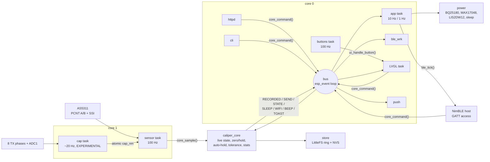
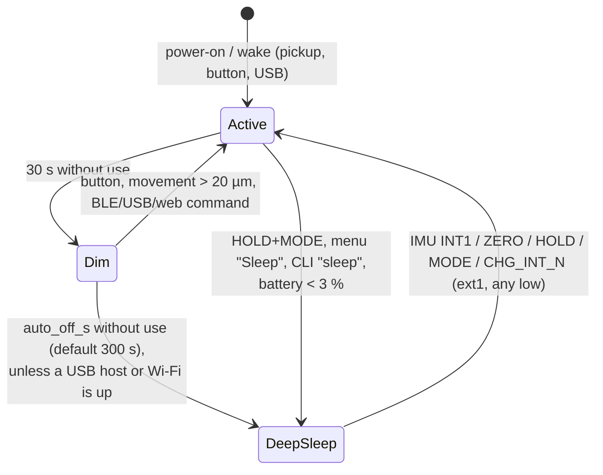

# Firmware

> **Status: builds for the target, not run on hardware.** The ESP-IDF project in
> [`caliper/firmware`](../firmware/README.md) **builds with `idf.py build` on ESP-IDF v5.4.2** for the
> esp32s3 (4 MB / N4R2 layout, clean build, **0 warnings**). The image is **1 660 592 B and fits the
> 1 728 KB app slot with 108 880 B (6 %) to spare** (§13). No binary has been flashed: nothing has run on a
> chip. The portable core (units, rounding, tolerance, statistics, log records, GATT codecs, settings JSON,
> CSV, button gestures, the AS5311 frame logic, the SSI fine interpolation and the capacitive demodulator)
> is compiled and tested on the host: **25 test groups, 792 checks, 0 failures**, with `-Werror`,
> AddressSanitizer and UBSan, and also compiled as strict ISO C11; the reading-log store (`store.c`) has its
> own host test against stubbed LittleFS/NVS (**3 groups, 2589 checks, 0 failures**). Everything that
> touches a peripheral is unverified. Numbers marked **TVP** are to be verified on the prototype. The
> adversarial review of the capacitive, UI, storage, Wi-Fi and USB modules and the SSI interpolation
> (§14.1) found and fixed 20 defects; none of the fixes has run on a chip either.

The architecture of record is [SPEC](../hardware/design/SPEC.md); the pins come from
[`nets.py`](../hardware/design/nets.py) through a generated header. Where this page and SPEC disagree,
SPEC wins. The companion page that talks to the BLE service is described in [App](app.md).

## 1. Platform and layout

| | |
|---|---|
| SDK | ESP-IDF **v5.4.2** (built with it), target `esp32s3` |
| Module | ESP32-S3-MINI-1-**N4R2**: 4 MB quad flash, 2 MB quad PSRAM (SPEC §1). An 8 MB (N8R2) overlay exists |
| RTOS | FreeRTOS (dual core), tickless idle, dynamic frequency scaling 40–160 MHz |
| BLE | NimBLE (in IDF), peripheral only, up to 2 connections |
| Display | `esp_lcd` ST7789 driver (in IDF) + `espressif/esp_lvgl_port` **2.7.2** + `lvgl/lvgl` **9.2.2**. The port is pinned to `~2.7.2`: 2.8.0 and later use `LV_COLOR_FORMAT_RGB565_SWAPPED`, which LVGL 9.2 does not have |
| USB | `espressif/esp_tinyusb` **1.7.6** (with `espressif/tinyusb` 0.21.0): CDC ACM + MSC |
| Storage | `joltwallet/littlefs` **1.23.1** for the log and profiles, NVS for settings, FAT + wear levelling for MSC |
| Lock file | `caliper/firmware/dependencies.lock` (committed) pins the managed components above; `led_strip` 2.5.5 |
| Network | `esp_wifi`, `esp_http_server`, `esp_http_client`, `esp-mqtt` (all in IDF 5.4) |

```
caliper/firmware/
  CMakeLists.txt  sdkconfig.defaults  sdkconfig.defaults.8mb  partitions_4mb.csv  partitions_8mb.csv
  tools/gen_pins.py          nets.py -> main/board_pins.h
  main/                      app_main.c (tasks, wiring), Kconfig.projbuild, idf_component.yml
    board_pins.h             GENERATED, committed
    proto/caliper_gatt.h     the BLE contract (UUIDs, opcodes, layouts, flags)
  components/
    board/                   exposes main/board_pins.h + proto/ to every component; checks pin drift
    measure/                 PORTABLE: measure.c logrec.c gatt_codec.c settings.c csv.c buttons.c hid_keymap.c
    sensor_mag/              AS5311: sensor_mag.c (PCNT, SSI, index) + as5311_proto.c (PORTABLE)
    sensor_cap/              EXPERIMENTAL: sensor_cap.c (bundle drive, ADC) + cap_demod.c (PORTABLE)
    caliper_core/            event bus, live state, commands, settings, profiles, stats
    store/                   LittleFS ring log, profiles file, NVS settings, CSV export
    ui/                      panel + LVGL port, screens, button routing
    ble/                     NimBLE: custom service, BAS/DIS/HID, worker (log stream, typing)
    caliper_wifi/            STA / provisioning AP, HTTP server, MQTT + HTTP POST push
    caliper_usb/             TinyUSB CDC + MSC, CLI
    power/                   BQ25180, MAX17048, LIS2DW12, temperature guard, LEDC, LED, deep sleep
  test/host/                 CMake project: the PORTABLE files + tiny_test.h + test_main.c
```

The components are named `caliper_wifi` / `caliper_usb` rather than `wifi` / `usb` because IDF 5.x already
has a component called `usb` (the PHY and host library that `esp_tinyusb` uses); a project component of the
same name would shadow it.

## 2. Architecture



* **One owner of the state.** `caliper_core` holds the live reading, the zero, hold, unit, active
  profile, statistics, settings and profiles behind one mutex. Readers copy a snapshot
  (`core_get_live()`); writers post a command (`core_command()`), which runs in order on the **bus** task, a
  dedicated `esp_event` loop (queue 32, stack 6 KB, priority 6, core 0). Every front end (buttons, BLE,
  web, CLI) therefore behaves the same way.
* **Events out** of the core go over the same bus: `CAL_EVT_RECORDED` (a `logrec_t`) feeds the BLE log, the
  MQTT/HTTP push and the LED flash; `CAL_EVT_SEND` makes the BLE worker type the reading; `CAL_EVT_SLEEP`,
  `CAL_EVT_WIFI`, `CAL_EVT_BEEP`, `CAL_EVT_TOAST`, `CAL_EVT_STATE`, `CAL_EVT_SETTINGS`, `CAL_EVT_PROFILES`.
* **The capacitive path is isolated.** It has its own task and pins, hands one atomic value to the
  sensor task, and stops itself after 50 bad bursts in a row. A failure only clears `CAP_VALID`.

### 2.1 Tasks

| Task | Core | Prio | Rate | Job |
|---|---|---|---|---|
| `sensor` | 1 | 10 | 100 Hz (`vTaskDelayUntil`) | PCNT count and an SSI frame (≈ 40 µs) on every sample, fine position, `core_sample()` |
| `cap` | 1 | 4 | ~20 Hz (6.8 ms burst + 40 ms pause) | EXPERIMENTAL burst, demodulation, unwrap |
| `buttons` | 0 | 7 | 100 Hz | sample 3 GPIOs, `btn_update()`, `ui_handle_button()` |
| `app` | 0 | 3 | 10 Hz | `ble_tick()` (LIVE/battery notify); at 1 Hz: power poll, USB poll, dim, auto-off, low battery |
| `bus` | 0 | 6 | events | commands, events |
| `ble_wrk` | 0 | 5 | jobs | LOG_READ streaming, HID typing |
| `push` | 0 | 3 | jobs | MQTT publish, HTTP POST |
| `cli` | 0 | 3 | lines | USB console commands |
| LVGL (`esp_lvgl_port`) | 0 | 4 | 33 ms refresh | rendering; pinned to core 0 (the port's default is no affinity) |
| TinyUSB | 0 | 5 | events | CDC/MSC; `CONFIG_TINYUSB_TASK_AFFINITY_CPU0` (esp_tinyusb defaults to CPU1) |
| NimBLE host, httpd, mqtt | 0 | | | started by their components |

Core 1 holds only the sensor and cap tasks. The cap burst masks interrupts on core 1 for 6.8 ms, which
delays the sensor task by up to one sample; the PCNT keeps counting in hardware meanwhile, so no counts are
lost. The ADC DMA interrupt is allocated from `app_main` on core 0 so the masked core never holds it, and it
is IRAM-safe (`CONFIG_ADC_CONTINUOUS_ISR_IRAM_SAFE`) so a flash write on core 0 cannot hold it off (§5).

## 3. The pin header

`tools/gen_pins.py` reads `caliper/hardware/design/nets.py` (`GPIO` and `I2C_ADDR`) and writes
[`main/board_pins.h`](../firmware/main/board_pins.h): one `PIN_<NET>` per GPIO, `I2C_ADDR_<DEV>`, the
`PIN_CAP_TX_LIST` initialiser in phase order, `BOARD_PINS_ALL` / `BOARD_PINS_COUNT` (every GPIO, for the
pin-plan test, §12.5), and a `BOARD_PINS_HASH` (SHA-256 of nets.py and the generator). It fails if a net the firmware needs disappears or if GPIO26 (the PSRAM chip select) is used.

* The header is **committed**, so the firmware builds without the hardware tree.
* The `board` component runs `gen_pins.py --check` at CMake configure time; a stale header **stops the
  build** with the command to regenerate it. CMake re-runs the check when nets.py changes.
* It already paid off once: during capture the schematic moved the LIS2DW12 to **0x19** (SA0 high) and
  added the +3V3_UI rail; the check flagged the stale header and the firmware followed (§12).

```sh
python3 caliper/firmware/tools/gen_pins.py           # regenerate
python3 caliper/firmware/tools/gen_pins.py --check   # what the build runs
```

## 4. Magnetic sensing (AS5311)

| Item | Implementation |
|---|---|
| Counting | PCNT unit, two channels (A edge/B level and B edge/A level), **4× decoding**. The AS5311's incremental outputs give **256 A/B pulses = 1024 edges per 2 mm pole pair** (datasheet rev 1.12 §7.1 and Table 8, "RESinc 10 bit, 1.95 µm"); only the SSI word has 4096 steps per pole pair. Limits ±30000 with watch points and `accum_count`, so the driver accumulates overflows into an `int` (150 mm = 76 800 counts) |
| Scale | 2 mm / 1024 = **1953.125 nm/count** = 15625/8 nm. The reading is the count **refined by the SSI angle** (SPEC D1, below) to the 12-bit step **488.28125 nm** = 15625/32 nm, converted in `int64` with symmetric round-half-away (`meas_lsb_to_nm`; `meas_counts_to_nm` for the count alone). Displayed resolution 0.01 mm is 20.48 SSI steps |
| Fine interpolation | `as5311_fine_combine()` (portable, host-tested). With the slip tracker locked, `ssi ≈ 4·dir·count + offset (mod 4096)`; the residual `r = wrap(ssi − expected(count))` in [−2048, 2047] is the SSI's correction to the count, and `fine = 4·count + dir·r` SSI LSB. This is the SSI position unwrapped around the count: the count supplies the pole, the wrap is taken on the difference, so it is continuous across pole boundaries (4095 → 0). It also removes the incremental outputs' 2-edge direction hysteresis. Used only with a valid frame taken while the count did not change during it; otherwise (moving, bad frame) the count alone (`COARSE`, not an error) |
| Consistency | `\|r\|` > **12 LSB** (3 edges: the 2-edge hysteresis of §7.2 plus up to one edge of lock phase, since the offset is learned at an arbitrary point inside a count; **TVP**) is a **mismatch**: that reading uses the count alone and is flagged `SENSOR_ERR` (SPEC D1: "more than 2 edges" beyond what the hysteresis allows). The count is only re-aligned to the SSI after the **same** correction (±1 count) is seen on **3 consecutive still frames** (`as5311_mismatch_update`), so one bad but parity-valid frame cannot shift the reading; each correction is counted (`slips`) |
| Wrap-race filter | The PCNT driver's count is the 16-bit hardware count plus an accumulator its ISR bumps by ±30000 at the watch points. A read that lands between the hardware reset and the ISR is off by 30000 counts (58.6 mm). A step > 15000 counts (29 mm in one 10 ms sample, 2.9 m/s) is re-read up to twice 20 µs apart (`as5311_jump_plausible()`, no state change); then `as5311_jump_filter()` sees that sample's last read **once**: an implausible step is held (the previous count is used, the reading is COARSE) and only a jump that persists for **3 samples (30 ms)** is accepted as real. (Before the review the filter ran on every re-read, so a race that outlasted 40 µs, e.g. with the PCNT ISR held off by a flash write on core 0, was accepted as a 58.6 mm jump.) Rejections are counted (`jumps`) |
| SSI | Bit-banged on MAG_CSN/MAG_CLK/MAG_DO with 1 µs half-periods (≈ 500 kHz; limit 1 MHz). Datasheet Table 10 / Fig. 6: CLK idles **high** and must be high when CSn falls (with CLK low the frame carries the field magnitude instead), ≥ 500 ns CSn high between frames (tCSn), ≥ 500 ns from CSn low to the first CLK falling edge (tCLKFE, which latches the data), then each rising edge shifts out one bit (valid ≤ 413 ns later); DO is sampled 1 µs after each of the 18 rising edges. Frame: D11..D0, OCF, COF, LIN, MagINC, MagDEC, PAR (even parity over bits 1–17) |
| Frame check | Parity even over all 18 bits, OCF = 1, COF = 0 (`as5311_frame_valid`). All-ones (DO stuck high) and all-zeros frames are rejected. 3 bad frames in a row set `SENSOR_ERR` |
| Field check | Datasheet Table 13: MagINC = MagDEC = 1 with LIN = 1 is the RED range (out of spec), readings flagged `SENSOR_ERR`; with LIN = 0 it is YELLOW (≈ 3.4…54.5 mT, slightly reduced accuracy, logged). MagINC or MagDEC alone is a dynamic "distance changing" state. **TVP** at bring-up; the MAG_INC_N / MAG_DEC_N pins are configured as inputs but not used yet |
| Power-up lock | CSn is high at power-up, so A/B/Index stay high until the first CSn low pulse (datasheet §7.1.1). After the first valid frame the driver waits 2 ms for A/B to settle and takes a second frame as the reference, so that unlock transition can't shift the count |
| Slip check | At first power-up the offset between the SSI position and the count's phase (in SSI LSB: count mod 1024 × 4) is locked; it is kept across deep sleep (RTC memory), so the fine position never jumps by a lock phase. Every SSI read (100 Hz) computes the residual above, but only when the count did not change during the ≈ 40 µs frame; the correction uses `SSI_SIGN` |
| Index | MAG_IDX rising edge → IRAM ISR reads the PCNT count; the count's phase at the index must stay within ±16 LSB (4 counts) of the first one (logged) |
| Direction | `CONFIG_CALIPER_MAG_DIR_INVERT` flips the user-facing sign. The firmware assumes the SSI position rises with the PCNT count as wired (`SSI_SIGN`, **TVP**) |
| Power | SNS_PWR_EN high powers +3V3_SNS (and +3V3_UI, §12); 20 ms power-up, then up to 100 ms waiting for OCF |
| Deep sleep | Before sleeping, the count, the in-pole position and the SSI/count offset go to RTC memory (only from a still count and a valid frame) and the rail goes off. After waking, `count = stored + round(wrap(ssi_now − ssi_stored) / 4)`, then the stored offset is restored and the recovered count must pass the consistency check above. The result is exact to an SSI step if the slider moved less than ±1 mm while asleep. A larger move while asleep is not detectable: the reading is then off by a multiple of 2 mm (documented limitation, SPEC/architecture §3.2) |
| Zero after a wake | The zero lives in RTC memory, but `core_mag_origin()` keeps it **only if the count was recovered** (`sensor_mag_origin() == MAG_ORIGIN_RECOVERED`). If there was no saved position, no valid frame on waking, or the recovered count failed the check (and also after a reset that kept RTC memory), the zero is dropped and LIVE / the log carry **`REZERO` (flag bit 6)**. The display shows the value in amber with **ZERO?**, the web page shows "PRESS ZERO" and a toast says "Position lost: press ZERO". ZERO clears it |

## 5. Capacitive sensing (EXPERIMENTAL)

The SPEC asks for a rotating 8-phase square pattern and synchronous I/Q demodulation of ADC1 continuous
samples. Two hardware facts shape the implementation:

1. The ESP32-S3 ADC in continuous mode tops out at about **83 kS/s**, so 8 samples per cycle at the SPEC's
   25–100 kHz is impossible. The ADC's rate is APB / 16 / 2 / *interval* with an integer interval
   (`hal/adc_hal.c`): the firmware uses interval 31 = **80 645 S/s** and steps the pattern every 2 samples
   (**24.8 µs**), i.e. a **5.04 kHz** rotation with exactly 16 samples per cycle. The step is counted in CPU
   cycles of the clock actually running (3968 at 160 MHz) from the ADC period read back from the clock tree.
   (Before the review the drive used a fixed 25.000 µs against the 80 645 S/s the driver really produced
   for its "80 kS/s" request: 16.13 samples per cycle, so the windows slid ~2 samples against the drive per
   half.) The charge amplifier (10 pF ‖ 10 MΩ, corner 1.6 kHz) still integrates at 5 kHz, so the
   front-end should work there (**TVP**; contract issue reported).
2. The ADC and the drive loop start at an unknown relative delay. Each burst therefore runs the pattern
   **forward for 16 cycles, then in reverse for 16**. The position phase changes sign between the halves and
   the delay phase does not, so `2·θ = φ_reverse − φ_forward`, independent of the delay. The price is a
   **half-pitch ambiguity**: the burst measures the position modulo 2.54 mm.

| Step | Detail |
|---|---|
| Drive | Dedicated-GPIO bundle on CAP_TX0..7; phase *n* high while (n − step) mod 8 < 4. A cycle-counter loop inside a critical section on core 1, with a CPU-max PM lock |
| Sample | `adc_continuous` ADC1_CH0 (CAP_RX, GPIO1), 12 dB attenuation, TYPE2 frames; ~530 samples per burst. The driver's pool is flushed before and after every burst (`adc_continuous_stop()` leaves unread frames there, which shifted the next burst's sample index by a frame). The delay estimate (ADC start → drive start) is taken after `adc_continuous_start()` returns; a burst whose drive started more than 64 samples late (preempted) is discarded instead of being clamped into the wrong windows. `CONFIG_ADC_CONTINUOUS_ISR_IRAM_SAFE=y`: with a non-IRAM ISR, a log or NVS write on core 0 holds the ISR off for a sector erase while the 5-frame (4 ms) DMA ring is overwritten, and the burst would be demodulated from spliced samples |
| Demodulate | Single-bin DFT at 16 samples/cycle on a 12-cycle window from each half (2 cycles of margin at every edge), referenced to the absolute sample index, mean removed (`cap_demod_iq`) |
| Position | `frac = wrap((φr − φf) / 2π)` in [0, 1) of the 2.54 mm half pitch; amplitude of each half ≥ 8 LSB and within 2× of the other, else invalid |
| Unwrap | Whole half-pitches are counted from successive fractions, so the slider must move less than **1.27 mm between bursts (~25 mm/s at ~20 bursts/s)**; faster motion loses a half-pitch while the in-pitch fraction stays right |
| Zero and origin | The unwrapper restarts at every boot, so the cap zero is **not** kept across a deep sleep (it was, and the reading came back off by a multiple of 2.54 mm). After a boot, and after a ZERO taken while the cap had no valid burst, the first valid burst is **aligned to the magnetic reading**; ZERO zeroes both. A later cap/mag disagreement of more than 1.27 mm can only be a lost half-pitch, so whole half-pitches are taken back out (`caliper_core.c`); the sub-half-pitch part stays the capacitive scale's own measurement |

The host tests synthesise captures from a coupling model (phase *n* couples `1 + cos(θ − 2πn/8)`), with ±2 LSB
noise and start delays of 0–16 samples: the recovered fraction is delay-independent to 0.003 of a half
pitch and linear in θ. That proves the arithmetic, not the electrode physics. The sign (`CAP_SIGN`), the
constant phase offset (taken out by zeroing) and the ADC's actual sample rate (a rate error adds a constant
offset, also zeroed) are **TVP**.

## 6. Measurement core (`components/measure`, portable)

| Function | Rule | Tested |
|---|---|---|
| Rounding | Integer nm; halves round **away from zero**, symmetric for negative values; a value that rounds to zero prints `0.00`, never `-0.00` | ±5000 nm at 0.01 mm, carries (999.995 → 1000.00) |
| mm display | `decimals` (settings) = 1–3 digits; default 2 → step 10 µm | |
| Inch display | `decimals + 2` digits; at the default 4 digits the step is **0.0005 in = 12 700 nm**, so the last digit is always 0 or 5 | 0.0005 / 0.00075 / 150 mm = 5.9055 in |
| Zero / hold | Zero stores the raw position; hold freezes the shown value; zeroing while held shows 0 | |
| Auto-hold | Fires once when the reading has moved > 0.5 mm since the last hold and then stays within ±5 µm for 0.8 s; an automatic hold releases itself when the jaws move > 0.5 mm away; a manual hold stays | power-up stillness does not fire; re-arm |
| Tolerance | Band = `nominal − |tol_minus| … nominal + |tol_plus|`, **inclusive**, decided on the **displayed (rounded)** value. Green inside the inner 80 % of each half, amber in the outer 20 % (still a pass), red outside. Gauge −1000 at the lower limit, +1000 at the upper, clamped ±1500 | limits ±1 nm, one-sided, negative nominal, sign of tol_minus ignored |
| Statistics | Welford over the **recorded** readings: n, min, max, mean, sample σ (n − 1) | vs a two-pass long-double computation on 5000 values at 150 mm (σ to 1e-9 relative) |
| Log record | 16 bytes LE `{u32 seq, u32 unix_s, i32 value_nm, u8 unit, u8 flags, u16 profile_id}` | byte-exact pack, round trip, end marker |
| Ring log | seq *s* lives in slot (s − 1) mod capacity; seq numbers never restart (a clear moves `base_seq`), so incremental sync never sees a reused number | wraparound, clear, restore after reboot, bijection over 12 345 appends; the flash layout in `store_tests` (§11) |
| CSV | `seq,unix_s[,utc],value,unit,flags,profile`; flags `H` hold, `P` pass, `F` fail, `E` sensor error, **`Z` zero lost** (REZERO, added in the review: such a value is relative to an origin set after a sleep/reset). `csv_pack()` emits whole lines only and the export flushes and continues, so a batch that does not fit the 1 KiB buffer is split instead of losing its tail (the old loop dropped the rest of the batch) | widest line < 96 B, a 16-record batch of widest lines in 1 KiB, `HPFEZ` |

## 7. Display and buttons

240 × 135 landscape, SPI2 at 40 MHz, colour inversion on (IPS), RAM offset 40/53 (**TVP**: the 1.14 in
modules use 40/52 or 40/53 depending on rotation). LVGL draws into two 240 × 30 DMA buffers.

Threading: every LVGL call happens in the LVGL task (timers) or under `lvgl_port_lock` (`ui_lock()`: the
button handler, the toast handler, init). `ui_lock()` returns false until the display is up, so a panel that
fails to initialise no longer aborts the firmware through the port's "init first" assert the first time a
button is pressed: the buttons then still zero / hold / record / send, without screen changes. `ui_sleep()`
stops the LVGL task under the lock before sending the panel's off/sleep commands, so they never interleave
with a frame flush on the same SPI device.

| Screen | Content |
|---|---|
| MAIN | Reading in Montserrat 48, unit, HOLD / auto, status icons (BLE, Wi-Fi or AP, USB, battery or charging, %), the capacitive reading in small type when valid, profile name + GO / GO (edge) / NO GO, and a symmetrical gauge bar (green/amber/red) with white ticks at the limits |
| CHART | The last 100 live values at 10 Hz (10 s), auto-scaled with a minimum ±10 µm span, plus min..max |
| STATS | n, mean, σ (one extra digit), min, max, range of the recorded readings |
| MENU | Unit, profile, auto-hold, Wi-Fi on/off, Wi-Fi setup (AP), reset stats, clear log (long press), sleep, about |
| Wi-Fi setup | Overlay with the AP name, its password and `http://192.168.4.1` while the provisioning AP runs |

Buttons (100 k pull-ups + 100 nF on the board; 20 ms firmware debounce; `components/measure/buttons.c`):

| Gesture | Outside the menu | In the menu |
|---|---|---|
| ZERO short / long (0.8 s) | zero / mm ↔ inch | up |
| HOLD short / long | hold on/off / **SEND** (record + type over BLE HID) | select / select (destructive items need long) |
| MODE short / long | next screen / next tolerance profile | down / leave the menu |
| ZERO + MODE 1.5 s | Wi-Fi setup AP on/off | |
| ZERO + HOLD 1.5 s | reset statistics | |
| HOLD + MODE 1.5 s | sleep now | |

The backlight (LEDC 20 kHz, duty ∝ brightness²) runs at 70 % and dims to 10 % after 30 s without use; the
piezo beeps 15 ms on a record and 30 ms on an auto-hold (LEDC 4 kHz, the BZ50 resonance); the RGB LED flashes
green / red / white for 150 ms on a pass / fail / plain record.

## 8. BLE

### 8.1 GATT contract

Defined once in [`main/proto/caliper_gatt.h`](../firmware/main/proto/caliper_gatt.h); the byte layouts are
encoded by `components/measure/gatt_codec.c` and tested on the host. All integers little-endian. The custom
UUIDs share the base `7c0a0001-5e1f-4b8a-9c3d-2f6a1e0c7b11` with the second 16-bit group changed.

| UUID | Name | Properties | Payload |
|---|---|---|---|
| `7c0a0001-…` | service | primary | |
| `7c0a0002-…` | LIVE | read, notify | **12 B**: `i32 value_nm` (magnetic, zeroed; the held value while holding), `i32 cap_nm` (zeroed; `INT32_MIN` if invalid), `u8 unit` (0 mm, 1 in), `u8 flags`, **`u16 active_profile_id`** (0 = none; SPEC D6). Readers accept ≥ 10 bytes (firmware before the extension sent 10: "profile unknown") and ignore bytes past 12 |
| `7c0a0003-…` | COMMAND | write | `u8 opcode` + payload (table below) |
| `7c0a0004-…` | LOG | notify | after LOG_READ: notifications of 1..N packed 16-byte records, then **one notification holding only the end record** (`seq = 0xFFFFFFFF`, rest zero) |
| `7c0a0005-…` | SETTINGS | read, write (**write needs encryption**) | UTF-8 JSON ≤ 240 B; keys `name`, `wifi_ssid`, `wifi_pass` (write-only), `mqtt_url`, `http_post_url`, `auto_off_s`, `hid_suffix`, `decimals` |
| `7c0a0006-…` | PROFILES | read, write | read: every profile, 30 B each (≤ 16 → 480 B); write: one or more records `{u16 id, i32 nominal_nm, i32 tol_minus_nm, i32 tol_plus_nm, char name[16]}` |

LIVE flags (the log record's `flags` use the same bits): bit0 HOLD, bit1 TOL_PASS (green or amber), bit2
TOL_FAIL, bit3 SENSOR_ERR, bit4 CAP_VALID, bit5 CHARGING, **bit6 REZERO** (added by the firmware track on
2026-11-07: the zero could not be carried across a deep sleep or reset, §4; cleared by ZERO; a client that
does not know it ignores it). A record stores HOLD/PASS/FAIL/SENSOR_ERR/REZERO.

| Opcode | Command | Length (incl. opcode) | Action |
|---|---|---|---|
| `0x01` | ZERO | 1 | zero magnetic and capacitive |
| `0x02` | HOLD_TOGGLE | 1 | |
| `0x03` | RECORD_NOW | 1 | store the shown value (refused with a toast while SENSOR_ERR) |
| `0x04` | SET_UNIT | 2 | `u8` 0 mm / 1 in |
| `0x10` | LOG_READ | 5 | `u32 from_seq`: stream every stored record with seq ≥ from_seq (0 = from the oldest). Ignored unless this connection subscribed to LOG |
| `0x11` | LOG_CLEAR | 1 | numbering continues after a clear |
| `0x20` | SELECT_PROFILE | 3 | `u16 id`, 0 = none |
| `0x30` | SET_TIME | 5 | `u32` Unix seconds (`settimeofday`) |

Write errors: wrong length → ATT `0x0D` (invalid attribute value length); unknown opcode → `0x06` (request not
supported); bad value (e.g. unit 2, a rejected setting, a full profile table) → `0x80` (application error);
SETTINGS whose JSON would exceed 240 B → `0x0D`. These are `CALIPER_ATT_ERR_*` in `caliper_gatt.h`, which
`ble_gatt.c` uses directly (with compile-time checks against NimBLE's constants). A SETTINGS write on an
unencrypted link is refused by the stack before our code runs: ESP-IDF v5.4.2 NimBLE
(`ble_att_svr_check_perms`) answers **`0x05`** (insufficient authentication) when the peer has no bond and
**`0x0F`** (insufficient encryption) when it is bonded but has not re-encrypted yet. Checked in the IDF
source, not on air.

Where the contract was silent, the firmware decided (the [App](app.md) page implements the same):

* **Tolerance signs:** `tol_minus_nm` and `tol_plus_nm` are magnitudes; the sign is ignored. A one-sided
  band (e.g. −0.05/+0) works; a band that lies wholly above or below nominal cannot be expressed.
* **Profile writes** are upserts by id. A record with an empty name and nominal = tol− = tol+ = 0 **deletes**
  that id. id 0 is invalid. At most 16 profiles.
* **SETTINGS writes** merge the keys present, all-or-nothing: one bad value rejects the whole write. Limits:
  name 20, SSID 32, password 0 or 8–64, URLs 64 (`mqtt://`, `mqtts://`, `ws://`, `wss://` / `http://`,
  `https://`), `auto_off_s` 0 or 30–3600, `decimals` 1–3, `hid_suffix` `"\n"`, `"\t"` or `""`. Integers only
  for numbers; unknown keys are ignored; nested values are rejected. The read form never contains `wifi_pass`.
* **Connection table:** written by the NimBLE host task (GAP events), read by the app task (LIVE/battery
  notifications) and `ble_wrk` (log stream, HID typing). It sits behind a spinlock in `ble.c`; readers take
  copies (`ble_conn_get`, `ble_conn_snapshot`) and notify outside the lock.
* **Notifications:** LIVE at up to 10 Hz when it changes and at least once a second; LOG packs
  ⌊(MTU − 3) / 16⌋ records per notification (15 at the preferred MTU of 247, 1 at the default 23).

### 8.2 Standard services, advertising, security

* **Battery 0x180F**: Battery Level (read, notify) from the MAX17048.
* **Device Information 0x180A**: manufacturer "PrettyCool", model "Caliper rev A", firmware revision (the app
  version) and a PnP ID (USB VID source, Espressif VID 0x303A, product 0x4001 as a **placeholder**).
* **HID over GATT 0x1812**: keyboard, report ID 1, 8-byte input report and a 1-byte LED output report;
  protocol mode, report map, HID information and control point. All HID attributes require encryption.
  SEND types the formatted reading plus `hid_suffix` as press/release pairs, 12 ms apart (**TVP** per host),
  to every bonded, subscribed host.
* Implemented in `components/ble/ble_std.c` rather than with NimBLE's helper services, so the report map and
  layout are in our hands (`CONFIG_BT_NIMBLE_HID_SERVICE=n`).
* **Advertising** (100–150 ms): flags, appearance 0x03C1 (keyboard), the 0x1812 UUID and the name (up to 18
  characters, from settings `name`); the scan response carries the custom 128-bit service UUID.
* **Security:** LE Secure Connections, Just Works (no display/keyboard for a passkey), bonding with the keys in
  NVS (`CONFIG_BT_NIMBLE_NVS_PERSIST`), up to 6 bonds. A peer that lost its bond is re-paired. The custom
  service is open except the SETTINGS write, which carries the Wi-Fi password; the browser's pairing prompt
  appears on the first settings write.

## 9. Wi-Fi

Off by default (it costs ~100 mA); turned on from the menu, the CLI or the ZERO + MODE combo.

* **Station** with `wifi_ssid` / `wifi_pass` from settings (credentials stored by us in NVS; the Wi-Fi driver
  keeps none). After 5 failed attempts, or with no SSID, it falls back to the **provisioning AP**.
* **Provisioning AP:** `Caliper-XXXX` (the last two MAC bytes), WPA2 with a random **10-character password**
  (31 symbols without look-alikes, ~49.5 bits; it was 8 digits, 26.6 bits, which an offline search of a captured
  handshake breaks in minutes, exposing the home-network password typed into the setup form) shown on the
  display, channel 6, at most 2 clients, `http://192.168.4.1`. Saving new credentials in the form switches to
  the station 1.5 s after the reply.
* **Credentials** are never logged and never returned (`/api/settings`, SETTINGS read and the CLI `get` omit
  `wifi_pass`). The station config is copied byte-wise, so a full 32-byte SSID and a 64-hex-digit PSK work
  (`strlcpy` cut them to 31 / 63 bytes); a 64-character `wifi_pass` must be hex and a passphrase printable
  ASCII. RAM copies in the station start and the form handler are wiped after use. They are stored in NVS
  without NVS encryption (flash readout exposes them; **not implemented**: NVS encryption).
* **State machine** (`wifi.c`): driven from the bus task and the default event loop; all of it now runs under
  one recursive mutex (before, a disconnect event racing a "Wi-Fi off" could restart the radio, and both tasks
  could start/stop the web server at once).
* **Auto-off is suspended** while Wi-Fi is on.

| Method | Path | Returns / does |
|---|---|---|
| GET | `/` | live page: the reading polled from `/api/live` at 4 Hz, buttons for zero / hold / record / unit |
| GET | `/api/live` | `{"value_nm","text","unit","flags","cap_nm","tol","profile","battery"}` |
| POST | `/api/cmd?c=zero\|hold\|record\|send\|unit` | runs the command |
| GET | `/log` | log table page (200 rows per fetch, "more") |
| GET | `/api/log?from=S&n=N` | JSON array of records from seq S, N ≤ 200 |
| GET | `/log.csv` | the whole log as CSV (`seq,unix_s,utc,value,unit,flags,profile`), chunked |
| GET | `/settings` | settings form (password field blank = keep) |
| GET | `/api/settings` | the SETTINGS JSON (no password) |
| POST | `/settings` | form-urlencoded; applies each key with the same validation as BLE; 303 back with `saved` or `err` |

**Push** (station only), for every recorded reading: MQTT QoS 1 to `caliper/<name>/reading` when `mqtt_url`
is set (queued with `esp_mqtt_client_enqueue`, the client handle under a mutex: it was destroyed by Wi-Fi off
while the push task could be publishing on it), and an HTTP POST to `http_post_url`, both with the body
`{"seq","unix_s","value_nm","value","unit","flags","profile_id"}`. `https://`, `mqtts://` and `wss://` verify the
server against the ESP-IDF certificate bundle (common-CA subset); before, no verification option was set and
esp-tls refused every TLS connection. The URL is not logged (it may contain `user:password@`).

**Web security.** The web server has no authentication: it is meant for a trusted shop network or the WPA2
provisioning AP. It does defend against other web pages using the browser as a proxy:
every request must carry a `Host` naming the caliper (its IP, `192.168.4.1` in AP mode, or its DHCP hostname),
else **403** (DNS rebinding); a POST with an `Origin` other than this host, or `Sec-Fetch-Site` other than
`same-origin`/`none`, gets **403** (CSRF: a cross-site form could otherwise rewrite `wifi_ssid`/`wifi_pass` or
point `http_post_url` at an attacker). Pages carry `X-Frame-Options: DENY`, `nosniff`, a self-only CSP and
`no-referrer`; all values are shown with `textContent`/`.value` (the log table no longer uses `innerHTML`). The
`err` key in the settings redirect is reduced to `[a-z_]`. At most 4 HTTP sockets (of `LWIP_MAX_SOCKETS` 12)
so MQTT and the POST client always get one.

## 10. USB

TinyUSB owns the native USB PHY (`CONFIG_CALIPER_USB_TINYUSB=y`), as a composite device:

* **CDC ACM:** the console (logs are redirected to it with `esp_tusb_init_console`) and a line CLI:
  `read`, `status`, `zero`, `hold`, `rec`, `send`, `unit mm|in`, `log [from] [n]`, `csv`, `clear yes`, `get`,
  `set <key> <value>`, `profiles`, `profile <id>`, `time <unix_s>`, `wifi on|off|ap`, `export`, `sleep`,
  `reboot`, `bootloader`. The console VFS is non-blocking (right for logs: a log line never stalls the sensor
  task), but it drops whatever does not fit the CDC FIFO, so `csv` and long `log` output came out truncated.
  CLI output now goes through `usb_console_write()`, which waits for the host (gives up after ~1 s with no
  progress).
* **MSC:** the 192 KB `msc` FAT partition (wear-levelled) holding **LOG.CSV**, regenerated from the log each
  time a host enumerates the caliper (and on `export`; the host sees the medium change). It is a copy: edits
  made on the PC are overwritten at the next export. A full 4096-record log is ~130–160 KB of CSV
  (`seq,unix_s,value,unit,flags,profile`, without the ISO time column to fit; the FAT on the 192 KB partition
  leaves roughly 160 KB, so long seq numbers and 3 decimals can overflow it: the export then logs
  "LOG.CSV export incomplete", **TVP**). The host-attach export (app task) and the CLI `export` are
  serialised by a mutex (two at once mounted the FAT twice).
* **Charge current:** 100 mA input limit until a host configures the device, 500 mA after; VBUS for 3 s without
  enumeration is treated as a dedicated charger (500 mA).
* **Flashing:** with TinyUSB running, esptool cannot reset the chip into download mode over
  USB-Serial-JTAG. Use the CLI `bootloader` command (forces ROM download mode on the next reset) or hold BOOT
  while plugging in / resetting. For firmware development set `CONFIG_CALIPER_USB_TINYUSB=n`: the console
  and the CLI then use USB-Serial-JTAG, and `idf.py flash monitor` works as usual (no MSC).
* Early boot logs go to USB-Serial-JTAG until TinyUSB takes the PHY. UART0's pins are capacitive TX phases,
  so there is no UART console.

## 11. Storage

| Partition (4 MB) | Offset | Size | Use |
|---|---|---|---|
| nvs | 0x9000 | 24 KB | settings JSON + wifi_pass, unit/profile/auto-hold, BLE bonds, PHY cal |
| otadata | 0xF000 | 8 KB | OTA slot selection (rollback enabled) |
| phy_init | 0x11000 | 4 KB | |
| ota_0 / ota_1 | 0x20000 / 0x1D0000 | 1728 KB each | application (two slots; no OTA transport is implemented yet) |
| storage | 0x380000 | 320 KB | LittleFS: `log.hdr`, `log000.bin`…, `profiles.bin` |
| msc | 0x3D0000 | 192 KB | FAT for LOG.CSV |

The 8 MB overlay (`sdkconfig.defaults.8mb`, `partitions_8mb.csv`) has 2.5 MB app slots, 1 MB LittleFS, 1.9 MB
MSC and a 16 384-record log.

**Log layout (v2, changed in the review).** It was one 64 KB file (`log.bin`, `"CLG1"`) overwritten in
place. LittleFS stores a file as a backward-linked CTZ skip-list, so writing 16 bytes in the middle of a file
rewrites every block from there to the end (`lfs_file_flush`: "copy over anything after current branch"):
on average **half the file per reading**, 32 KB / 8 sector erases in the 4 MB build and 128 KB / 32 erases
in the 8 MB one, each erase stalling both cores (the 100 Hz sensor task, the cap burst) for tens of ms, up to
~1 s per record. Now:

* `log.hdr`: 16 bytes, `"CLG2"`, version 2, record size, capacity, base_seq; rewritten in place only on a
  clear or a capacity change.
* `log000.bin`, `log001.bin`, …: segment *k* holds slots 256·k … 256·k + 255, **4 KB = one LittleFS block**, so
  a record write rewrites at most the rest of one block (one erase).

Each append is `fseek` + `fwrite` + `fflush` + `fsync`; LittleFS commits a sync atomically, so after a power
loss mid-write a slot holds its old or its new record, never a torn one. At boot the segments are scanned for
the newest seq ≥ base_seq whose slot matches it; a record whose seq does not belong in its slot (stale,
garbage) is never accepted, a missing segment only means fewer records, a torn or foreign header starts a new
log. A capacity change deletes the segments first and writes the header last, so an interruption leaves a
consistent (shorter) log; the numbering continues. A failed append gives its seq back. The old `log.bin`
(pre-release builds only; nothing has run on a chip) is deleted at boot. `profiles.bin` is the 30-byte GATT
records back to back, written to `.tmp`, synced, and renamed over the old file (LittleFS `rename` replaces
atomically; the old code unlinked first, so a power loss there lost the table).

`store_tests` (host, §13) runs `store.c` against stubs (a directory for the partition, an empty NVS):
wraparound over 3 segments with a partial last one, reboot scan, clear across reboot, capacity change,
a misplaced seq, a blank newest slot, a deleted segment, a torn header, removal of the v1 file, and the CSV
export of a full log (every record, every line complete). POSIX files do not reproduce LittleFS's atomic
commit, so the power-loss guarantee itself rests on LittleFS (**not tested here**).

## 12. Power

### 12.1 BQ25180 register table

The dial-me-spinner table (its `docs/firmware.md` §13.1), changed for
this board's 250 mA charge current (SPEC §1). Written in this order at boot and again whenever IC_CTRL reads
back wrong (a BQ reset), checked at 1 Hz.

| Order | Register | Value | Setting |
|---|---|---|---|
| 1 | IC_CTRL 0x07 | **0x97** | TS_EN, VLOWV 3.0 V, VRCH 100 mV, 2× timer, 6 h, **watchdog off** (first transaction: the watchdog starts with it) |
| 2 | VBAT_CTRL 0x03 | 0x46 | 4.20 V |
| 3 | ICHG_CTRL 0x04 | **0x34** | ICHG = 40 + (52 − 31) × 10 = **250 mA** (`CONFIG_CALIPER_CHARGE_MA`); bit 7 CHG_DIS from the guards |
| 4 | CHARGECTRL0 0x05 | 0x20 | IPRECHG 2 × ITERM, ITERM 10 %, VINDPM 4.2 V, TREG 100 °C |
| 5 | CHARGECTRL1 0x06 | 0x92 | BATOCP 1.5 A, BUVLO 3.0 V, CHG_STATUS int on, ILIM int masked |
| 6 | TMR_ILIM 0x08 | 0xC9 → 0xCD | 100 mA until USB is configured (or 3 s of VBUS with no host), then 500 mA |
| 7 | SHIP_RST 0x09 | **0x08** | **EN_PUSH = 0** (dial-me-spinner has a button on TS/MR and writes 0x09; rev A has only the NTC there). The push-button scan costs 1 µA on battery: SLUSE99C IQ_BAT is 3 µA with it disabled, 4 µA enabled, and SPEC §3 budgets 3 µA. Long press = reset, WAKE1 300 ms, WAKE2 2 s (unused) |
| 8 | SYS_REG 0x0A | 0x20 | SYS 4.4 V on USB (the buck-boost takes anything from 1.3 V) |
| 9 | TS_CONTROL 0x0B | 0x90 | HOT 50 °C, COLD 3 °C (dial-me-spinner's JEITA margins) |
| 10 | read STAT0..FLAG0 | | clears the flags |

* Rev A has a 10 k NTC (RT1) on TS/MR next to the battery connector ([Schematics](electronics.md)), so TS
  monitoring is on. `CONFIG_CALIPER_CHG_TS_ENABLE=n` writes IC_CTRL 0x17 for a board without it.
* **TS open** (STAT0 bit 7) disables charging, as dial-me-spinner requires.
* **Die-temperature guard:** charging is also disabled while the ESP32-S3 die reads below 2 °C or above 55 °C
  (3 °C hysteresis). The die runs warmer than the cell; the limits are a backstop (**TVP**).
* Storage mode (`power_ship_mode`) writes SHIP_RST **0x28**: EN_RST_SHIP = 01, the BQ25180's *shutdown*
  mode with wake on adapter insert only (15 nA, SLUSE99C IBAT_SHUTDOWN). TS/MR has no button on rev A, so the
  button-wake ship mode (10, 3.2 µA IBAT_SHIP for its push-button scan) would buy nothing. Not wired to the UI
  or the CLI yet; only plugging in USB leaves it. It puts the MAX17048 to sleep first (§12.2).

### 12.2 Fuel gauge and IMU

* **MAX17048** (0x36): VCELL × 78.125 µV, SOC high byte = %. Default configuration (RCOMP 0x97, automatic
  hibernate), except **VRESET.Dis = 1** (bit 0 of the 0x18 MSB, read-modify-write of the 16-bit register) so
  the reset comparator is off in hibernate: SPEC §3 counts 3 µA for the gauge, which needs it.
* **MAX17048 before ship mode** (`power_ship_mode`, SPEC §3): ship mode switches VSYS off, so +3V3 and the
  4.7 k I2C pull-ups die while the gauge stays on VBAT with SDA/SCL floating. Before SHIP_RST is written:
  HIBRT 0x0A = **0xFFFF** (always hibernate, 3 µA: the fallback), MODE 0x06 = **0x2000** (EnSleep, bit 13) and,
  without VBUS, CONFIG 0x0C |= **0x0080** (SLEEP, bit 7; read-modify-write keeps RCOMP / ATHD): forced sleep,
  0.5 µA typ / 2 µA max, which only CONFIG.SLEEP = 0 or a POR ends (Maxim 19-6171 Rev 7: Table 2 p. 10, Fig. 8
  p. 11, HIBRT / Fig. 10 p. 12, "Sleep Mode" p. 10, IDD0 p. 2). With a cable in, the BQ25180 keeps the ship
  request pending until it is unplugged (SLUSE99C §8.3.11) and the caliper keeps running, so the gauge is not
  forced asleep; EnSleep then lets the dead, low bus (IPD 0.2 µA pull-downs, tSLEEP 1.75–2.5 s) put it to
  sleep. `power_init` undoes all three (CONFIG.SLEEP = 0, MODE = 0, HIBRT = 0x8030) at every boot. The
  charger starts charging on the plug-in a few hundred ms before the firmware wakes the gauge: a small SOC
  error the datasheet warns about ("wake up the IC before charging"). **TVP** on the bench. Below 3 % without VBUS the caliper shows "Battery empty" and sleeps.
* **LIS2DW12 (0x19)**: WHO_AM_I 0x44; 12.5 Hz low-power mode 1, ±2 g; wake-up threshold 2 × 31.25 mg =
  62.5 mg, duration 0; wake-up routed to INT1, **latched, active low, push-pull** (CTRL3 = 0x18), interrupts
  enabled. The latch is cleared right before sleeping, and INT1 is armed as a wake source only if it then
  reads high: a LIS2DW12 that reset since boot is back to its active-high default and would otherwise wake
  the caliper at once, over and over. Active low because ext1 on the S3 needs one level for all wake pins
  and the buttons are active low.

### 12.3 Power states



* **Active:** +3V3_SNS and +3V3_UI on (one switch line, SNS_PWR_EN), sensor at 100 Hz, display at 70 %.
  A `NO_LIGHT_SLEEP` PM lock is held the whole time: light sleep would gate the PCNT clock and lose counts.
  DFS (40–160 MHz) and tickless idle still run. Light sleep is configured for a future standby state.
* **Going to sleep:** Wi-Fi off, panel off, LCD and RGB lines driven low with no pull (they feed +3V3_UI),
  cap phases low, AS5311 position saved and SNS_PWR_EN low (both switched rails off), then **every pad to its
  SLEEP state from the pin plan** (§12.5): gates, rail switch and the lines into the switched rails low and
  held, the other RTC pads isolated and held, ext1 armed on the plan's wake pins (IMU_INT1, the three buttons,
  CHG_INT_N: all external pull-ups or push-pull, so every pad and RTC pull is off and RTC peripherals can
  power down). It waits up to 3 s for buttons to be released first.
* **Waking:** `app_main` writes the RUN state of the plain GPIOs, then releases every pad the SLEEP plan holds;
  sensor_mag and the buttons task apply their pins' RUN state, and once all drivers are up the plan's RUN pulls
  are written over the driver-owned pads (§12.5). The count is recovered from the AS5311 pole position (§4);
  the zero survives in RTC memory.

### 12.4 Sleep budget

Datasheet typicals as collected in [Architecture §5](architecture.md); firmware's share is to switch things
off.

| Block | Deep sleep | What the firmware does |
|---|---|---|
| ESP32-S3 | ~7–8 µA | deep sleep, RTC memory on (count, zero), RTC peripherals off |
| TPS63802 + divider | 16.5 µA | nothing it can do |
| BQ25180 | ~3 µA | battery-only |
| MAX17048 | ~3 µA | automatic hibernate |
| LIS2DW12 | ~1 µA | 12.5 Hz low-power wake-up mode |
| TPS22917 × 2 (off) | ~1 µA | SNS_PWR_EN held low |
| AS5311, AFE, ST7789, WS2812 | 0 | on the switched rails, lines held low |
| **Total** | **≈ 32–33 µA** | within the revised SPEC target of ≤ 35 µA; not measured |

The pad currents behind "lines held low" are what §12.5 checks: until the fix there, six of those held
lines cost **≈ 440 µA**, thirteen times the whole budget.

### 12.5 Pin plan and sleep leakage

**One table, applied and checked.** [`tools/pin_plan.py`](../firmware/tools/pin_plan.py) holds, for every
ESP32-S3 GPIO in `board_pins.h`, its state in each mode: **RESET** (the silicon's: ESP32-S3 Series Datasheet
v2.2 Table 2-1 "After Reset", pp. 16–17; the straps, Table 3-1 p. 32), **RUN**, **SLEEP** (deep sleep, with
the holds and the ext1 wake pins) and **SHIP** (BQ25180 ship mode: the ESP32-S3 is unpowered). Each entry has a
direction (in / out / od / hi-Z / periph / off), level, internal pull, hold, wake, the owning peripheral, and the
board circuit on the net (`ext`: pull-up / pull-down / driven / load, its rail and value, read from
`hardware/design/sheets/*.py`). From it:

* `pin_plan.py` generates [`components/board/pin_plan_table.c`](../firmware/components/board/pin_plan_table.c);
  the `board` component checks it at CMake time like `board_pins.h` (a stale table stops the build) and
  [`pin_plan_apply.c`](../firmware/components/board/pin_plan_apply.c) applies it:
  * **sleep entry** (`power_deep_sleep`): `pin_plan_apply(SLEEP, all, LEVEL | HOLD)` sets every pad, both
    pull sets of the RTC pads, the holds and `gpio_deep_sleep_hold_en`; the ext1 mask is
    `pin_plan_wake_mask()`. `power_ui_lines_low` is the same call on the +3V3_UI pins (no hold yet);
  * **boot**: `app_main` writes the RUN state of the plain GPIOs (BOOT, FG_ALRT_N, CHG_INT_N, IMU_INT1/2)
    before releasing the holds (`pin_plan_release_holds`: exactly the pads the plan holds); `sensor_mag_init`
    and the buttons task apply their pins' RUN state instead of their own `gpio_config`;
  * **after the drivers**: `pin_plan_apply_pulls(RUN, driver pins)` writes the plan's pulls over the pads a
    driver owns (PCNT turns pull-ups on, GPIO45/46 keep their reset pull-downs under LEDC / RMT, MTCK and
    U0TXD/U0RXD their reset pull-ups). The USB pair is never touched (a pull write on GPIO20 overrides the
    PHY's D+ pull-up).
* `test/host/test_pin_plan.c` (`pin_plan_tests`) checks the invariants: every `BOARD_PINS_ALL` pin exactly
  once; no driven pad against its own internal pull (any mode); no internal pull against the board's pull;
  straps at reset (GPIO0 = 1, GPIO45 = 0, GPIO46 = 0 / float, GPIO3 no pull) and the strap gates low in sleep;
  in SLEEP no held output against a board pull on a powered rail, no pull-up or high level into a chip on a
  switched-off rail (back-powering), no floating input, every RTC pad held or a wake input (ESP-IDF isolates
  only the digital pads), every output held, the wake pins = the five RTC inputs with no pull, not held; holds
  only in SLEEP, SHIP all off. It also feeds the checker the pre-fix states (gpio_reset_pin + low + hold on
  LCD_SCK and RGB_DIN, a PCNT pull-up surviving into sleep, an RTC pull-down on a button) and requires each to
  fail.
* [`tools/export_pinstate.py`](../firmware/tools/export_pinstate.py) writes the hwtools `pinstate.json`
  (hwtools `schema/README.md` §3; committed copy `test/hwtools/pinstate.json`, kept current by a ctest).
  Every state is `source: "assumed: ..."` (design intent, not a pinsnap capture). U10 pins are keyed by the
  KiCad symbol names (IO0…IO48, TXD0/RXD0; pads 23/24 for USB D−/D+), plus EN. By default it also adds the
  other chips' pins on the MCU nets as the firmware configures them (LIS2DW12 INT1/INT2 push-pull high, the
  I2C targets released, BQ25180 /INT and MAX17048 ALRT released, AS5311 outputs in RUN); `--no-peers` exports
  U10 only.

| GPIO | Net | Board circuit | RESET | RUN (owner) | SLEEP |
|---|---|---|---|---|---|
| 0 | BOOT_N | R21 10k pull-up; SW20 BOOT to GND | in PU | in (board) | hi-Z, hold |
| 1 | CAP_RX | R85 3.9k from the U40 charge-amp low-pass | in | periph (sensor_cap: ADC1_CH0) | hi-Z, hold |
| 2 | FG_ALRT_N | R9 10k pull-up; U4 MAX17048 ALRT open drain | in | in (board) | hi-Z, hold |
| 3 | CHG_INT_N | R8 10k pull-up; U2 BQ25180 /INT open drain | in | in (board) | in, **wake** |
| 4 | MAG_A | U30 AS5311 A, push-pull | hi-Z | periph (sensor_mag: PCNT) | hi-Z, hold |
| 5 | MAG_B | U30 AS5311 B, push-pull | hi-Z | periph (sensor_mag: PCNT) | hi-Z, hold |
| 6 | MAG_IDX | U30 AS5311 Index, push-pull | hi-Z | in (sensor_mag) | hi-Z, hold |
| 7 | MAG_CLK | U30 AS5311 CLK (Schmitt input) | hi-Z | out 1 (sensor_mag) | out 0, hold |
| 8 | MAG_DO | U30 AS5311 DO, tri-state while CSn is high | hi-Z | in PU (sensor_mag) | hi-Z, hold |
| 9 | MAG_CSN | U30 AS5311 CSn internal pull-up (30-100 uA at 5 V) | in | out 1 (sensor_mag) | out 0, hold |
| 10 | MAG_INC_N | R30 10k to +3V3_SNS; U30 MagINCn open drain | in | in (sensor_mag) | hi-Z, hold |
| 11 | MAG_DEC_N | R31 10k to +3V3_SNS; U30 MagDECn open drain | in | in (sensor_mag) | hi-Z, hold |
| 12 | SNS_PWR_EN | R5 100k pull-down; U5 / U6 TPS22917 ON | in | out 1 (sensor_mag) | out 0, hold |
| 13 | I2C_SDA | R6 4.7k pull-up; U2, U4, U60 | in | periph 1 (power: I2C0 master) | hi-Z, hold |
| 14 | I2C_SCL | R7 4.7k pull-up; U2, U4, U60 | in | periph 1 (power: I2C0 master) | hi-Z, hold |
| 15 | IMU_INT1 | U60 LIS2DW12 INT1, push-pull active low (CTRL3 0x18) | hi-Z | in (board) | in, **wake** |
| 16 | IMU_INT2 | U60 LIS2DW12 INT2, push-pull (no source routed) | hi-Z | in (board) | hi-Z, hold |
| 17 | BTN_ZERO_N | R52 100k pull-up + C52 100n; SW50 to GND | in | in (buttons) | in, **wake** |
| 18 | BTN_HOLD_N | R53 100k pull-up + C53 100n; SW51 to GND | in | in (buttons) | in, **wake** |
| 19 | USB_DM | U1 USBLC6 ESD, J1 (host pull-downs only with a cable) | hi-Z | periph (USB PHY) | periph |
| 20 | USB_DP | U1 USBLC6 ESD, J1 (host pull-downs only with a cable) | in PU | periph PU (USB PHY) | periph |
| 21 | BTN_MODE_N | R54 100k pull-up + C54 100n; SW52 to GND | hi-Z | in (buttons) | in, **wake** |
| 33 | LCD_SCK | J50 ST7789 SCL input | in | periph 0 (ui: SPI2) | out 0, hold |
| 34 | LCD_MOSI | J50 ST7789 SDA input | in | periph 0 (ui: SPI2) | out 0, hold |
| 35 | LCD_CS_N | J50 ST7789 CS input | in | periph 1 (ui: SPI2) | out 0, hold |
| 36 | LCD_DC | J50 ST7789 RS (D/C) input | in | periph 0 (ui: esp_lcd D/C GPIO) | out 0, hold |
| 37 | LCD_RST_N | J50 ST7789 RESET input | in | periph 1 (ui: esp_lcd reset GPIO) | out 0, hold |
| 38 | LCD_BL | R51 100k gate pull-down; Q50 AO3400A gate | in | periph 1 (power: LEDC channel 0) | out 0, hold |
| 39 | CAP_TX0 | R60 0R + R70 100R to the TX0 electrode (capacitive) | in PU | periph 0 (sensor_cap: dedicated-GPIO bundle) | hi-Z |
| 40 | CAP_TX1 | R61 0R + R71 100R to the TX1 electrode (capacitive) | in | periph 0 (sensor_cap: dedicated-GPIO bundle) | hi-Z |
| 41 | CAP_TX2 | R62 0R + R72 100R to the TX2 electrode (capacitive) | in | periph 0 (sensor_cap: dedicated-GPIO bundle) | hi-Z |
| 42 | CAP_TX3 | R63 0R + R73 100R to the TX3 electrode (capacitive) | in | periph 0 (sensor_cap: dedicated-GPIO bundle) | hi-Z |
| 43 | CAP_TX6 | R66 0R + R76 100R to the TX6 electrode (capacitive) | periph 1 PU | periph 0 (sensor_cap: dedicated-GPIO bundle) | hi-Z |
| 44 | CAP_TX7 | R67 0R + R77 100R to the TX7 electrode (capacitive) | in PU | periph 0 (sensor_cap: dedicated-GPIO bundle) | hi-Z |
| 45 | BUZZ | R56 100k gate pull-down; Q51 AO3400A gate | in PD | periph 0 (power: LEDC channel 1) | out 0, hold |
| 46 | RGB_DIN | R55 100k pull-down; D50 WS2812 DIN on +3V3_UI | in PD | periph 0 (power: RMT) | out 0, hold |
| 47 | CAP_TX4 | R64 0R + R74 100R to the TX4 electrode (capacitive) | in | periph 0 (sensor_cap: dedicated-GPIO bundle) | hi-Z |
| 48 | CAP_TX5 | R65 0R + R75 100R to the TX5 electrode (capacitive) | in | periph 0 (sensor_cap: dedicated-GPIO bundle) | hi-Z |

PU / PD = internal pull-up / -down (45 kΩ typ). SHIP is "off" for every pin. The notes per state are in
`pin_plan.py`.

**Leakage check** (hwtools pullaudit + boardcheck on the netlist snapshot of commit 83d0e74, the same MCU
nets; `rails.yaml` RUN / SLEEP / SHIP; `SOURCE_DATE_EPOCH=1794000000`):

| Run | RUN µA (paths) | SLEEP µA (paths) | SHIP | UNKNOWN_STATE RUN / SLEEP | Other flags |
|---|---|---|---|---|---|
| no pinstate (earlier run) | 22.0 (2) | 5.48 (1) | 0 | 28 / 21 | — |
| plan, U10 only | 88.0 (4) | 5.48 (1) | 0 | 12 / 4 | — |
| **plan + peers (committed)** | **88.0 (4)** | **5.48 (1)** | **0** | **3 / 0** | FLOAT USB_DM (RUN), USB_DP + USB_DM (SLEEP) |
| old SLEEP, bug 1 only | 88.0 | **445.5 (7)**, 335–666 | 0 | 3 / 0 | six 73.3 µA "driver vs pad pull" rows (IO33–37, IO46) |
| old SLEEP, bug 1 + PCNT pull-ups kept | 88.0 | 445.5 | 0 | 3 / 0 | + PULL_TO_OFF MAG_A, MAG_B ≤ 110 µA each |

* The 5.48 µA left in SLEEP is the TPS63802 feedback divider (R3/R4), which SPEC §3 already counts; no pad of
  the plan leaks. RUN grows from 22 to 88 µA because the plan says SNS_PWR_EN and LCD_BL are high while awake
  (R5 and R51 100 k: 33 µA each, by design); without pin states pullaudit could not compute them.
* **Bug 1 would have been caught:** with the old SLEEP states (pull-up on, driven low, held) pullaudit computes
  445.5 µA (335–666 µA over the pull band) in six paths, against a 35 µA budget.
* Left open: the three RUN UNKNOWN_STATE nets are the U40 op-amp's (no pad table, not an MCU net). The USB
  pair is FLOAT in SLEEP because the plan does not touch the PHY's pads and does not know what the PHY
  leaves in deep sleep (assumed: input, no pull); measure it (pinsnap / bench) before trusting it. boardcheck
  gives the same 2 errors / 5 warnings with and without pin states (none from the plan; the GPIO0/45/46 strap
  rules pass). One of its errors, I2C_PULLUP_RAIL/STUCK_LOW in SHIP (the gauge stays powered while the +3V3
  pull-ups die), is what the MAX17048 sleep in `power_ship_mode` (§12.2) answers in firmware.

**Fixed with the plan** (each one now a plan state and a test rule):

1. **`gpio_reset_pin` before a held low** (sleep.c `power_ui_lines_low`): in ESP-IDF v5.4.2 `gpio_reset_pin`
   enables the pull-**up** (`esp_driver_gpio/src/gpio.c`), and LCD_SCK, LCD_MOSI, LCD_CS_N, LCD_DC, LCD_RST_N and
   RGB_DIN were then driven low and held through deep sleep: 6 × 3.3 V / 45 kΩ ≈ 440 µA (pullaudit: 445.5 µA).
   Now `gpio_config` with both pulls off, then low, then hold. RGB_DIN also had R55 (100 k pull-down) under the
   pull-up.
2. **PCNT pull-ups on MAG_A / MAG_B**: `pcnt_new_channel` turns the pad pull-up on; A/B are AS5311 push-pull
   outputs, so each costs ~73 µA while low when awake, and the pads (RTC GPIOs 4/5, not isolated by ESP-IDF)
   were never reset for sleep, where the pull-up would back-power the unpowered AS5311 (pullaudit PULL_TO_OFF,
   ≤ 110 µA each; whether the IO MUX pull survives deep sleep is not verified). Now off after `pcnt_setup` and
   isolated + held in sleep.
3. **Every other RTC pad left as it was in sleep** (BOOT_N with its reset pull-up, CAP_RX, FG_ALRT_N, MAG_IDX,
   MAG_DO, MAG_INC_N/DEC_N, I2C, IMU_INT2): now isolated (input, output and both pull sets off) and held.
4. **Reset pull-downs on BUZZ (GPIO45) and RGB_DIN (GPIO46) while awake**: LEDC / RMT drive them high against
   the WPD (73 µA while the piezo sounds or a WS2812 bit is high). Off after the drivers; the external 100 k
   pull-downs keep the straps low at reset. Same for the reset pull-ups of MTCK (GPIO39) and U0TXD/U0RXD
   (GPIO43/44) under the cap-sensor outputs (no DC path there, but no reason to keep them).
5. **MAG_DO floating while awake**: the AS5311's DO is tri-state between SSI frames (CSn high); the plan gives
   it the pad pull-up in RUN (it only drives during the 40 µs reads) and isolates it in sleep.
6. **Wake pins after a wake**: they are left on the RTC mux by ext1; IMU_INT1 and CHG_INT_N were never
   `gpio_config`ed back (only `gpio_set_direction`). The boot RUN apply now does (`gpio_config` deinits the RTC
   mux).

Checked and fine as they were: SNS_PWR_EN, MAG_CLK, MAG_CSN, LCD_BL and BUZZ held low with no pull (R5, R51,
R56 pull down too, the AS5311 CSn pull-up is on the off rail); the buttons and CHG_INT_N (100 k / 10 k pull-ups
to the always-on +3V3) and IMU_INT1 (push-pull) with every RTC pull off; the I2C driver with its internal
pull-ups off (4.7 k on +3V3); GPIO0 / GPIO45 / GPIO46 strap levels (R21 up, R56 / R55 down, matching the reset
pulls); GPIO3 (CHG_INT_N, R8 up) is ignored as a strap while EFUSE_STRAP_JTAG_SEL = 0.

```sh
python3 caliper/firmware/tools/pin_plan.py                    # regenerate the C table (the build checks it)
python3 caliper/firmware/tools/export_pinstate.py -o caliper/firmware/test/hwtools/pinstate.json
# in the hwtools checkout:
python -m pullaudit run --netir slider.netir.json --rails rails.yaml --pins pinstate.json --pads pads -o out/
```

## 13. Build, flash, test

```sh
# once (WSL / Linux)
git clone --recursive -b v5.4.2 --depth 1 https://github.com/espressif/esp-idf.git ~/esp/esp-idf
~/esp/esp-idf/install.sh esp32s3
. ~/esp/esp-idf/export.sh

cd caliper/firmware
idf.py set-target esp32s3
idf.py build                       # 4 MB / N4R2 (default)
idf.py -D SDKCONFIG_DEFAULTS="sdkconfig.defaults;sdkconfig.defaults.8mb" set-target esp32s3 build   # N8R2

# first flash, or with CONFIG_CALIPER_USB_TINYUSB=n: USB-Serial-JTAG
idf.py -p /dev/ttyACM0 flash monitor
# with TinyUSB running: CLI "bootloader" (or hold BOOT), then flash
```

In WSL the USB port has to be attached with `usbipd` first. The managed components (LVGL, esp_lvgl_port,
esp_tinyusb, littlefs, led_strip) are fetched on the first build, at the versions in `dependencies.lock`.

**Target build result** (2026-11-07, after the review fixes; WSL Ubuntu 24.04, ESP-IDF v5.4.2,
xtensa-esp-elf gcc 14.2.0, `CONFIG_COMPILER_OPTIMIZATION_SIZE`): `rm -rf build sdkconfig; idf.py set-target
esp32s3; idf.py build` compiles the tree (1811 build steps) with **0 warnings** and links. `check_sizes.py`:
*"caliper.bin binary size 0x1956b0 bytes. Smallest app partition is 0x1b0000 bytes. 0x1a950 bytes (6%)
free."* The review's fixes added 23 088 B, most of it the TLS certificate bundle (common-CA subset) that
https/mqtts push needs. With the pin plan (§12.5) and the MAX17048 ship-mode sleep, rebuilt clean the same way
(a copy of the tree in WSL `/tmp`, 1815 steps, 0 warnings): *"caliper.bin binary size 0x196c00 bytes. Smallest
app partition is 0x1b0000 bytes. 0x19400 bytes (6%) free."* (total image 1 665 922 B; that build also carries
the other tracks' uncommitted changes of the day, so the difference is not the pin plan's alone).

| `idf.py size` (4 MB / N4R2) | Used | Of |
|---|---|---|
| Image (.bin) | **1 660 592 B** | 1 769 472 B app slot (`ota_0`/`ota_1`): **108 880 B (6 %) free** |
| Flash code (.text) | 1 129 456 B | |
| Flash data (.rodata) | 380 160 B | |
| DIRAM (.text + .data + .bss) | 216 971 B (63.5 %) | 341 760 B, 124 789 B free |
| IRAM | 16 383 B | 16 384 B: the S3's fixed IRAM block, which the linker always fills before using DIRAM |
| RTC slow / fast | 52 B / 148 B | 8 KB each (the AS5311 position, the zero) |

The 6 % margin is thin for one slot of a two-slot OTA layout: the next big feature should look at the
fonts (Montserrat 48 is the largest), the MQTT client (no Kconfig switch yet) or TinyUSB MSC first. The 8 MB
overlay (`SDKCONFIG_DEFAULTS="sdkconfig.defaults;sdkconfig.defaults.8mb"`, `partitions_8mb.csv`, 16 384-record
log) also builds with 0 warnings (clean `build8` directory): *"caliper.bin binary size 0x1956b0 bytes. Smallest
app partition is 0x280000 bytes. 0xea950 bytes (37%) free."*

Host tests (no ESP-IDF needed; nothing is downloaded):

```sh
cmake -S caliper/firmware/test/host -B build-host -G Ninja
cmake --build build-host && ctest --test-dir build-host --output-on-failure   # + pin_plan_tests, generated-file checks
```

They build with `-Wall -Wextra -Werror -Wshadow -Wconversion` and AddressSanitizer + UBSan; the same portable
sources are also compiled as strict ISO C11 (`-std=c11 -pedantic`, target `portable_c11`, part of the default
build), which is what caught `strnlen` (POSIX, not C11) in `gatt_codec.c`. Result (2026-11-07, after the
review, WSL Ubuntu 24.04, gcc 13.3): `caliper_tests` **25 groups PASS, 792 checks, 0 failures**;
`store_tests` **3 groups PASS, 2589 checks, 0 failures** (ctest: "100% tests passed, 0 tests failed out of 2").
Covered: count → nm (1953.125 nm/count) and SSI LSB → nm (488.28125 nm) and their
symmetry, mm and inch rounding edges (halves, −0, carries, ±150 mm, the 0.0005 in step), zero/hold, auto-hold
timing and re-arm, tolerance limits ±1 nm (one-sided, negative nominal, sign of tol_minus, rounding before the
check), Welford vs two-pass, log record bytes and round trip, ring wraparound / clear / restore, LIVE bytes,
UUID bytes, every opcode and length error, profile records (16-char names, delete), settings JSON (escapes,
`é`, write-only password, all-or-nothing rejection of 16 bad inputs, the 240 B limit, round trip),
URL decoding, CSV lines and the UTC calendar (1970, 2000-02-29, 2106), button gestures (bounce, long, combos,
quick two-button taps), HID key map, AS5311 frame decode / parity (every single-bit error) / field states /
slip residual in SSI LSB and the count correction for ±7 missed edges in both directions / sleep recovery
rounded to a count, **the fine combine** (a sensor model with every hardware count phase, 2 counts of
hysteresis and ±1 LSB of SSI jitter, swept over 3 pole pairs and back in both SSI directions: the fine position
tracks the true one to ≤ 1 LSB and is never flagged; explicit 4095 → 0 pole-boundary cases; the 12/13 LSB
mismatch edge; sleep recovery with the stored offset continuing the fine position exactly for moves of
±2000 LSB), **slip confirmation** (3 equal mismatches correct, one bad frame or alternating noise never does,
coarse frames neither confirm nor reset), **the PCNT wrap-race filter** (±30000 races held and re-read,
persistent jumps accepted on the 3rd sample, re-reads never counting as samples), the 12-byte LIVE and its
10-byte legacy decode, capacitive pattern, demodulation vs delay and position, unwrap, the Wi-Fi password rules
(63-char passphrase, 64-hex PSK, non-hex / control / non-ASCII refused, 32-byte SSID), CSV `Z` flag, widest
line and `csv_pack` batch splitting.

The app's protocol tests use LIVE vectors generated from this C codec (`gatt_live_pack`, 12 bytes):
`node --test public/caliper/app/protocol.test.mjs public/caliper/app/protocol.vectors.test.mjs` on Windows
gave **tests 36, pass 36, fail 0**.

## 14. What is not verified

* **The target build compiles and links (§13); that is all it proves.** It shows the code matches the
  ESP-IDF v5.4.2 and managed-component APIs it calls, and that the image fits. It does not show any driver
  configuration is right at run time (`ESP_ERROR_CHECK`s that would abort at boot, PCNT/ADC/LEDC/RMT
  resource conflicts, task stack sizes, heap use with PSRAM, NimBLE/Wi-Fi coexistence memory).
* **None of the review fixes (§14.1) has run either.** In particular: the ADC rate read back from the clock tree
  (80 645 S/s expected), `adc_continuous_flush_pool` between bursts, the IRAM-safe ADC ISR under flash writes,
  the segmented log on real LittleFS (timing per record, the wear), the Host/Origin checks with real browsers
  (Chrome, Safari, Firefox; a router-provided DNS name other than the DHCP hostname is refused), the TLS
  bundle against real brokers, CLI output speed over CDC, `lvgl_port_stop()` before deep sleep.
* **Nothing has run on hardware.** In particular (**TVP**): the AS5311 SSI timing, the direction of SSI vs
  count (`SSI_SIGN`), the fine-combine tolerance (12 LSB) against real hysteresis and SSI noise, the 100 Hz
  SSI cost, whether the wrap race happens at all on this core layout, the MagINC/MagDEC interpretation, the
  index phase stability, the ST7789 RAM offsets and
  mirror flags, the backlight curve, the piezo level, the WS2812 colour order, the IMU wake threshold, the
  BQ25180 ILIM strategy against real hosts, the die-temperature limits, HID typing speed per host, MSC
  behaviour on Windows/macOS, the ROM bootloader entry from the CLI, and the deep-sleep current.
* **The capacitive scale** is unproven end to end: front-end gain at 5 kHz, the ADC's true sample rate, the
  half-pitch ambiguity, the 25 mm/s tracking limit, electrode crosstalk.
* **Not implemented:** OTA updates (the partitions are ready), IMU orientation (display flip), detecting a
  move > 1 mm while asleep (undetectable with this sensor: the REZERO flag covers only a recovery that
  failed), battery-temperature derating beyond the guards, USB suspend handling (the 2.5 mA suspend budget),
  Wi-Fi/HTTP authentication, a "standby" light-sleep state, a Kconfig switch for the MQTT client.
* **Open, by design:** the web server and the USB CLI have no authentication (trusted network / physical
  access); NVS is not encrypted; the 4 MB MSC partition may not hold a full 4096-record CSV.

### 14.1 Adversarial review of cap / UI / store / Wi-Fi / USB and the SSI interpolation (2026-11-07)

The modules phase 2's review did not cover were read against the ESP-IDF v5.4.2 sources (`esp_adc`,
`esp_driver_pcnt`, `esp_http_server`, `esp_tinyusb` 1.7.6, `esp_lvgl_port` 2.7.2, `joltwallet/littlefs` 1.23.1
with littlefs's `lfs.c`), the datasheets and the contract. Defects found and fixed (all **designed, not run**):

| # | Module | Defect | Fix |
|---|---|---|---|
| 1 | sensor_cap | Drive at 25.000 µs vs the ADC's real 80 645 S/s (integer interval 31): 16.13 samples/cycle, windows slide against the drive | rate read back from the clock tree; step = 2 real sample periods in CPU cycles of the running clock (§5) |
| 2 | sensor_cap | `adc_continuous_stop()` keeps unread frames; the next burst started with stale samples, shifting every index | `adc_continuous_flush_pool()` before and after each burst |
| 3 | sensor_cap | Delay estimate clamped to 64 when the task was preempted after the ADC start: demodulated the wrong samples silently | burst discarded; timestamp taken after `adc_continuous_start()` |
| 4 | sensor_cap | Non-IRAM ADC ISR: a flash write on core 0 lets the 5-frame DMA ring overwrite unread samples | `CONFIG_ADC_CONTINUOUS_ISR_IRAM_SAFE=y` |
| 5 | caliper_core (cap) | Cap zero kept in RTC memory across sleep while the unwrapper restarts: off by n × 2.54 mm | cap seeded from the magnetic reading at its first valid burst, whole half-pitch slips taken back out (§5) |
| 6 | sensor_mag (SSI) | Wrap-race filter counted each 20 µs re-read as a sample: a race > 40 µs was accepted as a 58.6 mm jump | re-reads use `as5311_jump_plausible()`; the filter runs once per sample (§4) |
| 7 | store | Mid-file overwrite of one 64 KB (or 256 KB) LittleFS file: half the file rewritten per record | 4 KB segment files + header (§11) |
| 8 | store | `profiles.bin` replaced by unlink + rename: a power loss in between lost every profile; no fsync | fsync, then rename over the old file (atomic in LittleFS) |
| 9 | store / csv | CSV export dropped the rest of a 16-record batch that did not fit 1 KiB | `csv_pack()` whole lines, flush and continue |
| 10 | csv | `REZERO` records exported without a mark | flag `Z` |
| 11 | caliper_wifi | Provisioning AP password 8 digits (26.6 bits) | 10 chars of 31 symbols (~49.5 bits) |
| 12 | caliper_wifi | 32-byte SSID / 64-hex PSK truncated by `strlcpy` into `wifi_config_t` | byte copy; 64-char password must be hex |
| 13 | caliper_wifi | State machine raced between the bus task and the event loop (radio restarted after "off", web server double start/stop) | recursive mutex around every entry point |
| 14 | caliper_wifi (push) | `s_mqtt` destroyed while the push task could be publishing on it (use-after-free) | mutex + non-blocking `esp_mqtt_client_enqueue` |
| 15 | caliper_wifi (push) | https / mqtts / wss with no server verification: esp-tls refuses, every TLS push failed; URL (may hold credentials) logged | certificate bundle (CMN); URL not logged |
| 16 | caliper_wifi (web) | No CSRF / DNS-rebinding defence: any web page could post settings (Wi-Fi, push URL) or read the log | Host must be the caliper; cross-origin POST refused; frame/sniff/CSP headers; `textContent` only; 4 sockets |
| 17 | caliper_usb | CLI `csv` / `log` truncated by the non-blocking console VFS | blocking `usb_console_write()` for CLI output |
| 18 | caliper_usb | `msc_export()` from the app task and the CLI at once | mutex; an incomplete export is reported |
| 19 | caliper_usb / ui | TinyUSB task on CPU1 and LVGL unpinned, competing with the sensor task and the cap burst on core 1 | both pinned to core 0 |
| 20 | ui | `ui_lock()` before the port existed aborts (assert) when the display failed to init; `ui_sleep()` sent panel commands concurrently with LVGL flushes | ready flag (buttons work without a display); LVGL stopped under the lock before the panel is switched off |

Checked and found correct: the fine interpolation's pole-boundary handling (`fine = 4·count + dir·r` with the
wrap on the difference; host sweep across 3 pole pairs both ways), the slip confirmation, the sleep
recovery arithmetic, the cap demodulator's delay cancellation (the reverse half's phase is `ωd − θ`, the
forward's `ωd + θ`), the TYPE2 parsing, the LVGL lock discipline in the timers and handlers (LVGL → core lock,
never the reverse), the settings JSON escaping (the web page sets values with `.value`), `wifi_pass` never
read back, the CSV value formatting.

Not changed, for the SPEC owner: the 12 LSB fine-combine tolerance (D1 says 2 edges; see §4), and whether the
experimental cap reading should be seeded from the magnetic one at all.

### 14.2 Firmware track: target build and defect fixes (2026-11-07)

ESP-IDF v5.4.2 was installed this time, so the target build was run and fixed (§13), and the open defects
were closed:

* **Build fixes:** the LittleFS component is `joltwallet/littlefs` (the manifests said `joltwatt/esp_littlefs`,
  which does not exist, so dependency solving failed); `esp_lvgl_port` pinned to `~2.7.2` for LVGL 9.2;
  `board_pins.h` regenerated (only `BOARD_PINS_HASH` changed: nets.py gained the outline/hole data);
  a `snprintf` truncation warning in the About toast and a `LINE_MAX` clash with newlib in the CLI. Nothing
  else needed changing: the suspects listed before (lvgl_port display config, TinyUSB MSC/CDC config, ADC
  `type2` fields, GAP appearance, the ext1 API, `PRIV_REQUIRES` names) all compiled as written.
* **SSI fine interpolation (SPEC D1)** with consistency checks, confirmed slip correction and the count-only
  fallback (§4).
* **LIVE is 12 bytes** with `active_profile_id` (`CALIPER_LIVE_LEN` = `CALIPER_LIVE_LEN_V2`); the app's
  vectors were regenerated from the C codec.
* **The zero after deep sleep** is applied only when the count was recovered; otherwise `REZERO` (§4). This
  replaces the "known gap" listed here before.
* **PCNT wrap-race filter** (§4), a **spinlock for the BLE connection table** (§8.1), a local
  `bounded_strlen` instead of `strnlen` in `gatt_codec.c`, settings limits taken from `CALIPER_SET_*`, the
  ATT error codes from `CALIPER_ATT_ERR_*`, and the IMU INT1 level check before arming (§12.2).

### 14.3 Earlier review fixes (2026-11-07)

A review against the datasheets changed the following; the host tests were re-run afterwards. (The target
build was not run until §14.2.)

* **AS5311 count scale was 4× off.** The firmware assumed 4096 quadrature counts per 2 mm pole pair
  (488 nm/count). The incremental outputs have 256 pulses per channel = 1024 edges per pole pair
  (datasheet §7.1, Table 8), so every displayed length would have read **a quarter of the true value**.
  Now 1953.125 nm/count; the slip tracker, the index check and the sleep recovery convert between counts
  and SSI LSB (4 per count). The slip correction also used the wrong direction (`dir = 1` instead of
  `SSI_SIGN`), which would have "corrected" every reading once `SSI_SIGN` was flipped at bring-up.
* **AS5311 power-up lock:** the reference frame and count are now taken 2 ms after the first CSn low pulse,
  when A/B have left their "all high" power-up state; the SSI routine now also asserts CLK high and the
  tCSn gap itself instead of relying on the caller.
* **BQ25180 SHIP_RST** 0x09 → **0x08** (EN_PUSH off, 1 µA) and the storage write 0x49 → **0x28**
  (shutdown, adapter wake only); see §12.1.
* **MAX17048 VRESET.Dis** is now set (§12.2).

## 15. References

* [SPEC](../hardware/design/SPEC.md), [Architecture](architecture.md), [Schematics and boards](electronics.md), [App](app.md)
* Espressif, ESP-IDF v5.4 Programming Guide: PCNT, dedicated GPIO, ADC continuous mode (S3 limit
  `SOC_ADC_SAMPLE_FREQ_THRES_HIGH` ≈ 83.3 kHz), sleep modes, power management, NimBLE, esp_lcd
* ams, AS5311 datasheet rev 1.12 (checked in review) / 1.13: Table 8 (RESinc 10 bit = 1.95 µm), §7.1 (256 A/B
  pulses = 1024 edges per 2 mm pole pair; power-up lock), §7.2 (2-count hysteresis), §7.3 + Table 10 (SSI
  frame and timing), Tables 12–13 (status bits, red/yellow/green)
* TI SLUSE99C (BQ25180) register map; dial-me-spinner `docs/firmware.md` §13 (init table, faults, ILIM)
* Maxim/ADI 19-6171 (MAX17048 registers); ST DS11811 (LIS2DW12 registers)
* Bluetooth SIG: HID over GATT Profile 1.0, Battery Service, Device Information Service
