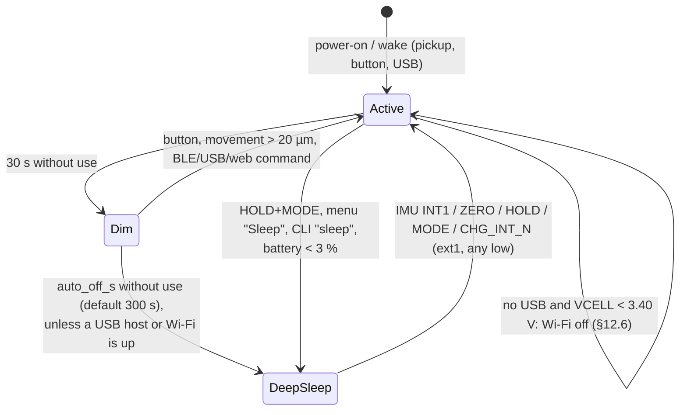

# Firmware

> **Status: builds for the target, not run on hardware.** The ESP-IDF project in
> [`caliper/firmware`](../firmware/README.md) **builds with `idf.py build` on ESP-IDF v5.4.2** for the
> esp32s3 (4 MB / N4R2 layout, clean build, **0 warnings**). With the bring-up commands (§10.1) the image is
> **1 711 168 B and fits the 1 728 KB app slot with 58 304 B (3.3 %) to spare** (built 2026-11-10 with the IIS2MDC
> compass driver and its part of the orientation filter: 6 288 B more than with the LSM6DSO driver, the orientation
> filter and the display flip, which had added 15 728 B the same day); `CONFIG_CALIPER_BRINGUP=n` gave 23 520 B
> back before those changes and has not been rebuilt since (§13). No binary has been flashed: nothing has run on a
> chip, and that includes the LSM6DSO driver, which is written from the datasheet text, and the IIS2MDC compass
> driver, whose register values come from ST's driver sources because the datasheet's register map was not read
> (§12.2). The portable core (units, rounding, tolerance, statistics, the SETTLE / SWEEP capture modes, log
> records, GATT codecs, settings JSON, CSV, button gestures, the AS5311 frame logic, the SSI fine
> interpolation, the capacitive demodulator, the orientation filter of §12.2 with its compass part and the
> bring-up pass/fail rules) is compiled and tested on the host: **72 test groups, 2741 checks, 0 failures**, with
> `-Werror`,
> AddressSanitizer and UBSan (fatal: any undefined behaviour fails the run), and also compiled as strict ISO C11; the reading-log store (`store.c`) has its
> own host test against stubbed LittleFS/NVS (**4 groups, 2614 checks, 0 failures**). Everything that
> touches a peripheral is unverified. Numbers marked **TVP** are to be verified on the prototype. The
> adversarial review of the capacitive, UI, storage, Wi-Fi and USB modules and the SSI interpolation
> (§14.1) found and fixed 20 defects; none of the fixes has run on a chip either.

The architecture of record is [SPEC](../hardware/design/SPEC.md); the pins come from
[`nets.py`](../hardware/design/nets.py) through a generated header. Where this page and SPEC disagree,
SPEC wins. The companion page that talks to the BLE service is described in [App](app.md).

## 1. Platform and layout

| | |
|---|---|
| SDK | ESP-IDF **v5.4.2** (built with it), target `esp32s3` |
| Module | ESP32-S3-MINI-1-**N4R2**: 4 MB quad flash, 2 MB quad PSRAM (SPEC §1). An 8 MB (N8R2) overlay exists |
| RTOS | FreeRTOS (dual core), tickless idle, dynamic frequency scaling 40–160 MHz |
| BLE | NimBLE (in IDF), peripheral only, up to 2 connections |
| Display | `esp_lcd` ST7789 driver (in IDF) + `espressif/esp_lvgl_port` **2.7.2** + `lvgl/lvgl` **9.2.2**. The port is pinned to `~2.7.2`: 2.8.0 and later use `LV_COLOR_FORMAT_RGB565_SWAPPED`, which LVGL 9.2 does not have |
| USB | `espressif/esp_tinyusb` **1.7.6** (with `espressif/tinyusb` 0.21.0): CDC ACM + MSC |
| Storage | `joltwallet/littlefs` **1.23.1** for the log and profiles, NVS for settings, FAT + wear levelling for MSC |
| Lock file | `caliper/firmware/dependencies.lock` (committed) pins the managed components above; `led_strip` 2.5.5 |
| Network | `esp_wifi`, `esp_http_server`, `esp_http_client`, `esp-mqtt` (all in IDF 5.4) |

```
caliper/firmware/
  CMakeLists.txt  sdkconfig.defaults  sdkconfig.defaults.8mb  partitions_4mb.csv  partitions_8mb.csv
  tools/gen_pins.py          nets.py -> main/board_pins.h
  main/                      app_main.c (tasks, wiring), Kconfig.projbuild, idf_component.yml
    board_pins.h             GENERATED, committed
    proto/caliper_gatt.h     the BLE contract (UUIDs, opcodes, layouts, flags)
  components/
    board/                   exposes main/board_pins.h + proto/ to every component; checks pin drift
    measure/                 PORTABLE: measure.c logrec.c gatt_codec.c settings.c csv.c buttons.c hid_keymap.c
                             orient.c (orientation from the gyroscope + accelerometer, the compass as a
                             yaw reference, §12.2)
    sensor_mag/              AS5311: sensor_mag.c (PCNT, SSI, index) + as5311_proto.c (PORTABLE)
    sensor_cap/              EXPERIMENTAL: sensor_cap.c (bundle drive, ADC) + cap_demod.c (PORTABLE)
    caliper_core/            event bus, live state, commands, settings, profiles, stats
    store/                   LittleFS ring log, profiles file, NVS settings, CSV export
    ui/                      panel + LVGL port, screens, button routing
    ble/                     NimBLE: custom service, BAS/DIS/HID, worker (log stream, typing)
    caliper_wifi/            STA / provisioning AP, HTTP server, MQTT + HTTP POST push
    caliper_usb/             TinyUSB CDC + MSC, CLI
    power/                   BQ25180, MAX17048, LSM6DSO (imu.c), IIS2MDC (compass.c), temperature guard,
                             LEDC, LED, deep sleep
  test/host/                 CMake project: the PORTABLE files + tiny_test.h + test_main.c
```

The components are named `caliper_wifi` / `caliper_usb` rather than `wifi` / `usb` because IDF 5.x already
has a component called `usb` (the PHY and host library that `esp_tinyusb` uses); a project component of the
same name would shadow it.

## 2. Architecture


* **One owner of the state.** `caliper_core` holds the live reading, the zero, hold, unit, active
  profile, statistics, settings and profiles behind one mutex. Readers copy a snapshot
  (`core_get_live()`); writers post a command (`core_command()`), which runs in order on the **bus** task, a
  dedicated `esp_event` loop (queue 32, stack 6 KB, priority 6, core 0). Every front end (buttons, BLE,
  web, CLI) therefore behaves the same way.
* **Events out** of the core go over the same bus: `CAL_EVT_RECORDED` (a `logrec_t`) feeds the BLE log, the
  MQTT/HTTP push and the LED flash; `CAL_EVT_SEND` makes the BLE worker type the reading; `CAL_EVT_SLEEP`,
  `CAL_EVT_WIFI`, `CAL_EVT_BEEP`, `CAL_EVT_TOAST`, `CAL_EVT_STATE`, `CAL_EVT_SETTINGS`, `CAL_EVT_PROFILES`.
* **The capacitive path is isolated.** It has its own task and pins, hands one atomic value to the
  sensor task, and stops itself after 50 bad bursts in a row. A failure only clears `CAP_VALID`.

### 2.1 Tasks

| Task | Core | Prio | Rate | Job |
|---|---|---|---|---|
| `sensor` | 1 | 10 | 100 Hz (`vTaskDelayUntil`) | PCNT count and an SSI frame (≈ 40 µs) on every sample, fine position, `core_sample()` |
| `cap` | 1 | 4 | ~20 Hz (6.8 ms burst + 40 ms pause) | EXPERIMENTAL burst, demodulation, unwrap |
| `buttons` | 0 | 7 | 100 Hz | sample 3 GPIOs, `btn_update()`, `ui_handle_button()` |
| `app` | 0 | 3 | 10 Hz | `ble_tick()` (LIVE/battery notify); at 1 Hz: power poll, USB poll, dim, auto-off, low battery |
| `bus` | 0 | 6 | events | commands, events |
| `imu` | 0 | 5 | 50 Hz (`vTaskDelayUntil`) | one 14-byte I2C read of the LSM6DSO (temperature, gyroscope, accelerometer), the orientation filter (§12.2); on every 5th sample (10 Hz) the IIS2MDC compass: its status and, when a new sample is waiting, a 6-byte read |
| `ble_wrk` | 0 | 5 | jobs | LOG_READ streaming, HID typing |
| `push` | 0 | 3 | jobs | MQTT publish, HTTP POST |
| `cli` | 0 | 3 | lines | USB console commands |
| LVGL (`esp_lvgl_port`) | 0 | 4 | 33 ms refresh | rendering; pinned to core 0 (the port's default is no affinity) |
| TinyUSB | 0 | 5 | events | CDC/MSC; `CONFIG_TINYUSB_TASK_AFFINITY_CPU0` (esp_tinyusb defaults to CPU1) |
| NimBLE host, httpd, mqtt | 0 | | | started by their components |

Core 1 holds only the sensor and cap tasks. The cap burst masks interrupts on core 1 for 6.8 ms, which
delays the sensor task by up to one sample; the PCNT keeps counting in hardware meanwhile, so no counts are
lost. The ADC DMA interrupt is allocated from `app_main` on core 0 so the masked core never holds it, and it
is IRAM-safe (`CONFIG_ADC_CONTINUOUS_ISR_IRAM_SAFE`) so a flash write on core 0 cannot hold it off (§5).

## 3. The pin header

`tools/gen_pins.py` reads `caliper/hardware/design/nets.py` (`GPIO` and `I2C_ADDR`) and writes
[`main/board_pins.h`](../firmware/main/board_pins.h): one `PIN_<NET>` per GPIO, `I2C_ADDR_<DEV>`, the
`PIN_CAP_TX_LIST` initialiser in phase order, `BOARD_PINS_ALL` / `BOARD_PINS_COUNT` (every GPIO, for the
pin-plan test, §12.5), and a `BOARD_PINS_HASH` (SHA-256 of nets.py and the generator). It fails if a net the firmware needs disappears or if GPIO26 (the PSRAM chip select) is used.

* The header is **committed**, so the firmware builds without the hardware tree.
* The `board` component runs `gen_pins.py --check` at CMake configure time; a stale header **stops the
  build** with the command to regenerate it. CMake re-runs the check when nets.py changes.
* It already paid off once: during capture the schematic moved the accelerometer (then a LIS2DW12) to **0x19**
  (SA0 high) and added the +3V3_UI rail; the check flagged the stale header and the firmware followed (§12).
  The same path carried the change to the LSM6DSO at **0x6B** on 2026-11-10 (§12.2), and the same day the
  compass: `I2C_ADDR["IIS2MDC"]` in nets.py became `I2C_ADDR_IIS2MDC` **0x1E** in the header, whose
  `BOARD_PINS_HASH` is now `202d301f8ed3b0f1` (it was `ee472a43b6aab9d6`). No GPIO changed: the compass has no
  pin of its own (§12.2).

```sh
python3 caliper/firmware/tools/gen_pins.py           # regenerate
python3 caliper/firmware/tools/gen_pins.py --check   # what the build runs
```

## 4. Magnetic sensing (AS5311)

| Item | Implementation |
|---|---|
| Counting | PCNT unit, two channels (A edge/B level and B edge/A level), **4× decoding**. The AS5311's incremental outputs give **256 A/B pulses = 1024 edges per 2 mm pole pair** (datasheet rev 1.12 §7.1 and Table 8, "RESinc 10 bit, 1.95 µm"); only the SSI word has 4096 steps per pole pair. Limits ±30000 with watch points and `accum_count`, so the driver accumulates overflows into an `int` (150 mm = 76 800 counts) |
| Scale | 2 mm / 1024 = **1953.125 nm/count** = 15625/8 nm. The reading is the count **refined by the SSI angle** (SPEC D1, below) to the 12-bit step **488.28125 nm** = 15625/32 nm, converted in `int64` with symmetric round-half-away (`meas_lsb_to_nm`; `meas_counts_to_nm` for the count alone). Displayed resolution 0.01 mm is 20.48 SSI steps |
| Fine interpolation | `as5311_fine_combine()` (portable, host-tested). With the slip tracker locked, `ssi ≈ 4·dir·count + offset (mod 4096)`; the residual `r = wrap(ssi − expected(count))` in [−2048, 2047] is the SSI's correction to the count, and `fine = 4·count + dir·r` SSI LSB. This is the SSI position unwrapped around the count: the count supplies the pole, the wrap is taken on the difference, so it is continuous across pole boundaries (4095 → 0). It also removes the incremental outputs' 2-edge direction hysteresis. Used only with a valid frame taken while the count did not change during it; otherwise (moving, bad frame) the count alone (`COARSE`, not an error) |
| Consistency | `\|r\|` > **12 LSB** (3 edges: the 2-edge hysteresis of §7.2 plus up to one edge of lock phase, since the offset is learned at an arbitrary point inside a count; **TVP**) is a **mismatch**: that reading uses the count alone and is flagged `SENSOR_ERR` (SPEC D1: "more than 2 edges" beyond what the hysteresis allows). The count is only re-aligned to the SSI after the **same** correction (±1 count) is seen on **3 consecutive still frames** (`as5311_mismatch_update`), so one bad but parity-valid frame cannot shift the reading; each correction is counted (`slips`) |
| Wrap-race filter | The PCNT driver's count is the 16-bit hardware count plus an accumulator its ISR bumps by ±30000 at the watch points. A read that lands between the hardware reset and the ISR is off by 30000 counts (58.6 mm). A step > 15000 counts (29 mm in one 10 ms sample, 2.9 m/s) is re-read up to twice 20 µs apart (`as5311_jump_plausible()`, no state change); then `as5311_jump_filter()` sees that sample's last read **once**: an implausible step is held (the previous count is used, the reading is COARSE) and only a jump that persists for **3 samples (30 ms)** is accepted as real. (Before the review the filter ran on every re-read, so a race that outlasted 40 µs, e.g. with the PCNT ISR held off by a flash write on core 0, was accepted as a 58.6 mm jump.) Rejections are counted (`jumps`) |
| SSI | Bit-banged on MAG_CSN/MAG_CLK/MAG_DO with 1 µs half-periods (≈ 500 kHz; limit 1 MHz). Datasheet Table 10 / Fig. 6: CLK idles **high** and must be high when CSn falls (with CLK low the frame carries the field magnitude instead), ≥ 500 ns CSn high between frames (tCSn), ≥ 500 ns from CSn low to the first CLK falling edge (tCLKFE, which latches the data), then each rising edge shifts out one bit (valid ≤ 413 ns later); DO is sampled 1 µs after each of the 18 rising edges. Frame: D11..D0, OCF, COF, LIN, MagINC, MagDEC, PAR (even parity over bits 1–17) |
| Frame check | Parity even over all 18 bits, OCF = 1, COF = 0 (`as5311_frame_valid`). All-ones (DO stuck high) and all-zeros frames are rejected. 3 bad frames in a row set `SENSOR_ERR` |
| Field check | Datasheet Table 13: MagINC = MagDEC = 1 with LIN = 1 is the RED range (out of spec), readings flagged `SENSOR_ERR`; with LIN = 0 it is YELLOW (≈ 3.4…54.5 mT, slightly reduced accuracy, logged). MagINC or MagDEC alone is a dynamic "distance changing" state. **TVP** at bring-up; the MAG_INC_N / MAG_DEC_N pins are configured as inputs but not used yet |
| Power-up lock | CSn is high at power-up, so A/B/Index stay high until the first CSn low pulse (datasheet §7.1.1). After the first valid frame the driver waits 2 ms for A/B to settle and takes a second frame as the reference, so that unlock transition can't shift the count |
| Slip check | At first power-up the offset between the SSI position and the count's phase (in SSI LSB: count mod 1024 × 4) is locked; it is kept across deep sleep (RTC memory), so the fine position never jumps by a lock phase. Every SSI read (100 Hz) computes the residual above, but only when the count did not change during the ≈ 40 µs frame; the correction uses `SSI_SIGN` |
| Index | MAG_IDX rising edge → IRAM ISR reads the PCNT count; the count's phase at the index must stay within ±16 LSB (4 counts) of the first one (logged) |
| Direction | `CONFIG_CALIPER_MAG_DIR_INVERT` flips the user-facing sign. The firmware assumes the SSI position rises with the PCNT count as wired (`SSI_SIGN`, **TVP**) |
| Power | SNS_PWR_EN high powers +3V3_SNS (and +3V3_UI, §12); 20 ms power-up, then up to 100 ms waiting for OCF |
| Deep sleep | Before sleeping, the count, the in-pole position and the SSI/count offset go to RTC memory (only from a still count and a valid frame) and the rail goes off. After waking, `count = stored + round(wrap(ssi_now − ssi_stored) / 4)`, then the stored offset is restored and the recovered count must pass the consistency check above. The result is exact to an SSI step if the slider moved less than ±1 mm while asleep. A larger move while asleep is not detectable: the reading is then off by a multiple of 2 mm (documented limitation, SPEC/architecture §3.2) |
| Zero after a wake | The zero lives in RTC memory, but `core_mag_origin()` keeps it **only if the count was recovered** (`sensor_mag_origin() == MAG_ORIGIN_RECOVERED`). If there was no saved position, no valid frame on waking, or the recovered count failed the check (and also after a reset that kept RTC memory), the zero is dropped and LIVE / the log carry **`REZERO` (flag bit 6)**. The display shows the value in amber with **ZERO?**, the web page shows "PRESS ZERO" and a toast says "Position lost: press ZERO". ZERO clears it |

## 5. Capacitive sensing (EXPERIMENTAL)

The SPEC asks for a rotating 8-phase square pattern and synchronous I/Q demodulation of ADC1 continuous
samples. Two hardware facts shape the implementation:

1. The ESP32-S3 ADC in continuous mode tops out at about **83 kS/s**, so 8 samples per cycle at the SPEC's
   25–100 kHz is impossible. The ADC's rate is APB / 16 / 2 / *interval* with an integer interval
   (`hal/adc_hal.c`): the firmware uses interval 31 = **80 645 S/s** and steps the pattern every 2 samples
   (**24.8 µs**), i.e. a **5.04 kHz** rotation with exactly 16 samples per cycle. The step is counted in CPU
   cycles of the clock actually running (3968 at 160 MHz) from the ADC period read back from the clock tree.
   (Before the review the drive used a fixed 25.000 µs against the 80 645 S/s the driver really produced
   for its "80 kS/s" request: 16.13 samples per cycle, so the windows slid ~2 samples against the drive per
   half.) The charge amplifier (10 pF ‖ 10 MΩ, corner 1.6 kHz) still integrates at 5 kHz, so the
   front-end should work there (**TVP**; contract issue reported).
2. The ADC and the drive loop start at an unknown relative delay. Each burst therefore runs the pattern
   **forward for 16 cycles, then in reverse for 16**. The position phase changes sign between the halves and
   the delay phase does not, so `2·θ = φ_reverse − φ_forward`, independent of the delay. The price is a
   **half-pitch ambiguity**: the burst measures the position modulo 2.54 mm.

| Step | Detail |
|---|---|
| Drive | Dedicated-GPIO bundle on CAP_TX0..7; phase *n* high while (n − step) mod 8 < 4. A cycle-counter loop inside a critical section on core 1, with a CPU-max PM lock |
| Sample | `adc_continuous` ADC1_CH0 (CAP_RX, GPIO1), 12 dB attenuation, TYPE2 frames; ~530 samples per burst. The driver's pool is flushed before and after every burst (`adc_continuous_stop()` leaves unread frames there, which shifted the next burst's sample index by a frame). The delay estimate (ADC start → drive start) is taken after `adc_continuous_start()` returns; a burst whose drive started more than 64 samples late (preempted) is discarded instead of being clamped into the wrong windows. `CONFIG_ADC_CONTINUOUS_ISR_IRAM_SAFE=y`: with a non-IRAM ISR, a log or NVS write on core 0 holds the ISR off for a sector erase while the 5-frame (4 ms) DMA ring is overwritten, and the burst would be demodulated from spliced samples |
| Demodulate | Single-bin DFT at 16 samples/cycle on a 12-cycle window from each half (2 cycles of margin at every edge), referenced to the absolute sample index, mean removed (`cap_demod_iq`) |
| Position | `frac = wrap((φr − φf) / 2π)` in [0, 1) of the 2.54 mm half pitch; amplitude of each half ≥ 8 LSB and within 2× of the other, else invalid |
| Unwrap | Whole half-pitches are counted from successive fractions, so the slider must move less than **1.27 mm between bursts (~25 mm/s at ~20 bursts/s)**; faster motion loses a half-pitch while the in-pitch fraction stays right |
| Zero and origin | The unwrapper restarts at every boot, so the cap zero is **not** kept across a deep sleep (it was, and the reading came back off by a multiple of 2.54 mm). After a boot, and after a ZERO taken while the cap had no valid burst, the first valid burst is **aligned to the magnetic reading**; ZERO zeroes both. A later cap/mag disagreement of more than 1.27 mm can only be a lost half-pitch, so whole half-pitches are taken back out (`caliper_core.c`); the sub-half-pitch part stays the capacitive scale's own measurement |

The host tests synthesise captures from a coupling model (phase *n* couples `1 + cos(θ − 2πn/8)`), with ±2 LSB
noise and start delays of 0–16 samples: the recovered fraction is delay-independent to 0.003 of a half
pitch and linear in θ. That proves the arithmetic, not the electrode physics. The sign (`CAP_SIGN`), the
constant phase offset (taken out by zeroing) and the ADC's actual sample rate (a rate error adds a constant
offset, also zeroed) are **TVP**.

## 6. Measurement core (`components/measure`, portable)

| Function | Rule | Tested |
|---|---|---|
| Rounding | Integer nm; halves round **away from zero**, symmetric for negative values; a value that rounds to zero prints `0.00`, never `-0.00` | ±5000 nm at 0.01 mm, carries (999.995 → 1000.00) |
| mm display | `decimals` (settings) = 1–3 digits; default 2 → step 10 µm | |
| Inch display | `decimals + 2` digits; at the default 4 digits the step is **0.0005 in = 12 700 nm**, so the last digit is always 0 or 5 | 0.0005 / 0.00075 / 150 mm = 5.9055 in |
| Zero / hold | Zero stores the raw position; hold freezes the shown value; zeroing while held shows 0 | |
| Capture: SETTLE | Replaces the auto-hold. Fires once when the reading has moved > 0.5 mm since the last capture and then stays within a 10 µm span (±5 µm) for 0.8 s; holds the **median of the last 32 samples** (320 ms), not the first still sample; releases when the jaws move > 0.5 mm away (§6.1) | exact median against a reference sort, a +40 µm glitch moves it ≤ 1 LSB, a 20 µm/s ramp never fires, power-up stillness never fires |
| Capture: SWEEP | Min/max peak-hold while the jaws are on the part; freezes on lift-off; shows MIN (OD) or MAX (ID) from the approach direction, or forced (§6.1) | analytic rocked-cylinder, bore and depth traces (§6.1) |
| Tolerance | Band = `nominal − \|tol_minus\| … nominal + \|tol_plus\|`, **inclusive**, decided on the **displayed (rounded)** value. Green inside the inner 80 % of each half, amber in the outer 20 % (still a pass), red outside. Gauge −1000 at the lower limit, +1000 at the upper, clamped ±1500 | limits ±1 nm, one-sided, negative nominal, sign of tol_minus ignored |
| Statistics | Welford over the **recorded** readings: n, min, max, mean, sample σ (n − 1) | vs a two-pass long-double computation on 5000 values at 150 mm (σ to 1e-9 relative) |
| Log record | 16 bytes LE `{u32 seq, u32 unix_s, i32 value_nm, u8 unit_kind, u8 flags, u16 profile_id}` (byte 12: bit 0 unit, bits 1..3 the capture kind, §8.1) | byte-exact pack, round trip, end marker |
| Ring log | seq *s* lives in slot (s − 1) mod capacity; seq numbers never restart (a clear moves `base_seq`), so incremental sync never sees a reused number | wraparound, clear, restore after reboot, bijection over 12 345 appends; the flash layout in `store_tests` (§11) |
| CSV | `seq,unix_s[,utc],value,unit,flags,profile,kind`; flags `H` hold, `P` pass, `F` fail, `E` sensor error, **`Z` zero lost** (REZERO, added in the review: such a value is relative to an origin set after a sleep/reset); **`kind`** (appended last with the capture modes, so readers of the first seven columns are unaffected): empty for a plain reading, `settle`, `min` or `max`. `csv_pack()` emits whole lines only and the export flushes and continues, so a batch that does not fit the 1 KiB buffer is split instead of losing its tail (the old loop dropped the rest of the batch) | widest line < 104 B, a 16-record batch of widest lines in 1 KiB, `HPFEZ`, the kind column |

### 6.1 Capture modes

Code: `components/measure/capture.c` (portable C, host-tested), glued in `caliper_core.c`.

> **Status: designed and host-tested on synthetic traces, not run on hardware or tried by a user.** Every
> parameter below is a design value to tune on the bench (**TVP**). The design note behind it is summarised
> here; the numbers marked *calc* are geometry, not measurement.

**Why.** A reading that "fluctuates a tenth of a mm" is almost all technique, not the sensor. The sensor's step
is 0.488 µm at 100 Hz; the display step is 10 µm, so the sensor alone flickers by at most one digit at a rounding
boundary. The dominant term is **jaw-to-part misalignment**. Flat outside jaws are 7.8 mm thick
(`hardware/mechanical/calcs_output.txt` §1), so a cylinder of diameter D rocked across its axis by a tilt *t*
reads *w = D / cos t + l·|tan t|* with *l* = 7.8 mm: a V-shaped minimum at *t* = 0 (*calc*, D = 20 mm):

| tilt | l·tan t | D (1/cos t − 1) | reading error |
|---|---|---|---|
| 0.25° | 34 µm | 0.2 µm | +34 µm |
| 0.5° | 68 µm | 0.8 µm | **+69 µm** |
| 1° | 136 µm | 3 µm | **+139 µm** |

Thumb force on the printed jaws adds about ±10 µm (PA-CF) to ±26 µm (PETG) per jaw at the tip (calcs §2);
burrs and seating add more, all one-sided. **So an average is the wrong statistic**: misalignment only ever
pushes an OD reading up, and averaging a rock reads high. The true size is an extreme, the turning point of the
rock: the **minimum for OD, depth and step**, and for a bore the **maximum across it** (the chord
2·√(r² − y²) is largest at the diameter). Tilting *along* the bore axis depends on how the inside jaws touch
(*calc*, re-derived in the review, §14.4; the design note covered only the tip case). With a **line contact** along
the bore (each jaw edge bearing over a length *l*ᵢ, the usual case once the jaws are in), the reading is
*D / cos t − l*ᵢ *·|tan t|*. That is an inverted V whose top is the square position, so **MAX is right for the
axial rock too** (Ø12 mm, *l*ᵢ = 5 mm, 1°: 85 µm low), with the same half-sample cusp bias as an OD, the other way
up. Only with **tip contact** (*l*ᵢ ≈ 0: a shallow bore or pointed tips) does an axial tilt read *larger*, by
*D (1/cos t − 1) ≈ D t²/2*: 1.8 µm at 1° on Ø12 mm, 15 µm at 1° on Ø100 mm. That is the wrong way for MAX and
no statistic removes it, so keep the jaws square along the axis. That is what peak-hold indicators
do (Mitutoyo MAX/MIN/TIR, Sylvac MIN/MAX/DELTA). An average is right only for random noise on a still reading,
and there a median is better: that is SETTLE.

**UX.**

* **MENU → Capture: off / settle / sweep** (HOLD cycles it; it replaces *Auto-hold*, persisted in NVS as
  `capture`; the old `autohold` key migrates: on = settle, off = off, and is still written for one release).
  **MENU → Sweep: auto / min / max** (`sweep_sel`). Both are also set from the app (COMMAND `0x05`) and the USB
  CLI (`capture off|settle|sweep [auto|min|max]`, `rearm`).
* **MAIN**: the big number is the **chosen extreme** (SWEEP) or the **median** (SETTLE). Top left, the tag:
  `▼MIN auto ▶` while in contact, `▼MIN auto ■` frozen, `SWEEP auto ...` armed, `SETTLE ▶` settling, `SETTLE ■`
  frozen, `SWEEP SENSOR` (red) after a sensor error, `HOLD` for a hand hold (LVGL's built-in arrow, play and stop
  symbols: no new font). Under the number, the detail line: `▲20.04  R 0.029  n 214` (the other extreme, the
  range with one digit more, computed from the exact nm difference, and the sample count), or for SETTLE
  `median  n 32  sd 0.4 um` (amber when the window's range is more than one display step: not really settled).
  The profile line names what was judged: `GO (min)`, `NO GO (max)`, `GO (median)`. In LIVE mode the same line
  shows the capacitive reading as before.
* **HOLD short**: in contact → **freeze now** (a part in a vise you cannot pull away from); on a frozen result →
  **clear and re-arm**; with nothing captured or running → a **hand hold** of the live value, as in LIVE mode
  (pressing HOLD again releases it and re-arms). **ZERO** also clears and re-arms the capture (a capture across
  a zero shift means nothing). **HOLD long = SEND** records and types the **shown** value; the record carries its
  kind (§8.1). The other gestures are unchanged.
* **Beeps**: 30 ms when a capture freezes (as the auto-hold did), 15 ms on a record.

**SETTLE.** Each ok sample joins a still run while the run's span stays ≤ 10 µm; up to two isolated single
samples outside the band are tolerated (the median ignores them), two in a row restart the run, and a bad
(`!ok`) sample restarts it too. Once armed (moved > 0.5 mm since the last capture; never right after power-up or
ZERO) and still for 0.8 s, it freezes the median of the last 32 samples (insertion sort of 32 int32), with their
standard deviation and range. It releases when the reading moves 0.5 mm away from the median.

**SWEEP.** Per 100 Hz sample, in `core_sample()` under the core lock:

| parameter | value | why |
|---|---|---|
| contact | span ≤ 20 µm over 100 ms (10 samples), armed | hand closing runs 5–50 mm/s, a rock at the cusp ≤ 0.9 mm/s: this catches the stop, not the rocking |
| re-arm | the jaws moved > 0.5 mm since the last capture (or since power-up / ZERO / re-arm) | jitter at rest never starts a capture |
| reference | median of the 10 contact samples | |
| approach | sign of the move over the 200 ms before the still window. If that is < 0.2 mm (the first stop came mid-rock, at a turning point 0.25 s or more after the contact), the direction of the **last move of ≥ 0.5 mm** (`leg_nm`, more than any rock). Neither: the last used, else MIN | closing = OD = MIN, opening = ID = MAX |
| gate | ±1 mm about the reference | a 1° rock on 7.8 mm jaws is 0.14 mm; a real withdrawal leaves it |
| lift-off | 5 consecutive samples (50 ms) outside the gate. An exit **against** the approach (the side a rock or a bore sweep goes) that stays within 2 × the gate counts only if the reading has not come back into the gate within 1 s (`resume_ms`). If it comes back in time, the run continues | a wide sweep of a small bore drops the chord out of the gate and back (Ø6 mm swept ±1.8 mm: 1.2 mm). A fast withdrawal passes 2 mm at once and is not delayed |
| persistence | an extreme must hold 2 samples: MIN = min over i of max(x[i−1], x[i]), MAX the converse | a 1-sample glitch is rejected; costs ≤ 1 sample at a sharp cusp |
| minimum contact | 200 ms | a shorter stop is a pause |
| safety | freeze after 10 min; more than 5 consecutive bad samples abort | |

The last 64 in-gate samples are held back uncommitted (a FIFO); at lift-off the ones that were already leaving
faster than 20 µm per sample (2 mm/s) in the lift-off direction are taken back out, so the withdrawal does not
inflate the other extreme or R. While in contact the display shows the committed statistics plus the FIFO
(O(64) per sample). Out-of-gate and bad samples are never added and break the persistence window.

A stop is not always a contact: the user may pause in the air. Two rules handle that (**deviations from the
design note, chosen here**):

1. **A capture that ends moving on in its own approach direction is a pause, not a contact**, and is discarded
   (the previous result comes back): a part blocks the approach direction, so a real contact always lifts off the
   opposite way. This also means sliding straight on from one diameter to one more than 1 mm smaller *without
   withdrawing* discards the first (the note's test expected it frozen); a diameter within the gate is followed
   (MIN follows it, R spans both). **Except a hover** (added in the review, §14.4): if the run's mean lies
   ≥ 0.2 mm (`approach_nm`) from the stop *against* the approach, the stop was the jaws being lined up over the
   part within the gate, and the contact was made from the other side. The run is then frozen as a contact
   approached that way. Without this, the usual "open, line up 0.4–1 mm over the part, close onto it" lost the
   OD, even with MIN forced, and the mirror case lost a bore. Then R includes the hover. While in contact, AUTO
   shows the hover's extreme (MAX for an OD) until the lift-off decides; with MIN or MAX forced, the shown value
   is right throughout.
2. **A frozen result stays on the display until the jaws have come back** (reversed by > 0.5 mm against the
   lift-off direction) and stopped again, or until HOLD/ZERO. A stop before that (the pause after pulling the
   caliper off, while reading the display) runs as a *background candidate* that is not shown. Such a candidate
   replaces the result at its own lift-off only if its approach is the preferred kind: **closing (OD) for AUTO and
   MIN, opening (ID) for MAX**. The reason: "pause in the air after an OD lift-off, then close onto the next part"
   and "pause in the air before an OD, then close onto it" are mirror images in the position signal, and only the
   expected kind can break the tie. A background candidate is decided only at its own lift-off: the 10-minute
   safety freeze and a hand freeze never replace the result on show. Before the review, a caliper put down open
   after a measurement replaced the result with the air value after 10 minutes. **Consequences (TVP, bench):** in
   AUTO, a pause in the air *after opening the jaws and before the first OD* freezes that air value briefly; the
   real OD then runs in the background (not shown live) and replaces it at lift-off. **AUTO does not handle bores
   in a row.** After an ID lift-off the jaws are closed, and a stop there (reading the display) is a
   closing-approached candidate, which AUTO prefers. When the jaws open for the next bore, that air value
   replaces the ID, and the next bore (opening, the same direction as that lift-off) is then not shown. AUTO is
   dependable for ODs and for one bore at a time. **For bores in a row set Sweep: max**; for depth and steps,
   **Sweep: min**.

A sensor error (> 5 bad samples) during a shown capture **aborts** it: `SWEEP SENSOR`, the live value, no frozen
value, a toast. So does a confirmed count-slip correction: `sensor_mag` re-aligns the count to the SSI, which
steps the reading. The sensor task calls `core_mag_slip()` when `mag_reading_t.slips` changes, and that also
restarts a SETTLE still window (added in the review; the note asked for it). It stays aborted until the jaws move 0.5 mm away and stop again (a deliberate re-measure). The
button task reports debounced edges (`core_button_edge()`): samples are ignored while a button is down and for
100 ms after release, and on the press the last 50 ms are taken back out of a running capture, because pressing
the housing lifts the slider pads and moves the reading (calcs §3).

**Cusp refinement** (`cfg.refine`, **off** in the firmware until the bench shows it helps): a least-squares line
through each flank of the persisted extreme (≤ 7 samples within 50 µm), intersected, used only if every fit
residual is ≤ 1.5 µm and the lines meet between the flanks, and clamped to [raw extreme − half a sample at the
fitted slope, persisted extreme]. On an ideal V it recovers the sub-sample cusp; on a rounded (self-seating)
bottom the residual check rejects it and the persisted value stands.

**Arithmetic.** Integer nm throughout. The statistics use shifted sums in int64 (*x0* = the first sample,
Σd, Σd²); the variance numerator is formed exactly as Σd² − q²n − 2qr − r²/n with Σd = qn + r, so it cannot
overflow inside the ±1 mm gate up to 2·10⁶ samples (n saturates there); only the final square root is floating
point. Inputs far apart cannot overflow either (a tolerated glitch in a SETTLE window can be anywhere in the
int32 range): d² is formed in uint64, Σd² saturates, and σ then reads INT32_MAX. The review found a signed
overflow there with UBSan. A unit switch only reformats (the capture never sees the unit); R and σ are formatted from the exact nm
values with one digit more than the reading, never as a difference of two rounded numbers. A capture across
zero needs nothing special (signed values, `meas_div_round` symmetric). The capture state is RAM only: deep sleep
or a reset drops it, like a hold.

**Tolerance per mode.** The go/no-go is judged on the shown value rounded to the display step (`refresh_locked()`):

| mode | judged | label |
|---|---|---|
| LIVE / hand hold | the displayed value | `GO` |
| SETTLE | the median | `GO (median)` |
| SWEEP | the **selected extreme**, live while in contact, final when frozen; never the other extreme, which is a misalignment artefact, not a size | `GO (min)` / `GO (max)` |

**Not built:** SET (multi-point sets, contract value 3 and the log's set bits are reserved), the CHART screen's
min/max lines, the 5 ms contact tick, an IMU stillness gate (the orientation filter of §12.2 now has a `steady`
flag; SETTLE does not use it: its thresholds are untuned, and the slider can be still while the hand is not).

**Host tests** (`test/host/test_capture.c`, 14 groups plus 11 from the review; the traces are analytic and quantised to the
488.28125 nm SSI step, with deterministic Gaussian jitter σ = 0.3 µm from an LCG so every host gives the same
numbers; the bounds come from the geometry, so changing PERSIST, the gate or the refinement fails a bound
deliberately). Results of 2026-11-07 (WSL Ubuntu 24.04, gcc 13.3):

| # | case | asserted | measured |
|---|---|---|---|
| 1 | OD rock D 20 mm, l 7.8 mm, ±0.5° at 0.5 Hz, 4 s, approach and lift-off at 20 mm/s | one DONE after the lift-off, MIN, 0 ≤ MIN − D ≤ l·θ̇max·Δt·P/2 + 1 µm (3.1 µm), R within 10 % of 68.8 µm, n = 400 ± 15; the air pause after the lift-off keeps it on screen; 40 random rock phases and ±0.1° biases all within the bound | MIN − D = 0.49 µm, R 68.4 µm, n 401 |
| 2 | fast cusp ±1° at 1 Hz (8.6 µm per sample) | persisted MIN within 9.6 µm; with refinement \|MIN − D\| ≤ 2 µm over 20 phases, never below raw min − half a sample; a rounded bottom (x = D + kθ²) never below its raw minimum | 6.3 µm persisted, 0.2 µm refined |
| 3 | ID sweep, 12 mm bore, ±1 mm across | MAX, within 2 µm; the other extreme = the 1 mm-offset chord | MAX − D = 0 |
| – | depth rod tilted 2°, approached by opening | AUTO picks MAX (the documented caveat); switching to MIN afterwards re-renders d within 2 µm; forced MIN gives the same | |
| 4 | spike −50 µm at a cusp | 1 sample rejected; 3 samples persist and become the MIN (documented) | |
| 5 | bad samples, a slip | 1 ignored; 6 in a row abort, and it stays aborted while on the part; a +2 mm pole slip for 3 samples is ignored and kept out of R | |
| 6 | zero crossing | zero 30 µm above D (the rock crosses 0) and 1 mm above (all negative): every result shifts by exactly the zero, R/σ/n identical | |
| 7 | gate | a 2nd diameter 0.6 mm smaller is followed (one contact, R spans both); 1.5 mm smaller: the first is discarded as a pause, the second captured | |
| 8 | re-arm | ±3 µm jitter at rest for 10 s never starts; after a hand freeze, resting on the part captures nothing; lift-off, air pause, more opening: the result stays shown; back onto a 15 mm part: a new shown contact, frozen at its lift-off | |
| 9 | SETTLE | fires once, exactly still_ms after the stop; the median equals a reference sort; a +40 µm glitch in the window moves it ≤ 1 LSB; a 20 µm/s ramp never fires; release and re-fire; a bad sample restarts the window | |
| 10 | accumulator | 10⁶ samples within ±1 mm against a long-double two-pass: mean and σ within 1 nm; ±1 mm about a −1 mm first sample at the 2·10⁶ limit: exact | |
| 11 | units | the same trace with an inch reformat mid-capture: bit-identical; R at 3 (mm) / 5 (inch) decimals from the exact difference (12.3546 − 12.3454 = `0.009`, not 0.010) | |
| 12 | (SET) | not built | |
| 13 | contract | in `test_main.c`: LIVE v3 bytes and round trip, 10/12/20/24-byte unpack, SET_CAPTURE / CAPTURE_RESET lengths and values (SET refused), LOG_READ 5/6 bytes and its option bits, record byte 12 masked for the plain read and whole for the extended one | |
| 14 | buttons | HOLD: nothing captured = hand hold, in contact = freeze, frozen = re-arm; ZERO mid-capture resets; SETTLE HOLD while settling freezes; a −30 µm pad-lift dip around a press is blanked (without blanking it would have been the MIN) | |
| – | clock wrap | the same capture with the ms clock wrapping mid-way (refinement on) | |
| R1 | review: hover over an OD | open from 2 mm, line up 0.4 / 0.7 / 0.95 / 2 mm over a 20 mm part for 0.5 s, close at 5 mm/s, rock, release: AUTO and MIN both freeze the MIN within the cusp bound | before: lost for every hover inside the gate |
| R2 | review: hover under a bore | the mirror on a 12 mm bore: MAX within 2 µm, AUTO and MAX (AUTO with a 2 mm hover is the documented AUTO limit) | before: lost inside the gate |
| R3 | review: pauses stay pauses | an air pause while closing onto a part 2 mm further is discarded. An OD rocked ±1.5°, then slid off axially while the jaws keep closing, is discarded, not frozen as a MAX | before: frozen (the first stop came mid-rock, so the approach was unknown) |
| R4 | review: background candidate | the caliper left open for 610 s after an OD: no freeze, the OD stays; a hand freeze of the hidden candidate leaves it too | before: the air value after 600 s |
| R5 | review: slip | a 2-count slip correction mid-capture aborts it, and it stays aborted on the part; a SETTLE window restarts and fires 0.8 s after the slip | before: ignored |
| R6 | review: int32 edges | the accumulator with INT32_MIN / INT32_MAX (no UB, σ saturates); a SETTLE window at −2·10⁹ nm with a glitch at +2.14·10⁹; a whole OD trace shifted to both int32 ends (refinement on): every result shifts exactly | before: signed overflow (UBSan) |
| R7 | review: cusp spikes | a +50 µm glitch on the exact cusp sample: MIN within 2.5 samples of slope (P = 2 drops both pairs that hold it) | |
| R8 | review: false lift-off | a Ø6 mm bore swept ±1.8 mm at 0.25 Hz leaves the gate by 1.2 mm each side: AUTO and MAX keep the MAX within 2 µm | before: AUTO froze the 4.80 mm chord as a MIN |
| R9 | review: short release | an OD released by only 1.2 mm and held still: frozen ≤ 1.05 s after the exit, R without the release, then the next part 0.5 mm smaller; a bore released by 1.2 mm | |
| R10 | review: view = freeze | at every 7th sample of a fast rock, what the display shows equals what HOLD would freeze (refinement off and on) | |

## 7. Display and buttons

240 × 135 landscape, SPI2 at 40 MHz, colour inversion on (IPS), RAM offset 40/53 (**TVP**: the 1.14 in
modules use 40/52 or 40/53 depending on rotation). LVGL draws into two 240 × 30 DMA buffers.

Threading: every LVGL call happens in the LVGL task (timers) or under `lvgl_port_lock` (`ui_lock()`: the
button handler, the toast handler, init). `ui_lock()` returns false until the display is up, so a panel that
fails to initialise no longer aborts the firmware through the port's "init first" assert the first time a
button is pressed: the buttons then still zero / hold / record / send, without screen changes. `ui_sleep()`
stops the LVGL task under the lock before sending the panel's off/sleep commands, so they never interleave
with a frame flush on the same SPI device.

**Display flip** (2026-11-10, `CONFIG_CALIPER_UI_AUTO_FLIP`, default on): when the caliper is held with its top
(button) edge down, the picture turns 180° so that it still reads upright. The 25 Hz refresh timer asks the
orientation filter (§12.2) for `up`: top edge at least ≈ 20° below the horizon (`up.y ≤ −0.35`) for 0.6 s turns
it, ≥ +0.35 for 0.6 s turns it back, and anything between (lying flat, standing on end) keeps what is shown, so
it does not flap on a bench. The turn is done in the panel, not in software: `lv_display_set_rotation(180)` makes
`esp_lvgl_port` invert the ST7789's MX / MY bits and LVGL redraws everything, with no extra buffer. The port
does not move the RAM offset, so `ui_flip_poll` sets the mirrored one first: 320 − 240 − 40 = **40** and
240 − 135 − 53 = **52** (**TVP**, like 40/53; `bu lcd flip` shows the frame for it). All of it runs in the LVGL
task between frames. The buttons do not swap: ZERO / HOLD / MODE keep their functions wherever they end up.
Without an IMU, or before it has seen gravity, the picture stays as mounted. Thresholds are first guesses and the
whole path is **designed, host-tested (the hysteresis rule), not run**.

| Screen | Content |
|---|---|
| MAIN | Reading in Montserrat 48, unit, the capture tag (HOLD / ZERO? / `▼MIN ▶`, `SETTLE ■`, …: §6.1), status icons (BLE, Wi-Fi or AP, USB, battery or charging, %), a detail line (the capture's other extreme, R and n, or the SETTLE spread; in LIVE mode the capacitive reading when valid), profile name + GO / GO (edge) / NO GO with what was judged (`(min)`, `(max)`, `(median)`), and a symmetrical gauge bar (green/amber/red) with white ticks at the limits |
| CHART | The last 100 live values at 10 Hz (10 s), auto-scaled with a minimum ±10 µm span, plus min..max |
| STATS | n, mean, σ (one extra digit), min, max, range of the recorded readings |
| MENU | Unit, profile, **capture (off / settle / sweep)**, **sweep (auto / min / max)**, Wi-Fi on/off, Wi-Fi setup (AP), reset stats, clear log (long press), sleep, about |
| Wi-Fi setup | Overlay with the AP name, its password and `http://192.168.4.1` while the provisioning AP runs |

Buttons (100 k pull-ups + 100 nF on the board; 20 ms firmware debounce; `components/measure/buttons.c`):

| Gesture | Outside the menu | In the menu |
|---|---|---|
| ZERO short / long (0.8 s) | zero (also clears and re-arms the capture) / mm ↔ inch | up |
| HOLD short / long | hold on/off; in a capture mode freeze a running capture, clear + re-arm a frozen one (§6.1) / **SEND** (record + type over BLE HID) | select / select (destructive items need long) |
| MODE short / long | next screen / next tolerance profile | down / leave the menu |
| ZERO + MODE 1.5 s | Wi-Fi setup AP on/off | |
| ZERO + HOLD 1.5 s | reset statistics | |
| HOLD + MODE 1.5 s | sleep now | |

The backlight (LEDC 20 kHz, duty ∝ brightness²) runs at 70 % and dims to 10 % after 30 s without use; the
piezo beeps 15 ms on a record and 30 ms when a capture freezes (LEDC 4 kHz, the BZ50 resonance); the RGB LED flashes
green / red / white for 150 ms on a pass / fail / plain record.

## 8. BLE

### 8.1 GATT contract

Defined once in [`main/proto/caliper_gatt.h`](../firmware/main/proto/caliper_gatt.h); the byte layouts are
encoded by `components/measure/gatt_codec.c` and tested on the host. All integers little-endian. The custom
UUIDs share the base `7c0a0001-5e1f-4b8a-9c3d-2f6a1e0c7b11` with the second 16-bit group changed.

| UUID | Name | Properties | Payload |
|---|---|---|---|
| `7c0a0001-…` | service | primary | |
| `7c0a0002-…` | LIVE | read, notify | **20 B** (v3): `i32 value_nm` (magnetic, zeroed; the **shown** value: the held one while holding, the capture result when frozen, the running extreme while a SWEEP is in contact), `i32 cap_nm` (zeroed; `INT32_MIN` if invalid), `u8 unit` (0 mm, 1 in), `u8 flags`, `u16 active_profile_id` (0 = none; SPEC D6), then the capture block: `u8 capture` (bits 0..3 mode 0 live / 1 settle / 2 sweep / 3 set reserved, bits 4..5 sweep selection 0 auto / 1 min / 2 max), `u8 capture_state` (bits 0..2: 0 idle, 1 armed, 2 in contact / settling, 3 frozen, 4 aborted; bits 4..5 which extreme `value_nm` is: 0 n/a, 1 MIN, 2 MAX), `u16 capture_n` (saturating), `i32 capture_aux_nm` (SWEEP the other extreme, SETTLE σ, `INT32_MIN` n/a). Readers accept ≥ 10 bytes (10: before the profile id; 12: before the capture modes) and ignore bytes past 20. 20 B fits one notification at the default ATT_MTU of 23 |
| `7c0a0003-…` | COMMAND | write | `u8 opcode` + payload (table below) |
| `7c0a0004-…` | LOG | notify | after LOG_READ: notifications of 1..N packed 16-byte records, then **one notification holding only the end record** (`seq = 0xFFFFFFFF`, rest zero) |
| `7c0a0005-…` | SETTINGS | read, write (**write needs encryption**) | UTF-8 JSON ≤ 240 B; keys `name`, `wifi_ssid`, `wifi_pass` (write-only), `mqtt_url`, `http_post_url`, `auto_off_s`, `hid_suffix`, `decimals` |
| `7c0a0006-…` | PROFILES | read, write | read: every profile, 30 B each (≤ 16 → 480 B); write: one or more records `{u16 id, i32 nominal_nm, i32 tol_minus_nm, i32 tol_plus_nm, char name[16]}` |

LIVE flags (the log record's `flags` use the same bits): bit0 HOLD, bit1 TOL_PASS (green or amber), bit2
TOL_FAIL, bit3 SENSOR_ERR, bit4 CAP_VALID, bit5 CHARGING, **bit6 REZERO** (added by the firmware track on
2026-11-07: the zero could not be carried across a deep sleep or reset, §4; cleared by ZERO; a client that
does not know it ignores it). A record stores HOLD/PASS/FAIL/SENSOR_ERR/REZERO. A frozen capture sets HOLD, so an
old client shows it as a held reading.

**Log record byte 12** (`unit_kind`, added with the capture modes; the flash format is unchanged): bit 0 unit,
bits 1..3 kind (0 plain, 1 SETTLE median, 2 SWEEP min, 3 SWEEP max), bits 4..5 reserved for SET, 6..7 zero. Old
records read as kind 0. The existing app and the CSV code compared the whole byte with the inch value, so an
unmasked byte would have turned an inch SWEEP record into mm: the **plain LOG_READ (5 bytes) sends bit 0 only**
(`gatt_log_record_pack()`), and only the **6-byte LOG_READ** with opts bit 0 sends the whole byte. Inside the
firmware `logrec_t` keeps `unit` and `kind` apart, so nothing that reads `unit` can see the kind.

| Opcode | Command | Length (incl. opcode) | Action |
|---|---|---|---|
| `0x01` | ZERO | 1 | zero magnetic and capacitive |
| `0x02` | HOLD_TOGGLE | 1 | |
| `0x03` | RECORD_NOW | 1 | store the shown value (refused with a toast while SENSOR_ERR) |
| `0x04` | SET_UNIT | 2 | `u8` 0 mm / 1 in |
| `0x05` | SET_CAPTURE | 3 | `u8 mode` (0 live, 1 settle, 2 sweep), `u8` sweep selection (0 auto, 1 min, 2 max); persisted. Mode 3 (SET, reserved) or a value out of range → `0x80`. Changing the mode resets the capture; changing only the selection re-renders a frozen result |
| `0x06` | CAPTURE_RESET | 1 | clear the capture result and re-arm |
| `0x10` | LOG_READ | 5 or 6 | `u32 from_seq`: stream every stored record with seq ≥ from_seq (0 = from the oldest). The 6th byte `u8 opts` (bit 0: send record byte 12 whole, with the kind; other bits must be 0, else `0x80`) is new; firmware without it answers 6 bytes with `0x0D`. Ignored unless this connection subscribed to LOG |
| `0x11` | LOG_CLEAR | 1 | numbering continues after a clear |
| `0x20` | SELECT_PROFILE | 3 | `u16 id`, 0 = none |
| `0x30` | SET_TIME | 5 | `u32` Unix seconds (`settimeofday`) |

Write errors: wrong length → ATT `0x0D` (invalid attribute value length); unknown opcode → `0x06` (request not
supported; firmware without the capture modes answers `0x05`/`0x06` this way, which is how a client can tell);
bad value (e.g. unit 2, capture mode 3, a rejected setting, a full profile table) → `0x80` (application error);

SETTINGS whose JSON would exceed 240 B → `0x0D`. These are `CALIPER_ATT_ERR_*` in `caliper_gatt.h`, which
`ble_gatt.c` uses directly (with compile-time checks against NimBLE's constants). A SETTINGS write on an
unencrypted link is refused by the stack before our code runs: ESP-IDF v5.4.2 NimBLE
(`ble_att_svr_check_perms`) answers **`0x05`** (insufficient authentication) when the peer has no bond and
**`0x0F`** (insufficient encryption) when it is bonded but has not re-encrypted yet. Checked in the IDF
source, not on air.

Where the contract was silent, the firmware decided (the [App](app.md) page implements the same):

* **Tolerance signs:** `tol_minus_nm` and `tol_plus_nm` are magnitudes; the sign is ignored. A one-sided
  band (e.g. −0.05/+0) works; a band that lies wholly above or below nominal cannot be expressed.
* **Profile writes** are upserts by id. A record with an empty name and nominal = tol− = tol+ = 0 **deletes**
  that id. id 0 is invalid. At most 16 profiles.
* **SETTINGS writes** merge the keys present, all-or-nothing: one bad value rejects the whole write. Limits:
  name 20, SSID 32, password 0 or 8–64, URLs 64 (`mqtt://`, `mqtts://`, `ws://`, `wss://` / `http://`,
  `https://`), `auto_off_s` 0 or 30–3600, `decimals` 1–3, `hid_suffix` `"\n"`, `"\t"` or `""`. Integers only
  for numbers; unknown keys are ignored; nested values are rejected. The read form never contains `wifi_pass`.
* **Connection table:** written by the NimBLE host task (GAP events), read by the app task (LIVE/battery
  notifications) and `ble_wrk` (log stream, HID typing). It sits behind a spinlock in `ble.c`; readers take
  copies (`ble_conn_get`, `ble_conn_snapshot`) and notify outside the lock.
* **Notifications:** LIVE at up to 10 Hz when it changes and at least once a second; LOG packs
  ⌊(MTU − 3) / 16⌋ records per notification (15 at the preferred MTU of 247, 1 at the default 23).

### 8.2 Standard services, advertising, security

* **Battery 0x180F**: Battery Level (read, notify) from the MAX17048.
* **Device Information 0x180A**: manufacturer "PrettyCool", model "Caliper rev A", firmware revision (the app
  version) and a PnP ID (USB VID source, Espressif VID 0x303A, product 0x4001 as a **placeholder**).
* **HID over GATT 0x1812**: keyboard, report ID 1, 8-byte input report and a 1-byte LED output report;
  protocol mode, report map, HID information and control point. All HID attributes require encryption.
  SEND types the formatted reading plus `hid_suffix` as press/release pairs, 12 ms apart (**TVP** per host),
  to every bonded, subscribed host.
* Implemented in `components/ble/ble_std.c` rather than with NimBLE's helper services, so the report map and
  layout are in our hands (`CONFIG_BT_NIMBLE_HID_SERVICE=n`).
* **Advertising** (100–150 ms): flags, appearance 0x03C1 (keyboard), the 0x1812 UUID and the name (up to 18
  characters, from settings `name`); the scan response carries the custom 128-bit service UUID.
* **Security:** LE Secure Connections, Just Works (no display/keyboard for a passkey), bonding with the keys in
  NVS (`CONFIG_BT_NIMBLE_NVS_PERSIST`), up to 6 bonds. A peer that lost its bond is re-paired. The custom
  service is open except the SETTINGS write, which carries the Wi-Fi password; the browser's pairing prompt
  appears on the first settings write.

## 9. Wi-Fi

Off by default (it costs ~100 mA); turned on from the menu, the CLI or the ZERO + MODE combo.

* **Station** with `wifi_ssid` / `wifi_pass` from settings (credentials stored by us in NVS; the Wi-Fi driver
  keeps none). After 5 failed attempts, or with no SSID, it falls back to the **provisioning AP**.
* **Provisioning AP:** `Caliper-XXXX` (the last two MAC bytes), WPA2 with a random **10-character password**
  (31 symbols without look-alikes, ~49.5 bits; it was 8 digits, 26.6 bits, which an offline search of a captured
  handshake breaks in minutes, exposing the home-network password typed into the setup form) shown on the
  display, channel 6, at most 2 clients, `http://192.168.4.1`. Saving new credentials in the form switches to
  the station 1.5 s after the reply.
* **Credentials** are never logged and never returned (`/api/settings`, SETTINGS read and the CLI `get` omit
  `wifi_pass`). The station config is copied byte-wise, so a full 32-byte SSID and a 64-hex-digit PSK work
  (`strlcpy` cut them to 31 / 63 bytes); a 64-character `wifi_pass` must be hex and a passphrase printable
  ASCII. RAM copies in the station start and the form handler are wiped after use. They are stored in NVS
  without NVS encryption (flash readout exposes them; **not implemented**: NVS encryption).
* **State machine** (`wifi.c`): driven from the bus task and the default event loop; all of it now runs under
  one recursive mutex (before, a disconnect event racing a "Wi-Fi off" could restart the radio, and both tasks
  could start/stop the web server at once).
* **Auto-off is suspended** while Wi-Fi is on.

| Method | Path | Returns / does |
|---|---|---|
| GET | `/` | live page: the reading polled from `/api/live` at 4 Hz, buttons for zero / hold / record / unit |
| GET | `/api/live` | `{"value_nm","text","unit","flags","cap_nm","tol","profile","battery"}` |
| POST | `/api/cmd?c=zero\|hold\|record\|send\|unit` | runs the command |
| GET | `/log` | log table page (200 rows per fetch, "more") |
| GET | `/api/log?from=S&n=N` | JSON array of records from seq S, N ≤ 200 |
| GET | `/log.csv` | the whole log as CSV (`seq,unix_s,utc,value,unit,flags,profile`), chunked |
| GET | `/settings` | settings form (password field blank = keep) |
| GET | `/api/settings` | the SETTINGS JSON (no password) |
| POST | `/settings` | form-urlencoded; applies each key with the same validation as BLE; 303 back with `saved` or `err` |

**Push** (station only), for every recorded reading: MQTT QoS 1 to `caliper/<name>/reading` when `mqtt_url`
is set (queued with `esp_mqtt_client_enqueue`, the client handle under a mutex: it was destroyed by Wi-Fi off
while the push task could be publishing on it), and an HTTP POST to `http_post_url`, both with the body
`{"seq","unix_s","value_nm","value","unit","flags","profile_id"}`. `https://`, `mqtts://` and `wss://` verify the
server against the ESP-IDF certificate bundle (common-CA subset); before, no verification option was set and
esp-tls refused every TLS connection. The URL is not logged (it may contain `user:password@`).

**Web security.** The web server has no authentication: it is meant for a trusted shop network or the WPA2
provisioning AP. It does defend against other web pages using the browser as a proxy:
every request must carry a `Host` naming the caliper (its IP, `192.168.4.1` in AP mode, or its DHCP hostname),
else **403** (DNS rebinding); a POST with an `Origin` other than this host, or `Sec-Fetch-Site` other than
`same-origin`/`none`, gets **403** (CSRF: a cross-site form could otherwise rewrite `wifi_ssid`/`wifi_pass` or
point `http_post_url` at an attacker). Pages carry `X-Frame-Options: DENY`, `nosniff`, a self-only CSP and
`no-referrer`; all values are shown with `textContent`/`.value` (the log table no longer uses `innerHTML`). The
`err` key in the settings redirect is reduced to `[a-z_]`. At most 4 HTTP sockets (of `LWIP_MAX_SOCKETS` 12)
so MQTT and the POST client always get one.

## 10. USB

TinyUSB owns the native USB PHY (`CONFIG_CALIPER_USB_TINYUSB=y`), as a composite device:

* **CDC ACM:** the console (logs are redirected to it with `esp_tusb_init_console`) and a line CLI:
  `read`, `status`, `zero`, `hold`, `rec`, `send`, `unit mm|in`, `log [from] [n]`, `csv`, `clear yes`, `get`,
  `set <key> <value>`, `profiles`, `profile <id>`, `time <unix_s>`, `wifi on|off|ap`, `export`, `sleep`,
  `reboot`, `bootloader`. The console VFS is non-blocking (right for logs: a log line never stalls the sensor
  task), but it drops whatever does not fit the CDC FIFO, so `csv` and long `log` output came out truncated.
  CLI output now goes through `usb_console_write()`, which waits for the host (gives up after ~1 s with no
  progress).
* **MSC:** the 192 KB `msc` FAT partition (wear-levelled) holding **LOG.CSV**, regenerated from the log each
  time a host enumerates the caliper (and on `export`; the host sees the medium change). It is a copy: edits
  made on the PC are overwritten at the next export. A full 4096-record log is ~130–160 KB of CSV
  (`seq,unix_s,value,unit,flags,profile`, without the ISO time column to fit; the FAT on the 192 KB partition
  leaves roughly 160 KB, so long seq numbers and 3 decimals can overflow it: the export then logs
  "LOG.CSV export incomplete", **TVP**). The host-attach export (app task) and the CLI `export` are
  serialised by a mutex (two at once mounted the FAT twice).
* **Charge current:** 100 mA input limit until a host configures the device, 500 mA after; VBUS for 3 s without
  enumeration is treated as a dedicated charger (500 mA).
* **Flashing:** with TinyUSB running, esptool cannot reset the chip into download mode over
  USB-Serial-JTAG. Use the CLI `bootloader` command (forces ROM download mode on the next reset) or hold BOOT
  while plugging in / resetting. For firmware development set `CONFIG_CALIPER_USB_TINYUSB=n`: the console
  and the CLI then use USB-Serial-JTAG, and `idf.py flash monitor` works as usual (no MSC).
* Early boot logs go to USB-Serial-JTAG until TinyUSB takes the PHY. UART0's pins are capacitive TX phases,
  so there is no UART console.

### 10.1 Bring-up commands (`bu`)

The guided first-board checks of [Bring-up](bringup.md) are CLI commands in the normal image
(`components/bringup`, `CONFIG_CALIPER_BRINGUP`, default on). `bu help` lists them; each prints its numbers and
ends with one line `PASS <name>: ...` or `FAIL <name>: ...`; the visual / audible ones ask for a `y` / `n` typed on
the console (`ask()` in `cli.c` reads the next line from the CLI queue while the command runs in the CLI task).

| Command | Checks | Reads |
|---|---|---|
| `bu all` | rails, i2c, bq, fg, imu, gyro, compass, mag, cap, ble (2 s), then `SUMMARY n PASS, m FAIL` | |
| `bu rails [vbat_mv]` | charger and gauge present; VBAT (MAX17048 VCELL) 2.5–4.5 V and within ±30 mV of the meter value given; VBUS, charge state, die temperature. VSYS and the 3.3 V rails have no ADC: the meter, at TP3–TP6 | `power_get_last()` (the app task's 1 Hz poll) |
| `bu i2c` | `i2c_master_probe` 0x08–0x77: exactly 0x1E, 0x36, 0x6A, 0x6B (the table is `board_pins.h`) | |
| `bu bq` | STAT0 / STAT1 / FLAG0 decoded (fails on VIN OVP, safety timer, BAT_OCP, TS open / hot / cold); registers 0x00–0x0C dumped and compared with the init table (`power_bq_table()`, with the live ICHG and ILIM) | `power_diag_read()` |
| `bu fg [vbat_mv]` | VERSION 0x001x, VCELL, SOC, and the settings §12.2 makes (VRESET.Dis, HIBRT 0x8030, CONFIG.SLEEP clear) | |
| `bu imu` / `bu imu move [s]` | LSM6DSO WHO_AM_I 0x6C and \|a\| 850–1150 mg at rest, plus the orientation line (roll, pitch, face, steady, relative yaw) / a ≥ 500 mg swing and IMU_INT1 going low (the wake-up interrupt), latch cleared after | `power_diag_read()`, `power_orient_get()` |
| `bu gyro` / `bu gyro turn [s]` | the gyroscope running (CTRL2_G), 2 s lying still: each axis' mean within ±3 dps and ≤ 2 dps peak-to-peak, with the filter's bias estimate and the chip temperature / some axis reaching 60 dps while turned by hand, each axis' extremes printed with their signs (the axis-mapping check) | `power_diag_read()`, `power_imu_last()` |
| `bu compass` | IIS2MDC WHO_AM_I 0x40 and CFG_REG_A in continuous mode, then 8 readings of the output registers 100 ms apart: at least 4 of them, some axis changing (a part in power-down repeats itself), no axis at full scale, \|B\| 10–1000 µT (a deliberately wide first-board window, **TVP**: hard iron and the steel beam are in the number). Prints the chip's X / Y / Z and \|B\| in µT, and the filter's line: \|B\| with the offset removed, the dip, plausible / DISTURBED, the magnetic heading and its uncertainty, or "compass not in use" without a calibration (§12.2) | `power_diag_read()`, `power_orient_get()` |
| `bu compass cal [s]` | the hard-iron calibration (§12.2): the same two register checks, then the caliper is turned through every direction for s seconds (default 20, 5–120). PASS when the three axis spans make a sphere of 20–75 µT: the offsets are then in use and stored in NVS. A refused run changes nothing | `power_compass_last()`, `power_compass_cal_set()`, `store_compass_save()` |
| `bu sns off` / `on` | SNS_PWR_EN: the UI stopped, its lines low, rails off, operator reads TP5 / TP6 / rails back on and the AS5311 answering; then `reboot` | `sensor_mag_power()` |
| `bu mag` / `bu mag move [s]` | one second of frames: ≥ 50, ≤ 1 % bad, last valid, field in range / the count vs SSI cross-check below | `sensor_mag_diag()` |
| `bu lcd [off]` | colour bars, a 1 px frame, corner labels on LVGL's top layer (`ui_test_pattern()`), backlight dim and back; operator y / n. The picture is pinned as mounted for the test (`ui_set_flip`) | |
| `bu lcd flip` | the same pattern turned 180° (§7): the frame proves the turned RAM offset; operator y / n | |
| `bu btn [s]` | each button pressed and released (≥ 20 ms), none down at the start | GPIO levels |
| `bu beep`, `bu led` | two beeps; red, green, blue, white; operator y / n | |
| `bu cap [scale]` | DC level at the ADC 1700–2700 LSB, the last burst's raw I/Q and amplitudes; with `scale` ≥ 90 % valid and both amplitudes ≥ 8 LSB | `sensor_cap_diag()` |
| `bu ble [s] [min_dbm]` | host synced, advertising, advertising TX power, the link RSSI of a connected phone averaged over s seconds (optional floor) | `ble_diag()` |
| `bu wifi [ssid] [min_dbm]` | a blocking all-channel scan (the station started just for it if the radio was off; refused while the setup AP or a connection attempt runs), strongest first; one SSID's RSSI and an optional floor | `caliper_wifi_scan()` |
| `bu sleep [delay_s]` | deep sleep after a delay (to unplug USB first) for the current measurement | |
| `bu ship` | `power_ship_mode()` (§12.1); pending until USB is unplugged | |

No check owns a bus or a pin the normal firmware owns: the I2C reads go through the I2C driver's bus lock, and
the AS5311, the capacitive burst, BLE and Wi-Fi are read from snapshots their own tasks publish
(`sensor_mag_diag`, `sensor_cap_diag`, `ble_diag`) or through their component's lock (`caliper_wifi_scan` under
the Wi-Fi state lock). One check does get in the firmware's way: `bu compass` reads the IIS2MDC's output registers
itself, which (as the driver assumes) clears the part's data-ready flag, so the orientation filter can miss compass
samples while the command runs (§14). `bu compass cal` reads the sampler's copies and does not. The pass/fail
rules are portable (`bringup_eval.c`) and host-tested (§13).

**Count vs SSI (`bu mag move`).** The sensor task feeds every valid, still-believed frame with the raw PCNT count
(no origin, no slip correction) into `as5311_xcheck_feed()`: the SSI position is unwrapped frame to frame on its
own, and `ssi_unwrapped − 4 × Δcount` must stay within **16 LSB** (`AS5311_XC_TOL_LSB`: the 12 LSB fine tolerance
of §4 plus one edge of skew between the count read and the frame). If `ssi + 4 × Δcount` stays there instead,
`SSI_SIGN` is wrong; a step above 1536 LSB (0.75 mm in one 10 ms sample) makes the unwrap untrustworthy and the run
is refused as too fast; less than one pole pair of span gives no verdict. It also reports the pole crossings the
SSI saw and the index pulses counted meanwhile.

Found while adding them: the CLI `help` text was one `out()` call of 257 bytes into a 256-byte buffer and lost
its last two characters (now three calls); the gauge's VCELL conversion multiplied in 32 bits and wrapped above
4.29 V (now 64-bit, in `power.c` and the bring-up rule).

## 11. Storage

| Partition (4 MB) | Offset | Size | Use |
|---|---|---|---|
| nvs | 0x9000 | 24 KB | settings JSON + wifi_pass, unit/profile/auto-hold, the compass calibration (§12.2), BLE bonds, PHY cal |
| otadata | 0xF000 | 8 KB | OTA slot selection (rollback enabled) |
| phy_init | 0x11000 | 4 KB | |
| ota_0 / ota_1 | 0x20000 / 0x1D0000 | 1728 KB each | application (two slots; no OTA transport is implemented yet) |
| storage | 0x380000 | 320 KB | LittleFS: `log.hdr`, `log000.bin`…, `profiles.bin` |
| msc | 0x3D0000 | 192 KB | FAT for LOG.CSV |

The 8 MB overlay (`sdkconfig.defaults.8mb`, `partitions_8mb.csv`) has 2.5 MB app slots, 1 MB LittleFS, 1.9 MB
MSC and a 16 384-record log.

**Log layout (v2, changed in the review).** It was one 64 KB file (`log.bin`, `"CLG1"`) overwritten in
place. LittleFS stores a file as a backward-linked CTZ skip-list, so writing 16 bytes in the middle of a file
rewrites every block from there to the end (`lfs_file_flush`: "copy over anything after current branch"):
on average **half the file per reading**, 32 KB / 8 sector erases in the 4 MB build and 128 KB / 32 erases
in the 8 MB one, each erase stalling both cores (the 100 Hz sensor task, the cap burst) for tens of ms, up to
~1 s per record. Now:

* `log.hdr`: 16 bytes, `"CLG2"`, version 2, record size, capacity, base_seq; rewritten in place only on a
  clear or a capacity change.
* `log000.bin`, `log001.bin`, …: segment *k* holds slots 256·k … 256·k + 255, **4 KB = one LittleFS block**, so
  a record write rewrites at most the rest of one block (one erase).

Each append is `fseek` + `fwrite` + `fflush` + `fsync`; LittleFS commits a sync atomically, so after a power
loss mid-write a slot holds its old or its new record, never a torn one. At boot the segments are scanned for
the newest seq ≥ base_seq whose slot matches it; a record whose seq does not belong in its slot (stale,
garbage) is never accepted, a missing segment only means fewer records, a torn or foreign header starts a new
log. A capacity change deletes the segments first and writes the header last, so an interruption leaves a
consistent (shorter) log; the numbering continues. A failed append gives its seq back. The old `log.bin`
(pre-release builds only; nothing has run on a chip) is deleted at boot. `profiles.bin` is the 30-byte GATT
records back to back, written to `.tmp`, synced, and renamed over the old file (LittleFS `rename` replaces
atomically; the old code unlinked first, so a power loss there lost the table).

`store_tests` (host, §13) runs `store.c` against stubs (a directory for the partition, an NVS that keeps only its
u16 values):
wraparound over 3 segments with a partial last one, reboot scan, clear across reboot, capacity change,
a misplaced seq, a blank newest slot, a deleted segment, a torn header, removal of the v1 file, the CSV
export of a full log (every record, every line complete), and the compass calibration's four NVS keys (nothing
stored, the range limits and NaN refused, the round trip to 0.1 µT, a refused save leaving the stored one). POSIX
files do not reproduce LittleFS's atomic
commit, so the power-loss guarantee itself rests on LittleFS (**not tested here**).

## 12. Power

### 12.1 BQ25180 register table

The dial-me-spinner table (its `docs/firmware.md` §13.1), changed for
this board's cell: a Renata ICP501230PS-03, 135 mAh (2026-11-09: the slim housing; it replaced the 500 mAh
402535), charged at 70 mA (SPEC §1; the reasons for each value are in §12.6). Written in this order at boot and
again whenever IC_CTRL reads back wrong (a BQ reset), checked at 1 Hz.

| Order | Register | Value | Setting |
|---|---|---|---|
| 1 | IC_CTRL 0x07 | **0x97** | TS_EN, VLOWV 3.0 V, VRCH 100 mV, 2× timer, 6 h, **watchdog off** (first transaction: the watchdog starts with it) |
| 2 | VBAT_CTRL 0x03 | 0x46 | 4.20 V |
| 3 | ICHG_CTRL 0x04 | **0x22** | ICHG = 40 + (34 − 31) × 10 = **70 mA** = 0.52C (`CONFIG_CALIPER_CHARGE_MA`, range 10–135, so at most the cell's 1C); bit 7 CHG_DIS from the guards (0xA2) |
| 4 | CHARGECTRL0 0x05 | 0x20 | IPRECHG 2 × ITERM = **14 mA** (0.1C), ITERM 10 % = **7 mA** (0.05C), VINDPM 4.2 V, TREG 100 °C |
| 5 | CHARGECTRL1 0x06 | **0x52** | IBAT_OCP **1 A** (the reset value; it was 0x92 = 1.5 A for the 500 mAh cell), BUVLO 3.0 V, CHG_STATUS int on, ILIM int masked |
| 6 | TMR_ILIM 0x08 | 0xC9 → 0xCD | 100 mA until USB is configured (or 3 s of VBUS with no host), then 500 mA |
| 7 | SHIP_RST 0x09 | **0x08** | **EN_PUSH = 0** (dial-me-spinner has a button on TS/MR and writes 0x09; rev A has only the NTC there). The push-button scan costs 1 µA on battery: SLUSE99C IQ_BAT is 3 µA with it disabled, 4 µA enabled, and SPEC §3 budgets 3 µA. Long press = reset, WAKE1 300 ms, WAKE2 2 s (unused) |
| 8 | SYS_REG 0x0A | 0x20 | SYS 4.4 V on USB (the buck-boost takes anything from 1.3 V) |
| 9 | TS_CONTROL 0x0B | 0x90 | HOT 50 °C, COLD 3 °C (dial-me-spinner's JEITA margins) |
| 10 | read STAT0..FLAG0 | | clears the flags |

* Rev A has a 10 k NTC (RT1) on TS/MR next to the battery connector ([Schematics](electronics.md)), so TS
  monitoring is on. `CONFIG_CALIPER_CHG_TS_ENABLE=n` writes IC_CTRL 0x17 for a board without it.
* **TS open** (STAT0 bit 7) disables charging, as dial-me-spinner requires.
* **Die-temperature guard:** charging is also disabled while the ESP32-S3 die reads below 2 °C or above 55 °C
  (3 °C hysteresis). The die runs warmer than the cell; the limits are a backstop (**TVP**).
* Storage mode (`power_ship_mode`) writes SHIP_RST **0x28**: EN_RST_SHIP = 01, the BQ25180's *shutdown*
  mode with wake on adapter insert only (15 nA, SLUSE99C IBAT_SHUTDOWN). TS/MR has no button on rev A, so the
  button-wake ship mode (10, 3.2 µA IBAT_SHIP for its push-button scan) would buy nothing. Not wired to the UI;
  the CLI reaches it through the bring-up command `bu ship` (§10.1). Only plugging in USB leaves it. It puts the MAX17048 to sleep first (§12.2).

### 12.2 Fuel gauge and IMU

* **MAX17048** (0x36): VCELL × 78.125 µV, SOC high byte = %. Default configuration (RCOMP 0x97, automatic
  hibernate), except **VRESET.Dis = 1** (bit 0 of the 0x18 MSB, read-modify-write of the 16-bit register) so
  the reset comparator is off in hibernate: SPEC §3 counts 3 µA for the gauge, which needs it.
* **MAX17048 before ship mode** (`power_ship_mode`, SPEC §3): ship mode switches VSYS off, so +3V3 and the
  2.2 k I2C pull-ups die while the gauge stays on VBAT with SDA/SCL floating. Before SHIP_RST is written:
  HIBRT 0x0A = **0xFFFF** (always hibernate, 3 µA: the fallback), MODE 0x06 = **0x2000** (EnSleep, bit 13) and,
  without VBUS, CONFIG 0x0C |= **0x0080** (SLEEP, bit 7; read-modify-write keeps RCOMP / ATHD): forced sleep,
  0.5 µA typ / 2 µA max, which only CONFIG.SLEEP = 0 or a POR ends (Maxim 19-6171 Rev 7: Table 2 p. 10, Fig. 8
  p. 11, HIBRT / Fig. 10 p. 12, "Sleep Mode" p. 10, IDD0 p. 2). With a cable in, the BQ25180 keeps the ship
  request pending until it is unplugged (SLUSE99C §8.3.11) and the caliper keeps running, so the gauge is not
  forced asleep; EnSleep then lets the dead, low bus (IPD 0.2 µA pull-downs, tSLEEP 1.75–2.5 s) put it to
  sleep. `power_init` undoes all three (CONFIG.SLEEP = 0, MODE = 0, HIBRT = 0x8030) at every boot. The
  charger starts charging on the plug-in a few hundred ms before the firmware wakes the gauge: a small SOC
  error the datasheet warns about ("wake up the IC before charging"). **TVP** on the bench. Below 3 % without VBUS the caliper shows "Battery empty" and sleeps.
* **MAX17048 with the 135 mAh cell:** nothing to change. ModelGauge works from the cell voltage alone, with no
  capacity or sense resistor to configure, and the default model (RCOMP 0x97) is the generic 4.2 V LiPo one
  (19-6171). The automatic hibernate thresholds (HIBRT POR 0x8030: HibThr 0x80 × 0.208 %/h = 26.6 %/h, ActThr
  0x30 × 1.25 mV = 60 mV) now keep the gauge **active while the caliper is awake** (56–71 mA is 41–53 %/h of
  135 mAh; with the 500 mAh cell it was 11–14 %/h, below the threshold) and let it hibernate in deep sleep
  (40 µA = 0.03 %/h), as the sleep budget assumes. The ALRT thresholds (ATHD 4 % default) stay unused: nothing
  reads FG_ALRT_N (§12.5). The "Battery empty" threshold stays at **3 %** SOC. The small cell's higher
  resistance makes VCELL, and so SOC, read low under load, which can end a session early but never late. 3 %
  is now ≈ 4 mAh, about 3–4 min awake. The MAX17048's accuracy on this cell is **TVP**.
* **LSM6DSO (0x6B)**, a 6-axis IMU (3-axis gyroscope + 3-axis accelerometer) since 2026-11-10 (SPEC §16;
  it replaced the LIS2DW12 accelerometer at 0x19). Driver: `components/power/imu.c`. Every register address,
  bit and scale factor is from ST DS12140 Rev 3 and AN5192 Rev 5 and cited in the source. WHO_AM_I (0Fh) = 0x6C.
  At boot: both sensors to power-down, software reset (CTRL3_C bit 0, polled), then
  * **CTRL3_C (12h) = 0x64**: BDU, register auto-increment, **H_LACTIVE = 1 and PP_OD = 0: the interrupt pins
    are push-pull and active low**. ext1 on the S3 needs one level for all wake pins and the buttons are active
    low. Until this write INT1 is an input with a pull-down (DS Table 19), so the pin reads **low**;
  * **CTRL9_XL (18h) = 0xE2**: the I3C interface off (I2C only on this bus);
  * the wake-up interrupt: WAKE_UP_THS (5Bh) = 2 and WAKE_UP_DUR (5Ch) = 0 (threshold 2 × 31.25 mg = 62.5 mg
    at ±2 g, no duration), TAP_CFG0 (56h) = 0x41 (**latched**, cleared by reading the source register),
    MD1_CFG (5Eh) = 0x20 (wake-up on INT1), TAP_CFG2 (58h) = 0x80 (interrupts on). Nothing is routed to INT2.
* **Awake**: accelerometer ±2 g and gyroscope ±1000 dps, both at **52 Hz in low-power mode** (CTRL1_XL 0x30,
  CTRL2_G 0x38, XL_HM_MODE = G_HM_MODE = 1): **0.30 mA** typical against 0.55 mA in high-performance mode
  (AN5192 Table 9, at VDD 1.8 V; not measured, and ST gives no figure at 3.3 V). The gyroscope's drive is most
  of it (0.265 mA already at 12.5 Hz), so a slower rate would save little. The `imu` task (core 0, priority 5,
  50 Hz) reads temperature, gyroscope and accelerometer in one 14-byte burst from OUT_TEMP_L (20h).
* **Asleep** (`power_imu_sleep_prepare`, called by `power_deep_sleep`): the sampler stops, the gyroscope and
  the accelerometer go to power-down, then XL_HM_MODE = 0 and **XL_ULP_EN = 1** (CTRL5_C bit 7; the order the
  datasheet requires for ultra-low-power mode), the wake-up setup is written again, and the accelerometer
  restarts at **12.5 Hz**: **5.5 µA** typical (AN5192 Table 9, at 1.8 V; not measured). After 300 ms for the
  slope filter to settle, the latch is cleared by reading WAKE_UP_SRC and ALL_INT_SRC, and IMU_INT1 is armed as a
  wake source **only if it then reads high**: an LSM6DSO that reset since boot has INT1 back as an input with a
  pull-down and would otherwise wake the caliper at once, over and over. The log then says `pickup wake
  disabled for this sleep`; buttons and USB still wake it. The boot after a wake reconfigures the awake mode.

**Orientation** (`components/measure/orient.c`, portable C, host-tested; fed by the `imu` task):

| | |
|---|---|
| Frame | the board's: **+x** along the beam toward the USB end, **+y** toward the buttons (top edge), **+z** out of the display. The chip → board mapping is one 3 × 3 table at the top of `imu.c` (the identity: U60 is on the top side at 0°); `power_imu_init` refuses a table that is not a rotation |
| State | the unit vector `up` (opposite to gravity) in board coordinates, the gyroscope bias, the yaw integral; with a compass calibration also the heading, the learned dip and the yaw's reference (**Compass**, below) |
| Gyroscope step | `up` is turned by the bias-corrected rate over the sample interval (exact rotation, Rodrigues), so it follows a quick flip without waiting for the accelerometer |
| Accelerometer step | a complementary filter pulls `up` toward a / \|a\| with τ = 0.5 s, only while \|\|a\| − 1 g\| ≤ 0.15 g (a shake is not gravity); it snaps instead of blending when the two point into opposite half-spaces |
| **Roll, pitch, tilt** | **absolute** (gravity is the reference): roll about the beam (0 display up, +90° top edge up), pitch of the beam against the horizon (+90° USB end up), tilt of the display normal against vertical; plus the nearest face (`display up`, `top edge down`, …) |
| **Yaw** | **relative, and it drifts.** It is the integral of the turn rate about the vertical since power-on or `power_orient_zero_yaw()`, with `yaw_unc_deg` growing at 1 °/s before a bias is known and 0.05 °/s after (estimates, not measured); a clipped gyroscope sample or a gap above 100 ms sets it to "unknown" (180°). Without a calibrated compass nothing else holds it: good for "turned about a quarter since I zeroed it", not for a heading. With one, the compass limits how far it can drift and gives a lost yaw back (**Compass**, below); it stays an angle since the zero, and nothing ties it to north |
| Angular rate | bias-corrected, dps, board axes, and its magnitude |
| Bias | learned whenever the caliper lies still for 1 s (each gyro axis within 1 dps peak-to-peak and each accelerometer axis within 30 mg over the window, mean below 5 dps), low-passed over later windows, subtracted from then on. The datasheet's zero-rate level is ±1 dps typical with ±0.010 dps/°C drift |
| `steady` | \|rate\| ≤ 6 dps and \|\|a\| − 1 g\| ≤ 0.06 g for 300 ms: "held still enough to read". Looser and quicker than "at rest" (a hand, not a table) |

API (`power.h`): `power_orient_get(&out)` copies the latest `orient_out_t` (false until a gravity reference has
been seen), `power_orient_zero_yaw()`, `power_imu_last()` (the last raw sample in g / dps, the chip temperature,
sample and error counts). Every threshold above is a first guess from the datasheet's noise figures (**TVP**).

Where it is used: the **display flip** (§7), `bu imu` and `bu gyro` (§10.1). Where it is deliberately not:
the SETTLE capture (§6.1) keeps its position-only rule, movement of the caliper does not count as "use" for the
dim / auto-off timers, and **no orientation goes over BLE, the web API or the log**: the LIVE record stays
20 bytes (v3) and no wire format changed.

**Compass** (IIS2MDC, U61, I2C 0x1E, since 2026-11-10: SPEC §17 and
[electronics §7.16](electronics.md#_7-16-compass-iis2mdc-magnetometer-2026-11-10); driver
`components/power/compass.c`, the fusion in `orient.c`). **Designed, compiled and host-tested; it has not run on a
chip.** The part sits on the always-on +3V3 at a fixed address. Its INT/DRDY pin is not connected (every ESP32 GPIO
is taken), so it is polled. In the firmware it is always called the compass: `mag`, as in `sensor_mag` and
`bu mag`, is the AS5311 position sensor.

*What the heading is.* The direction of the **local field at the sensor, not north**, and nothing in the firmware
calls it north. The part is at board (23.5, 31.2), 11.2 mm from the edge of the O1 steel beam. The beam is soft
iron: it bends the field, by an amount that changes with the slider position and with how the tool is held. The
load currents add an estimated few degrees between load states and several times that during a Wi-Fi transmission
(calculations, not measurements: electronics §7.16). A distorted field that holds still is still a reference, and
that is the job here: it stops the yaw's drift. With the 1.4301 (non-magnetic) beam option this is expected to be
much better. **All of it is unmeasured**;
[Bring-up B-10a](bringup.md#b-10a-compass-iis2mdc-and-the-steel-beam) is where it gets measured.

*Where the register values come from.* The datasheet (ST DocID030986 Rev 1) was read up to page 25 of 40, from a
distributor's mirror, for the pins, the currents and the application circuit; **its register map pages were not
read**. Every register address, bit position, the WHO_AM_I value and the scale factor below therefore come from
ST's own driver sources, `iis2mdc_reg.h` and `iis2mdc_reg.c`, and the sequence from ST's example
`iis2mdc_read_data_polling.c` (§15). Those were read with a fetch tool that returns a page through a summarising
model, not byte for byte; the header was fetched twice and the two readings agree. That is weaker than the
datasheet's own tables: every value in this table is **TVP** against the part.

| Register | Value | Setting (the field names are those of `iis2mdc_reg.h`) |
|---|---|---|
| WHO_AM_I 4Fh | reads **0x40** | `IIS2MDC_ID`; any other value and the driver gives up |
| CFG_REG_A 60h | 0x20, then **0x90** | first `soft_rst` (bit 5), read back every 2 ms, up to 10 times, until it is 0 (ST's example does the same). Then, written last because it starts the part: `comp_temp_en` (bit 7), `lp` (bit 4: low-power mode), `odr` (bits 3:2) = 00: 10 Hz, `md` (bits 1:0) = 00: continuous mode |
| CFG_REG_B 61h | **0x03** | `set_rst` (bits 2:1) = 01, `IIS2MDC_SENS_OFF_CANC_EVERY_ODR`: offset cancellation at every sample; `lpf` (bit 0): the digital low-pass filter |
| CFG_REG_C 62h | **0x10** | `bdu` (bit 4): the two bytes of an output never come from different samples; `ble` (bit 3) = 0: low byte first; `i2c_dis` (bit 5) = 0; `drdy_on_pin` (bit 0) and `int_on_pin` (bit 6) = 0: nothing on the unconnected pin |
| STATUS_REG 67h | read | `zyxda` (bit 3): a new sample is waiting |
| OUTX_L 68h … OUTZ_H 6Dh | read | X, Y, Z: 16-bit two's complement, low byte first, one 6-byte read. **1.5 mgauss/LSB = 0.15 µT/LSB** (`iis2mdc_from_lsb_to_mgauss()`); full scale ±4915 µT, so the Earth's 25–65 µT is a few hundred LSB |
| CFG_REG_A 60h, before deep sleep | **0x92** | the awake value with `md` = 10: `IIS2MDC_POWER_DOWN`. That this is the state of the datasheet's 1.5 µA (Table 5, Idd_PD) rests on the enum's name |

The `lp` and `lpf` bits are from the header alone: ST's example sets neither.

* **At boot** (`power_compass_init`, from `power_init` after the IMU): an `i2c_master_probe` of 0x1E first. A board
  without U61 gets one warning (`no IIS2MDC at 0x1e: no magnetic heading`), `IIS2MDC MISSING` in the boot line and
  `compass_ok` false in `power_status_t`, and everything else carries on as it did before the compass. The device
  runs at 400 kHz with a 50 ms timeout per transfer. The part is on the always-on rail, so after a deep sleep it is
  still in power-down and after a crash in whatever state it had: hence the software reset.
* **Awake**: continuous mode at 10 Hz, low-power, with offset cancellation, the low-pass filter and temperature
  compensation: **0.05 mA** typical (DocID030986 Table 11; not measured). The `imu` task polls it on every 5th of
  its 50 Hz samples (`COMPASS_DIV`): STATUS_REG, and only when `zyxda` is set the six output bytes. The part runs
  on its own clock, so now and then a poll comes before the next sample: it is skipped, and the next sample carries
  the longer gap in its dt (counted up to 1 s). No sample is weighed twice, **if** reading the outputs clears
  `zyxda` (assumed, §14). An I2C error is counted and skipped the same way. The reading goes to µT in the board
  frame through one 3 × 3 table at the top of `compass.c`: the identity (U61 is on the top side at 0°), **TVP**,
  because the chip's axis drawing has not been checked against the footprint. Unlike the IMU's table it is not
  required to be a rotation: if the chip's frame turns out left-handed against the board's, the right table is a
  mirror.
* **Asleep** (`power_compass_sleep_prepare`, called by `power_deep_sleep` right after the IMU's, when the sampler
  has stopped): CFG_REG_A = 0x92, power-down, **1.5 µA** typical (not measured). If the write fails the log says
  `IIS2MDC power-down failed: it may stay in continuous mode (50 uA)` and the caliper sleeps anyway. The boot
  after a wake resets and configures the part again.
* **Calibration, hard iron only** (`bu compass cal [s]`, §10.1; `orient_compass_span_cal()`): while the caliper is
  turned through every direction the command keeps the minimum and maximum of each axis. The offset is the middle
  of each span and the reference field the mean of the three half spans. The result is refused when that reference
  is outside 20–75 µT (`ORIENT_COMPASS_MIN_UT` / `MAX_UT`; the Earth's field is about 25–65 µT) or when any half
  span is more than 30 % off their mean (`ORIENT_COMPASS_SPAN_TOL`): not turned all the way round, or iron that
  bends the field. There is no soft-iron matrix, so what the beam does to the field's direction stays in the
  heading, and the 30 % rule may well refuse a calibration made next to the beam (**TVP**). An accepted calibration
  goes to the filter (`power_compass_cal_set()`, taken by the sampler at its next sample) and into NVS: namespace
  `caliper`, keys `cmp_x`, `cmp_y`, `cmp_z` (the offsets, two's complement) and `cmp_ref`, each a u16 in 0.1 µT,
  all four or nothing. `store_compass_save()` refuses an offset beyond ±3276.7 µT, a reference outside
  0.1–6553.5 µT, and NaN. `app_main` loads the calibration after `power_init()`. A new one replaces the stored one;
  no command removes it. **Without a calibration the compass is not used**: its samples are read and kept for
  `bu compass cal` only, and the filter behaves bit for bit as it did before the compass (host-tested).

The fusion (`orient_compass_update()`, once per compass sample). **Every number in it is a guess (TVP)**: none has
seen a real field, let alone the one next to the beam.

| Step | Rule | Value (`orient_cfg_t` field or constant) |
|---|---|---|
| Used at all | only with a calibration, and once `up` is valid | |
| Field | the offset is subtracted; \|B\| and the dip (the field's angle below the horizontal, taken against `up`) follow | |
| Plausible, 1 | \|B\| is the size of the Earth's field | 20–75 µT (`cmp_abs_min_ut`, `cmp_abs_max_ut`) |
| Plausible, 2 | and the size it was calibrated at | within ±25 % (`cmp_ref_tol` 0.25) |
| Plausible, 3 | and its dip is the dip it has had: within a tolerance of a learned dip, which starts as the first sample's and then follows the measured one slowly | ±10° (`cmp_dip_tol_deg`); τ = 20 s (`cmp_dip_tau_s`) |
| Plausible, 4 | all of that without a break | for 1 s (`cmp_hold_ms`) |
| Not plausible | `field_disturbed`: no correction, and the gyroscope carries the heading and the yaw exactly as it does without a compass | |
| Plausible, but no heading | the beam is near vertical (the heading of +x is then the angle of a vanishing vector) | \|`up.x`\| > 0.9, within ≈ 26° (`cmp_vert_cos`) |
| | or the field is near vertical | within 10° (`CMP_FIELD_COS` 0.985) |
| | or the caliper is turning fast (a 10 Hz sample lags) | above 60 dps (`cmp_rate_max_dps`) |
| **Heading** | of board +x projected on the horizontal plane, clockwise seen from above, from the horizontal part of the field: 0–360°, **magnetic, in the local field**, tilt-compensated with `up`. The first one is taken as it is; after that the gyroscope carries the heading between samples and each believed sample pulls it | τ = 3 s (`cmp_tau_s`) |
| `heading_unc_deg` | grows at the gyroscope's drift rates, as `yaw_unc_deg` does, and each believed sample pulls it with the same τ toward what such a heading may still be off by (soft iron, currents). 180° = unknown: no heading yet, a clipped gyroscope sample, a gap | 15° (`cmp_unc_deg`), not measured |
| `heading_valid` | a heading was taken from a plausible sample just now; false: carried by the gyroscope, or unknown | within 300 ms (`CMP_FRESH_US`) |
| **Yaw** | heading + yaw is constant, so the heading at the moment the yaw was zeroed says what the yaw must be now. That is good to a floor: the heading's uncertainty at the zero plus 15°, or, when no heading was known at the zero, the yaw's uncertainty at the first believed heading plus 2 × 15°. While `yaw_unc_deg` is below the floor the gyroscope is the better of the two and the yaw is **not touched**. Above it the yaw is pulled toward the compass and `yaw_unc_deg` comes down to the floor. A lost yaw (180°) is set from the compass at once, though not from a disturbed field, and not a yaw that was already unknown when the first heading came: that one has nothing to be restored to | floor ≈ 30°; τ = 3 s (`cmp_tau_s`) |

What follows from those numbers: with a learned bias (0.05 °/s) the yaw's uncertainty takes about ten minutes
after a zero to reach a 30° floor, and without one (1 °/s) half a minute; until then the compass changes nothing.
So the compass does not make the yaw accurate. It bounds the drift at roughly ±30° (the floor plus drift rate × τ)
and gives a yaw back after a clipped sample or a gap. What the gate cannot do: a disturbance of the right size and
dip passes after the 1 s hold, and one of the right size that lasts is learned (the dip follows it with τ = 20 s)
and passes from then on. Nothing here can tell those from the Earth's field.

API (`power.h`): `power_compass_last(&s)` (the last sample in µT in the board frame, as measured, with the sample
and error counts; false until the first one), `power_compass_cal_set(&cal)` (`NULL` removes the calibration from
the filter, not from NVS), and in `orient_out_t`: `heading_valid`, `heading_deg`, `heading_unc_deg`,
`field_disturbed`, `field_abs_ut`, `dip_deg`. Where it is used: `bu compass` (§10.1), and through the yaw in the
orientation line of `bu imu`. Nowhere else: no heading is on the display, over BLE, in the web API or in the log.

### 12.3 Power states



* **Active:** +3V3_SNS and +3V3_UI on (one switch line, SNS_PWR_EN), sensor at 100 Hz, display at 70 %.
  A `NO_LIGHT_SLEEP` PM lock is held the whole time: light sleep would gate the PCNT clock and lose counts.
  DFS (40–160 MHz) and tickless idle still run. Light sleep is configured for a future standby state.
* **Going to sleep:** Wi-Fi off, panel off, LCD and RGB lines driven low with no pull (they feed +3V3_UI),
  cap phases low, AS5311 position saved and SNS_PWR_EN low (both switched rails off), the LSM6DSO from its
  awake mode to the wake-up mode (gyroscope off, §12.2), the IIS2MDC compass to power-down, then **every pad to its
  SLEEP state from the pin plan** (§12.5): gates, rail switch and the lines into the switched rails low and
  held, the other RTC pads isolated and held, ext1 armed on the plan's wake pins (IMU_INT1, the three buttons,
  CHG_INT_N: all external pull-ups or push-pull, so every pad and RTC pull is off and RTC peripherals can
  power down). It waits up to 3 s for buttons to be released first.
* **Waking:** `app_main` writes the RUN state of the plain GPIOs, then releases every pad the SLEEP plan holds;
  sensor_mag and the buttons task apply their pins' RUN state, and once all drivers are up the plan's RUN pulls
  are written over the driver-owned pads (§12.5). The count is recovered from the AS5311 pole position (§4);
  the zero survives in RTC memory.

### 12.4 Sleep budget

Datasheet typicals as collected in [Architecture §5](architecture.md); firmware's share is to switch things
off.

| Block | Deep sleep | What the firmware does |
|---|---|---|
| ESP32-S3 | ~7–8 µA | deep sleep, RTC memory on (count, zero), RTC peripherals off |
| TPS63802 + divider | 16.5 µA | nothing it can do |
| BQ25180 | ~3 µA | battery-only |
| MAX17048 | ~3 µA | automatic hibernate |
| LSM6DSO | 5.5 µA | gyroscope powered down, accelerometer in the 12.5 Hz ultra-low-power wake-up mode (§12.2). Typical at VDD 1.8 V (AN5192 Table 9); ST gives no figure at 3.3 V. It was ~1 µA with the LIS2DW12 |
| IIS2MDC | 1.5 µA | power-down, CFG_REG_A `md` = 10 (§12.2). Typical (ST DocID030986 Rev 1 Table 5, Idd_PD); it draws 0.05 mA awake |
| TPS22917 × 2 (off) | 0.02 µA | SNS_PWR_EN held low |
| AS5311, AFE, ST7789, WS2812 | 0 | on the switched rails, lines held low |
| Conversion loss | ≈ 2.4 µA | the 3.3 V loads seen from the battery through the TPS63802 (≈ 2.2 µA before the compass) |
| **Total** | **≈ 40 µA** | within the SPEC target of ≤ 42 µA (≤ 40 µA and ≈ 38 µA before the compass, SPEC §17; ≤ 35 µA and ≈ 33 µA before the LSM6DSO, SPEC §16); ≈ 42 µA with 4 µA for the BQ25180 and the MAX17048 each; not measured |

The pad currents behind "lines held low" are what §12.5 checks: until the fix there, six of those held
lines cost **≈ 440 µA**, more than eleven times the whole budget.

### 12.5 Pin plan and sleep leakage

**One table, applied and checked.** [`tools/pin_plan.py`](../firmware/tools/pin_plan.py) holds, for every
ESP32-S3 GPIO in `board_pins.h`, its state in each mode: **RESET** (the silicon's: ESP32-S3 Series Datasheet
v2.2 Table 2-1 "After Reset", pp. 16–17; the straps, Table 3-1 p. 32), **RUN**, **SLEEP** (deep sleep, with
the holds and the ext1 wake pins) and **SHIP** (BQ25180 ship mode: the ESP32-S3 is unpowered). Each entry has a
direction (in / out / od / hi-Z / periph / off), level, internal pull, hold, wake, the owning peripheral, and the
board circuit on the net (`ext`: pull-up / pull-down / driven / load, its rail and value, read from
`hardware/design/sheets/*.py`). From it:

* `pin_plan.py` generates [`components/board/pin_plan_table.c`](../firmware/components/board/pin_plan_table.c);
  the `board` component checks it at CMake time like `board_pins.h` (a stale table stops the build) and
  [`pin_plan_apply.c`](../firmware/components/board/pin_plan_apply.c) applies it:
  * **sleep entry** (`power_deep_sleep`): `pin_plan_apply(SLEEP, all, LEVEL | HOLD)` sets every pad, both
    pull sets of the RTC pads, the holds and `gpio_deep_sleep_hold_en`; the ext1 mask is
    `pin_plan_wake_mask()`. `power_ui_lines_low` is the same call on the +3V3_UI pins (no hold yet);
  * **boot**: `app_main` writes the RUN state of the plain GPIOs (BOOT, FG_ALRT_N, CHG_INT_N, IMU_INT1/2)
    before releasing the holds (`pin_plan_release_holds`: exactly the pads the plan holds); `sensor_mag_init`
    and the buttons task apply their pins' RUN state instead of their own `gpio_config`;
  * **after the drivers**: `pin_plan_apply_pulls(RUN, driver pins)` writes the plan's pulls over the pads a
    driver owns (PCNT turns pull-ups on, GPIO45/46 keep their reset pull-downs under LEDC / RMT, MTCK and
    U0TXD/U0RXD their reset pull-ups). The USB pair is never touched (a pull write on GPIO20 overrides the
    PHY's D+ pull-up).
* `test/host/test_pin_plan.c` (`pin_plan_tests`) checks the invariants: every `BOARD_PINS_ALL` pin exactly
  once; no driven pad against its own internal pull (any mode); no internal pull against the board's pull;
  straps at reset (GPIO0 = 1, GPIO45 = 0, GPIO46 = 0 / float, GPIO3 no pull) and the strap gates low in sleep;
  in SLEEP no held output against a board pull on a powered rail, no pull-up or high level into a chip on a
  switched-off rail (back-powering), no floating input, every RTC pad held or a wake input (ESP-IDF isolates
  only the digital pads), every output held, the wake pins = the five RTC inputs with no pull, not held; holds
  only in SLEEP, SHIP all off. It also feeds the checker the pre-fix states (gpio_reset_pin + low + hold on
  LCD_SCK and RGB_DIN, a PCNT pull-up surviving into sleep, an RTC pull-down on a button) and requires each to
  fail.
* [`tools/export_pinstate.py`](../firmware/tools/export_pinstate.py) writes the hwtools `pinstate.json`
  (hwtools `schema/README.md` §3; committed copy `test/hwtools/pinstate.json`, kept current by a ctest).
  Every state is `source: "assumed: ..."` (design intent, not a pinsnap capture). U10 pins are keyed by the
  KiCad symbol names (IO0…IO48, TXD0/RXD0; pads 23/24 for USB D−/D+), plus EN. By default it also adds the
  other chips' pins on the MCU nets as the firmware configures them (LSM6DSO INT1/INT2 push-pull high, the
  I2C targets released, BQ25180 /INT and MAX17048 ALRT released, AS5311 outputs in RUN); `--no-peers` exports
  U10 only.

| GPIO | Net | Board circuit | RESET | RUN (owner) | SLEEP |
|---|---|---|---|---|---|
| 0 | BOOT_N | R21 10k pull-up; SW20 BOOT to GND | in PU | in (board) | hi-Z, hold |
| 1 | CAP_RX | R85 3.9k from the U40 charge-amp low-pass | in | periph (sensor_cap: ADC1_CH0) | hi-Z, hold |
| 2 | FG_ALRT_N | R9 10k pull-up; U4 MAX17048 ALRT open drain | in | in (board) | hi-Z, hold |
| 3 | CHG_INT_N | R8 10k pull-up; U2 BQ25180 /INT open drain | in | in (board) | in, **wake** |
| 4 | MAG_A | U30 AS5311 A, push-pull | hi-Z | periph (sensor_mag: PCNT) | hi-Z, hold |
| 5 | MAG_B | U30 AS5311 B, push-pull | hi-Z | periph (sensor_mag: PCNT) | hi-Z, hold |
| 6 | MAG_IDX | U30 AS5311 Index, push-pull | hi-Z | in (sensor_mag) | hi-Z, hold |
| 7 | MAG_CLK | U30 AS5311 CLK (Schmitt input) | hi-Z | out 1 (sensor_mag) | out 0, hold |
| 8 | MAG_DO | U30 AS5311 DO, tri-state while CSn is high | hi-Z | in PU (sensor_mag) | hi-Z, hold |
| 9 | MAG_CSN | U30 AS5311 CSn internal pull-up (30-100 uA at 5 V) | in | out 1 (sensor_mag) | out 0, hold |
| 10 | MAG_INC_N | R30 10k to +3V3_SNS; U30 MagINCn open drain | in | in (sensor_mag) | hi-Z, hold |
| 11 | MAG_DEC_N | R31 10k to +3V3_SNS; U30 MagDECn open drain | in | in (sensor_mag) | hi-Z, hold |
| 12 | SNS_PWR_EN | R5 100k pull-down; U5 / U6 TPS22917 ON | in | out 1 (sensor_mag) | out 0, hold |
| 13 | I2C_SDA | R6 2.2k pull-up; U2, U4, U60 | in | periph 1 (power: I2C0 master) | hi-Z, hold |
| 14 | I2C_SCL | R7 2.2k pull-up; U2, U4, U60 | in | periph 1 (power: I2C0 master) | hi-Z, hold |
| 15 | IMU_INT1 | U60 LSM6DSO INT1, push-pull active low (CTRL3_C 0x64) | hi-Z | in (board) | in, **wake** |
| 16 | IMU_INT2 | U60 LSM6DSO INT2, push-pull (no source routed) | hi-Z | in (board) | hi-Z, hold |
| 17 | BTN_ZERO_N | R52 100k pull-up + C52 100n; SW50 to GND | in | in (buttons) | in, **wake** |
| 18 | BTN_HOLD_N | R53 100k pull-up + C53 100n; SW51 to GND | in | in (buttons) | in, **wake** |
| 19 | USB_DM | U1 USBLC6 ESD, J1 (host pull-downs only with a cable) | hi-Z | periph (USB PHY) | periph |
| 20 | USB_DP | U1 USBLC6 ESD, J1 (host pull-downs only with a cable) | in PU | periph PU (USB PHY) | periph |
| 21 | BTN_MODE_N | R54 100k pull-up + C54 100n; SW52 to GND | hi-Z | in (buttons) | in, **wake** |
| 33 | LCD_SCK | J50 ST7789 SCL input | in | periph 0 (ui: SPI2) | out 0, hold |
| 34 | LCD_MOSI | J50 ST7789 SDA input | in | periph 0 (ui: SPI2) | out 0, hold |
| 35 | LCD_CS_N | J50 ST7789 CS input | in | periph 1 (ui: SPI2) | out 0, hold |
| 36 | LCD_DC | J50 ST7789 RS (D/C) input | in | periph 0 (ui: esp_lcd D/C GPIO) | out 0, hold |
| 37 | LCD_RST_N | J50 ST7789 RESET input | in | periph 1 (ui: esp_lcd reset GPIO) | out 0, hold |
| 38 | LCD_BL | R51 100k gate pull-down; Q50 AO3400A gate | in | periph 1 (power: LEDC channel 0) | out 0, hold |
| 39 | CAP_TX0 | R60 0R + R70 100R to the TX0 electrode (capacitive) | in PU | periph 0 (sensor_cap: dedicated-GPIO bundle) | hi-Z |
| 40 | CAP_TX1 | R61 0R + R71 100R to the TX1 electrode (capacitive) | in | periph 0 (sensor_cap: dedicated-GPIO bundle) | hi-Z |
| 41 | CAP_TX2 | R62 0R + R72 100R to the TX2 electrode (capacitive) | in | periph 0 (sensor_cap: dedicated-GPIO bundle) | hi-Z |
| 42 | CAP_TX3 | R63 0R + R73 100R to the TX3 electrode (capacitive) | in | periph 0 (sensor_cap: dedicated-GPIO bundle) | hi-Z |
| 43 | CAP_TX6 | R66 0R + R76 100R to the TX6 electrode (capacitive) | periph 1 PU | periph 0 (sensor_cap: dedicated-GPIO bundle) | hi-Z |
| 44 | CAP_TX7 | R67 0R + R77 100R to the TX7 electrode (capacitive) | in PU | periph 0 (sensor_cap: dedicated-GPIO bundle) | hi-Z |
| 45 | BUZZ | R56 100k gate pull-down; Q51 AO3400A gate | in PD | periph 0 (power: LEDC channel 1) | out 0, hold |
| 46 | RGB_DIN | R55 100k pull-down; D50 WS2812 DIN on +3V3_UI | in PD | periph 0 (power: RMT) | out 0, hold |
| 47 | CAP_TX4 | R64 0R + R74 100R to the TX4 electrode (capacitive) | in | periph 0 (sensor_cap: dedicated-GPIO bundle) | hi-Z |
| 48 | CAP_TX5 | R65 0R + R75 100R to the TX5 electrode (capacitive) | in | periph 0 (sensor_cap: dedicated-GPIO bundle) | hi-Z |

PU / PD = internal pull-up / -down (45 kΩ typ). SHIP is "off" for every pin. The notes per state are in
`pin_plan.py`.

**Leakage check** (hwtools pullaudit + boardcheck on the netlist snapshot of commit 83d0e74, the same MCU
nets; `rails.yaml` RUN / SLEEP / SHIP; `SOURCE_DATE_EPOCH=1794000000`):

| Run | RUN µA (paths) | SLEEP µA (paths) | SHIP | UNKNOWN_STATE RUN / SLEEP | Other flags |
|---|---|---|---|---|---|
| no pinstate (earlier run) | 22.0 (2) | 5.48 (1) | 0 | 28 / 21 | — |
| plan, U10 only | 88.0 (4) | 5.48 (1) | 0 | 12 / 4 | — |
| **plan + peers (committed)** | **88.0 (4)** | **5.48 (1)** | **0** | **3 / 0** | FLOAT USB_DM (RUN), USB_DP + USB_DM (SLEEP) |
| old SLEEP, bug 1 only | 88.0 | **445.5 (7)**, 335–666 | 0 | 3 / 0 | six 73.3 µA "driver vs pad pull" rows (IO33–37, IO46) |
| old SLEEP, bug 1 + PCNT pull-ups kept | 88.0 | 445.5 | 0 | 3 / 0 | + PULL_TO_OFF MAG_A, MAG_B ≤ 110 µA each |

* The 5.48 µA left in SLEEP is the TPS63802 feedback divider (R3/R4), which SPEC §3 already counts; no pad of
  the plan leaks. RUN grows from 22 to 88 µA because the plan says SNS_PWR_EN and LCD_BL are high while awake
  (R5 and R51 100 k: 33 µA each, by design); without pin states pullaudit could not compute them.
* **Bug 1 would have been caught:** with the old SLEEP states (pull-up on, driven low, held) pullaudit computes
  445.5 µA (335–666 µA over the pull band) in six paths, against a 35 µA budget.
* Left open: the three RUN UNKNOWN_STATE nets are the U40 op-amp's (no pad table, not an MCU net). The USB
  pair is FLOAT in SLEEP because the plan does not touch the PHY's pads and does not know what the PHY
  leaves in deep sleep (assumed: input, no pull); measure it (pinsnap / bench) before trusting it. boardcheck
  gives the same 2 errors / 5 warnings with and without pin states (none from the plan; the GPIO0/45/46 strap
  rules pass). One of its errors, I2C_PULLUP_RAIL/STUCK_LOW in SHIP (the gauge stays powered while the +3V3
  pull-ups die), is what the MAX17048 sleep in `power_ship_mode` (§12.2) answers in firmware.

**Fixed with the plan** (each one now a plan state and a test rule):

1. **`gpio_reset_pin` before a held low** (sleep.c `power_ui_lines_low`): in ESP-IDF v5.4.2 `gpio_reset_pin`
   enables the pull-**up** (`esp_driver_gpio/src/gpio.c`), and LCD_SCK, LCD_MOSI, LCD_CS_N, LCD_DC, LCD_RST_N and
   RGB_DIN were then driven low and held through deep sleep: 6 × 3.3 V / 45 kΩ ≈ 440 µA (pullaudit: 445.5 µA).
   Now `gpio_config` with both pulls off, then low, then hold. RGB_DIN also had R55 (100 k pull-down) under the
   pull-up.
2. **PCNT pull-ups on MAG_A / MAG_B**: `pcnt_new_channel` turns the pad pull-up on; A/B are AS5311 push-pull
   outputs, so each costs ~73 µA while low when awake, and the pads (RTC GPIOs 4/5, not isolated by ESP-IDF)
   were never reset for sleep, where the pull-up would back-power the unpowered AS5311 (pullaudit PULL_TO_OFF,
   ≤ 110 µA each; whether the IO MUX pull survives deep sleep is not verified). Now off after `pcnt_setup` and
   isolated + held in sleep.
3. **Every other RTC pad left as it was in sleep** (BOOT_N with its reset pull-up, CAP_RX, FG_ALRT_N, MAG_IDX,
   MAG_DO, MAG_INC_N/DEC_N, I2C, IMU_INT2): now isolated (input, output and both pull sets off) and held.
4. **Reset pull-downs on BUZZ (GPIO45) and RGB_DIN (GPIO46) while awake**: LEDC / RMT drive them high against
   the WPD (73 µA while the piezo sounds or a WS2812 bit is high). Off after the drivers; the external 100 k
   pull-downs keep the straps low at reset. Same for the reset pull-ups of MTCK (GPIO39) and U0TXD/U0RXD
   (GPIO43/44) under the cap-sensor outputs (no DC path there, but no reason to keep them).
5. **MAG_DO floating while awake**: the AS5311's DO is tri-state between SSI frames (CSn high); the plan gives
   it the pad pull-up in RUN (it only drives during the 40 µs reads) and isolates it in sleep.
6. **Wake pins after a wake**: they are left on the RTC mux by ext1; IMU_INT1 and CHG_INT_N were never
   `gpio_config`ed back (only `gpio_set_direction`). The boot RUN apply now does (`gpio_config` deinits the RTC
   mux).

Checked and fine as they were: SNS_PWR_EN, MAG_CLK, MAG_CSN, LCD_BL and BUZZ held low with no pull (R5, R51,
R56 pull down too, the AS5311 CSn pull-up is on the off rail); the buttons and CHG_INT_N (100 k / 10 k pull-ups
to the always-on +3V3) and IMU_INT1 (push-pull) with every RTC pull off; the I2C driver with its internal
pull-ups off (2.2 k on +3V3); GPIO0 / GPIO45 / GPIO46 strap levels (R21 up, R56 / R55 down, matching the reset
pulls); GPIO3 (CHG_INT_N, R8 up) is ignored as a strap while EFUSE_STRAP_JTAG_SEL = 0.

```sh
python3 caliper/firmware/tools/pin_plan.py                    # regenerate the C table (the build checks it)
python3 caliper/firmware/tools/export_pinstate.py -o caliper/firmware/test/hwtools/pinstate.json
# in the hwtools checkout:
python -m pullaudit run --netir slider.netir.json --rails rails.yaml --pins pinstate.json --pads pads -o out/
```

### 12.6 The 135 mAh cell: charging and the Wi-Fi peaks

The slim housing (2026-11-09) holds a **Renata ICP501230PS-03**: a 1S LiPo with a protection circuit (PCM),
3.7 V nominal, **135 mAh typ / 130 min**. It charges at 0.5C (67 mA) standard and 1C (135 mA) maximum, CC/CV to
**4.2 V**, and discharges at **1C (135 mA) continuous, 2C (270 mA) pulse** (Renata ICP family manual). The
mechanics chose the cell ([Mechanics](mechanical.md) §15). This is the design; nothing here has been measured.

**Charger (§12.1).**

| Setting | Value | Why |
|---|---|---|
| VBATREG | 4.20 V (0x46, unchanged) | the cell's charge voltage |
| ICHG | **70 mA** (code 34) | the BQ25180 step nearest the 0.5C standard charge (67 mA): 0.52C of 135 mAh, 0.54C of a 130 mAh cell. With the ±10 % ICHG accuracy (SLUSE99C) it is at most 77 mA = 0.59C, well under the 1C maximum. 60 mA (0.44C) was the alternative. At 70 mA a day's use (36 mAh) charges back in under an hour |
| ITERM | 10 % = **7 mA** (0.05C), unchanged code | a common cell cut-off. 5 % (3.5 mA) would lengthen the CV tail for about 1 % more capacity |
| IPRECHG | 2 × ITERM = **14 mA** (0.1C), unchanged code | precharge below VLOWV 3.0 V at about 0.1C |
| Safety timer | 6 h, doubled in DPM/thermal regulation (IC_CTRL 0x97, unchanged) | a full charge takes ≈ 2–2.5 h (CC ≈ 1.6 h, then the CV tail; *estimate*). 3 h would be tight for an aged cell with a long tail |
| IBAT_OCP | **1 A** (was 1.5 A) | see below |
| BUVLO | 3.0 V (unchanged) | the cell's discharge cut-off; 60 µs deglitch (SLUSE99C tBUVLO) |
| Input current limit | **unchanged**: 100 mA until USB is configured (or after 3 s of VBUS without a host), then 500 mA | |

**IBAT_OCP.** The BQ25180 offers 0.5, 1 or 1.5 A, or off (SLUSE99C Table 8-15). None is near the cell's 2C
pulse rating, so the charger cannot enforce that rating and the firmware does (below). 1 A, the reset value, is
the fault limit (7C): two thirds of the old 1.5 A, and still at least 2× any Wi-Fi peak. The 500 mA step was
rejected. It is still 3.7C, and an uncapped Wi-Fi burst from a low cell (0.42–0.49 A) would come within a few
percent of it. Four to seven trips in 2 s **latch the BATFET off until USB is plugged in** (§8.3.7.5), which
would strand the caliper away from a charger.

**Wi-Fi peaks.** The battery-side peak is (module + ≈ 45 mA for the AS5311, display logic, backlight at 70 %,
AFE and LED) × 3.3 V / (VBAT × 0.9):

| | Module peak | From a 4.2 V cell | 3.5 V | 3.0 V | Against 2C (270 mA) |
|---|---|---|---|---|---|
| Wi-Fi 802.11b at 20.5 dBm (uncapped) | 355 mA (datasheet Table 6-4) | 349 mA | 419 mA | 489 mA | 2.6–3.6C: **over** |
| **Wi-Fi capped at 10 dBm** | ≈ 195 mA (*estimate*) | 210 mA | 251 mA | 293 mA | 1.6–2.2C |
| BLE at 9 dBm (the controller default, unchanged) | 204 mA (Table 6-5) | 217 mA | 261 mA | 304 mA | 1.6–2.3C |

The capped Wi-Fi figure is an interpolation. Espressif publishes the Wi-Fi TX current only at full power, and
its BLE curve (340, 204, 189 and 118 mA at 20, 9, 0 and −15 dBm) shows the PA current levelling off below about
9 dBm. So the firmware does two things:

* **TX power cap of 10 dBm.** `CONFIG_ESP_PHY_MAX_WIFI_TX_POWER=10` (sdkconfig.defaults; the lowest value the
  option takes) puts the cap in the PHY init data, so it holds from `esp_wifi_start()` on. `wifi.c` applies it
  again after each start (`esp_wifi_set_max_tx_power(40)`, in 0.25 dBm units). The cost is 10.5 dB against
  20.5 dBm, about a third of the free-space range, on an antenna that already has only 5 mm of side clearance
  (SPEC D4). Range is a bring-up test (TVP). Receive sensitivity is unchanged.
* **Voltage floor.** Without VBUS, Wi-Fi does not start while the MAX17048 reads VCELL below **3.50 V**
  (`CONFIG_CALIPER_WIFI_MIN_MV`). This covers the station, the setup AP and the bring-up scan, which then fails
  with "battery below the Wi-Fi floor". `app_main` switches Wi-Fi off below **3.40 V** (100 mV hysteresis,
  because VCELL reads lower while Wi-Fi runs), and a toast says so. The reason: the cell, its PCM and Q1 are
  taken as ≈ 1 Ω for millisecond pulses (*estimate*: Renata gives < 420 mΩ at 50 % charge for the ICP501230PS-02; it is higher
  at DC, at low charge and in the cold, and the PCM and Q1 add to it). A 0.27 A burst on top of the ≈ 60 mA awake load then sags VBAT by
  ≈ 0.2 V. From a 3.40 V reading the burst sees ≈ 3.2 V, still ≈ 0.2 V above the BQ25180's 3.0 V BUVLO
  (60 µs deglitch). A dip below BUVLO would cut SYS and reset the caliper. On battery, Wi-Fi is therefore
  unavailable for roughly the last 10–15 % of the charge (*estimate*); on USB it always works.
* **BLE stays at 9 dBm.** Its peak is about the same as capped Wi-Fi (1.6–2.3C), but its connection events last well
  under 1 ms. Going to 0 dBm would save only 15 mA (189 vs 204 mA) and cost 9 dB of range.
* The averages are inside the 1C (135 mA) rating: 56–71 mA awake (0.41–0.53C), and about 100 mA (0.74C) for the
  few seconds of a Wi-Fi sync.

At the low end of the charge, both radios still take the cell to about its 2C pulse rating, not well inside it.
The bursts last milliseconds on top of an average well under 1C, which is how small-cell pulse ratings are
usually applied. To verify on the prototype: VBAT on a scope during a sync at 3.5 V, and no BAT_OCP or BUVLO flag
in STAT1 / FLAG0 afterwards.

**Bulk capacitance.** A Wi-Fi frame lasts 0.1–12 ms (12 ms is 1500 B at 1 Mbit/s). Holding even 1 ms of a
0.2 A step to 0.1 V of droop takes C = I·t/ΔV = 2 mF. No ceramic bank comes close, so the cell carries the
burst, and the voltage floor is what keeps VBAT clear of BUVLO. The existing capacitors do the job they can do.
About 78 µF nominal on +3V3 (C5, C6 and C20 at 22 µF, C23 at 10 µF; perhaps half that under DC bias) holds the
3.3 V rail through the TPS63802's load-step response: ≈ 0.2 A × 20 µs / 40 µF ≈ 0.1 V (*estimate*). C2 + C4
(20 µF on VSYS) and C3 (4.7 µF on VBAT) are the converter's and the charger's input capacitors. Bridging just
the 60 µs BUVLO deglitch would take 0.27 A × 60 µs / 0.2 V ≈ 80 µF on VBAT, and that does nothing for bursts
lasting milliseconds. **No board change.**

## 13. Build, flash, test

```sh
# once (WSL / Linux)
git clone --recursive -b v5.4.2 --depth 1 https://github.com/espressif/esp-idf.git ~/esp/esp-idf
~/esp/esp-idf/install.sh esp32s3
. ~/esp/esp-idf/export.sh

cd caliper/firmware
idf.py set-target esp32s3
idf.py build                       # 4 MB / N4R2 (default)
idf.py -D SDKCONFIG_DEFAULTS="sdkconfig.defaults;sdkconfig.defaults.8mb" set-target esp32s3 build   # N8R2

# first flash, or with CONFIG_CALIPER_USB_TINYUSB=n: USB-Serial-JTAG
idf.py -p /dev/ttyACM0 flash monitor
# with TinyUSB running: CLI "bootloader" (or hold BOOT), then flash
```

In WSL the USB port has to be attached with `usbipd` first. The managed components (LVGL, esp_lvgl_port,
esp_tinyusb, littlefs, led_strip) are fetched on the first build, at the versions in `dependencies.lock`.

**Target build result** (2026-11-07, after the review fixes; WSL Ubuntu 24.04, ESP-IDF v5.4.2,
xtensa-esp-elf gcc 14.2.0, `CONFIG_COMPILER_OPTIMIZATION_SIZE`): `rm -rf build sdkconfig; idf.py set-target
esp32s3; idf.py build` compiles the tree (1811 build steps) with **0 warnings** and links. `check_sizes.py`:
*"caliper.bin binary size 0x1956b0 bytes. Smallest app partition is 0x1b0000 bytes. 0x1a950 bytes (6%)
free."* The review's fixes added 23 088 B, most of it the TLS certificate bundle (common-CA subset) that
https/mqtts push needs. With the pin plan (§12.5) and the MAX17048 ship-mode sleep, rebuilt clean the same way
(a copy of the tree in WSL `/tmp`, 1815 steps, 0 warnings): *"caliper.bin binary size 0x196c00 bytes. Smallest
app partition is 0x1b0000 bytes. 0x19400 bytes (6%) free."* (total image 1 665 922 B; that build also carries
the other tracks' uncommitted changes of the day, so the difference is not the pin plan's alone).

**With the capture modes** (§6.1; 2026-11-07, a fresh copy of `caliper/firmware` only in WSL `/tmp`, `set-target`
then `build` from an empty build directory, 0 warnings): *"caliper.bin binary size 0x196130 bytes. Smallest app
partition is 0x1b0000 bytes. 0x19ed0 bytes (6%) free."* That is **2 768 B smaller** than the same tree without
them (0x196c00, built the same way the same day): the MAIN screen no longer uses Montserrat 12 (the capacitive
reading moved to the 14 pt detail line), so that font's 11 484 B of glyph data are no longer linked, and the
capture modes add about 8.7 KB (the capture module is 5 525 B of code, about 1.5 KB of it the cusp refinement,
which is linked but off; the rest is the core glue, the UI lines, LIVE v3, the codec and the CLI).
`CONFIG_LV_FONT_MONTSERRAT_12` is still set; it costs nothing while unreferenced. The copy had no `hardware/` next to it, so the board component printed its "nets.py
not found" CMake notice and skipped the generated-file check (the host ctest runs that check, and it passed).
**After the capture review's fixes** (§14.4; rebuilt the same way from a fresh copy, `set-target` then `build`,
0 warnings): *"caliper.bin binary size 0x196390 bytes. Smallest app partition is 0x1b0000 bytes. 0x19c70 bytes
(6%) free."*, 608 B more. The capture call chain's stack, from `-fstack-usage` with the target compiler and
flags: `core_sample` 64 → `refresh_locked` 64 → `meas_cap_result` 432 → `run_extremes` 48 → `refine_extreme` 400
→ `line_fit` 96, about 1.1 KB of the sensor task's 4 KB (`sweep_start`, on the update path, 560 B).

**With the bring-up commands** (§10.1; 2026-11-09, a copy of `caliper/firmware` and `nets.py` in WSL `/tmp`, an
empty build directory, 0 warnings): *"caliper.bin binary size 0x19c370 bytes. Smallest app partition is 0x1b0000
bytes. 0x13c90 bytes (5%) free."* and ESP-IDF's notice *"The smallest app partition is nearly full (5% free space
left)!"*. That is 24 544 B over the capture-review image (0x196390, rebuilt from HEAD the same way the same day):
1 024 B stay in either way (the snapshots the AS5311 and capacitive tasks write, the cached power poll, the
BQ25180 table as a function) and 23 520 B are the commands and the helpers only they call (`power_diag_read`,
`ble_diag`, `caliper_wifi_scan`, the test pattern): 8.6 KB of code in `libbringup.a`, about 7.7 KB of message
strings, about 4 KB of Wi-Fi scan code in `libnet80211.a`. With `CONFIG_CALIPER_BRINGUP=n` (built the same way,
0 warnings): *"caliper.bin binary size 0x196790 bytes ... 0x19870 bytes (6%) free."*: the linker drops all of it.

**With the 135 mAh cell changes** (§12.6: charger values, the Wi-Fi TX cap and voltage floor; 2026-11-09, a
copy of `caliper/firmware` in WSL `/tmp`, `set-target` and `build` from an empty build directory, 0 compiler
warnings): *"caliper.bin binary size 0x19c640 bytes. Smallest app partition is 0x1b0000 bytes. 0x139c0 bytes
(5%) free."*, 720 B more than the line above. The host tests pass unchanged (6 CTest targets; 1276, 2589 and
443 checks, 0 failures).

**With the LSM6DSO, the orientation filter and the display flip** (§12.2, §7; 2026-11-10, built in the working
tree with the build directory and the sdkconfig outside it, `idf.py -B <dir> -D SDKCONFIG=<file> set-target
esp32s3` then `build` from an empty build directory, `hardware/design/nets.py` present so the board component's
generated-file check ran, 0 compiler warnings): *"caliper.bin binary size 0x1a03b0 bytes. Smallest app partition
is 0x1b0000 bytes. 0xfc50 bytes (4%) free."* and ESP-IDF's notice *"The smallest app partition is nearly full (4%
free space left)!"*. That is **15 728 B more** than the line above: by `esp_idf_size` the flash code grew
13 072 B and the read-only data 3 112 B against the last full table (which predates the 720 B of the cell
changes). In the image now: `orient.c` 2.9 KB, `libpower.a` 5.5 KB in all (the driver and sampler are new in it),
`libbringup.a` 10.4 KB (was 8.6 KB of code), and whatever the filter's `sinf`, `cosf`, `atan2f`, `asinf` and
`acosf` pull in from `libm` (14.1 KB in all now; how much of it is new was not measured).
`CONFIG_CALIPER_BRINGUP=n` and the 8 MB overlay were **not** rebuilt with this change.

**With the IIS2MDC compass** (§12.2; 2026-11-10, built the same way: in the working tree with the build directory
and the sdkconfig outside it, `set-target esp32s3` then `build` from an empty build directory, 0 compiler warnings):
*"caliper.bin binary size 0x1a1c40 bytes. Smallest app partition is 0x1b0000 bytes. 0xe3c0 bytes (3%) free."* and
ESP-IDF's notice *"The smallest app partition is nearly full (3% free space left)!"*. That is **6 288 B more** than
the line above: by `esp_idf_size` the flash code grew 4 864 B and the read-only data 1 408 B. In the image now:
`orient.c` 4.6 KB (was 2.9 KB), `compass.c` 1.0 KB, `libpower.a` 7.4 KB in all (was 5.5 KB), `libbringup.a` 11.9 KB
(was 10.4 KB), `libstore.a` 3.4 KB; `libm` is unchanged at 14.1 KB. `CONFIG_CALIPER_BRINGUP=n` and the 8 MB overlay
were **not** rebuilt with this change either.

| `idf.py size` (4 MB / N4R2, bring-up on, 2026-11-10, with the compass) | Used | Of |
|---|---|---|
| Image (.bin) | **1 711 168 B** | 1 769 472 B app slot (`ota_0`/`ota_1`): **58 304 B (3.3 %) free** (it was 64 592 B before the compass and 80 320 B before the LSM6DSO; 104 560 B with `CONFIG_CALIPER_BRINGUP=n` before the cell changes) |
| Flash code (.text) | 1 173 092 B | |
| Flash data (.rodata) | 386 956 B | |
| DIRAM (.text + .data + .bss) | 219 555 B (64.2 %) | 341 760 B, 122 205 B free (the capture state is about 1.7 KB, the orientation state was 0.3 KB before the compass, which added 216 B of DIRAM in all; the `imu` task's 4 KB stack comes from the heap) |
| IRAM | 16 383 B | 16 384 B: the S3's fixed IRAM block, which the linker always fills before using DIRAM |
| RTC slow / fast | 44 B / 148 B in this build (52 B / 148 B in the table before the cell changes; the compass keeps nothing in RTC memory, and what took 8 B out in between was not looked into) | 8 KB each (the AS5311 position, the zero) |

The 3.3 % margin is thin for one slot of a two-slot OTA layout: the orientation code took a fifth of what was
left and the compass a tenth of the rest. A release image can turn `CONFIG_CALIPER_BRINGUP` off (it gave 23.5 KB
back before these two changes), and the
next big feature should look at the fonts (Montserrat 48 is the largest), the MQTT client (no Kconfig switch yet) or TinyUSB MSC first. The 8 MB
overlay (`SDKCONFIG_DEFAULTS="sdkconfig.defaults;sdkconfig.defaults.8mb"`, `partitions_8mb.csv`, 16 384-record
log) also builds with 0 warnings (clean `build8` directory): *"caliper.bin binary size 0x1956b0 bytes. Smallest
app partition is 0x280000 bytes. 0xea950 bytes (37%) free."*

Host tests (no ESP-IDF needed; nothing is downloaded):

```sh
cmake -S caliper/firmware/test/host -B build-host -G Ninja
cmake --build build-host && ctest --test-dir build-host --output-on-failure   # + pin_plan_tests, generated-file checks
```

They build with `-Wall -Wextra -Werror -Wshadow -Wconversion` and AddressSanitizer + UBSan; the same portable
sources are also compiled as strict ISO C11 (`-std=c11 -pedantic`, target `portable_c11`, part of the default
build), which is what caught `strnlen` (POSIX, not C11) in `gatt_codec.c`. The sanitizers run with
`-fno-sanitize-recover=all` since the capture review, so a UBSan report fails the test instead of scrolling past.
Result (2026-11-10, with the LSM6DSO, the IIS2MDC compass and the orientation filter, WSL Ubuntu 24.04,
gcc 13.3): `caliper_tests` **72 groups PASS, 2741 checks, 0 failures** (the 25 before, the 14 capture groups of
§6.1, the capture review's 11, the 11 bring-up groups of `test_bringup.c`: the I2C expectation table incl. a
missing compass, a dead and a shorted bus, the
BQ25180 status decode and every fault bit, the register read-back compare, the MAX17048 rule and VCELL conversion
at full scale, the LSM6DSO accelerometer scaling / norm / motion rule, **the gyroscope rules** (the scale of every
full-scale setting incl. ±125 dps, the zero-rate limit, a moving board, too few samples, the turn threshold and
the axis signs), **the compass rule** (the 150 nT/LSB scale at both ends of the range, the mode bits of
CFG_REG_A, too few readings, a part that repeats itself, an axis at full scale, the 10–1000 µT window), the button
press tracker with glitches and stuck buttons, the AS5311 frame text and frame rule,
the count vs SSI cross-check on synthetic slides with hysteresis, lost edges, the wrong sign, too-fast and
too-short runs, and the capacitive rule; and **the 11 orientation groups of `test_orient.c`**: the mounting table
(identity, a rotated chip, a mirror refused), gravity on all six faces with roll / pitch / tilt, a gyroscope-only
turn against the exact rotation, the yaw integral with its uncertainty and its loss on clipping and gaps, the bias
learned at rest and not while turning slowly, recovery from a wrong start and a shake, the flip hysteresis, and
the four compass groups: the span calibration (a sphere around a large offset, a turn in one plane refused, a mild
ellipsoid passed and strong ones refused), the tilt-compensated heading in a set of poses with and without an
offset and carried by the gyroscope through a turn, the gate (no calibration, a field too strong, too weak and at
the wrong dip, a wrong dip that stays and is learned, the 1 s hold, the beam and the field near vertical, a fast
turn, samples that stop, the calibration taken away), and the yaw (bit for bit the filter without a compass while
the gyroscope is the better of the two, a lost yaw given back but not from a disturbed field, a 2 dps gyroscope
offset held to about 6°)); `store_tests` **4 groups PASS, 2614 checks, 0 failures** (the three before and the
compass calibration in NVS); `pin_plan_tests` 443 checks, 0 failures; ctest
"100% tests passed, 0 tests failed out of 6" (with the generated-file checks). All motion in these tests is
synthetic: they prove the arithmetic and the rules, not the sensor.
Covered: count → nm (1953.125 nm/count) and SSI LSB → nm (488.28125 nm) and their
symmetry, mm and inch rounding edges (halves, −0, carries, ±150 mm, the 0.0005 in step), zero/hold, auto-hold
timing and re-arm, tolerance limits ±1 nm (one-sided, negative nominal, sign of tol_minus, rounding before the
check), Welford vs two-pass, log record bytes and round trip, ring wraparound / clear / restore, LIVE bytes,
UUID bytes, every opcode and length error, profile records (16-char names, delete), settings JSON (escapes,
`é`, write-only password, all-or-nothing rejection of 16 bad inputs, the 240 B limit, round trip),
URL decoding, CSV lines and the UTC calendar (1970, 2000-02-29, 2106), button gestures (bounce, long, combos,
quick two-button taps), HID key map, AS5311 frame decode / parity (every single-bit error) / field states /
slip residual in SSI LSB and the count correction for ±7 missed edges in both directions / sleep recovery
rounded to a count, **the fine combine** (a sensor model with every hardware count phase, 2 counts of
hysteresis and ±1 LSB of SSI jitter, swept over 3 pole pairs and back in both SSI directions: the fine position
tracks the true one to ≤ 1 LSB and is never flagged; explicit 4095 → 0 pole-boundary cases; the 12/13 LSB
mismatch edge; sleep recovery with the stored offset continuing the fine position exactly for moves of
±2000 LSB), **slip confirmation** (3 equal mismatches correct, one bad frame or alternating noise never does,
coarse frames neither confirm nor reset), **the PCNT wrap-race filter** (±30000 races held and re-read,
persistent jumps accepted on the 3rd sample, re-reads never counting as samples), the 20-byte LIVE and its
12- and 10-byte legacy decodes, the capture commands and the 6-byte LOG_READ, the log record's unit_kind byte
(masked for the plain read), capacitive pattern, demodulation vs delay and position, unwrap, the Wi-Fi password
rules (63-char passphrase, 64-hex PSK, non-hex / control / non-ASCII refused, 32-byte SSID), CSV `Z` flag and
`kind` column, widest line and `csv_pack` batch splitting, and the capture modes (§6.1).

The app's protocol tests use vectors generated from this C codec by `test/host/gen_vectors.c` (built with the
host tests; `./gen_vectors` prints LIVE v3, LOG and COMMAND bytes):
`node --test public/caliper/app/protocol.test.mjs public/caliper/app/protocol.vectors.test.mjs` on Windows
(Node 24.11) gave **tests 41, pass 41, fail 0**.

## 14. What is not verified

* **The target build compiles and links (§13); that is all it proves.** It shows the code matches the
  ESP-IDF v5.4.2 and managed-component APIs it calls, and that the image fits. It does not show any driver
  configuration is right at run time (`ESP_ERROR_CHECK`s that would abort at boot, PCNT/ADC/LEDC/RMT
  resource conflicts, task stack sizes, heap use with PSRAM, NimBLE/Wi-Fi coexistence memory).
* **None of the review fixes (§14.1) has run either.** In particular: the ADC rate read back from the clock tree
  (80 645 S/s expected), `adc_continuous_flush_pool` between bursts, the IRAM-safe ADC ISR under flash writes,
  the segmented log on real LittleFS (timing per record, the wear), the Host/Origin checks with real browsers
  (Chrome, Safari, Firefox; a router-provided DNS name other than the DHCP hostname is refused), the TLS
  bundle against real brokers, CLI output speed over CDC, `lvgl_port_stop()` before deep sleep.
* **The capture modes (§6.1) are tested only on synthetic traces.** Not checked: real hand motion (contact
  detection, the 20 µm / 100 ms stop, the 2 mm/s lift-off roll-back with a hand that accelerates), the air-pause
  and hover rules and the 1 s exit hold against real users, the pad-lift blanking window, the SETTLE timing
  (0.8 s vs 0.5 s), the sensor task's real stack high-water mark (the capture chain is about 1.1 KB by
  `-fstack-usage`, §13), the LVGL arrow/play/stop glyphs on the panel, and the
  layout of the detail line at inch widths. The design note's bench plan (noise floor, force, a ground dowel in
  a V-block by three users against a micrometer, a ring gauge for ID, gauge blocks for depth) has not been run.
* **The bring-up commands (§10.1) have not run either:** their limits are first-board limits from SPEC and the
  datasheets ([Bring-up](bringup.md) marks them TVP), the BQ25180 STAT1 / FLAG0 bit positions are from SLUSE99C
  §8.6 as read for this page (TVP against the part), `i2c_master_probe` sharing the bus with the 1 Hz power
  poll, the Wi-Fi scan from a stopped radio, and the operator prompts over CDC are unexercised.
* **Nothing has run on hardware.** In particular (**TVP**): the AS5311 SSI timing, the direction of SSI vs
  count (`SSI_SIGN`), the fine-combine tolerance (12 LSB) against real hysteresis and SSI noise, the 100 Hz
  SSI cost, whether the wrap race happens at all on this core layout, the MagINC/MagDEC interpretation, the
  index phase stability, the ST7789 RAM offsets and
  mirror flags, the backlight curve, the piezo level, the WS2812 colour order, the IMU wake threshold, the
  BQ25180 ILIM strategy against real hosts, the die-temperature limits, HID typing speed per host, MSC
  behaviour on Windows/macOS, the ROM bootloader entry from the CLI, and the deep-sleep current.
* **The 135 mAh cell (§12.6)** is designed for, not measured: the capped Wi-Fi peak (an interpolation), the
  cell's pulse resistance (≈ 1 Ω assumed), the 3.50 / 3.40 V Wi-Fi floor, the Wi-Fi range at 10 dBm, the
  MAX17048's accuracy on this cell, and a full charge at 70 mA to a 7 mA termination.
* **The capacitive scale** is unproven end to end: front-end gain at 5 kHz, the ADC's true sample rate, the
  half-pitch ambiguity, the 25 mm/s tracking limit, electrode crosstalk.
* **The IMU and the orientation (§12.2) have not run.** The LSM6DSO driver is written from the datasheet text
  (DS12140 Rev 3, AN5192 Rev 5) and the filter is tested on synthetic motion only. **TVP**: the sign of each
  axis against the board (the mapping table assumes the datasheet's drawing; `bu imu` and `bu gyro turn` check
  it), the 0.30 mA awake and 5.5 µA asleep currents (typical at 1.8 V; the board runs it at 3.3 V), whether a
  wake-up threshold of 62.5 mg feels like the LIS2DW12's did (the slope filters differ), the level of INT2
  with nothing routed (the plan assumes idle high; a pad that sits low costs nothing, it is hi-Z and held in
  sleep), the 300 ms settle before the latch is cleared, the gyroscope's real zero-rate level and noise in
  low-power mode against the rest / steady thresholds, the yaw drift figures, the 50 Hz read sharing the bus
  with the 1 Hz power poll, the flip thresholds and the turned panel offset (§7).
* **The compass (§12.2) has not run either, and its driver stands on weaker ground than the others:** the
  datasheet's register map was not read, so the addresses, the bits, WHO_AM_I and the scale factor are ST's driver
  sources as a summarising fetch tool reported them. **TVP**, every item:
  * *The driver.* That `md` = 10 is the power-down state behind the datasheet's 1.5 µA: it is ST's enum name and
    nothing more, and if it is wrong the part keeps drawing up to 50 µA asleep. That reading the output registers
    clears `zyxda`: assumed, not sourced, and the rule that no sample is weighed twice rests on it. The reset
    values of the registers the driver does not write were not read. The `lp` and `lpf` bits are from the header
    alone (ST's example sets neither). The axis table is the identity and unchecked against the footprint; a
    wrong sign or a mirrored frame turns the heading the wrong way (`bu compass` and the sign of the dip check
    it). The 0.05 mA awake, the 1.5 µA asleep and the noise are the datasheet's typical figures.
  * *The sampler.* The compass is polled by the `imu` task: **without an IMU there are no compass samples**, no
    heading and no `bu compass cal`, though the register part of `bu compass` still works. `bu compass` reads the
    outputs itself and so takes samples away from the filter while it runs; the gap is carried in the next
    sample's dt, and the command's own filter line can say `not measured now` for that reason alone. The 10 Hz
    poll shares the bus with the 50 Hz IMU read and the 1 Hz power poll, unexercised.
  * *The calibration.* Hard iron only: the soft iron of the beam is not calibrated out, and its effect changes
    with the slider position, so offsets found at one position may be wrong at another. The 30 % span rule and
    the 20–75 µT window **may refuse every calibration next to the steel beam**, and then the compass is simply
    not used. Stored to 0.1 µT. No command removes a stored calibration.
  * *The fusion.* Every threshold in the table of §12.2 is a guess. **A steady disturbance of the right size is
    learned** by the dip filter (τ 20 s) and passes the gate from then on; one of the right size and dip passes after
    the 1 s hold. With a gyroscope offset the carried heading and a held yaw lag by the offset × 3 s (6° at 2 dps in the
    host test). A heading taken while `up` is still converging, after a shake, is off until the 3 s filter pulls
    it in. A held `yaw_unc_deg` settles at the floor plus drift rate × τ, not at the floor. The floor of about 30°
    means the compass does nothing for the first ten minutes after a zero. The 15° a believed heading is trusted
    to is not measured, and neither is the 10–1000 µT window of `bu compass`.
  * *The physics.* How far the beam, the slider position, the way the tool is held and the load currents move the
    heading (§12.2): calculated for the currents, unknown for the beam, measured for neither.
* **Not implemented:** OTA updates (the partitions are ready), orientation over BLE / the web API / in the
  app (no wire format has a field for it), a heading anywhere but `bu compass`, a soft-iron calibration, a
  command that removes a compass calibration, movement of the caliper as "use" for the dim and auto-off timers,
  an IMU stillness gate for SETTLE (§6.1), detecting a
  move > 1 mm while asleep (undetectable with this sensor: the REZERO flag covers only a recovery that
  failed), battery-temperature derating beyond the guards, USB suspend handling (the 2.5 mA suspend budget),
  Wi-Fi/HTTP authentication, a "standby" light-sleep state, a Kconfig switch for the MQTT client.
* **Open, by design:** the web server and the USB CLI have no authentication (trusted network / physical
  access); NVS is not encrypted; the 4 MB MSC partition may not hold a full 4096-record CSV.

### 14.1 Adversarial review of cap / UI / store / Wi-Fi / USB and the SSI interpolation (2026-11-07)

The modules phase 2's review did not cover were read against the ESP-IDF v5.4.2 sources (`esp_adc`,
`esp_driver_pcnt`, `esp_http_server`, `esp_tinyusb` 1.7.6, `esp_lvgl_port` 2.7.2, `joltwallet/littlefs` 1.23.1
with littlefs's `lfs.c`), the datasheets and the contract. Defects found and fixed (all **designed, not run**):

| # | Module | Defect | Fix |
|---|---|---|---|
| 1 | sensor_cap | Drive at 25.000 µs vs the ADC's real 80 645 S/s (integer interval 31): 16.13 samples/cycle, windows slide against the drive | rate read back from the clock tree; step = 2 real sample periods in CPU cycles of the running clock (§5) |
| 2 | sensor_cap | `adc_continuous_stop()` keeps unread frames; the next burst started with stale samples, shifting every index | `adc_continuous_flush_pool()` before and after each burst |
| 3 | sensor_cap | Delay estimate clamped to 64 when the task was preempted after the ADC start: demodulated the wrong samples silently | burst discarded; timestamp taken after `adc_continuous_start()` |
| 4 | sensor_cap | Non-IRAM ADC ISR: a flash write on core 0 lets the 5-frame DMA ring overwrite unread samples | `CONFIG_ADC_CONTINUOUS_ISR_IRAM_SAFE=y` |
| 5 | caliper_core (cap) | Cap zero kept in RTC memory across sleep while the unwrapper restarts: off by n × 2.54 mm | cap seeded from the magnetic reading at its first valid burst, whole half-pitch slips taken back out (§5) |
| 6 | sensor_mag (SSI) | Wrap-race filter counted each 20 µs re-read as a sample: a race > 40 µs was accepted as a 58.6 mm jump | re-reads use `as5311_jump_plausible()`; the filter runs once per sample (§4) |
| 7 | store | Mid-file overwrite of one 64 KB (or 256 KB) LittleFS file: half the file rewritten per record | 4 KB segment files + header (§11) |
| 8 | store | `profiles.bin` replaced by unlink + rename: a power loss in between lost every profile; no fsync | fsync, then rename over the old file (atomic in LittleFS) |
| 9 | store / csv | CSV export dropped the rest of a 16-record batch that did not fit 1 KiB | `csv_pack()` whole lines, flush and continue |
| 10 | csv | `REZERO` records exported without a mark | flag `Z` |
| 11 | caliper_wifi | Provisioning AP password 8 digits (26.6 bits) | 10 chars of 31 symbols (~49.5 bits) |
| 12 | caliper_wifi | 32-byte SSID / 64-hex PSK truncated by `strlcpy` into `wifi_config_t` | byte copy; 64-char password must be hex |
| 13 | caliper_wifi | State machine raced between the bus task and the event loop (radio restarted after "off", web server double start/stop) | recursive mutex around every entry point |
| 14 | caliper_wifi (push) | `s_mqtt` destroyed while the push task could be publishing on it (use-after-free) | mutex + non-blocking `esp_mqtt_client_enqueue` |
| 15 | caliper_wifi (push) | https / mqtts / wss with no server verification: esp-tls refuses, every TLS push failed; URL (may hold credentials) logged | certificate bundle (CMN); URL not logged |
| 16 | caliper_wifi (web) | No CSRF / DNS-rebinding defence: any web page could post settings (Wi-Fi, push URL) or read the log | Host must be the caliper; cross-origin POST refused; frame/sniff/CSP headers; `textContent` only; 4 sockets |
| 17 | caliper_usb | CLI `csv` / `log` truncated by the non-blocking console VFS | blocking `usb_console_write()` for CLI output |
| 18 | caliper_usb | `msc_export()` from the app task and the CLI at once | mutex; an incomplete export is reported |
| 19 | caliper_usb / ui | TinyUSB task on CPU1 and LVGL unpinned, competing with the sensor task and the cap burst on core 1 | both pinned to core 0 |
| 20 | ui | `ui_lock()` before the port existed aborts (assert) when the display failed to init; `ui_sleep()` sent panel commands concurrently with LVGL flushes | ready flag (buttons work without a display); LVGL stopped under the lock before the panel is switched off |

Checked and found correct: the fine interpolation's pole-boundary handling (`fine = 4·count + dir·r` with the
wrap on the difference; host sweep across 3 pole pairs both ways), the slip confirmation, the sleep
recovery arithmetic, the cap demodulator's delay cancellation (the reverse half's phase is `ωd − θ`, the
forward's `ωd + θ`), the TYPE2 parsing, the LVGL lock discipline in the timers and handlers (LVGL → core lock,
never the reverse), the settings JSON escaping (the web page sets values with `.value`), `wifi_pass` never
read back, the CSV value formatting.

Not changed, for the SPEC owner: the 12 LSB fine-combine tolerance (D1 says 2 edges; see §4), and whether the
experimental cap reading should be seeded from the magnetic one at all.

### 14.2 Firmware track: target build and defect fixes (2026-11-07)

ESP-IDF v5.4.2 was installed this time, so the target build was run and fixed (§13), and the open defects
were closed:

* **Build fixes:** the LittleFS component is `joltwallet/littlefs` (the manifests said `joltwatt/esp_littlefs`,
  which does not exist, so dependency solving failed); `esp_lvgl_port` pinned to `~2.7.2` for LVGL 9.2;
  `board_pins.h` regenerated (only `BOARD_PINS_HASH` changed: nets.py gained the outline/hole data);
  a `snprintf` truncation warning in the About toast and a `LINE_MAX` clash with newlib in the CLI. Nothing
  else needed changing: the suspects listed before (lvgl_port display config, TinyUSB MSC/CDC config, ADC
  `type2` fields, GAP appearance, the ext1 API, `PRIV_REQUIRES` names) all compiled as written.
* **SSI fine interpolation (SPEC D1)** with consistency checks, confirmed slip correction and the count-only
  fallback (§4).
* **LIVE is 12 bytes** with `active_profile_id` (`CALIPER_LIVE_LEN` = `CALIPER_LIVE_LEN_V2`); the app's
  vectors were regenerated from the C codec.
* **The zero after deep sleep** is applied only when the count was recovered; otherwise `REZERO` (§4). This
  replaces the "known gap" listed here before.
* **PCNT wrap-race filter** (§4), a **spinlock for the BLE connection table** (§8.1), a local
  `bounded_strlen` instead of `strnlen` in `gatt_codec.c`, settings limits taken from `CALIPER_SET_*`, the
  ATT error codes from `CALIPER_ATT_ERR_*`, and the IMU INT1 level check before arming (§12.2).

### 14.3 Earlier review fixes (2026-11-07)

A review against the datasheets changed the following; the host tests were re-run afterwards. (The target
build was not run until §14.2.)

* **AS5311 count scale was 4× off.** The firmware assumed 4096 quadrature counts per 2 mm pole pair
  (488 nm/count). The incremental outputs have 256 pulses per channel = 1024 edges per pole pair
  (datasheet §7.1, Table 8), so every displayed length would have read **a quarter of the true value**.
  Now 1953.125 nm/count; the slip tracker, the index check and the sleep recovery convert between counts
  and SSI LSB (4 per count). The slip correction also used the wrong direction (`dir = 1` instead of
  `SSI_SIGN`), which would have "corrected" every reading once `SSI_SIGN` was flipped at bring-up.
* **AS5311 power-up lock:** the reference frame and count are now taken 2 ms after the first CSn low pulse,
  when A/B have left their "all high" power-up state; the SSI routine now also asserts CLK high and the
  tCSn gap itself instead of relying on the caller.
* **BQ25180 SHIP_RST** 0x09 → **0x08** (EN_PUSH off, 1 µA) and the storage write 0x49 → **0x28**
  (shutdown, adapter wake only); see §12.1.
* **MAX17048 VRESET.Dis** is now set (§12.2).

### 14.4 Adversarial review of the capture modes (2026-11-07)

The SWEEP / SETTLE build (§6.1) was reviewed against the design note: the geometry re-derived, the state
machine driven with adversarial synthetic traces (host tests R1–R10), the contract checked byte by byte for
old clients, the app's LIVE lengths and the gestures. Defects found and fixed (**designed and host-tested, not
run**):

| # | Where | Defect | Fix |
|---|---|---|---|
| 1 | capture.c | The usual way onto an OD: open, line up 0.4–1 mm over the part (a stop), close onto it. Hover and contact are one run approached by *opening*, and the release (opening) is in that run's own approach direction, so the pause rule **discarded the measurement**, also with MIN forced (and AUTO showed the hover as MAX while on the part). The mirror case lost a bore | a run whose mean lies ≥ 0.2 mm from the stop against the approach is a hover-then-contact: frozen as a contact approached the other way (R1, R2) |
| 2 | capture.c | A wide sweep of a small bore (Ø6 mm, ±1.8 mm) drops the chord out of the ±1 mm gate: false lift-off, then each sweep turning point was a closing-approached candidate, which AUTO prefers, so the 6.000 bore became a **4.800 MIN** | an exit against the approach within 2 × the gate is held for up to 1 s; coming back into the gate continues the run (R8); a short real release freezes 1 s after the exit (R9) |
| 3 | capture.c | When the user rocks from the first moment, the first stop is a rock turning point, and the 300 ms look-back sees only the rock: approach **unknown**, so the pause rule was skipped. An OD slid off axially then froze its rock top as a MAX | fallback to the direction of the last move of ≥ 0.5 mm (R3) |
| 4 | capture.c | A hidden background candidate (the caliper put down open after a measurement) reached the 10-minute safety freeze and **replaced the result on show with the air value** | hidden candidates are decided only at their own lift-off (R4) |
| 5 | capture.c, caliper_core, app_main | The note's "a slip increment aborts" was not built: a confirmed count-slip correction steps the reading and went straight into the extremes | `core_mag_slip()` from the sensor task when `slips` changes: a running SWEEP aborts, a SETTLE window restarts (R5) |
| 6 | capture.c | `meas_acc_add`: d² in int64 overflows for samples far apart (signed overflow, UB; reachable through a tolerated SETTLE glitch) | d² in uint64, Σd² saturates, σ = INT32_MAX (R6) |
| 7 | ble_gatt.c | A hand hold in LIVE mode reported capture state 1 (armed) | 0 (idle) in LIVE mode, as the contract says |
| 8 | docs | The ID axial-tilt caveat had the wrong sign for the usual case: with a line contact along the bore the reading is *D/cos t − l*ᵢ*·\|tan t\|* (reads low, so MAX is right), and only tip contact reads high, by *D t²/2* (1.8 µm at 1° on Ø12) | §6.1 corrected |
| 9 | test/host | UBSan reports did not fail the run | `-fno-sanitize-recover=all` |

**Geometry, re-derived** (*calc*). OD between flat jaws of thickness *l* tilted by *t* in the axial plane: a face
point *(w/2)·n + s·u* must stay outside |x| ≤ r for |s| ≤ l/2, so *w = D/cos t + l·|tan t|*, a V-shaped minimum
at *t* = 0 (68.1 µm at 0.5° for *l* = 7.8 mm); tilt in the cross-section plane changes nothing; **MIN is the size**.
ID: across the bore the chord 2√(r² − y²) peaks at the diameter (**MAX**); along the axis see §6.1 (line contact:
MAX is right; tip contact: up to *D t²/2* high, keep square). Depth rod: *d/cos t*, **MIN**. The 100 Hz sampling
puts the persisted extreme at most P/2 samples of cusp slope off the cusp (*l·θ̇·Δt·P/2*: 2.1 µm for ±0.5° at
0.5 Hz, 8.6 µm for ±1° at 1 Hz, always on the safe side for OD, high, and for a line-contact ID, low); a +50 µm
one-sample glitch on the cusp sample costs up to 2.5 samples of slope (R7).

**Checked and found correct:** zero crossing and the int32 ends (all differences in int64; the whole capture
shifted to ±2.1·10⁹ nm gives identical results, R6); a unit switch (only formatting); ZERO and HOLD mid-capture;
the clock wrap; the display view during contact equals what HOLD freezes (R10); the persistence filter; the
lift-off roll-back. **Contract:** bytes 0–11 of LIVE v3 are byte-identical to v2, and `value_nm` is the shown
value with HOLD set on a frozen capture, so a 10- or 12-byte reader shows the right number held. LIVE byte 8 (unit)
is unchanged. Log byte 12 reaches a plain LOG_READ (5 bytes), the HTTP `/api/log` JSON, MQTT/HTTP push, the USB
CLI and the CSV only as bit 0 (`logrec_unpack()` splits it), so no old reader sees the kind. The app decodes 10,
11, 12, 14, 19, 20 and 24-byte LIVE (a 19-byte test added) and sends the 6-byte LOG_READ only to a 20-byte LIVE
caliper. **Gestures:** no new ones; HOLD short in a capture mode means freeze / re-arm / hand hold by state, HOLD
long stays SEND of the shown value, ZERO resets the capture; the button-edge blanking covers the whole press.

**Not changed (for the bench / the owner):**
* **AUTO's ambiguities stay**, now documented plainly in §6.1: bores in a row (use MAX), depth (use MIN), the
  brief freeze of an air pause before the first OD, a hover inside the gate shown as the hover's extreme until
  the lift-off, and R including the hover in that case.
* A very slow move in the air (< 0.2 mm/s, e.g. the thumb roller turned slowly) passes the 20 µm / 100 ms contact
  test; if no previous result is shown, it is captured as a contact at its starting point.
* The hover rule (fix 1) cannot tell a part from the jaws closed by ≥ 0.2 mm *in the air* within the gate and
  opened again: the position signals are identical, so such a fidget is kept as a contact (before the fix, both
  were discarded, which lost the far more common real hover).
* A downgrade to firmware before the capture modes would read the stored byte 12 whole, so an inch record with
  a kind would show as mm there (the flash keeps the whole byte; the old `autohold` key is kept for downgrades,
  this is not).
* `meas_acc_mean_nm` rounds the shifted mean, so a mean exactly on a half nm can round toward zero (±0.5 nm,
  irrelevant at the 488 nm LSB); the SWEEP's mean is not shown.

## 15. References

* [SPEC](../hardware/design/SPEC.md), [Architecture](architecture.md), [Schematics and boards](electronics.md), [App](app.md)
* Espressif, ESP-IDF v5.4 Programming Guide: PCNT, dedicated GPIO, ADC continuous mode (S3 limit
  `SOC_ADC_SAMPLE_FREQ_THRES_HIGH` ≈ 83.3 kHz), sleep modes, power management, NimBLE, esp_lcd
* ams, AS5311 datasheet rev 1.12 (checked in review) / 1.13: Table 8 (RESinc 10 bit = 1.95 µm), §7.1 (256 A/B
  pulses = 1024 edges per 2 mm pole pair; power-up lock), §7.2 (2-count hysteresis), §7.3 + Table 10 (SSI
  frame and timing), Tables 12–13 (status bits, red/yellow/green)
* TI SLUSE99C (BQ25180) register map; dial-me-spinner `docs/firmware.md` §13 (init table, faults, ILIM)
* Maxim/ADI 19-6171 (MAX17048 registers); ST DS12140 Rev 3 (LSM6DSO datasheet: registers,
  scale factors, pin states) and AN5192 Rev 5 (LSM6DSO application note: currents, start-up, the wake-up
  interrupt)
* ST, IIS2MDC datasheet DocID030986 Rev 1: read up to page 25 of 40, from a distributor's mirror (Table 5 and
  Table 11 currents); **the register map was not read**. The registers, bits, WHO_AM_I and scale factor are from
  ST's driver, <https://raw.githubusercontent.com/STMicroelectronics/iis2mdc-pid/master/iis2mdc_reg.h> and
  <https://raw.githubusercontent.com/STMicroelectronics/iis2mdc-pid/master/iis2mdc_reg.c>, and the sequence from
  ST's example
  <https://raw.githubusercontent.com/STMicroelectronics/STMems_Standard_C_drivers/master/iis2mdc_STdC/examples/iis2mdc_read_data_polling.c>
  (all three read on 2026-11-10 through a fetch tool that returns the page through a summarising model, §12.2)
* Bluetooth SIG: HID over GATT Profile 1.0, Battery Service, Device Information Service
