# Mechanical design (rev A printed, rev B machined)

**Status: designed, not built or tested.** Every number below comes out of the model, the
calculation scripts and the FEA in [`caliper/hardware/mechanical/`](../hardware/mechanical/README.md).
None of it has been measured on a part yet. Items marked **(TVP)** are assumptions to verify on
the prototype; section 13 collects them.

* **Architecture of record:** [SPEC](../hardware/design/SPEC.md) sections 2, 2.1, 2.2 and 7, and the
  decisions D2–D5 in section 10. SPEC wins on any disagreement. The model follows the SPEC outline,
  holes and placement; section 3 lists the few places where the mechanics add detail SPEC leaves open.
* **Model:** [`params.py`](../hardware/mechanical/params.py) holds every dimension.
  [`models.py`](../hardware/mechanical/models.py) builds exact B-rep solids with build123d 0.13
  (OpenCascade). `run_all.sh` regenerates the board extraction, STLs, STEPs, drawings, clash report,
  calculations and renders in about four minutes (WSL, the dial-me-spinner venv).
* **Real board:** [`extract_board_parts.py`](../hardware/mechanical/extract_board_parts.py) reads the routed
  `caliper/hardware/kicad/slider/prettycool-caliper-slider.kicad_pcb` (KiCad 10 `pcbnew`) into
  [`board_parts.json`](../hardware/mechanical/board_parts.json): the Edge.Cuts outline with the end tabs,
  the five holes, 102 part envelopes (Fab outline × datasheet height), plus the four SMT standoffs
  and the mated JST plug. The routed board has J2 on the bottom side since 2026-11-09 (section 15), so
  [`board_envelope.py`](../hardware/mechanical/board_envelope.py) has no pending board change to apply over it.
* **Calculations:** [`calcs.py`](../hardware/mechanical/calcs.py) writes everything quoted here to
  [`calcs_output.txt`](../hardware/mechanical/calcs_output.txt). The FEA uses the `print-stress` solver
  (linear tets): the moving outside jaw in [`fea_jaw.py`](../hardware/mechanical/fea_jaw.py), the moving
  inside jaw in [`fea_inside_jaw.py`](../hardware/mechanical/fea_inside_jaw.py), and the whole slider
  body plus the board in [`fea_slider.py`](../hardware/mechanical/fea_slider.py).
* **Interference check:** [`clash_check.py`](../hardware/mechanical/clash_check.py) intersects the B-rep
  solids exactly, 6837 pairs, against the **routed board** (J2 on the bottom side). It writes
  [`clash_report.txt`](../hardware/mechanical/clash_report.txt). The result is in section 12.

---

## 1. Concept

| | |
|---|---|
| 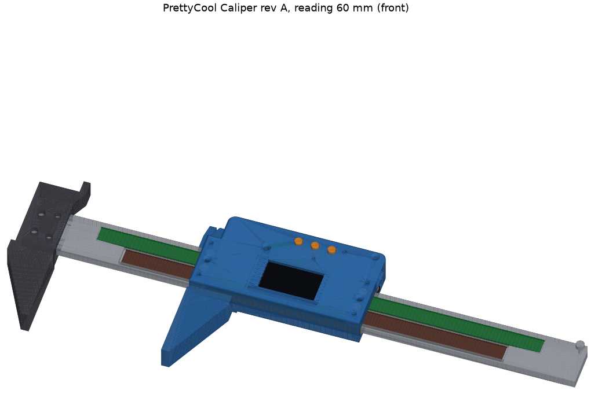 | 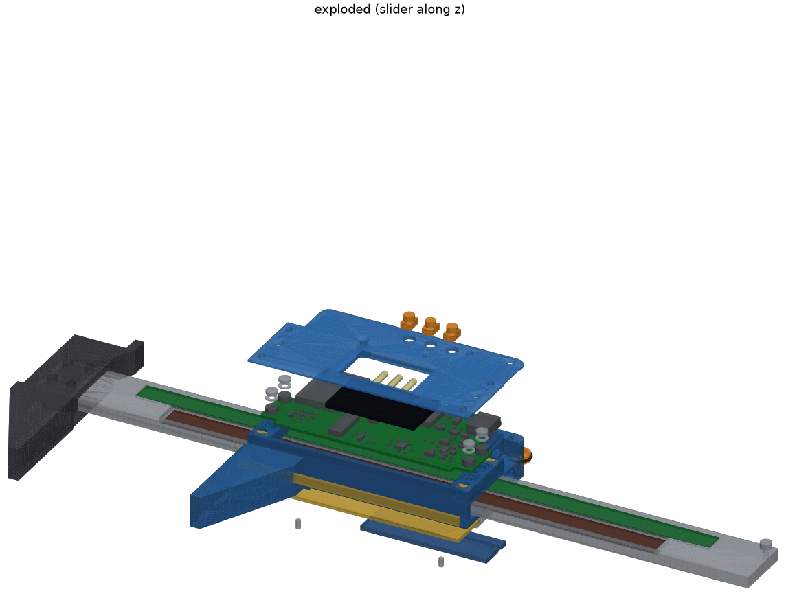 |
| Assembly at reading 60 mm, with the routed board | Exploded along z: front shell and caps up; battery door, battery and back gib down |
| 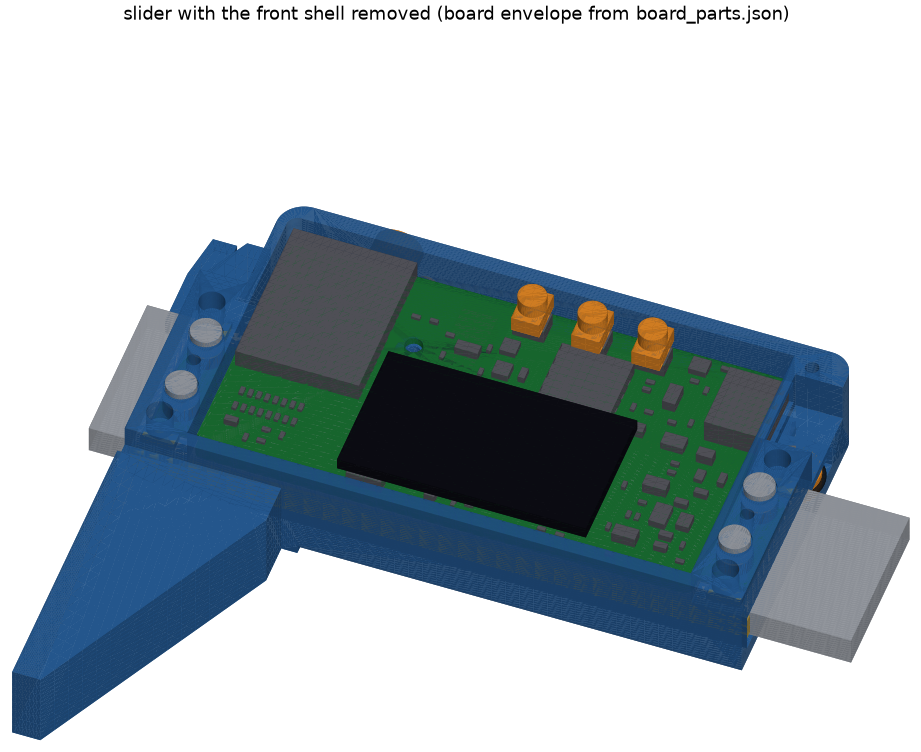 | 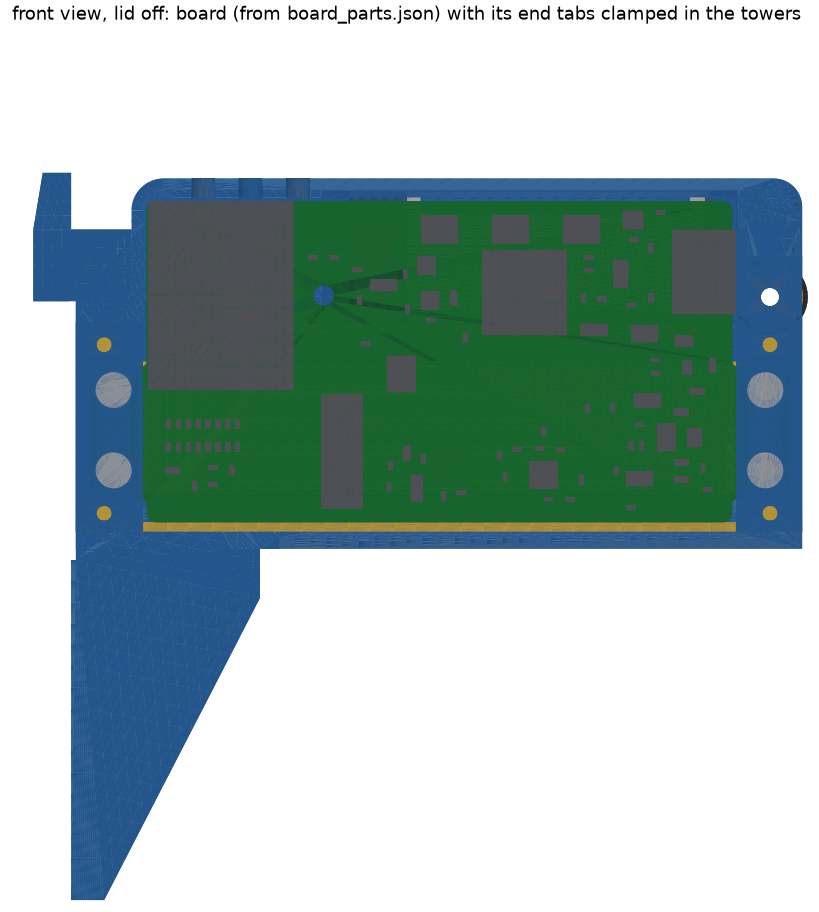 |
| Slider with the front shell removed | Front view, lid off: the routed board, its end tabs clamped in the two towers |
| 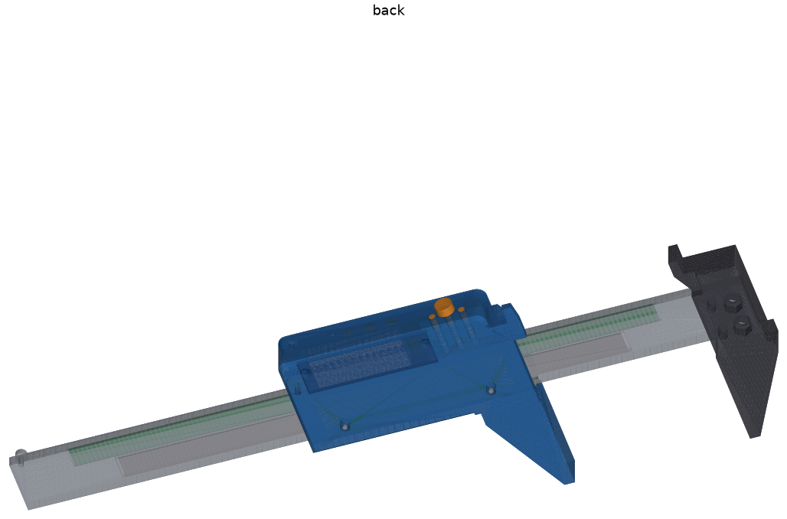 | 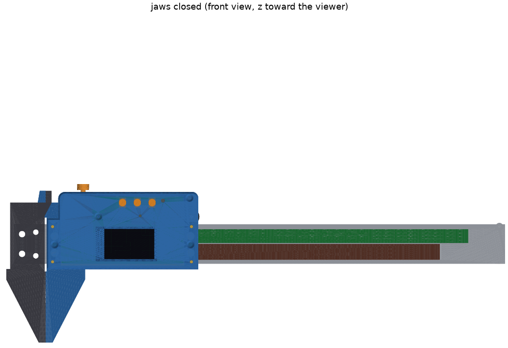 |
| Back: the closed back web over the beam, the battery door, the two back-plunger holes | Jaws closed (R = 0), seen from the front: the inside jaws cross above the beam |

Coordinates used everywhere (model, drawings, this page): **x** runs along the beam, with x = 0 at the
fixed jaw's measuring face. **y** runs across it, with y = 0 at the beam's lower (jaw-side)
**reference edge**, which is also the slider board's y (SPEC 2.1). **z** runs through it, with z = 0 at
the beam's front face and the back face at z = −4. The slider is built in its own frame u = x − R,
where R is the reading; board x = u − 8.

| Part | Rev A | Rev B |
|---|---|---|
| Beam | ground flat stock 20 × 4 × 250, O1 (preferred) or 1.4301, two pockets, five holes, one M2 tapped stop hole | same, to drawing PCC-M-02 |
| Fixed jaw | printed PA-CF block clamping the beam end with 2 × M3 + 2 × Ø3 dowels; **prints front face down** | 6061-T6 or tool steel |
| Slider body | printed **PAHT-CF**, with an unfilled-PA modifier volume near the antenna (PETG for fit trials). A closed tunnel round the beam with a 3.2 mm back web; the outside and inside moving jaws are integral; the board's end tabs are clamped in the two towers. **Since 2026-11-09 it ends 1.3 mm above the battery pocket (y 36.4, was 49.2)**, with R 3.4 / R 3.0 plan radii at the top corners and a 1.2 × 45° bevel round the back face (section 15) | CNC 6061-T6, drawing PCC-M-01 |
| Front shell | printed lid: landscape display window and bezel ribs, button holes, hex-key access to the pad screws, pockets for the tab-clamp screw heads, piezo port, LED light pipe, a 0.8 × 45° bevel on its outer edge and a tube onto H1 (its upper fastening, section 5) | printed (RF) |
| Battery door | printed; a flat 1.6 mm plate in a rebate in the body's back face, held by two nylon M2 screws; its inside face is the pocket floor. **Replaces the old back cover** | printed |
| Gibs | brass C360: back gib, Y gib, reference strip, 4 front pads | same |
| Depth rod | **omitted in rev A** (section 8) | open |

Key numbers (from `params.py`, `calcs_output.txt` and the FEA outputs):

| Quantity | Value |
|---|---|
| Housing envelope | **76.9 × 39.2 × 16.0 mm** (u × y × z; was 76.9 × 52.0 × 16.0 before the 2026-11-09 slim-down); the thumb-roller rim at u 78.0 from the jaw face, 0.6 proud of the end face; the inside-jaw tips reach y 37.0 (0.6 above the top face) and the lock's nylon knob 4 mm above it, as appendages (SPEC 7: ≤ 78 × 39.5 × 16 with the roller) |
| Battery | **501230-class 1S LiPo, 135 mAh** (reference Renata ICP501230PS-03, ≤ 5.4 × 12.5 × 31.5 with its protection circuit), behind the board's upper band; was a 402535, ~500 mAh. Rated 1C (135 mA) continuous, 2C (270 mA) pulse: the firmware must keep the battery current inside that (section 15) |
| Travel | 0–150 mm, hard stop at 151 (an M2 socket-head screw in the beam, removable) |
| Capacitive gap | 0.150 nominal; **±0.029 RSS, ±0.064 worst** after the tab-clamp bedding |
| AS5311 gap | 0.300 nominal; **±0.034 RSS, ±0.097 worst** after the per-unit shim, inside the SPEC window of ±0.10 |
| Sliding force | **3.9 N** at μ 0.15 (oiled brass on ground steel), 5.2 N at μ 0.20; was 8.0 N |
| Moving-jaw flex at the tip, 5 N | PETG 15 µm, PA-CF 6.1 µm, 6061 0.3 µm (beam theory); FEA 14.3 / 5.8 / 0.4 µm |
| Moving inside jaw, at the face | **1.98 µm/N** PA-CF, 4.05 µm/N PETG (FEA with the local body; the 2.4 mm plate was 9.5 / 23 µm/N) |
| Fixed inside jaw, at the face | **1.13 µm/N** PA-CF, 2.79 µm/N PETG (FEA with the fixed block's top part; 0.94 / 2.32 with a rigid root; the old triangle was 2.17 / 5.4 µm/N) |
| Inside reading, both jaws, 2–8 N | **19 µm** PA-CF (3.11 µm/N; 22 µm with the 0.85 FDM knock-down); outside reading 15 µm |
| Back web under the back preload | 1.8 µm at the plunger seat (FEA); the old back cover bent 0.6–1.1 mm |
| Masses (solid) | beam 124 g, slider body **23.0 g** PA-CF (was 33.0) / 53 g 6061 (was 77), front shell 4.5 g (6.1), battery door 1.1 g (4.2), back gib 9 g; the cell ≈ 3.6 g (the 402535 ≈ 9 g) |

## 2. Stack-up and sections

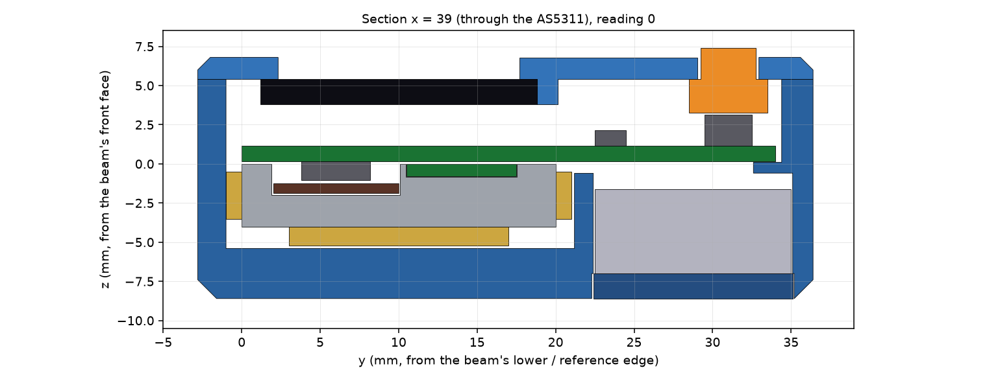

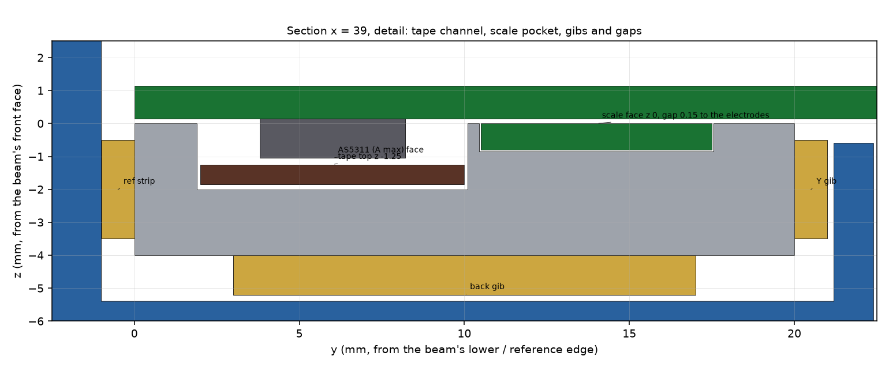

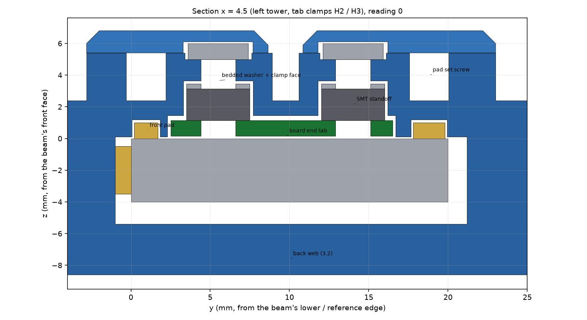

The sections are exact `section()` cuts of the solids from `render.py`, at R = 0: x = 39 through the
AS5311, and x = 4.5 through the left tower's two tab clamps.

| z (mm) | Item | Source |
|---|---|---|
| +6.8 | front-shell top (button caps +0.6 above) | `Z_LID` |
| +5.4 | front-shell underside = body front face. The display glass is glued here, 1.6 thick, down to +3.8 | display 31.0 × 17.6 × 1.6, landscape |
| +5.0 … +6.0 | tab-clamp screw heads: 0.4 in a body counterbore, 0.6 in a pocket in the lid underside | M2 × 4 low head |
| +3.65 | tab-clamp ceiling: 0.2 epoxy over a 0.3 shim washer on the standoff | `CLAMP_CEIL_Z` |
| +1.15 … +3.15 | SMT M2 standoffs on the tab holes | SPEC D3 |
| +1.15 | board top. Tallest part: J1 USB-C at 3.30 → +4.45 (limit 4.2 above the board); under the glass, SW20 at 2.0 (limit 2.6) | SPEC 2.1 |
| **+0.15** | **board bottom = capacitive electrodes** | SPEC 7 cap gap 0.15 |
| 0.00 | beam front face; scale PCB face flush (pocket 0.85 = 0.80 PCB + 0.05 467MP) | SPEC 7 |
| −0.95 | AS5311 package face (A nominal 1.10; JEDEC MO-153 range 0.85–1.20) | |
| **−1.25** | **tape face**: 0.30 below the AS5311 | SPEC 4.1 |
| −2.00 | tape-channel floor (0.60 tape + 0.05 adhesive + 0.10 Kapton shim for a nominal package; 0–0.35 per unit) | SPEC D2 |
| −4.00 | beam back face; back gib 1.2 thick, down to −5.2 | |
| −1.6 | top of the cell's max envelope (5.4 thick), 1.0 under the button ledge / cavity floor (−0.6): swelling room | `Z_POCKET + BAT_T` |
| −5.4 | tunnel back = back-web inside face | `Z_WEB_IN` |
| −7.0 | battery-pocket floor = battery-door inside face (the door is a flat 1.6 plate) | `Z_POCKET` |
| −8.6 | body back face (print bed) = battery-door outside face; 1.2 × 45° bevel round its edge | `Z_BACK` |

Across the beam (y): reference strip at y −1…0 under the lower edge; front-pad lands at y 0…1.9 and
17.55…20; **tape channel at y 1.9…10.1** (8.2 wide; the AS5311's 6.4 mm lead span runs inside it with
0.9 each side); a 0.35 land; **scale pocket at y 10.45…17.55**; Y gib at y 20…21 on the upper edge.

The board sits 0.15 above the beam over its whole lower band, so nothing on its bottom may cross the
beam except inside the tape channel. The real board meets that rule (section 12). The housing
touches the beam front face **only at its two end towers** (u 0.5…7.6 and 70.4…77.4), beyond the
board's body. The board's end tabs reach into those towers.

## 3. Alignment with SPEC

The first model's deviations DEV-1 to DEV-5 are all closed. They became SPEC D2 (tape, channel),
D3 (tabs instead of the three upper-band holes), D4 (landscape display, placement, USB-C y 26.5) and
D5 (scale x 14.5). The model now uses the SPEC numbers. Where SPEC leaves a choice to the mechanics,
the model does this:

| SPEC says | The mechanics chose |
|---|---|
| D3: the four clamp faces coplanar within 0.03; "faced washers, insert faces, or the rev B machined tower" | **Bedded shim washers**: each clamp face is a 2.2 × 4.0 × 0.3 washer bedded in epoxy while the board lies on 0.150 shim foil on the beam's lands. The clamp faces then copy the beam face, not a bridged printed surface (sections 5 and 7) |
| D3: H1 is a support, "printed low and shimmed" | H1 boss printed 0.1 low and shimmed with Kapton; M2 tapped in the print for the nylon screw (no brass insert, which would sit 4 mm from the antenna). Since 2026-11-09 the screw (nylon M2 × 10 flat head) comes from the lid's top face through a tube on the lid underside, so H1 also holds the lid's upper part (section 5) |
| Open item: support under the button band over the battery | A **button-band ledge** (u 37…65.5, y 32.6…34.4) cantilevered from the cavity wall under the board's top edge, shimmed to contact (section 5) |
| D4: the right Y plunger and the lock move out of the battery pocket | Both Y plungers (u 14, 24) and the lock (u 19) sit **left** of the pocket. They pass under the antenna, so each pushes the gib through a **Ø2 GFRP rod**. Since 2026-11-09 the top face is only 2.4 mm above the antenna area, so the only metal, each Y plunger's spring, sits at the **bottom** of its bore (y 22.0–24.4, 5.15 mm from the antenna), and the set screws and the lock's thumb screw are **nylon M3** in threads tapped in the print (section 4) |
| D4 / 7: no metal or carbon fibre within 5 mm of the antenna | Checked in plan for every metal item (section 12). The body region u 6.4…28.55, y 24.5…39 prints in **unfilled PA** through a slicer modifier (`stl/slider_body_rf_modifier.stl`). The stiffened moving inside jaw (section 9) reaches the housing face at u 6.4 under the antenna corner: its material within **5.15 mm** of the antenna area (a round-cornered zone) is in the same modifier, so its **PA-CF stays 5.15 mm away in plan** (section 12). The first fix, an R 5.15 relief arc on the old 2.4 mm plate's flank, was replaced by it |
| 7: lead channel + JST plug relief past the top edge, sound port, light pipe | **No plug relief any more** (2026-11-09): J2 moves to the board's bottom side, mouth +y, so it, the plug and the cell leads sit in the battery pocket's left end (u 29.5…35.6, the J2 bay). The board has had that move since 2026-11-09 (section 15). Ø1.5 piezo port at u 48, y 24.3; Ø2.0 light pipe at u 59.5, y 32 |
| 2.1: lid end ribs x 16.15…17.5 and 48.5…49.85 | Those two, plus a rib along the glass's top edge (y 18.8…20.15) to locate it in y, inside SPEC's 2.6 mm zone |

These choices are the mechanics' own and are not SPEC items:

* **Outside shape (2026-11-09).** The body prints back face down and the lid face down, so their outer
  edges on those faces are **45° bevels** (1.2 on the body's back, 0.8 on the lid's top), which print with no
  support, and the plan corners at the top are radii (R 3.4 left, R 3.0 right). The cavity's top-left corner
  follows the board's R 1 corner (0.4 clear), so the left radius keeps the 1.2 mm wall. The bevel stops
  short of the jaws (the step, the inside-jaw root and the outside-jaw root keep their sharp back edges) and
  the datum faces (the end faces, the tunnel, the clamp faces) are untouched. There is no taper: the top face
  sits 1.3 mm over the cell pocket and 2.0 mm over the board cavity, and the end faces are datums (the stop,
  the jaw), so nothing is left to taper without taking a function (section 15).

* **Slim USB-C cable.** The cable-overmold relief is now 10.6 × 6.0, kept above the beam tunnel
  (y ≥ 21.2). The first relief (12.4 × 6.6) cut the right tower's front part off from the upper body.
  The cable's overmold must be ≤ 10.4 × 5.8 (TVP).
* **The inside jaws moved in z** so that each prints on its own part's bed with no support (section 8):
  the moving one is at z −8.6…−6.2, the fixed one at −6.0…+2.5. The tips still cross with a 0.2 mm
  gap. A bore must still be at least ~2.6 mm deep for both tips to engage (inserted back face first),
  the same as before.
* **The moving inside jaw is stiffened** (2026-11-08, section 9): the old 2.4 mm plate flexed 8 µm/N. The
  measuring face (u 0, y 31…37), the tip's z (−8.6…−6.2) and its 3.0 mm width at the end are unchanged. The
  tip's back edge now tapers to **4.0 mm at its base**, the plate fills a **shoulder block** under the tip
  (u −4…6.4, its top level with the face's lower end, y 31), and a **full-height gusset** (z −8.6…+2.4)
  fills the part of that block the fixed inside jaw can never reach at any reading (0.4 mm clear of its
  flank). Trade-off: a gap narrower than 4.0 mm takes less than the full 6 mm of tip (it was 3.0 mm; the
  tip's last millimetre is still 3.0 wide).
* **The fixed inside jaw is stiffened too** (2026-11-09, section 9): it was a triangle whose neck at the face's
  lower end was the 3 mm tip alone. The measuring face (x 0, y 31…37), the tip's 3.0 mm width over its whole
  6 mm, its z (−6.0…+2.5, the 0.2 mm gap over the moving tip) and its right flank are unchanged. A **shoulder
  block** now fills x −18…0 under the face, up to y 31, on the whole fixed-block top, and a **full-depth
  gusset** (z −8.6…+2.5) fills the part of it left of x −4.4, which the moving inside jaw never reaches
  (0.4 mm clear). Trade-off: a workpiece wall left of the fixed face now stops at y 31 (the face's lower end),
  as on the moving side; before, the sloping edge let a thin wall pass a little lower. The tip is not tapered:
  its right edge (x 3.0) is exactly 5.15 mm from the antenna at R = 0, and a wider base would also run into the
  moving jaw's gusset.

Placement deviations reported by the layout track (U4, the TX ladder, FID3, U1, module x 7.85, J2 y
30.6, J50 y 7.5, SW20 rotation, C8/C10/C30) are all in the extracted envelope. None of them clashes
with the housing. The same holds for the 2026-11-08 changes (SPEC §12): C21/C23 (0402, 0.55 mm envelope) on the
**bottom under the module** at x 2.1–4.1, y 24.8–27.0 clear the cavity floor 0.75 mm below and the GFRP pushers,
and Q1 / R10 / RT1 / C7 beside J2.

## 4. How the slider locates on the beam

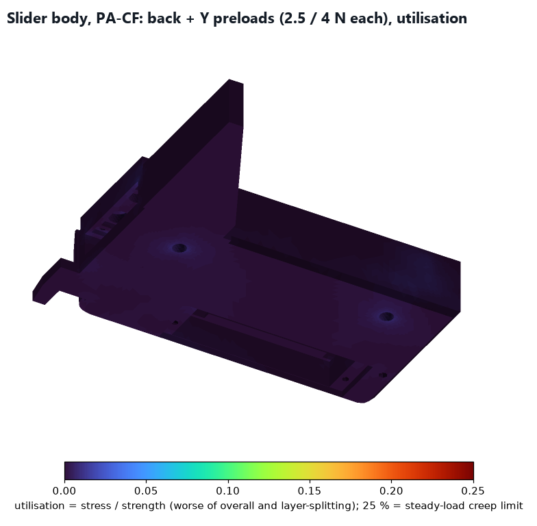

Five brass contacts and three spring loads:

* **Y (across the beam):** the brass **reference strip** (1.0 × 3 × 76.9, glued into the lower rail)
  rides on the beam's lower edge, which is reference edge E. Two **Y plungers** at **u 14 and 24** push
  the brass **Y gib** onto the upper edge, which pulls the strip up onto edge E. Each plunger is, from
  the gib up (2026-11-09; the top face is now 2.4 mm above the antenna area, too close for metal):
  * a **GFRP tip pin** (Ø2 × 1, coned into the gib's dimple);
  * the **spring** at the bottom of the bore (y 22.0…24.4 as compressed, ~2 N/mm, ~2 mm deflection for
    4 N), the only metal, 5.15 mm below the antenna area in plan;
  * a **Ø2 GFRP rod** up to
  * a **nylon M3 × 4 set screw** in an M3 thread tapped in the print at the top face (y 31.4…36.4; no
    insert). Before the slim-down it was an M2 set screw in a brass insert with the spring at y 41…46.

  The bores run at z −2.5 (was −2.3), so the M3 thread keeps 0.65 mm under the cavity floor. The 5 N measuring force at the jaw tip
  (y −37) and the thumb's drive force form a couple that lifts the strip's left end. Moving both
  plungers left raised their lever about the strip's right end from 81.5 to **116.8 mm**. Keeping the
  strip seated now needs **≥ 2.4 N each** with the roller drive and ≥ 3.1 N for a push on the end face
  (calcs §2). The design value is **4.0 N each**, a 1.64× / 1.30× margin (6 N before).

  Trade-off: nothing on the right end resists a moment of the other sense. A −y push on the
  slider's right end above **1.9 N** lifts the strip there while it lasts. No measuring load makes
  that moment: outside and inside measurements both lift the left end.
* **Z (through the beam), position:** four brass **front pads** (4 × 1.5 or 2.0 × 1.0) ride on the
  beam's front lands (y 0.2…1.7 and 17.8…19.8) under the two towers. Each sits under an **M2 set
  screw** in an insert, reached through Ø2.0 holes in the front shell. They set the tower height. The
  board height is then fixed by the tab-clamp bedding (section 7), and the screws are only a trim.
* **Z, preload (review fix a):** the brass **back gib** (1.2 × 14 × 64) is pushed onto the beam's
  back face by two spring plungers. They now sit in the **body's 3.2 mm back web**, which closes the
  tunnel behind the beam and ties the lower rail to the upper body. They are at **(u 14, y 5) and
  (64, 5)**, **2.5 N each**. The first model put them in a back cover screwed only at y 44: a 34 mm
  cantilever that bent 0.6–1.1 mm in PA-CF and used up the plungers' travel. FEA of the whole body
  (`fea_slider.py`, PA-CF, both preloads; re-run on the slim body 2026-11-09, the Y loads now on the M3
  threads at the top) gives **1.8 µm** at the plunger seats (1.7 before), and 0.1 µm at the
  tab-clamp ceilings. The reactions balance the loads (9.43 N). Stress is under 0.25 MPa (utilisation
  ≈ 0 in the figure). Moving the plungers from y 10 to y 5 raised their lever to the upper pad line
  from 8.8 to 13.8 mm. A button press (2.5 N at y 31) now needs ≥ 1.1 N each. A grip near the top
  edge (y 34.4) above **4.4 N** lifts the lower pads while it lasts (3.3 N at y 40 on the 52 mm housing;
  the lower edge has the shorter lever); the gaps then open, they never close.
* **Locking screw:** a **nylon M3 knurled thumb screw** in an M3 thread tapped in the print at the top
  face, at **u 19**, pushes a third GFRP rod onto the Y gib (it was steel in a brass insert). Its head
  stands 4 mm above the top face.
* **Thumb roller:** a printed Ø7 hub with an NBR O-ring (ID 6 × 0.8) on a Ø2 pin, rolling on the
  beam's upper edge with 0.15 mm squeeze. The rim is at **u 78.0**, 0.6 proud of the right end face,
  below the USB-C. The axle hole now runs through to the USB relief, so the pin can be pushed out.

**Sliding force (review fix c).** Every preload acts on two faces, so F = 2 × (2 P_back + 2 P_Y) × μ:

| Preloads | Normal load | μ 0.12 | μ 0.15 | μ 0.20 |
|---|---|---|---|---|
| First model: back 4 N, Y 6 N | 20 N | 4.8 N | 6.0 N | 8.0 N |
| **Now: back 2.5 N, Y 4.0 N** | 13 N | 3.1 N | **3.9 N** | 5.2 N |

The target is 2–5 N, as for a commercial caliper. μ 0.12–0.15 is brass on ground steel with a light
oil film; dry brass on steel is 0.3–0.35, so keep the beam oiled. The lower preloads cost no seating
margin, because both levers grew. The plunger set screws trim the force on the bench (0.4 mm per
turn on the back plungers, 0.5 mm on the Y plungers' nylon M3). The O-ring's rolling resistance is not
included (TVP).

The outside jaw is 11.0 thick (z −8.6…+2.4, on the print bed). Its centre is 1.1 mm off the beam's
mid-plane, so the 5 N measuring force puts a 5.5 N·mm twist into the guide, which is small.

## 5. Board support (SPEC D3)

* **Tab clamps (Z datum).** The board's end tabs (x −6…0 and 62…68, y 2.5…16.5) sit in pockets in
  the towers (u 1.8…8 and 70…76.2, y 2.3…16.7), open to the tunnel below. On each of H2–H5 an SMT
  M2 standoff (2.0 tall) rises into a Ø4.4 pocket. An **M2 × 4 low-head screw** from the tower's front
  face pulls it up against a **2.2 × 4.0 × 0.3 shim washer bedded in epoxy** under a printed clamp
  plate 1.35 mm thick. The screw tip ends inside the board, never below it.
* **Bedding instead of printed faces.** A downward printed clamp face is a bridged surface (±0.1).
  So the washers are bedded while the board lies on 0.150 mm shim foil on the beam's ground lands
  (section 7). The four clamp faces then sit in the plane of beam face D, and the open-loop ±0.10
  clamp-height term drops out of the stack (section 6).
* **H1** (18.75, 24): a boss printed 0.1 low and shimmed to contact. Since 2026-11-09 H1 is also the
  lid's upper fastening: the old upper lid screws (an insert at (10.5, 46) and one at (74, 44)) have no
  body left above the board, and the upper left one would now sit over the antenna. A Ø4.4 tube on the lid
  underside ends 0.1 mm over the board around H1, and a **nylon M2 × 10 flat-head screw** from the lid's
  top face runs through it and the board into the boss (M2 tapped in the print). The board is clamped
  between the tube and the shimmed boss, so the boss still sets its height; the screw cannot pull the board
  out of the tab plane. The lid's third steel screw moved to the right tower above the USB-C relief
  (u 73.0, y 33.4). TVP: the lid's top-left corner is about 24 mm from the nearest screw (H1); check it lies flat.
* **Button-band ledge.** HOLD and MODE sit over the battery pocket, with no body under the board.
  The FEA of the board (`fea_slider.py`) used the real outline and tabs, clamped at the four
  standoffs, resting on H1, with 3 N on one switch at a time. It gives these deflections:

  | 3 N on | Without the ledge: button / electrode band / AS5311 | With the ledge |
  |---|---|---|
  | ZERO | 46 / 19 / 6 µm | 0.5 / 0.7 / 0.5 µm |
  | HOLD | 92 / 35 / 8 µm | 0.5 / 1.0 / 0.8 µm |
  | MODE | 129 / **42** / 12 µm | 0.5 / 1.0 / 0.6 µm |

  Without support, a MODE press closed the capacitive gap by 28 %. The ledge runs under the board's
  top edge (u 37…65.5, y 32.6…34.4), where the board's bottom is plain solder mask. It is printed
  0.05 low and shimmed to contact like H1. The FEA treats it as rigid; its own compliance as a
  printed 1.8 mm cantilever adds about 6 µm under the full 3 N. Linear tets are stiff in plate
  bending, so the board results are corrected ×1.75. A cantilever strip meshed the same way in the
  same run calibrates that factor.

## 6. Gap stack-up

From `calcs.py` §5 and §6:

| Gap | Open loop | After the bedding and the per-unit shim (section 7) | Window |
|---|---|---|---|
| capacitive 0.15 | ±0.165 RSS, ±0.34 worst: **can't be built open loop** (scale FR4 ±0.08, printed clamp face and tower ±0.10 each) | **±0.029 RSS, ±0.064 worst**: the electrodes never touch | experimental; touching is the only hard limit |
| AS5311 0.30 | ±0.187 RSS: **outside** (package height alone is ±0.175) | **±0.034 RSS, ±0.097 worst: inside** | 0.20–0.40 (SPEC 4.1) |

The board-height terms after the bedding are:

| Term | Value | Notes |
|---|---|---|
| shim foil | ±0.005 | TVP: measure the foil |
| beam face flatness | ±0.010 | |
| board flatness residual | ±0.015 | half the SPEC 0.03 band; every board is inspected |
| epoxy cure shrinkage | ±0.004 | |
| clamp-seat creep | ±0.010 | PA-CF, TVP |
| thermal of the clamp chain, ±10 K | < 0.001 | |
| tower movement under a ±20 % preload drift | < 0.001 | FEA |

Their RSS is ±0.022, against ±0.04 with the first model's bosses, set screws and an unsupported
7–24 mm overhang. The first model's AS5311 worst case (±0.13) was outside the window. This one is
just inside. The firmware field check (section 7, step 7) still accepts or rejects each unit.

## 7. Setting the gaps (assembly procedure)

1. **Before fitting the board:** micrometer the board + AS5311 stack beside the package, which gives
   the seated height A to ±0.005. Check the board's lower band (y 0…20, tabs included) on a surface
   plate and reject a board more than 0.03 out of flat (SPEC D3 fab note).
2. **Bond the scale and the tape** with 3M 467MP. Depth-gauge the tape face and the scale face below
   beam face D at 5 points along the travel. Predict the AS5311 gap = 0.15 + 2.00 − 0.05 − tape − shim − A,
   and lay 0–0.35 mm of Kapton shim (0.025 steps) under the tape until it predicts 0.30. Unshimmed,
   the tallest package (A max 1.20) gets 0.30. A shim only raises the tape, so every shorter package
   can be corrected.
3. **Assemble the slider on the beam:** reference strip, front pads, Y gib, back gib; in each Y bore
   the GFRP tip pin, the spring, the GFRP rod and the nylon set screw (the spring goes in second, at the
   bottom); the back plungers. Set the preloads to Y 4 N and back 2.5 N (TVP: by turns from contact, once
   the spring rates are known). Slide it on from the beam's right end, with the stop screw out. Set the
   four pad screws so the tower undersides sit about 0.1 over the beam.
4. **Bed the clamp washers:**
   * With the lid off, lay four strips of **0.150 steel shim foil** on the beam's ground lands
     (y 0.2…1.7 and 17.8…19.8) under the board's two ends.
   * Lower the board, with its standoffs reflowed on, onto them. The tabs go into the tower pockets.
   * Check the gap between each standoff and its pocket ceiling with feelers: 0.05–0.35.
   * Put a dab of slow structural epoxy on each shim washer's top face and wax the four clamp screws.
   * Fit the screws **finger-loose**, put a ~50 g weight on the board centre and cure 24 h.
5. **Clamp and check:** tighten the clamp screws lightly (TVP: 0.05 N·m) and slide the foil out. With a
   dial indicator (2 µm) on a base standing on the beam face, read the board top at three points over
   the electrodes. Board bottom = indicator − board thickness must be 0.150 ± 0.010 at all three. Trim
   with the four pad screws (M2 × 0.4: 0.1 mm = 90°), lock them with Loctite 222, and re-bed if a
   corner is out.
6. **H1 and the ledge:** shim the H1 boss and the button-band ledge with Kapton until each just
   touches (a 0.02 feeler drags). Keep at least one Kapton layer on the ledge even if it already touches: the
   board's VBAT band runs under it on B.Cu (under mask; electronics §7.13). With the lid off, press the board
   at H1 with ~3 N: the indicator there must not move more than 0.01 (the boss shim is right). The H1 screw
   now comes with the lid (step 8).
7. **Check in firmware** at R = 0, 75 and 150:
   * AS5311 MagINCn and MagDECn both high (field in range);
   * SSI status OCF set, COF and LIN clear;
   * the capacitive RX amplitude varies by less than ±30 %.

   Record everything in the [bring-up](bringup.md) log. Fit the stop screw (Loctite 222).
8. **Battery and lid:** with the door off, plug the cell's JST-SH plug into J2 on the board's bottom side
   through the open back (it points +y, toward the top edge), lay the leads in the J2 bay (u 29.5…35.6), put
   the cell in the pocket lead end first and fit the door (two nylon M2 × 4 flat-head screws, snug). Fit the
   lid: the two tower screws and the right-tower screw, then the nylon M2 × 10 through the lid's H1 tube,
   snug only.

## 8. Parts, print settings and orientation

Bambu P2S, 0.4 mm nozzle, 0.20 mm layers, textured PEI plate. PAHT-CF needs the hardened nozzle and
filament dried at 80 °C for 8 h. The body's RF modifier prints in unfilled PAHT from a second AMS
slot; PAHT and PAHT-CF bond. Every printed part was run through the `bambu-p2s` printability check
(`printcheck.py`) on the exported print-pose STLs, and every STL is watertight (trimesh):

| Part | File | Material | Pose | Settings | Printability check |
|---|---|---|---|---|---|
| Slider body | [`stl/slider_body.stl`](../hardware/mechanical/stl/slider_body.stl) + [`rf_modifier`](../hardware/mechanical/stl/slider_body_rf_modifier.stl) | **PAHT-CF**; the modifier in PAHT (PETG for fit trials) | back face down | 6 walls, 40 % gyroid, solid jaws | FAIL without supports. **Paint-on supports in two places** (three before the 2026-11-09 slim-down: the battery-pocket ceiling over y 34…48 is gone with the plug relief): (1) the roller-slot roof (7 mm); (2) the tower undersides beside the tab pockets (4.5 mm strips), standing on the back web inside the tunnel and pulled out through the tunnel ends. WARN: the 22 mm tunnel-roof bridges at the towers and a 4 mm² sub-0.8 mm feature at z 0.5, as before; the button ledge (2.5 mm shelf) and the two door-rebate ledges at the pocket ends (2.3 and 2.4 mm shelves). The back bevel and the plan radii add no finding. **The inside jaw no longer needs support** |
| Fixed jaw | [`stl/fixed_jaw.stl`](../hardware/mechanical/stl/fixed_jaw.stl) | PA-CF | **front face down** (was back face down) | 6 walls, 60 % infill | the beam-slot roof flags as a 5.6 mm cantilever. It is bridged 20 mm between both side walls, as before. **The inside jaw no longer needs support**; its shoulder block and gusset (2026-11-09) are prisms standing on the bed and add no finding (re-checked) |
| Front shell | [`stl/front_shell.stl`](../hardware/mechanical/stl/front_shell.stl) | PETG | top face down (textured) | 4 walls, 100 % | PASS (re-checked 2026-11-09 with the edge bevel and the H1 tube) |
| Battery door | [`stl/battery_door.stl`](../hardware/mechanical/stl/battery_door.stl) | PETG | outside face down (textured) | 4 walls, 100 % | PASS (re-checked 2026-11-09: now a flat 1.6 plate) |
| Button cap × 3 | [`stl/button_cap.stl`](../hardware/mechanical/stl/button_cap.stl) | PETG | flange down | 100 % | PASS |
| Thumb roller | [`stl/thumb_roller.stl`](../hardware/mechanical/stl/thumb_roller.stl) | PETG | flat | 100 % | PASS |

**Inside jaws (review fix d).** Each inside jaw now starts on its own part's print bed. The moving one
spans z −8.6…−6.2 on the slider's back face. The fixed one spans −6.0…+2.5, reaching the fixed jaw's
front face, which now goes on the bed. So both 14 mm overhangs are gone, with no split part and
nothing glued. The other two FAILs in the first model (the roller-slot roof and, now, the pocket and
tower strips) are short and non-functional faces, so they get specified supports rather than a split
part.

Clearances: sliding parts get 0.15–0.20 per side (`CLR_SLIDE`); the brass gibs and pads float in
0.10–0.15 pockets. Heat-set inserts are M2 × 3 in Ø3.2 holes (pad screws, back plungers); thread-forming
screws go into Ø1.7 pilots; the nylon screws go into threads tapped in the print: M3 in Ø2.5 (Y plungers,
lock), M2 in Ø1.6 (H1, the battery door). The STEP of every part is in [`step/`](../hardware/mechanical/step/), in assembly
pose, plus [`step/caliper_assembly.step`](../hardware/mechanical/step/caliper_assembly.step) (44 named
solids at R = 0).

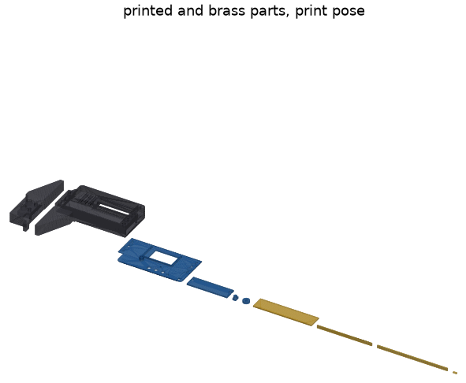

**Depth rod:** omitted in rev A. The back face carries the back gib and its web, and the right tower
holds the roller, the USB relief, a tab clamp and two pad screws.

## 9. Calculation results (summary)

**Jaw deflection** (calcs §1; FEA in `fea_jaw_output.txt`, figure `renders/fea_jaw.png`). The jaw is
11.0 thick (it grew from 7.8 when the body's back face moved to the print-bed plane), 20 wide to
y −8, and tapers to 3.5 at the tip, y −40. It is printed back face down, so it bends in the layer
plane. Interlayer stress is 0.10 MPa (FEA), so strength is not the issue; stiffness is.

| Body | Tip contact (y −37), 5 N: beam theory | FEA, tip | Per N | 2–8 N thumb spread |
|---|---|---|---|---|
| PETG | 15.1 µm | 14.3 µm (datasheet E; ÷0.85 → 16.8) | 3.0 µm/N | **18 µm** |
| PA-CF | 6.1 µm | 5.8 µm | 1.2 µm/N | **7.3 µm** |
| 6061-T6 | 0.3 µm | 0.4 µm | 0.06 µm/N | 0.4 µm |

The fixed jaw (PA-CF) adds about the same again.

**Inside jaw** (calcs §1; FEA in `fea_inside_jaw_output.txt`). The old moving inside jaw was a 2.4 mm
plate (z −8.6…−6.2) with a 3 mm tip over y 31…37 on a 45° flank, and flexed **7.9 µm/N** on PA-CF. It is now
stiffened (2026-11-08, `params.py` "Stiffening"):

* **Unchanged:** the measuring face (u 0, y 31…37), the tip's z (it still crosses the fixed tip 0.2 apart and
  adds nothing to the crossed tips' z stack) and the tip's 3.0 mm width at its end.
* **Tip taper:** the tip's back edge runs from 3.0 mm wide at y 37 to **4.0 mm at its base**, y 31.
* **Shoulder block:** the plate fills the region under the tip, u −4…6.4, up to y 31, level with the face's
  lower end. Nothing is added right of the face above y 31, so a bore still takes the whole 6 mm tip. The
  block's left part hangs 0.4 mm over the fixed block's top at R = 0.
* **Gusset:** a full-height gusset (z −8.6…+2.4) fills the part of the block the fixed inside jaw can never
  reach at any reading. It stays right of the fixed jaw's flank, 0.4 mm clear (perpendicular), and sits on
  the step top and against the housing's left face (u 6.4) up to y 31.
* **RF:** the block and gusset run under the antenna corner. Their material within 5.15 mm of the antenna
  area prints in **unfilled PA** (the body's RF modifier, section 12).

The FEA puts 5 N in −u on the measuring face. It uses datasheet E (PA-CF 4.2 GPa; unfilled PA 1.5 GPa, TVP;
PETG 1.7 GPa) and two supports. **Rigid root** fixes the faces against the body, as the first run did.
**Local body** fuses the jaw to the body round its root (u 0.5…14, y 15…36: the step over the tunnel, the
1.2 mm wall beside the board cavity and the back web) and fixes only the cut faces:

| Moving inside jaw, µm/N at the face | PA-CF, rigid root | PA-CF, local body | PETG, local body |
|---|---|---|---|
| 2.4 mm plate (before) | 7.86 | 9.48 | 23.2 |
| shoulder block + taper, plate only | 1.86 | 2.27 | 4.3 |
| **as built: + full-height gusset** | **1.72** | **1.98** | **4.05** |

So the jaw is about **4.8× stiffer**. On PA-CF with the local body it reaches the ≤ 2 µm/N target on datasheet
E, with no margin: with the 0.85 FDM knock-down it is 2.3 µm/N, and linear tets read a few % stiff, so treat
it as at the target, not under it (review 2026-11-09; a hand beam check of the tip plus block, ≈ 1.5 µm/N with a
rigid root, agrees with the FEA's 1.72). The plate's compliance was mostly the 45° flank and the narrow root. What remains is mostly
the 3 × 2.4 mm tip itself: the tip taper is worth about 0.6 µm/N. The gusset matters most once the body's own
give is counted. Stresses are low: von Mises 1.8 MPa, interlayer 0.16 MPa, SF > 20.

Options looked at and not taken (rigid root, scratch runs):

* A thicker tip (3.4 mm in z, with the fixed tip 1 mm thinner, same stack): 1.9 µm/N. It deepens the bore
  needed to engage both tips (2.6 → 3.6 mm) and weakens the fixed jaw.
* A taper to 4.5 mm: 1.55 µm/N, at a wider minimum gap.
* A bonded hardened-steel tip blade (ideal bond): 1.6 µm/N, with an insert, bonding and a metal part 8 mm
  from the antenna.
* A gusset up to the body front face (z 5.4): no gain over z 2.4.

**Fixed inside jaw** (calcs §1; FEA in `fea_inside_jaw_output.txt`, second part). It was a triangle,
8.5 mm thick (z −6.0…+2.5): the 3 mm tip over y 31…37 on a left edge sloping from the face's lower end (x 0,
y 31) down to (−12, 22.9). Its neck at y 31 was the tip alone, and it flexed **1.71 µm/N** on PA-CF with a rigid
root, 2.17 with the block's own give: about as much as the stiffened moving jaw (1.98). It is now stiffened the same way
(2026-11-09, `params.py` "Fixed inside jaw stiffening"):

* **Unchanged:** the measuring face (x 0, y 31…37, facing −x), the tip's 3.0 mm width over its whole 6 mm, its z
  (the 0.2 mm gap over the moving tip, so the crossed tips' z stack is the same) and its right flank, which the
  moving jaw's gusset keeps 0.4 mm from.
* **Shoulder block:** the plate fills x −18…0 under the face, up to y 31, level with the face's lower end, on the
  whole fixed-block top (x −18…−0.5, y 23). Nothing is added left of the face above y 31, so a bore or slot still
  takes the whole 6 mm tip. The block passes over the moving jaw's plate 0.2 mm apart in z, as the tips do.
* **Gusset:** the shoulder is full depth (z −8.6…+2.5, the block's back face) left of x −4.4, where the moving
  inside jaw never reaches at any reading: its leftmost edge is u −4.0 (the tip base and the block's left part),
  so the gusset is 0.4 mm clear at R = 0.
* **No tip taper.** The tip's right edge (x 3.0) is exactly 5.15 mm from the antenna area at R = 0 (section 12),
  so a 4.0 mm base like the moving tip's would put PA-CF 4.15 mm from it (or need unfilled PA in the tip), and it
  would also run into the moving jaw's gusset at R = 0. The minimum gap is therefore unchanged: the fixed tip
  is 3.0 mm wide over its whole length, the moving tip 4.0 at its base.
* **Mass:** +1.3 g of PA-CF (the fixed jaw is now 12.2 g). It prints front face down as before; the shoulder and
  gusset are prisms standing on the bed (section 8). The bolts, dowels, nut traps and the beam slot are
  untouched: everything new sits on the block top, y ≥ 22.9.

The FEA puts 5 N in +x on the measuring face, datasheet E, all PA-CF (or all PETG). **Rigid root** fixes the jaw's
root face on the block top. **Local block** fuses the jaw to the fixed block's top part (x −18…−0.5, y 15…23,
full depth, with the beam slot, the bolt bores, the nut traps and the dowel bores left empty) and fixes only
the cut face y 15. The beam does not support the plates between y 15 and 20 and the dowels carry nothing, so it
is the soft bound; a scratch run with the upper dowel and the plates' beam faces held read about 0.03 µm/N
stiffer.

| Fixed inside jaw, µm/N at the face | PA-CF, rigid root | PA-CF, local block | PETG, local block |
|---|---|---|---|
| old triangle (before) | 1.71 | 2.17 | 5.37 |
| shoulder block, plate only | 0.96 | 1.16 | 2.87 |
| **as built: + full-depth gusset** | **0.94** | **1.13** | **2.79** |

So the fixed jaw is about **1.9× stiffer**. It meets the ≤ 1.0 µm/N target with a rigid root (0.94) but **not
with the block's own give (1.13; 1.33 with the 0.85 FDM knock-down)**. What is left is mostly the tip itself:
with a rigid root the face's lower end (y 31) moves 0.29 µm/N and its mean 0.93, so about two thirds is the 3 mm
× 8.5 mm tip bending on its root. The tip can't grow: not in x (the face, and the RF limit on the right), not in
z (the moving tip below, the print bed above). Stresses are low: von Mises 1.1 MPa, interlayer 0.3 MPa.

Options looked at for the fixed jaw and not taken (scratch runs, mesh 0.4):

* Shoulder only to x −12 (the old root's length), plate only: 0.99 rigid, 1.27 with the block, against 0.95 /
  1.13 for the same plate to x −18 on the same scratch mesh.
* The shoulder raised to y 37 left of x −6.8, on top of the as-built jaw: no gain (0.932 against 0.934 rigid,
  1.09 against 1.10 with the block), and it would stop a workpiece wall thicker than 6.8 mm left of the face.
* A tip taper to 4.0 mm at y 31 (as on the moving tip), ignoring the RF limit and the moving gusset: 0.73 µm/N
  rigid, 0.2 better, so the largest single lever left. Not taken: its PA-CF would be 4.15 mm from the antenna
  area at R = 0 (SPEC D4 wants 5), and its base would touch the moving jaw's gusset at R = 0 (that gusset would
  have to give up its corner, softening the moving jaw). Printed in unfilled PA instead, the strip would gain roughly a
  third of that (estimate from E 1.5 against 4.2 GPa; not run) and still meet the moving gusset.

**Inside-measurement budget** (PA-CF, 2–8 N thumb spread, datasheet E, both jaws with their local bodies):

| Contribution | per N | over 2–8 N |
|---|---|---|
| moving inside jaw, as built (local body) | 1.98 µm/N | **11.9 µm** (14.0 with the 0.85 FDM knock-down) |
| fixed inside jaw, as built (local block) | 1.13 µm/N | **6.8 µm** (8.0 with the knock-down; was 2.17 µm/N, 13.0 µm) |
| **inside reading, both jaws** | 3.11 µm/N | **18.7 µm** (22.0 with the knock-down; rigid roots 2.66 µm/N, 16.0 µm) |
| outside reading, both jaws (for comparison) | 2.4 µm/N | 14.7 µm |

The inside reading was 22 µm over 2–8 N in the last budget, which counted the fixed jaw with a rigid root (1.70);
on the same local-body basis it was 4.15 µm/N, 24.9 µm. It is now 18.7 µm. The fixed jaw is inside its 10 µm share
of the 30 µm budget; the moving jaw is just over it (11.9 µm), and it is now the larger term. The inside reading
still needs a light, steady touch (section 13, item 12).

**Fixed-jaw bolts** (calcs §9). With the nut trap 3.6 deep, the M3 × 10 engages the whole 2.4 mm nut
and ends 1.1 mm under the back face. The old 2.5 mm trap gave 1.4 mm of engagement.

**Thermal** (calcs §4, error after zeroing, per 10 K, worst of two bounds). The board is now clamped
at both tabs, so the AS5311 (exactly midway between them) moves with the body over 39 mm rather than
over 11 mm of body plus FR4. Results: PETG body on O1 24 µm, PA-CF on O1 9.1 µm, 6061 on O1 6.3 µm.
A 1.4301 beam adds 0.7 µm/K at 150 mm against steel workpieces. Zero after warm-up.

**Preloads, sliding force, back web:** section 4. **Board under a button press:** section 5.

## 10. Rev B machining

* **[`drawings/slider_body_b.pdf`](../hardware/mechanical/drawings/slider_body_b.pdf)** (PCC-M-01)
  and `step/slider_body_b.step`: the body in 6061-T6, stress-relieved plate, clear anodise with the
  channel and jaw face masked. Tapped M2 × 0.4 and M3 holes replace the inserts and pilots.
  * Datums: A = jaw measuring face, B = channel lower face (reference-strip seat), C = tower underside.
  * The gib and lock bores (u 14 / 19 / 24, z −2.5) are at ±0.02 from A, M3 tapped 5 deep at the top.
  * The tab-clamp faces are machined coplanar within 0.02, with no bedding.
  * **The 6061 body needs a non-metal window** under and beside the antenna (u 3.2…28.6, y 24.5 to the top face):
    machine it open and bond in a printed or POM insert (SPEC D4).
* **[`drawings/beam_pockets.pdf`](../hardware/mechanical/drawings/beam_pockets.pdf)** (PCC-M-02) and
  `step/beam_pockets.step`:
  * Rough both pockets and all holes 0.2 under.
  * **Tap the M2 stop hole before hardening.**
  * Harden O1 to 58–60 HRC (1.4301: stress-relieve only).
  * Grind face D and edge E.
  * Only then finish the pockets from D and the holes.
  * Edge E straight 0.01 over any 150; face D flat 0.01/150.
* **Jaw faces:** flat 0.005 and parallel 0.01, reached by lapping the two jaws together, then checked
  against gauge blocks at three heights. The optional hardened jaw insert (2.0 × 6 × 34, 1.2379/D2 or
  carbide) is unchanged.

## 11. Hardware BOM

| Item | Qty | Spec / source |
|---|---|---|
| Beam | 1 | ground flat stock 20 × 4, O1 (1.2510 "gauge plate") or 1.4301, cut to 250 (TVP: exact SKU) |
| Magnetic tape | 172 mm | ams AS5000-MS10-H075-100 or a generic 2 mm pole-pair tape, slit to 8.0 mm, ≤ 0.60 thick with backing (width and thickness TVP) |
| Adhesive transfer tape | – | 3M 467MP (0.05) for the tape and the scale, and a 30 × 10 piece to hold the cell on the battery door |
| Kapton shim | – | 0.025 mm sheet: 0–14 layers under the tape; strips for the H1 boss and the button ledge |
| Steel shim foil 0.150 | 4 strips | assembly tool for the bedding (step 4); reused |
| Brass C360 | – | 1.2 × 14 × 64 (back gib), 1.0 × 3 × 60 (Y gib), 1.0 × 3 × 76.9 (reference strip), 1.0 sheet for 4 pads |
| SMT M2 standoff, 2.0 tall, OD ≤ 4.0 | 4 | PEM SMTSO-M2-2ET class, on H2–H5 (schematics track picks the LCSC part; else hand-fitted) |
| Shim washer 2.2 × 4.0 × 0.3 | 4 | precision shim washer (e.g. MISUMI); bedded in slow structural epoxy |
| M2 × 4 low head (k ≤ 1.0) | 4 | tab clamps |
| LiPo cell, 1S, 501230 class | 1 | Renata ICP501230PS-03 (135 mAh, ≤ 5.4 × 12.5 × 31.5 with its protection circuit, wire leads) or an equivalent protected cell inside that envelope (section 15) |
| JST SHR-02V-S housing + 2 SSH-003T-P0.2 crimps | 1 | crimped onto the cell's leads for J2 (bottom side, section 15) |
| Nylon M2 × 10 flat head (ISO 7046 class) | 1 | H1 + the lid's upper fastening (through the lid's tube) |
| Nylon M2 × 4 flat head | 2 | battery door (M2 tapped in the print) |
| Heat-set inserts M2 × 3 | 6 | in the body: 4 pad screws, 2 back plungers |
| Thread-forming screw for plastics, 2.2 × 5 countersunk (WN 1452 / PT K20 class) | 3 | lid: 2 in the towers, 1 in the right tower above the USB-C |
| M2 set screws, cup point | 6 | 4 × M2 × 4 (front pads), 2 × M2 × 2 (back plungers) |
| Nylon M3 × 4 set screws | 2 | Y plungers (M3 tapped in the print) |
| Compression springs | 4 | Y: ~4 N at ~2 mm (~2 N/mm), OD ≤ 2.0, ~4.4 free, at the bottom of the bore; back: ~2.5 N at ~1 mm, OD ≤ 1.5 (it passes through the M2 insert) (TVP: stock parts, e.g. Lee Spring LC series) |
| GFRP rod Ø2 | 5 pieces | 2 × 8 mm (Y plungers), 2 × 1 mm tip pins, coned (Y plungers), 1 × 11.4 mm (lock); glass-fibre, non-conductive |
| Nylon M3 knurled thumb screw (thread ≥ 4) | 1 | lock |
| M2 × 6 socket head ISO 4762 | 1 | end stop, Loctite 222 |
| Steel pin Ø2 × 6 m6 | 1 | roller axle |
| Dowel pins Ø3 × 10 m6 | 2 | fixed jaw |
| M3 × 10 socket head ISO 4762 (or button head ISO 7380) + M3 hex nut ISO 4032 (5.5 AF, m 2.4) | 2 + 2 | fixed jaw: block 11.1 thick, nut in a 5.6 AF × 3.6 deep trap on the back; the screw passes through the whole nut and ends 1.1 under the back face |
| O-ring NBR ID 6.0 × 0.8 | 1 | thumb-roller tyre |
| Epoxy | – | clamp washers (slow structural); reference strip in the rail; display glass to the lid ribs (or B-7000) |
| USB-C cable | – | overmold ≤ 10.4 × 5.8 mm (TVP) |

## 12. Clash check with the routed board

From `clash_report.txt`. The board envelope comes from `board_parts.json`, extracted from
`caliper/hardware/kicad/slider/prettycool-caliper-slider.kicad_pcb`.

* **2026-11-09 slim-down: 6837 intersections, 0 not clear; 0 FAIL, 0 RISK, 0 BREAK/THIN** (re-run by the review on the
  board with J2 on the bottom side: J2 and its plug are read from the routed board, 0.3 mm inside the pocket, so no
  pending substitution is left; while the board still had J2 on top the report showed 1 PENDING). The new items: the cell
  at its max envelope, J2 and its plug on the bottom side in the pocket, the lid's H1 tube, the Y-plunger tip pins,
  springs and nylon screws, the closed door rebate, the bevels and radii. The extracted board no longer carries an
  H1 screw head (the screw comes from the lid).
* Before: **6255 intersections, 0 not clear** (re-run 2026-11-08 on the re-routed board with Q1/R10, the bottom-side
  module caps C21/C23 and the C2911931 J50 land; again after the inside-jaw RF relief and the deeper
  fixed-jaw nut traps; and again after the inside-jaw stiffening, on the board in the working tree at the
  time, which had gained C13 and moved R85/C44: 102 part envelopes; and again on 2026-11-09 after the fixed
  inside jaw's stiffening, re-extracted from the committed board: 0 FAIL, 0 RISK, 0 BREAK/THIN). The only overlap is the intended one:
  the O-ring tyre squeezed 0.15 onto the beam.
  * **Board vs housing:** the board with its tabs, the 102 part envelopes, the four standoffs and the
    mated JST plug (J2 and the plug as moved to the bottom side), against the body, lid, door, caps, roller,
    gibs, pads, GFRP rods and tip pins, nylon screws, display, battery, lock and the clamp hardware. All clear.
  * **Travel:** the slider and the board against the beam, fixed jaw, tape, scale and stop screw at
    R = 0, 75 and 151. All clear; the right end face meets the stop-screw head at R = 151.0.
  * **Slider-internal pairs:** all clear.
* **Gaps and board rules: all OK.**
  * AS5311 (U30 as placed) to tape: 0.300 at nominal A with the nominal shim, B-rep 0.200 at A max.
  * Electrodes to scale: 0.150.
  * AS5311 leads 0.9 inside the channel walls.
  * The bottom window (x 20…41) stays over the tape channel from R = 0 to 151.
  * Bottom parts over the beam band are only U30, C30, C31, inside the window, ≤ 1.30.
  * Tallest top parts: SW20 at 2.00 under the glass (limit 2.6), J1 at 3.30 elsewhere (limit 4.2).
  * No parts in the antenna keep-out; H1–H5 all have their boss or standoff room.
  * New rule (2026-11-09): bottom parts in the upper band (y > 20) must be the module's 0402 exception
    (x 1.8…4.4, y 22.7…27.0, ≤ 0.55) or hang into the battery pocket 0.3 clear of its walls and, over the cell,
    0.3 above it. C21/C23/C44/R85 and the moved J2 and its plug pass.
* **Body walls:** no cut feature breaks into another, and no web is under 0.4 mm. Local webs under
  the 1.2 mm wall rule:

  | Web between | Thickness |
  |---|---|
  | tab pocket / pad pocket | 0.45 |
  | tab clamps / pad inserts | 0.55 |
  | door pilot / battery pocket | 0.70 (0.75 before) |
  | right-tower lid pilot / USB relief | 0.75 (new) |
  | pad insert / USB relief | 0.80 |
  | H1 pilot / Y bore | 0.85 |
  | pad screw / tunnel | 0.90 |
  | tab clamps / lid pilot | 0.94 |

* **RF (SPEC D4): every metal item is ≥ 5 mm from the antenna area in plan.** The antenna area is
  taken where the layout placed the module (U10 origin x 7.85, so the antenna spans board x 0.15…15.55;
  the SPEC table's x 8.3 gave 0.6…16.0). The closest (2026-11-09) are the Y-plunger springs (5.15, now at
  the bottom of their bores), the J2 plug (6.35) and J2 (6.86) on the bottom side, the Y gib (8.5), the beam
  (9.5) and the cell (12.05). The nylon parts (Y set screws, lock, H1 / lid screw, door screws) are not
  counted as metal; the steel lid screws are 19 mm and more away. Before: the cell 6.45, the J2 plug 6.75,
  J2 6.95, the springs and screws 7.5. **The PA-CF moving inside jaw keeps 5.15 mm in plan.**
  * History: with the module as placed, the old 2.4 mm plate's root flank was 4.70 mm away (clash check
    RISK). The first fix stepped that flank round the antenna corner on an R 5.15 arc, because the jaw
    material inside 5 mm was a lens only 0.3 mm deep: too thin for a slicer region.
  * The stiffened jaw (section 9) fills that corner. It runs under the antenna corner to the housing face
    at u 6.4, 1.75 mm from the antenna area at the closest.
  * So the RF modifier now also takes the jaw's material within **5.15 mm** of the antenna area. On the
    jaw (u < 6.4) the zone is the area grown by 5.15 mm with round corners, not a box. That is
    0.19 cm³, a solid region several millimetres across, which a slicer region holds reliably. The jaw's
    **PA-CF is 5.15 mm** from the antenna in plan and in 3D (the gusset reaches the beam's front plane).
  * The FEA counts that zone as unfilled PA (E 1.5 GPa, TVP).
  * The fixed jaw's PA-CF inside tip, checked at R = 0 where it is closest, is also 5.15 mm. Its stiffening
    (2026-11-09) adds material only to the left of the old outline (away from the antenna), so that is unchanged.
  * The modifier (`stl/slider_body_rf_modifier.stl`) now holds **2.39 cm³** of body in unfilled PA (3.21 before
    the 2026-11-09 slim-down, which took the body above y 36.4 away; 3.03 before the jaw stiffening).
  * The clash check now counts RISK lines in its summary: **0 FAIL, 0 RISK**.

The first model's two findings are gone with the new placement: MODE cap × USB-C, and U_MCU × SW_MODE.

## 13. Risks and things to verify

1. **The bedding procedure is new and untested.** Things to verify: epoxy bed thickness and
   shrinkage, that the foil comes out cleanly, and the clamp-seat creep in PA-CF under the screw
   (±0.01 assumed). If it fails, the fallback is per-unit shim washers under each clamp face
   (0.025 steps), measured with the indicator.
2. **Holding the 0.3 mm AS5311 gap** still needs the per-unit A measurement and tape shim. The worst
   case (±0.097) is only just inside the window, so the firmware field check decides each unit.
   Board flatness (≤ 0.03, inspected) and the tape thickness along its length are TVP.
3. **Jaw accuracy with a printed body:** PETG flexes 18 µm at the tip over a 2–8 N thumb spread;
   PA-CF 7 µm per jaw. Judge rev A on PA-CF parts, measured near the jaw root. Inside readings: 19 µm
   over 2–8 N on PA-CF for both inside jaws together (22 µm with the FDM knock-down; section 9).
4. **Springs:** the Y springs (4 N at ~2 mm, OD ≤ 2.0, at the bottom of the bores) and the back ones
   (2.5 N in about 1 mm, OD ≤ 1.5) are not sourced (TVP). The sliding force is 3.9 N only with the beam
   oiled (μ 0.15); 5.2 N at μ 0.20. The Y preload is now held by nylon set screws in threads tapped in
   PAHT-CF: check that it does not creep away (re-measure the sliding force after a week).
5. **Yaw at the right end:** a −y push above 1.9 N on the slider's right end lifts the reference strip
   there (section 4); measuring loads never do.
6. **Supports** are still needed in two non-functional places on the body (section 8). The roller
   roof and the tower strips are inside the part, so check that the supports come out.
7. **Antenna:** the clearance is SPEC D4's 5 mm (not Espressif's 15). The modifier volume, the GFRP
   rods, the nylon screws (H1 / lid, Y plungers, lock, door) and the unfilled-PA zone on the inside jaw's root
   (its PA-CF 5.15 mm away, section 12) keep metal and carbon away. The top face is now 2.4 mm above the
   antenna area, so a hand on the top edge is close to it. The RF range test at bring-up decides.
8. **Slim USB-C cable** (≤ 10.4 × 5.8 overmold) is a usage constraint (TVP: check common cables).
9. **Tape:** the ams strip's width and thickness are unconfirmed. A magnetic (O1) beam under the tape
   may change the field the AS5311 sees (TVP: check MagINC/MagDEC on both beam materials).
10. **Fixed-jaw bolts:** closed (2026-11-08). The nut traps are 3.6 deep (were 2.5), so the
    M3 × 10 engages the full nut (2.40 mm, 4.8 threads; 2.21 mm with a short screw at −0.29) and ends
    1.1 under the back face (calcs §9). The web left between the trap floor and the beam slot is
    0.95 mm. The nut clamps it against the beam's back face, so it only sees compression (TVP: no
    creep at the clamp load).
11. **Inside-jaw usage:** the moving inside jaw is now the back one. For a shallow bore, insert the
    jaws back face first (about 2.6 mm of depth for both tips, as before). Since the stiffening, the
    moving tip is 4.0 mm wide at its base (3.0 at its end): a gap under 4 mm takes less than the full
    6 mm of tip. The fixed tip stays 3.0 mm wide over its whole 6 mm (2026-11-09), so that minimum is unchanged.
    Since the fixed jaw's shoulder block, a workpiece wall left of the fixed face stops at y 31, the face's lower
    end, as on the moving side (before, the fixed jaw's sloping edge let a thin wall pass a little lower).
12. **Inside-jaw stiffness:** improved but not closed (2026-11-08). The moving inside jaw was a 2.4 mm
    plate at 7.9–9.5 µm/N. It now has a tapered tip, a shoulder block and a full-height gusset, at
    **1.98 µm/N** on PA-CF with the local body (4.05 on PETG). That is at the 2 µm/N target, with no margin:
    11.9 µm over a 2–8 N spread, 14 µm (2.3 µm/N, just over the target) with the FDM knock-down. PA-CF also
    loses stiffness as it takes up moisture; the dial-indicator test below settles it.
    * The **fixed inside jaw** is stiffened too (2026-11-09): shoulder block and full-depth gusset, 2.17 →
      **1.13 µm/N** with the fixed block's give (0.94 with a rigid root). That misses its ≤ 1.0 µm/N target by
      0.13 on datasheet E (1.33 with the knock-down); the rest is the 3 mm tip itself, which the RF limit and
      the crossing gap keep from growing. An inside reading now moves about 19 µm over 2–8 N (22 with the
      knock-down), against about 15 µm for an outside one. A light, steady touch still matters.
    * Next steps if that is not enough: the thicker-tip or steel-tip options in section 9 (now mostly for the
      moving jaw, the larger term), or rev B metal jaws.
    * TVP: the unfilled-PA modulus (1.5 GPa assumed), the PA/PA-CF bond across the modifier boundary in
      the jaw root, and the jaw's real stiffness: push the tip with a known weight under a dial indicator.
13. **Battery (2026-11-09):** the 135 mAh cell is rated 1C continuous / 2C pulse; the ≈ 0.5 A Wi-Fi TX peak is
    ≈ 3.7C. The firmware holds it inside the rating (section 15: Wi-Fi TX capped at 10 dBm, no Wi-Fi on battery
    below 3.50 V; ≈ 0.21–0.29 A per burst, an *estimate*: TVP, VBAT on a scope during a Wi-Fi sync at 3.5 V). It
    charges at 70 mA (0.52C). J2 is on the board's bottom side since 2026-11-09. The cell's 1.0 mm swelling room and the 0.2 mm width clearance assume
    the datasheet maximum envelope (TVP: measure the cells bought). The pocket alone leaves the cell loose (1.0 mm
    in z, 0.5 in length, 0.2 in width), which would rattle and work its AWG30 leads: bond it to the door's inside
    face with a piece of the 0.05 mm 3M 467MP transfer tape already in the BOM (0.95 mm of swelling room left), and
    leave enough lead slack in the J2 bay for the door to come off with the cell on it.
14. **Lid fastening (2026-11-09):** the lid's upper part is held only through H1 (u 26.75, y 24) and the
    right-tower screw; its top-left corner is about 24 mm from H1 (TVP: check it lies flat; if not, a bead of
    B-7000 along the top edge).

## 14. Change record

**Slim housing, 2026-11-09 (the owner's decision: the 77 × 52 × 16 housing looked bulky).** Designed, not built.
* **Cell:** 402535 (~500 mAh, 4 × 25 × 35) → **501230 class, 135 mAh** (reference Renata ICP501230PS-03, ≤ 5.4 ×
  12.5 × 31.5 with its protection circuit) behind the board's upper band (section 15). The owner accepted ~3–4 days
  per charge on a typical shop day; no firmware power-saving pass was asked for. Two firmware limits follow from the
  cell's rating (section 15).
* **Housing:** top face y 49.2 → **36.4**: **76.9 × 39.2 × 16.0 mm** (was 76.9 × 52.0 × 16.0). Battery pocket u 29.5…67.6,
  y 22.4…35.1, floor z −7.0 (was u 29.5…65.5, y 22.4…48, floor −5.4); a flat 1.6 mm door in a rebate closed all round
  (was a 2.0 flange + 1.2 plug, open at the top), two nylon M2 screws (were thread-forming steel). Body 33.0 → 23.0 g,
  lid 6.1 → 4.5 g, door 4.2 → 1.1 g.
* **J2:** the plug relief past the top edge is gone; J2 moves to the board's bottom side into the pocket (board change
  request, section 15, made on the board the same day). While the board still had J2 on top, `board_envelope.py`
  applied the move over the extracted board (`PENDING`, now empty). The extractor finds a JST mouth from its signal
  pads (either side).
* **Y plungers and lock (RF):** the top face is 2.4 mm from the antenna area, so the springs moved to the bottom of the
  bores (5.15 mm in plan), the set screws and the lock became nylon M3 in threads tapped in the print (no inserts),
  and the bore axis moved 0.2 deeper (z −2.5). Positions and preloads unchanged.
* **Lid:** the two upper lid screws (inserts at (10.5, 46) and (74, 44)) had no body left under them: H1 now holds the
  lid (a tube on the lid underside, a nylon M2 × 10 through the lid, the tube and the board into the boss) and a
  thread-forming screw sits in the right tower at (73.0, 33.4). The extracted board no longer has an H1 head.
* **Shape:** R 3.4 / R 3.0 plan radii at the top corners (the cavity's top-left corner now follows the board's R 1
  corner, keeping 1.2 mm of wall), a 1.2 × 45° bevel round the body's back face except at the jaws and the step, a
  0.8 × 45° bevel round the lid's top edge. All print without support. No taper (section 3).
* Clash check: 6837 intersections, 0 not clear, 0 FAIL, 0 RISK, 0 BREAK/THIN (1 PENDING, the J2 move, until the board
  had it; none since). RF: closest metal the
  Y springs at 5.15 mm; the modifier holds 2.39 cm³.
* `printcheck`: body one FAIL fewer (the pocket ceiling over y 34…48 is gone: two support regions, not three); lid
  and door PASS. All 13 STLs watertight.
* `fea_slider.py` re-run on the slim body: back web 1.85 µm at the plunger seat (1.75 before), clamp ceilings
  0.09 µm, reactions balance (9.43 N); the board under a button press is unchanged (the ledge stays).
  `fea_inside_jaw.py` and `fea_jaw.py` were not re-run: the jaws, their roots and the body below y 33 are unchanged.
* calcs: the top-edge grip that lifts the lower pads is now 4.4 N at y 34.4 (3.3 N at y 40); the cell top is 1.0 mm
  under the ledge (0.8 before, for a 4.0 cell).
* Tests: 41 pass (new: the cell in its pocket, J2 in the bay, the lid's H1 column, the outside shape, the Y-plunger
  metal below the antenna; changed: envelope ≤ 78 × 39.5 × 16, the pocket span, the M3 threads).

**Fixed inside jaw stiffening, 2026-11-09.**
* The fixed inside jaw's triangle (the 3 mm tip on a sloping left edge) became:
  * a shoulder block x −18…0 under the face, up to y 31, on the whole fixed-block top;
  * a full-depth gusset (z −8.6…+2.5) left of x −4.4, 0.4 mm clear of the moving inside jaw at every reading;
  * the measuring face, the tip (3.0 mm over its 6 mm, no taper), its z and its right flank unchanged.
* `fea_inside_jaw.py` now runs the fixed jaw as the moving one: the old triangle, the block and the jaw as built,
  rigid root and with the fixed block's top part (slot, bolt bores, nut traps, dowel bores), PA-CF and PETG.
  The moving-jaw results reproduce unchanged.
* Result on PA-CF: 1.71 → **0.94 µm/N** rigid, 2.17 → **1.13 µm/N** with the block (target ≤ 1.0: met with a rigid
  root only). Inside reading, both jaws: 3.11 µm/N, 18.7 µm over 2–8 N (calcs §1; section 9).
* RF: the fixed jaw's PA-CF is still 5.15 mm from the antenna at R = 0 (nothing added on that side).
* Clash check: 6255 intersections, 0 not clear, 0 FAIL, 0 RISK, 0 BREAK/THIN.
* `printcheck` on the fixed jaw: the same single finding as before (the beam-slot roof, bridged); the STL is
  watertight.
* Tests: 37 pass (new: the fixed jaw keeps its face, tip and flank, adds nothing left of the face above y 31,
  stays on the block top and clears the moving jaw).

**Inside-jaw stiffening, 2026-11-08 (second pass).**
* The moving inside jaw's 2.4 mm plate became:
  * a tip tapered to 4.0 mm at its base, with the measuring face, the tip's z and its end width unchanged;
  * a shoulder block under the tip, u −4…6.4, up to y 31;
  * a full-height gusset (z −8.6…+2.4), 0.4 mm clear of the fixed inside jaw at every reading.
* Its material within 5.15 mm of the antenna moved into the unfilled-PA modifier. The modifier is now
  3.21 cm³; the PA-CF stays 5.15 mm away.
* `fea_inside_jaw.py` now compares the plate, the block and the jaw as built:
  * rigid root and with the local body around the root;
  * per-element E for the PA zone;
  * the fixed inside jaw is added for the budget.
* Result on PA-CF with the local body: 9.48 → **1.98 µm/N**.
* Clash check: 6255 intersections, 0 not clear, 0 FAIL, 0 RISK, 0 BREAK/THIN.
* `printcheck` on the slider body: the same findings as before (the jaw adds none).
* Tests: 36 pass (new: the stiffened jaw keeps the tip and clears the fixed jaw; the RF test now checks the
  PA-CF part and the modifier).
* Fixed-jaw bolts re-checked: the 3.6 mm trap and M3 × 10 are in the model, calcs §9 and the BOM.
* `fea_slider.py` (body under the preloads) was not re-run; the body changed only at the inside jaw.

**Mechanics against the 2026-11-08 board changes.**
* Re-extracted the re-routed slider board: Q1 (SOT-23, 1.15) and R10 beside J2, RT1/C7 moved,
  C21/C23 on the bottom under the module, the C2911931 J50 land. 6207 intersections, 0 not clear,
  0 FAIL, 0 RISK, 0 BREAK/THIN.
* RF: the moving inside jaw's root flank is relieved round the antenna corner (5.15 mm in plan, was
  4.70), and its root starts at u 0.5 (was 1.5). The new `fea_inside_jaw.py` compares the outlines:
  23 % stiffer. The clash check also checks the fixed jaw at R = 0 and counts RISK in its summary.
* Fixed-jaw nut traps 2.5 → 3.6 deep: the M3 × 10 now engages the full nut (calcs §9; BOM updated).
* Body FEA (`fea_slider.py`) re-run on the new body STEP.
* Tests: 35 pass (new: carbon-filled jaws vs the antenna; fixed-jaw screw engagement).

**Phase 3 (mechanics against the routed board), 2026-11-08.**
* `params.py` now follows the SPEC outline (tabs), holes, placement and the D2/D4/D5 numbers.
  A test checks it against `nets.SLIDER_OUTLINE` / `SLIDER_HOLES` / `SLIDER_KEEPOUTS`.
* The extractor reads the real board: aux origin, outline, standoffs, H1 head, JST plug.
* The clash check gained the wall and RF sections. Result: 0 clashes.
* **(a)** back cover → body back web + battery door;
* **(b)** tab clamps with bedded washers, H1 low and shimmed, button-band ledge; the new bow and clamp
  terms are in the stack;
* **(c)** plungers rebalanced, 8.0 → 3.9 N;
* **(d)** both inside jaws print on their beds, the fixed jaw prints front face down, and the remaining
  supports are specified;
* **(e)** the end face moved to 77.4 (roller rim at 78.0); the stop is an M2 screw; the gib/lock bores
  sit 0.6 under the cavity floor and moved left of the battery;
* **(f)** the FEA figure KeyError is fixed (the saved array now carries `eb` / `names` / `layers`). The
  jaw FEA was re-run, and a body + board FEA was added.
* Tests: 33 pass. 13 STLs are watertight. Drawings regenerated.

**Phase 2 review** (earlier):
* tape channel 1.90 → 2.00;
* yaw preload with the drive couple;
* the AS5311 worst case corrected;
* the beam-drawing process order fixed;
* found but not fixed then, and fixed now: the back cover, the unsupported lower band, the roller
  length, the stop pin.

## 15. Battery cell and the slim housing (2026-11-09)

**The decision.** The owner found the 77 × 52 × 16 mm housing bulky and chose the largest slim-down: a cell
about 12 mm tall that fits behind the board's upper band (board y 20…34), so the housing ends just above the
board, accepting about 3–4 days per charge on a typical shop day. No firmware power-saving pass was asked for.

**The space** (behind the board's upper band, between the beam tunnel and the top face):
* **y:** the tunnel's wall ends at y 21.2, plus 1.2 of wall → the pocket starts at y 22.4. A 12.5 mm cell with
  0.2 clearance needs y 22.4…35.1; 0.1 for the door's clearance, then the 1.2 back bevel's foot → top face
  **y 36.4** (the board's top edge is at 34.0, the cavity at 34.4).
* **u:** the antenna area ends at u 23.55, so metal starts at u ≥ 28.55; the H1 boss needs the pocket at
  u ≥ 29.5; the roller slot (u 69.65) needs a 1.2 wall, so the pocket could end at u 68.4; it ends at 67.6
  (2.05 of wall). J2, its plug and the leads take the left end (the **J2 bay**, u 29.5…35.6), so the cell has
  u 35.6…67.6: **32.0 mm**, a 31.5 mm-max cell plus 0.5 for length swelling.
* **z:** the door is a flat 1.6 plate in the back face (z −8.6…−7.0), so the pocket floor is z −7.0; the
  button ledge's underside (and the cavity floor) is at −0.6. That leaves 6.4 mm: a 5.4 mm-max cell with
  **1.0 mm of swelling room** (≈ 18 %). A 6 mm cell (6.3 max) would have 0.1 mm.

**Candidates** (all 3.7 V nominal, 4.2 V charge; the dimension codes read thickness × width × length):

| Cell | Capacity | Max size incl. PCM (mm) | Discharge | Charge | Leads | Fits? | Source |
|---|---|---|---|---|---|---|---|
| **Renata ICP501230PS-03** (chosen) | 135 mAh typ / 130 min | 5.4 × 12.5 × 31.5 | 1C (135 mA) continuous, 2C (270 mA) pulse (the ICP501230PS family sheet) | 0.5C standard, 1C (135 mA) max | wire leads, AWG 30 | yes: 0.6 mm length margin incl. 0.5 swelling, 1.0 mm z swelling room | [ichome listing (-03, links the Renata sheet)](https://ichome.com/product-detail/chip/icp501230ps-03); ratings: [ICP501230PS-02 manual](https://www.manualsdir.com/manuals/258379/renata-sa-icp501230ps-02.html) |
| EEMB LP501230 | 140 typ / 130 min | 5.3 × 12.5 × 31–32 | not published | not published | solder tabs (bare cell: needs a PCM and leads) | yes, if a PCM fits the length | [eemb.com product 122](https://eemb.com/product-122) |
| Jia Xin Rui JXR401230 | 120 | 4.2 × 12.5 × 33.0 | 1C; PCM TYD-0840 over-current 1.3–3.0 A | 1C | AWG 28, 100 mm, JST-PH 2.0 | **no**: 33.0 mm > the 32.0 mm space (32.8 if the pocket grew to the roller-slot wall), and less capacity | [Melopero datasheet](https://www.melopero.com/wp-content/uploads/2023/12/401230.pdf) |
| EEMB LP401230 | 100 (catalogue) | 4 × 12 × 30 nominal | 2C (200 mA) max | — | — | yes, less capacity | EEMB catalogue (search result; not opened) |
| VTC LP501235 | 180 | 5.2 × 12.5 × 37 | — | — | — | **no**: 37 mm does not fit beside J2 | VTC Power listing (search result) |
| E-flite EFLB1501S25 (RC) | 150 | 5.5 × 12.1 × 37.3 | 25C | 1C | JST-PH 1.25 (UMX) | **no**: too long, and no protection circuit | Horizon Hobby listing (search result) |

The 401235 / 451235 / 301240 / 401240 classes were looked for: none had a published sheet with a size that fits
(a 35–40 mm cell needs the J2 bay's length, and a 3 mm cell gives up a third of the capacity).

**Choice: a 501230-class protected cell, reference Renata ICP501230PS-03**: the most capacity that fits
(135 mAh; the EEMB bare cell is 140 typ but needs its own PCM), a maker's sheet with real limits, wire leads
to crimp a JST-SH plug onto, and a distributor listing. Any protected cell inside 5.4 × 12.5 × 31.5 with its
leads at one short end fits the pocket. **Designed, not bought or measured.**

**What the cell's rating asks of the firmware** (SPEC §1 / §3; done in the firmware, docs/firmware.md §12.6):
* **Discharge:** the ≈ 0.5 A uncapped Wi-Fi TX peak from a low cell (SPEC §3) is ≈ **3.7C**, above the cell's 2C
  (270 mA) pulse rating. The firmware caps the Wi-Fi TX power at 10 dBm (≈ 0.21–0.29 A from the cell, an
  *estimate*) and, on battery (no VBUS), does not start Wi-Fi below a 3.50 V cell reading and stops it below
  3.40 V. BLE stays at 9 dBm (≈ 1.6–2.3C at its peaks). TVP: the burst current and sag on a scope. The old
  500 mAh cell took the same peak at 1C.
* **Charge:** the BQ25180 charges at **70 mA (0.52C)** (was 250 mA; the cell's standard rate is 0.5C, its maximum
  1C = 135 mA, and the firmware setting stops at 135), terminating at 7 mA, about 2–2.5 h from empty. IBAT_OCP is
  its 1 A reset value (was 1.5 A): the charger's discharge fault limit; the cell's own PCM protects the cell.
* The fuel gauge (MAX17048) needs no capacity setting; the TS thermistor (RT1) now reads the board over the
  J2 bay, not over the cell (it was "over the cell, not the cell itself" before as well).

**Board change (requested by the mechanics, made on the board 2026-11-09, SPEC §15 L1).** J2 (JST SH SM02B-SRSS-TB, 2-pin side
entry, footprint `JST_SH_SM02B-SRSS-TB_1x02-1MP_P1.00mm_Horizontal`) moves from the **top** side at (24.5, 30.6),
mouth +y, to the **bottom** side: footprint origin **(24.1, 24.9)**, **mating face toward +y** (the board's top
edge), signal pads toward −y (pads at y ≈ 22.9, body x 22.1…26.1, y 23.2…27.5, the mated plug y 27.5…32.1).
Pin 1 stays VBAT_RAW (Q1's drain is directly above, through a via), pin 2 GND. Why: a top-side J2 needs its
plug and leads to pass the board's top edge, and the top face is now only 2.4 mm above that edge (0.4 to the
cavity wall, then 2.0 of wall). On the bottom, J2, the plug and the leads hang into the pocket's J2 bay: 0.4 mm clear of the pocket's
left wall, 6.3 mm in plan from the antenna area, outside the antenna keep-out (x ≥ 21.9), 0.9 mm clear of the
H1 boss, and the cell can be unplugged through the battery door without taking the board out. It also needs:
SPEC §2.1's bottom-side rule extended ("Bottom in y 22…34: … except J2 on the bottom at (24.1, 24.9), 2.95 mm
tall, hanging into the battery pocket"), the placement table row for J2, and two-sided assembly (the board
already has bottom parts). All of that is now on the board and in SPEC (§2.1, §15); the clash check reads J2
and its plug from the routed board (0.3 mm inside the pocket), and `board_envelope.PENDING` is empty.

**What else moved with the top face** (sections 4 and 5): no metal fits at the top face any more (2.4 mm from the
antenna area), so the Y-plunger springs went to the bottom of their bores and the screws became nylon; the two
upper lid screws had nothing left under them, so H1 holds the lid; the door screws are nylon (the left one is
within 5 mm of the antenna area in plan).

**Shape.** Fillets on the bed-side edges would need support, so the body's back face and the lid's top face have
45° bevels (1.2 and 0.8 mm) and the corners in plan have radii (R 3.4 top left, R 3.0 top right). The door's
rebate stops at the bevel's foot, so the bevel runs on over the door and the top wall stands on it instead of
bridging 44 mm over an open-topped rebate. A taper was looked at and left out: the top face is set by the cell
pocket (1.3 mm over it) and the cavity (2.0 mm over it), the end faces are the stop and jaw datums, the back face
is the print bed and the jaw roots stay as they are, so a taper would take a function or a wall.
