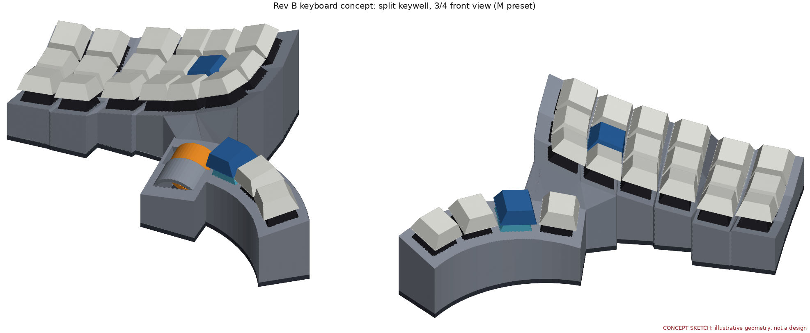
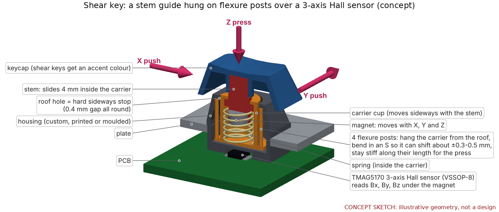
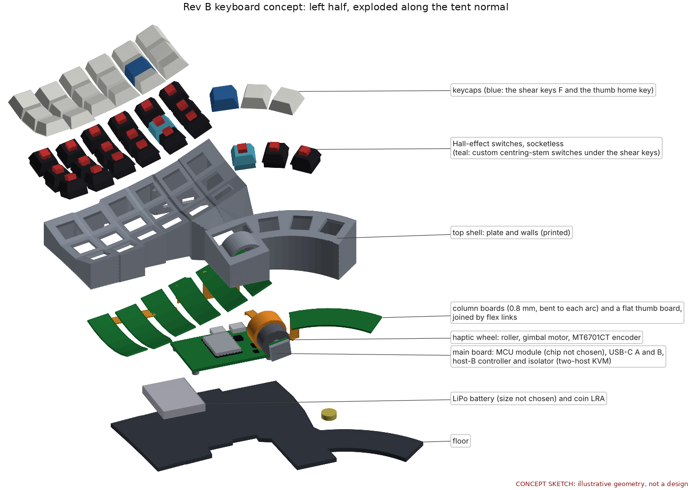
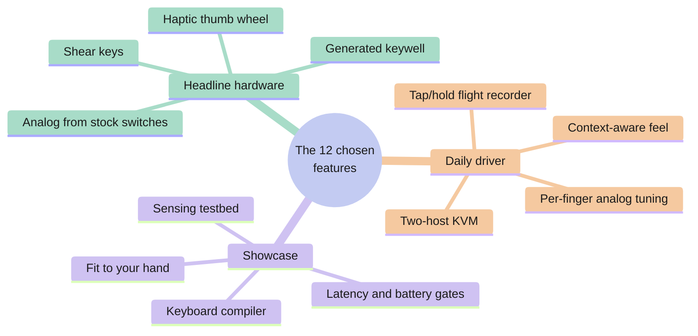
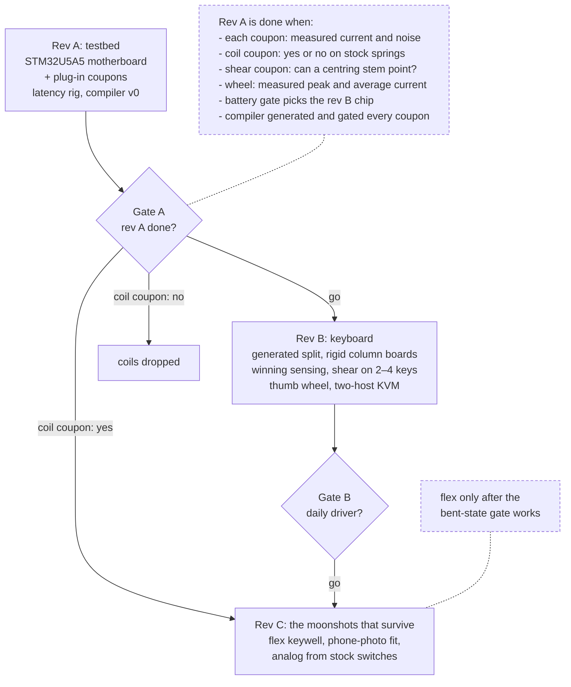
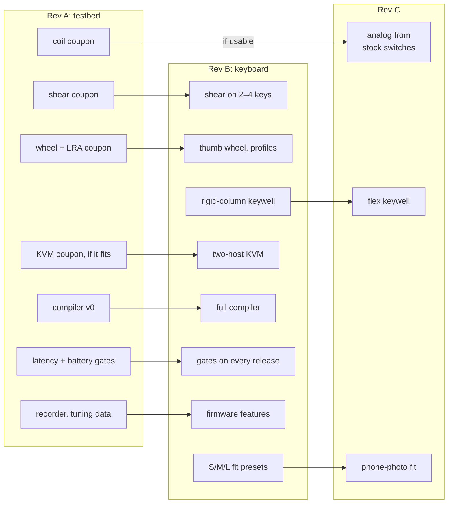

# PrettyCool Keyboard (working name)

A planned analog keyboard designed as code: one layout file in, a gated, JLC-assembled board, case and firmware out.
The plan: keys that also point, and controls that change how they feel to suit what you are doing.

> **Status (2026-11-27): concept and rev A testbed design.** Nothing is built, ordered or measured. This folder holds
> the research, the feature roadmap the owner chose on 2026-11-25, the rev A MCU the owner chose on 2026-11-26
> ([decision record](docs/mcu.md)), three testbed decisions of the same day (no charger on rev A, the slot connector, a
> USB Type-C detect chip), and the owner's seven answers of 2026-11-27 to the [rev A risk register](docs/risks.md)
> (below). The testbed's [SPEC](hardware/design/SPEC.md) is its draft architecture of record. The test coupon and the
> Hall-effect coupon are captured, laid out, routed and gated, and the motherboard schematic is captured (all on
> 2026-11-27); none of them carries the decisions of 2026-11-27 yet, and nothing is built. The firmware (the
> [8 kHz HID proof](firmware/hid8k/README.md) for the Nucleo, the testbed's board support and its bring-up
> application) compiles and has never run on hardware. Every part, figure and claim on these pages is a candidate from
> desk research, to be checked on the rev A testbed.

## Concept renders

Concept sketches from rough build123d models, with illustrative geometry: they show the ideas, not a design, and each
one carries a CONCEPT SKETCH stamp. The [concept renders page](hardware/concept/README.md) has every render and
figure, and the **[3D gallery](https://tyevco.github.io/prettycoolboards/keyboard/gallery/)** has the models to
rotate.

| | |
|---|---|
|  |  |
| *Rev B as sketched: a generated keywell per half (the sketch tents it about 18°, an illustrative constant), a thumb arc, and one haptic thumb wheel (drawn on the left half; which half is not decided). Blue: the shear keys* | *Rev A, the testbed: one motherboard and a plug-in coupon per sensing method, on the owner's 2 × 20, 2.54 mm slot connector. The board sizes are the draft SPEC's "about" figures and the layout is illustrative; the optional KVM coupon is drawn as a ghost* |
|  |  |
| *A shear key, one way it could work: the stem slides inside a carrier hung on flexure posts, so a sideways push moves its magnet over a TMAG5170 3-axis Hall sensor* | *The left half's parts stack. Sizes are placeholders, and the switches are drawn socketless, though hot-swap is still an open question ([concept §9](docs/concept.md#_9-open-questions))* |

## The idea in one table

| | |
|---|---|
| What it is not | Another Hall-effect gaming board. Adjustable actuation, rapid trigger, 8 kHz polling, SOCD and browser configurators are now table stakes ([research](docs/research.md#what-no-longer-differentiates)) |
| What it is | A planned integration that the desk research found in no single product or project (four of the five sceptics could not search the web): keys that point (shear keys), a profile-driven haptic thumb wheel, two wired hosts at once, a firmware that explains and tunes its own tap/hold decisions, and a layout compiler whose releases are gated on wiring, DRC, placement, latency and battery life |
| Priorities | All four, by owner decision: daily driver (programming), gaming / performance, ergonomics, and a showcase for the toolchain |
| Form factor | Open: the features decide. The roadmap points to a split with a generated keywell |
| Ambition | Moonshot: novel sensing and mechanics that may take several revisions, but it must end up a usable daily driver |

## Decisions so far (owner, 2026-11-25 to 2026-11-27)

| Question | Decision |
|---|---|
| Form factor | Open, let the features decide |
| Priorities | Daily driver, gaming, ergonomics, toolchain showcase (all four) |
| Switch technology | Undecided: the rev A testbed compares Hall-effect, TMR, 3-axis Hall and printed inductive coils |
| Ambition | Moonshot |
| Headline hardware | Shear keys, a generated keywell, a haptic thumb wheel, analog sensing from stock switches (all four) |
| Daily-driver features | Two-host KVM, tap/hold flight recorder and tuner, context-aware feel, per-finger analog tuning (all four) |
| Showcase features | Keyboard compiler, latency and battery gates, sensing testbed, fit to your hand (all four) |
| Staging | **Testbed first**: rev A proves the sensing and the compiler on coupons; the keyboard is rev B |
| Firmware | **Custom firmware on Zephyr**, with ZMK-compatible keymap files where possible |
| Platform (MCU) | Rev A: chosen (the next row). Rev B: **the testbed decides.** Rev A measures the sensors' real current; a battery-budget gate picks the rev B chip |
| Rev A MCU: STM32U5A5 (2026-11-26) | **STM32U5A5** (STM32U5A5VJT6, LQFP100, JLC C22455480) on the motherboard, with bring-up on the NUCLEO-U5A5ZJ-Q: of the stocked parts found with a high-speed USB PHY on chip and upstream Zephyr support for it, the one with the strongest analog. Fallback: the NXP i.MX RT1021. The AT32F405, the candidate until then, was dropped for having no upstream Zephyr. Before the schematic: reserve the MCUs, and prove 8 kHz HID on the Nucleo ([decision record](docs/mcu.md)) |
| Rev B side track (2026-11-26) | An nRF54LM20 dev kit (XIAO nRF54LM20A or nRF54LM20 DK) measures 8 kHz HID together with BLE, and the radio current, for the battery gate. The nRF54LM20A is the rev B front-runner; the gate still decides |
| Testbed form | **A motherboard plus plug-in coupons**, each coupon generated by the compiler |
| Rev A power (2026-11-26) | **No battery and no charger on rev A**: the charger is deferred to rev B by the owner's choice. **USB-C input** behind an input breaker of about 3.3 A, with a **USB Type-C detect chip on I2C** that reads the current the source advertises (Default, 1.5 A or 3.0 A), so that the firmware sets the board's power budget itself; it uses no MCU pin. The SPEC's candidate chip is TI's TUSB320LAI ([SPEC §3.8](hardware/design/SPEC.md#_3-8-usb-type-c-detect-u-cc)) |
| Rev A slot connector (2026-11-26) | **2 × 20 at 2.54 mm**: a female through-hole socket on the motherboard, a male header on each coupon. The board sizes follow from it (motherboard about 190 × 150 mm, coupons about 58 × 60 and 80 × 60 mm); layout sets the exact outlines |
| Rev A in two stages (2026-11-27, D1) | **A1** (the motherboard, the test coupon and the Hall coupon) is released, ordered and brought up first; **A2** (the haptics, coil, shear and TMR coupons and the latency rig) is designed after A1 and ordered later, and must not hold A1 back. The optional KVM coupon is out of this release ([SPEC §1](hardware/design/SPEC.md#_1-purpose-and-what-rev-a-must-prove)) |
| The slot key (2026-11-27, D2) | **Keyed at pin 39**: no pin 39 on any coupon, socket hole 39 plugged, unconnected on both sides; never keyed at pin 2 as well |
| The slot guard (2026-11-27, D3) | **100 Ω in series at each socket** on CS0_N, CS1_N, IRQ_N and G0–G3, and on S5's G4/G5: plain resistors, no TVS arrays; the lanes keep their 47 Ω + 1 nF |
| Power fixes (2026-11-27, D4) | The input breaker's power-good divider 100 k / 44.2 k (VSYS_PG falls at 3.51–3.64 V); the USB-C load line written down (4.75 V − 0.25 Ω × I at J1); the DRV8316's supply limits from its datasheet; a **0.47 Ω + 10 µF damping leg on VDDA's supply**, picked with a simulation that includes the regulator; Kelvin sense for every current monitor |
| Layout rules (2026-11-27, D5) | Shrouded box headers for the rig and KVM headers; placement rules for the 2 A path and the analog supply; the PCB stack named (JLC04161H-7628) with the USB pair at 0.25 / 0.15 mm (an estimate until JLC's calculator confirms it); the motherboard single-sided; 0.60 / 0.30 mm vias; a release warning on drills under 0.3 mm |
| MCU supply and SPEC fixes (2026-11-27, D6) | **The MCUs come from ST's store**, bought by the owner; the STM32U599VJT6 and STM32U595VJT6 are pin-compatible alternates (not the -Q parts); five SPEC corrections from the risk register and §8.1's Stop 1 sentence; ST's documents to be read first-hand (st.com still did not answer on 2026-11-27) |
| Coupon fixes (2026-11-27, D7) | The test coupon gets a path from the rig's stimulus into a lane; the haptics coupon one or two Hall sites at rev B distances and a filtered DRV2605L supply; the coil coupon tanks above 1 MHz with two capacitor footprints per coil and its own I2C mux as the documented scheme; the TMR part, its magnet and the shear sensor's variant and spacing are picked before those coupons are captured |
| Left open (2026-11-27) | A coupon BOM without its header (for JLC's Economic assembly), a second source for the bus switch, a rule bounding a lane's voltage, the rules to write before the data (the 1 kHz mode, the rig's VBUS source, the condition-2 decision rule, done cards), and LICENSE files and USB PIDs ([risk register](docs/risks.md#changes-recommended-before-ordering)). These decisions are written into the SPEC; none is captured, built or measured yet |

The twelve chosen features in the three groups above:

*The twelve features the owner chose on 2026-11-25: headline hardware, daily driver and showcase. It is a plan; none
of them is built.*

## Roadmap

| Rev | What | Proves |
|---|---|---|
| **A: testbed** | Motherboard (STM32U5A5 with high-speed USB, power, the latency rig's hooks) plus plug-in coupons: Hall-effect, TMR, 3-axis shear sites, printed coils, compliant-stop aftertouch, haptic wheel driver and LRA. A key-injector rig for latency. Compiler v0, which generates the coupons | Which sensing to build on, the sensors' real current, shear signal on a centring stem, whether coils can read a stock MX spring, the wheel's power, and the compiler's first gated boards |
| **B: keyboard** | A compiler-generated split with rigid column boards in a generated keywell case, fitted from S/M/L presets or measurements. The winning sensing, shear on 2–4 keys, the thumb wheel, two-host KVM, and the firmware features | A daily driver |
| **C** | A flex keywell, a phone-photo fit, and analog from stock switches if the rev A coil coupon shows a usable signal | The moonshots that survive rev A |

The same staging with its go/no-go points:

*Concept sketch of the staging. Rev A must meet every "done when" item in [concept §7](docs/concept.md#_7-rev-a-testbed)
before rev B starts, and the coil coupon alone decides whether analog from stock switches reaches rev C. Rev B has no
written exit criteria yet, so the B gate only restates the roadmap's "a daily driver" and §8's rule that flex waits
for the bent-state gate.*

And where each chosen feature would land, rev by rev:

*Concept sketch of how each chosen feature moves from a rev A coupon to rev B and rev C, following the Stage lines in
[concept.md](docs/concept.md). Nothing here is built.*

## Documentation

| Document | Contents |
|---|---|
| [docs/concept.md](docs/concept.md) | The chosen features: what each one is, what already exists, the risks, and where it lands in the roadmap. The platform and firmware decisions, the conflicts between features, the rev A testbed |
| [docs/mcu.md](docs/mcu.md) | The rev A MCU decision record (2026-11-26): the requirements, the ranked candidates, why the AT32F405 was dropped, the conditions before the schematic, the bring-up risks, the rev B side track, sources |
| [hardware/design/SPEC.md](hardware/design/SPEC.md) | The rev A testbed's draft architecture of record, with the owner's decisions of 2026-11-26 on the charger, the slot connector and USB-C power, and of 2026-11-27 on the risk register (two stages, the slot key, series resistors, power and layout fixes, MCU alternates, coupon fixes) |
| [docs/risks.md](docs/risks.md) | The rev A risk register (2026-11-27): 55 risks from datasheets, source code and arithmetic, none seen on a bench, with the owner's decision on each recommendation and the ones left open |
| [firmware/README.md](firmware/README.md) | The keyboard's Zephyr firmware, one application per folder, pinned to Zephyr v4.5.0. Today one bring-up application |
| [firmware/hid8k/README.md](firmware/hid8k/README.md) | The 8 kHz HID proof for the NUCLEO-U5A5ZJ-Q (condition 2 before the schematic): the firmware, the host tool that measures report rate and jitter, the test procedure and pass criteria. Written and compiled on 2026-11-27, not run on hardware |
| [docs/research.md](docs/research.md) | The landscape (late 2026), what no longer differentiates, the ideas the owner did not pick, with the sceptic's score and case, the method and its caveats, sources; an addendum on the MCU research of 2026-11-26 |
| [hardware/concept/README.md](hardware/concept/README.md) | Concept renders: every concept sketch, model-estimate plot and research figure in one place, with captions and the commands that regenerate them |
