# Concept: features, decisions and the rev A testbed

The owner chose these features and decisions on 2026-11-25, from a researched shortlist ([research.md](research.md)),
and the rev A testbed MCU, the STM32U5A5, on 2026-11-26 ([rev A MCU decision](mcu.md)).
**Nothing here is designed, built or measured.** Parts, stock figures and currents come from desk research on
2026-11-25, and the MCU figures from 2026-11-26. Recheck stock at LCSC/JLC before designing around a part, and with
`tools/lcsc_check.py` once the part is in a generated netlist (the tool reads LCSC codes from a KiCad netlist). Every
figure is a candidate until the testbed measures it. The testbed's [SPEC](../hardware/design/SPEC.md) is a draft on
paper, and the only firmware, the 8 kHz HID proof for the Nucleo ([firmware/hid8k](../firmware/hid8k/README.md)), is
compiled and has not run on hardware.

## 1. What makes it different

Analog Hall-effect keys are no longer a differentiator. Wooting, Razer, SteelSeries, Keychron, Cherry and the ASUS
ROG Falcata all ship adjustable actuation, rapid trigger and 8 kHz polling, and libhmk does the same in open
firmware ([research: what no longer differentiates](research.md#what-no-longer-differentiates)). The pitch has to come from what nobody
**combines**:

1. **Keys that point.** Push J or F sideways to move the cursor or scroll, with normal keycaps and no nub.
2. **Controls that change their feel to suit the task.** The thumb wheel ticks per line, stops hard at 0 and 100,
   and snaps to N slots, driven by per-app profiles that also set the haptics and lights.
3. **A keyboard that serves two computers at once.** Both wired, both enumerated, switched in one report interval.
4. **Firmware that explains itself.** It records why each key resolved as a tap or a hold, and it tunes the
   timings from your own misfires.
5. **Hardware as code, with gates.** One layout file generates the schematic, board, case and firmware. A release
   fails on a wiring, DRC, placement, latency or battery-life regression the way it fails on a DRC error today.

On a rev B split, the headline features might sit like this:


*Concept sketch: where the headline features would sit. Shear keys are blue; dashed parts are inside the case. Which
half gets the one wheel is not decided: the sketch puts it on the left, beside the sketch's USB-C ports, because the
wheel is wired-first.*

How the rev B pieces would connect:

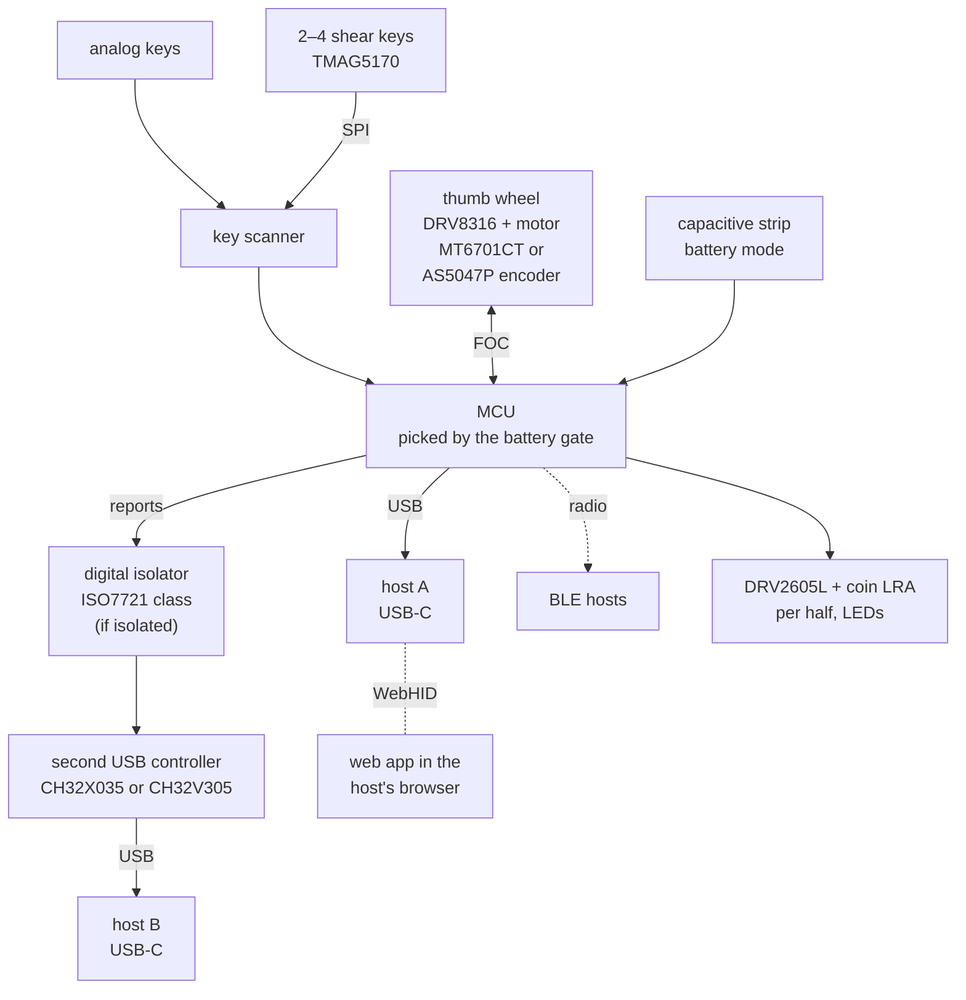

*Concept sketch. The rev B MCU is not chosen yet (the battery gate picks it, §5), the key sensing is whichever method
wins on rev A, and every part named is a candidate from desk research. Whether host B's controller is isolated is still
open (§3.1).*

Each piece has prior art somewhere, listed honestly below. As far as the research found, the integration, the
openness and the gates are new (four of the five sceptics could not search the web; see
[research.md](research.md#how-this-was-researched)).

The closest prior art for each of the twelve features, as this page names it in the sections below (the figure is
tall: open it on its own to read it at full size):


*A summary of the prior art this page names for each feature, from desk research that does not claim to be
exhaustive. An empty cell means this page names nothing of that kind, and "not found" means not found by this
research, not that nothing exists.*

## 2. Headline hardware

### 2.1 Shear keys

**What:** two to four keys (the index-finger home keys and the thumbs) also sense sideways push. With a pointing
layer held, they move the cursor or scroll, TrackPoint-style, without leaving the home row. Pressed straight down,
they type normally.

**Mechanism:** a 3-axis Hall sensor (TI **TMAG5170**, SPI, VSSOP-8) under each shear key reads the stem magnet's
X, Y and Z field. Z runs the normal analog press pipeline. X and Y, after removing the part that couples in from
the press, become a 2D vector. Stock MX stems wobble but have no centring force, so wobble is not a usable
pointing signal. This needs a **custom switch with a centring flexure stem** (build123d, printed or moulded), about
±0.3–0.5 mm of lateral travel.

One way such a switch could work, as a concept sketch:


*Concept sketch, one way a shear key could work: the stem slides 4 mm inside a carrier hung on four flexure posts,
so a sideways push moves the magnet about ±0.3–0.5 mm over a TMAG5170 3-axis Hall sensor. The carrier and posts are
the sketch's reading of "centring flexure stem". Illustrative geometry, not a design.*

The same sketch in exact sections: at rest, pushed sideways to its stop, and in plan.


*Exact sections of the concept shear key: at rest (top left), pushed 0.4 mm to the roof-hole stop with the flexure
posts bent in an S (top right), and in plan (bottom), where the magnet's range over the sensor is the small red
circle. Concept geometry; the stiffness and the X/Y signal are rev A unknowns.*

The signal path, from one sensor to typing and to pointing:

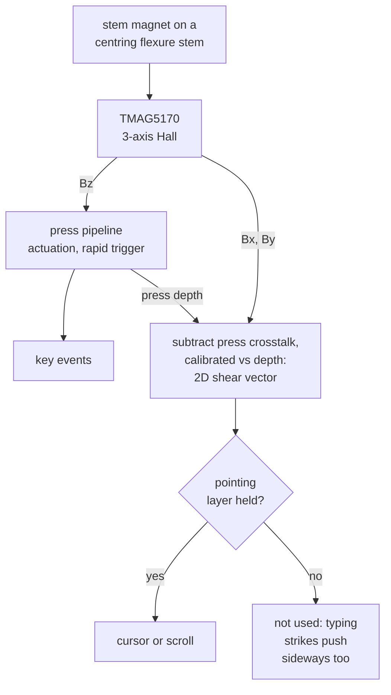

*Concept sketch: Bz runs the normal press pipeline. Bx and By, minus the depth-dependent crosstalk from the press,
move the cursor or scroll only while a pointing layer is held. Not designed or measured, and the crosstalk
calibration is an open risk.*

**Prior art:** Expressive E Osmose senses lateral motion on every key, but on a music keyboard. Lenovo TrackPoint
and the Tex Shinobi point from a nub between G, H and B. Svalboard, DataHand and CharaChorder have multi-direction
keys that replace normal typing. Research: McPherson TouchKeys (CHI 2011), Buschek et al. (CHI 2018).
**New:** TrackPoint-style pointing on normal-feel typing keys, with any keycap and no nub.

**Risks:** typing strikes carry real lateral force, so an automatic "intent gate" will misfire. Plan on a held
pointing layer. Z-to-XY crosstalk changes with press depth, so calibration is a function of depth, not one matrix.
A ±0.3 mm isometric key suits pointing and scrolling but makes a poor gaming thumbstick. The custom switch needs
several mechanical revisions, and JLC does not assemble it.

A simple magnet model shows how strongly that crosstalk depends on depth:

![Four panels. (a) A to-scale side sketch: PCB, a TMAG5170 package with its element at the origin, the stem magnet at rest and pressed 3 mm and pushed 0.5 mm sideways, with the field vector at the sensor. (b) Lateral field Bx against lateral offset at press depths 0 to 4 mm: straight lines whose slope grows with depth, 1.0 mT at rest and 13.5 mT at 4 mm for a 0.5 mm push. (c) Sensitivity near zero offset against depth, from 0.21 to 2.76 mT per 0.1 mm. (d) Bx divided by Bz against offset: the depth lines bunch closer (spread 1.8 times instead of 13 times) but stay apart.](figures/phys_shear_field.png)

*Model estimate, not measured: a Biot–Savart sum over the magnet's equivalent surface current (checked against the
exact on-axis formula) has the same sideways push reading about 13 times stronger at 4 mm depth than at rest.
Normalising by Bz narrows that to about 1.8 times, so in this model too the pointing calibration would have to be a
function of press depth.*

**Stage:** rev A coupon (TMAG5170 sites under a stock stem and under a centring-stem prototype); rev B on 2–4 keys.

### 2.2 Generated keywell

**What:** a concave keywell (Kinesis Advantage / Glove80 shape) whose PCBs come straight from the build123d case,
fitted to your hand, and checked **in their bent shape** against the case.

**Mechanism:** rev B uses rigid 0.8 mm column boards (one per finger column, identical where possible so JLC
assembly is cheap) held at their poses by the case, joined to a main board. Rev C develops the columns into one
polyimide flex per half with FR4 stiffener islands under each key. Hall-effect keys suit this well: there are no
hot-swap sockets to fail on a curved board. The clash check runs on the folded state.

How the boards would come from the case:

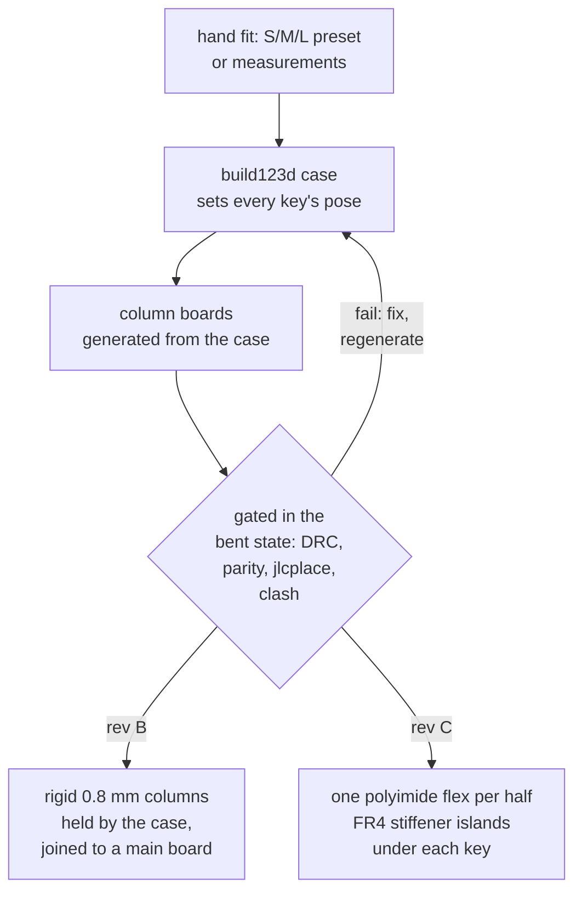

*Concept sketch: the fitted case sets each key's pose, the column boards are generated from it, and the gates check
the boards in their bent state. Rev B would use rigid columns; flex waits for rev C.*

The tent and the column arcs, in a concept sketch at the M fit preset:


*Concept sketch: the tent (about 18°, inner side up) and each column's arc about the finger's flexion, with a
per-finger radius. Radii, tent and stack heights are illustrative constants, not decisions.*

And inside the left half, with the top shell, keycaps and switches taken off:


*Concept sketch: one board per column, joined by flex links to a main board (MCU module, chip not chosen; USB-C A
and B for the two-host KVM). The sketch bends each 0.8 mm column board to its column's arc, as Skadi's bendable
column boards are; flat rigid segments would be the other way to read "rigid column boards" above. Part sizes and
positions are illustrative; Hall sensors and passives are not modelled.*

**Prior art:** YKB Skadi (2026) already ships an open Hall-effect keywell on bendable column PCBs (TMAG5253,
nRF5340, Zephyr). Cosmos generates keywell cases with column-flex and per-key PCBs, and fits them from a phone hand
scan. janaka's Dactyl flex and fmcraft's BastardKB flex are hand-drawn flex keywell PCBs, and TheBigSkree sells
generic fully flexible PCBs. **New:** boards generated from the case
model and gated in their bent state (DRC, parity, jlcplace, clash) for any fitted geometry.

**Risks:** a splayed keywell is not one developable surface. Real designs end up as per-column strips joined at a
spine, as Skadi and Cosmos do. The Hall signal falls off steeply with gap, so each island must sit to about 0.1 mm.
JLC warns that steel stiffeners are slightly magnetic and should not be used with Hall sensors: use FR4. Flex
assembly cost and yield for about 40 islands per half are unknown until JLC quotes it.

**Stage:** rev B rigid columns; rev C flex.

### 2.3 Haptic thumb wheel

**What:** one thumb control whose feel changes with the task. It ticks once per line in the editor, jumps per diff
hunk, stops hard at volume 0 and 100, snaps to N slots for a game's weapon wheel, and spins free for long documents.

What four of those feels could look like as firmware tables:

![Four panels of torque, as a fraction of full scale, for the thumb wheel. (a) Editor: a gentle sine with a stable rest point every 12 degrees, labelled line 1 to line 6. (b) Volume: light ticks between 0 and 270 degrees (volume 0 to 100), with steep walls to full-scale torque beyond each end. (c) Weapon wheel: eight slots 45 degrees apart, each a saturating spring that snaps over at the midpoint. (d) Free spin: a shallow straight line of drag torque against wheel speed, with no dependence on angle.](figures/phys_haptic_profiles.png)

*Illustrative profiles, not measured: firmware tables that a context profile would select (per-line ticks, hard
stops at 0 and 100, N slots, free spin), not physics. What full-scale torque means depends on a motor and driver not
yet chosen or tested.*

**Mechanism:** a low-cogging BLDC gimbal motor under a roller, a magnetic angle encoder on the shaft, and
field-oriented control (FOC) from the MCU. Detents, end stops and inertia are tables chosen by the context profile
(§3.3). Parts from the stock check: the TMC6300 driver had only 21 in stock at JLC, so the **DRV8316** (C5218861)
is the stocked alternative. For the encoder, the QFN MT6701 was out of stock, so the **MT6701CT** SOP-8
(C3202694) or the AS5047P. The motor, magnet and roller are fitted by hand.

The control loop:

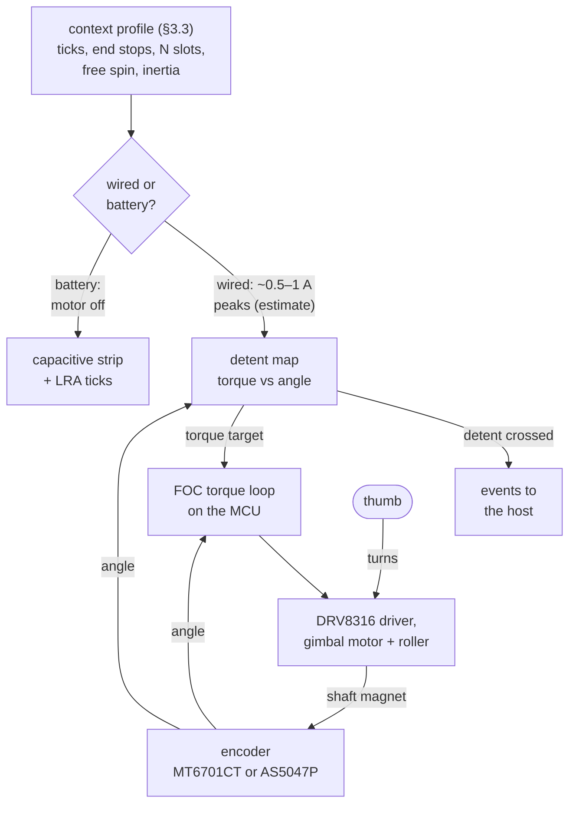

*Concept sketch: the context profile picks a detent map, and the FOC loop turns the encoder angle into motor torque.
On battery the motor stays off and a capacitive strip with LRA ticks stands in. The 0.5–1 A peak is a desk estimate,
not a measurement.*

One way the module could be built, as a concept sketch:


*Concept sketch of the haptic thumb wheel: a gimbal motor drives the roller directly (a 2804-class motor in this
sketch; the motor is not chosen). A diametric magnet on the shaft faces an MT6701CT encoder (or the AS5047P), and a
DRV8316 on the same small board drives the motor. The board parts are the stocked candidates from the stock check
above. Motor, magnet and roller would be fitted by hand; illustrative geometry.*

The same module in an exact section through the shaft:


*Exact section through the shaft of the concept module: the roller on the motor's outer rotor, the stator, bearings
and shaft, and the diametric magnet facing the encoder IC (MT6701CT or AS5047P) on the encoder board. The motor is
not chosen (the sketch draws a 2804-class one), and the board parts are candidates. Illustrative geometry; detent
strength, cogging and current are rev A unknowns.*

**Prior art:** Peng Zhihui's HelloWord keyboard (2022, GPLv3) has a built-in FOC haptic knob on its own MCU and
battery. CNCDan's Hapticpad (2026) is a macropad with nearly this exact horizontal haptic wheel. SmartKnob and its
derivatives are standalone. Surface Dial gives per-app vibration ticks. **New:** a wheel in an ergonomic thumb
cluster, driven by the same declarative profiles as the rest of the board.

**Risks:** power. Strong detents peak at about 0.5–1 A on 5 V (*estimate*), and HelloWord needed its own battery
because the knob drew more than USB 2.0 could supply. So the wheel is wired-first, with an LRA-ticked capacitive
strip as the battery-mode stand-in (§3.3). Motor cogging limits how crisp the detents feel, and SmartKnob builders
report motor choice as the hard part. A wheel placed away from the home row may see little use.

**Stage:** rev A coupon (driver, encoder, motor; measure current and feel); rev B in the thumb cluster.

### 2.4 Analog from stock switches (printed coils)

**What:** analog travel with no magnets: a coil printed in the PCB copper under each key. The moonshot version reads
the compressing steel spring of a **stock** MX switch, so tactile and clicky switches become analog too.

The idea under one key, as a concept sketch:

![Top: an exploded 3D cutaway. A stock MX switch, cut in half to show its grey steel spring, red stem and copper contact leaves, is lifted 11 mm above a green PCB that carries a copper spiral around the MX centre-post hole. In one small patch the top layer is peeled to show the same spiral on L2. Bottom, assembled: on the left an exact section showing the spring wires starting about 1 mm above the copper, behind the housing floor, and on the right a zoom on the board showing L1 and L2 turns joined by a via.](../hardware/concept/renders/mech_coil_key.png)

*Concept sketch of analog sensing from a stock MX switch: a generated two-layer spiral under the switch, read by an
LDC1614-class converter. In this sketch the steel spring starts about 1 mm above the copper and runs up to about
7.5 mm. Unproven, and the copper thickness is exaggerated.*

**Mechanism:** the toolchain generates the spiral coils as footprints (the caliper's electrode comb is already generated in Python: a seed footprint from `fpgen.py`, extended
in `layout.py`) and computes their inductance in Python. An inductance-to-digital converter reads
them (TI LDC1614-class, or Azoteq IQS9320). A design-of-experiments coupon carries about 20 coil variants (turns,
trace and space, layers, diameter).

Such a coupon, as the concept's `coils.py` draws it:

![PCB-style top view of the coil coupon on an 80 by 60 mm wide coupon: a 4 by 5 grid of copper spirals with five converter chips on the right, the 2 by 20 slot header's pads along its back edge, and the descriptor EEPROM ("ID") beside the converters. Column headers give each column's trace width, row headers each row's layers and size (rows of 1, 2 and 4 layers inside the stock-MX pin positions and a row of larger 2-layer coils), and each coil is labelled with its turns. Below the coupon: a legend on the left, and on the right one 4-layer coil drawn layer by layer, with arrows showing the current turning the same way on every layer.](../hardware/concept/renders/testbed_coil_coupon.png)

*Concept sketch drawn by `coils.py`: 20 spiral variants (layers and diameter by row, trace = space by column) and one
4-layer coil shown layer by layer. The parameters are an illustrative spread around a stock MX footprint, not checked
against JLC's rules or the LDC1614-class converter; nothing is measured.*

A simple inductance model for coils of this kind. The model ignores the switch pins, and its 10–14 mm coils are all
larger than the coupon sketch's: rows A–C sit inside the MX pins, and row D is 9 mm across:


*Model estimate, not measured: modified Wheeler inductance for a lone planar spiral (0.127 mm trace and space), with
a rough assumed layer-to-layer coupling of k = 0.7 (band 0.45 to 0.9) for series stacks. There is no spring, slug or
ground copper in the model; the rev A coil coupon would measure the real values.*

**Prior art:** inductive keyboards ship: the Epomaker Magcore boards use PCB coils read by IQS9320s. Cherry showed
inductive switches at Computex 2025, reported in the Ducky One X. TI's TIDA-00509 is a coil keypad reference design.
Spring sensing has DIY proofs of concept (Hackaday 2018, Pawnerd). **New:** analog from unmodified stock switches,
if the signal holds up. It is unproven.

**Risks:** most of the spring sits several mm above the coil, and a forum report calls the spring signal strongly
non-linear, so it may only work as a threshold. Coils need copper-free layers under every key, which fights the
solid ground the Hall sensors want: it is a separate board variant, not a per-key option. The IQS9320 is QFN52 at
0.35 mm pitch, and DigiKey lists it as discontinued. The LDC1614 fallback costs about $0.5–1 per key
(*estimate*). Cherry describes its inductive approach as patented, so a freedom-to-operate check comes before
publishing a switch-plus-coil design.

**Stage:** rev A coil coupon only. Rev C if the coupon shows a usable spring signal; dropped if not.

The coupon's chain, ending in that go/no-go:

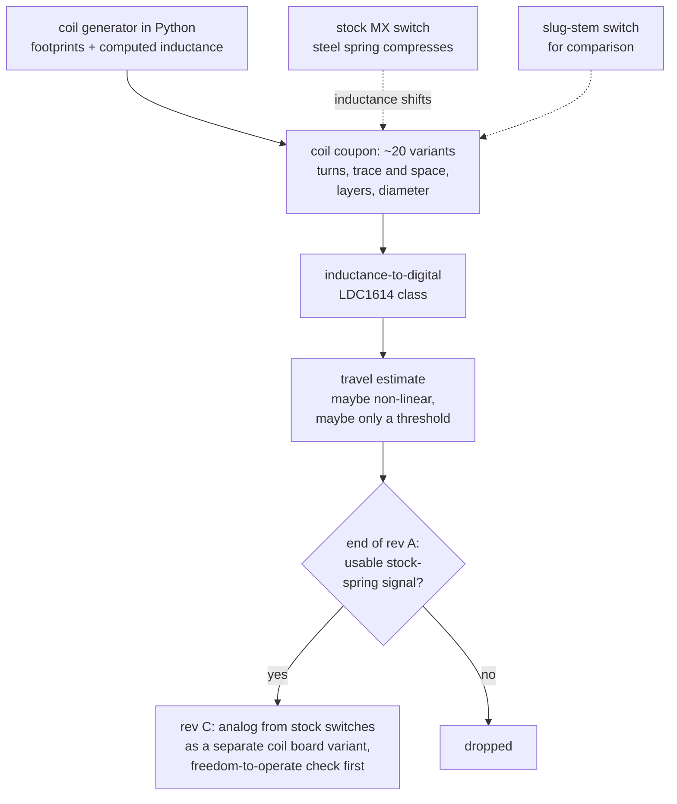

*Concept sketch of the coil coupon: about 20 generated coil variants under stock and slug-stem switches, read by an
LDC1614-class converter. At the end of rev A it answers yes or no on stock-spring sensing. The idea is unproven.*

## 3. Daily-driver features

### 3.1 Two-host KVM

**What:** plugged into a work laptop and a personal or gaming PC at the same time, plus BLE hosts. One key moves the
keyboard to the other machine in one report interval, with no re-enumeration and no reconnect.

**Mechanism:** two USB-C upstream ports, each with its own USB device controller that stays enumerated: the main
MCU's on host A, a small second MCU (CH32X035 full speed, or CH32V305 high speed) on host B, linked through a
digital isolator (ISO7721 or ADuM1201 class), the split DeskHop uses. Switching only changes which controller gets
the reports. Rev B can add a downstream port for a mouse (a MAX3421E-class USB host) or relay a BLE mouse instead.

How the two hosts would connect in the isolated option, one of the two power choices below:

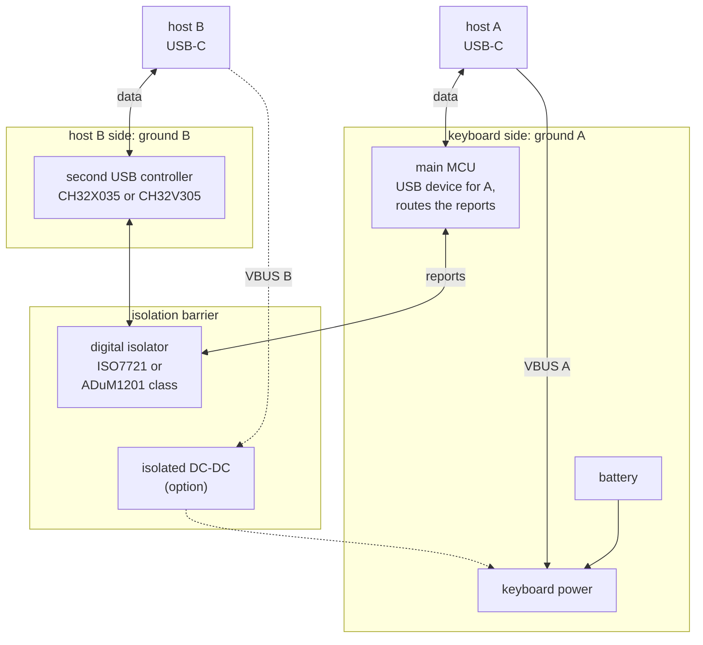

*Concept sketch: host B's USB controller sits on host B's ground and reaches the main MCU through a digital isolator.
The keyboard side runs from host A's VBUS or the battery, with an isolated DC-DC from VBUS B as an option. The parts
are candidates. This is the isolated option; whether to isolate is still open (see below).*

**Prior art:** DeskHop (two RP2040s behind an isolator, a box), HID Remapper (dual RP2040, USB host), USB-C KVM
monitors, Logitech Easy-Switch (reconnects) and Flow (needs host software). **New:** inside the keyboard.

**Risks:** power topology comes first. With isolation, the keyboard side has no power when only host B is plugged
in, unless the battery or an isolated DC-DC feeds it. Without isolation, OR the two VBUS supplies and accept a
shared ground. A full-speed host-B controller caps that host at 1 kHz. USB host support in Zephyr is experimental.
Screen-edge mouse switching inherits DeskHop's documented OS problems (Windows multi-monitor, macOS). The generator
and DRC need an isolation slot and a creepage rule. Managed work laptops may block a composite device:
**per-host interface sets** help, where the work laptop sees a plain boot keyboard and the personal PC sees
everything.

The two power choices from the start of this paragraph:

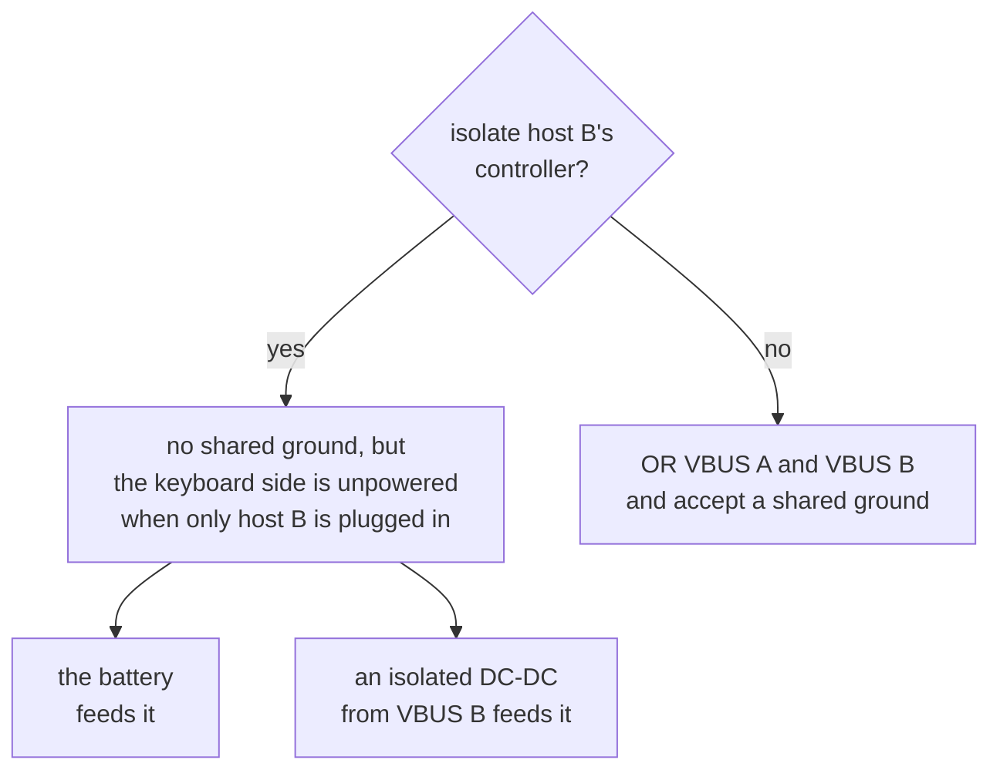

*Both choices are still open. With isolation, the battery or an isolated DC-DC from VBUS B powers the keyboard side.
Without it, the two VBUS supplies are ORed and the hosts share a ground.*

**Stage:** rev A coupon only if it fits (dual upstream and isolator); rev B key-switched; rev B+ mouse passthrough.

### 3.2 Tap/hold flight recorder and tuner

**What:** record a typing session, then see every press on a timeline with the firmware's decision and the reason
("hold: another key went down at +142 ms"). Mark the misfires, and the tuner computes per-finger timings that would
have resolved them correctly.

**Mechanism:** an opt-in RAM ring buffer (about 12 B per event, so about 120 KB for 10 000 events; the sceptic sized
it for the nRF54LM20A's 512 KB of RAM, so on the rev A chip it must fit that chip's RAM, or use a QSPI NOR) of key, µs
timestamps, analog samples and the hold-tap and combo decision trace. The tuner replays the recording through the
firmware's own decision code: first in Zephyr's `native_sim` on the PC, later compiled to WebAssembly in the web
app. It checks the result on held-out typing before it pushes the new timings.

One recording, from opt-in to new timings:

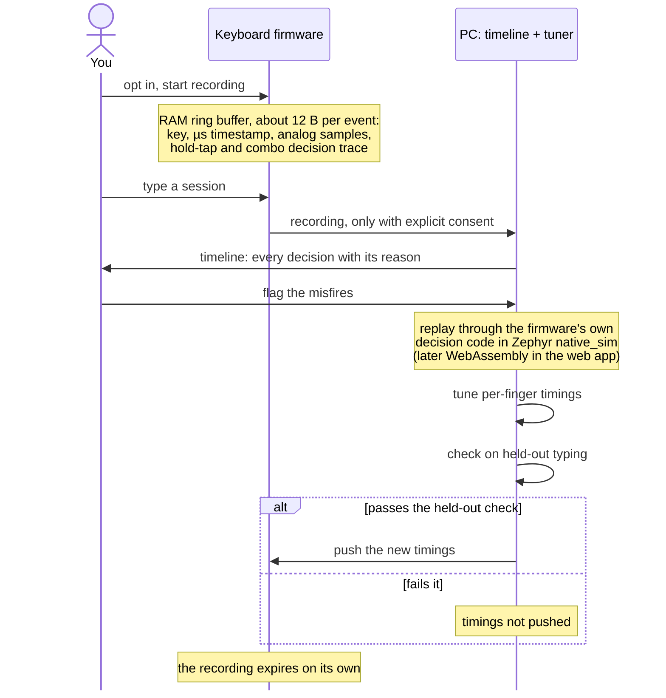

*Concept sketch of one opt-in recording. The firmware logs its decisions in RAM and you flag the misfires. The PC
replays them through the firmware's own code in `native_sim`, and new timings go back only if they pass a check on
held-out typing. Not implemented.*

**Prior art:** hrm-tuner (host-side logging for ZMK home-row mods), ZMK's debug logging and `native_sim` behaviour
tests (replay, but not from recordings; both from the sceptic's memory, not checked), Keyboard Heaven's calibrator, KeyPath for Kanata. **New:** capture on the
device, with the firmware's reasons, and tuning by replay through the real code.

**Risks:** a recording of key positions with µs timing is a keylogger. It must be opt-in, held in RAM, expire on its
own, and never leave the device without explicit consent. The tuner can overfit to a few flagged misfires.

**Stage:** firmware; on the rev A testbed as soon as keys report.

### 3.3 Context-aware feel

**What:** per-app profiles that set the wheel's detents, the haptic ticks, the lights and the layers. When your AI
coding agent asks for approval, the wheel grows a notch ring: twist through the hunks, press to approve.

That example as a sequence:

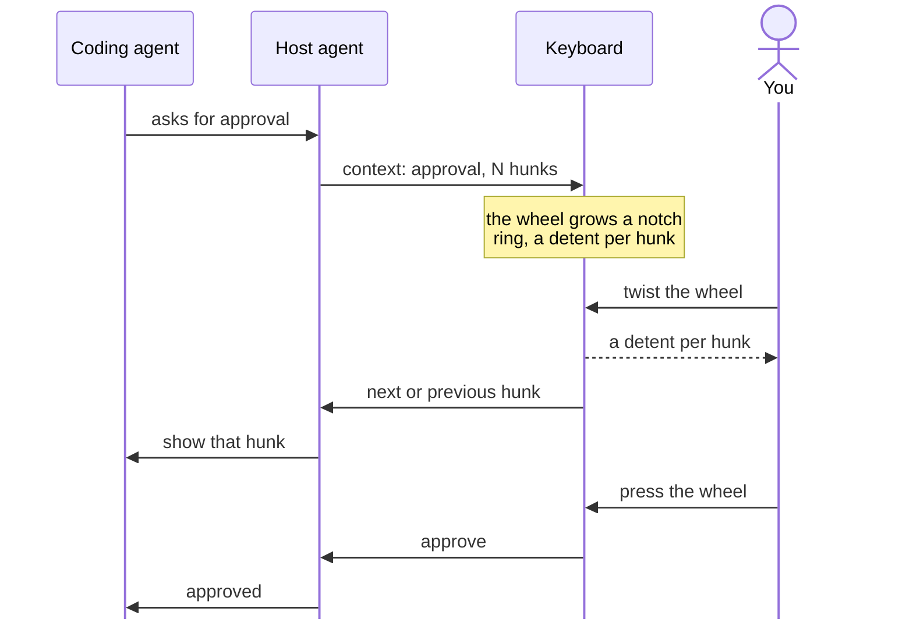

*An illustration of the example above: a coding agent asks for approval, the wheel gets one detent per hunk, and a
press approves. The host-agent protocol is not designed, so the messages are placeholders.*

**Mechanism:** profiles are declarative files in the repo, schema-checked and unit-tested in CI like the hardware
gates, and editable in the web app. Context comes in three ways, cheapest first. (1) **Standard HID:** enumerate
the wheel as a Windows Radial Controller (the Surface Dial usage, with its haptic output) and the LRAs as a HID
haptic controller, so Windows gives per-app dial menus and ticks with nothing installed. (2) The web app over
WebHID or Web Bluetooth. (3) An optional small host agent for the foreground app, CI state or agent prompts.
Feedback: a DRV2605L haptic driver (C527464) and a coin LRA per half, with a small, user-tested vocabulary (tick,
double tick, long buzz), plus a capacitive strip with LRA-synthesised detents as the low-power wheel. The research
reads the strip with the ESP32-S3's touch peripheral. The rev A STM32U5A5 has a touch-sensing controller, but Zephyr
has no devicetree node for it on the U5, so rev A plans an external touch controller ([mcu.md](mcu.md)); on rev B it
depends on the chip the battery gate picks.

From context to one profile:

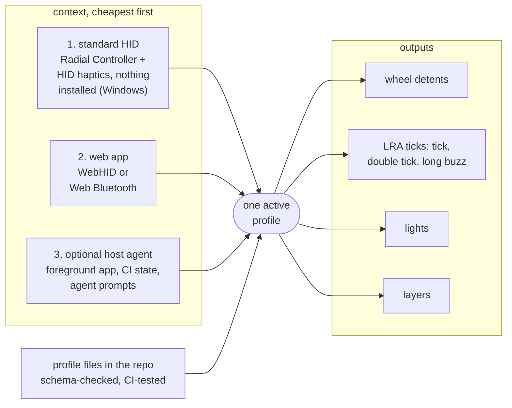

*Concept sketch: three context sources, cheapest first, select one schema-checked profile, which sets the wheel's
detents, the LRA ticks, the lights and the layers together. Not implemented.*

**Prior art:** QMKonnect, auto_layers and komokana switch layers by app. Surface Dial and the Logitech MX Master 4
give per-app haptics. DRV2605L haptics on home-row-mod holds exist in DIY ZMK builds. **New:** one tested profile
drives detents, haptics and lights together.

**Risks:** a host agent is a privacy and maintenance burden, so lean on standard HID first. WebHID works only in
Chromium. Reading game state can trip anti-cheat. People learn only 3–5 haptic patterns reliably. LRA buzz is
audible on a hard desk.

One way to keep the buzz out of a hard desk, as an untested concept sketch:


*Concept sketch of a coin LRA in a cradle printed with the case floor. The cradle joins the floor only through three
flexure arms inside a slot, aimed at keeping buzz out of a hard desk. Untested; the mount and the arm geometry are
the sketch's choices.*

**Stage:** rev A LRA coupon; firmware and profiles from rev A; full use in rev B.

### 3.4 Per-finger analog tuning and load budget

**What:** the keyboard learns how each finger presses, sets each key's actuation point and rapid-trigger
sensitivity to match (shallower for the pinkies, deeper for keys that collect accidental grazes), and shows the load
each finger carried, with nothing leaving the device.

**Mechanism:** firmware keeps per-key aggregates (press depth, peak velocity, bottom-out ratio, resting
pre-travel) from the analog sensing. An adaptation loop learns, then **freezes**, so muscle memory is not undermined.
A fixed competitive profile turns adaptation off. Related, from the research: **switch fingerprinting** (identify a
hot-swapped switch from its field-versus-travel curve, so actuation in mm stays true on mixed switches) and
**common-mode reference sensors** (two to four Hall sites with no switch, plus thermistors, to subtract stray fields
and temperature drift).

The adaptation loop's states:

```mermaid
---
config:
  # the docs theme sets p { line-height: 28px }, which would clip the labels mermaid measured at 1.5
  themeCSS: "p { line-height: inherit; }"
---
stateDiagram-v2
  state "Learning" as L
  state "Frozen" as F
  state "Competitive profile" as C
  L: per-key aggregates set each key's actuation
  L: point and rapid-trigger sensitivity
  F: settings fixed, so muscle memory holds
  C: fixed settings, adaptation off
  [*] --> L
  L --> F: learned, then freeze
  F --> L: re-learn on request
  L --> C: competitive profile on
  F --> C: competitive profile on
  C --> F: profile off
  note right of L
    Aggregates only:
    press depth, peak velocity,
    bottom-out ratio,
    resting pre-travel.
    Never sequences or
    inter-key timing.
    Nothing leaves the device.
  end note
```

*Concept sketch: the loop learns, then freezes so muscle memory holds, and the competitive profile turns adaptation
off. "Re-learn on request" and the way out of the competitive profile are assumptions that this page does not state
yet.*

One possible order for the pieces above:

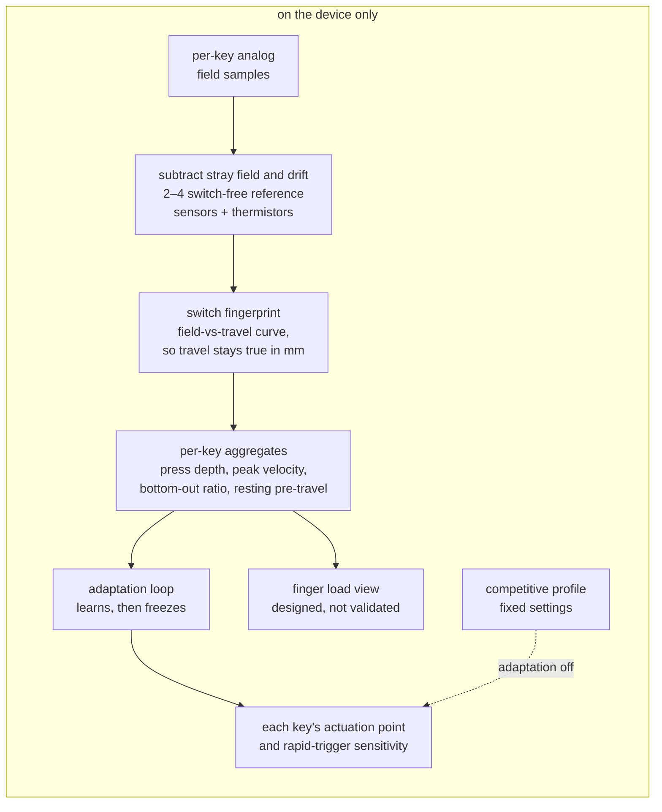

*Concept sketch of one possible order. Reference sensors remove stray field and drift, a switch fingerprint turns
field into millimetres, and per-key aggregates drive the adaptation and the finger-load view. Everything stays on the
device. Nothing is designed or validated.*

**Prior art:** SteelSeries Protection Mode (global accidental-press rejection), adaptive touch targets on phone
keyboards and Razer Synapse and WhatPulse heatmaps (both from the sceptic's memory, not checked), libhmk's manual
per-key actuation. **New:** closed-loop per-key
adaptation on analog mechanical keys.

**Risks:** "finger load" is not validated against injury outcomes, so the docs must say designed, not validated.
Keystroke dynamics are biometric: store per-key aggregates, never sequences or inter-key timing.

One more stray field a key's sensor sees comes from its neighbours' magnets. In a simple model:


*Model estimate, not measured: superposed Biot–Savart fields of identical switch magnets at the MX pitch suggest a
fully pressed row neighbour shifts a resting key's reading by about 30 µm of equivalent travel, and only a few µm
near the stop. No steel is modelled; the testbed coupon would have to check this.*

**Stage:** firmware; data collection on the rev A coupons.

## 4. Toolchain showcase

### 4.1 Keyboard compiler

**What:** edit one layout file and get the wired schematic, the routed board, the case and plate, the firmware
matrix, pin header, physical layout and keymap, and the docs, all regenerated and consistent with each other.

**Mechanism:** a layout source holds each key's 3D pose, sensor type, finger and scan slot, and drives the existing
generators (`schgen`, `pcbgen`, build123d, the firmware header). New work: a grid placement mode in `schplace`, so a
key array with no anchor IC still passes R1–R6, and a pose-driven placer in place of a hand-written `layout.py`.
**Cross-domain contract checks**, generalised from `check_contract.py`:

* the netlist's MCU pins equal the firmware pin header,
* PCB switch centres equal the case cutouts and the firmware's physical layout, within 0.05 mm,
* the scan map in the netlist equals the one in firmware,
* a **keycap clearance gate**: real keycap solids swept from rest to bottom-out at every pose, checked against each
  other, the case and tall parts, with a tolerance pass. This reuses `clash_check.py`.

The four checks, and the one that runs today:

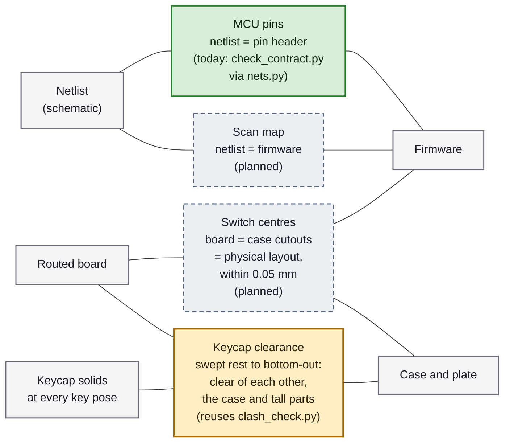

*Concept sketch of the four checks that would tie the schematic, board, case and firmware together. Only the MCU-pin
check runs today, for the caliper: `check_contract.py` compares the netlist with `nets.py`, and the pin header is
generated from `nets.py`. The keycap sweep would reuse `clash_check.py`, and the other two checks are planned.*

The plan is for CI to run the same gates on every fork: wiring check, ERC, DRC, schematic parity, the jlcplace
placement simulation, the clash and keycap checks, the firmware build and tests, and the docs build. Today the
hardware gates run by hand in WSL, and the repo's only workflow (`docs.yml`) builds the docs and checks links.

The whole compiler as planned, with what exists today:

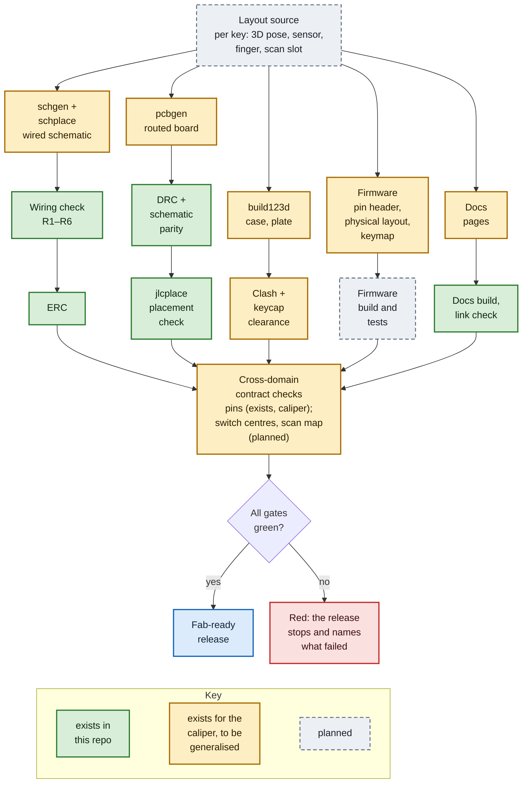

*Concept sketch of the planned compiler. One layout source drives the generators, and every output must pass the
gates before a fab-ready release. Green gates exist in this repo today (run by hand in WSL; only the docs build runs
in CI). Amber parts exist for the caliper and need generalising, and dashed parts are planned; of the cross-domain
checks, only the pins check exists. Nothing here exists for the keyboard yet.*

A rough version of that check in the concept model's own script (not `clash_check.py`, and not the planned gate), run
on the sketch geometry, finds a tight spot, which is what such a gate is for:

![Four panels. (a) Left thumb arc seen square to its plate, with red closest-point marks: T2/wheel 5.73 mm at bottom-out, T2/T3 and T3/T4 1.38 mm at rest. (b) The thumb arc seen from its centre, keycaps shaded at rest and dashed at 4 mm bottom-out. (c) The tightest spot the sketch check found: an exact cut at key E showing the pressed cap 0.40 mm from the web up to the higher index column in that cut, and 0.35 mm at its back corner, below an illustrative 0.5 mm margin. (d) A bar chart of the 12 tightest of 97 checks, with E vs case at 0.35 mm highlighted as below the margin.](../hardware/concept/renders/keyboard_keycap_clearance.png)

*Model estimate on sketch geometry, not measured: every keycap at rest, mid travel and bottom-out against its
neighbours, the case and the wheel. The thumb arc clears (1.38 mm at rest), but the deeper middle column's top cap
(E, and I on the right) comes 0.35 mm from the stepped web at bottom-out, under an illustrative 0.5 mm margin.*

**Prior art:** Ergogen (outlines, cases and an un-routed PCB, no schematic), kicad-kbplacer (placement and simple
matrix routing, a label-wired schematic), Cosmos (cases and firmware for its own fixed PCBs, open-core). The Corney
Island CI already runs Ergogen, Freerouting and DRC to Gerbers on push. **New:** a readable wired schematic, ERC and
parity, the jlcplace gate (wrong rotations of sockets and reverse-mount LEDs in JLC's placement file are a classic
keyboard fab failure), and the cross-domain checks.

**Risks:** the toolchain is not parametric yet. The caliper's `layout.py` is about 3 000 lines of board-specific
placement and pre-routes. Freerouting has no documented seed option, so routes may not reproduce: commit routed
boards and re-check them in CI, and re-route only when the layout changes.

**Stage:** v0 in rev A (it generates the coupons); full in rev B.

### 4.2 Latency and battery gates

**What:** every firmware release carries measured press-to-report latency (p50 and p99) per mode, and a battery-life
estimate from the bill of materials. A regression fails the release.

**Mechanism:** *latency:* a generated rig board injects a stimulus at a sensor's ADC node through a test pad (or a
coil next to the sensor, or a solenoid on a real key) and timestamps the HID report, acting as the USB host. The
keyboard exposes per-stage timing (capture, decision, queue, transmit) and a marker GPIO. A high-speed USB sniffer
(Cynthion or ataradov's usb-sniffer) checks 8 kHz microframes. Note that row/column contact injection, as in a
digital matrix, does not apply to analog keys. *Battery:* a per-state current table for every BOM line, next to
`mpn-map.csv`, combined with the firmware's declared duty cycle (scan rate, BLE interval, sleep policy, LEDs, split
link), gives battery life and worst-case latency. The figure stays *designed* until a measured current log replaces
it.

One strike through the planned latency rig:

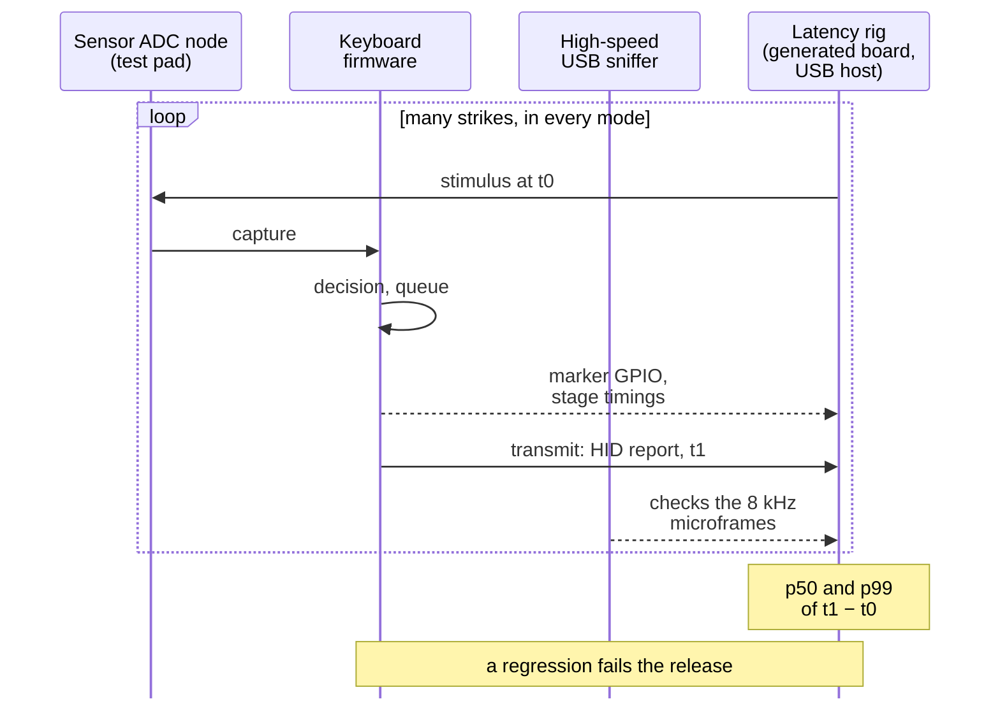

*Concept sketch of the planned latency gate. The rig injects a stimulus at a sensor node, the keyboard captures,
decides, queues and transmits, and the rig, acting as the USB host, timestamps the report and takes p50 and p99 over
many strikes. No rig exists and nothing has been measured; the stimulus could instead be a coil next to the sensor or
a solenoid on a real key.*

The rig as a concept sketch, beside the rev A motherboard:

![Concept sketch of a 100 by 80 mm yellow latency-rig board beside the motherboard, which carries only the Hall-effect coupon. A USB cable runs from the rig's USB-A host port to the motherboard's USB-C. A grey ribbon arches from the rig to the motherboard's latency-rig header, J_RIG. A callout marks the closed solder jumper JP_INJ1, which takes the rig's stimulus to slot S1. Below, a five-box strip shows the planned measurement path from t0, the rig's stimulus edge, to t1, when the rig timestamps the HID report.](../hardware/concept/renders/testbed_latency_rig.png)

*Concept sketch of the latency rig. Over a ribbon to J_RIG it would drive the stimulus, which reaches the coupon in
slot S1 through the solder jumper JP_INJ1 (all five are open by default), and read the marker GPIO. As the USB host
it would timestamp each HID report. The rig's parts are not chosen; nothing is built or measured
([SPEC §7.3](../hardware/design/SPEC.md#_7-3-latency-rig-j-rig)).*

And the battery gate:

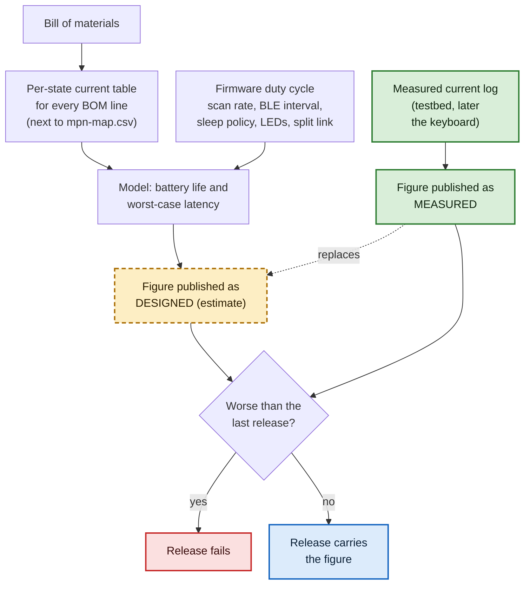

*Concept sketch of the planned battery gate. A per-state current table for every BOM line, combined with the
firmware's duty cycle, gives a modelled battery life and worst-case latency. The figure is published as designed
until a measured current log replaces it. No table, model or log exists yet.*

**Prior art:** RTINGS and LTT Labs measure latency with a solenoid and a USB analyzer. Michael Stapelberg measured
QMK. joelspadin's keyboard-latency-tester injects electrically across one switch. The ZMK Power Profiler estimates
battery life, for nice!nano-class boards and not tied to a BOM. **New:** gating releases on both.

**Risks:** BLE latency depends on the host's stack and OS, so publish it per host. A full-speed USB host quantises
timing to about 1 ms, so a fine p99 gate needs many strikes or a high-speed host.

How much waiting the scan and report intervals alone add, by arithmetic:


*Arithmetic, not a measurement: a press at a random time waits on average half of each interval it must wait
through, 0.5 ms at 1 kHz against 0.0625 ms at 8 kHz, and twice that if the scan is not locked to the report. Sensor,
firmware, USB host, OS and display delays are not included; the latency gate would measure those end to end.*

**Stage:** rev A (the testbed's purpose includes measuring these); then on every firmware release.

### 4.3 Sensing testbed

**What:** rev A itself: a motherboard plus coupons that compare the sensing methods side by side under the same
switches, with the raw data published as an open dataset (noise floor, drift with temperature, crosstalk, latency,
current).

The testbed as a concept sketch:

![3/4 view concept sketch of a green motherboard of about 190 by 150 mm on four standoffs, with coupons plugged into 2 by 20 sockets. Along the back: a blue Hall-effect coupon and a purple TMR coupon with six grey keys each, and a red shear coupon with two blue keys. Along the front: a black coil coupon with 20 copper spirals and two stock switches, a white haptics coupon with a gimbal-motor roller, a coin LRA and gold capacitive pads, and a translucent optional KVM coupon on its own 2 by 6 header. Callouts mark the USB-C port and the Type-C current-detect chip on the board's left edge, the STM32U5A5 (rev A MCU) just behind them, and the power section (input breaker, slot switches, 13 INA226-class monitors, LDOs) in the strip between the rows.](../hardware/concept/renders/testbed_assembly.png)

*Concept sketch of the rev A testbed, drawn to the draft [SPEC](../hardware/design/SPEC.md). One motherboard of about
190 × 150 mm carries the STM32U5A5, the owner's rev A MCU of 2026-11-26 ([mcu.md](mcu.md)); USB-C with a Type-C
current-detect chip on I2C; the power section; and the latency-rig hooks. One plug-in coupon per sensing method sits
on the owner's 2 × 20, 2.54 mm slot connector: S1–S3 along the back, S4 and S5 along the front. The optional KVM
coupon, drawn as a ghost, sits beside S5 on its own 2 × 6 header. No battery or charger on rev A. The sizes are the
SPEC's; the positions on the board are the sketch's, and the mask colours only tell the coupons apart. §7 has more
views.*

**Prior art:** ThereminGoat's force curves (a huge open set, but mechanical only), and vendor blog comparisons of HE
and TMR without raw data. **New:** an open, measured comparison across sensing methods.

**Stage:** rev A. See §7.

### 4.4 Fit to your hand

**What:** S/M/L presets (from anthropometric percentiles) or your hand measurements set the column stagger, splay
and thumb-arc geometry, and out comes a JLC-assembled board and case that fit you.

One parametric half at three illustrative sizes:


*Concept sketch: one parametric half at three illustrative sizes. Key pitch is fixed; a uniform scale moves the
column radii, stagger and thumb arc. That scale is the sketch's stand-in, not the anthropometric mapping, which is not
validated (see Risks), and the dimensions are model outputs, not measurements.*

**Mechanism:** a parameter mapping into the compiler (§4.1). Rev C adds a phone-photo capture: ArUco fiducials on the
case (the caliper's jaws already carry ArUco inlays in the model, designed but not yet printed or tried with a
camera: [mechanical §16](../../caliper/docs/mechanical.md#_16-aruco-markers-on-the-jaws-2026-11-15))
let the web app measure both halves' pose, and a hand tracker estimates wrist angle against the under-30° extension
target from the ergonomics literature (Rempel, Keir & Bach 2008).

The fit loop, with rev C's photo capture:

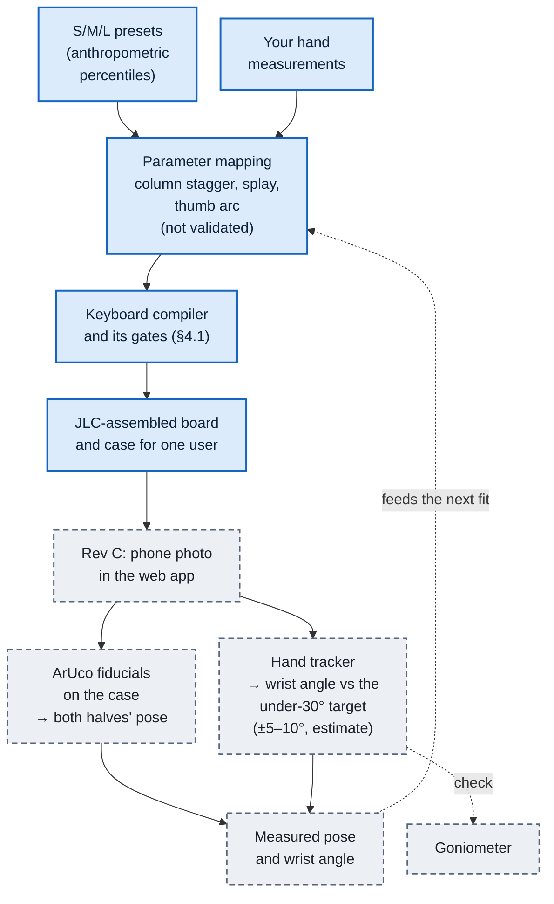

*Concept sketch of the fit loop. Presets or hand measurements set the stagger, splay and thumb arc through a mapping
nobody has validated yet. Rev C adds a phone-photo capture whose measured pose and wrist angle feed the next fit; the
camera wrist angle (±5–10°, an estimate) would have to be checked against a goniometer. Feeding the measured pose
back into the mapping is this sketch's reading; §4.4 does not state it.*

**Prior art:** Cosmos fits a keywell from a phone hand scan, but for its own fixed PCBs. Ergogen users hand-tune
stagger and splay in YAML. Squeezebox, FCS42S and key-yack's magnetic columns are passive adjustable rigs. **New:**
a fitted, gated, JLC-assembled board per user.

**Risks:** nobody has validated the mapping from hand measurements to stagger and splay, and a wrong fit is worse
than a standard Corne. Each unique board pays JLC's setup and extended-part fees (tens of USD per design,
*estimate*). Camera wrist angles are likely only ±5–10° (*estimate*) and must be checked against a goniometer.

**Stage:** presets in rev B; phone capture in rev C.

## 5. Platform: let the testbed decide

Two owner decisions, a day apart. On 2026-11-25: the rev A testbed measures the sensors' real current, and the
battery-budget gate (§4.2) picks the rev B chip. On 2026-11-26: the **rev A chip is the STM32U5A5**
(STM32U5A5VJT6, LQFP100, JLC C22455480), on the motherboard, with bring-up on the NUCLEO-U5A5ZJ-Q. Of the stocked
parts the research found with a high-speed USB PHY on chip *and* upstream Zephyr support for it, it has the strongest
analog: three ADCs, two of them 14-bit, and two motor-control timers. The [rev A MCU decision record](mcu.md) has the
requirements, the ranked candidates, the conditions and the bring-up risks. The rev B chip is still open.

The candidates, from the research (the STM32U5A5, i.MX RT1021 and AT32F405 rows from the MCU research of
2026-11-26, the rest from 2026-11-25 unless marked):

| Chip | For | Against |
|---|---|---|
| **ST STM32U5A5** (rev A testbed, chosen 2026-11-26) | High-speed USB with the PHY on chip, upstream in Zephyr: the `nucleo_u5a5zj_q` board has it on by default in v4.4.0, v4.5.0 and `main`. Three 2.5 Msps ADCs (two 14-bit) with a DMA-capable Zephyr driver, the TIM1 and TIM8 motor timers, 4 MB flash, a 0.5 mm LQFP | About $19 per MCU. Thin stock: 13 at JLC and none at DigiKey before Feb–Mar 2027 (2026-11-26), so the parts must be reserved. No radio. 8 kHz HID on Zephyr's STM32 USB driver is unproven ([mcu.md](mcu.md#conditions-before-the-schematic-is-committed)) |
| NXP i.MX RT1021 (rev A fallback) | The most mature high-speed USB path in Zephyr (EHCI). Good stock: 300 at JLC at $6.26 (C5119758, 2026-11-26). Two 12-bit ADCs, FlexPWM | No on-chip flash (a QSPI NOR and FlexSPI boot). Zephyr's ADC driver takes one interrupt per sample with no DMA, so the scan engine must be written. No radio |
| Artery AT32F405 (the rev A candidate until 2026-11-26; **dropped**) | On-chip high-speed USB PHY. Artery's own magnetic-keyboard reference design reaches 8 kHz polling and 16 kHz scanning on it, and libhmk 8 kHz polling on bare-metal TinyUSB. Cheap and in stock at JLC: 92–329 per part number at $1.85–2.82 (2026-11-26) | **No upstream Zephyr**: only a blinky-level upstream PR (#101409) and a vendor fork on Zephyr 4.3.99, not pushed since 2026-02-28, whose high-speed USB nobody has shown working. No radio. It may still serve as a known-good libhmk 8 kHz reference to calibrate the latency rig |
| **Nordic nRF54LM20A** (rev B front-runner) | High-speed USB upstream in Zephyr since v4.3.0, on the same dwc2 driver Nordic runs at about 8 kHz; nRF Desktop sets a 125 µs polling period on the nrf54lm20dk (2026-11-26). BLE 6, 4 Mbps proprietary link for a split or dongle, low BLE current | The QFN52 (0.4 mm, 32 GPIO) is still "Early sampling" with no stock; the 66-GPIO CSP98 is stocked but at 0.35 mm pitch needs via-in-pad or HDI (2026-11-26). One 10-bit SAADC. Nordic says 8 kHz USB plus the proprietary link together are CPU-bound |
| nRF52840 (optionally with an nRF54L15 as a split radio) | Mature in Zephyr; weeks to months on a charge with lighting off (nRF52840-class ZMK boards) | Full-speed USB: 1 kHz on the nRF52840 (the nRF54L15 has no USB) |
| Espressif ESP32-S31 | High-speed USB, stays in ESP-IDF | Preliminary datasheet; weaker BLE power than Nordic |
| WCH CH585 | BLE 5.4 plus high- and full-speed USB, cheap and in stock (JLC, 2026-11-26: CH585F QFN32 2590 at $1.45, CH585M QFN48 5347 at $1.70) | Weaker open-source ecosystem. No Zephyr support, and its 48-pin package is 0.35 mm pitch (2026-11-26 research) |
| ESP32-S3 (the caliper's) | Familiar, gated sheets exist | Full-speed USB only (1 kHz cap); BLE HID current in the mA range |

The MCU research of 2026-11-26 also named two rev B alternatives: the STM32WBA65 (BLE 5.4 plus high-speed USB, thin
analog, 0–3 in stock) and the NXP RW612 (Wi-Fi 6, BLE 5.4 and high-speed USB; only the u-blox IRIS-W106 module is
stocked). See the [split advice](mcu.md#split-advice-rev-b-and-the-dev-kit-side-track).

Whatever wins rev B, prefer a pre-certified radio module if one is stocked: a bare-chip RF design (matching network,
50 Ω feed) would be a first for this toolchain. High-speed USB needs 90 Ω pairs on JLC's controlled-impedance stack,
pre-routed, because Freerouting is not impedance-aware; that now applies to the rev A motherboard too.

How the rev A chip was settled, and how rev A would pick the rev B chip, following the owner's decisions in §5 and §6:

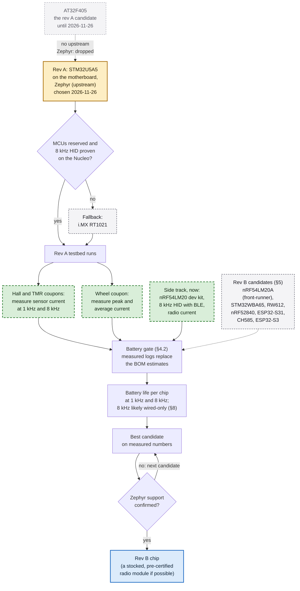

*A concept sketch of the platform decision. The rev A chip is chosen: the STM32U5A5 (2026-11-26), which replaced the
AT32F405 once that chip turned out to have no upstream Zephyr support. Two conditions come before its schematic,
and if they fail the i.MX RT1021 takes over ([mcu.md](mcu.md)). Rev A would then measure sensor and wheel currents, an
nRF54LM20 dev kit would measure 8 kHz HID with BLE and the radio current, and the battery gate would rank the rev B
candidates on those numbers, with Zephyr support checked again for the pick. The ranking is this sketch's reading of
"the battery-budget gate picks the rev B chip", and the Zephyr check on the rev B pick follows from the Zephyr
firmware decision: it is this sketch's reading, not a stated step. No measurement or ranking exists yet.*

## 6. Firmware: custom on Zephyr

Owner decision: **custom firmware on Zephyr**, with ZMK-compatible keymap files where possible. ZMK mainline has no
analog keys and no USB host, and this board needs both, plus haptics, a second USB controller and the flight
recorder. Patching ZMK would mean carrying those changes forever. Nordic's SDK is built on Zephyr, and Zephyr supports the
ESP32-S3.

**Zephyr support for the rev A chip is now checked: it is upstream.** The STM32U5A5 is in `soc/st/stm32/stm32u5x`,
and the `nucleo_u5a5zj_q` board has the high-speed USB device on its on-chip PHY (`zephyr_udc0 = &usbotg_hs`) in the
v4.4.0, v4.5.0 and `main` trees, checked on 2026-11-26 ([mcu.md](mcu.md)). That support is not old: it has needed
fixes, and nobody has published 8 kHz HID on Zephyr's STM32 USB driver. So rev A pins Zephyr v4.5.0 or a known-good
`main` commit, and proves 8 kHz HID on the Nucleo before the schematic is committed. The AT32F405, the rev A candidate
until 2026-11-26, has no upstream Zephyr support (only a vendor fork) and was dropped rather than run on bare-metal
test firmware.

The caveat moves to rev B. Of its candidates, the nRF54LM20A is upstream (the SoC since v4.2.0, its high-speed USB
since v4.3.0), the STM32WBA65 and the RW612 are upstream with high-speed USB, the CH585 has no Zephyr support (the
2026-11-26 research), and the **ESP32-S31 is still not checked**. Whatever the battery gate picks must be confirmed
in Zephyr before rev B firmware starts.

The hold-tap and combo logic is kept free of hardware calls, so the same code runs in `native_sim` for the recorder's
replay and the CI tests, and later in WebAssembly for the web app. The caliper's ESP-IDF firmware stays as it is.
The keyboard's firmware lives in [keyboard/firmware/](../firmware/README.md), one Zephyr application per folder. The
first is the 8 kHz HID proof for the Nucleo, written and compiled on 2026-11-27 and not yet run on hardware.

The planned layers:

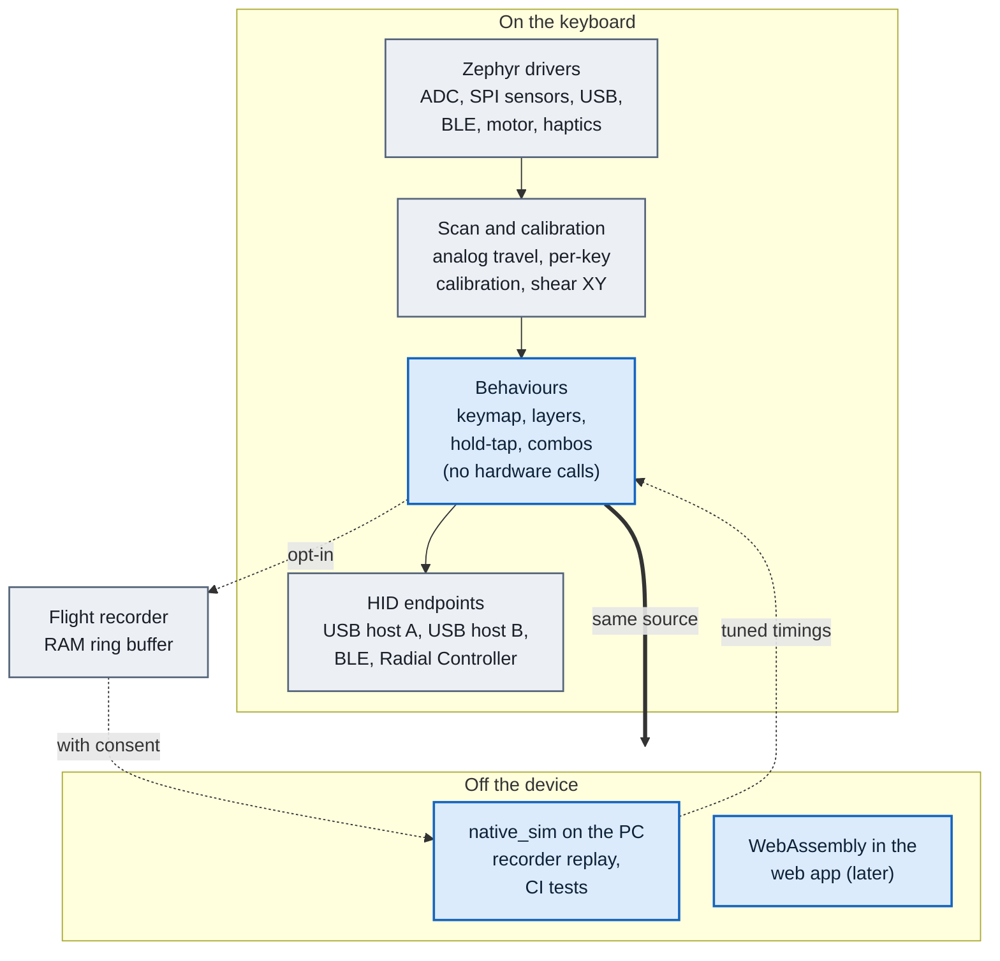

*Concept sketch of the planned firmware layers, top to bottom in the order a key press travels. The behaviour layer
makes no hardware calls, so the same source runs in `native_sim` for the flight recorder's replay and the CI tests,
and later as WebAssembly in the web app. None of these layers exists yet; the only firmware is a bring-up test, the
8 kHz HID proof for the Nucleo ([keyboard/firmware/hid8k](../firmware/hid8k/README.md)), compiled and not run. Zephyr
support is upstream for the rev A STM32U5A5
(checked 2026-11-26), but 8 kHz HID on it is unproven; for the rev B candidates it is upstream for the nRF54LM20A,
absent for the CH585 and not checked for the ESP32-S31 (§6).*

## 7. Rev A testbed

A **motherboard plus plug-in coupons**. Each coupon is generated by compiler v0, so rev A also proves the compiler.
The testbed's draft architecture of record is [hardware/design/SPEC.md](../hardware/design/SPEC.md). It is a draft
on paper: no schematic or board exists. On 2026-11-26 the owner decided three of its proposals
([SPEC §1](../hardware/design/SPEC.md#_1-purpose-and-what-rev-a-must-prove)):

* **No battery and no charger on rev A.** The charger is deferred to rev B by the owner's choice; rev A measures the
  currents the battery gate needs without a cell.
* **The coupon slot connector is 2 × 20 at 2.54 mm**: a female through-hole socket on the motherboard, a male header
  on each coupon. The board sizes follow from it, about 190 × 150 mm for the motherboard and about 58 × 60 mm and
  80 × 60 mm for the standard and wide coupons, and stay proposals until layout sets the outlines.
* **USB-C input power with a Type-C detect chip on I2C**, which reads the current the source advertises (Default,
  1.5 A or 3.0 A) so that the firmware sets the board's power budget itself, behind an input breaker of about 3.3 A.
  It uses no MCU pin. The SPEC's candidate is TI's TUSB320LAI
  ([SPEC §3.8](../hardware/design/SPEC.md#_3-8-usb-type-c-detect-u-cc)).

The table below is the plan; the SPEC has the detail.

| Board | Carries | Measures / proves |
|---|---|---|
| Motherboard | **STM32U5A5** (STM32U5A5VJT6, LQFP100: high-speed USB with the PHY on chip, upstream Zephyr; chosen 2026-11-26, [mcu.md](mcu.md)), USB-C with a hand-routed 90 Ω pair, USB-C power with a Type-C detect chip that reads the source's current advertisement (no battery or charger: deferred to rev B by the owner's choice, 2026-11-26), 2 × 20 coupon connectors at 2.54 mm with analog and SPI lanes, test pads and a marker GPIO for the latency rig, current-sense points per coupon, kept apart from the MCU's own current and its HS PHY's (about 13 mA at idle) | 8 kHz scanning, per-coupon current, the latency gate's hooks |
| Hall-effect coupon | TMAG5253 per key (outputs high-impedance when disabled; always on behind an analog mux at 8 kHz, because one re-enabled every 125 µs frame does not settle within it, and enable-gated at 1 kHz: [SPEC §6.3](../hardware/design/SPEC.md#_6-3-per-step-arithmetic-estimate), an *estimate*), compliant-stop aftertouch sites, two switch-free reference sensors and thermistors | Noise, drift, the bottom-out knee, a shared-bus topology at 1 and 8 kHz |
| TMR coupon | The same keys on a TMR sensor | Hall-effect against TMR on noise and current |
| Shear coupon | TMAG5170 under a stock stem and under a centring-stem prototype | The lateral signal and press crosstalk |
| Coil coupon | About 20 generated coil variants under stock MX switches and slug-stem switches, read by an LDC1614-class converter | Whether a stock spring gives a usable analog signal |
| Haptics coupon | DRV8316 (in 3x PWM mode first) + MT6701CT + gimbal motor; DRV2605L + LRA; a capacitive strip on an external touch controller (I2C), since Zephyr has no node for the STM32U5A5's touch-sensing controller | Wheel current and detent feel, LRA localisation and noise |
| Latency rig | A generated board that injects at a sensor node and is the USB host for the report: a high-speed host with microframe (125 µs) timestamps, to time 8 kHz | Press-to-report p50/p99 per mode |

The same plan as a block diagram, with what each coupon is meant to answer:

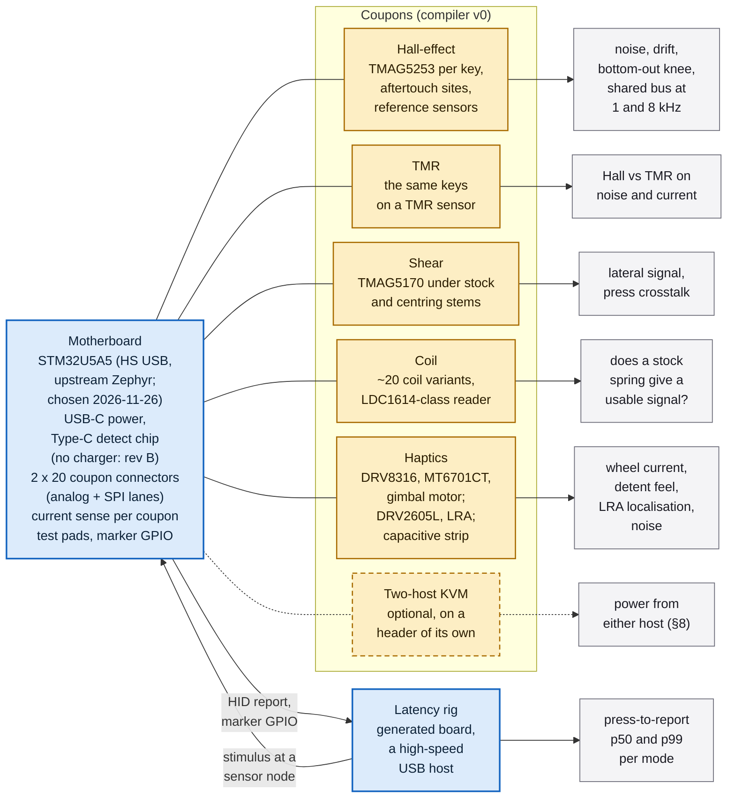

*Concept block diagram of the rev A testbed: the motherboard, the plug-in coupons (each to be generated by compiler
v0), what each coupon is meant to measure, and the latency rig. Nothing is built; the SPEC is a draft on paper. The
rev A chip is the STM32U5A5, chosen on 2026-11-26 (the AT32F405 was the candidate until then): its Zephyr support is
upstream, but 8 kHz HID on it is not proven yet (§6, §9). The owner's decisions of 2026-11-26 are drawn in: no
charger on rev A, the 2 × 20 slot connector, and USB-C power with a Type-C detect chip. The two-host KVM coupon is
optional: the draft SPEC gives it a header of its own (J_KVM, SPEC §7.4) rather than a slot.*

And as a concept sketch, top view to scale:

![Top-view concept sketch of the testbed to scale. The Hall-effect and TMR coupons with six keys each and the shear coupon run along the back. The coil and haptics coupons and the pale optional KVM coupon run along the front, with a strip between the rows. Callouts name each coupon, the M3 nylon posts, the 2 by 20 header pins, and the power section: input breaker, two LDOs, a 3.3 V and a 5 V switch per slot, 13 INA226-class monitors, and no charger. Below, the strip's left half is drawn at twice the scale, with callouts for the USB-C with its ESD array and VBUS TVS, the short 90-ohm pair, the Type-C current detect (I2C) chip, the STM32U5A5 drawn as an LQFP100, the 16 MHz HSE crystal, the reset and BOOT0 buttons, the J_RIG and J_SWD headers, the I2C mux and I/O expanders, the test pads and the JP_INJ solder jumpers.](../hardware/concept/renders/testbed_top.png)

*Concept sketch, top view to scale. The motherboard is about 190 × 150 mm and the coupons about 58 × 60 and
80 × 60 mm: the sizes in the draft [SPEC](../hardware/design/SPEC.md#_2-boards), which follow from the owner's
2 × 20 slot connector. Layout sets the outlines. The rows follow SPEC §9; the positions in them are the sketch's. The
MCU is the owner's rev A decision ([mcu.md](mcu.md)), drawn as its 14 × 14 mm LQFP100 and turned so that its USB pins
(PA11/PA12) face the USB-C. Every other part named is a candidate. The 16 MHz HSE is in the high-speed PHY's list of
accepted reference clocks (RM0456 Rev 7, read in a third-party transcription; ST's HAL and Zephyr's PHY driver agree)
and in the ROM bootloader's DFU crystal list (AN2606)
([SPEC §5.2](../hardware/design/SPEC.md#_5-2-constraints-behind-the-choices)).*

With the coupons lifted out of their sockets, and the keys lifted off, the sensor sites show:

![Exploded concept sketch of the testbed. The back-row coupons float high above the motherboard and the front-row coupons just above it. Dashed pink guides drop from each coupon's 2 by 20 header towards its socket on the motherboard. The S1 and S4 sockets show as black bars; the front-row coupons hide the others. The switches and keycaps are lifted further off the Hall-effect, TMR, shear and coil coupons so the sensor packages show. Callouts name each coupon's contents, the descriptor EEPROM every coupon carries, the M3 nylon post under each coupon, and the female through-hole socket on the motherboard.](../hardware/concept/renders/testbed_exploded.png)

*Concept sketch: each slot coupon lifted off its 2 × 20, 2.54 mm connector (a female through-hole socket on the
motherboard and a male header on the coupon, by the owner's decision of 2026-11-26), and the keys lifted off to show
the sensor sites under them: TMAG5253, TMR and TMAG5170 sites, all candidate parts. Every coupon carries a descriptor
EEPROM (SOIC-8) and stands on one M3 nylon post.*

The two-host KVM path (second USB controller and isolator) goes on its own optional coupon, which the draft SPEC
plugs into a header of its own, J_KVM ([SPEC §7.4](../hardware/design/SPEC.md#_7-4-optional-kvm-slot-j-kvm)), not
into a slot. If that coupon is not built on rev A, the KVM path waits for rev B.

The Hall-effect coupon's compliant-stop aftertouch sites would test a soft bottom stop: when the key bottoms out, the
stop compresses a little further, and the sensor reads that extra travel. One way such a key could look:


*Concept sketch of the aftertouch idea: the stem's magnet travels 4 mm towards a TMAG5253-class sensor, then lands on
a compliant stop, drawn here as a TPU disc. Illustrative geometry, not a design.*

The same key in an exact section, at rest and pressed into the stop:


*Exact section of the concept key: 4.0 mm of travel to the stop, then a 0.3 mm squeeze into an illustrative
compliant zone, the sketch's own choice (inset; the field model below uses 0.5 mm). In this sketch the gap from the
magnet to the top of the sensor package closes from 5.8 to 1.5 mm; to the Hall element inside the package, the gap
the field model uses, it is 6.3 mm at rest. The stop's stiffness and the field-versus-squeeze curve are rev A
unknowns.*

A simple magnet model shows why the coupon has to choose the magnet, the gap and the sensor range together:


*Model estimate, not measured: the exact on-axis field of a cylindrical NdFeB magnet (Br 1.25 T, an illustrative
6.3 mm rest gap to the Hall element; the section above gives 5.8 mm, to the package top) rises steeply toward the
hard stop, and the travel resolution with it, so the magnet, gap and sensor range have to be chosen together. The
TMAG5253 ranges drawn are approximate and unchecked against the datasheet.*

**Rev A is done when:** each coupon has a measured current and noise figure in the docs, the coil coupon says yes or
no to stock-spring sensing, the shear coupon says whether a centring stem gives a usable pointing signal, the wheel
coupon has a measured peak and average current, the battery gate picks a rev B chip from measured numbers, and the
compiler has generated and gated every coupon.

What each of those answers would decide:

```mermaid
---
config:
  # the docs theme sets p { line-height: 28px }, which would clip the labels mermaid measured at 1.5
  themeCSS: "p { line-height: inherit; }"
  flowchart:
    nodeSpacing: 16
    rankSpacing: 50
---
flowchart LR
  Q1["Which sensing wins<br/>on noise and current?"]:::q
  Q2["Does a stock spring<br/>give a usable signal?"]:::q
  Q3["Does a centring stem<br/>give a pointing signal?"]:::q
  Q4["Wheel peak and<br/>average current"]:::q
  Q5["Sensor currents<br/>at 1 and 8 kHz"]:::q
  Q6["Did compiler v0 generate<br/>and gate every coupon?"]:::q

  Q1 --> B1["Rev B: that sensing<br/>on every key"]:::revb
  Q2 -->|yes| C2["Rev C: analog from<br/>stock switches"]:::revc
  Q2 -->|no| D2["Dropped"]:::drop
  Q3 -->|yes| B3["Rev B: shear<br/>on 2–4 keys"]:::revb
  Q4 --> B4["Rev B: wheel full strength<br/>wired; strip + LRA<br/>on battery"]:::revb
  Q5 --> B5["Battery gate picks<br/>the rev B chip (§5)"]:::revb
  Q6 -->|yes| B6["Rev B: the full<br/>compiler"]:::revb

  classDef q fill:#f4f4f6,stroke:#6b6b78,stroke-width:1.5px,color:#1a1a22
  classDef revb fill:#dcebfb,stroke:#1565c0,stroke-width:2px,color:#0d2238
  classDef revc fill:#eceff4,stroke:#56657a,stroke-width:1.5px,stroke-dasharray:6 4,color:#1a1f28
  classDef drop fill:#f4f4f6,stroke:#9a9aa6,stroke-width:1px,color:#55555f
```

*What each planned rev A result decides for rev B and rev C, drawn from the "Rev A is done when" list and the
roadmap. No result exists yet. Only the outcomes this page names are drawn; for example, it does not say what happens
if the centring stem fails.*

## 8. Conflicts the testbed has to settle

| Conflict | Why | Settled by |
|---|---|---|
| Coils against Hall sensors | Coils need copper-free layers under each key, and the Hall analog buses want solid ground | Separate coupons, then a board variant if coils win |
| Wheel against battery | 0.5–1 A detent peaks (*estimate*) against a LiPo budget | Wheel coupon current; wheel full-strength when wired, a capacitive strip with LRA ticks on battery |
| 8 kHz against battery | Fresh 8 kHz reports need sensors on nearly all the time: by the draft SPEC's arithmetic a TMAG5253 re-enabled every frame cannot settle to 14 bits within it (its datasheet's 20–45 µs turn-on time reaches only 5 %; [SPEC §6.3](../hardware/design/SPEC.md#_6-3-per-step-arithmetic-estimate), an *estimate*), so at 8 kHz its duty is 100 %; an enable-gated bus only allows one sensor per column at a time | Hall and TMR coupon currents at 1 and 8 kHz; 8 kHz likely wired-only |
| KVM power | With isolation, the keyboard needs power from whichever host is present | A power design on the KVM coupon if rev A carries one (§7), otherwise in rev B |
| Keywell against flex | A splayed keywell does not unroll into one flat sheet | Rigid columns in rev B, flex only after the bent-state gate works |
| Magnetometer against magnets | The caliper's compass idea fails next to 60 switch magnets, so splay can't be sensed on board | Phone-photo fiducials (§4.4) |

The six conflicts as a graph:

```mermaid
---
config:
  # the docs theme sets p { line-height: 28px }, which would clip the labels mermaid measured at 1.5
  themeCSS: "p { line-height: inherit; }"
  flowchart:
    nodeSpacing: 16
    rankSpacing: 40
---
flowchart LR
  COIL["Printed coils"]:::part
  HALL["Hall analog buses"]:::part
  WHEEL["Haptic wheel"]:::part
  BAT["Battery (LiPo)"]:::part
  K8["8 kHz polling"]:::part
  ISO["KVM isolator"]:::part
  KPWR["Keyboard power"]:::part
  KW["Splayed keywell"]:::part
  FLEX["One flex sheet"]:::part
  MAGN["Magnetometer"]:::part
  SWM["~60 switch magnets"]:::part

  COIL --- X1(["copper-free layers<br/>vs solid ground"]):::conf
  HALL --- X1
  WHEEL --- X2(["0.5–1 A detent peaks<br/>(estimate)"]):::conf
  BAT --- X2
  K8 --- X3(["sensors on nearly<br/>all the time"]):::conf
  BAT --- X3
  ISO --- X4(["no power when only<br/>host B is plugged in"]):::conf
  KPWR --- X4
  KW --- X5(["does not unroll<br/>flat"]):::conf
  FLEX --- X5
  MAGN --- X6(["splay cannot be<br/>sensed on board"]):::conf
  SWM --- X6

  X1 --> S1["Rev A: separate coupons,<br/>then a board variant<br/>if coils win"]:::reva
  X2 --> S2["Rev A: wheel current;<br/>full strength when wired,<br/>strip + LRA on battery"]:::reva
  X3 --> S3["Rev A: Hall and TMR<br/>currents at 1 and 8 kHz;<br/>8 kHz likely wired-only"]:::reva
  X4 --> S4["Rev A: a power design<br/>on the KVM coupon if<br/>it fits, else rev B"]:::maybe
  X5 --> S5["Rev B: rigid columns;<br/>flex only after the<br/>bent-state gate works"]:::later
  X6 --> S6["Rev C: phone-photo<br/>fiducials (§4.4)"]:::later

  classDef part fill:#f4f4f6,stroke:#6b6b78,stroke-width:1.5px,color:#1a1a22
  classDef conf fill:#fbe0e0,stroke:#c62828,stroke-width:1.5px,color:#3a0d0d
  classDef reva fill:#fdeec4,stroke:#a86b00,stroke-width:2px,color:#2b1d00
  classDef maybe fill:#fdeec4,stroke:#a86b00,stroke-width:2px,stroke-dasharray:6 4,color:#2b1d00
  classDef later fill:#dcebfb,stroke:#1565c0,stroke-width:2px,color:#0d2238
```

*The two competing parts in each conflict, why they clash, and what settles it. The battery sits in two of them.
Amber is settled on the rev A testbed (dashed: only if rev A carries a KVM coupon) and blue later; the 0.5–1 A detent
peak is a desk estimate.*

## 9. Open questions

* The working name, and whether the folder stays `keyboard/`.
* Which layout format the compiler reads: its own Python, or Ergogen or KLE input for compatibility.
* Hot-swap magnetic switches on rev B (a plate-mount HE ecosystem: Gateron, Lekker, TTC, Kailh) or socketless.
* How many shear keys: two index keys plus the thumbs, or all eight home keys.
* Wi-Fi: the keyboard research's MCU lens recommends dropping it, and the caliper's rev B ideas list it as something
  that may go (rev A keeps it). The keyboard's companion app works over USB and BLE.
* Zephyr on the rev A chip: **resolved on 2026-11-26.** The AT32F405 has no upstream Zephyr support, so the owner
  picked the rev A chip again: the STM32U5A5, whose high-speed USB device is upstream in Zephyr (§5, §6,
  [mcu.md](mcu.md)).
* Reserve the rev A MCUs before the schematic is committed: buy JLC's stock of the STM32U5A5VJT6 into a private parts
  library, or consign 4–6 parts. On 2026-11-26 JLC had 13 (possibly already committed to other orders, an
  unverified reading of its API; [SPEC §1](../hardware/design/SPEC.md#_1-purpose-and-what-rev-a-must-prove)), and
  DigiKey none before February–March 2027. If they cannot be secured, the i.MX RT1021 takes over.
* Prove 8 kHz HID on the NUCLEO-U5A5ZJ-Q before the schematic is committed: Zephyr's `usbd` at high speed with
  `in-polling-period-us = <125>` (bInterval 1), the report rate and jitter measured for at least 10 minutes. Nobody has
  published this for Zephyr's STM32 USB driver ([mcu.md](mcu.md#conditions-before-the-schematic-is-committed)). The
  proof firmware and its host measurement tool are written
  ([keyboard/firmware/hid8k](../firmware/hid8k/README.md), 2026-11-27): it compiles for `nucleo_u5a5zj_q` with
  Zephyr v4.5.0 and Ubuntu's arm-none-eabi GCC rather than the Zephyr SDK, and its high-speed endpoint descriptor
  carries bInterval 1, but it has not run on a Nucleo, so nothing is measured yet.
* Rev B side track: measure 8 kHz HID together with BLE, and the radio current, on an nRF54LM20 dev kit (XIAO
  nRF54LM20A or nRF54LM20 DK) for the battery gate.
