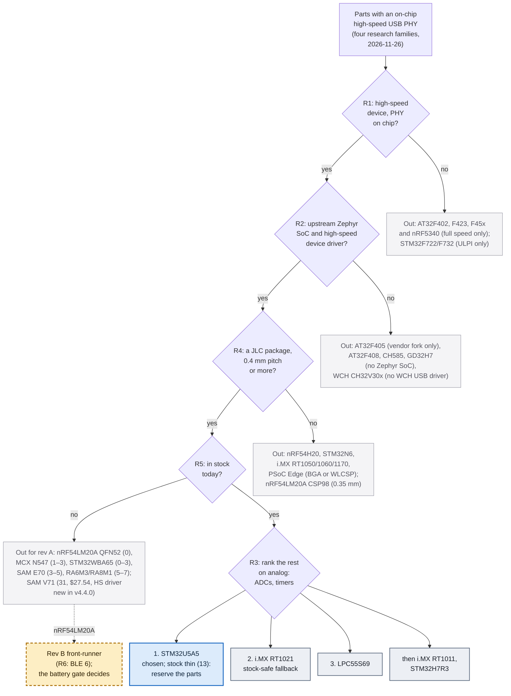

# Rev A MCU: STM32U5A5 (decision record)

> **Status (2026-11-26): decided on paper.** The owner chose the rev A testbed MCU on 2026-11-26 after a desk-research
> run: four researchers, one per chip family, then an adversarial verifier that re-checked the deciding claims on
> primary sources (the Zephyr tree, the USB device drivers, the JLC parts API). **Designed, not built or measured:** no
> schematic, board or firmware exists, the Nucleo has not been brought up, and nobody has shown 8 kHz HID on this chip.
> Stock and prices are from 2026-11-26 and change daily.

## The decision

| | |
|---|---|
| Rev A testbed MCU | **STMicroelectronics STM32U5A5VJT6**: LQFP100, 14 × 14 mm at 0.5 mm pitch, about 80 GPIO. JLC C22455480 (extended part), 13 in stock at $19.07 on 2026-11-26 |
| Where it sits | On the testbed motherboard, not on a plug-in MCU card |
| Bring-up board | ST NUCLEO-U5A5ZJ-Q, an upstream Zephyr board (`nucleo_u5a5zj_q`) with the high-speed USB device on by default. It carries the LQFP144 STM32U5A5ZJ (its -Q variant), not the LQFP100, so pin-level details need checking against the VJT6 datasheet |
| Firmware | Zephyr ([concept §6](concept.md#_6-firmware-custom-on-zephyr)), pinned to v4.5.0 or a known-good `main` commit |
| Fallback | NXP i.MX RT1021 (C5119758), the stock-safe runner-up. Third choice: NXP LPC55S69 |
| Dropped | Artery AT32F405, the rev A candidate until 2026-11-26: no upstream Zephyr ([verdict below](#the-at32f405-verdict)) |
| Rev B | Still decided by the battery gate ([concept §5](concept.md#_5-platform-let-the-testbed-decide)). Front-runner: Nordic nRF54LM20A, measured now on a dev kit ([side track](#split-advice-rev-b-and-the-dev-kit-side-track)) |
| Architecture | The testbed's draft architecture of record: [hardware/design/SPEC.md](../hardware/design/SPEC.md) |

**Why.** It is the only stocked part found that meets the two hardest requirements, high-speed USB with the PHY on
chip (R1) and upstream Zephyr support for that USB device (R2), **and** leads on analog (R3). The verifier found
`zephyr_udc0 = &usbotg_hs` on the `nucleo_u5a5zj_q` board in the v4.4.0, v4.5.0 and `main` trees, and Zephyr's
STM32 USB device driver (`udc_stm32`) selects high speed for its on-chip PHY. Its analog: three 2.5 Msps ADCs, two of
them 14-bit, with a DMA-capable Zephyr driver, plus the TIM1 and TIM8 motor-control timers, 6 I2C, 3 SPI and 4 MB of
flash, in a 0.5 mm LQFP (R4). Of the other stocked parts that meet R1 and R2, the NXP ones have one or two ADCs of
about 1 Msps (and the i.MX RT parts' Zephyr ADC driver has no DMA), and the STM32H7R3 has faster but 12-bit ADCs, one
advanced timer and 64 KB of flash.

**What it costs.** About $19 per MCU against $2–6 for the alternatives. A supply that has to be managed: 13 at JLC,
none at DigiKey before February–March 2027. No radio. No Zephyr support for its capacitive-touch controller. And
8 kHz HID on `udc_stm32` is unproven, so it is the first thing to test
([conditions](#conditions-before-the-schematic-is-committed)).

## Requirements

What the rev A testbed MCU had to meet, in priority order:

| | Requirement |
|---|---|
| R1 | High-speed USB 2.0 (480 Mb/s) **device** with the PHY **on chip** (no external ULPI PHY), to test 8 kHz polling |
| R2 | **Upstream Zephyr**: the SoC in `zephyr/soc`, ideally a board in `zephyr/boards`, **and** a high-speed device driver in Zephyr's USB device stack (`device_next`, a UDC driver). Vendor-fork support counts only where it is said explicitly |
| R3 | Analog: enough ADC count, resolution and rate to scan the Hall-effect and TMR coupons through external muxes (about 1–2 Msps in aggregate), plus SPI, I2C and an advanced timer for the DRV8316's 3-phase PWM |
| R4 | A package JLC can assemble on a normal 4-layer board: QFN or LQFP at 0.4 mm pitch or more, no 0.35 mm CSP or BGA that needs HDI |
| R5 | LCSC/JLC stock and price, and a cheap dev board for bring-up |
| R6 | Nice to have: a family that could also serve rev B (BLE or a companion radio), low active current, SWD debug |

## How the requirements narrowed the field

The four research families covered every part found with an on-chip high-speed PHY: Artery and WCH; Nordic; ST; and
NXP, Microchip, Renesas, Espressif, Infineon, GigaDevice, Nuvoton and Ambiq. A simplified view of what each
requirement removed:

*Simplified from the verifier's ranking, which weighed R1–R6 together: this sketch applies them one at a time, in an
order chosen for the drawing, and names the main parts each step removed, not every part checked. "Out for rev A" is
about stock on 2026-11-26, not about the silicon, and R5 was weighed with price and driver age: the SAM V71 had more
JLC stock (31) than the chosen STM32U5A5 (13), but at $27.54 and with a high-speed device driver first released in
Zephyr v4.4.0. Desk research: no part here has been tried.*

## The ranked candidates

The verifier's ranking for the rev A testbed. JLC stock and qty-1 price are from the JLC parts API on 2026-11-26; all
of them are extended parts.

| # | Part | Package | Zephyr | High-speed USB | ADC and timers | JLC stock, price | Dev board | What it gives up |
|---|---|---|---|---|---|---|---|---|
| 1 | **ST STM32U5A5VJT6** (RJT6 in LQFP64 as the pin-light option) | LQFP100 14 × 14, 0.5 mm | Upstream SoC; `nucleo_u5a5zj_q` has HS as `zephyr_udc0` in v4.4.0, v4.5.0, `main` | Yes, on-chip PHY (`st,stm32u5-otghs-phy`); `udc_stm32` sets HS. 8 kHz not shown | 2 × 14-bit + 1 × 12-bit, 2.5 Msps each; DMA and stream in the Zephyr driver. TIM1, TIM8 | C22455480: 13 at $19.07 (RJT6 C22454506: 1 at $23.23). DigiKey: 0 until Feb–Mar 2027 | NUCLEO-U5A5ZJ-Q, about $35–55 (Future $34.65 with 4 in stock, others $37–55; search snapshots, unverified) | Price; supply to manage; no radio; no Zephyr touch node; the HS PHY's ~13 mA idle |
| 2 | **NXP i.MX RT1021** (CAG4B; DAF5B/CAF4B in LQFP100) | LQFP144 20 × 20 or LQFP100 14 × 14, 0.5 mm. No on-chip flash | Upstream; `mimxrt1020_evk`, `zephyr_udc0 = &usb1` in v4.4.0, v4.5.0, `main` | Yes, the most mature: EHCI, `udc_mcux_ehci` | 2 × 12-bit, about 1 Msps each (rate unverified); the Zephyr driver takes one interrupt per sample, no DMA. FlexPWM | C5119758: 300 at $6.26. DigiKey 69–361 by variant | MIMXRT1020-EVK (price not checked) | External QSPI NOR and FlexSPI boot; a scan engine to write on `hal_nxp`; 12-bit; more current |
| 3 | **NXP LPC55S69JBD100** | HLQFP100 14 × 14, 0.5 mm, exposed pad | Upstream; `lpcxpresso55s69`, `zephyr_udc0 = &usbhs` | Yes, mature (IP3511), but only 6 bidirectional endpoints | 1 × 16-bit, up to 1.0 Msps (unverified); DMA mode needs an overlay. No motor timer | C5194741: 686 at $3.846 (an outlier: DigiKey $11.43) | LPCXpresso55S69, about €52 (snippet) | ADC rate; no advanced timer; endpoints; CPU headroom |
| 4 | NXP i.MX RT1011 | LQFP80 12 × 12, 0.5 mm; external flash | Upstream; `mimxrt1010_evk` | Yes (EHCI) | 1 × 12-bit, about 1 Msps; one FlexPWM | C1575810: 350 at $5.67 | MIMXRT1010-EVK, about €42 (snippet) | Half the RT1021's ADC and PWM |
| 5 | NXP MCX N547 | HLQFP100 14 × 14, 0.5 mm (preliminary) | Upstream; `mcx_n5xx_evk` in v4.5.0, `main` | Yes (EHCI) | 2 × 16-bit, 2 Msps (3.15 Msps at 12-bit); DMA; FlexPWM | 1 and 3 (C27775912, C47127813) at $13.75–15.74. DigiKey 0 until mid-2027 | FRDM-MCXN947 (same HS IP), about $25 | Buyability |
| 6 | ST STM32H7R3V8T6 | LQFP100 14 × 14, 0.5 mm | Upstream; HS on `nucleo_h7s3l8` only from v4.5.0 | Yes, but young | 2 × 12-bit at 5 Msps; TIM1 only; 64 KB flash | C22400329: 16 at $9.22 | NUCLEO-H7S3L8, about $37–57 | External XSPI flash and an MCUboot chain; one advanced timer |
| 7 | Nordic nRF54LM20A | QFN52 6 × 6, 0.4 mm ("Early sampling"); CSP98 at 0.35 mm fails R4 | Upstream since v4.2.0; HS quirk since v4.3.0; `nrf54lm20dk`, `xiao_nrf54lm20a` | Yes, with the best 8 kHz evidence of any candidate (Nordic's `udc_dwc2`) | 1 SAADC, 8 inputs, 10-bit native at 2 Msps; no advanced timer | QFN52: 0 (placeholder C9900325583). CSP98 C52031439: 2949 at $6.25 | nRF54LM20 DK (B die), about $45; XIAO nRF54LM20A, about $10 | A stocked JLC package; ADC; motor timer; GPIO. The rev B front-runner |
| 8 | ST STM32WBA65 | UFQFPN48 7 × 7, 0.5 mm; VFQFPN68, 0.4 mm | Upstream; `nucleo_wba65ri` HS in v4.4.0+ | Yes | 1 × 12-bit at 2.5 Msps, few channels; one advanced timer | C45616365: 3 at $12.23; C45338552: 0 | NUCLEO-WBA65RI, about $71–76 | Analog, CPU, stock. A rev B alternative |
| 9 | Artery AT32F405 | LQFP64 at 0.5 or 0.4 mm, LQFP48, QFN32 | **Not upstream**: a blinky-level PR and a stale vendor fork | In silicon (needs a 12 MHz crystal); in Zephyr only in the fork, unvalidated | 1 × 12-bit at 2 Msps, 16 channels; TMR1 | 92–329 per part number at $1.85–2.82 (RCT7 C47090415: 162 at $2.63) | AT-START-F405 (no seller found) | Upstream Zephyr (R2) |
| 10 | WCH CH32V307RCT6 | LQFP64M 10 × 10, 0.5 mm | SoC and boards upstream, but no WCH USB driver at any speed and no V30x ADC driver | In silicon; no Zephyr driver | 2 × 12-bit at 1 Msps; 4 advanced timers | C2988083: 1476 at $3.45 | CH32V307V-EVT-R1 | Two drivers to write; WCH 2-wire debug instead of SWD |

## The AT32F405 verdict

The research of 2026-11-25 named the Artery AT32F405 for rev A (on-chip high-speed PHY, Artery's 8 kHz
magnetic-keyboard reference, libhmk) but never checked Zephyr. The verifier's verdict, which the owner accepted:
**do not put it on the rev A motherboard under the Zephyr decision.**

* **Upstream Zephyr has nothing for it:** no Artery SoC, no AT32 files and no `hal_at32` module in `main` (4.5.99,
  commit 17bf798, 2026-11-26) or v4.5.0.
* **The only upstream PR, [#101409](https://github.com/zephyrproject-rtos/zephyr/pull/101409),** has been open for
  11 months. It is blinky-level (clock, GPIO, pinctrl, reset, EXINT and USART), blocked by a DNM label for the new
  `hal_at32` module, and has needed a rebase since 2026-09-04.
* **The vendor fork** ([ArteryTek/zephyr](https://github.com/ArteryTek/zephyr/tree/artery-v1.1-branch),
  `artery-v1.1-branch`, Zephyr 4.3.99) has not been pushed since 2026-02-28. Its high-speed path is real code (the
  generic dwc2 driver with an AT32 quirk, OTGHS as `zephyr_udc0`), but nothing shows it ever ran at high speed: the
  board lists only `gpio` as supported.
* Choosing it would mean carrying a stale fork two minor versions behind upstream and validating its high-speed USB
  ourselves, or writing bare-metal TinyUSB/libhmk firmware, which contradicts the Zephyr decision for the very board
  meant to prove the firmware.

The silicon is good and cheap. Its best use now, an option the owner left open: an AT-START-F405 or a small board
running libhmk as a **reference 8 kHz device** to calibrate the latency rig (libhmk's 8 kHz is its own claim, on
bare-metal TinyUSB; neither research run measured it). Re-check it for rev B or later only if #101409 merges with USB
support.

## What the verifier corrected

The verifier re-checked the researchers' deciding claims and corrected these:

* **STM32U5A5 supply is worse than first reported.** JLC confirmed (VJT6: 13; RJT6: 1). DigiKey shows 0 for the
  VJT6 (1 expected on 22 March 2027) and 0 for the VJT6Q (90 expected on 15 February 2027). Search snippets showing
  about 573 at DigiKey were stale.
* **LPC55S69 price.** JLC's $3.846 (686 in stock) is a low outlier; DigiKey sells it at $11.43 (763 in stock). Plan on
  about $11.
* **MCX N547 is out of stock everywhere checked**, not just thin.
* **i.MX RT1021 supply is better** than one distributor suggested: 300 at JLC at $6.26, 69–361 at DigiKey.
* **i.MX RT10xx ADC.** "About 1 Msps" is the silicon, not what Zephyr delivers: `adc_mcux_12b1msps_sar.c` starts one
  conversion in software and takes one interrupt per sample, with no DMA or ADC_ETC path.
* **LPC55S69.** The Zephyr LPADC DMA mode exists but needs `dmas` in a board overlay, and the high-speed controller
  has only 6 bidirectional endpoints: tight for keyboard, mouse, Radial Controller, CDC log and a vendor interface.
* **AT32F405 PR.** The stale label was removed on 2026-11-19 after the author objected; the PR is open but still
  blinky-level.
* **ArteryTek fork.** `artery-v1.1-branch` is its newest branch, with no push for about nine months. The AT32F405's
  OTGHS binds to the generic dwc2 driver through a quirk, not to `udc_at32.c`.
* **8 kHz on Zephyr.** The NXP and STM32 "8 kHz is expressible" claims rest only on descriptor arithmetic
  (`USB_HS_INT_EP_INTERVAL(125)` gives bInterval 1). The only public evidence of Zephyr's device stack running near
  8000 Hz is Nordic's (known issue NCSDK-30504 on the nRF54H20; nRF Desktop configured at 125 µs on the nrf54lm20dk),
  and both use `udc_dwc2`, not `udc_stm32` or the NXP drivers.
* **nRF54LM20A QFN52.** JLC's placeholder (C9900325583, stock 0) confirms the 0.4 mm pitch and that no QFN52 is
  stocked. Nordic's page still lists it as early sampling; the CSP98 (0.35 mm) and CSP61 (0.325 mm) are in mass
  production.
* **STM32U5 high-speed USB in Zephyr has needed fixes**: the embedded-PHY binding (commit f72ef5c2) and OTG clock
  gating in sleep (commit 8b355e93). The path is upstream and on by default, but it is not old or heavily exercised.

## Conditions before the schematic is committed

The owner set two conditions. Both are open on 2026-11-26.

1. **Reserve the MCUs.** Buy the JLC stock into a JLC private parts library, or consign 4–6 parts, before the
   schematic is committed. JLC had 13 STM32U5A5VJT6 on 2026-11-26 and DigiKey had none before February–March 2027.
   The same JLC API answer reports `canPresaleNumber` −4 for the part, which suggests the 13 are already committed to
   other orders (an inference from an undocumented field, unverified): check JLC's parts-order page first
   ([SPEC §1](../hardware/design/SPEC.md#_1-purpose-and-what-rev-a-must-prove)). If the parts cannot be secured, the
   i.MX RT1021 takes over.
2. **Prove 8 kHz HID on the NUCLEO-U5A5ZJ-Q with Zephyr's `usbd`.** Enumerate at high speed with
   `in-polling-period-us = <125>`, check that bInterval is 1, and measure the report rate and jitter for at least 10
   minutes, on Windows and Linux hosts, with CDC logging active. Also measure what each `hid_device_submit_report`
   costs. Nobody has published this for `udc_stm32`. Pin Zephyr v4.5.0 or a known-good `main` commit and run the USB
   samples first. If it fails, fall back to the i.MX RT1021 (EHCI) and record why; the nRF54LM20 dev kit's dwc2
   result is a cross-check, not a rev A fallback.

## Bring-up risks

The risks bring-up has to retire first, from the verifier:

| Risk | What to do first |
|---|---|
| 8 kHz HID on `udc_stm32` is unproven | Condition 2 above. It is the first gate |
| ADC throughput per 125 µs frame | Each frame must cover N keys × (mux switch + sensor enable-to-valid settling + conversion + any oversampling) on each ADC. The coupon sensors are enable-gated, so their settling time is probably the real limit, not the ADC; it is not checked. By arithmetic, 16 keys on one ADC leave 7.8 µs per key. Build a timer-triggered, DMA-driven scan (`ADC_STM32_DMA` or `ADC_STREAM`, or LL code) and measure the scan period and CPU load before deciding how many keys share a bus |
| Parts supply | Condition 1, and keep the RT1021 as a ready alternative |
| The high-speed hardware | A 90 Ω differential pair on JLC's controlled-impedance stack, routed by hand before Freerouting (it is not impedance-aware). An HSE crystal at a frequency the U5's HS PHY accepts: 16 MHz works on the Nucleo, and the accepted list is unverified. VDDUSB handling per package. The OTG_HS core runs only in voltage ranges 1 and 2. Plan an enumeration and eye check at 480 Mb/s |
| Current-sense separation | The HS PHY draws about 13 mA at idle (datasheet typical, via the research). It and the MCU's own current must stay off the per-coupon sense paths, or the battery gate gets polluted numbers |
| Zephyr maturity | Pin a version (above). Keep the MCU out of low-power states that gate the OTG clocks until that is tested |
| Motor drive | Zephyr's STM32 PWM has complementary outputs, but dead-time is not clearly exposed. Run the DRV8316 in 3x PWM mode (its internal dead-time) first; 6-PWM only once the TIM1 or TIM8 dead-time setup is proven |
| Capacitive strip | Zephyr has no TSC node for the U5, so the haptics coupon needs an external touch controller on I2C |
| Latency rig | To time press-to-report at 8 kHz it must be a high-speed USB host with microframe-accurate timestamps. Check its host side (and any Zephyr USB host support it would rely on) before trusting its p99 numbers |

## Split advice: rev B and the dev-kit side track

The verifier's advice was to **split**: no part with a radio meets rev A's R3–R5 today. The nRF54LM20A's QFN52 is
sampling with no stock and its stocked CSP98 needs HDI; the STM32WBA65 has thin analog and almost no stock; the NXP
RW612 has no motor PWM, and only its module is stocked (u-blox IRIS-W106, 21 units). So rev A is a wired,
analog-rich Zephyr part, and the battery gate picks rev B, as the owner intended.

* **Rev B front-runner: the nRF54LM20A.** Its Zephyr high-speed path is `udc_dwc2`, the driver Nordic runs at about
  8000 Hz on the nRF54H20, and Nordic's nRF Desktop sets a 125 µs polling period on the nrf54lm20dk. Alternatives:
  the STM32WBA65, and the RW612 or IRIS-W106.
* **Side track, now (owner decision).** Buy an nRF54LM20 dev kit, either the Seeed XIAO nRF54LM20A (about $10,
  upstream in Zephyr since v4.5.0) or the nRF54LM20 DK (about $45; it carries the B die, and the A is emulated).
  Measure 8 kHz HID together with BLE, and the radio current, and give those numbers to the battery gate beside rev
  A's sensor currents. Watch for report-rate drops while BLE is active: NCSDK-30504 shows one on the nRF54H20, and
  nRF Desktop uses MCUboot RAM-load mode and pauses BLE advertising while USB is active.
* **Keep the split cheap.** Keep the behaviour, HID and coupon-driver layers on Zephyr APIs and devicetree, so the
  rev B port is a board file plus a new scan engine. The ADC scan engine is vendor-specific on every candidate.
* **Not taken:** the verifier's optional plug-in MCU card (the MCU, USB-C and the 90 Ω pair on a card, so a later
  nRF54LM20 card could drive the same coupons). The owner put the MCU on the motherboard.
* **Not a split:** an AT32F405 rev A on bare-metal firmware. It defers the Zephyr risk instead of retiring it.

The nRF54LM20A's own caveats: one SAADC that is 10-bit native (12 and 14 bits only by oversampling, at 125 and
62.5 ksps), 32 GPIO on the QFN52, no advanced motor timer, and a bare-chip RF design would be a first for this
toolchain.

## What could not be verified

* A measured 8 kHz HID report rate through Zephyr's `usbd` on any of the recommended parts (STM32U5A5, RT1021,
  LPC55S69, MCX N547). Only descriptor arithmetic and Nordic's dwc2 evidence exist.
* Whether the ArteryTek fork's AT32F405 high-speed USB enumerates on hardware.
* STM32U5A5 datasheet details the verifier did not re-read itself: the HS PHY bonded out on every LQFP, 2.5 Msps per
  ADC, and the HSE frequencies the HS PHY accepts. The Zephyr devicetree confirms the 14-bit ADC1/ADC2, the 12-bit
  ADC4, TIM1/TIM8 and the OTG_HS node. The STM32 researcher read DS13543 and reported the PHY in every package.
  The SPEC's drafting has since read DS13543 Rev 2 for the LQFP100: ADC1/ADC2 reach 2.5 Msps at 14 bits and ADC4
  2.75 Msps at 12 bits (Tables 97 and 100), and Zephyr's PHY driver accepts a 16 MHz HSE
  ([SPEC §5.2, §6.2](../hardware/design/SPEC.md#_5-2-constraints-behind-the-choices)).
* The i.MX RT1021's ADC rate and per-package channel and FlexPWM counts (the NXP datasheet download was blocked).
* The LPC55S69's 1.0 Msps ADC rate (search summaries of the datasheet, not read directly).
* Mouser stock for every part (the site returned 503).
* Dev-board prices and stock (search snapshots only).
* Whether Zephyr's STM32 PWM binding exposes dead-time.
* The enable-to-valid settling time of the TMAG5253 and the TMR sensors behind a shared, enable-gated bus, which sets
  how many keys fit in a 125 µs scan.

## Sources

The verifier's and researchers' main sources, fetched on 2026-11-26.

**Zephyr** (main at commit 17bf798be778, 2026-11-26, version 4.5.99; tags v4.3.0, v4.4.0 and v4.5.0)

* Zephyr repository: <https://github.com/zephyrproject-rtos/zephyr>
* STM32 USB device driver: <https://github.com/zephyrproject-rtos/zephyr/blob/main/drivers/usb/udc/udc_stm32.c>
* STM32 embedded HS PHY list: <https://github.com/zephyrproject-rtos/zephyr/blob/main/drivers/usb/common/stm32/stm32_usb_common.h>
* STM32U5 OTG_HS devicetree: <https://github.com/zephyrproject-rtos/zephyr/blob/main/dts/arm/st/u5/stm32u5_usbotg_hs.dtsi>
* NUCLEO-U5A5ZJ-Q board: <https://github.com/zephyrproject-rtos/zephyr/blob/main/boards/st/nucleo_u5a5zj_q/nucleo_u5a5zj_q.dts>
  and <https://docs.zephyrproject.org/latest/boards/st/nucleo_u5a5zj_q/doc/index.html>
* STM32 ADC driver (DMA, stream): <https://github.com/zephyrproject-rtos/zephyr/blob/main/drivers/adc/adc_stm32.c>
* NXP EHCI USB device driver: <https://github.com/zephyrproject-rtos/zephyr/blob/main/drivers/usb/udc/udc_mcux_ehci.c>
* NXP RT10xx ADC driver: <https://github.com/zephyrproject-rtos/zephyr/blob/main/drivers/adc/adc_mcux_12b1msps_sar.c>
* MIMXRT1020-EVK board: <https://github.com/zephyrproject-rtos/zephyr/blob/main/boards/nxp/mimxrt1020_evk/mimxrt1020_evk.dts>
* NXP IP3511 USB device driver: <https://github.com/zephyrproject-rtos/zephyr/blob/main/drivers/usb/udc/udc_mcux_ip3511.c>
* LPC55S6x devicetree: <https://github.com/zephyrproject-rtos/zephyr/blob/main/dts/arm/nxp/lpc/lpc55xxx/nxp_lpc55S6x_common.dtsi>
* nRF54L high-speed USB quirk: <https://github.com/zephyrproject-rtos/zephyr/blob/main/drivers/usb/udc/udc_dwc2_nrf_usbhs_nrf54l.h>
* High-speed interval macro: <https://github.com/zephyrproject-rtos/zephyr/blob/main/include/zephyr/usb/usb_ch9.h>
* HID class: <https://github.com/zephyrproject-rtos/zephyr/blob/main/subsys/usb/device_next/class/usbd_hid.c>
* STM32U5 OTG_HS fixes: commit f72ef5c2 (embedded PHY) and commit 8b355e93 (clock gating in sleep), seen on mirrors:
  <https://juju.nz/src/michaelh/zephyr/commit/f72ef5c237240e4888b94ec2cccaec774be5ece1>,
  <https://mirrors.sustech.edu.cn/git/12411711/zephyr/-/commit/8b355e93062474e0c231255f1f354def821c0968>

**Artery**

* Upstream PR #101409: <https://github.com/zephyrproject-rtos/zephyr/pull/101409>
* ArteryTek Zephyr fork: <https://github.com/ArteryTek/zephyr/tree/artery-v1.1-branch>
* libhmk: <https://github.com/peppapighs/libhmk>

**ST**

* STM32U5A5 datasheet DS13543: <https://www.st.com/resource/en/datasheet/stm32u5a5rj.pdf>

**Nordic**

* nRF54LM20A product page: <https://www.nordicsemi.com/Products/nRF54LM20A>
* nRF Desktop on the nrf54lm20dk (125 µs): <https://raw.githubusercontent.com/nrfconnect/sdk-nrf/main/applications/nrf_desktop/configuration/nrf54lm20dk_nrf54lm20a_cpuapp/app_release.overlay>
* nRF Desktop USB state: <https://raw.githubusercontent.com/nrfconnect/sdk-nrf/main/applications/nrf_desktop/doc/usb_state.rst>
* NCS known issues (NCSDK-30504): <https://raw.githubusercontent.com/nrfconnect/sdk-nrf/main/doc/nrf/releases_and_maturity/known_issues.rst>
* XIAO nRF54LM20A board: <https://github.com/zephyrproject-rtos/zephyr/tree/main/boards/seeed/xiao_nrf54lm20a>

**Stock**

* JLC parts API (the endpoint [`tools/lcsc_check.py`](../../tools/lcsc_check.py) uses), queried for every C-number on
  this page: <https://jlcpcb.com/api/overseas-pcb-order/v1/shoppingCart/smtGood/selectSmtComponentList>
* DigiKey STM32U5A5VJT6: <https://www.digikey.com/en/products/detail/stmicroelectronics/STM32U5A5VJT6/21348988>
* DigiKey STM32U5A5VJT6Q: <https://www.digikey.com/en/products/detail/stmicroelectronics/STM32U5A5VJT6Q/20412790>
* DigiKey searches: <https://www.digikey.com/en/products/result?keywords=MIMXRT1021>,
  <https://www.digikey.com/en/products/result?keywords=LPC55S69JBD100>,
  <https://www.digikey.com/en/products/result?keywords=MCXN547VKLT>
* NUCLEO-U5A5ZJ-Q price snapshot: <https://www.futureelectronics.com/p/development-tools--microcontroller-microprocessor--32-bit-eval-board/nucleo-u5a5zj-q-stmicroelectronics-2177223>
