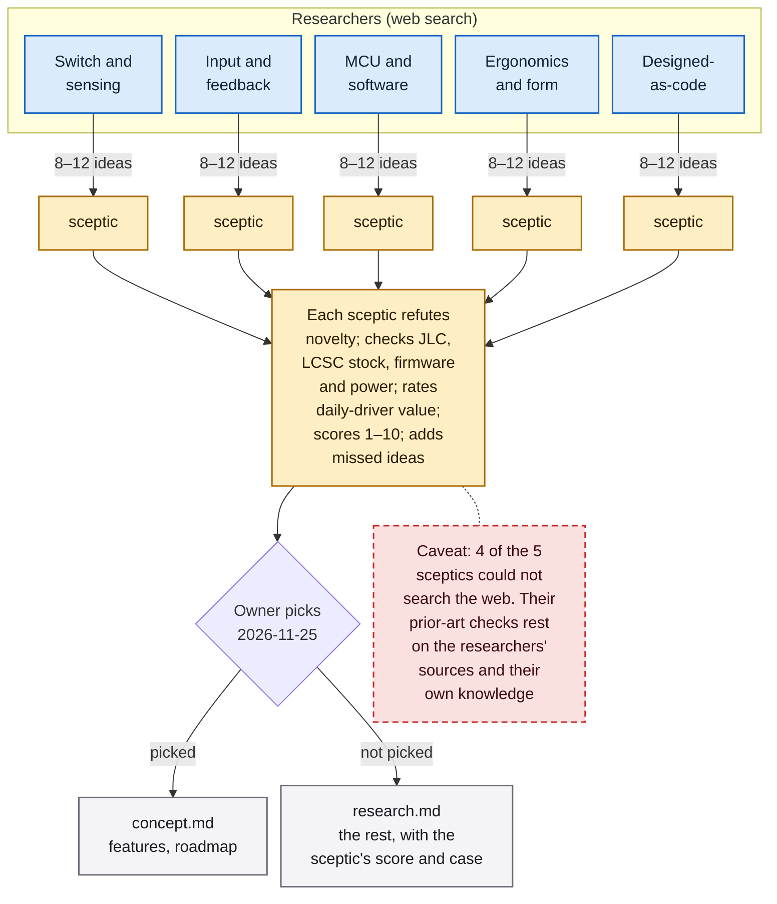
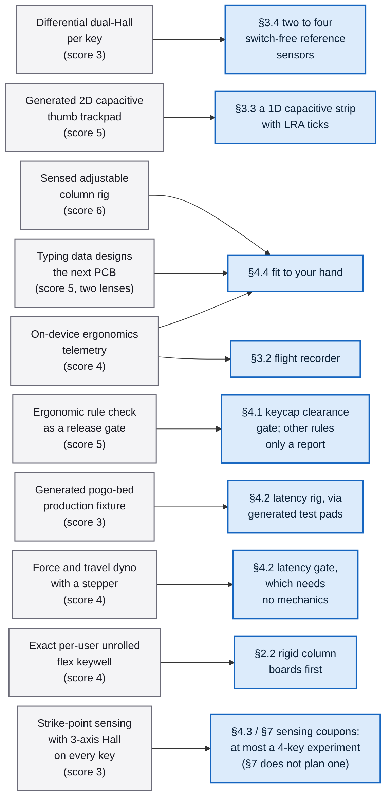

# Research: the keyboard landscape and the ideas we weighed

Desk research from 2026-11-25. It fed the owner's choices in [concept.md](concept.md). **Nothing here was built or
measured.** A dated [addendum](#addendum-2026-11-26-the-rev-a-mcu) records the MCU research that followed on
2026-11-26.

## How this was researched

Five researchers each covered one area and searched the web for current products, projects and papers:

* switch and sensing technology,
* extra input and feedback,
* MCU, connectivity and software,
* ergonomics and form,
* designed-as-code.

Each proposed 8–12 differentiating ideas with the closest prior art. A sceptic then reviewed each area. Its job was
to refute novelty, check feasibility on this toolchain (JLC assembly, LCSC stock, firmware, power), rate each idea's
daily-driver value and give it a 1–10 score for worth building. It also added ideas the researcher had missed.

The method in one picture:

*How the desk research ran: five researchers with web search, each proposing 8–12 ideas; one sceptic per area to
refute and score them; then the owner's pick on 2026-11-25. Four of the five sceptics could not search the web, so
some prior-art checks rest on the researchers' sources and the sceptics' own knowledge.*

**Caveats:**

* **Search coverage.** Four of the five sceptics could not run web search, so their prior-art checks rest on the
  researchers' sources, six to nine primary pages each fetched directly, and their own knowledge. A few "rare" ratings may be generous. Where a source says "from
  memory" or "unverified", treat it that way.
* **Stock figures.** Stock and price figures are from 2026-11-25 and change daily. Recheck them at LCSC/JLC, and
  with `tools/lcsc_check.py` once the parts are in a generated netlist.
* **Links.** The links below are as the research found them. They were not all re-checked.

Where the 54 proposed ideas sit on the sceptics' novelty and feasibility ratings:

![A four-by-four grid with the sceptic's novelty rating across (table stakes, common, niche exists, rare) and feasibility down (straightforward, hard, research needed, impractical). Each cell shows its idea count and one dot per idea, coloured by status (blue picked, orange folded, grey not picked), and lists the picked ideas by name with their concept.md section. Most ideas are 'niche exists' (32), and the largest cell is niche exists by hard (15). The 12 picks fall only in the niche-exists and rare columns and never in the impractical row.](figures/data_novelty_feasibility.png)

*The sceptics' own ratings of the 54 ideas: opinions from desk research, not measurements (some "rare" ratings may be
generous, as the caveat above says). Only the 12 picked ideas are named here; the scores figure below names all 54,
and the table lists the not-picked ones (two of its rows cover two ideas each).*

## The landscape (late 2026)

**Sensing.** Magnetic sensing has won gaming: Wooting 60HE/80HE, Razer Huntsman V3 Pro and V3 HE, SteelSeries Apex
Pro Gen 3, Logitech PRO X2 RAPID, Corsair MAKR PRO 75, Keychron Q1 HE, Cherry MX 8.2 TMR,
MonsGeek M1 V5 TMR, Epomaker HE75 V2 and the split ASUS ROG Falcata. TMR sensors are arriving. Wooting's May 2026 post
says the noise gap with Hall-effect has closed. Capacitive: Topre Realforce GX1 (adjustable actuation, a rapid-trigger
"Dynamic mode") and Cipulot's open EC boards. Optical analog: the Razer Huntsman V2 Analog, now listed as
discontinued by retailers. Inductive: Epomaker Magcore (PCB coils, five Azoteq IQS9320 readers per board); Cherry showed inductive
switches at Computex 2025. Open source is mature: libhmk with hmkconf (rapid trigger, DKS, gamepad, auto-calibration,
8 kHz on the Artery AT32F405), Macrolev, Woodox, pmk, Silakka54-HE, Plink (velocity-sensitive MIDI) and YKB Skadi
(June 2026: a wireless Hall-effect keywell split on TMAG5253 sensors and an nRF5340). Multi-axis keys exist as
5-way ergonomic devices (DataHand, Svalboard, CharaChorder), and per-key lateral sensing ships on a music keyboard
(Expressive E Osmose). No product was found that senses lateral shear on normal typing keys.

**Extra input and feedback.** Commercial knobs are passive encoders (ROG Azoth Extreme, Corsair Galleon 100 SD, Work
Louder, the Lenovo × AngryMiao knob). Integrated pointing is mainstream on ergonomic boards: Keychron Orca echo
(trackball, wheel, capacitive scroll pads), ZSA Navigator, MoErgo Go60 (dual Cirque pads), Charybdis, Svalboard
Lightly, PSKeeb 5. Ploopy Bean (2026) is a standalone open trackpoint. BLDC haptic knobs exist as standalone devices (SmartKnob, MaTouch, Kokensha), one
built into a DIY keyboard (HelloWord, 2022) and one in a macropad (Hapticpad, 2026). Keyboard haptics today means
buzzing on a layer change (QMK's DRV2605L support, zmk-drv2605). Keychron's F4 HE "vibe coding" keypad adds
approve and reject keys for AI agents.

**MCU, connectivity and software.** QMK with VIA or Vial is the wired default, and ZMK leads wireless. ZMK Studio
edits keymaps at runtime (its docs still call it alpha), and Keychron's Ultra 8K line runs ZMK. RMK (Rust) runs on nRF, ESP32 and RP2040.
8 kHz is normal wired on gaming boards and now ships over 2.4 GHz dongles (Keychron Ultra 8K, MonsGeek Fun60 Ultra,
NuPhy). The caliper's ESP32-S3 has only full-speed USB, which caps polling at 1 kHz, and its BLE HID current is in
the milliamp range. New parts with high-speed USB and BLE: Nordic nRF54LM20A, Espressif ESP32-S31 (preliminary), WCH
CH585. Multi-host is Easy-Switch-style reconnects, Logitech Flow (needs host software) or a separate box (DeskHop).
No keyboard with a built-in FIDO2 authenticator turned up. Typing analytics are host-side (ZSA heatmaps, WhatPulse,
hrm-tuner).

**Ergonomics and form.** The commercial formula is a split, columnar board with a thumb cluster, manual tenting,
optional pointing and an open-ish firmware: Kinesis Advantage360 Pro, ZSA Moonlander and Voyager, MoErgo Glove80
and Go60, Dygma Defy, UHK 80, Keychron Orca echo, Razer Pro Type Ergo. At the radical end: Svalboard Lightly,
CharaChorder, Azeron Cyborg II, Naya. Passive adjustable rigs exist (Squeezebox, FCS42S, Pangaea, key-yack). Nothing
shipping senses or actuates its own geometry; the only motorised precedent is the long-dead Smartfish Engage.
Research anchors: higher make force raises applied force and flexor EMG (Rempel et al. 1997), and carpal-tunnel
pressure rises with wrist extension, with under 30° recommended (Rempel, Keir & Bach 2008).

**Designed-as-code.** Ergogen turns YAML into outlines, cases and an un-routed PCB, with no schematic.
kicad-kbplacer places parts and routes a simple matrix, with a label-wired schematic. Cosmos fits a keywell to a
phone hand scan and generates firmware, but for its own fixed PCBs, and is open-core. The Dactyl generators make only
the case. The Corney Island CI already runs Ergogen, Freerouting and DRC to Gerbers on every push. KiBot, KiKit and
KiRI cover CI exports, panels and diffs (the sceptic's description, unverified). Nobody links one layout source to a readable wired schematic, a routed board
that passes DRC and a JLC placement check, the case, the firmware, a test rig and measured data, with gates that make
a fork fab-ready or fail loudly.

## What no longer differentiates

Table stakes in late 2026, so not worth building a pitch on:

* Hall-effect or TMR switches with per-key adjustable actuation, rapid trigger and continuous rapid trigger
* 8 kHz polling wired, and now over 2.4 GHz dongles
* SOCD / snap-tap, dynamic keystroke (actions by press depth), tap-hold, analog gamepad / XInput mode
* Automatic calibration; hot-swap magnetic switches
* Browser configurators with no reflashing (Wootility, hmkconf, VIA, Vial, ZMK Studio, Oryx)
* Tri-mode connectivity (USB, BLE with 3–5 hosts, 2.4 GHz dongle); wireless and split Hall-effect boards
* Splits with columnar stagger, thumb clusters and manual tenting
* Integrated trackballs, round Cirque pads, trackpoints and capacitive scroll strips
* A layer-change buzz (DRV2605L), a small OLED or memory LCD status screen, per-key RGB, passive knobs
* Per-key heatmaps and WPM counters; OS detection
* Generated 3D-printed cases (Ergogen, Cosmos, Dactyl); layout-in, footprints-placed-in-KiCad tools; CI that exports
  Gerbers on push
* A phone-camera hand scan fitted to a keywell (Cosmos)

## Ideas we weighed and did not pick

Kept as a record, like the caliper's binned [slide-lock page](../../caliper/docs/ideas/slide-lock.md). Score is the
sceptic's 1–10 for worth building. The owner picked none of these, but the sceptic did not reject them all: it said
keep for the memory-LCD strip, strain analytics and the pose-aware IMU, and keep as a moonshot for the FIDO2
authenticator, typing data designing the next PCB, the sensed column rig and the fingertip clusters.

Every proposed idea with its sceptic's score, and which ones the owner picked (the figure is tall:
[open it on its own](figures/data_idea_scores.png) to read it at full size):

*Desk-research opinion data, not measurements: each area's sceptic scored every proposed idea from 1 to 10 for worth
building, and four of the five sceptics could not search the web. The owner picked all six ideas scored 7, five
scored 6 and one scored 5 (printed coils, a moonshot). Orange marks the seven ideas that became part of a picked
feature outright, so they are not in the table below; rows the table describes as folded into a feature, such as the
sensed column rig, count as not picked here. Folded does not mean decided as proposed: the adaptive-rate idea's chip
is not chosen ([concept §5](concept.md#_5-platform-let-the-testbed-decide)), and the 8 kHz Hall bus is a rev A
test.*

| Idea | Score | The sceptic's case |
|---|---|---|
| Load-cell plate fusing force with travel | 4 | Hand-bonded gauges (not JLC), a new mechanical architecture, and a fusion solver that fails under ordinary rollover. Force plates are classic ergonomics lab rigs. A cheaper route if force is ever wanted: capacitive plate-gap sensing with generated electrodes |
| Differential dual-Hall per key | 3 | The TMAG5253 already compensates magnet drift. Two to four switch-free reference sensors give most of the stray-field rejection for about $2 (now in [concept §3.4](concept.md#_3-4-per-finger-analog-tuning-and-load-budget)) |
| Haptic tick at the software actuation point | 4 | A plate-level actuator cannot give a per-key, synchronous tick; likely a one-week novelty |
| Hover and resting-hand sensing | 2 | Unlikely to work through MX-height caps; presence comes free from Hall pre-travel |
| Generated 2D capacitive thumb trackpad | 5 | Every Azoteq trackpad controller checked was out of stock at JLC, and a first custom pad will likely feel worse than commodity modules. A 1D strip with LRA ticks keeps the idea (now in concept §3.3) |
| Piezo force-tier thumb keys | 3 | Not JLC-assemblable, adds a high-voltage domain, and analog thumb keys already give depth tiers |
| Touch-aware keycaps | 3 | Heavily patented, shipped and abandoned (BlackBerry, Mokibo), and incompatible with standard keycaps |
| IMU per half for tent and splay | 5 (input lens); 6 for the ergonomics lens's pose-aware halves | Tent is set once, and a magnetometer cannot measure splay reliably next to the switch, motor and LRA magnets and desk steel. Kept as cheap support: accelerometer tent and tilt readout, wake on pickup, sleep when the halves are face to face |
| Semantic lighting from the keymap | 3 | Lighting the keys a layer uses is table stakes in QMK and Oryx |
| Memory-LCD status strip | 5 | Table stakes, and its pairing with a haptic knob was done in 2022 (HelloWord). Still keep it as a necessary supporting part, sized small, because software-defined controls need a label |
| Actuators as a speaker | 2 | Poor audio; a gimmick |
| Force-based typing coaching | 3 | Bottom-out force is invisible to position sensors; no evidence of benefit |
| Built-in FIDO2 authenticator with a trusted input path | 5 | Real but niche: one authenticator for both KVM hosts and a trusted passphrase path. Fingerprint keyboards already give passkeys through Windows Hello and Touch ID (from memory). A candidate for later |
| Standalone on-device ergonomics telemetry | 4 | Hobby mods already do it, and the fatigue claims are unvalidated. Made a data source for the flight recorder and the fit loop |
| Typing data designs the next PCB | 5 (software lens, keep as a moonshot); 5 for the designed-as-code lens's telemetry-to-geometry loop (demote) | Typing on one geometry does not identify a better geometry; geometry comes from fit instead |
| Timestamped sub-ms wireless split | 4 | Mitosis (2017) and several commercial boards; a refinement for the platform choice, not a feature |
| Sandboxed WebAssembly scripts on the device | 3 | HID Remapper's expressions (and, from memory, UHK's smart macros) already script without reflashing |
| Channel Sounding walk-away lock | 2 | RSSI proximity locks are good enough at a desk; a gimmick |
| Motorised tenting | 3 | Rigidity and noise kill it. A sensed self-locking tent dial gives "restore my angle" with the human as the actuator |
| Sensed adjustable column rig | 6 | The round trip from a fitting rig to a gated board is the valuable part, and scales or a photo record the geometry as well as sensors do. Folded into fit (concept §4.4) |
| Hall-effect 5-way fingertip clusters (DataHand-style) | 5 | The most radical form, but its mechanics dwarf everything else and it replaces the keywell. A long-horizon option |
| Strain analytics in mm and newtons | 5 | Useful as a software view; Carpalx-style effort models exist |
| Capacitive palm rest and wrist ToF posture coach | 3 | Presence wake ships in Logitech MX Keys; wrist-angle estimation from below is unvalidated |
| Magnetic pod bus for moving modules | 5 | Framework Laptop 16 already ships the mechanism |
| Electromagnetic per-key force | 2 | Watts, fights the Hall sensing, a few grams of force at best. Passive magnetic breakaway does per-finger weighting at zero watts |
| Transforming split / unibody / travel brick | 4 | Each piece exists elsewhere, and folding conflicts with the keywell |
| Force and travel dyno with a stepper | 4 | Most of the gate value is latency, which needs no mechanics. Build a force rig only if per-key calibration needs it |
| Per-unit calibration certificate | 4 | Read once; continuous rest tracking already absorbs drift. Keep a boot self-test and a diagnostics page |
| Ergonomic rule check as a release gate | 5 | No validated thresholds. Kept as a report; hard gates only for binary physical rules such as keycap clearance |
| Exact per-user unrolled flex keywell | 4 | Generic stretch flex already conforms. Rigid column boards first (concept §2.2) |
| FEA-optimised flex cuts for uniform feel | 3 | The key tool is off-repo and the claim is unvalidated |
| Strike-point sensing with 3-axis Hall on every key | 3 | Fitting data read once; at most a 4-key experiment on the sensing coupon panel |
| Generated pogo-bed production fixture | 3 | Keep generated test pads and a netlist coverage report; point them at the latency rig instead |

Ten rows of the table point, in their sceptic's case, to a feature the owner did pick:

*Ten table rows (eleven not-picked ideas: the typing-data row covers two) whose sceptic's case points to a feature in
[concept.md](concept.md), each with the sceptic's 1–10 score. They stay in the table as not picked; this only maps
the desk research, and none of these features is designed. Strike-point sensing points to the sensing testbed only as
"at most a 4-key experiment"; the §7 coupon plan does not include one.*

**Smaller ideas from the sceptics, not yet placed:** a ToF presence sensor (wake on approach, lock on leave),
hot-standby BLE links to every host (relaying the user's own BLE mouse is already in [concept §3.1](concept.md#_3-1-two-host-kvm)), a keystroke-timing anonymiser mode, a
sensed self-locking tent dial, and passive magnetic breakaway for per-finger force.

## Sources

The researchers' and sceptics' main sources, grouped by area. They are not all re-checked.

**Sensing**

* libhmk: <https://github.com/peppapighs/libhmk>
* Artery high-speed USB magnetic keyboard reference: <https://gitee.com/arterytek/High-Speed_USB_Magnetic_Switch_Keyboard>
* YKB Skadi: <https://kbd.news/YKB-Skadi-2874.html>
* Wooting, Hall effect vs TMR: <https://wooting.io/post/hall-effect-vs-tmr-pause-the-funeral>
* Multi-level keypresses with Hall-effect keyboards (GI 2026): <https://cs.uwaterloo.ca/~dvogel/gi2026/papers/1002b.pdf>
* Expressive E Osmose: <https://www.expressivee.com/2-osmose>
* Plink velocity-sensitive HE MIDI keyboard: <https://www.pcbway.com/project/shareproject/Plink_Velocity_Sensitive_Hall_Effect_USB_MIDI_Keyboard_Raspberry_Pi_Pico_e799e539.html>
* McPherson TouchKeys (CHI 2011): <https://instrumentslab.org/data/andrew/mcpherson_chi2011.pdf>
* Buschek et al. (CHI 2018): <https://www.medien.ifi.lmu.de/pubdb/publications/pub/buschek2018chi1/buschek2018chi1.pdf>
* TI, position sensing in keyboard applications (SLYA093): <https://www.ti.com/document-viewer/lit/html/SLYA093>
* Azoteq IQS9320: <https://www.azoteq.com/product/iqs9320/>
* Epomaker Magcore65 Lite teardown: <https://hwbusters.com/peripherals/epomaker-magcore65-lite-keyboard-review/4/>
* Cherry inductive switches: <https://www.tomshardware.com/peripherals/mechanical-keyboards/cherry-unveils-next-generation-keyboard-switches-with-inductive-sensing-technology-claims-no-mechanical-wear-and-50-percent-power-reduction>
* Analog via the MX spring (Hackaday 2018): <https://hackaday.com/2018/09/26/adding-analog-touch-to-nearly-any-mechanical-keyboard>
* TI TIDA-00509 inductive keypad: <https://www.ti.com/tool/TIDA-00509>
* KiCad coil footprints for the LDC1x1x: <https://github.com/eliassjogreen/inductive-analog-switch>
* ThereminGoat force curves: <https://github.com/ThereminGoat/force-curves>

**Extra input and feedback**

* HelloWord keyboard: <https://hackaday.com/2022/07/28/smart-modular-keyboard-sports-an-e-ink-display-and-a-haptic-feedback-knob>
* Hapticpad: <https://github.com/dmcke5/Hapticpad>
* SmartKnob: <https://github.com/scottbez1/smartknob>
* espp bldc_haptics: <https://components.espressif.com/components/espp/bldc_haptics/versions/1.3.0/examples/example>
* Radial Controller output reports: <https://learn.microsoft.com/en-us/windows-hardware/design/component-guidelines/radial-controller-output-reports>
* Logitech Options+ haptics: <https://www.logitech.com/en-us/software/logi-options-plus/haptics.html>
* Adding haptics to your keyboard: <https://nidhishs.github.io/blogs/adding-haptics-to-your-kb>
* QMK haptic feedback: <https://docs.qmk.fm/features/haptic_feedback>
* QMKonnect: <https://dabstractor.github.io/qmkonnect>
* komokana: <https://www.github.com/LGUG2Z/komokana>

**MCU, connectivity and software**

* Nordic nRF54LM20A: <https://www.nordicsemi.com/Products/nRF54LM20A>
* Espressif ESP32-S31: <https://www.espressif.com/en/products/socs/esp32-s31>
* RMK: <https://github.com/haobogu/rmk>
* ZMK power profiler: <https://zmk.dev/power-profiler>
* DeskHop: <https://github.com/hrvach/deskhop>
* HID Remapper: <https://github.com/jfedor2/hid-remapper>
* hrm-tuner: <https://github.com/dsifry/hrm-tuner>
* ZMK behaviour tests: <https://github.com/zmkfirmware/zmk/tree/main/app/tests>
* RTINGS latency test: <https://www.rtings.com/keyboard/tests/latency>
* Michael Stapelberg, QMK latency: <https://michael.stapelberg.ch/posts/2021-05-08-keyboard-input-latency-qmk-kinesis/>
* Cynthion: <https://greatscottgadgets.com/cynthion/>
* ataradov usb-sniffer: <https://github.com/ataradov/usb-sniffer>

**Ergonomics and form**

* JLCPCB flex capabilities: <https://jlcpcb.com/capabilities/flex-pcb-capabilities>
* Cosmos keyboard PCBs: <https://github.com/rianadon/cosmos-keyboard-pcbs>
* Dactyl flex PCBs: <https://kbd.news/Dactyl-flex-PCBs-931.html>
* Svalboard key mechanism: <https://svalboard.com/pages/key-mechanism>
* Squeezebox: <https://hackaday.io/project/186096>
* FCS42S: <https://kbd.news/FCS42S-keyboard-1317.html>
* UHK Riser: <https://uhk.io/?p=38164>
* Glove80 tenting: <https://docs.moergo.com/glove80-user-guide/customizing-the-tenting-angle>

**Designed-as-code**

* Ergogen: <https://github.com/ergogen/ergogen>
* kicad-kbplacer: <https://github.com/adamws/kicad-kbplacer>
* Cosmos: <https://github.com/rianadon/Cosmos-Keyboards>
* Cosmos Pumpkin Patch: <https://ryanis.cool/cosmos/docs/pcbs/pumpkin/>
* Corney Island CI: <https://github.com/ceoloide/corney-island/blob/main/.github/workflows/build.yaml>
* KiBot: <https://github.com/INTI-CMNB/KiBot>
* KiKit: <https://github.com/yaqwsx/KiKit>
* KiRI: <https://github.com/leoheck/kiri>
* keymap-drawer: <https://github.com/caksoylar/keymap-drawer>
* ZMK physical layouts: <https://zmk.dev/docs/hardware-integration/physical-layouts>
* keyboard-latency-tester: <https://github.com/joelspadin/keyboard-latency-tester>

## Addendum (2026-11-26): the rev A MCU

On the strength of the research above, concept.md named the Artery AT32F405 as the rev A testbed chip, but nobody
had checked its Zephyr support.
On 2026-11-26 a second desk-research run did: four researchers, one per family of chips with an on-chip high-speed
USB PHY, then an adversarial verifier that re-checked the deciding claims on primary sources (the Zephyr tree and its
USB device drivers, the JLC parts API, distributor pages). It found that the AT32F405 has no upstream Zephyr support,
only a blinky-level upstream PR and a stale vendor fork, and the owner chose the **STM32U5A5** for rev A instead,
with the NXP i.MX RT1021 as the fallback and the nRF54LM20A as the rev B front-runner. Nothing was built or measured.

Two notes on this page's 2026-11-25 text, left as written above:

* libhmk's 8 kHz on the AT32F405 (the landscape) is libhmk's own claim, on bare-metal TinyUSB firmware, not Zephyr;
  neither run measured it.
* Of the "new parts with high-speed USB and BLE", the 2026-11-26 run found that the WCH CH585 has no Zephyr
  support and that its 48-pin package is at 0.35 mm pitch. The nRF54LM20A's high-speed USB is upstream in Zephyr, but its QFN52 had no
  stock. The ESP32-S31 was not checked.

The full record, with the requirements, the ranked candidates, the corrections, the conditions and the sources, is
[Rev A MCU: STM32U5A5 (decision record)](mcu.md).
