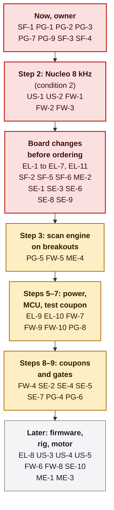

# Rev A risk register

> **Status (2026-11-27): research, answered by the owner.** This is a desk pre-mortem of the rev A testbed. **Nothing
> is built, ordered or measured.** Each risk below comes from datasheets, source code or arithmetic, and none has been
> seen on a bench. "Verified" means the evidence was opened again on 2026-11-27 and still holds. It does not mean the
> failure happens. On the evening of 2026-11-27 the owner answered the recommendations with seven decisions, D1–D7 of
> that day ([SPEC §1][s1]): sixteen recommendations decided, one in part (rec. 12), four left open (recs. 11, 19, 20,
> 21). The decided ones are written into the SPEC and `nets.py`; **none is captured, laid out, built or measured
> yet**, so a decided risk is not a retired one.

Seven reviewers each looked at the testbed from one side: electrical, USB host, sensing, firmware, supply and fab,
measurement, and a pre-mortem of the plan as a whole. Together they reported 91 risks. This page merges those into 55
and checks again every risk rated *blocks rev A* or *costs a respin*, and every risk rated *high* likelihood. Each was
checked against its primary source: the datasheet, the Zephyr or Linux source, the USB specification, the vendor
page, or the arithmetic, re-run here. The checks dropped one claim, lowered seven ratings, corrected three figures, and
found one risk already fixed in the firmware ([appendix](#appendix-dropped-and-corrected-claims)). The architecture of record is
still the [SPEC](../hardware/design/SPEC.md) with [nets.py](../hardware/design/nets.py). This page proposed changes to
them; the owner's decisions of 2026-11-27 put the decided ones there, and each risk below says what was decided.

## How to read it

* **Likelihood**: *high* means expected unless someone acts, *medium* means plausible on this bench, and *low* means
  it needs an unusual mistake or condition.
* **Impact**: *blocks rev A* means a gate or the done list cannot close. *Costs a respin* means a board, or a coupon
  not yet captured, has to be redrawn. *Degrades results* means the numbers come out wrong or a run is lost. *Minor*
  means cost, time or tidiness.
* **Status**: *verified* means the evidence was opened again here and holds. *Plausible (not verified)* means the
  mechanism is sound but the source was not fetched again, or the effect depends on a model. *Mitigated* means a
  design already in the tree answers the risk. Dropped claims are in the [appendix](#appendix-dropped-and-corrected-claims).
* **Stage**: when the mitigation has to happen. *Before order* covers condition 2 on the Nucleo, which
  gates ordering ([SPEC §1][s1]). *Bring-up* follows [SPEC §10][s10] steps 3–9. *Later* is the testbed firmware and
  the latency rig.
* **Owner**: the roles of [SPEC §11][s11]: Owner, Hardware, Firmware, Rig, Compiler.
* **Each risk opens with one line**: likelihood · impact · status · stage · owner, and, where a recommendation touched
  it, the owner's decision of 2026-11-27 (D1–D7 of that day, [SPEC §1][s1]), followed by a bullet that says what was
  decided and where it landed. *Decided* means written into the architecture of record, not captured or built.
* **IDs** group risks by area: **PG** plan, **SF** supply and fab, **EL** electrical, **US** USB host, **FW**
  firmware, **SE** sensing, **ME** measurement.
* **Tests marked "now"** are arithmetic or code that can run today. Several use research scripts that live outside
  the repository (listed under [Sources](#sources)). They check the contract, the code or the arithmetic. They do not
  check hardware.

## The ten that matter most

1. [SF-1](#sf-1) **The MCUs are not in hand.** ST's own store lists the STM32U5A5VJT6 in stock today. Buy six now.
   *Decided (D6): ST's store is the route; the owner buys.*
2. [PG-1](#pg-1) **Condition 2 has not run.** It needs a $40 Nucleo and one evening, and the design keeps growing
   ahead of it.
3. [US-1](#us-1) **Condition 2 has no rule for a mixed or host-side result.** A Linux shortfall could trigger the
   RT1021 redraw for the wrong reason. *Not decided (rec. 20): an open owner item.*
4. [FW-1](#fw-1) **Condition 2 tests an easier case than the testbed's.** It runs at queue depth 2, on an idle CPU,
   with light CDC and no instrumentation.
5. [EL-2](#el-2) **The slot has no key.** A coupon turned 180° reads present, and the bring-up firmware drives MCU pins
   into it before it reads the descriptor. *Decided (D2): keyed at pin 39.*
6. [PG-2](#pg-2) **Eight boards at once**, with a done list that only closes when every coupon is measured. *Decided
   (D1): stages A1 and A2.*
7. [PG-5](#pg-5) **The core firmware does not exist yet**, and no CI runs the keyboard's host-side gates.
8. [PG-3](#pg-3) **The battery gate has no rule for picking the rev B chip.**
9. [SE-1](#se-1) **The TMR coupon cannot use the Hall coupon's keys.** Linear TMR parts sense in-plane fields and
   saturate at a few mT. *Decided (D7): part and magnet picked before capture.*
10. [SE-3](#se-3) **The shear coupon's sensor is noisy at frame rate and saturates at bottom-out.** The TMAG5170A1
    gives 140 µT rms at 8 kHz-capable settings, and its Z range ends at ±100 mT. *Decided (D7): variant and spacing
    before capture.*

## Summary

| ID | Risk | Likelihood | Impact | Status | Stage |
|---|---|---|---|---|---|
| [PG-1](#pg-1) | Design runs ahead of the one person who buys, solders and measures | high | blocks rev A | verified | before order |
| [PG-2](#pg-2) | Eight boards at once, and an all-or-nothing done list | high | blocks rev A | verified; decided (D1) | before order |
| [PG-3](#pg-3) | The battery gate has no selection rule for rev B | high | blocks rev A | verified | before order |
| [PG-4](#pg-4) | No rules written in advance: done cards, noise figure, gate statistics | high | degrades results | verified; open (rec. 20) | bring-up |
| [PG-5](#pg-5) | The scan engine and coupon drivers are unwritten, and there is no CI | high | blocks rev A | verified | bring-up |
| [PG-6](#pg-6) | Results have no home: no schema, no storage plan, figures repeated across pages | high | degrades results | verified | bring-up |
| [PG-7](#pg-7) | ST facts read second-hand, errata unread | medium | costs a respin | verified; partly decided (D6) | before order |
| [PG-8](#pg-8) | One damaged motherboard stops everything, and logs cannot name the board | medium | degrades results | verified | bring-up |
| [PG-9](#pg-9) | No licence file, the test PID, bcdDevice = Zephyr version | high | minor | verified; open (rec. 21) | before order |
| [SF-1](#sf-1) | MCU supply: JLC's 13 look committed, but ST's store has stock | medium (was high) | blocks rev A | verified, corrected; decided (D6) | before order |
| [SF-2](#sf-2) | Coupons are two-sided at JLC, which rules out Economic PCBA, and panelising does not help | high | minor | verified; open (rec. 11) | before order |
| [SF-3](#sf-3) | No cost estimate: fixed fees, duty and via surcharges dominate | high | minor | verified; partly decided (D5) | before order |
| [SF-4](#sf-4) | Calendar: Chinese New Year 2027 and a US import rule from 2027-01-05 | high | minor | verified | before order |
| [SF-5](#sf-5) | The 90 Ω pair depends on a stack the SPEC does not name | medium | degrades results | plausible (not verified); decided (D5) | before order |
| [SF-6](#sf-6) | Thin stock on coupon ICs, and one verified second source | low | minor | verified; partly decided (D6) | before order |
| [EL-1](#el-1) | A legal source and cable take S5 below the DRV8316's UVLO, and a cheap cable trips VSYS_PG | medium (was high) | degrades results | verified; decided (D4) | before order |
| [EL-2](#el-2) | Unkeyed slot: a coupon turned 180° reads present and gets driven | medium | costs a respin | verified; decided (D2, D5) | before order |
| [EL-3](#el-3) | No ESD protection on the 37 slot lines that go straight to the MCU | medium | degrades results (was respin) | verified; decided (D3) | before order |
| [EL-4](#el-4) | No rule bounds a lane's voltage, and S3's lanes are 3.6 V-tolerant pins | low | degrades results (was respin) | verified; open (rec. 19) | before order |
| [EL-5](#el-5) | The VDDA ferrite resonates at 76–196 kHz, inside the scan's own band | medium | degrades results | plausible (not verified); decided (D4) | before order |
| [EL-6](#el-6) | Nothing enforces Kelvin sensing on the 20 mΩ shunts | medium | degrades results | plausible (not verified); decided (D4) | before order |
| [EL-7](#el-7) | Ground: the 2 A return and external ground loops offset the lanes and the USB link | medium | degrades results | plausible (not verified); decided (D5) | before order |
| [EL-8](#el-8) | A stock Teensy rig cannot power the DUT, and its ribbon carries the return current | high | degrades results | verified; open (rec. 20) | later |
| [EL-9](#el-9) | Meter jumper: back-power when it is pulled, bypass currents, no 5 V meter path | medium | degrades results | verified; partly decided (D6) | bring-up |
| [EL-10](#el-10) | Power timing: slot-enable inrush, and the 60 ms tSinkAdj | low | minor | verified; partly decided (D6) | bring-up |
| [EL-11](#el-11) | The 2.54 mm sockets: solder heat, alignment, unknown durability | medium | degrades results | verified; partly decided (D5) | before order |
| [US-1](#us-1) | The condition 2 verdict can be wrong or ambiguous for host-side reasons | medium | blocks rev A | verified (effect not measured); open (rec. 20) | before order |
| [US-2](#us-2) | Host artefacts that look like device faults | medium | degrades results | verified | before order |
| [US-3](#us-3) | The raw stream over HID is capped at 64 B per microframe, and a shared endpoint skews latency | medium (was high) | degrades results | verified | later |
| [US-4](#us-4) | A host-initiated suspend turns every slot rail off | low | degrades results | plausible (not verified) | later |
| [US-5](#us-5) | Composite HID + CDC on Windows | low | minor | verified, no action | later |
| [FW-1](#fw-1) | Condition 2 runs at depth 2 with an idle CPU, an easier case than the testbed's | medium | costs a respin | verified | before order |
| [FW-2](#fw-2) | OTG_HS OUT-NAK interrupt storm in v4.5.0, fixed on Zephyr main | medium | degrades results | verified | before order |
| [FW-3](#fw-3) | The PHY tuning (TUNER2) is off in hid8k's default build | medium | degrades results | plausible (not verified) | before order |
| [FW-4](#fw-4) | I2C1 cannot carry the planned INA226 logging, and logging clears the alerts | high | degrades results | verified; decided (D6) | bring-up |
| [FW-5](#fw-5) | Zephyr's ADC driver cannot run the scan engine, owns its ADCs and skips linearity calibration | high | degrades results | verified | bring-up |
| [FW-6](#fw-6) | S5 motor control: TIM1 break semantics, ADC4 and SPI2 contention | medium | degrades results | verified; decided (D6) | later |
| [FW-7](#fw-7) | A stuck slot I2C channel freezes I2C4 until reboot | medium | degrades results | verified | bring-up |
| [FW-8](#fw-8) | Flash writes and SWO tracing stall the 8 kHz path | low | degrades results | verified | later |
| [FW-9](#fw-9) | Pinned to v4.5.0 with no manifest or patch set of its own | medium | minor | verified | bring-up |
| [FW-10](#fw-10) | A dead HSE hangs the board before the console | low | minor | verified | bring-up |
| [SE-1](#se-1) | The TMR coupon cannot use the Hall coupon's keys | high | costs a respin | verified; decided (D7) | before order |
| [SE-2](#se-2) | The Hall coupon's references sit closer to keys than the key pitch | high | degrades results | verified | bring-up |
| [SE-3](#se-3) | The shear TMAG5170 is noisy at frame rate and its Z range saturates | high | costs a respin | verified; decided (D7) | before order |
| [SE-4](#se-4) | The ADC lane, not the sensor, sets the Hall noise figure | high | degrades results | verified | bring-up |
| [SE-5](#se-5) | No anti-alias filter: 20 kHz switching and PWM fold into the key band | medium | degrades results | plausible (not verified); partly decided (D7) | bring-up |
| [SE-6](#se-6) | Stray and actuator fields: small for Hall Z, not for TMR and shear, and rev B is closer | high | degrades results | verified; partly decided (D7) | before order |
| [SE-7](#se-7) | No travel, force or temperature reference, and no calibration procedure | high | degrades results | verified, corrected | bring-up |
| [SE-8](#se-8) | Coil coupon: a steel spring's frequency crossover can give a false "no" | medium | costs a respin | verified; decided (D7) | before order |
| [SE-9](#se-9) | LDC1614 address by G-line relies on undocumented behaviour | low (was medium) | costs a respin | verified, mitigated; decided (D7) | before order |
| [SE-10](#se-10) | Shear flexure creep makes pointing depend on hold time | medium | degrades results | plausible (not verified) | later |
| [ME-1](#me-1) | Strikes timed by the rig's own clock lock onto the microframe phase | high | degrades results | verified | later |
| [ME-2](#me-2) | No coupon drives a lane, so per-coupon latency skips the scan path | high | degrades results | verified; decided (D7) | before order |
| [ME-3](#me-3) | The rig's timing chain is unproven: t0 capture, microframe stamps, log join | medium | degrades results | plausible (not verified) | later |
| [ME-4](#me-4) | The 1 kHz mode is undefined | high | degrades results | verified; open (rec. 20) | bring-up |

Where each risk is met, on [SPEC §10][s10]'s bring-up order:

*Each risk sits at the step where it must be dealt with. Red: before anything is ordered. Amber: at bring-up. Grey:
later. Step 3 can run on the Nucleo before the order, as [SPEC §10][s10] allows.*

## Plan

### PG-1 Design runs ahead of the one person who buys, solders and measures {#pg-1}

**high · blocks rev A · verified · before order · Owner**

* **Mechanism.** Every gate is a physical act by the owner: reserving MCUs, running hid8k on a Nucleo, reading ST's
  PDFs, ordering, hand-soldering and bring-up. Generated design output grows by thousands of lines a day. In the
  failure story, six months on, all eight boards are released and gated, nothing has been ordered, and condition 2 has
  never run.
* **Evidence.** The caliper repeated this pattern. It was bootstrapped on 2026-11-07, and its last commit is
  2026-11-15. Its order page still says "Status: rev A is designed, not built. Nothing has been ordered, assembled or
  measured" (`caliper/docs/ordering.md`). The keyboard's [hid8k README](../firmware/hid8k/README.md) opens with
  "written and compiled, not run". The NUCLEO-U5A5ZJ-Q is "In stock" at $39.53 on ST's store (fetched by the
  supply reviewer, 2026-11-27).
* **Mitigation.** Make the next physical step "buy the Nucleo and run hid8k". Freeze new capture beyond what is
  already released until condition 2 has a result. Date both conditions, for example hid8k by 2026-12-11 and the MCU
  purchase by 2026-12-15, and write down what happens when a date slips.
* **Test.** Tripwires: no hid8k JSON in the repository 14 days after the Nucleo is ordered, or a fab package older
  than 14 days with neither an order nor a recorded decision not to order.

### PG-2 Eight boards at once, and an all-or-nothing done list {#pg-2}

**high · blocks rev A · verified · before order · Owner · decided 2026-11-27 (D1)**

* **Owner's decision (2026-11-27).** **Decided** as D1: rev A splits into **A1** (the motherboard, the test coupon and
  the Hall coupon, released, ordered and brought up first) and **A2** (the haptics, coil, shear and TMR coupons and
  the latency rig, designed after A1 and ordered later); A2 must not hold A1 back ([SPEC §1][s1], §2, [§10][s10],
  [§11][s11]). Neither stage has a done card yet (rec. 20, open), and no kill dates were set.
* **Mechanism.** Rev A is the motherboard, the test coupon, five sensing coupons and the latency rig. Each coupon is
  its own bring-up and measurement campaign, and the done list ([concept §7][c7]) closes only when all six answers
  exist.
* **Evidence.** [SPEC §11][s11] #3 says "No TMR part is chosen", and #9 says of the rig "no candidate checked". Zephyr
  v4.5.0 has bindings for the TMAG5170, DRV2605, CAP12xx, INA226 and TCA9548A, and none for the LDC161x, DRV8316 or
  MT6701 (`dts/bindings`, checked here). Its host class directory holds only `usbh_hub.c` and `usbh_uvc.c`, so it has
  no host HID class for a Zephyr-based rig.
* **Mitigation.** Split rev A. **A1** is the motherboard, the test coupon, the Hall coupon and hid8k. It is done when
  Hall noise and current are measured at 1 and 8 kHz. **A2** is the TMR, shear, coil and haptics coupons, ordered once
  the A1 motherboard works. Defer the rig board: the DUT already captures RIG_TRIG on TIM2 ([SPEC §7.3][s7.3]), so a
  function generator plus a sniffer can give first latency numbers. Give each A2 coupon a kill date that moves it to
  rev B.
* **Test.** Each stage has a dated done card ([PG-4](#pg-4)).

### PG-3 The battery gate has no selection rule for rev B {#pg-3}

**high · blocks rev A · verified · before order · Owner**

* **Mechanism.** "The battery gate picks a rev B chip from measured numbers" is on the done list, but no cell, target
  life, BLE duty or scoring rule is written. The only written gate rule is a regression check. Rev A has no radio, and
  the radio side track has not started.
* **Evidence.** [Concept §4.2][c4.2] draws the gate as "Worse than the last release?". [Concept §5][c5] says "No
  measurement or ranking exists yet." On the JLC parts API on 2026-11-27, nRF54LM20A in QFN52 (C9900325583,
  C9900316931) had stock 0, while the 0.35 mm CSP (C52031439) had 2,944. The CSP fails [mcu.md](mcu.md)'s R4, "no
  0.35 mm CSP or BGA that needs HDI".
* **Mitigation.** Write the rule on one page: the target cell, the target life at 1 kHz on BLE, the duty model, how
  rev A's sensor currents combine with a dev kit's radio currents, tie-breaks (Zephyr support, stock, pitch of 0.4 mm
  or more), and a default pick if the data is late. Order the radio dev kit now.
* **Test.** Run the rule dry on today's estimates. It must name a chip.

### PG-4 No rules written in advance: done cards, noise figure, gate statistics {#pg-4}

**high · degrades results · verified · bring-up · Owner, Firmware · not decided (rec. 20)**

* **Owner's decision (2026-11-27).** **Not decided:** the done cards, the noise figure's definition and the gate
  statistics are rec. 20, an open owner item ([SPEC §11][s11] #29).
* **Mechanism.** "Noise figure", "usable signal" and "usable pointing signal" have no unit, bandwidth or threshold.
  The latency gate's "a regression fails the release" ([concept §4.2][c4.2]) has no statistic. Rules chosen after
  the data are suspect, and a naive p99 comparison fails unchanged firmware a fair share of the time.
* **Evidence.** A search of the SPEC and concept finds "noise figure" only in the done list ([SPEC §1][s1]) and finds
  no definition. The arithmetic was re-run here: detecting P(late) moving from 1 % to 2 % (one-sided α 0.05, power
  0.9) takes **1,177 strikes** against a fixed limit, or **2,529 per release** against the previous one. With one
  coupon per method and 3–6 sites, the smallest possible two-sided Mann–Whitney p is 0.10 for 3 against 3, 0.029 for
  4 against 4 and 0.0022 for 6 against 6. The size of the naive gate's false-fail rate depends on the tail model:
  26–29 % in the measurement reviewer's simulation, and 5–15 % in this register's variant (a p99 that rises by more
  than 25 µs, n = 5,000 and 1,000). Either way the gate needs a designed rule.
* **Mitigation.** Write one card per coupon before it is ordered: metric, unit, bandwidth, fixture, pass threshold and
  kill rule. Define the noise figure as input-referred (µT, and µm at rest, at actuation and at bottom-out), state its
  bandwidth and processing, and publish the ADC floor beside it ([SE-4](#se-4)). For latency, gate on an exceedance
  test at a fixed limit with at least 2,500 dithered strikes per mode ([ME-1](#me-1)). Compare coupons in travel units
  with at least two coupons or slots per method.
* **Test.** Feed the analysis synthetic data with known white, 1/f and 50 Hz parts and check that it recovers them.
  Split the first real run in two: the gate must pass against itself at least 95 % of the time.

### PG-5 The scan engine and coupon drivers are unwritten, and there is no CI {#pg-5}

**high · blocks rev A · verified · bring-up · Firmware, Owner**

* **Mechanism.** The work rev A exists to prove is the SOF-locked, DMA-driven dual-ADC scan at 8 kHz, the coupon
  drivers, the raw stream and the battery-gate export. None of it exists. The builds use Ubuntu's GCC, not the Zephyr
  SDK, and nothing runs the keyboard's host-side gates on each push.
* **Evidence.** The [firmware README](../firmware/README.md): "The testbed firmware itself (board `kbd_testbed_a`, the
  scan engine, the coupon drivers) does not exist yet". [SPEC §6.1][s6.1] says the engine is "expected to need LL
  code". `.github/workflows/` holds only `docs.yml`.
* **Mitigation.** Do step 3 first, as a bare LL loop on the Nucleo with one slot. Keep a 1 kHz fallback scan through
  Zephyr's ADC API so that coupons can be measured if the 8 kHz engine slips. Hard-code A1's coupons and defer the
  generic driver model. Add a CI job for the host-only gates: `nets.check`, the coupon rules, the lib tests, the sim
  pytest and both native_sim suites.
* **Test.** CI green on every push. Scan period and CPU load measured on the Nucleo ([SPEC §10][s10] step 3).

### PG-6 Results have no home: no schema, no storage plan, figures repeated across pages {#pg-6}

**high · degrades results · verified · bring-up · Owner, Firmware**

* **Mechanism.** A 10-minute hid8k capture is about 170 MB, and raw lanes at 8 kHz on five slots are about 9.2 GB/h.
  No run manifest ties a result to the board, the firmware, the coupon serial, the stem and magnet, the cable and the
  host. Key figures are written out in several pages, so a measurement has to be copied into each.
* **Evidence.** The [hid8k README](../firmware/hid8k/README.md#test-procedure) gives "about 170 MB for 10 minutes".
  The descriptor format leaves per-site calibration to "the host's records (keyed by serial)"
  (`keyboard/tools/coupon/DESCRIPTOR.md`), and no schema holds those records. The JLC stock claim for the MCU
  appears 7 times across the SPEC, concept and mcu.md (counted here). The repository has no LICENSE file
  ([PG-9](#pg-9)).
* **Mitigation.** Write a versioned JSON run manifest: run id, time, the MCU UID, commits and dirty flags, coupon
  type, revision, serial and descriptor CRC, slot, rig and calibration ids, host, controller and port, cable, VBUS
  source, instrumentation profile, temperature, magnet lot and fixture. Store raw data as compressed columnar files
  with their SHA-256 in an archive (Zenodo, one record per campaign), and keep manifests and analysis in the
  repository. Docs cite result files instead of restating figures.
* **Test.** A manifest validator in CI, and every published figure re-derived from archived raw data.

### PG-7 ST facts read second-hand, errata unread {#pg-7}

**medium · costs a respin · verified · before order · Owner, Hardware · partly decided 2026-11-27 (D6)**

* **Owner's decision (2026-11-27).** **Decided** as part of D6: read ST's documents first-hand where st.com answers,
  and correct §8.1's Stop 1 sentence. The sentence is corrected ([SPEC §8.1][s8.1]). st.com still failed on 2026-11-27
  at 22:03 and 23:03 UTC (HTTP/2 stream errors; an HTTP/1.1 retry got an empty reply), so DS13543, RM0456 and ES0553
  remain unread first-hand ([SPEC §11][s11] #24, #25), and the risk stands.
* **Mechanism.** Register-level facts (CLKSEL, TUNER2, TIM2's SOF trigger, the ADC triggers, the break input) come from
  a third-party transcription of RM0456, and the errata sheet ES0553 has not been read. One wrong fact or one unknown
  erratum can cost a respin.
* **Evidence.** [SPEC §11][s11] #24 and #25 record both. On 2026-11-27 st.com still did not serve the errata PDF here
  (`curl: (92) HTTP/2 stream 1 was not closed cleanly: INTERNAL_ERROR`). Reading DS13543 Rev 2 here also found a
  contradiction. Table 10 note 12 says "OTG_HS cannot wake up from Stop mode 1." [SPEC §8.1][s8.1] says that in Stop 0
  and Stop 1 "USBPWREN left set, so the OTG_HS can wake the MCU". The impact is low, because the MCU stays out of Stop
  modes. The researchers' report that ES0553 is at Rev 6 and DS13543 at Rev 3 was not re-fetched (plausible).
* **Mitigation.** Before ordering, download DS13543, RM0456 and ES0553 in an ordinary browser. Diff the sections the
  SPEC cites, and scan the errata for OTG_HS, ADC, TIM1/TIM8, EXTI, RCC/HSE and GPDMA. Correct §8.1's Stop 1 sentence.
  Print DEV_ID and REV_ID at boot in hid8k and in the bring-up firmware ([FW-5](#fw-5) shows why the revision
  matters).
* **Test.** The revisions read are recorded in the SPEC's sources, and every erratum found is checked against the
  firmware paths.

### PG-8 One damaged motherboard stops everything, and logs cannot name the board {#pg-8}

**medium · degrades results · verified · bring-up · Firmware, Owner**

* **Mechanism.** A mis-plug ([EL-2](#el-2)) or an ESD event ([EL-3](#el-3)) can kill the only working motherboard.
  Rework changes behaviour and the per-slot calibration, but nothing records which board or which rework state
  produced a log.
* **Evidence.** The bring-up boot record is `boot fw=bringup board=kbd_testbed_a map=%s nets_rev=%s zephyr=%s reset=%s
  …` (`bringup/src/main.c`). It carries no MCU UID and no application commit.
* **Mitigation.** Add `uid=` (from `hwinfo_get_device_id`) and `git=` to the boot record and every CSV header. Keep a
  rework log per board UID. Assemble two motherboards if the MCUs allow it. Buy spare bus switches, TPS2553s and
  TUSB320LAIs with the order.
* **Test.** A lint step that rejects result files without `uid`, `git` and rework fields.

### PG-9 No licence file, the test PID, bcdDevice = Zephyr version {#pg-9}

**high · minor · verified · before order · Owner, Firmware · not decided (rec. 21)**

* **Owner's decision (2026-11-27).** **Not decided:** LICENSE files and PIDs are rec. 21, an open owner item ([SPEC
  §11][s11] #30).
* **Mechanism.** hid8k and the bring-up app enumerate as 1209:0001, the pid.codes test PID. Rev A boards are assembled
  at JLC from an open design. A real pid.codes PID needs a LICENSE file, and the repository has none. Windows also
  caches per-device flags on VID, PID and bcdDevice, and Zephyr's default bcdDevice is the kernel version, so every app
  on a bench PC shares one key. ST's motor-control SDK code, an obvious shortcut for FOC, is not open source.
* **Evidence.** [pid.codes 1209/0001](https://pid.codes/1209/0001/): "This PID is reserved for use in private
  testing … it MUST NOT be used on any device that will be redistributed, sold, or manufactured." The
  [pid.codes how-to](https://pid.codes/howto/) says: "Your source code repository must contain a LICENSE file
  attesting to this fact." No LICENSE or COPYING file exists (`git ls-files`). Zephyr v4.5.0 `include/zephyr/usb/usbd.h`
  sets `.bcdDevice = sys_cpu_to_le16(USB_BCD_DRN)`, the kernel's major and minor version (`usb_ch9.h:548`).
* **Mitigation.** Choose licences (for example Apache-2.0 for firmware, CERN-OHL for hardware, CC BY or CC0 for data)
  and add LICENSE files. Request pid.codes PIDs before boards leave the bench. Give each app its own bcdDevice through
  `usbd_device_set_bcd_device()`, and bump it on every interface change. Keep ST MCSDK and X-CUBE code out of the tree.
* **Test.** A pre-commit or docs-build check for the LICENSE file and SPDX tags.

## Supply and fab

### SF-1 MCU supply: JLC's 13 look committed, but ST's store has stock {#sf-1}

**medium (was high) · blocks rev A · verified, corrected · before order · Owner, Hardware · decided 2026-11-27 (D6)**

* **Owner's decision (2026-11-27).** **Decided** as D6: ST's store is the route and the owner buys (no agent buys
  anything); the STM32U599VJT6 (C18213037) and STM32U595VJT6 (C7938448) are pin-compatible alternates, and the -Q
  parts are not ([SPEC §1][s1] condition 1, [§2.1][s2.1], [§11][s11] #1; `nets.MCU_ALTERNATES`). JLC showed 13 / −4
  and none of either alternate on 2026-11-27. U1 as do-not-place is the owner's choice at ordering. Nothing is bought
  yet, so the risk stands until the parts are in hand.
* **Mechanism.** Ordering waits on reserving STM32U5A5VJT6s ([SPEC §1][s1] condition 1). JLC's 13 appear to be
  committed to other orders. JLC's routes for a 4–6 part buy have traps: consignment from outside China excludes
  ECCN-listed parts, a short pre-order is refunded rather than filled, sources cannot be mixed, and unused parts stay
  in China (JLC's terms as the supply reviewer read them; not re-fetched). The pre-mortem reviewer reported that the
  MCU cannot be bought before spring 2027. **That claim did not hold.**
* **Evidence.** JLC parts API, 2026-11-27: `C22455480 STM32U5A5VJT6 stock 13 presale -4`. The pin-compatible
  STM32U599VJT6 and STM32U595VJT6 are at stock 0, presale −1. [ST eStore, STM32U5A5VJT6](https://estore.st.com/en/stm32u5a5vjt6-cpn.html),
  fetched 2026-11-27: "In stock", "1-9 $19.25", "ECCN US 5A992.c". [STM32U599VJT6](https://estore.st.com/en/stm32u599vjt6-cpn.html):
  "In stock", "1-9 $17.99", "ECCN US 3A991.a.2". Neither page shows a quantity. ST's open pin data, compared here
  pin by pin, gives 0 pins with a different name and 0 missing signals for U599VJTx and U595VJTx against U5A5VJTx. The
  only differences are the AES, OTFDEC, PKA and SAES blocks, which the testbed does not use. The -Q part has 33 pins
  that differ, so it is not a substitute.
* **Mitigation.** Put 6 MCUs in the ST eStore cart this week and see whether it accepts them. Add the U599VJT6 and
  U595VJT6 to [SPEC §2.1][s2.1] as pin-compatible alternates, and note that the -Q parts are not. Firmware then changes
  only the SoC. Consider ordering the motherboard PCBA with U1 do-not-place and hand-fitting the LQFP100. The §3.5
  reset-state resistors keep every rail off until firmware runs. Keep the RT1021 as the last resort.
* **Test.** The cart test. A weekly run of the JLC stock query. At bring-up, read DBGMCU_IDCODE on a substituted part.

### SF-2 Coupons are two-sided at JLC, which rules out Economic PCBA, and panelising does not help {#sf-2}

**high · minor · verified · before order · Owner, Hardware · not decided (rec. 11)**

* **Owner's decision (2026-11-27).** **Not decided** (rec. 11; [SPEC §11][s11] #26). The key (D2) adds to it: a
  footprint without pad 39 takes no stock header, so J1 is fitted by hand after its pin 39 is pulled (#31).
* **Mechanism.** Every coupon's 2 × 20 header is through-hole on the bottom, with all other parts on top. That makes
  each coupon a two-sided Standard PCBA order, with Standard's 70 × 70 mm minimum, edge rails, fiducials and higher
  fixed fees. Putting several designs on one panel is charged almost like separate orders.
* **Evidence.** [JLC PCBA capabilities](https://jlcpcb.com/capabilities/pcb-assembly-capabilities), fetched
  2026-11-27: Economic does "Single sided placement (SMT/Thru-hole)" and Standard does "Single & double sided
  placement". The page also says "THT components are assembled using wave soldering". `boards/coupon_common.py` puts J1
  on the bottom and its fab note already offers "order J1 as do-not-place and hand-solder it". The supply reviewer's
  fee model gives $234.72 in fixed fees for three separate Standard coupon orders against $93.60 for Economic, and
  $160.98 for one Standard panel. That model was not re-run here.
* **Mitigation.** Order each coupon as Economic PCBA with J1 do-not-place. Hand-solder J1 (40 joints) with the header
  plugged into a motherboard socket and the M3 spacer fitted, so the socket is the jig. Have `release.py` emit a
  BOM/CPL variant without J1. Do not panelise for cost.
* **Test.** Upload one coupon both ways on the live JLC form and record the assembly types and fees it offers.

### SF-3 No cost estimate: fixed fees, duty and via surcharges dominate {#sf-3}

**high · minor · verified (no estimate exists; the figures are a model) · before order · Owner · partly decided 2026-11-27 (D5)**

* **Owner's decision (2026-11-27).** **Decided** in part as D5: the coupons' via rule (0.60 / 0.30 mm) on the
  motherboard, and a `release.py` warning on drills under 0.3 mm ([SPEC §9][s9]). `release.py` is not changed yet, and
  no cost estimate exists.
* **Mechanism.** Nothing prices a build. For small runs JLC's fixed fees exceed the parts, and duty, tax and shipping
  come on top. A motherboard via drill under 0.3 mm adds a small-hole charge and a Kelvin test, often as a supplement
  that holds the order.
* **Evidence.** No estimate exists in the SPEC, concept or mcu.md (searched). The supply reviewer's model, not re-run
  here, gives about $1.2–1.6k landed for one set if the coupons go Economic, and $1.9–2.3k as drawn. The routed coupons
  use 0.3 mm drills.
* **Mitigation.** Set a budget from the Economic scenario plus the MCUs, the Nucleo, the rig, a probe and fixtures.
  Give the motherboard the coupons' via rule (0.60/0.30 mm), and make `release.py` warn on drills under 0.3 mm. Append
  each board's live quote to its ORDER-NOTES.
* **Test.** Quote every board on the live form, DDP to the owner's state, and compare.

### SF-4 Calendar: Chinese New Year 2027 and a US import rule from 2027-01-05 {#sf-4}

**high · minor · verified · before order · Owner**

* **Mechanism.** Ordering waits on condition 2, so a realistic order date falls in mid-December to February. Chinese
  New Year 2027 falls on 6 February. The US now stacks Section 301 duties on Chinese PCBAs, has no de minimis, and
  changes the rules for foreign importers of record from 5 January 2027. JLC's DDP shipping relies on foreign
  importers of record.
* **Evidence.** The Federal Register API, queried 2026-11-27, returns: 91 FR 69977, "Heightened Requirements for
  Foreign Importers of Record", published 2026-11-06, effective 2027-01-05
  ([link](https://www.federalregister.gov/documents/2026/11/06/2026-22735/heightened-requirements-for-foreign-importers-of-record));
  91 FR 47318 (USTR, 2026-07-28), "imposing tariffs on all products of the investigated economy"; and 91 FR 64532
  (2026-10-08), "Low-Value Shipments". The rates (25 % List 3 plus 12.5 %) are the supply reviewer's reading and were
  not re-derived here. None of this is legal advice.
* **Mitigation.** Buy the MCUs and the Nucleo domestically now. Ship all boards in one DDP order. Order before
  2027-01-05 if condition 2 allows. Otherwise re-read JLC's tariff FAQ that week, and expect delays around 6 February.
* **Test.** In the week of ordering, query the Federal Register for anything newer, and compare the checkout's DDP
  line with 35 % of the merchandise.

### SF-5 The 90 Ω pair depends on a stack the SPEC does not name {#sf-5}

**medium · degrades results · plausible (not verified) · before order · Hardware · decided 2026-11-27 (D5)**

* **Owner's decision (2026-11-27).** **Decided** as D5: the stack is JLC04161H-7628 (layer figures from JLC's
  impedance page, fetched 2026-11-27) and the pair 0.25 / 0.15 mm, about 88 Ω by two independent 2-D solves
  ([SPEC §2][s2], [§7.1][s7.1]; `nets.MB_STACK`, `nets.USB_PAIR`). That is an estimate: JLC's calculator is still to
  be run, so the status stays plausible.
* **Mechanism.** [SPEC §7.1][s7.1] says only "JLC's controlled-impedance stack". The stack in code is JLC's 7628
  default, where the caliper's 0.16/0.16 mm pair comes out near 109 Ω. JLC's free impedance test is ±20 %.
* **Evidence.** The supply reviewer's 2-D solver gives 109.4 Ω on 7628 at 0.16/0.16 mm and 90.4 Ω on 3313. On 7628,
  0.25/0.15 or 0.30/0.20 mm gives about 90 Ω. This was not re-run here. Economic PCBA takes "Standard stack-up only,
  special stack-up is not supported" (JLC capabilities, fetched here).
* **Mitigation.** Name the stack in [SPEC §2][s2] and the motherboard's board file. Then either keep 7628 at about
  0.25/0.15 mm, or take 3313 at 0.16/0.16 mm and accept Standard PCBA. Confirm the geometry in JLC's calculator and
  write it into the fab notes.
* **Test.** JLC's calculator for the exact stack. High-speed enumeration and an eye check at bring-up.

### SF-6 Thin stock on coupon ICs, and one verified second source {#sf-6}

**low · minor · verified · before order · Owner, Hardware · partly decided 2026-11-27 (D6)**

* **Owner's decision (2026-11-27).** **Decided** in part: the TPS259470L out-of-stock note is in [SPEC §2.1][s2.1] and
  [§3.5][s3.5] (0 in stock, presale −91, again on 2026-11-27). The bus switch's second source is **not decided** (rec.
  12; [SPEC §11][s11] #27).
* **Mechanism.** Most ICs are single-source TI parts. Several coupon parts have little JLC stock left, and the stock is
  moving.
* **Evidence.** JLC parts API, 2026-11-27, stock and presale: DRV2605L 491/158, CAP1206 244/234, TMAG5253BA4
  717/635, TMAG5170A1 432/254, TPS259470L 0/−91 (the SPEC's active-limit fallback for U2), SN74CBTLV3125PWR 1101/1100,
  and Nexperia 74CBTLV3125PW,118 (C456149) 19957/19957.
* **Mitigation.** Name the Nexperia part as the bus switch's second source in [SPEC §2.1][s2.1] after its R_on and
  timing are read against §4.3 ([SPEC §11][s11] #19). Note in [SPEC §3.5][s3.5] that the TPS259470L is out of stock.
  Pre-order the thin coupon parts if assembly is weeks away.
* **Test.** A weekly stock query, which flags any part below 10 × the need.

## Electrical

### EL-1 A legal source and cable take S5 below the DRV8316's UVLO, and a cheap cable trips VSYS_PG {#el-1}

**medium (was high) · degrades results · verified · before order · Hardware, Firmware · decided 2026-11-27 (D4)**

* **Owner's decision (2026-11-27).** **Decided** as D4: U2's PGTH divider 100 k / 44.2 k (VSYS_PG falls at 3.51–3.64
  V, 3.46–3.69 V with 1 % parts), the load line in [SPEC §3.6][s3.6], and §11 #15 from SLVSF16B ([SPEC §3.1][s3.1];
  `nets.INPUT_PGTH_DIVIDER`). keyboard/sim's PG test passes with that divider in a copy of the netlist. Not captured
  yet. The firmware's shedding and the bench cable rule stay proposals, and S5 still sees 3.9 V at 2 A on the load
  line.
* **Mechanism.** [SPEC §3.6][s3.6] budgets S5 from "a source at USB's 4.75 V minimum" and leaves the cable
  unquantified. The board adds about 0.1 Ω. Four thresholds sit on what is left. U2's EN/UVLO (100k/39k) resets the
  board. PGTH (100k/39k on VSYS_IN) deasserts VSYS_PG, and the bring-up firmware then turns every rail off. S5_PG turns
  S5 off. The DRV8316's VM UVLO stops the motor.
* **Evidence.**
  * The [USB Type-C R2.0](https://www.usb.org/sites/default/files/USB%20Type-C%20Spec%20R2.0%20-%20August%202019.pdf)
    specification, §4.4.1, says: "The maximum allowable cable IR drop for ground … shall be 250 mV and for VBUS shall
    be 500 mV through the cable to the cable's maximum rated VBUS current capacity". §4.8.1.2, on captive-cable
    chargers, says the output may fall to "between 4.0 V – 5.5 V at 3 A". Either way a sink can legally see
    4.75 − 0.25·I volts.
  * TPS25947 (ZHCSL91B): VUVLO(F) and VPGTH(F) are 1.076/1.09/1.116 V, and tPGD is 12 µs. ×139/39 puts the falling
    thresholds at **3.83/3.88/3.98 V**.
  * The DRV8316 datasheet (SLVSF16B §7.5) gives VM UVLO falling at **4.1/4.2/4.3 V**, and its VM minimum is 4.5 V.
    That settles the "near 4.5 V (unverified)" of [SPEC §11][s11] #15.
  * `lib/src/trip.c`: `if (!s->vsys_pg) { … out->all_off = true;`.
  * The arithmetic was re-run here with maximum on-resistances and a 0.1 A base load:

  | Source and cable | S5 current | J1 | VSYS_IN | U5 out | S5 pins |
  |---|---|---|---|---|---|
  | spec worst case (4.75 V, 0.25 Ω) | 1.5 A | 4.35 | 4.29 | 4.19 | 4.14 (DRV8316 marginal) |
  | spec worst case | 2.0 A | 4.22 | 4.14 | 4.01 | **3.94 (in UVLO)** |
  | 5.0 V, 1 m of 28 AWG (0.51 Ω) | 2.0 A | 3.93 | **3.84 (PG and UVLO marginal)** | 3.71 | 3.65 |
  | 5.1 V, good 1 m cable (0.12 Ω) | 2.0 A | 4.85 | 4.76 | 4.63 | 4.56 |

  The likelihood is lowered to medium because a typical source and a good cable clear every threshold at 2 A. The
  margin is negative only at the specification's worst case or with a non-compliant cable.
* **Mitigation.** Move PGTH to 100k/44.2k, so that VSYS_PG falls at 3.51–3.64 V and rises at 3.86–3.99 V. The pin
  stays at 1.78 V at OVLO's 5.8 V. VSYS_PG then means "about to brown out", not "loaded". Write the load line into
  [SPEC §3.6][s3.6]. In firmware, estimate the source and cable resistance from INA226 0x40 at two loads before
  granting S5, and shed S5 when VSYS falls below about 4.3 V. On the bench, run S5 above 1 A only on a short cable
  known to be compliant.
* **Test.** Now: the table above (DC only: it cannot see cable inductance, motor peaks or temperature). At bring-up
  step 5: a bench supply through 0.25, 0.5 and 1 Ω, and an electronic load on the test coupon's S5 pads from 0 to
  2.2 A, logging J1, VSYS, the S5 pins, VSYS_PG and S5_PG.

### EL-2 Unkeyed slot: a coupon turned 180° reads present and gets driven {#el-2}

**medium · costs a respin · verified · before order · Hardware, Compiler, Firmware · decided 2026-11-27 (D2, D5)**

* **Owner's decision (2026-11-27).** **Decided** as D2 (pin 39 keyed: absent on every coupon, plugged in the socket,
  unconnected, never together with pin 2) and D5 (shrouded box headers for J_RIG and J_KVM) ([SPEC §4.2][s4.2],
  [§7.3][s7.3], [§7.4][s7.4]; `nets.SLOT_PINS`, `nets.SLOT_KEY_PIN`). JLC listed no key plug on 2026-11-27, so the
  plug is an assembly note. Not yet in the sheets, the coupons or `rules.py`. The firmware items (the descriptor
  before the lines, the i2c4 timeout) were not part of the decision.
* **Mechanism.** The socket and header are plain, unshrouded 2 × 20 parts. Turned 180°, socket pin *p* meets coupon
  pin 41 − *p*. PRESENT_N lands on a coupon GND, so the slot reads present. +3V3_Sn feeds the coupon's G0 and G1 inputs,
  which back-power its 3.3 V rail through their clamps. The bring-up firmware then drives CS0_N high into coupon GND
  and G0/G1 low into the back-fed rail, and only after that reads the descriptor. SCL sits on GND during that read, and
  the read waits for Zephyr's 500 ms I2C timeout. J_RIG and J_KVM are plain headers too.
* **Evidence.**
  * The mapping, recomputed from `nets.SLOT_PINS`: socket 32 PRESENT_N ↔ coupon 9 GND; 7, 8 +3V3 ↔ 34, 33 G1, G0;
    27 CS0_N ↔ 14 GND; 29 SCL ↔ 12 GND; 33, 34 G0, G1 ↔ 8, 7 +3V3.
  * `bringup/src/slot.c`: `res->on3 = true; (void)tb_slot_lines(slot, true);` comes before `tb_descio_load()`, and
    `tb_slot_lines()` sets CS and G to `GPIO_OUTPUT_INACTIVE`.
  * Zephyr v4.5.0 `drivers/i2c/Kconfig`: `I2C_TRANSFER_TIMEOUT_MS … default 500`. The board devicetree sets no
    `zephyr,transfer-timeout-ms`.
  * DS13543 Rev 2: "Output current sunk by any I/O and control pin 20" mA.
  * The BOOMELE socket drawing shows no key.
  * The pre-mortem reviewer's analysis of the three captured coupons over 17 insertion modes found 12 hazardous cases
    of 51. That analysis was not re-run here.
* **Mitigation.**
  * Key the slot at pin 39 (RSV, not connected): cut coupon pin 39, and plug socket hole 39. Turned 180°, coupon
    pin 2 then meets the plug. Rename RSV to KEY in `nets.SLOT_PINS` and [SPEC §4.2][s4.2], and make it a compiler
    rule. Never key pins 2 and 39 together: they swap under rotation.
  * Fit shrouded 2 × 5 and 2 × 6 box headers for J_RIG and J_KVM.
  * In firmware, read and check the descriptor before `tb_slot_lines(true)` (the read needs no slot line), and set
    `zephyr,transfer-timeout-ms` to about 20 ms on i2c4.
  * Series resistors at the socket ([EL-3](#el-3)) also cap the current of whatever placement still gets through.
* **Test.** Now: the pin map (the contract only; it cannot say what is mechanically possible). At bring-up: insert the
  test coupon rotated, from a current-limited supply and before the key is fitted, and scope PE2, PE3 and PE6. The
  firmware must refuse the slot without driving it.

### EL-3 No ESD protection on the 37 slot lines that go straight to the MCU {#el-3}

**medium · degrades results (was costs a respin) · verified · before order · Owner, Hardware · decided 2026-11-27 (D3)**

* **Owner's decision (2026-11-27).** **Decided** as D3: a plain 100 Ω (no TVS) at each socket on the 37 direct lines
  ([SPEC §4.3][s4.3]; `nets.SLOT_SERIES`). The timing check: about 9 ns edges into 40 pF, against 200 kHz PWM and
  EXTI's 20 ns minimum pulse. A driven line shorted to a rail still carries 22–33 mA through it, above the pin's 20
  mA, and the bench rule stays.
* **Mechanism.** CS0_N, CS1_N, IRQ_N and G0–G3 on every slot, plus S5's G4 and G5, run from the socket to MCU pins
  with nothing in series. Coupons are plugged in by hand, and fingers are on the keys during runs. The board's only
  path to earth is through the host.
* **Evidence.** [SPEC §4.3][s4.3]: "Straight to the MCU. S5's G4/G5 too". DS13543 Rev 2 gives VESD(HBM) class 2,
  2000 V for all packages, and VESD(CDM) class C1, 250 V for the LQFP100. Only the USB lines have protection
  ([SPEC §7.1][s7.1]). The impact is lowered to *degrades results*: ESD would cost a pin or an MCU, which ST's store
  can now replace ([SF-1](#sf-1)), not a redesign.
* **Mitigation.** Now: a bench rule. Use an ESD mat and a wrist strap, tie the motherboard's GND to the mat through
  1 MΩ, touch GND before handling a coupon, and keep coupons in ESD bags. Before order (optional hardening):
  100–220 Ω series resistor arrays at each socket on the direct lines. They also limit mis-insertion currents
  ([EL-2](#el-2)), and 100 Ω × 20 pF is about 2 ns, negligible for selects and TIM1 PWM. Low-capacitance TVS arrays
  could go at J_RIG and J_KVM.
* **Test.** A firmware self-test, still to write, that logs each direct pin's leakage at boot. Drive the pin, then
  watch its lane or pull decay. A rising pin is a flag.

### EL-4 No rule bounds a lane's voltage, and S3's lanes are 3.6 V-tolerant pins {#el-4}

**low · degrades results (was costs a respin) · verified · before order · Compiler, Firmware · not decided (rec. 19)**

* **Owner's decision (2026-11-27).** **Not decided:** the lane voltage rule is rec. 19, an open owner item ([SPEC
  §11][s11] #28).
* **Mechanism.** [SPEC §4.8][s4.8] lets the TMR coupon run at "5 V if the chosen sensor wants it", and any coupon fits
  any slot. A ratiometric 5 V sensor swings to about 4.5 V. S3's AN0 and AN1 are TT pins with no injection allowed.
* **Evidence.** DS13543 Rev 2 Table 27: "PA4 I/O TT_ha", "PA5 I/O TT_a", "PA1 I/O FT_hat". The input voltage on TT
  pins is 4.0 V at most. The injection table gives "Injected current on TT_a, PA4, PA5 … 0 / 0" mA, and 5/0 mA for
  PA1. The impact is lowered: the fix is a coupon rule and the cost is an MCU pin, with no motherboard respin.
* **Mitigation.** Add to [SPEC §4.9][s4.9] and compiler v0: a lane stays at or below min(+3V3_Sn, VDDA) + 0.3 V in
  every power state, including +5V on with +3V3 off. Add a lane V_max field to the descriptor. The firmware refuses
  +5V_Sn on S3, and on S2 for PA1, when any lane declares more than 3.6 V.
* **Test.** A compiler-rule unit test.

### EL-5 The VDDA ferrite resonates at 76–196 kHz, inside the scan's own band {#el-5}

**medium · degrades results · plausible (not verified) · before order · Hardware · decided 2026-11-27 (D4)**

* **Owner's decision (2026-11-27).** **Decided** as D4, with the option picked from a model that includes the LDO
  ([keyboard/sim](../sim/README.md) bench 4): a 0.47 Ω + 10 µF leg on +3V3A. The model reproduces the resonance (+6.4
  to +19.1 dB at 76–316 kHz for FB1 at 0.1–2 µH) and the leg holds it within 2.7 dB (5.9 dB with its capacitor at 47
  %). A resistor in place of FB1 was not chosen: its 1–2.2 Ω at DC turns the ADCs' own current into a 5.6–12.7 LSB
  swing ([SPEC §3.7][s3.7]; `nets.VDDA_DAMPING`). A simulation, not a measurement: the status stays plausible, and the
  bring-up test below stands.
* **Mechanism.** FB1 (BLM18PG221) feeds +3V3A from +3V3_SLOT into 2 × (100 nF + 1 µF) of low-ESR MLCC with no
  damping. Below a few MHz a bead is mostly inductance. The scan's 8 select steps per 125 µs put a fundamental at
  64 kHz, with harmonics at 128 and 192 kHz.
* **Evidence.** The arithmetic was re-run here with C = 2.2 µF and R = 0.05 Ω: f0 = 196 / 139 / 107 / 76 kHz for
  L = 0.3 / 0.6 / 1 / 2 µH, with peaking of 17–26 dB. That is an upper bound, because the bead's loss, the capacitors'
  ESR and the LDO's output impedance all damp it. Murata publishes no low-frequency inductance for the bead.
* **Mitigation.** Add a damping leg on +3V3A, 10 µF in series with 0.47 Ω, or replace FB1 with 1–2.2 Ω plus more
  capacitance. Keep VREF+'s 100 nF at its pin.
* **Test.** At bring-up: PWM a test-coupon load on S4 at 30–300 kHz, scope +3V3A, and read a fixed ladder on another
  slot in lockstep. Repeat with the damping leg fitted.

### EL-6 Nothing enforces Kelvin sensing on the 20 mΩ shunts {#el-6}

**medium · degrades results · plausible (not verified) · before order · Hardware · decided 2026-11-27 (D4)**

* **Owner's decision (2026-11-27).** **Decided** as D4: a sense pair per INA226 (PM*aa*_SENSE_P / _N), joined only at
  its shunt's pad by a NetTie_2 or a 4-terminal shunt, pre-routed, with a post-layout check ([SPEC §7.5][s7.5];
  `nets.INA226_SHUNT_NETS`). `layout.py` has no such check yet.
* **Mechanism.** Each INA226's IN+ and IN− sit on the same nets as the power path, so the router may join a sense pin
  anywhere along that copper. 5 mm of 0.5 mm trace is about 5 mΩ, +24 % on 20 mΩ. The 2.8 A VSYS ceiling sits only
  160 mA (5.4 %) under U2's 2.96 A minimum trip, and 0x40 enforces it.
* **Evidence.** `layout.py` has no Kelvin, net-tie or 4-terminal handling (searched). The motherboard has no layout
  yet, so whether the router breaks the sensing is not known.
* **Mitigation.** Give each shunt separate sense nets joined through a NetTie_2, or use a 4-pad footprint. Pre-route
  the sense pairs from the shunt pads' inner edges. Add a post-layout check that fails when an IN± track touches its
  power net anywhere but the shunt pad.
* **Test.** The post-layout check (to write). At bring-up, compare `tb ina` with a 4-wire meter at 0.5, 1 and 2 A.

### EL-7 Ground: the 2 A return and external ground loops offset the lanes and the USB link {#el-7}

**medium · degrades results · plausible (not verified) · before order · Hardware, Owner · decided 2026-11-27 (D5)**

* **Owner's decision (2026-11-27).** **Decided** as D5: the placement rules are in [SPEC §9][s9]. Nothing is laid out
  yet.
* **Mechanism.** Two effects. First, S5's motor current spreads over the one GND plane and all 13 slot GND contacts,
  so a few mV, correlated with torque, appear between VSSA and S1–S4's coupon grounds. Second, the STLINK, the rig
  ribbon, scope probes and the host share the return current, and the DUT's ground can sit hundreds of mV above the
  PC's. The USB high-speed receiver's common-mode range is −50 to 500 mV.
* **Evidence.** The reviewers' models (not re-run here) give 0.34–1.34 mV at S1–S4 for 2 A at the sketch's positions.
  That is 1.7–6.7 LSB at 14 bits. They also give 135–373 mV of DUT-to-PC ground offset with the STLINK attached. On the
  limits, USB 2.0 §7.1.4.2 gives "–50 mV to 500 mV" of VHSCM, and Type-C allows 250 mV of ground drop at 3 A.
* **Mitigation.** At layout: put S5's socket and its feed next to J1, keep the 2 A loop away from the MCU's analog pins
  and the S1–S4 lanes, split VDDA and the slot branches at the LDO pad, and return VSSA at the MCU. At bring-up: write
  down the measurement setup (one ground path for noise runs), and repeat the 8 kHz run with S5 at 0, 1 and 2 A.
* **Test.** Fixed ladders in S1–S4 while S5's load switches at a known frequency. Lock in on each lane and report µV/A,
  with and without the STLINK.

### EL-8 A stock Teensy rig cannot power the DUT, and its ribbon carries the return current {#el-8}

**high · degrades results · verified · later · Rig · not decided (rec. 20)**

* **Owner's decision (2026-11-27).** **Not decided:** the rig's VBUS source is rec. 20 ([SPEC §11][s11] #29). The rig
  is in stage A2 (D1).
* **Mechanism.** To time 8 kHz the rig must be the DUT's high-speed host ([SPEC §7.3][s7.3]), so by default its host
  port supplies VBUS. A Teensy 4.1's host 5 V passes a 0.5 A switch behind a 500 mA fuse, and a Type-A host makes U_CC
  report Default (500 mA), so S5 is refused. The ribbon's four GND conductors also sit in parallel with the cable
  ground. RIG_INJ has no series resistor, so it can back-power an unpowered coupon.
* **Evidence.** [PJRC's Teensy 4.1 schematic](https://www.pjrc.com/teensy/schematic41.png), read here, shows U5
  TPD3S014 feeding VHST and F1 "500 mA" on VUSB. TI SLVSCP4B gives "Continuous Current Ratings of 0.5 A and 1.5 A" for
  the 014 and 044. `nets.J_RIG_SERIES` puts 33 Ω on RIG_MARK, SLOT_SYNC and USB_SOF only.
* **Mitigation.** The rig board supplies the DUT's VBUS from its own 5 V through a source path that advertises 3.0 A,
  never from the Teensy's host port. Buffer the rig's DUT-side signals with Ioff translators referenced to RIG_VREF.
  Drive INJ through 1 kΩ or more, and only while a run is armed. Record the VBUS source in each run's metadata.
* **Test.** At bring-up step 4: VBUS at J1 and U_CC's reading with the rig as host. Toggle INJ with the slot off and
  expect `rail_live_off` to stay quiet.

### EL-9 Meter jumper: back-power when it is pulled, bypass currents, no 5 V meter path {#el-9}

**medium · degrades results · verified · bring-up · Firmware, Owner · partly decided 2026-11-27 (D6)**

* **Owner's decision (2026-11-27).** **Decided** in part (rec. 14): [SPEC §3.3][s3.3]'s INA226 bias now reads 0.1 nA.
  The firmware items were not part of the decisions.
* **Mechanism.** If JP_3V3_Sn is pulled while the slot runs, +5V, the bus switch and the driven lines stay on, and they
  back-feed the collapsing 3.3 V domain. With a meter in place, current reaches the coupon around the meter: through
  I2C pull-ups from the other regulator, and through MCU-driven lines into the coupon's pull-downs. The meter's burden
  also shifts +3V3_Sn against VREF+. +5V_Sn has no meter break. LED_Sn shows the firmware's intent, not the rail.
* **Evidence.** `lib/src/trip.c` turns a rail off only below `dead_mv = 500`, and a sag between that and the
  undervoltage level is logged, not acted on. [SPEC §3.3][s3.3] counts the INA226's "IN− bias of 10 µA typ", while
  [SBOS547C](https://www.ti.com/lit/ds/symlink/ina226.pdf) (revised August 2026) gives "Input bias current (IIN+, IIN–
  pins) 0.1 nA". The Hall coupon has 100 k pull-downs on every G-line, about 33 µA per line held high.
* **Mitigation.** In firmware, treat +3V3_Sn below about 2.9 V on an enabled slot as "jumper or contact open", and
  within one poll turn 5 V off, open the bus switch and float the lines. Poll every 10–20 ms while a slot is on. Add a
  µA-measurement state: mux deselected, lines at their pulls' levels, line currents added back from the descriptor.
  As a procedure, clip the meter across the jumper before pulling it, and never take noise data with a meter fitted.
  Correct §3.3's bias figure. A meter break on +5V_S5 is optional hardware.
* **Test.** A native_sim scenario in which a powered slot reads 1.5 V: expect 5 V off and the lines floated. At
  bring-up, pull the jumper with a scope on G and CS.

### EL-10 Power timing: slot-enable inrush, and the 60 ms tSinkAdj {#el-10}

**low · minor · verified · bring-up · Firmware · partly decided 2026-11-27 (D6)**

* **Owner's decision (2026-11-27).** **Decided** in part (rec. 14): tSinkAdj = 60 ms is recorded in [SPEC §8.4][s8.4].
  The firmware's faster poll above 1.5 A was not part of the decisions.
* **Mechanism.** A TPS2553 enabling into 100 µF draws its 0.52–0.64 A limit for about 0.5–1 ms, which the budget does
  not count. A source that lowers its advertisement must be followed within tSinkAdj. The board's backstop poll is
  100 ms, and U_CC may not report the change at all ([SPEC §3.8][s3.8]).
* **Evidence.** USB Type-C R2.0 Table 4-29: "tSinkAdj … 60 ms … Response time for a Sink to adjust its current
  consumption … due to a change in USB Type-C Current advertisement". [SPEC §8.4][s8.4] says its value "is not read
  here". The bring-up README says the firmware "polls U_EXP2 every 100 ms". The inrush figure is
  arithmetic.
* **Mitigation.** Record tSinkAdj = 60 ms in the SPEC. While the budget is above 1.5 A, read U_CC's 0x08/0x09 every
  20 ms or less, and shed S5 first. Count C_bulk × V / I_lim in the headroom check, and enable one rail at a time.
* **Test.** At bring-up step 5: a CC breakout with switchable Rp. Time the Rp change to the load shed.

### EL-11 The 2.54 mm sockets: solder heat, alignment, unknown durability {#el-11}

**medium · degrades results · verified · before order · Owner, Hardware · partly decided 2026-11-27 (D5)**

* **Owner's decision (2026-11-27).** **Decided** in part as D5: the motherboard is single-sided, lane RCs on top
  ([SPEC §9][s9]). How JLC solders the sockets is asked at ordering, and the coupons' BOM without J1 (rec. 11) is
  open.
* **Mechanism.** Each motherboard has 232 through-hole joints. JLC wave-solders THT, and the socket's PBT body is rated
  220 °C for 10 s. A socket that tilts by 1–2° moves the coupon's M3 post hole by about 0.9–1.8 mm at 51 mm. The
  socket states no mating-cycle rating, and each reinsertion changes the contact resistance that [SPEC §3.1][s3.1]
  calibrates once.
* **Evidence.** The BOOMELE drawing for C5124634, read here, gives "额定电流: 2.5A AC DC" (rated current),
  "接触电阻: ≤20mΩ" (contact resistance), "焊接温度: +220℃, 10s max" (soldering temperature), "PBT(Black) UL94V-0",
  "Brass/Gold plated", and no durability row. JLC: "THT components are assembled using wave soldering."
* **Mitigation.** Ask JLC how it will solder these parts, or mark them do-not-place and hand-solder them with the test
  coupon plugged in and its spacer fitted as the jig. Keep the motherboard single-sided (lane RCs on top). Give the
  wide coupons two M3 posts. Re-run the series-resistance calibration on each insertion, and count insertions per
  slot.
* **Test.** At arrival: the M3 screw starts by hand in every slot. At bring-up: series resistance after 0, 10 and 50
  insertions.

## USB host

### US-1 The condition 2 verdict can be wrong or ambiguous for host-side reasons {#us-1}

**medium · blocks rev A · verified (mechanism; effect not measured) · before order · Owner, Firmware · not decided (rec. 20)**

* **Owner's decision (2026-11-27).** **Not decided:** the decision rule for a mixed or host-side result is rec. 20
  ([SPEC §11][s11] #29).
* **Mechanism.** A condition 2 failure sends the design to the RT1021 ([SPEC §1][s1]). On Linux, usbhid keeps one
  interrupt URB and resubmits it only after the report has been parsed in a bottom half. While it is out, nothing is
  queued, so a late resubmit loses a microframe and the device looks late. Without a bus analyser, a device NAK cannot
  be told from a host that skipped the poll. The owner has not yet chosen between the strict and PASS verdicts, so a
  mixed result neither triggers the fallback nor rules it out.
* **Evidence.** Linux master `drivers/hid/usbhid/hid-core.c`, fetched 2026-11-27: `if (usbhid->urbin) continue;` and
  then one `usb_fill_int_urb(usbhid->urbin, …)`. `hid_irq_in()` calls `hid_safe_input_report(…)` and then
  `status = usb_submit_urb(urb, GFP_ATOMIC);`. The [hid8k README](../firmware/hid8k/README.md#pass-criteria) says:
  "Whether condition 2 closes on four strict PASSes, or on four PASSes with the strict results recorded beside them,
  is the owner's decision". No published 8 kHz HID measurement on Linux was found. Whether usbhid actually misses polls
  is **not measured**.
* **Mitigation.** Before the runs, write the rule. A shortfall shown to come from the host is recorded, and does not
  trigger the fallback. Device-side NAKs fail. Capture usbmon during every Linux run, and add a Linux leg that keeps 4–8
  transfers queued (libusb async, usbhid detached from the HID interface only). Make the `CONFIG_HID8K_FRAME_NUMBER=y`
  run standard. Borrow or buy a high-speed analyser, and run a reference 8 kHz device on the same port as a control.
* **Test.** With usbmon: one request in flight, 250 µs intervals, and a libusb leg at 8000/s on the same port mean
  the limit is usbhid's. An analyser split of host skips against device NAKs must agree with the frame-number count.

### US-2 Host artefacts that look like device faults {#us-2}

**medium · degrades results · verified · before order (condition 2 runs) · Firmware**

* **Mechanism.** On Linux, one bus error stops polling for 13, 26, 52 or 104 ms, and a second of errors resets the
  device, with nothing logged above debug level. On Windows, hidapi's 64-report ring is 8 ms deep, so a descheduled
  reader produces sequence gaps. Linux's `kbpoll` cannot slow an xHCI host. A bus-powered hub refuses the 500 mA
  configuration, and the board looks dead. Docks and isolators can swap the controller or the speed.
* **Evidence.** `hid-core.c`: `usbhid->retry_delay = 13; /* Then 26, 52, 104, 104, ... */`,
  `stop_retry = jiffies + msecs_to_jiffies(1000)`, and the only message is `dev_dbg(… "retrying intr urb\n")`. The
  EPROTO, EILSEQ and ETIME cases call `hid_io_error()` silently. `xhci-ring.c`: `urb->interval = xhci_interval;` after
  "Driver uses different interval". The hidapi ring is recorded in the [hid8k README](../firmware/hid8k/README.md#not-verified).
* **Mitigation.** Add a README row: on Linux, one gap of about 13, 26, 52 or 104 ms, or a re-enumeration, means a
  transfer error, so check the cable, the port and TUNER2. Save dmesg with usbhid and xhci_hcd dynamic debug on. On
  Windows, raise the ring to 512 with several overlapped reads, and capture USBPcap. Reword the kbpoll check as
  "EHCI only". Record the hub chain, controller and driver in the run JSON.
* **Test.** One deliberate run with a poor cable, to see the error signature once. A 10-minute Windows run during disk
  load, with 64 and with 512 buffers.

### US-3 The raw stream over HID is capped at 64 B per microframe, and a shared endpoint skews latency {#us-3}

**medium (was high) · degrades results · verified · later · Firmware, Owner**

* **Mechanism.** [SPEC §8.3][s8.3] leaves the raw lane stream on "a vendor or HID interface". Zephyr's HID class puts
  any report over 64 B in alternate setting 1, which in-box host drivers never select. One slot of raw lanes is 64 B
  per frame, and five slots are 320 B (2.56 MB/s). Separately, if keyboard reports share an endpoint with a stream, as
  in hid8k, the latency gate times the stream's queue.
* **Evidence.** Zephyr v4.5.0 `usbd_hid_macros.h:152`: "MPS for the default interface is always limited to 64 bytes",
  and `usbd_hid.c:887` chooses the alternate-setting interface when any MPS is over 64. Linux `hid-core.c` uses
  `intf->cur_altsetting` throughout and never calls `usb_set_interface`. The likelihood is lowered to medium because
  the SPEC has not chosen HID. The mechanism is certain if HID is chosen.
* **Mitigation.** Use a vendor-class interface with a bulk IN endpoint (512 B) and MS OS 2.0 descriptors, so that
  Windows binds WinUSB without an INF. `samples/subsys/usb/webusb` is the template. Keep the LPM bit 0. Give the
  keyboard its own HID interface and endpoint, carrying keyboard reports only, and stream raw data only after the host
  enables it. Recount OTG_HS FIFO RAM (hid8k's 354 words, plus 128–256).
* **Test.** Key-report latency with the stream on and off must not change.

### US-4 A host-initiated suspend turns every slot rail off {#us-4}

**low · degrades results · plausible (not verified) · later · Firmware**

* **Mechanism.** [SPEC §8.4][s8.4] turns the slot rails off on suspend. Linux refuses to autosuspend an open usbhid or
  cdc_acm interface only because the device cannot wake. Firmware that declares remote wakeup, as keyboards usually
  do, could be autosuspended in the middle of a long battery log.
* **Evidence.** The reviewer's reading of Linux `driver.c` `autosuspend_check()` (not re-fetched). The bring-up app
  declares configuration attributes 0, with no remote wakeup.
* **Mitigation.** Rule for [SPEC §8.4][s8.4]: rev A declares no remote wakeup. Log suspend, resume and reset events
  with timestamps. On the bench, set the device's `power/control` to `on` with a udev rule.
* **Test.** `runtime_status` stays `active` through an idle hour.

### US-5 Composite HID + CDC on Windows {#us-5}

**low · minor · verified, no action · later · Firmware**

* **Mechanism and evidence.** usbccgp splits the composite device by its IAD, and usbser.sys binds CDC by class code.
  hid8k sets the IAD triple (`usbd_device_set_code_triple(…, USB_BCC_MISCELLANEOUS, 0x02, 0x01)`), and the native_sim
  run shows CDC's IAD as 02/02/00.
* **Mitigation.** None needed. Keep the IAD triple when the raw interface is added ([US-3](#us-3)).
* **Test.** Device Manager shows a USB serial device, a HID keyboard and a vendor-defined HID device.

## Firmware

### FW-1 Condition 2 runs at depth 2 with an idle CPU, an easier case than the testbed's {#fw-1}

**medium · costs a respin · verified · before order · Firmware, Owner**

* **Mechanism.** hid8k proves 8 kHz with two reports queued, no scan engine, no I2C logging and 100 kB/s of CDC
  filler. The testbed wants the freshest report (depth 1) and adds scan processing, GPDMA, INA226 logging and a raw
  stream inside the same 125 µs. A submit from the scan path waits on the device mutex that the UDC thread holds. A
  PASS here can fail on the testbed after boards are ordered, and that failure means the RT1021 redraw.
* **Evidence.** `hid8k/Kconfig`: `HID8K_QUEUE_DEPTH` has `range 1 4` and `default 2`, and `HID8K_CDC_HEAVY_BPS` has
  `default 100000`. Zephyr v4.5.0 `udc_common.c:559` calls `api->lock(dev)`, and `udc_stm32.c:853–856` says "Ensure
  we hold the device lock during processing". The README says: "With one report queued, the interrupt, the driver
  thread, the stack thread and the submit would all have to fit before the host's next poll".
* **Mitigation.** Add to step 2 a depth-1 run on each host (`CONFIG_HID8K_QUEUE_DEPTH=1`), and a loaded run: an 8 kHz
  ISR that burns N µs, a thread that burns M µs per frame, a GPDMA loop, and heavy CDC at 2.6 MB/s. Add CPU idle %
  to the stats line. The owner decides whether condition 2 needs a pass under load. If depth 1 misses microframes, the
  testbed has to arm reports from the frame ISR, and [SPEC §6][s6.1] should say so.
* **Test.** Compare `late`, the histogram and `submit_cyc` between the idle and loaded runs. The frame-number build
  gives the exact count.

### FW-2 OTG_HS OUT-NAK interrupt storm in v4.5.0, fixed on Zephyr main {#fw-2}

**medium · degrades results · verified · before order · Firmware**

* **Mechanism.** The pinned HAL unmasks the OUT-endpoint NAK interrupt on every bus reset, and v4.5.0's driver never
  masks it. Every NAK on an OUT endpoint then raises an interrupt at priority 0: a full CDC receive ring, a tty in echo
  mode, or control OUT stages. That steals time from the thread that arms the next HID report.
* **Evidence.** hal_stm32 c9550199 `stm32u5xx_hal_pcd.c:1317` sets `USB_OTG_DOEPMSK_NAKM` in the reset branch. v4.5.0
  `udc_stm32.c` has no DOEPMSK or NAKM. Zephyr main's `udc_stm32.c`, fetched 2026-11-27, adds "HAL unmasks the OUT
  NAK IRQ on reset but never uses it. The resulting IRQ storm can starve the threads that reply to host requests." and
  `stm32_reg_clear_bits(&otg_dev->DOEPMSK, USB_OTG_DOEPMSK_NAKM);`. The interrupt rates the reviewer quoted from the
  commit (about 254,000 IRQ/s) were not re-checked.
* **Mitigation.** Carry the fix as a local patch (`west patch`), or clear NAKM from the application on every
  USBD_MSG_RESET. Record which build each condition 2 run used.
* **Test.** Stream host-to-device data into a CDC port the firmware does not drain, with and without the patch, and
  watch `late` and CPU idle.

### FW-3 The PHY tuning (TUNER2) is off in hid8k's default build {#fw-3}

**medium · degrades results · plausible (not verified) · before order · Firmware, Owner**

* **Mechanism.** Zephyr never writes SYSCFG_OTGHSPHYTUNER2, and hid8k makes the RM's values opt-in. If the untuned PHY
  is marginal, the 10-minute runs show errors or disconnects that read as a driver failure ([US-2](#us-2)).
* **Evidence.** Zephyr main's `phy_u5otghs.c`, fetched 2026-11-27, has no tuning. The reviewer cites an Embassy
  issue that traced a U5A5 enumeration failure to the missing tuning. That issue was not re-fetched here, because
  GitHub's web pages were blocked from this session.
* **Mitigation.** Treat the TUNER2=y build as the gate build, since the testbed will ship it, and keep the default
  build as the comparison. A failure of the untuned build alone is not a platform failure.
* **Test.** Run the four runs with TUNER2=y first, then repeat run 1 with the default build. Log the TUNER2 line and the
  reset and disconnect counts.

### FW-4 I2C1 cannot carry the planned INA226 logging, and logging clears the alerts {#fw-4}

**high · degrades results · verified · bring-up · Firmware; SPEC correction · decided 2026-11-27 (D6)**

* **Owner's decision (2026-11-27).** **Decided** as part of D6 (rec. 14): [SPEC §3.4][s3.4]'s logging is re-planned (a
  survey of 13 rails, current only, at ≤ 700 Hz: 66 % of the bus; one fast rail at 140 µs with the others at ≤ 300 Hz:
  78 %; bus voltages at ≤ 10 Hz: 2 %; duplicates found by time, never by CVRF), and §8.5's record corrected. The
  firmware does not log this way yet.
* **Mechanism.** [SPEC §3.4][s3.4]'s plan oversubscribes I2C1: one rail at 140 µs plus "the rest … averaged at 1 ms"
  needs 131–139 % of the bus. Logging bus voltage with every record (§8.5) triples it. A free-running INA226 read at
  1 kHz repeats samples. Reading Mask/Enable to find a new sample also clears the latched alert that the board uses to
  find which monitor fired. Writing the configuration register does the same.
* **Evidence.** The arithmetic was re-run here at 400 kHz, with a raw read of 29 bits and a pointer write plus read of
  48 bits. Current-only reads of 13 rails at 1 kHz take **94 %** of the bus, adding bus voltage takes **312 %**, and
  the SPEC's plan takes **131–139 %**. [SBOS547C](https://www.ti.com/lit/ds/symlink/ina226.pdf): "If the Alert
  Latch is enabled, the AFF and Alert pin remain asserted until either the Configuration Register (00h) is written to
  or the Mask/Enable Register is read". CVRF "clears under the following conditions: 1.) Writing to the Configuration
  Register … 2.) Reading the Mask/Enable Register". tCT is 1.1 ms typ and 1.21 ms max. `bringup/src/monitors.c` sets
  `TB_INA226_ME_LEN`.
* **Mitigation.** Log current only, with raw pointer-held reads, at no more than about 700 Hz for 13 rails. Read bus
  voltage at no more than 10 Hz. Pause the other rails while S5 runs at 140 µs. Choose tCT shorter than the read
  period, and mark duplicates by time, never by CVRF. Re-read every Mask/Enable after a configuration write. Consider
  I2C DMA, and `CONFIG_USBD_CDC_ACM_WORKQUEUE=y` so that the expander's interrupt work does not stall CDC. Correct
  §3.4's "rest at 1 ms" and §8.5's record definition.
* **Test.** Now: the arithmetic. At bring-up: scope SCL with the logger running to measure the real gap per transfer,
  the calculator's only free parameter, then pull PM_ALERT_N while the logger runs.

### FW-5 Zephyr's ADC driver cannot run the scan engine, owns its ADCs and skips linearity calibration {#fw-5}

**high · degrades results · verified · bring-up · Firmware**

* **Mechanism.** The §6.1 engine (TIM15-triggered, dual simultaneous, DMA) has to be LL code. The board devicetree also
  enables adc1, adc2 and adc4 for Zephyr's driver, which the bring-up self-test uses, so there would be two owners for
  one converter. Zephyr calibrates the offset only. It also applies the extended calibration by a revision rule that
  differs from ST's HAL. Nothing logs the silicon revision.
* **Evidence.** Zephyr v4.5.0 `adc_stm32.c:2477`: `LL_ADC_REG_SetTriggerSource(adc, LL_ADC_REG_TRIG_SOFTWARE)`.
  `:824`: `if ((dev_id != 0x482UL) && (rev_id != 0x2001UL))`. `:835`: `LL_ADC_CALIB_OFFSET`. hal_stm32 c9550199
  `stm32u5xx_hal_adc_ex.c:205`: `((dev_id == 0x481UL) || (dev_id == 0x482UL)) && (rev_id >= 0x3000UL)`. DS13543
  Rev 2 Table 99's accuracy figures carry the note "Extended calibration mode activated". `kbd_testbed_a.dts`
  configures `&adc1`, `&adc2`, `&adc4` and `&vref1`, and `bringup/src/lanes.c` calls `adc_read`.
* **Mitigation.** The scan-engine app disables adc1 and adc2 (and vref1, die_temp, vbat) in its overlay and does the
  full LL bring-up, including `LL_ADC_CALIB_OFFSET_LINEARITY`. Use GPDMA channels 12–15 (2D) for the select writes
  across ports C, D and E, and reserve them. Log DBGMCU_IDCODE.
* **Test.** On the Nucleo: INL of a sweep under offset-only and offset-plus-linearity calibration, and a logic
  analyser on the three select ports.

### FW-6 S5 motor control: TIM1 break semantics, ADC4 and SPI2 contention {#fw-6}

**medium · degrades results · verified (Zephyr facts; RM0456 items read only by the reviewer) · later · Firmware;
SPEC correction · decided 2026-11-27 (D6)**

* **Owner's decision (2026-11-27).** **Decided** as part of D6 (rec. 14): [SPEC §5.3][s5.3] now says that BKINE is on
  from reset and BKE is not, and [§8.4][s8.4] that `st,deadtime` exists. The driver items stay firmware work.
* **Mechanism.** The break function needs BDTR.BKE, which resets to 0. Zephyr's PWM driver sets dead time and MOE and
  nothing else. Once BKE is on, a held-low BKIN (S5 empty, or the coupon's pull-up unpowered) keeps the break asserted,
  and a TIM1_BRK interrupt re-enters forever. FOC phase sampling wants ADC4's only regular trigger, which §6.1 gives to
  the scan. The MT6701's angle on shared SPI2 cannot be read with Zephyr's SPI API from the control ISR.
* **Evidence.** `pwm_stm32.c:810–813` calls only `LL_TIM_OC_SetDeadTime` and `LL_TIM_EnableAllOutputs`.
  `st,stm32-timers.yaml` has `st,deadtime`, so [SPEC §8.4][s8.4]'s "no dead-time property in v4.5.0" is out of date.
  `spi_context.h:150` has `"%s would block from ISR; "`. `sheets/coupon_haptics.py` pulls nFAULT up 5.1 kΩ to the
  coupon's own +3V3. [SPEC §5.3][s5.3] says "The break input is on from reset", which is true of BKINE, not BKE.
* **Mitigation.** In the haptics driver, write BKE, BKP, BKF, OSSR and OSSI in the first BDTR write, set DBG_TIM1_STOP
  so that a breakpoint stops the PWM, and enable BIE only while +3V3_S5 is up and PE15 is high. When the haptics coupon
  is fitted, the motor owns ADC4. Read the angle from the MT6701's analog output on S5_AN0. Correct §5.3 and §8.4.
* **Test.** Pull nFAULT low and scope INHx. Enable BIE with S5 unpowered and check that the interrupt rate stays
  bounded. Hit a breakpoint mid-PWM.

### FW-7 A stuck slot I2C channel freezes I2C4 until reboot {#fw-7}

**medium · degrades results · verified · bring-up · Firmware**

* **Mechanism.** A coupon holding SDA or SCL low on its selected channel (a mis-plug, a fault, an unpowered part)
  blocks the deselect write. Each transfer then waits 500 ms, and MUX_RST_N is pulsed only at boot.
* **Evidence.** The board devicetree has no `zephyr,transfer-timeout-ms`. `bringup/src/main.c` calls
  `i2c_recover_bus(i2c4)` only in the boot snapshot. The TCA9548A datasheet's RESET exists "to recover from a
  bus-fault condition" (reviewer's quote).
* **Mitigation.** On any I2C4 bus error, pulse MUX_RST_N through U_EXP2 (on I2C1, which is unaffected), then mark the
  slot faulted and power it down. Set the I2C4 timeout to 10–20 ms.
* **Test.** A native_sim scenario that holds one channel's SCL low. On hardware, short one slot's SCL to GND and check
  that the other slots keep working.

### FW-8 Flash writes and SWO tracing stall the 8 kHz path {#fw-8}

**low · degrades results · verified (flash); plausible (SWO) · later · Firmware**

* **Mechanism.** Zephyr's U5 flash driver turns the instruction cache off for every erase and program, so the USB and
  scan code run uncached for the whole operation (an 8 KB page per erase). ITM writes busy-wait when the SWO port is
  full, and the default SWO rate is HCLK, which most probes cannot decode.
* **Evidence.** v4.5.0 `flash_stm32l5x.c:229–235`: "i-cache is disabled. A write to flash performed without …" and
  `sys_cache_instr_disable();`. The SWO facts are the reviewer's (`Kconfig.swo`, CMSIS `ITM_SendChar`), not re-read.
* **Mitigation.** No flash writes during a run (queue them). Put the hot path in SRAM. Use a non-blocking ITM port with
  a drop counter, and an explicit SWO rate.
* **Test.** A hid8k command that writes a flash page every second during a run, compared with a clean run.

### FW-9 Pinned to v4.5.0 with no manifest or patch set of its own {#fw-9}

**medium · minor · verified · bring-up · Firmware**

* **Mechanism.** The fixes this design needs land on main ([FW-2](#fw-2)). A fresh workspace built from the README
  carries no local patches, and results taken on "a known-good main commit" can drift from the pinned tree.
* **Evidence.** `keyboard/firmware` has no `west.yml`. The NAKM fix is on main and not in v4.5.0 (checked here).
* **Mitigation.** Add `keyboard/firmware/west.yml` (zephyr v4.5.0 plus the four modules) and a `patches/` directory
  applied with `west patch`. Record the patch-set hash with every result.
* **Test.** `west init` and `west update` on the manifest in a clean workspace, then a byte-identical hid8k binary.

### FW-10 A dead HSE hangs the board before the console {#fw-10}

**low · minor · verified · bring-up · Firmware**

* **Mechanism and evidence.** v4.5.0 `clock_stm32_ll_u5.c:793`, `while (LL_RCC_HSE_IsReady() != 1) {`, waits with no
  timeout at PRE_KERNEL. If the first board's crystal does not start (load capacitors are an estimate,
  [SPEC §5.2][s5.2]), USART1 shows nothing.
* **Mitigation.** A clock-safe bring-up variant: run from HSI16, start the HSE with a timeout, and report the result on
  USART1 before switching to PLL1.
* **Test.** On the Nucleo, remove the HSE and confirm that the variant reports it while the stock build hangs.

## Sensing

### SE-1 The TMR coupon cannot use the Hall coupon's keys {#se-1}

**high · costs a respin (the TMR coupon) · verified · before order · Hardware, Owner · decided 2026-11-27 (D7)**

* **Owner's decision (2026-11-27).** **Decided** as D7: before the TMR coupon is captured, its part is picked by
  sensing axis and range and its magnet sized ([SPEC §4.8][s4.8]). The TMR coupon is in A2; no part is picked yet.
* **Mechanism.** [SPEC §4.8][s4.8] gives the TMR coupon "the same keys on a TMR sensor". Linear TMR bridges sense the
  field parallel to the package and are linear only to a few mT. On the key's axis the in-plane field is zero. A
  millimetre or two off it, the field reaches tens of mT. Far enough off to stay in range, the signal turns
  non-monotonic over the travel and is about 1 mT wide.
* **Evidence.** This register re-computed the Hall coupon's magnet independently, as a 4 × 2 mm NdFeB at Br 1.25 T
  using exact current-loop integration: on-axis 11.91 mT at rest, 95.07 mT at the stop and 134.97 mT 0.5 mm into the
  compliant zone, matching [concept §7][c7]'s figure. The peak in-plane |B_r| over the travel is **44.9 mT at 1 mm,
  65.7 mT at 2 mm, 4.3 mT at 8 mm and 2.2 mT at 10 mm** off axis. Against that, the reviewer quotes TMR linear ranges
  of ±3 mT (TMR2103), ±8 mT (TMR2104) and ±10 mT (NVE ALT025). Those datasheets were not re-fetched here.
* **Mitigation.** Choose the TMR part by axis and range first. Then size the TMR keys' magnet and position with the
  field model, so that the sensed component stays linear and monotonic over 0–4.5 mm. Budget an instrumentation
  amplifier per lane. Restate the comparison: each sensor on its own best magnet, reported in travel-equivalent noise.
* **Test.** Before ordering, the field model with the chosen part and magnet. Then a TMR breakout on a micrometer stage
  (press-release loops).

### SE-2 The Hall coupon's references sit closer to keys than the key pitch {#se-2}

**high · degrades results · verified · bring-up · Firmware, Hardware**

* **Mechanism.** REF1 and REF2 are 17.3 mm from two keys each, closer than the 19.05 mm pitch. If firmware subtracts a
  reference as common mode, as the sheet intends, a key press enters every key's reading.
* **Evidence.** `boards/coupon_hall.py`: `REFS_XY = {"REF1": (5.0, 36.05), "REF2": (53.0, 36.05)}` and K1 at (19.475,
  26.525), which is 17.33 mm. Re-computed here: pressing K1 moves REF1's Bz by **−206.8 µT**, against −136.5 µT at the
  row neighbour. That is about 8× the TMAG5253's 25.8 µT rms (SBASAI5E: BN 0.17 mTpp at 3.3 V).
* **Mitigation.** Update the common-mode estimate only while every key on the coupon and its neighbour reads at rest,
  or calibrate a key-to-reference crosstalk matrix and subtract it using the keys' own travel. Report crosstalk as a
  matrix.
* **Test.** At step 8: press each key alone to the stop and log all six sensors, which gives the 4 × 6 matrix.

### SE-3 The shear TMAG5170 is noisy at frame rate and its Z range saturates {#se-3}

**high · costs a respin (the shear coupon) · verified · before order · Hardware · decided 2026-11-27 (D7)**

* **Owner's decision (2026-11-27).** **Decided** as D7: the TMAG5170 variant is picked from the stop field with
  tolerances, and the two sites go at least 40 mm apart, before capture ([SPEC §4.8][s4.8]). The shear coupon is in
  A2.
* **Mechanism.** Only CONV_AVG 000 fits an X+Y+Z conversion into a 125 µs frame, and X/Y noise there is 140 µT rms.
  The concept's at-rest lateral signal is about 1 mT for a 0.5 mm push, so the SNR at full push is about 7. Averaging
  32× gives 24 µT, but at about 600 Hz. The A1's largest Z range is ±100 mT, and the Hall coupon's magnet gives
  83–102 mT at the stop across tolerances.
* **Evidence.** [SBASAF4](https://www.ti.com/lit/ds/symlink/tmag5170.pdf): "TMAG5170A1: ±25, ±50, ±100 mT", "A2:
  ±75, ±150, ±300 mT". "NRMS_XY_FAST_A1 … CONV_AVG = 000b, TA = 25℃ 140 191 µT", "NRMS_XY_SLOW_A1 … 101b … 24 34
  µT". tmeasure is 50 µs for one channel at CONV_AVG 000, and "Add 25µs for each additional channel".
* **Mitigation.** Choose the magnet and gap for lateral sensitivity at rest, with the model. Use the A1 only if the stop
  stays under about 90 mT with tolerances, otherwise the A2. Put the two sites at least 40 mm apart. Trigger
  conversions on a CS pulse locked to the frame. Read Z every frame, and X/Y averaged at 1 kHz or less for pointing.
* **Test.** A shear breakout on the fixture: noise against CONV_AVG, Z at bottom-out (look for the saturation flag),
  and stock-to-prototype crosstalk.

### SE-4 The ADC lane, not the sensor, sets the Hall noise figure {#se-4}

**high · degrades results · verified · bring-up · Firmware, Owner**

* **Mechanism.** The TMAG5253BA4 at 3.3 V gives about 26 µT rms over its 15 kHz bandwidth. There is no anti-alias
  filter, so every sample carries all of it. The 14-bit ADC's single-ended SNR adds 31–62 µT rms at the BA4's 7.5 mV/mT.
  The sensor is then only 15–41 % of the measured variance, and a different rev B ADC would change the figure.
* **Evidence.** DS13543 Rev 2 Table 99: SNR single-ended 68 min, 74 typ dB. Note 1 says "Evaluated by characterization
  for BGA packages … The values for LQFP packages may differ", and note 5 says "This parameter may degrade in case of
  digital activity on adjacent I/Os". SBASAI5E: BND 220 nT/√Hz, BN 0.17 mTpp, VN BA4 1.2 mVpp, sensitivity BA4 7.5
  mV/mT typ at 3.3 V. Re-computed here: 0.233–0.464 mV rms = 1.16–2.31 LSB = 31–62 µT.
* **Mitigation.** Measure the electronic floor through the same lane in every run. The Hall coupon's thermistor channels
  and the test coupon's dividers are quiet sources for it. Report sensor noise with the floor subtracted in quadrature,
  with the floor beside it. Try the ADC's 4× oversampling, and keep raw codes so that a rev B ADC can be simulated.
* **Test.** σ of a static lane at 12-, 20- and 68-cycle sampling, with neighbouring G-lines toggling and idle.

### SE-5 No anti-alias filter: 20 kHz switching and PWM fold into the key band {#se-5}

**medium · degrades results · plausible (not verified) · bring-up · Firmware · partly decided 2026-11-27 (D7)**

* **Owner's decision (2026-11-27).** **Decided** in part as D7: a filter on the DRV2605L's supply branch on the
  haptics coupon ([SPEC §4.8][s4.8]). The firmware items were not part of it.
* **Mechanism.** The lane's 47 Ω + 1 nF corner is 3.4 MHz. The DRV2605L switches at 19.5–21.5 kHz from its own clock,
  which folds to 2.5–4.0 kHz at 8 kHz frames and anywhere in 0–500 Hz at 1 kHz. A DRV8316 PWM at an exact multiple of
  the frame beats against the SOF-locked TIM2 at up to about 12 Hz, which looks like drift or a light press.
* **Evidence.** The reviewer's SLOS854D quote (19.5/20.5/21.5 kHz) and alias arithmetic, not re-run here.
* **Mitigation.** Slave TIM1 to TIM2 and sample at a fixed PWM phase, or keep PWM away from frame multiples. Trigger the
  TMAG5170 by CS pulse. Filter the DRV2605L's supply branch on the haptics coupon. Record noise runs with S5 off and on.
* **Test.** FFT of a static lane at 1 and 8 kHz with the LRA and the motor running. Look for the predicted lines.

### SE-6 Stray and actuator fields: small for Hall Z, not for TMR and shear, and rev B is closer {#se-6}

**high · degrades results · verified (arithmetic) · before order · Hardware, Owner · partly decided 2026-11-27 (D7)**

* **Owner's decision (2026-11-27).** **Decided** in part as D7: one or two Hall sites at rev B's distances on the
  haptics coupon ([SPEC §4.8][s4.8]). The fixture rules were not part of it.
* **Mechanism.** The haptics coupon's encoder magnet turns 83 mm or more from the rev A key sites. Its in-plane field
  there swings tens of µT, which is small for a Z Hall sensor but not for a TMR part or the shear coupon's lateral
  signal. Earth's field, steel fixture screws and a steel desk add tens of µT more. Rev B puts the encoder and a coin LRA
  5–40 mm from key sensors, so rev A cannot predict rev B's thumb cluster.
* **Evidence.** Re-computed here as a dipole for a 6 × 2.5 mm diametric magnet at Br 1.25 T (m = 0.070 A·m²): swings
  of 25–49 µT pp at 83 mm, against **1.8–3.5 mT pp at 20 mm**, 0.5–1.0 mT at 30 mm and 0.2–0.4 mT at 40 mm.
  [Concept §2.2][c2.2]'s internals sketch puts the coin LRA "on the floor under the thumb home key".
* **Mitigation.** On the haptics coupon (being laid out now), add one or two Hall sites at rev B distances from the
  encoder axis and the LRA, or a removable jig. Use non-magnetic fixture hardware and standoffs, fix the testbed's
  orientation between calibration and runs, and log the wheel angle with TMR and shear runs.
* **Test.** Static and AC field against distance with the LRA playing and the wheel spinning. Rotate the testbed by
  90° and 180°.

### SE-7 No travel, force or temperature reference, and no calibration procedure {#se-7}

**high · degrades results · verified, corrected · bring-up · Owner, Hardware**

* **Mechanism.** Noise in µm, the bottom-out knee, aftertouch, crosstalk in µm, Hall against TMR, and shear pointing
  all need a known displacement or force. The fixture only holds stems. Magnet tolerance (Br 1.17–1.25 T, gap ±0.1 mm)
  gives 83–102 mT at the stop, so every key needs its own calibration. That calibration lives in host records keyed by
  coupon serial, while the magnets live in the stems.
* **Evidence.** No micrometer, stage, load cell, force gauge or dial indicator appears in the SPEC, concept or
  research (searched). The drift figure was corrected while checking this risk. The reviewer quoted SBASAI5E's ±5 mV
  over 0–50 °C, but that row is "VCC = 1.8V … Bipolar, BA4 only". At 3.3 V, the coupon's supply, the datasheet gives
  only **±30 mV over 0–85 °C** (±4 mT at 7.5 mV/mT), so drift at 3.3 V is less tightly bounded than the reviewer
  thought. STC is 0.04/0.12/0.2 %/°C.
* **Mitigation.** Give the key fixture a travel reference: a micrometer head or stage, or at least shims of known
  height. Give the shear fixture a force gauge. Write the calibration procedure: rest zero, two points per key, the
  crosstalk matrix, and two or three temperature soaks. Key calibration to (coupon serial, site, stem ID), and label
  the stems. List the bench equipment with minimum specifications in [SPEC §10][s10]: an analyser with an external
  input, a differential probe, a stage and a force gauge.
* **Test.** 10 stem insertions and 10 presses to a shim (repeatability), and a warm-up log with the thermistors.

### SE-8 Coil coupon: a steel spring's frequency crossover can give a false "no" {#se-8}

**medium · costs a respin (the coil coupon) · verified · before order · Hardware · decided 2026-11-27 (D7)**

* **Owner's decision (2026-11-27).** **Decided** as D7: every tank above 1 MHz, two capacitor footprints per coil
  ([SPEC §4.8][s4.8]). The coil coupon (A2) is captured with one tank capacitor per coil, so its capture changes.
* **Mechanism.** In magnetic steel, permeability raises the inductance and eddy currents lower it. They cancel at a
  frequency that drifts with temperature, and the output can turn non-monotonic. The LDC1614 measures frequency only.
  A coil variant whose tank lands near the spring's crossover reads "no signal", which would be scored as stock-spring
  sensing failing.
* **Evidence.** [TI SNOA957B](https://www.ti.com/lit/an/snoa957b/snoa957b.pdf): "systems using these targets should
  have either ƒSENSOR < 20 kHz or ƒSENSOR > 1 MHz"; "There is actually a frequency at which the magnetic permeability
  and eddy currents balance … This effect can actually result in a non-monotonic output for target movement"; "RP
  measurements do not have this issue".
* **Mitigation.** On the coil coupon (being laid out now), make sensor frequency an axis of the experiment: two tank
  footprints per coil, near 1–2 MHz and near 5–10 MHz, every tank above 1 MHz. Test each spring with a magnet and
  record its alloy. Log temperature.
* **Test.** A breakout coil with a spring at fixed compressions. Sweep the tank capacitor and check monotonicity at
  each frequency.

### SE-9 LDC1614 address by G-line relies on undocumented behaviour {#se-9}

**low (was medium) · costs a respin · verified, mitigated · before order · Hardware · decided 2026-11-27 (D7)**

* **Owner's decision (2026-11-27).** **Decided** as D7: U15, the coupon's TCA9548A at 0x71, is the documented scheme
  ([SPEC §4.5][s4.5]); driving ADDR from G-lines stays a bring-up experiment.
* **Mechanism and evidence.** [SPEC §4.5][s4.5] switches five LDC1614s by driving ADDR live. SNOSCY9A §7.4.4 says "It
  is permitted to change the ADDR pin setting while in Shutdown Mode" and "Entering Shutdown Mode will return all
  registers to their default state". **The coil coupon's sheet already answers this.** `sheets/coupon_coil.py` adds
  U15, a TCA9548A at 0x71 with one channel per converter, and keeps the G-line scheme to try at bring-up.
* **Mitigation.** Make the mux the documented scheme in [SPEC §4.5][s4.5] and `coupon-coil.json`.
* **Test.** On a breakout, toggle ADDR while converting and record what happens. Document it, and do not rely on it.

### SE-10 Shear flexure creep makes pointing depend on hold time {#se-10}

**medium · degrades results · plausible (not verified) · later · Hardware, Owner**

* **Mechanism and evidence.** The centring stem hangs on printed TPU posts. Under a held push the displacement creeps,
  and after release it returns slowly. A 2025 study of printed TPU (arXiv:2509.05855, quoted by the reviewer and
  not re-read) reports about 26 cycles to settle and about 2 days to recover, at larger strains than these posts see.
* **Mitigation.** Print a second flexure in a low-creep material, or use a non-magnetic metal spring. Pre-cycle it.
  Add auto-zero with a dead band. Put hold time and return-to-centre into the shear pass criterion.
* **Test.** Constant lateral force for 1, 5 and 30 s, then return-to-centre over time, plus a 50-cycle sweep.

## Measurement

### ME-1 Strikes timed by the rig's own clock lock onto the microframe phase {#me-1}

**high · degrades results · verified · later · Rig**

* **Mechanism.** The rig is the USB host, so its microframes and its stimulus timer share one crystal. The DUT's scan
  is locked to SOF ([SPEC §6.1][s6.1]). Strikes at a fixed period land on a handful of phases of the frame, so p50 and
  p99 collapse to a few values instead of sampling the whole wait.
* **Evidence.** Re-computed here: strikes every 10 ms give 1 distinct phase against 125 µs, every 7.3 ms gives 5, and
  every 12.345 ms gives 25. [Concept §4.2][c4.2]'s wait figure assumes "200,000 random presses".
* **Mitigation.** Schedule each strike at base + U(0, T), with T ≥ 1 ms, drawn at the finest timer resolution. Log each
  strike's phase against the captured USB_SOF edge. Refuse to compute percentiles unless the phase histogram is flat.
* **Test.** A chi-square test over 16 phase bins. One deliberate run of fixed 10 ms strikes must trip it.

### ME-2 No coupon drives a lane, so per-coupon latency skips the scan path {#me-2}

**high · degrades results · verified · before order · Hardware, Rig · decided 2026-11-27 (D7)**

* **Owner's decision (2026-11-27).** **Decided** as D7: the test coupon gets a diode and 1 kΩ from INJ into the AN0
  ladder's tap and is re-released ([SPEC §4.7][s4.7], [§4.8][s4.8]). Not captured yet. Sensor coupons still need a
  fixture.
* **Mechanism.** [SPEC §8.5][s8.5] asks for p50 and p99 "per coupon". The only INJ path drives the test coupon's
  IRQ_N (EXTI), not a lane. The rig can time interrupt-to-report, but not lane RC → select step → ADC → decision →
  report.
* **Evidence.** `sheets/coupon_hall.py`: "**Not used:** INJ, SYNC …". `sheets/coupon_haptics.py`: "**Not used:** INJ
  and SYNC". `sheets/test_coupon.py`: `"irq": "IRQ_N low while G5 or INJ is high"`.
* **Mitigation.** On the test coupon, add a diode from INJ plus 1 kΩ into the AN0 ladder tap. INJ high lifts AN0 by
  about 0.58 V (the reviewer's estimate), and INJ low leaves the ladder alone. Add a firmware scan mode that thresholds
  that lane like a key. For sensor coupons, use a removable coil or solenoid fixture whose t0 is calibrated separately.
* **Test.** Compare IRQ-path and lane-path latency on the test coupon. The lane path should spread uniformly over one
  frame.

### ME-3 The rig's timing chain is unproven: t0 capture, microframe stamps, log join {#me-3}

**medium · degrades results · plausible (not verified) · later · Rig, Owner**

* **Mechanism.** Calibrating end-to-end needs one instrument that stamps both the stimulus edge and the IN packet. The
  proposed reference 8 kHz device's latency is a vendor claim, so calibrating against it is circular. A Teensy host
  can stamp to the microframe, but only with a custom driver that reads FRINDEX in the ISR. Joining the rig's log to
  the DUT's needs microframe numbers and strike counters on both sides.
* **Evidence.** The reviewer read ataradov's usb-sniffer source (`capture.c` logs "Trigger input = %d" with packet
  timestamps), Cynthion's gateware (no external-input event), USBHost_t36 `ehci.cpp` (ITC 1, S-mask 0xFF, two transfers
  queued), EHCI 1.0 §2.3.4, and Linux dwc2's 14-bit microframe count at high speed. None was re-fetched here.
* **Mitigation.** Use a sniffer with a timestamped trigger input, and calibrate t1_rig − t1_wire for each setup. Use
  the reference device only to catch regressions. Put FNSOF and a strike counter in every DUT record, log FRINDEX at
  each rig completion, and join on both.
* **Test.** 1,000 strikes: t1_rig − t1_wire constant to within the rig's timer resolution, and FRINDEX − FNSOF constant
  for 10 minutes.

### ME-4 The 1 kHz mode is undefined {#me-4}

**high · degrades results · verified · bring-up · Owner, Firmware · not decided (rec. 20)**

* **Owner's decision (2026-11-27).** **Not decided:** the 1 kHz mode is rec. 20 ([SPEC §11][s11] #29).
* **Mechanism.** The gates compare "per mode (1 kHz, 8 kHz)" ([SPEC §8.5][s8.5]), but nothing says whether 1 kHz
  means full speed with bInterval 1 or high speed with bInterval 4. At high speed the host picks which of the 8
  microframes it polls, so a scan locked to every eighth SOF waits a constant 0–875 µs that changes between sessions.
  In Zephyr the polling period is a devicetree constant, so the two modes become two builds.
* **Evidence.** The SPEC mentions bInterval 7 times, all for the 8 kHz case, and gives no bus speed or bInterval for
  1 kHz (searched). Zephyr `usb_ch9.h`: `USB_HS_INT_EP_INTERVAL(us) CLAMP((ilog2((us) / 125U) + 1U), 1U, 16U)`, which
  is 4 for 1,000 µs. `in-polling-period-us` is `required: true` in `zephyr,hid-device.yaml`.
* **Mitigation.** Define the mode before the scan firmware. Either full speed with bInterval 1, or high speed with
  bInterval 4 and the scan locked to the polled microframe (FNSOF mod 8). Record the poll offset in every run. Build
  both modes from one firmware.
* **Test.** Run 1 kHz at high speed on two hosts and through a hub. Once the offset is aligned, the per-session p50
  values agree.

## Changes recommended before ordering

These were recommendations for the owner. **The owner answered them on the evening of 2026-11-27** with decisions
D1–D7 of that day ([SPEC §1][s1]). Each item below keeps its text and says whether it was decided and where it
landed, or that it is open. Decided means written into the SPEC and `nets.py`; the sheets, boards, firmware and
tools follow, and nothing is captured, built or measured yet. The two conditions of [SPEC §1][s1] still gate
ordering.

1. **Buy the MCUs from ST's store now.** Run a cart test for 6 × STM32U5A5VJT6. Add STM32U599VJT6 (C18213037) and
   STM32U595VJT6 (C7938448) to [SPEC §2.1][s2.1] and `mpn/motherboard.csv` as pin-compatible alternates, and note
   that the -Q parts are not. Update [SPEC §1][s1] condition 1 and [§11][s11] #1 to name ST's store as the route.
   Consider U1 as do-not-place. ([SF-1](#sf-1))
   * **Decided (D6):** in [SPEC §1][s1] condition 1, [§2.1][s2.1] and [§11][s11] #1, and `nets.MCU_ALTERNATES`; the
     owner buys, no agent buys anything. `mpn/motherboard.csv` gets the alternates with the motherboard's recapture.
     U1 as do-not-place: the owner's choice at ordering.
2. **Key the slot at pin 39.** Rename RSV to KEY in `nets.SLOT_PINS` and [SPEC §4.2][s4.2]. Add a compiler rule that
   coupon pin 39 is removed and unconnected, and an assembly note to plug socket hole 39. Never key pins 2 and 39
   together. ([EL-2](#el-2))
   * **Decided (D2):** in [SPEC §4.2][s4.2], [§4.9][s4.9], `nets.SLOT_PINS` (pin 39 is KEY) and `nets.SLOT_KEY_PIN`.
     No key plug part was found at JLC on 2026-11-27, so plugging hole 39 is an assembly note; the coupons' footprints
     and `rules.py` follow.
3. **Shrouded box headers for J_RIG and J_KVM** ([SPEC §7.3][s7.3], [§7.4][s7.4]). ([EL-2](#el-2))
   * **Decided (D5):** in [SPEC §7.3][s7.3] and [§7.4][s7.4]; the parts are picked at capture.
4. **100–220 Ω series resistors at each socket** on CS0_N, CS1_N, IRQ_N and G0–G3, and on S5's G4/G5, in
   [SPEC §4.3][s4.3] and `sheets/mb_slots.py`. Check them against TIM1 PWM edges and EXTI timing. ([EL-3](#el-3),
   [EL-2](#el-2))
   * **Decided (D3), at 100 Ω:** in [SPEC §4.3][s4.3] with the timing numbers, and `nets.SLOT_SERIES` (37 lines);
     plain resistors, no TVS arrays. `sheets/mb_slots.py` follows.
5. **Move U2's PGTH divider from 100k/39k to 100k/44.2k** (R35/R36 in `sheets/mb_power.py`), so that VSYS_PG falls at
   3.51–3.64 V. Write the USB-C load line (4.75 − 0.25·I at J1) into [SPEC §3.6][s3.6], and replace §11 #15's "near
   4.5 V (unverified)" with SLVSF16B's figures: VM 4.5 V minimum, UVLO falling 4.1–4.3 V. ([EL-1](#el-1))
   * **Decided (D4):** the divider in [SPEC §3.1][s3.1] and `nets.INPUT_PGTH_DIVIDER`, the load line in [§3.6][s3.6],
     #15 in [§11][s11]. `sheets/mb_power.py` follows.
6. **A damping leg on +3V3A**, 10 µF + 0.47 Ω, or a resistor in place of FB1 ([SPEC §3.1][s3.1], [§3.7][s3.7],
   `sheets/mb_mcu.py`). Confirm with a model that includes the LDO first. ([EL-5](#el-5))
   * **Decided (D4), as the leg** (0.47 Ω + 10 µF), chosen with a model that includes the LDO
     ([keyboard/sim](../sim/README.md) bench 4): in [SPEC §3.1][s3.1], [§3.7][s3.7] and `nets.VDDA_DAMPING`.
     `sheets/mb_mcu.py` follows; `tests/test_vdda.py` fails if the leg is removed.
7. **Kelvin sense nets** for every INA226: NetTie_2 or a 4-pad shunt, pre-routed, plus a post-layout check
   (`layout.py`, [SPEC §7.5][s7.5]). ([EL-6](#el-6))
   * **Decided (D4):** in [SPEC §3.4][s3.4], [§7.5][s7.5], `nets.INA226_SHUNT_NETS` and `nets.ina226_sense_nets()`.
     The sheets, `layout.py` and its post-layout check follow.
8. **Placement rules** in [SPEC §9][s9]: S5's socket and feed nearest J1, the 2 A loop away from the MCU's analog
   pins and the S1–S4 lanes, VDDA and the slot branches split at the LDO pad, and VSSA returned at the MCU.
   ([EL-7](#el-7))
   * **Decided (D5):** in [SPEC §9][s9].
9. **Name the PCB stack** in [SPEC §2][s2] and the motherboard board file, with the 90 Ω geometry for it: about
   0.25/0.15 mm on 7628, or 0.16/0.16 mm on 3313 with Standard PCBA. ([SF-5](#sf-5))
   * **Decided (D5): JLC04161H-7628 at 0.25 / 0.15 mm** (about 88 Ω, an estimate from two 2-D solves; JLC's
     calculator still to run) in [SPEC §2][s2], [§7.1][s7.1], `nets.MB_STACK` and `nets.USB_PAIR`.
     `boards/motherboard.py` follows.
10. **Keep the motherboard single-sided** with the lane RCs on top ([SPEC §11][s11] #20). Use the coupons' via rule
    (0.60/0.30 mm), and make `release.py` warn on drills under 0.3 mm. ([SF-3](#sf-3), [EL-11](#el-11))
    * **Decided (D5):** in [SPEC §2][s2] and [§9][s9]. `release.py`'s warning follows.
11. **Coupon BOM/CPL without J1**, so coupons can go as Economic PCBA (`release.py`, `coupon_common` FAB_NOTES). Ask
    JLC how it would solder the motherboard's sockets, or plan to hand-solder them using a coupon as the jig.
    ([SF-2](#sf-2), [EL-11](#el-11))
    * **Not decided** (open owner item, [SPEC §11][s11] #26). The key (D2) makes J1 hand-fitted anyway (#31).
12. **Second sources**: Nexperia 74CBTLV3125PW,118 (C456149) for the bus switch, once its R_on and timing are read
    ([SPEC §2.1][s2.1], §11 #19). Note in [SPEC §3.5][s3.5] that the TPS259470L is out of stock at JLC (0, presale
    −91). ([SF-6](#sf-6))
    * **Decided in part (D6):** the TPS259470L note is in [SPEC §2.1][s2.1] and [§3.5][s3.5]. **The bus switch's
      second source is not decided** ([SPEC §11][s11] #27).
13. **Read the ST documents first-hand**: DS13543 (latest), RM0456 Rev 7 and ES0553 ([SPEC §11][s11] #24, #25).
    Correct [SPEC §8.1][s8.1]'s Stop 1 sentence against DS13543 Table 10 note 12. ([PG-7](#pg-7))
    * **Decided (D6):** §8.1's sentence is corrected ([SPEC §8.1][s8.1]). Reading the documents first-hand failed
      again: st.com did not answer on 2026-11-27 at 22:03 or 23:03 UTC ([SPEC §11][s11] #24, #25).
14. **SPEC corrections** found while checking: [§3.3][s3.3]'s INA226 IN− bias of "10 µA typ" is 0.1 nA in SBOS547C;
    [§3.4][s3.4]'s "rest … at 1 ms" needs 131–139 % of I2C1; [§5.3][s5.3]'s "break input is on from reset" holds for
    BKINE, not BKE; [§8.4][s8.4]'s "no dead-time property" is out of date (`st,deadtime`); and §8.4 should record
    tSinkAdj = 60 ms. ([EL-9](#el-9), [FW-4](#fw-4), [FW-6](#fw-6), [EL-10](#el-10))
    * **Decided (D6):** all five corrections are in [SPEC §3.3][s3.3], [§3.4][s3.4] (with §8.5's record), [§5.3][s5.3]
      and [§8.4][s8.4].
15. **Test coupon: an INJ-to-lane path**, a diode plus 1 kΩ from INJ into the AN0 ladder tap
    (`sheets/test_coupon.py`). ([ME-2](#me-2))
    * **Decided (D7):** in [SPEC §4.7][s4.7] and [§4.8][s4.8]; the test coupon is re-released with it.
16. **Haptics coupon**: one or two Hall sites at rev B distances from the encoder and the LRA (or a jig), and a filter
    on the DRV2605L's supply branch. ([SE-6](#se-6), [SE-5](#se-5))
    * **Decided (D7):** in [SPEC §4.8][s4.8] (the haptics coupon is in stage A2).
17. **Coil coupon**: tanks above 1 MHz with two capacitor footprints per coil. Make the U15 mux the documented scheme in
    [SPEC §4.5][s4.5]. ([SE-8](#se-8), [SE-9](#se-9))
    * **Decided (D7):** in [SPEC §4.5][s4.5] and [§4.8][s4.8] (the coil coupon is in stage A2).
18. **TMR and shear coupons, before capture**: pick the TMR part by sensing axis and range, then size its magnet. Pick
    the TMAG5170 variant from the stop field with tolerances, and put the two sites at least 40 mm apart.
    ([SE-1](#se-1), [SE-3](#se-3))
    * **Decided (D7):** in [SPEC §4.8][s4.8] and [§11][s11] #3 (both coupons are in stage A2).
19. **Coupon rules** in [SPEC §4.9][s4.9]: the lane voltage bound, a V_max field in the descriptor, and the TT pins
    noted in `nets.SLOT_MCU`. ([EL-4](#el-4))
    * **Not decided** (open owner item, [SPEC §11][s11] #28).
20. **Write down** the 1 kHz mode ([SPEC §8.5][s8.5]), the rig's VBUS source ([SPEC §7.3][s7.3]), the condition 2
    decision rule for host-side and mixed results ([SPEC §10][s10] step 2), and one done card per coupon.
    ([ME-4](#me-4), [EL-8](#el-8), [US-1](#us-1), [PG-4](#pg-4))
    * **Not decided** (open owner item, [SPEC §11][s11] #29).
21. **A LICENSE file** and pid.codes PIDs before boards leave the bench. ([PG-9](#pg-9))
    * **Not decided** (open owner item, [SPEC §11][s11] #30).

## Appendix: dropped and corrected claims

Kept so that they are not raised again.

| Claim (reviewer) | Verdict | Why |
|---|---|---|
| "The MCU cannot be bought before spring 2027" (pre-mortem) | **dropped** | ST eStore listed STM32U5A5VJT6 and STM32U599VJT6 "In stock" on 2026-11-27. DigiKey's zero stock is real but not the only route ([SF-1](#sf-1)). |
| Mis-insertion "blocks rev A" because the MCU cannot be replaced (pre-mortem) | **downgraded** to costs a respin | The same ST stock ([EL-2](#el-2)). |
| I2C bus recovery is not wired up (firmware) | **dropped: fixed in the tree** | `kbd_testbed_a.dts` now has `GPIO_OPEN_DRAIN` on `scl-gpios`/`sda-gpios`, `bringup/prj.conf` sets `CONFIG_I2C_BUS_RECOVERY=y`, and `bringup/src/main.c` calls `i2c_recover_bus()` in the boot snapshot. Recovery at run time is still open ([FW-7](#fw-7)). |
| USB-C load line, likelihood high (electrical) | **downgraded** to medium | The arithmetic holds, but a typical source and a good cable clear every threshold at 2 A ([EL-1](#el-1)). |
| Raw stream over HID, likelihood high (USB host, firmware) | **downgraded** to medium | The cap is certain, but the SPEC has not chosen HID ([US-3](#us-3)). |
| ESD and lane over-voltage "cost a respin" (electrical) | **downgraded** to degrades results | The damage is to a pin or an MCU, the fix is a procedure or a rule, and MCUs are buyable ([EL-3](#el-3), [EL-4](#el-4)). |
| LDC1614 address switching costs a respin (sensing) | **mitigated**, likelihood low | The coil sheet already adds a TCA9548A at 0x71 ([SE-9](#se-9)). |
| TMAG5253 quiescent drift "±5 mV over 0–50 °C" (sensing) | **corrected** | That row is for VCC = 1.8 V, BA4 only. At 3.3 V the datasheet gives ±30 mV over 0–85 °C ([SE-7](#se-7)). |
| A naive p99 gate false-fails "about 27 % at any n" (measurement) | **corrected** | The rate depends on the tail model, 5–15 % in this register's variant. The sample sizes (1,177 and 2,529) re-compute exactly ([PG-4](#pg-4)). |
| "The SPEC is wrong: no dead-time property" (firmware) | **confirmed** as a SPEC correction | `st,deadtime` is on `st,stm32-timers` in v4.5.0 ([FW-6](#fw-6)). |
| The MCU stock claim "appears 8 times" (pre-mortem) | **corrected** to 7 | Counted here across the SPEC (2), concept (2) and mcu.md (3). |

## Sources

Fetched or read on 2026-11-27 unless marked otherwise. "Reviewer only" marks a source that a reviewer quoted and this
register did not open again.

**Specifications and standards**

* USB Type-C Cable and Connector Specification, Release 2.0 (August 2019), §4.4.1, §4.8.1.2 and Table 4-29:
  <https://www.usb.org/sites/default/files/USB%20Type-C%20Spec%20R2.0%20-%20August%202019.pdf>
* USB 2.0 §7.1.4.2, §7.2.2 and §7.2.4.1 (reviewer only)

**Datasheets and application notes**

* ST DS13543 Rev 2 (July 2023), the copy JLC hosts for C22455480: Table 10 note 12, Table 27, the voltage and
  injection tables, the ESD table, and Table 99 with its notes
* TI INA226, SBOS547C (revised August 2026): <https://www.ti.com/lit/ds/symlink/ina226.pdf>
* TI TMAG5170, SBASAF4: <https://www.ti.com/lit/ds/symlink/tmag5170.pdf>
* TI SNOA957B, LDC target design: <https://www.ti.com/lit/an/snoa957b/snoa957b.pdf>
* TI TMAG5253, SBASAI5E (revised April 2026), TPS25947 ZHCSL91B (JLC's copy for C2864845), DRV8316 SLVSF16B, LDC1614
  SNOSCY9A (revised March 2018) and TPD3S014 SLVSCP4B: local copies, read here
* BOOMELE 2.54-2*20P socket drawing, the copy JLC hosts for C5124634 (rendered by the pre-mortem reviewer, read here)
* MDT TMR2103/TMR2104 and NVE ALT025 (reviewer only); Murata BLM18PG221SN1D (reviewer only)

**Source code**

* Zephyr v4.5.0 (commit 41d10b5), read in the local tree: `subsys/usb/device_next/class/usbd_hid_macros.h`,
  `usbd_hid.c`, `include/zephyr/usb/usbd.h`, `usb_ch9.h`, `drivers/usb/udc/udc_common.c`, `udc_stm32.c`,
  `drivers/adc/adc_stm32.c`, `drivers/spi/spi_context.h`, `drivers/pwm/pwm_stm32.c`,
  `dts/bindings/timer/st,stm32-timers.yaml`, `drivers/i2c/Kconfig`, `drivers/flash/flash_stm32l5x.c` and
  `drivers/clock_control/clock_stm32_ll_u5.c`
* Zephyr main: [`drivers/usb/udc/udc_stm32.c`](https://github.com/zephyrproject-rtos/zephyr/blob/main/drivers/usb/udc/udc_stm32.c)
  and `drivers/usb/common/stm32/phy_u5otghs.c`
* hal_stm32 c9550199: `stm32u5xx_hal_pcd.c` and `stm32u5xx_hal_adc_ex.c`
* Linux master: [`drivers/hid/usbhid/hid-core.c`](https://github.com/torvalds/linux/blob/master/drivers/hid/usbhid/hid-core.c)
  and [`drivers/usb/host/xhci-ring.c`](https://github.com/torvalds/linux/blob/master/drivers/usb/host/xhci-ring.c)
* This repository: [SPEC](../hardware/design/SPEC.md) (its §1 records the owner's decisions of 2026-11-27),
  [nets.py](../hardware/design/nets.py), the sheets and board files named above, `keyboard/firmware/bringup`,
  `keyboard/firmware/lib`, [hid8k](../firmware/hid8k/README.md) and [keyboard/sim](../sim/README.md) (bench 4, the
  +3V3A model behind EL-5's decision)

**Vendors, registries and government**

* ST eStore: <https://estore.st.com/en/stm32u5a5vjt6-cpn.html> and <https://estore.st.com/en/stm32u599vjt6-cpn.html>
* ST open pin data (STM32U5A5VJTx, U599VJTx, U595VJTx and U5A5VJTxQ XMLs), compared by script
* JLC parts API (`selectSmtComponentList`) and [PCBA capabilities](https://jlcpcb.com/capabilities/pcb-assembly-capabilities)
* PJRC: [Teensy 4.1 schematic](https://www.pjrc.com/teensy/schematic41.png) and <https://www.pjrc.com/store/teensy41.html>
* pid.codes: <https://pid.codes/1209/0001/> and <https://pid.codes/howto/>
* Federal Register: 91 FR 69977, 91 FR 47318 and 91 FR 64532 (via `federalregister.gov/api/v1`)
* Reviewer only: Microsoft's HID and usbser documentation, the Apple Developer Forums, Chrome's WebHID docs, the Embassy
  issue on U5 PHY tuning, JLC's price, consignment and tariff pages, the tscircuit order dataset, ADI's ferrite-bead
  article, and arXiv:2509.05855

**Research scripts (scratch, not in the repository)**

The reviewers' scripts include `power_path.py`, `misinsert.py`, `misplug.py`, `vdda_filter.py`, `gnd_split.py`,
`ground_drop.py`, `fields.py`, `tmr_geometry.py`, `alias.py`, `usbcap_intervals.py`, `i2c1_budget.py`, `calc.py`,
`supply_check.py`, `pincmp.py`, `zdiff2d.py`, `cost_model.py` and `claims_census.py`. This register added
`mag_check.py` (cylinder-magnet fields by current-loop integration, and the encoder dipole) and `arith_check.py` (the
power path, I2C budget, strike phases, sample sizes, ADC floor and LC resonance). They check the contract, the code
or the arithmetic, not hardware. The useful ones belong in `keyboard/tools` with tests. Moving them is a
recommendation, not done here.

[s1]: ../hardware/design/SPEC.md#_1-purpose-and-what-rev-a-must-prove
[s2]: ../hardware/design/SPEC.md#_2-boards
[s2.1]: ../hardware/design/SPEC.md#_2-1-candidate-parts-jlc-parts-api-2026-11-26
[s3.1]: ../hardware/design/SPEC.md#_3-1-the-tree
[s3.3]: ../hardware/design/SPEC.md#_3-3-keeping-each-coupon-s-current-apart-from-the-mcu-and-the-hs-phy
[s3.4]: ../hardware/design/SPEC.md#_3-4-the-current-monitors-i2c1-400-khz-2-2-k-pull-ups-to-3v3
[s3.5]: ../hardware/design/SPEC.md#_3-5-inrush-protection-and-slot-power-rules
[s3.6]: ../hardware/design/SPEC.md#_3-6-the-haptics-slot-s-motor-peaks
[s3.7]: ../hardware/design/SPEC.md#_3-7-mcu-supply-pins
[s3.8]: ../hardware/design/SPEC.md#_3-8-usb-type-c-detect-u-cc
[s4.2]: ../hardware/design/SPEC.md#_4-2-pinout-one-entry-per-pin-nets-slot-pins
[s4.3]: ../hardware/design/SPEC.md#_4-3-what-sits-between-a-slot-pin-and-the-mcu-nets-slot-path
[s4.5]: ../hardware/design/SPEC.md#_4-5-i2c-on-the-slots
[s4.7]: ../hardware/design/SPEC.md#_4-7-sync-and-marker-lines
[s4.8]: ../hardware/design/SPEC.md#_4-8-which-coupon-uses-what
[s4.9]: ../hardware/design/SPEC.md#_4-9-coupon-rules-for-compiler-v0-to-check
[s5.2]: ../hardware/design/SPEC.md#_5-2-constraints-behind-the-choices
[s5.3]: ../hardware/design/SPEC.md#_5-3-interrupt-lines
[s6.1]: ../hardware/design/SPEC.md#_6-1-the-engine-proposal
[s7.1]: ../hardware/design/SPEC.md#_7-1-usb-high-speed-device-j1
[s7.3]: ../hardware/design/SPEC.md#_7-3-latency-rig-j-rig
[s7.4]: ../hardware/design/SPEC.md#_7-4-optional-kvm-slot-j-kvm
[s7.5]: ../hardware/design/SPEC.md#_7-5-test-points
[s8.1]: ../hardware/design/SPEC.md#_8-1-versions-and-board
[s8.3]: ../hardware/design/SPEC.md#_8-3-interfaces-the-host-sees
[s8.4]: ../hardware/design/SPEC.md#_8-4-board-services-and-the-coupon-driver-model
[s8.5]: ../hardware/design/SPEC.md#_8-5-what-the-gates-read
[s9]: ../hardware/design/SPEC.md#_9-mechanical-envelope-proposal
[s10]: ../hardware/design/SPEC.md#_10-bring-up-order
[s11]: ../hardware/design/SPEC.md#_11-open-items-and-risks
[c2.2]: concept.md#_2-2-generated-keywell
[c4.2]: concept.md#_4-2-latency-and-battery-gates
[c5]: concept.md#_5-platform-let-the-testbed-decide
[c7]: concept.md#_7-rev-a-testbed
