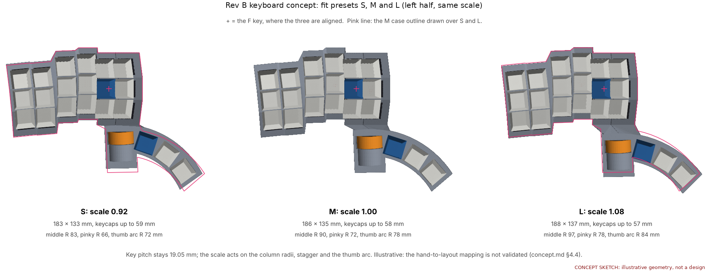
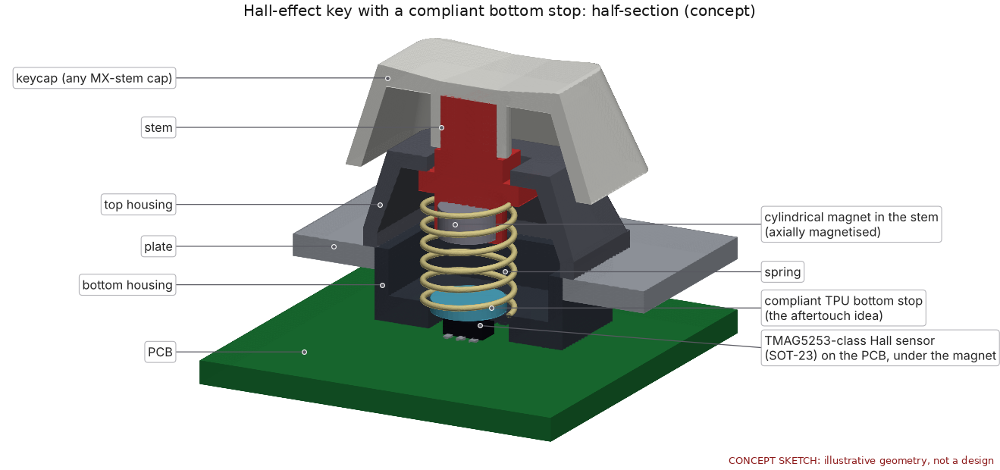
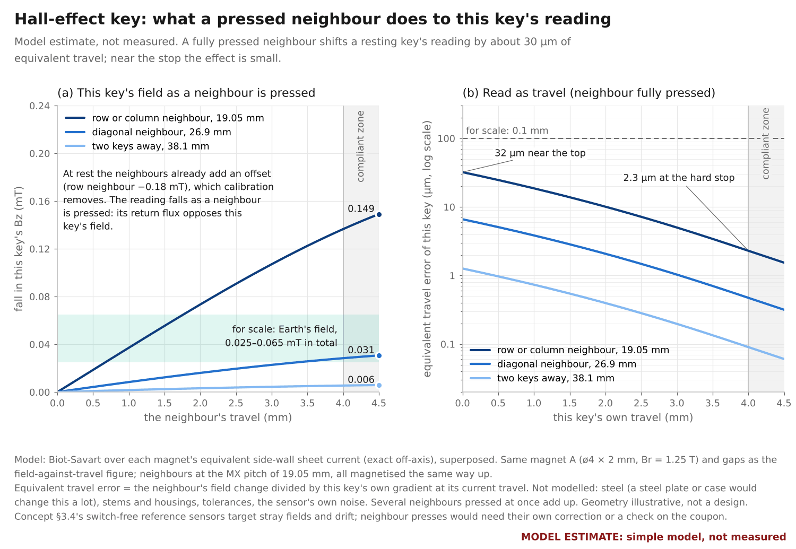
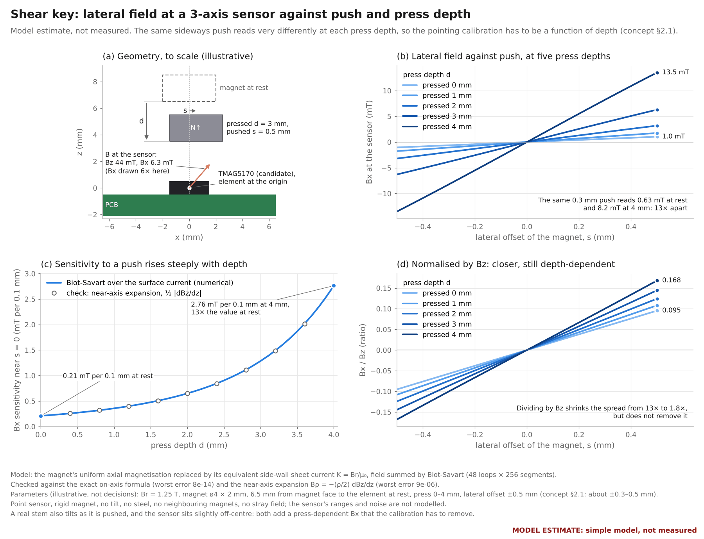
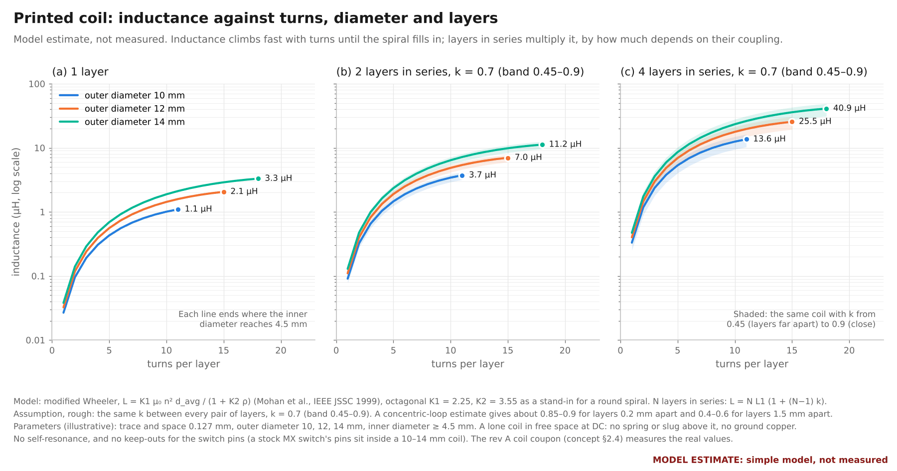
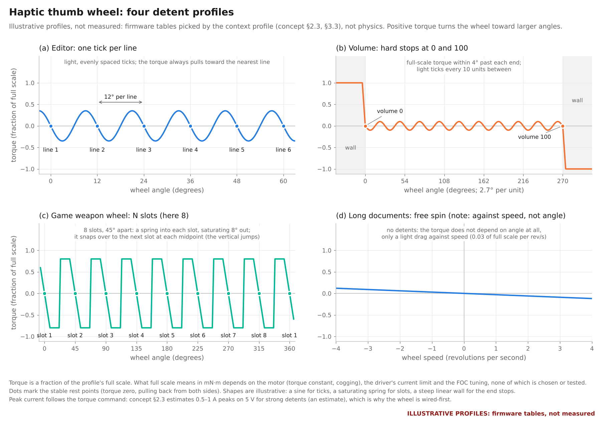
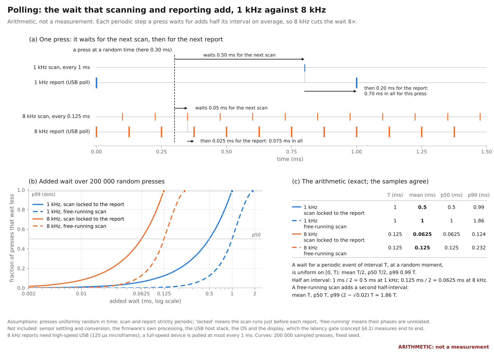
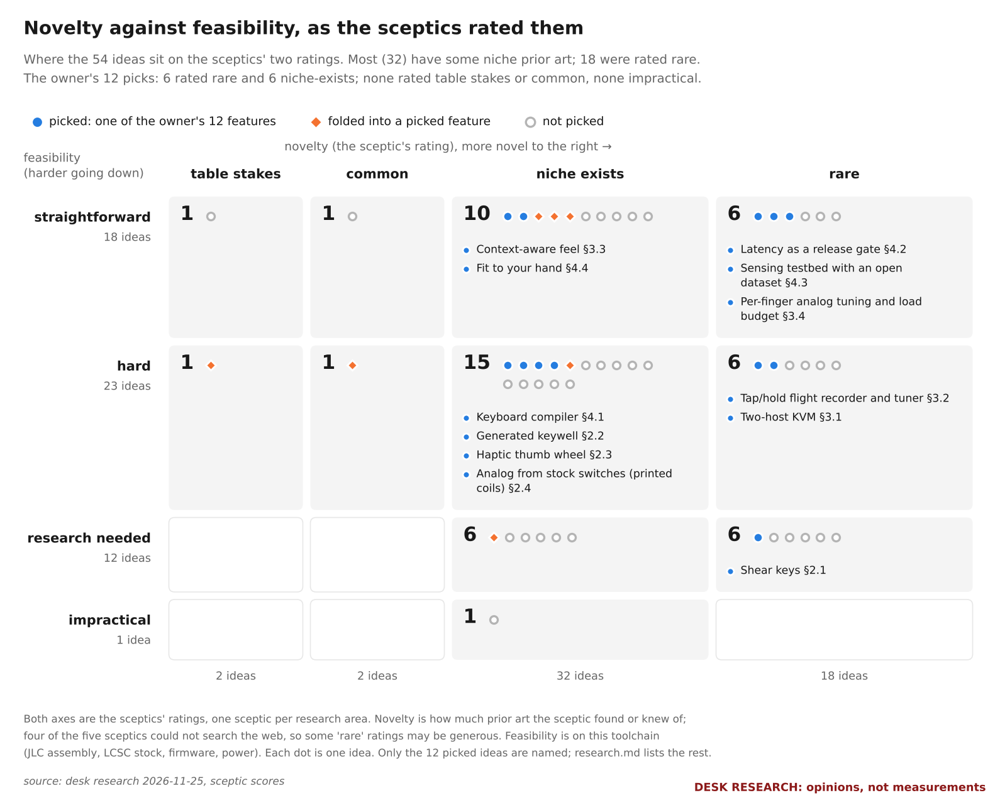
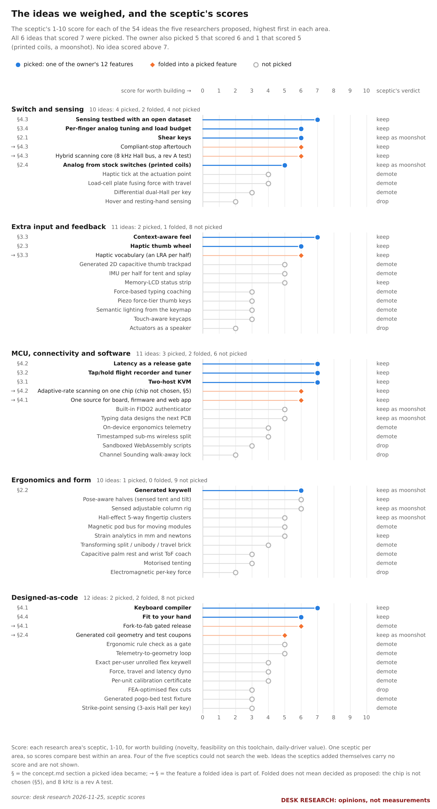
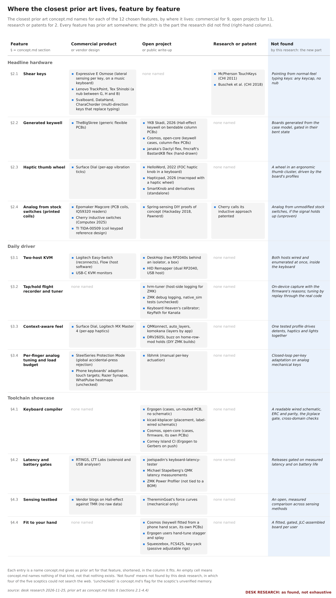

# Concept renders

> **Status (2026-11-26): concept sketches. Nothing here is designed, built or measured.** The 3D renders come from
> rough build123d models whose geometry is illustrative: round numbers near an MX-style switch and the candidate parts
> that [concept.md](../../docs/concept.md) names. The one decision among them is the rev A MCU, the STM32U5A5 (owner,
> 2026-11-26, [mcu.md](../../docs/mcu.md)); the board around it is not designed. The plots are simple models,
> arithmetic or desk-research opinion, not measurements. Every image carries a stamp that says which kind it is.

Every picture made for the keyboard [concept](../../docs/concept.md) and its [research](../../docs/research.md), in
one place. Each one also sits in the page section it illustrates, which its caption links to. To rotate the models,
open the **[3D gallery](https://tyevco.github.io/prettycoolboards/keyboard/gallery/)**.

## Rev B keyboard (concept)

A split with a generated keywell, as rev B might look, drawn by `keyboard_models.py` at the M fit preset. The tent
(about 18°), the column radii (72–90 mm), the stagger and the splay are illustrative constants, not decisions.


*Both halves: a generated keywell per half, tented about 18° in this sketch, with a thumb arc and, on the left half,
the haptic thumb wheel. Which half gets the wheel is not decided.
([concept §2.2](../../docs/concept.md#_2-2-generated-keywell))*


*Top view: where the headline features would sit. Shear keys are blue; dashed parts are inside the case.
([concept §1](../../docs/concept.md#_1-what-makes-it-different))*


*The tent and each column's arc about the finger's flexion, with a per-finger radius. Radii, tent and stack heights
are illustrative. ([concept §2.2](../../docs/concept.md#_2-2-generated-keywell))*


*Inside the left half: one 0.8 mm board per column, drawn bent to its arc, joined by flex links to a main board (MCU
module, chip not chosen; USB-C A and B for the two-host KVM). The isolator is drawn for the isolated option; whether
to isolate host B is still open. Hall sensors and passives are not modelled.*


*The left half's parts stack, exploded. The switches are magnetic, with the sensing (Hall-effect or TMR) left to rev
A, and drawn socketless, though hot-swap is still open ([concept §9](../../docs/concept.md#_9-open-questions));
sizes are placeholders.*



*Fit presets S, M and L: one parametric half at three illustrative sizes. Key pitch is fixed; a uniform scale moves
the column radii, stagger and thumb arc. That scale stands in for a hand-to-layout mapping nobody has validated, and
the dimensions are model outputs, not measurements. ([concept §4.4](../../docs/concept.md#_4-4-fit-to-your-hand))*


*Keycap clearance, a model estimate on the sketch's own geometry, not measured: a rough check in the concept script
(`keyboard_models.clearance_gate`, not `clash_check.py` and not the planned gate) puts every keycap at rest, mid
travel and bottom-out against its neighbours, the case and the wheel. The thumb arc clears (1.38 mm at rest), but the
deeper middle column's top cap (E, and I on the right) comes 0.35 mm from the stepped web at bottom-out, under an
illustrative 0.5 mm margin: the kind of thing the planned gate is meant to catch.
([concept §4.1](../../docs/concept.md#_4-1-keyboard-compiler))*

## Mechanisms

Single mechanisms at key scale, drawn by `mechanism_models.py`. The 3D views are cut in half; the sections are exact
cuts of the same solids. Every choice of mechanism here (posts, stops, mounts) is one way it could work, not a
design.



*Hall-effect key with a compliant bottom stop, the aftertouch idea: 4 mm of travel towards a TMAG5253-class sensor,
then a soft stop, drawn as a TPU disc. ([concept §7](../../docs/concept.md#_7-rev-a-testbed))*


*Shear key, one way it could work: the stem slides inside a carrier hung on four flexure posts, so a sideways push
moves the magnet about ±0.3–0.5 mm over a TMAG5170 3-axis Hall sensor.
([concept §2.1](../../docs/concept.md#_2-1-shear-keys))*

The two keys in exact sections:


*Hall-effect key at rest (top) and pressed into its stop (bottom): 4.0 mm of travel, then a 0.3 mm squeeze into an
illustrative compliant zone, the sketch's own choice (the field model uses 0.5 mm). The 5.8 mm rest gap runs to the
top of the sensor package; to the Hall element, the gap the field model uses, it is 6.3 mm. The stop's stiffness and
the field-versus-squeeze curve are rev A unknowns.*


*Shear key at rest (top left), pushed 0.4 mm to its roof-hole stop (top right), and in plan (bottom), where the
magnet's range over the sensor is the small red circle. The stiffness and the X/Y signal are rev A unknowns.*

The haptic thumb wheel ([concept §2.3](../../docs/concept.md#_2-3-haptic-thumb-wheel)):


*A gimbal motor drives the roller directly (a 2804-class motor in this sketch; the motor is not chosen). A diametric
magnet on the shaft faces an MT6701CT encoder (or the AS5047P), and a DRV8316 on the same small board drives the
motor. The board parts are the stocked candidates (concept §2.3). Motor, magnet and roller would be fitted by hand.*


*Section through the shaft: the roller on the motor's outer rotor, the stator, bearings and shaft, and the magnet
facing the encoder IC. The motor is not chosen (the sketch draws a 2804-class one), and the board parts are
candidates. Detent strength, cogging and current are rev A unknowns.*

Analog from a stock switch ([concept §2.4](../../docs/concept.md#_2-4-analog-from-stock-switches-printed-coils)), and
an LRA mount ([concept §3.3](../../docs/concept.md#_3-3-context-aware-feel)):


*Printed-coil key: a generated two-layer spiral under a stock MX switch, read by an LDC1614-class converter. In this
sketch the steel spring starts about 1 mm above the copper and runs up to about 7.5 mm. Unproven; the copper
thickness is exaggerated.*


*Coin LRA in a cradle printed with the case floor, joined to it only through three flexure arms, aimed at keeping
buzz out of a hard desk. Untested; the mount and the arm geometry are the sketch's choices.*

## Rev A testbed

The motherboard and its plug-in coupons ([concept §7](../../docs/concept.md#_7-rev-a-testbed)), drawn by
`testbed_models.py` and `coils.py` to match the draft [SPEC](../design/SPEC.md) and the owner's decisions of
2026-11-26 ([SPEC §1](../design/SPEC.md#_1-purpose-and-what-rev-a-must-prove)): no battery or charger on rev A, a
2 × 20, 2.54 mm slot connector, and a USB Type-C detect chip. The board and coupon sizes are the SPEC's "about"
figures ([§2](../design/SPEC.md#_2-boards)) and the slot rows follow its
[§9](../design/SPEC.md#_9-mechanical-envelope-proposal); every position inside them is this sketch's, not a
placement. The solder-mask colours only tell the coupons apart.


*Assembled: one motherboard (the STM32U5A5, the owner's rev A MCU of 2026-11-26, [mcu.md](../../docs/mcu.md); USB-C
with a Type-C current-detect chip on I2C, the power section, latency-rig hooks) and a coupon per sensing method, S1–S3
along the back and S4, S5 and the optional KVM coupon (a ghost) along the front. No battery or charger.*


*Exploded: each coupon off its 2 × 20, 2.54 mm socket (a female through-hole socket on the motherboard, a male header
on the coupon: the owner's decision, [SPEC §4.1](../design/SPEC.md#_4-1-connector)), and the keys off the TMAG5253, TMR
and TMAG5170 sites. Every coupon carries a descriptor EEPROM and stands on one M3 nylon post.*

![Top view of the testbed to scale: the Hall-effect, TMR and shear coupons along the back, the coil and haptics coupons and the pale optional KVM coupon along the front, and the strip between the rows with the power section on its right. Below it, the strip's left half at twice the scale, with callouts for the USB-C with its ESD array and VBUS TVS, the short high-speed pair, the Type-C current-detect chip, the STM32U5A5 drawn as an LQFP100, the 16 MHz HSE crystal, the reset and BOOT0 buttons, the latency-rig and SWD headers, the I2C mux and I/O expanders, the test pads and the INJ solder jumpers.](renders/testbed_top.png)

*Top view to scale: a motherboard of about 190 × 150 mm and coupons of about 58 × 60 and 80 × 60 mm, the SPEC's sizes,
which follow from the 2 × 20 connector; layout sets the outlines. The power section is the input breaker, the two
LDOs, a 3.3 V and a 5 V switch per slot and 13 INA226-class current monitors; there is no charger. The MCU is the
owner's rev A decision, turned so that its USB pins face the USB-C; the other parts named are the SPEC's candidates.
The 16 MHz HSE is in the high-speed PHY's list of accepted reference clocks (RM0456 Rev 7, read in a third-party
transcription; ST's HAL and Zephyr's PHY driver agree) and in the ROM bootloader's DFU crystal list
([SPEC §5.2](../design/SPEC.md#_5-2-constraints-behind-the-choices)).*


*Latency rig: over the ribbon to J_RIG it would drive the stimulus (through slot S1's solder jumper, closed for the
test) and read the marker GPIO, the frame tick and the USB SOF; as the USB host it would timestamp each HID report. Its
parts are not chosen; nothing is built or measured. ([SPEC §7.3](../design/SPEC.md#_7-3-latency-rig-j-rig),
[concept §4.2](../../docs/concept.md#_4-2-latency-and-battery-gates))*


*Coil coupon: 20 spiral variants (layers and diameter by row, trace = space by column) on a wide coupon of about
80 × 60 mm, an illustrative spread around a stock MX footprint, not checked against JLC's rules or the converter.
([concept §2.4](../../docs/concept.md#_2-4-analog-from-stock-switches-printed-coils))*

## Physics: model estimates

Simple models and arithmetic, drawn by `keyboard/docs/figures/physics.py`: **model estimates, not measurements.**
Each figure states its model, its parameters and what it leaves out, and its geometry is the illustrative geometry of
the mechanism sketches above. The rev A testbed is where real numbers would come from.


*Hall-effect key, field against travel: the field and the travel resolution rise steeply toward the stop, so the
magnet, gap and sensor range have to be chosen together. The sensor ranges drawn are unchecked.
([concept §7](../../docs/concept.md#_7-rev-a-testbed))*



*A pressed neighbour's magnet shifts a resting key's reading by about 30 µm of equivalent travel in this model, with
no steel modelled. ([concept §3.4](../../docs/concept.md#_3-4-per-finger-analog-tuning-and-load-budget))*



*Shear key: the same sideways push reads about 13 times stronger at 4 mm depth than at rest, and about 1.8 times
after dividing by Bz, so the pointing calibration would have to depend on depth.
([concept §2.1](../../docs/concept.md#_2-1-shear-keys))*



*Printed coil: modified Wheeler inductance for a lone spiral, with a rough assumed layer coupling (k = 0.7, band
0.45–0.9). No spring, slug or ground copper in the model, and its 10–14 mm coils are all larger than the coupon
sketch's. ([concept §2.4](../../docs/concept.md#_2-4-analog-from-stock-switches-printed-coils))*



*Haptic wheel: four illustrative detent profiles, firmware tables rather than physics. What full-scale torque means
depends on a motor and driver not yet chosen. ([concept §2.3](../../docs/concept.md#_2-3-haptic-thumb-wheel))*



*Polling, by arithmetic: a press waits on average 0.5 ms at 1 kHz against 0.0625 ms at 8 kHz for the scan and report
intervals alone, twice that with a free-running scan.
([concept §4.2](../../docs/concept.md#_4-2-latency-and-battery-gates))*

## Research data

The desk research's own ratings, drawn by `keyboard/docs/figures/data.py` from `ideas.json`: **opinions, not
measurements**, from one sceptic per research area, four of whom could not search the web
([research: how this was researched](../../docs/research.md#how-this-was-researched)).



*Novelty against feasibility for the 54 proposed ideas, as the sceptics rated them. The 12 picks sit only in the
"niche exists" and "rare" columns, and none is rated impractical.*



*Every proposed idea with its sceptic's score: all six ideas scored 7 were picked, with five scored 6 and one scored
5. Folded does not mean decided as proposed: the adaptive-rate idea's chip is not chosen, and the 8 kHz Hall bus is a
rev A test. ([research](../../docs/research.md#ideas-we-weighed-and-did-not-pick))*



*The prior art concept.md names for each feature. "Not found" means not found by this research, not that nothing
exists. ([concept §1](../../docs/concept.md#_1-what-makes-it-different))*

## Diagrams

The flow, block and sequence diagrams are Mermaid, written in the pages themselves, so they are not repeated here:

| Page | Diagrams |
|---|---|
| [Overview](../../README.md#roadmap) | The twelve chosen features; the roadmap with its go/no-go gates; where each feature lands, rev by rev |
| [Concept §1–§2](../../docs/concept.md#_1-what-makes-it-different) | Rev B system blocks; the shear key's signal path; keywell boards generated from the case; the haptic wheel's control loop; the coil coupon's chain and its go/no-go |
| [Concept §3](../../docs/concept.md#_3-daily-driver-features) | The two-host KVM across an isolation barrier, and its power options; one flight-recorder session; approving an agent's diff on the wheel; from context to one profile; the per-finger adaptation states and data flow |
| [Concept §4](../../docs/concept.md#_4-toolchain-showcase) | The cross-domain contract checks; the keyboard compiler and its gates; one strike through the latency rig; the battery gate; the fit loop |
| [Concept §5–§8](../../docs/concept.md#_5-platform-let-the-testbed-decide) | How the testbed picks the rev B chip; the firmware layers on Zephyr; the testbed's coupons and what each answers; what each rev A answer decides; the conflicts and what settles them |
| [Research](../../docs/research.md#how-this-was-researched) | How the research was done; the not-picked ideas that point to a picked feature |

## 3D models

The render scripts also export glTF models (metres, Y up) to `models/`. That folder is git-ignored: the
[3D gallery](https://tyevco.github.io/prettycoolboards/keyboard/gallery/) publishes the models it shows. All of
them are concept sketches with illustrative geometry.

| Model | What |
|---|---|
| `keyboard_assembly.glb` | Both rev B halves, every part: keycaps, switches, column and thumb boards, flex links, main boards, battery, LRA, wheel module and the two-part case |
| `keyboard_half_exploded.glb` | The left half exploded along its tent normal, the same layers as the exploded render |
| `mech_shear_key.glb` | One shear key: keycap, stem, magnet, spring, the carrier on its flexure posts, housing, plate, PCB and a TMAG5170 |
| `mech_thumb_wheel.glb` | The thumb wheel module: gimbal motor, roller, encoder board, bracket, thumb plate and two thumb keys for scale |
| `testbed_assembly.glb` | The rev A motherboard (about 190 × 150 mm in this sketch, no charger) with the Hall-effect, TMR, shear, coil and haptics coupons plugged into their 2 × 20 sockets (the optional KVM coupon is left out, its J_KVM header kept) |

## Regenerating

In WSL, from the repository root, with any Python that has build123d 0.13, matplotlib, numpy, scipy and Pillow, for
example the toolchain venv:

```sh
PY=$HOME/.venvs/dial-me-spinner/bin/python
$PY keyboard/hardware/concept/render_keyboard.py     # rev B keyboard: 7 PNGs + 2 GLBs (about 70 s)
$PY keyboard/hardware/concept/render_mechanisms.py   # mechanisms: 8 PNGs + 2 GLBs (about a minute)
$PY keyboard/hardware/concept/render_testbed.py      # rev A testbed: 5 PNGs + 1 GLB (about 2 minutes)
$PY keyboard/docs/figures/physics.py                 # model estimates: 6 PNGs (seconds)
$PY keyboard/docs/figures/data.py                    # research data, from ideas.json: 3 PNGs (seconds)
```

Each script can also draw a subset:

```sh
$PY keyboard/hardware/concept/render_keyboard.py assembly top side exploded internals fit gate glb
$PY keyboard/hardware/concept/render_mechanisms.py he shear wheel coil lra glb
$PY keyboard/hardware/concept/render_testbed.py --only assembly,exploded,top,rig,coil,glb
$PY keyboard/docs/figures/physics.py he neighbour shear coil haptic latency
```

The model modules also run on their own as build checks:

```sh
$PY keyboard/hardware/concept/keyboard_models.py    # both halves: case sizes, interference, keycap clearance
$PY keyboard/hardware/concept/mechanism_models.py   # the mechanism solids
$PY keyboard/hardware/concept/testbed_models.py     # part counts and bounding boxes
$PY keyboard/hardware/concept/coils.py              # the 20-coil set: turns, trace, layers, size, model inductance
```

| File | What |
|---|---|
| `render_lib.py` | Shared helpers: tessellation, palette, light, the CONCEPT SKETCH stamp, glTF export (adapted from the caliper's `render.py`) |
| `keyboard_models.py`, `render_keyboard.py` | The rev B keyboard sketch and its renders |
| `mechanism_models.py`, `render_mechanisms.py` | The key, wheel, coil and LRA mechanisms and their renders |
| `testbed_models.py`, `coils.py`, `render_testbed.py` | The rev A testbed sketch, the spiral-coil generator and their renders |
| `keyboard/docs/figures/physics.py` | The model-estimate plots |
| `keyboard/docs/figures/data.py`, `ideas.json` | The research-data figures and the scored ideas they plot |
