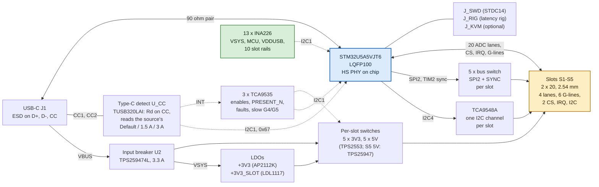

# PrettyCool Keyboard rev A testbed: SPEC (draft architecture of record)

> **Status (2026-11-27): Draft architecture of record, rev A testbed. The motherboard schematic is captured from this
> SPEC and nets.py (2026-11-27: sheets/mb_*.py, gated by the wiring rule, ERC and check_contract.py); not built, not
> measured.** The owner decided three of this draft's proposals on 2026-11-26: no charger on
> rev A, the 2 × 20 slot connector, and a USB Type-C detect chip (§1). On the evening of 2026-11-27 the owner
> answered the [risk register](../../docs/risks.md) with seven more decisions (§1: rev A in two stages, the slot key,
> series resistors at the sockets, power fixes, layout rules, SPEC fixes and MCU alternates, coupon fixes). They are
> written into this SPEC and nets.py; **none of them is captured, laid out or built yet**. Every part below is still a **candidate**,
> picked on paper, with its JLC stock checked on 2026-11-26 (the Type-C detect candidates on 2026-11-27); stock
> changes daily. Figures marked *estimate* are arithmetic or a model, not a measurement. Claims marked **unverified**
> were not checked against a primary source. The MCU pin map is a draft: its pin numbers and alternate functions
> agree with the datasheet (§5.1). The reference-manual items of §5.2, §5.3, §6 and §8 were read on 2026-11-27 in a
> third-party transcription of RM0456 Rev 7, because st.com was unreachable, and ST's errata sheet ES0553 is not read
> yet (§11 #24, #25). st.com still failed on 2026-11-27 at 22:03 and 23:03 UTC (HTTP/2 stream errors; a retry over
> HTTP/1.1 got an empty reply), so ST's own PDFs remain unread. The firmware written so far (the 8 kHz HID proof for the Nucleo,
> the board support and the bring-up application) compiles and has never run on hardware (§10 step 2).

This is the contract that the testbed's schematics, layout, coupons, latency rig and firmware will implement, in the
role [the caliper's SPEC](../../../caliper/hardware/design/SPEC.md) plays for the caliper. The net names, the coupon
slot pinout and the MCU pin map live in [nets.py](nets.py) (`python nets.py` checks that they agree with each
other). Change this file and `nets.py` together. The schematic is generated from sheet modules under
`keyboard/hardware/design/sheets/` (`mb_*.py`), drawn under the [wiring rule](../../../tools/README.md#wiring-rule),
and [check_contract.py](check_contract.py) compares the netlist's MCU pins with `nets.MCU_PINS`, as the caliper's
does, and the expanders, the mux, U_CC, the INA226 straps, the slot sockets and the headers with their tables here.

It rests on the owner's decisions recorded in [concept.md](../../docs/concept.md) (the features, the testbed-first
staging, Zephyr), the [rev A MCU decision record](../../docs/mcu.md) (2026-11-26), and the owner's answers of
2026-11-27 to the [rev A risk register](../../docs/risks.md) (§1).

## 1. Purpose and what rev A must prove

Rev A is a **motherboard plus plug-in coupons**, one coupon per sensing method, each coupon generated by compiler v0
([concept §7](../../docs/concept.md#_7-rev-a-testbed)). It is a measuring instrument, not a keyboard.

| Rev A is done when ([concept §7](../../docs/concept.md#_7-rev-a-testbed)) | What on this board serves it |
|---|---|
| Each coupon has a measured current and noise figure in the docs | A switched, current-limited 3.3 V and 5 V rail per slot, each with its own INA226 (§3.4), apart from the MCU's and the HS PHY's own supplies; a meter jumper per 3.3 V slot rail for µA ranges; four analog lanes per slot, 14-bit-capable on S1–S4 (S5: AN0 on ADC1/ADC2, AN1–AN3 on the 12-bit ADC4) (§4, §6) |
| The coil coupon says yes or no to stock-spring sensing | The slot's own I2C channel for five LDC1614-class converters (§4.5) |
| The shear coupon says whether a centring stem gives a usable pointing signal | Shared SPI with two chip selects per slot, plus G-lines as extra selects (§4.8) |
| The wheel coupon has a measured peak and average current | Slot S5: a 2 A 5 V rail on a 20 mΩ shunt, TIM1 for the DRV8316, ADC4 lanes for its current-sense outputs (§3.6, §4.8) |
| The battery gate picks a rev B chip from measured numbers | Per-rail current logs at 1 kHz and 8 kHz scan rates, exported with the scan mode and the coupon's identity (§8.5) |
| The compiler has generated and gated every coupon | One slot interface, one descriptor EEPROM per coupon, coupon design rules the compiler can check (§4.6, §4.9) |

**Two stages** (owner's decision D1 of 2026-11-27, answering [risks.md PG-2](../../docs/risks.md#pg-2)). Rev A is
released, ordered and brought up in two stages, so that the boards that prove the platform do not wait for the rest:

| Stage | Boards | When |
|---|---|---|
| **A1** | the motherboard, the test coupon, the Hall-effect coupon | released first; ordered and brought up first (§10) |
| **A2** | the haptics, coil, shear and TMR coupons, and the latency rig | designed after A1, ordered later. **A2 must not hold A1 back** |

The optional KVM coupon is in neither stage of this release. The done list above is still rev A's: A1 answers its
first row for the Hall coupon, the 8 kHz HID and the scan engine below; A2 answers the rest. Neither stage has a
written done card yet (risks.md recommendation 20, not decided).

Two things this board must also show, because rev A is where the platform risks get retired
([mcu.md](../../docs/mcu.md#bring-up-risks)): **8 kHz HID** (bInterval 1 at high speed) through Zephyr's STM32 USB
device driver, and a **scan engine** that fills a 125 µs frame (§6).

**Conditions before the schematic is committed** (owner, 2026-11-26; both open). On 2026-11-27 the owner asked for
the KiCad projects, Gerbers, BoMs and enclosures of rev A now, so both conditions now gate **ordering boards**, not
capture:

1. **The MCUs are in hand.** The purchase route is **ST's own store** (owner's decision D6 of 2026-11-27): the ST
   eStore listed the STM32U5A5VJT6 "In stock" at $19.25 (1–9) on 2026-11-27, and the pin-compatible STM32U599VJT6
   at $17.99 (risks.md [SF-1](../../docs/risks.md#sf-1); the eStore pages were read by the risk register's supply
   reviewer, not again here). **The owner buys them; no agent buys anything.** The STM32U599VJT6 and STM32U595VJT6 are
   pin-compatible alternates (§2.1); the -Q parts are not. JLC's own stock stays thin: 13 STM32U5A5VJT6 (C22455480)
   on 2026-11-27 with `canPresaleNumber` −4, where other parts show about their stock (SN74CBTLV3125PWR 1101 in
   stock, 1100), so the 13 may already be committed to other orders (the field is undocumented: an inference,
   **unverified**); neither alternate is in JLC's stock. DigiKey had none before February–March 2027
   ([mcu.md](../../docs/mcu.md#what-the-verifier-corrected)). How ST's parts reach the board (consigned to JLC, or
   U1 left unfitted and soldered by hand) is the owner's choice when ordering. The NXP i.MX RT1021 stays the last
   resort.
2. **8 kHz HID is proven on the NUCLEO-U5A5ZJ-Q** with Zephyr's `usbd`: `in-polling-period-us = <125>`, bInterval 1,
   report rate and jitter measured for at least 10 minutes on Windows and Linux with CDC logging active
   ([mcu.md](../../docs/mcu.md#conditions-before-the-schematic-is-committed)). Nobody has published this for
   `udc_stm32`. If either fails, the NXP i.MX RT1021 (C5119758) is the fallback and this SPEC is redrawn for it. The
   proof firmware and its host measurement tool are written: [keyboard/firmware/hid8k](../../firmware/hid8k/README.md)
   builds for `nucleo_u5a5zj_q` and its high-speed endpoint descriptor carries bInterval 1, but it has not run on a
   Nucleo, so nothing about this condition is measured yet (§10 step 2). The rule for a mixed or host-side result
   (risks.md recommendation 20) is not decided.

Both conditions still gate **ordering** after the decisions of 2026-11-27, and every `ORDER-NOTES.md` says so at the
top.

**Owner decisions of 2026-11-26** (answers to this draft's proposals; the parts named for them remain candidates):

| | Decision | Where it lands |
|---|---|---|
| D1 | **No battery and no charger on rev A.** The charger goes to rev B | This section, §11 #13 |
| D2 | **The coupon slot connector is 2 × 20 at 2.54 mm**: a female through-hole socket on the motherboard, a male header on the coupon. The board sizes follow from it (motherboard about 190 × 150 mm, standard coupon about 58 × 60 mm, wide coupon about 80 × 60 mm); layout sets the exact outlines | §2, §4.1, §9, §11 #20 |
| D3 | **USB-C input power:** keep the input breaker at about 3.3 A, and add a USB Type-C detect chip on I2C that reads the source's advertised current (Default, 1.5 A or 3.0 A), so that the firmware sets the VSYS budget itself. It uses no MCU pin (the pin budget is 82 of 82) | §3.1, §3.2, §3.5, §3.8 (the chip: U_CC, candidate TUSB320LAI), §8.4, §11 #12 |

**Owner decisions of 2026-11-27 (evening)**, answering the risk register's
[changes recommended before ordering](../../docs/risks.md#changes-recommended-before-ordering) (its recommendations
1–21). Their numbers restart at D1; where this page cites one it writes the date, "D3 of 2026-11-27":

| | Decision (2026-11-27) | Risk register | Where it lands |
|---|---|---|---|
| D1 | **Rev A in two stages.** A1 = the motherboard, the test coupon and the Hall coupon, released, ordered and brought up first; A2 = the haptics, coil, shear and TMR coupons and the latency rig, designed after A1 and ordered later. A1 is released first; A2 must not hold A1 back | PG-2 | this section; §2, §10, §11 |
| D2 | **Key the slot at pin 39.** RSV becomes KEY. Pin 39 is absent from every coupon's header (a footprint with no pad 39; the header's pin 39 pulled before soldering, or a part sold that way if one is stocked), and the socket's hole 39 is plugged (a key plug part if one is stocked, else an assembly note) and unconnected. A coupon rule checks that pin 39 is absent and unconnected. Never key pins 2 and 39 together | rec. 2 (EL-2) | §4.2, §4.9; `nets.SLOT_PINS`, `nets.SLOT_KEY_PIN` |
| D3 | **Slot guard: 100 Ω in series at each socket** on CS0_N, CS1_N, IRQ_N and G0–G3, and on S5's G4/G5. Plain resistors, no TVS arrays; checked against TIM1's PWM edges and EXTI timing. The lanes keep their 47 Ω + 1 nF | rec. 4 (EL-3) | §4.3; `nets.SLOT_SERIES` |
| D4 | **Power fixes.** U2's PGTH divider 100 k / 44.2 k, so that VSYS_PG falls at 3.51–3.64 V; the USB-C load line (4.75 − 0.25 × I at J1); §11 #15 from SLVSF16B (VM 4.5 V minimum, UVLO falling 4.1–4.3 V); a damping leg on +3V3A (10 µF + 0.47 Ω, or a resistor in place of FB1), chosen only after a model with the LDO confirms it: **it did, and the leg was chosen** (§3.7); Kelvin sense nets for every INA226 shunt, pre-routed, with a post-layout check | recs. 5, 6, 7 (EL-1, EL-5, EL-6) | §3.1, §3.4, §3.6, §3.7, §7.5, §11 #15; `nets.INPUT_PGTH_DIVIDER`, `nets.VDDA_DAMPING`, `nets.INA226_SHUNT_NETS` |
| D5 | **Layout rules.** Shrouded box headers for J_RIG and J_KVM; the placement rules of §9; the PCB stack named, with the 90 Ω geometry for it; the motherboard single-sided with the lane RCs on top; the coupons' via rule (0.60 / 0.30 mm) on the motherboard; `release.py` warns on drills under 0.3 mm | recs. 3, 8, 9, 10 (EL-2, EL-7, SF-5, SF-3, EL-11) | §2, §7.1, §7.3, §7.4, §9; `nets.MB_STACK`, `nets.USB_PAIR` |
| D6 | **SPEC fixes and MCU alternates.** STM32U599VJT6 and STM32U595VJT6 as pin-compatible alternates (the -Q parts are not); ST's store as the purchase route; the corrections of rec. 14; §8.1's Stop 1 sentence against DS13543 Table 10 note 12; ST's documents read first-hand where st.com answers (it did not, §11 #24); the note that the TPS259470L is out of stock | recs. 1, 13, 14 and rec. 12's TPS259470L note (SF-1, PG-7, SF-6) | §1, §2.1, §3.3, §3.4, §3.5, §5.3, §8.1, §8.4, §8.5, §11; `nets.MCU_ALTERNATES` |
| D7 | **Coupon fixes.** The test coupon gets an INJ-to-lane path and is re-released; the haptics coupon one or two Hall sites at rev B distances and a filter on the DRV2605L's supply; the coil coupon tanks above 1 MHz with two capacitor footprints per coil, and its U15 mux becomes the documented scheme; before the TMR and shear coupons are captured, the TMR part is picked by sensing axis and range and its magnet sized, the TMAG5170 variant picked from the stop field with tolerances, and the two shear sites put at least 40 mm apart | recs. 15–18 (ME-2, SE-5, SE-6, SE-8, SE-9, SE-1, SE-3) | §4.5, §4.8 |

**Not decided** (open owner items, §11 #26–#30): rec. 11 (a coupon BOM and CPL without J1, for Economic PCBA),
rec. 12's second source for the bus switch, rec. 19 (the rule that bounds a lane's voltage), rec. 20 (written rules:
the 1 kHz mode, the rig's VBUS source, the decision rule for condition 2, a done card per coupon) and rec. 21 (LICENSE
files and pid.codes PIDs). The optional KVM coupon stays out of this release.

**Out of rev A:** no battery and no charger, by the owner's decision D1 of 2026-11-26 (concept §7 had listed "power and charging";
the battery gate needs per-rail currents, not a cell; the charger goes to rev B, where the caliper's charger sheets
are a starting point); no radio (the rev A MCU has none; the rev B side track measures BLE on an nRF54LM20 dev kit); no
LSE crystal (a proposal, §5.2, §11 #11).

## 2. Boards

| Board | Stage (D1 of 2026-11-27) | Size (follows from D2 of 2026-11-26; outline set at layout) | Stack | Carries |
|---|---|---|---|---|
| Motherboard | A1 | **about 190 × 150 mm** | 4-layer, 1.6 mm, ENIG, **JLC04161H-7628** (D5 of 2026-11-27, below): L1 signals and the HS pair, L2 solid GND, L3 power, L4 signals; parts on L1 only | STM32U5A5VJT6, USB-C with the hand-routed 90 Ω pair and the Type-C detect chip (U_CC), the power tree and 13 current monitors, five coupon slots (S1–S5), the I2C mux, three I/O expanders, five bus switches, the latency-rig header, the optional KVM header, SWD |
| Standard coupon | A1: test, Hall-effect (S1); A2: TMR (S2), shear (S3) | about 58 × 60 mm | 4-layer, 1.6 mm, JLC04161H-7628 (analog coupons want a solid ground layer) | the test coupon (§10 step 7), Hall-effect (S1), TMR (S2), shear (S3) |
| Wide coupon | A2 | about 80 × 60 mm | 4-layer, 1.6 mm, JLC04161H-7628; the coil coupon keeps copper-free layers under each coil ([concept §8](../../docs/concept.md#_8-conflicts-the-testbed-has-to-settle)) | Coil (S4), haptics (S5) |
| KVM coupon (optional) | not in this release | ≤ 50 × 40 mm | its own choice | A second USB device path for host B (§7.4) |
| Latency rig | A2 | 100 × 80 mm | 4-layer, 1.6 mm (it carries a high-speed host link) | A high-speed USB host with microframe timestamps, the stimulus drivers, a ribbon to J_RIG (§7.3) |

**The stack** (owner's decision D5 of 2026-11-27; `nets.MB_STACK`) is JLC's **JLC04161H-7628**, whose layers JLC's
impedance page (fetched 2026-11-27) lists exactly as it lists its "No requirement" stack, so that the motherboard
keeps what is, by that reading, JLC's default stack. Its layers, from JLC's page: L1 copper 0.035 mm; 7628 prepreg 0.2104 mm,
dielectric constant 4.4; L2 copper 0.0152 mm; core 1.065 mm, 4.6; L3 copper 0.0152 mm; 7628 prepreg 0.2104 mm, 4.4;
L4 copper 0.035 mm; about 1.59 mm in all. Solder mask: dielectric constant 3.8, 1.2 mil over the laminate and
between traces, 0.6 mil over copper. The coupons already use this stack (`boards/coupon_common.py`, whose figures,
held there "as remembered", agree with JLC's page). The USB pair's geometry for it is in §7.1. **The motherboard is
single-sided** (D5): every part, the lane RCs and the through-hole sockets and headers included, sits on L1 (§9).

The slot connector is the owner's decision D2 (2026-11-26): 2 × 20 at 2.54 mm (§4.1). The sizes follow from it and
stay proposals until layout sets the exact outlines: the 50.8 mm socket needs a coupon edge of about 55 mm, which
gives the standard and wide coupons above, and two rows of slots with a strip between them give the motherboard's
190 × 150 mm (§9). The first concept sketches' 160 × 110 mm motherboard, smaller coupons and 2 × 10 sockets were
illustrative; the sketches are now redrawn at these sizes, with the positions still the sketch's
([concept renders](../concept/README.md)).

Every coupon carries the male half of the slot connector, a 2 kbit descriptor EEPROM at 0x50 on its own I2C
channel, its PRESENT_N strap to GND, one M3 support post, and an outline generated by the compiler.

**Default slot assignment.** S1 Hall-effect, S2 TMR, S3 shear, S4 coil, S5 haptics. All five slots are electrically
the same connector and pinout; any coupon fits any slot of its size or larger, with three differences: S4's G0–G3
are on TIM8 (PWM-capable), S5's G0–G5 are on TIM1 with its break input, and S5 has the 2 A 5 V rail and its
AN1–AN3 on ADC4 (§4.4).

How the motherboard hangs together (a block diagram of this draft, not a schematic):



*Block diagram of the draft motherboard: the power path (left) with the Type-C detect chip on the CC lines, the
measurement and control buses (I2C1 to the monitors, the expanders and the Type-C detect chip, whose interrupt
reaches the MCU through an expander; I2C4 to the slot mux), and the slot fabric. Nothing here is captured or built.*

### 2.1 Candidate parts (JLC parts API, 2026-11-26)

Queried through the endpoint that [`tools/lcsc_check.py`](../../../tools/lcsc_check.py) uses, on 2026-11-26 (the
Type-C detect row on 2026-11-27, and the rows the owner's decisions of 2026-11-27 add, that evening). Stock is JLC's,
price is qty 1. All are JLC **extended** parts except the crystal and the rows marked basic, so each unique part adds
JLC's extended-part fee.

| Function | Part | LCSC | JLC stock | $ (qty 1) | Notes |
|---|---|---|---|---|---|
| MCU | STM32U5A5VJT6 (LQFP100) | C22455480 | 13 (13 again on 2026-11-27) | 19.07 | Owner's pick; the owner buys it from ST's store (§1, condition 1; D6 of 2026-11-27). JLC's API also reports `canPresaleNumber` −4 (§1) |
| MCU alternate | STM32U599VJT6 (LQFP100) | C18213037 | 0 (2026-11-27) | 18.88 | Pin-compatible (D6 of 2026-11-27, `nets.MCU_ALTERNATES`): ST's open pin data gives 0 renamed pins and 0 missing signals against the U5A5VJTx; it differs in the AES, OTFDEC, PKA and SAES blocks, which this board does not use (risks.md SF-1, compared by script there). ST's eStore listed it "In stock", $17.99 (1–9), on 2026-11-27. Firmware changes only the SoC |
| MCU alternate | STM32U595VJT6 (LQFP100) | C7938448 | 0 (2026-11-27) | 24.64 | As the U599. **Not alternates:** the -Q parts (STM32U599VJT6Q C26430725, STM32U595VJT6Q C24591629), the SMPS variants: 33 pins differ (SF-1) |
| Input breaker U2, S5 5 V breaker U5 | TPS259474LRPWR (VQFN-10 2 × 2) | C2864845 | 5803 | 1.35 | 2.7–23 V, 5.5 A, 28.3 mΩ typ, true reverse-current blocking, adjustable OVLO, power-good. A **circuit breaker**, latch-off: above I_LIM for longer than the C_ITIMER blanking interval, or at once above 2 × I_LIM, it turns off and stays off; it limits current actively only at start-up (TI ZHCSL91B, Device Comparison Table, §8.3.5.2). The TPS259470L of the same family limits current actively instead, with FLT in place of PG; **JLC had none on 2026-11-27** (TPS259470LRPWR, C3662793: 0 in stock, `canPresaleNumber` −91; D6 of 2026-11-27), so it is not an alternative for an assembled order today. On 2026-11-27 the TPS259474L itself showed 5643 |
| Slot 3.3 V and S1–S4 5 V switches, KVM 5 V | TPS2553DBVR (SOT-23-6) | C55266 | 40431 | 0.54 | 2.5–6.5 V, 85 mΩ typ (135 mΩ max over temperature), adjustable current limit 75–1300 mA typ, 1.5 A maximum continuous load, constant-current limiting, FAULT output, active-high EN (TI SLVS841E). The latch-off TPS2553DBVR-1 (C111738, 6244) is the alternative. 10 per board |
| Current monitor | INA226AIDGSR (VSSOP-10) | C49851 | 37740 | 0.67 | 16-bit, 2.5 µV shunt LSB, 0–36 V common mode, 330 µA, 16 addresses (TI SBOS547). 13 per board |
| I2C mux | TCA9548APWR (TSSOP-24) | C130026 | 14661 | 0.86 | 8 channels, reset input |
| I/O expander | TCA9535PWR (TSSOP-24) | C130204 | 11879 | 1.28 | 16 I/O, open-drain INT, no internal pull-ups (TI SCPS201D). 3 per board. UMW second source C22396388 (16372, $0.49) |
| Bus switch | SN74CBTLV3125PWR (TSSOP-14) | C406866 | 1101 | 0.54 | 4 × FET switch, 7 Ω, Ioff, individual OE. 5 per board; the thinnest stock on this list after the MCU |
| 3.3 V always-on LDO | AP2112K-3.3TRG1 (SOT-23-5) | C51118 | 8695 | 0.17 | 600 mA, 250 mV dropout |
| 3.3 V slot LDO | LDL1117S33R (SOT-223) | C435835 | 43247 | 0.49 | 1.2 A, 60 µVrms (JLC listing). Lower-noise option if the slot budget stays under about 150 mA: TPS7A2033PDBVR, C2862740 (90355, $0.20; 300 mA, 10 µVrms) |
| HSE crystal | X322516MLB4SI, 16 MHz, 3225 | C13738 | 399712 | 0.09 | **Basic** part; 9 pF load, ±10 ppm (JLC listing) |
| USB-C receptacle | HRO TYPE-C-31-M-12 | C165948 | 404629 | 0.19 | 16-pin USB 2.0, the caliper's part |
| USB Type-C detect U_CC | TUSB320LAIRWBR (X2QFN-12 1.6 × 1.6 mm, 0.4 mm pitch) | C132554 | 4353 (2026-11-27) | 1.31 | Sink-only CC logic: Rd on CC1/CC2 powered or unpowered, reads Default / 1.5 A / 3.0 A over I2C at 0x67 (TI SLLSEQ8D). The owner decided on a detect chip (D3 of 2026-11-26); this part is a candidate (§3.8, alternatives compared there) |
| USB ESD | TPD4E05U06DQAR (USON-10) | C138714 | 29197 | 0.08 | 4 channels, 0.5 pF (JLC listing): D+, D−, CC1, CC2. Alternative: USBLC6-2SC6 C7519 (33014, $0.15; 3.5 pF per the listing), the caliper's |
| VBUS TVS | SMF5.0A (SOD-123FL) | C151296 | 55132 | 0.12 | As the caliper |
| VDDA ferrite | BLM18PG221SN1D (0603) | C80165 | 164706 | 0.01 | 220 Ω at 100 MHz |
| Slot socket (motherboard) | BOOMELE 2.54-2*20P female, 8.5 mm, THT | C5124634 | 6382 | 0.33 | The connector type is the owner's decision (D2 of 2026-11-26); this part is a candidate. 2.5 A per contact. Alternative HanElectricity 2541FV-2x20P-B C25503128 (1622, 3 A) |
| Slot header (coupon) | HanElectricity 2541WV-2x20P male, THT | C25503140 | 1520 (506 on 2026-11-27) | 0.14 | As the socket: type decided (D2 of 2026-11-26), part a candidate. 3 A per contact |
| Coupon descriptor | M24C02-WMN6TP (SOIC-8) | C7562 | 217250 | 0.12 | On every coupon, not on the motherboard |
| SWD | Samtec FTSH-107-01-L-DV-K (STDC14) | C5307809 | 2371 | 3.70 | 14-pin 1.27 mm, ST's STDC14 layout (§7.2) |
| Rig header | CJT A2541WV-2x5P | C225520 | 8249 | 0.18 | §7.3. **To be replaced** by a shrouded 2 × 5 box header (D5 of 2026-11-27), picked at capture |
| KVM header | CJT A2541WV-2x6P | C225521 | 4303 | 0.24 | §7.4. **To be replaced** by a shrouded 2 × 6 box header (D5 of 2026-11-27), picked at capture |
| Slot series resistors, 37 (D3 of 2026-11-27) | UNI-ROYAL 0402WGF1000TCE, 100 Ω 1 % 0402 | C25076 | 9011776 (2026-11-27) | 0.0011 | **Basic** part. §4.3 |
| U2 PGTH bottom resistor (D4 of 2026-11-27) | UNI-ROYAL 0402WGF4422TCE, 44.2 kΩ 1 % 0402 | C25895 | 21741 (2026-11-27) | 0.0017 | The top stays 100 k. §3.1 |
| +3V3A damping leg, R (D4 of 2026-11-27) | UNI-ROYAL 0603WAF470LT5E, 0.47 Ω 1 % 0603 | C23411 | 99709 (2026-11-27) | 0.0051 | ±800 ppm/°C, which a damping resistor tolerates. §3.7 |
| +3V3A damping leg, C (D4 of 2026-11-27) | Samsung CL21A106KAYNNNE, 10 µF 25 V X5R 0805 | C15850 | 9304315 (2026-11-27) | 0.031 | **Basic** part, already the board's 5 V bulk capacitor. Its capacitance at 3.3 V of DC bias was not read; the model still damps at 47 % of it (§3.7) |
| Slot key plug (D2 of 2026-11-27) | none found | – | – | – | JLC keyword searches on 2026-11-27 ("polarizing key", "key plug 2.54", "coding key header", "2.54mm polarizing") found no key plug for a 2.54 mm socket, so socket hole 39 is plugged by hand (§4.2) |
| Meter jumpers | hanxia HX PZ2.54-1x2P ZZ | C32713268 | 121940 | 0.02 | One per 3.3 V slot rail (§3.4) |

## 3. Power tree

### 3.1 The tree

```
USB-C J1 CC1, CC2 ─ TPD4E05U06 (ESD) ─ TUSB320LAI U_CC (Rd on both, powered or not; reads the source's current
                                         advertisement → I2C1 0x67, INT_N → U_EXP2 P14; VBUS_DET ← 887 kΩ ← VBUS)
USB-C J1 VBUS ─ SMF5.0A ─ (≤ 10 µF) ─ TPS259474L breaker U2 (I_LIM 2.96 / 3.33 / 3.62 A, dV/dt soft start,
   │                                     OVLO ≈ 5.8 V, latch-off, PG → VSYS_PG, PGTH 100 k / 44.2 k: falls 3.51–3.64 V)
   └─ 20 mΩ shunt (INA226 0x40, the whole board; Kelvin-sensed, §3.4) → VSYS (5 V)
VSYS ─ AP2112K-3.3 U3 → +3V3 (always on: INA226 x 13, TCA9535 x 3, TCA9548A, U_CC, bus switches, LEDs, pull-ups)
         +3V3 ─ 0.5 Ω (INA226 0x41) → +3V3_MCU (the five VDD pins, VBAT)
         +3V3 ─ 1 Ω   (INA226 0x42) → +3V3_USB (VDDUSB: the HS PHY's 3.3 V part)
VSYS ─ LDL1117S33R U4 → +3V3_SLOT ─┬─ BLM18PG221 → +3V3A (VDDA, VREF+: 2 × (1 µF + 100 nF); damping leg 0.47 Ω + 10 µF)
                                   └─ TPS2553 x 5 (EN_3V3_Sn, 256 / 292 / 335 mA) ─ 0.24 Ω (INA226 0x44–0x48)
                                         ─ JP_3V3_Sn → +3V3_Sn
VSYS ─ TPS2553 x 4 (EN_5V_Sn, 519 / 577 / 644 mA) ─ 0.1 Ω (INA226 0x49–0x4C) → +5V_S1 … +5V_S4
VSYS ─ TPS259474L breaker U5 (EN_5V_S5, I_LIM 2.01 / 2.27 / 2.46 A, PG → S5_PG) ─ 20 mΩ (INA226 0x4D) → +5V_S5
VSYS ─ TPS2553 (EN_5V_KVM, 519 / 577 / 644 mA) → +5V_KVM (not measured per rail)
```

**Limits** are given as min / typ / max trip. Each minimum sits above the coupon rule it protects (250 mA, 500 mA,
S5 2 A; §4.9), so a coupon within its rule is never limited or tripped, and each maximum sits inside its INA226's
full scale (§3.4). The TPS2553 figures come from SLVS841E Eq. 1 (I_OS = 25230 / R^1.016, 23950 / R^0.977 and
22980 / R^0.94 mA, R_ILIM in kΩ, "where 15 kΩ ≤ RILIM ≤ 232 kΩ") at R_ILIM = 90.9 kΩ for the 3.3 V rails and
45.3 kΩ for the 5 V rails, widened for a 1 % resistor (the minimum at R + 1 %, the maximum at R − 1 %, *estimate*),
because "the equations do not account for tolerance due to external resistor variation". Eq. 1 carries no input
voltage: SLVS841E's Electrical Characteristics hold "over recommended operating conditions", VIN 2.5–6.5 V, and its
current-limit rows name no VIN, so the figures apply at 3.3 V as well as at 5 V; no 3.3 V row exists, and bring-up
measures each trip (§10 step 5). Without the resistor's tolerance the same equation gives 258 / 292 / 331 mA and
524 / 577 / 638 mA. The TPS25947's
I_LIM = 3334 / R_ILM (ZHCSL91B Eq. 5): R_ILM = 1.47 kΩ for S5 and 1.0 kΩ for the input, with the spread interpolated
between the datasheet's 1.65 kΩ and 750 Ω rows (−11 % / +9 %, *estimate*). The input's threshold, kept at about
3.3 A by the owner (D3), sits around the 3.0 A a USB-C source can give at 5 V: 3.33 A typical, but its 2.96 A minimum
is just below 3.0 A, so the board cannot count on the source's full 3.0 A. The breaker catches faults, and the
firmware's VSYS budget (§3.2), set from what U_CC reads of the source (§3.8) and capped at 2.8 A, below the breaker's
minimum, keeps the board inside both. All resistor values are proposals, to re-check at capture.

All the TPS2553 FAULT outputs are wired together into SLOT_FAULT_N (open drain, read by U_EXP2); the INA226 that has
crossed its alert limit says which rail it was.

**U2's power-good threshold** (owner's decision D4 of 2026-11-27; risks.md [EL-1](../../docs/risks.md#el-1);
`nets.INPUT_PGTH_DIVIDER`). U2's PGTH pin watches VSYS_IN through **100 k / 44.2 k** (E96, 1 %; captured on
2026-11-27 as 100 k / 39 k, R35/R36). The TPS25947's PGTH thresholds are 1.183 / 1.20 / 1.223 V rising and
1.076 / 1.09 / 1.116 V falling (min / typ / max, TI SLVSFC9C §6.5; the same as EN/UVLO), and the divider multiplies
them by (100 + 44.2) / 44.2 = 3.262. So VSYS_PG **falls at 3.51 / 3.56 / 3.64 V and rises at 3.86 / 3.91 / 3.99 V**
with exact resistors, and at 3.46–3.69 V and 3.81–4.05 V with both resistors 1 % off in the worst direction
(`nets.vsys_pg_thresholds()`; arithmetic). PGTH's leakage, −0.1 to 0.3 µA (§6.5), through the divider's 30.6 kΩ
moves the pin by −3 to +9 mV, −10 to +30 mV at VSYS_IN (*estimate*). At OVLO's 5.8 V the pin sees 1.78 V, inside
its 5 V recommended range. The captured 39 k put the falling edge at 3.83–3.98 V, which a legal source and cable
reach at the 2.8 A ceiling (§3.6), and the firmware takes VSYS_PG low as "every rail off"
(`keyboard/firmware/lib/src/trip.c`). Now VSYS_PG means "about to brown out": while U2 is on, VSYS_IN sits at most
I × R_ON below VBUS (0.13 V at 2.8 A and 45 mΩ), and U2's own UVLO (100 k / 39 k on VBUS, not changed: falling at
3.83–3.98 V, 3.78–4.04 V with 1 % resistors) turns U2 off before VBUS can take VSYS_IN much below 3.7 V, so VSYS_PG
falls only with a brown-out (*estimate*). Only at the far corners do the two overlap: UVLO's lowest 3.78 V less
0.13 V is 3.65 V at 2.8 A, against VSYS_PG's highest 3.69 V, so VSYS_PG can fall up to about 40 mV of VSYS_IN
before U2 turns off (arithmetic, added by the review of 2026-11-27). With this divider in a copy of the netlist,
keyboard/sim's `test_ceiling_compliant_cable_keeps_vsys_pg`
passes. U5's own PGTH divider (S5_PG) is not part of the decision.

**Why VDDA hangs off the slot LDO.** The lanes carry ratiometric sensor outputs (a Hall sensor's zero-field output
and sensitivity scale with its supply). VDDA and VREF+ come from the same regulator as the slot rails, so slow supply
movement is common to the sensor and the ADC reference and cancels to first order. The ferrite and capacitors keep
the slot switching out of VDDA at high frequency, and the damping leg of §3.7 (D4 of 2026-11-27) keeps their
resonance from amplifying the scan's own disturbances. Between the regulator and the coupon, the shunt, switch and jumper
drop I × (R_shunt + R_DS(on) + R_jumper): with 0.24 Ω and the TPS2553's 85 mΩ typ (135 mΩ max over temperature,
SLVS841E), about 3.3 mV (0.1 %) at 10 mA and 81–94 mV (2.5–2.8 %) at the 250 mA rule, plus the jumper's contact
resistance (*estimate*). The INA226's bus-voltage reading cannot correct that: its offset is ±7.5 mV max and its gain
error ±0.1 % max (SBOS547), more than the drop at sensor currents. The firmware corrects it from the current reading,
with each slot's series resistance calibrated against the ADC on the test coupon (§10 step 7). VDDA and VREF+ are not
monitored.

### 3.2 Power budget (*estimate*)

| Load | Rail | Current | Source of the figure |
|---|---|---|---|
| MCU at 160 MHz with ADCs, DMA, timers | +3V3_MCU | ≈ 25–45 mA | *estimate*: the core 14.5 mA typ at 160 MHz on the LDO (DS13543 Rev 2 Table 41, CoreMark), 19 mA max at 30 °C and 36 mA max at 85 °C (Table 38, peripherals off); the OTG_HS controller ≈ 4.5 mA (Table 65: 27.98 µA/MHz, Range 1, LDO); ADC12, ADC4, GPDMA1, TIM1, TIM2, TIM8, SPI2, I2C1 and I2C4 ≈ 5 mA together (Table 65). The datasheet's headline 18.5 µA/MHz is the SMPS part in Range 4 at 24 MHz (Table 44), not this LDO part at 160 MHz |
| HS PHY, 1.1 V part | +3V3_MCU (inside the chip, §3.3) | 7.7 mA typ HS idle, 9 mA transmit (10.5 / 12.2 max) | DS13543 Rev 2 Table 156. With the row above, ≈ 32–58 mA on the 0x41 shunt, inside its 164 mA full scale |
| HS PHY, 3.3 V part | +3V3_USB | 5.8 mA typ HS idle, 13.5 mA transmit | DS13543 Rev 2 Table 156 |
| 13 × INA226 | +3V3 | ≈ 4.3 mA | 330 µA typ each (SBOS547) |
| Expanders, mux, bus switches, U_CC | +3V3 | under 1 mA | *estimate*; U_CC draws 70 µA typ in active UFP mode (SLLSEQ8D §6.5, at VDD 4.5 V with ADDR floating, which is GPIO mode; not given at 3.3 V or in I2C mode) |
| Base load, no slot powered | VBUS | ≈ 45 mA | *estimate*: the rows above at their typical values plus a few mA; under USB 2.0's 100 mA before configuration |
| Coupons, 3.3 V | +3V3_S1…S5 | ≤ 250 mA each (coupon rule; the switch trips at 256–335 mA); total budget ≤ 300 mA | *estimate*; the LDO's dissipation sets the total: (5.0 − 3.3) V × 0.3 A ≈ 0.5 W in a SOT-223 |
| Coupons, 5 V | +5V_S1…S4 | ≤ 500 mA each (coupon rule; the switch trips at 519–644 mA) | proposal |
| Haptics | +5V_S5 | 0.5–1 A detent peaks, 2 A rule (the breaker trips at 2.01–2.46 A) | the peaks are concept §8's *estimate* |

A sensor-only session would draw roughly 0.1–0.4 A from VBUS (*estimate*). USB 2.0 allows 100 mA until the host
configures the device, 500 mA after SET_CONFIGURATION with bMaxPower = 500 mA, and 2.5 mA in suspend. A USB 3.x port
gives this USB 2.0 device the same 500 mA, and a Type-C source gives Default USB Power, again 500 mA, unless it
advertises 1.5 A or 3.0 A on CC. U_CC reads that advertisement (§3.8). So the firmware (§8.4):

* powers no slot until the host has configured the device, whatever the source advertises, which keeps the base load
  (≈ 45 mA) under 100 mA, and goes back to that state (every slot rail off, the budget at 100 mA) on a USB bus reset
  or a SET_CONFIGURATION with value 0, either of which leaves the device unconfigured;
* keeps a **VSYS budget**: the base load plus the declared currents of every enabled rail stays at or under the
  source's capability as U_CC reports it, and never above 2.8 A, below the input breaker's minimum (§3.1):

  | U_CC reports | VSYS budget after configuration (`nets.vsys_budget`) |
  |---|---|
  | Attached.SNK, Default | 500 mA |
  | Attached.SNK, 1.5 A | 1.5 A |
  | Attached.SNK, 3.0 A | 2.8 A (the ceiling) |
  | Not attached, an accessory (a charge-through audio accessory offers 500 mA), or no answer on I2C | 500 mA |

  An operator override can lower the budget, never raise it (§8.4); it is the remedy when the advertisement is not
  the source's, as with a non-compliant Type-A-to-C cable (§3.8). INA226 0x40's ALERT is set at the budget;
* keeps the sum of the 3.3 V slot currents under the slot LDO's 300 mA, and refuses to enable a slot whose descriptor
  asks for more than either budget has left;
* turns the slot rails off on USB suspend. The testbed still does not meet USB 2.0's 2.5 mA suspend limit (its base
  load stays near 45 mA): it is a bench instrument.

### 3.3 Keeping each coupon's current apart from the MCU and the HS PHY

* Each slot rail has its own switch, shunt and INA226, downstream of everything else. A slot's reading is the coupon
  plus two small motherboard contributions: the slot's I2C pull-ups (4.7 k to +3V3_S*n*, §4.2), which draw 0.70 mA per
  line while it is low, so about 0.7 mA while the bus is busy (*estimate*); and the INA226's own input currents: its
  IN+ and IN− bias of 0.1 nA typ (SBOS547C, revised August 2026, "Input bias current (IIN+, IIN– pins)"; this page
  said 10 µA until the correction of 2026-11-27, D6) and its VBUS input's 830 kΩ, about 4 µA at 3.3 V. The firmware logs each frame's I2C
  activity on the slot's channel so that the battery gate can subtract the pull-ups (§8.5).
* The MCU's VDD pins and VBAT sit on their own shunt (+3V3_MCU), VDDUSB on another (+3V3_USB). The INA226s, expanders,
  mux, U_CC and LEDs sit on +3V3 outside both.
* **The HS PHY's split on this package:** on the LQFP100 the PHY's 1.1 V supply (VDD11USB) has no pin. DS13543 §3.9.1
  and RM0456 §10.4.1 both call VDD11USB "the external power supply for the OTG_HS transceiver", "only available on
  specific packages", and RM0456's supply table lists it as "OTG_HS transceiver supply (optional)"; RM0456 §10.4 has
  a paragraph headed "Internal OTG_HS transceiver supply (STM32U59x/5Ax/5Fx/5Gx only)", tied to voltage ranges 1 and
  2 and to the USB EPOD booster. Neither document names the regulator that feeds it without the pin, or the pins its
  current flows through. So its share (7.7 mA typ at HS idle, DS13543 Table 156) is taken to be drawn through the
  internal regulator and to show up on the **+3V3_MCU** shunt, not on +3V3_USB: an inference, **unverified** (RM0456
  read in a transcription, §11 #6). Either way the shunts have room: if it landed on +3V3_USB instead, the worst case
  there is 16.0 + 12.2 ≈ 28 mA (the two HS transmit maxima of Table 156) against an 82 mA full scale. Bring-up
  separates the two by logging +3V3_MCU with the USB suspended and at HS idle.
* VDDA's own current (the ADCs, ≈ 1 mA class) is not measured; it sits between the slot LDO and its switches.
* **Meter jumper:** each +3V3_Sn passes through a 1 × 2 header (JP_3V3_Sn) after its shunt. A jumper closes it; take
  the jumper off to put an external meter (a Nordic PPK2 or a Joulescope class instrument) in series for µA-range
  and high-rate profiles. The INA226 still reads, which cross-checks the two above about 100 µA: its shunt offset is
  ±2.5 µV typ and ±10 µV max (SBOS547), ±10 µA typ and ±42 µA max on the 0.24 Ω shunt. Below about 100 µA the figure
  comes from the meter.

### 3.4 The current monitors (I2C1, 400 kHz, 2.2 k pull-ups to +3V3)

Full scale is 81.92 mV across the shunt and the LSB 2.5 µV (SBOS547), so both scale with 1/R. Addresses follow the
INA226's Table 2 (A1 and A0 strapped to GND, VS, SDA or SCL).

| Address | A1 / A0 | Rail | Shunt | Full scale | LSB | Switch, trip min / typ / max (§3.1) |
|---|---|---|---|---|---|---|
| 0x40 | GND / GND | VSYS | 0.02 Ω | 4.10 A | 125 µA | input breaker, 2.96 / 3.33 / 3.62 A |
| 0x41 | GND / VS | +3V3_MCU | 0.5 Ω | 164 mA | 5.0 µA | |
| 0x42 | GND / SDA | +3V3_USB | 1 Ω | 82 mA | 2.5 µA | |
| 0x44 | VS / GND | +3V3_S1 | 0.24 Ω | 341 mA | 10.4 µA | TPS2553, 256 / 292 / 335 mA |
| 0x45 | VS / VS | +3V3_S2 | 0.24 Ω | 341 mA | 10.4 µA | TPS2553, 256 / 292 / 335 mA |
| 0x46 | VS / SDA | +3V3_S3 | 0.24 Ω | 341 mA | 10.4 µA | TPS2553, 256 / 292 / 335 mA |
| 0x47 | VS / SCL | +3V3_S4 | 0.24 Ω | 341 mA | 10.4 µA | TPS2553, 256 / 292 / 335 mA |
| 0x48 | SDA / GND | +3V3_S5 | 0.24 Ω | 341 mA | 10.4 µA | TPS2553, 256 / 292 / 335 mA |
| 0x49 | SDA / VS | +5V_S1 | 0.1 Ω | 819 mA | 25 µA | TPS2553, 519 / 577 / 644 mA |
| 0x4A | SDA / SDA | +5V_S2 | 0.1 Ω | 819 mA | 25 µA | TPS2553, 519 / 577 / 644 mA |
| 0x4B | SDA / SCL | +5V_S3 | 0.1 Ω | 819 mA | 25 µA | TPS2553, 519 / 577 / 644 mA |
| 0x4C | SCL / GND | +5V_S4 | 0.1 Ω | 819 mA | 25 µA | TPS2553, 519 / 577 / 644 mA |
| 0x4D | SCL / VS | +5V_S5 | 0.02 Ω | 4.10 A | 125 µA | TPS259474L breaker, 2.01 / 2.27 / 2.46 A |

The 3.3 V slot shunts are 0.24 Ω so that the full scale (341 mA) covers the switch's maximum trip (335 mA). The LSB
column is the shunt LSB in current (2.5 µV / R). Zephyr's `ti,ina226` driver also takes a current LSB in whole µA
(`current-lsb-microamps`) and sets CAL = 0.00512 / (LSB × R) from it (`drivers/sensor/ti/ina2xx/ina226.c`, v4.5.0);
that LSB must be rounded **up**, or the current register clips below the shunt's full scale. 10 µA on 0.24 Ω gives
CAL 2133 and clips at 32767 × 10 µA ≈ 328 mA, below the switch's maximum trip, so the slot monitors take 11 µA
(CAL 1939, a 360 mA range). The others: VSYS and +5V_S5 125 µA, +3V3_MCU 5 µA, +5V_S1–S4 25 µA (CAL 2048 each), and
+3V3_USB 3 µA, rounded up from 2.5 (CAL 1707) (§8.4; arithmetic).

The INA226's conversion time is 140 µs to 8.244 ms per sample, and averaging (1–1024 samples) multiplies it, up to
about 8.4 s (SBOS547). Run continuously on the shunt alone at 140 µs without averaging, one monitor gives a reading
about every 140 µs, enough to see the motor's detent peaks; averaged settings give the battery gate's mean currents.
**The bus sets how many rails can be followed that fast.** I2C1 runs at 400 kHz, the TCA9535's limit (SCPS201D). A
2-byte read with the register pointer already set is about 29 bit times, 72.5 µs, so the bus carries about 13,700
reads per second in all (*estimate*). That holds only for raw reads (`i2c_read_dt`) of a monitor whose pointer was set
once and that nothing else re-points (each INA226 keeps its own pointer). Zephyr's INA226 driver reads every register
with a pointer write, a repeated start and the data (`i2c_burst_read_dt`), about 48 bit times or 120 µs, so through
the sensor API the bus carries about 8,300 reads per second, and `sample_fetch(SENSOR_CHAN_ALL)` costs four of them
(`ina2xx_common.c`, `ina2xx_fetch.c`, v4.5.0; *estimate*). Following one rail at 140 µs takes about 7,100 reads per
second: half the bus with raw reads, nearly all of it through the sensor API.

**The logging plan** (re-planned on 2026-11-27, D6, from risks.md [FW-4](../../docs/risks.md#fw-4)'s arithmetic; all
*estimates* at 400 kHz, to measure on the bench by scoping SCL). This page used to say "one rail at 140 µs and the
rest averaged at 1 ms", which needs 131–139 % of the bus (one rail at 7,143 reads/s plus twelve at 1 kHz, raw);
thirteen rails at 1 kHz take 94 % with raw current-only reads, and 312 % with the bus voltage read every time
through the sensor API. So:

| Mode | What is read | Bus share |
|---|---|---|
| Survey | All 13 monitors, **current only**, raw reads with the pointer held on the Current register, at **≤ 700 Hz each** | 13 × 700 × 72.5 µs ≈ 66 % |
| Fast | **One** rail at 140 µs (7,143 reads/s; for example S5 during a motor test), the other twelve at **≤ 300 Hz** or paused | 52 % + 26 % ≈ 78 % |
| Bus voltages | Every rail at **≤ 10 Hz**: a pointer write to Bus Voltage, the read (120 µs), and a pointer write back to Current (about 50 µs) | 13 × 10 × 170 µs ≈ 2 % |

That leaves about a fifth of the bus or more for U_EXP2's interrupts and faults and for U_CC. Each monitor's
conversion time and averaging are set so that a new result is ready within the read period. A monitor whose bus
voltage is read runs shunt-and-bus conversions, and its cycle is (shunt + bus conversion time) × averages
(SBOS547C §6.4.1: 588 µs for both, averaged 4 times, updates "approximately every 4.7ms"), and SBOS547C gives
maxima 10 % above typical for its conversion times of 1.1 ms and longer (none for the shorter ones; taken as 10 %
here). So at 700 Hz (a 1.43 ms period) a 332 µs shunt and 140 µs bus conversion averaged twice fits: 0.94 ms
typical, about 1.04 ms if 10 % long. The 332 µs × 4 = 1.33 ms first written here did not: it left out the bus
conversion, and 10 % long it is about 1.46 ms (corrected by the review of 2026-11-27; *estimates*). The fast rail
runs shunt-only at 140 µs, so its bus voltage is not converted while it runs fast. Duplicates are marked by time,
**never by CVRF**: the Conversion Ready flag clears only when Mask/Enable is read or the configuration written
("Reading the Mask/Enable Register (06h)",
SBOS547C), and with the alert latch enabled, "the AFF and Alert pin remain asserted until either the Configuration
Register (00h) is written to or the Mask/Enable Register is read": polling Mask/Enable for CVRF would clear the
latched alert the board uses to find which monitor fired. So the board service reads Mask/Enable only after
PM_ALERT_N falls, and reads every monitor's Mask/Enable once before it writes a configuration (which also clears a
latched alert). The INA226 records of §8.5 follow this plan. The three TCA9535 expanders and the Type-C detect chip U_CC
share this bus, which no coupon ever sees; U_CC is read at boot and when its interrupt fires (§8.4), so it costs the
bus nothing that matters. Every INA226 ALERT is wired into PM_ALERT_N (open drain, read by U_EXP2 P07): a firmware
over-current threshold set below the switch's hardware limit, for example at the current the coupon's descriptor
declares. Zephyr's INA226 driver does not set the alert ("TODO: Add functionality for Trigger", `ina226.c` line 8;
it never writes Mask/Enable 0x06 or Alert Limit 0x07), so the board service writes those two registers itself
(§8.4).

**I2C1 address map** (`nets.i2c_buses()`; `nets.check()` fails on an address used twice on a bus, or on one of I2C's
reserved addresses 0x00–0x07 and 0x78–0x7F):

| Address | Device |
|---|---|
| 0x20, 0x21, 0x22 | U_EXP1, U_EXP2, U_EXP3 (TCA9535, A2–A0 strapped) |
| 0x40–0x42, 0x44–0x4D | The 13 INA226s (table above) |
| 0x67 | U_CC, TUSB320LAI, its ADDR pin pulled up to +3V3 (§3.8). With ADDR low it would answer at 0x47, the +3V3_S4 INA226's address, and `nets.check()` reports the clash |

**Bus load** (*estimate*): 17 devices hang on I2C1. Their pin capacitance alone is about 60–75 pF per line (13 ×
3 pF for the INA226s, SBOS547; 3 × 3–8 pF for the TCA9535s, SCPS201D; the MCU and U_CC a few pF each, not read
here), before the traces add theirs. U_CC's datasheet allows at most 100 pF per line at 400 kHz (SLLSEQ8D §6.6,
C_BUS_400KHz), tighter than I2C's own 400 pF, so layout keeps I2C1 short (the monitors, expanders and U_CC sit in the
power strip, §9) and computes its capacitance. If it comes out above 100 pF, U_CC moves to the mux's spare channel 6
(§4.5), where it meets only the mux, with weak pull-ups on that channel (about 22 kΩ: with the channel on, U_CC also
sinks I2C4's 2.2 kΩ). U_CC's outputs are rated to sink 1.6 mA at 0.4 V: I2C1's 2.2 kΩ pull-ups draw about 1.3 mA
there, so they must not be made stronger than about 1.8 kΩ (*estimate*).

### 3.5 Inrush, protection and slot power rules

* **USB-C sink:** the Type-C detect chip U_CC presents Rd on CC1 and CC2, powered or unpowered, and reads the
  source's current advertisement (§3.8). The two discrete 5.1 kΩ Rd resistors of the earlier draft are **not
  fitted**: in parallel with U_CC's own Rd they would halve the termination and make it misread the advertisement.
  VBUS carries no more than 10 µF before the input breaker (USB 2.0's inrush limit); the breaker's dV/dt ramp charges
  VSYS's bulk, and it must also bring +3V3 up within the 25 ms that U_CC's VDD allows (§3.8).
* **Input breaker** (TPS259474L, U2): a circuit breaker, not a current limiter (ZHCSL91B). It limits current only at
  start-up. Above I_LIM (2.96 A min, §3.1) for longer than its C_ITIMER blanking interval, or at once above 2 × I_LIM,
  it turns off, and the latch-off variant stays off until VBUS is cycled, which cuts the MCU, USB and the logs. The
  firmware's VSYS budget (§3.2) keeps the board below it. The overvoltage lockout is a divider on OVLO (rising
  threshold 1.20 V, 1.183–1.223 V): target about 5.8 V, above USB-C's 5.5 V maximum and at or below the AP2112K's
  6.0 V recommended maximum (the TPS7A2033 alternative is rated 6 V, the TPS2553 6.5 V); with 1 % resistors it trips
  at about 5.65–5.95 V (*estimate*). True reverse-current blocking, so a coupon's motor cannot push current back into
  the host. Power-good to VSYS_PG, falling at 3.51–3.64 V (§3.1, D4 of 2026-11-27). If a latching board-level trip
  proves too disruptive on the bench, the TPS259470L limits current actively instead, but JLC had none on 2026-11-27
  (C3662793: 0 in stock, `canPresaleNumber` −91; §2.1).
* **Slot switches** (TPS2553): soft start and a constant-current limit per rail; a shorted coupon trips its own rail
  only. The coupon's bulk capacitance is charged at the switch's limit (coupon rules, §4.9). S5's U5 is a second
  TPS259474L breaker: above its I_LIM for longer than the blanking interval it latches off until EN_5V_S5 is driven
  low. Its C_ITIMER is chosen at capture for the motor's peak width (the datasheet's example: 2.38 nF for 2 ms).
* **Reset states** (TCA9535 pins are inputs after reset and have no pull-ups): 100 k pull-downs on every EN_* (rails
  off), 10 k pull-ups on every BUSEN_N_* (bus switches open), 100 k pull-downs on the S1–S4 G4/G5 lines, 10 k
  pull-up on MUX_RST_N, 10 k pull-down on KVM_RST_N (the KVM coupon held in reset). **These hold only after a
  power-on.** The TCA9535 has no reset pin ("Power-on reset requires that the device go through a power cycle to be
  completely reset", SCPS201D §10), and the TCA9548A resets only at power-on or on its RESET input, so after an MCU
  reset (NRST, the watchdog, a jump to the ROM bootloader) the expanders keep their outputs, rails on and bus switches
  closed, and the mux keeps its channel. The firmware puts them back at boot (§8.4), and the ROM bootloader is entered
  from power-off (§5.2).
* **Slot power rules** (firmware, §8.4): never power a slot before the host has configured the device, or while its
  PRESENT_N reads high, or beyond the VSYS and slot-LDO budgets (§3.2); power +3V3_Sn first, read the
  descriptor, then +5V_Sn if the descriptor asks for it; close the slot's bus switch only after its rails are up,
  open it before they go down; drive every MCU line into an unpowered slot low (or leave it a high-impedance input)
  so nothing back-powers a coupon through its ESD diodes. The slot's I2C pull-ups go to its own +3V3_Sn for the same
  reason, and IRQ_N has no motherboard pull-up. Deselect the slot's mux channel before its rails go down: a channel
  left on joins I2C4's 2.2 kΩ pull-ups to +3V3 to the slot's 4.7 kΩ pull-ups on the now-off +3V3_Sn, about
  3.3 V / 6.9 kΩ ≈ 0.5 mA per line into the coupon (*estimate*; §8.4). LED_Sn is lit while a slot is powered:
  **coupons are not hot-plugged** while their LED is on (the 2.54 mm headers have no make-first ground).

### 3.6 The haptics slot's motor peaks

* S5's 5 V rail is a second TPS259474L breaker (U5) at 2.27 A typ, 2.01 A min (R_ILM 1.47 kΩ, §3.1), on a 20 mΩ
  shunt; a TPS2553 cannot serve it (its adjustable limit ends at 1.3 A typ, and 1.5 A is its maximum continuous
  load, SLVS841E). Three +5V pins and the three GND pins beside them carry it (2.5 A per contact rating); the coupon
  returns its motor current through pins 4–6, away from the lanes.
* The detent peaks are 0.5–1 A by concept §8's *estimate*. INA226 0x4D samples them every 140 µs at its fastest (one
  of the one or two rails I2C1 can follow that fast, §3.4); a Kelvin pad pair across the shunt (TP_IS5+ / TP_IS5−)
  takes a scope or current probe for finer detail. Whether a conversion that integrates over 140 µs resolves the
  peaks depends on their width, which is not known.
* **The source:** S5 up to its 2 A rule needs a source that advertises 3.0 A on CC. U_CC reads the advertisement
  (§3.8) and the firmware sets the VSYS budget from it (§3.2, §8.4), with no operator declaration. With a 1.5 A source
  the budget leaves S5 about 1.4 A at most, less with other slots powered; with a Default source the whole board has
  500 mA and the firmware refuses S5's 5 V rail for any descriptor that declares more than is left. INA226 0x40's
  ALERT tells the firmware to turn S5 off if the motor draws more than the budget allows.
* **Supply margin:** under a 2 A load the motherboard itself drops about 0.2 V between J1 and the S5 pins
  (*estimate*: U2 at 28.3 mΩ typ ≈ 59 mV at 2.1 A, the 20 mΩ VSYS shunt ≈ 42 mV, U5 ≈ 57 mV, the 20 mΩ S5 shunt
  ≈ 40 mV, three contacts in parallel ≈ 15 mV), and the cable adds its own drop.
* **The USB-C load line** (owner's decision D4 of 2026-11-27; risks.md [EL-1](../../docs/risks.md#el-1)). A source
  may sit at 4.75 V (USB 2.0 §7.2.2), and a Type-C cable may drop "250 mV" on ground and "500 mV" on VBUS "through
  the cable to the cable's maximum rated VBUS current capacity" (Type-C R2.0 §4.4.1), 0.25 Ω round trip for a 3 A
  cable, so the board must expect, at J1,

  **V(J1) = 4.75 V − 0.25 Ω × I(J1)**

  and design its thresholds against it. The DRV8316's own figures (TI SLVSF16B, read 2026-11-27): VM **4.5 V
  minimum** (recommended operating conditions), and VM **UVLO falling at 4.1 / 4.2 / 4.3 V**, rising at 4.3 / 4.4 /
  4.5 V (min / typ / max), with a 3–7 µs deglitch. Along the load line (DC arithmetic, *estimate*: U2 and U5 at their
  45 mΩ maximum R_ON, the two 20 mΩ shunts, three 20 mΩ contacts each way, 0.1 A for the rest of the board unless
  stated):

  | S5 current (J1 current) | J1 | VSYS_IN | S5 pins | Against |
  |---|---|---|---|---|
  | 1.0 A (1.1 A) | 4.47 V | 4.43 V | 4.33 V | below the DRV8316's 4.5 V minimum, above its UVLO |
  | 1.5 A (1.6 A) | 4.35 V | 4.28 V | 4.13 V | in the UVLO band (4.1–4.3 V) |
  | 2.0 A (2.1 A) | 4.22 V | 4.13 V | 3.93 V | below UVLO: the motor stops |
  | 2.0 A, board at the 2.8 A ceiling | 4.05 V | 3.92 V | 3.71 V | below UVLO; VSYS_PG holds (falls at 3.46–3.69 V, §3.1); U2's UVLO margin 14 mV (keyboard/sim bench 3) |

  keyboard/sim's bench 2 agrees in the transient (4.34 V at the coupon for 1 A detents through 0.25 Ω from 4.75 V;
  3.71 V at 2 A with the board at its ceiling). So **S5 runs its motor in range only from a better source or cable
  than the load line**: a 5.1 V source on a good 1 m cable (0.12 Ω) gives about 4.56 V at 2 A (risks.md EL-1's
  table). The haptics coupon checks its margin, or brings its own supply input if it wants more than 5 V or 2 A.
  Two more proposals of risks.md EL-1 are **not decided**: a bench rule that S5 runs above 1 A only on a short cable
  known to be compliant, and the firmware shedding S5 when VSYS sags.
* Braking energy cannot flow back into VSYS (U5 blocks reverse current), so the coupon must absorb it in its own bulk
  capacitance or clamp it.

### 3.7 MCU supply pins

From DS13543 Rev 2 Figure 23 (the LDO supply scheme of the non-SMPS parts): n × 100 nF + 10 µF on VDD; **4.7 µF (or
2 × 2.2 µF ±20 %), ESR under 20 mΩ at 3 MHz, rated ≥ 10 V on VCAP**; 100 nF + 1 µF on VDDA and on VREF+. VDDUSB takes
3.0–3.6 V (DS13543 §3.9.1); 100 nF + 1 µF (proposal). VBAT is tied to VDD with 100 nF (no backup cell).
VREF+ is tied to VDDA (+3V3A): VREFBUF stays off, because the lanes swing to the full 3.3 V.

**The +3V3A damping leg** (owner's decision D4 of 2026-11-27; risks.md [EL-5](../../docs/risks.md#el-5);
`nets.VDDA_DAMPING`): **0.47 Ω in series with 10 µF, from +3V3A to GND** (middle net VDDA_DAMP), at FB1's +3V3A
end; FB1 and the 2 × (100 nF + 1 µF) at VDDA and VREF+ stay. The owner asked for a leg or a resistor in place of FB1,
chosen only once a model that includes the LDO confirms it; the leg was picked from this model under that rule, and the
owner has not reviewed the pick separately. The model is bench 4 of [keyboard/sim](../../sim/README.md)
(`bench_vdda.py`): the LDL1117 with its output impedance fitted to its Figure 27, the captured 5.2 µF on +3V3_SLOT,
FB1 (0.10 Ω DC resistance, max; its inductance, which Murata does not publish, bracketed at 0.1–2 µH), the captured
2.2 µF on +3V3A, and the ADCs' current from DS13543 (Table 97: ADC12 980 + 160 µA typ at 2.5 Msps and 14 bits, each;
Table 100: ADC4 360 + 18 µA). Results, simulations of datasheet-based models (*estimates*; LSB are 14-bit codes of a
ratiometric input at mid-scale, 2^13 × ΔV / 3.3 V):

| | As captured | **With the leg** | 1 Ω in place of FB1, +10 µF | 2.2 Ω in place of FB1, +10 µF |
|---|---|---|---|---|
| Peaking, +3V3_SLOT to +3V3A, FB1 at 0.1 / 0.5 / 2 µH | +6.4 dB at 316 kHz / +13.2 dB at 151 kHz / +19.1 dB at 76 kHz | +0.6 / +0.4 / +2.7 dB | none (a low-pass near 13 kHz) | none (near 6 kHz) |
| Worst peaking over the bracket (also the LDO's inductance × 0.5–2 and the +3V3A capacitors at 1.3–2.2 µF) | +21.2 dB | +2.7 dB; +5.9 dB with the leg's capacitor at 47 % | – | – |
| Peak impedance at +3V3A, what the ADCs' own current sees | up to 8.0 Ω | 0.62 Ω | 1.0 Ω, at DC | 2.2 Ω, at DC |
| VREF+ swing inside an 80 µs scan window from the ADCs' 2.66 mA, FB1 at 0.1 / 0.5 / 2 µH | 0.7 / 3.2 / 9.7 LSB | 0.4 / 1.1 / 2.4 LSB | 5.6 LSB | 12.7 LSB |
| VREF+ swing across one slot's eight conversion steps (7.3 µs each, §6.3) | 0.9 / 2.0 / 5.2 LSB | 0.5 / 1.1 / 1.7 LSB | 1.3 LSB | 2.3 LSB |
| VREF+ excursion when another slot's four sensors switch on (10.4 mA on +3V3_SLOT) | 3.1–3.8 LSB | 1.5–2.2 LSB | 0.6 LSB | 0.3 LSB |

**Why the leg.** As captured the branch resonates where the scan's own disturbances sit (the 8 kHz frame's harmonics,
and step rates of 19–300 kHz for §6.3's 3.3–52 µs steps; EL-5's 64 kHz assumed steps spread evenly over the frame).
The leg removes the peaking at every inductance in the bracket and keeps +3V3A's DC impedance at FB1's 0.1 Ω, so
VREF+ stays ratiometric with the slot rails at DC (§3.1). A resistor in place of FB1 filters the slot rails harder,
but its 1–2.2 Ω at DC turns the ADCs' own current, which starts and stops with every scan window, into a 5.6–12.7 LSB
swing of the reference. The bars the choice is held to (proposals): peaking ≤ 3 dB over the whole bracket (≤ 6 dB
with the capacitor at 47 %), |Z| ≤ 1 Ω, and a scan-window swing ≤ 3 LSB; `keyboard/sim/tests/test_vdda.py` checks
them and fails if the leg is removed from the contract or, once the motherboard is recaptured, from the netlist.
With the leg the LDL1117 sees 17.4 µF nominal at most (5.2 + 2.2 + 10, the leg counted in full, though it sits
behind FB1 and 0.47 Ω), inside the 22 µF edge of its stability plan (DocID030319 Figures 20–21). Parts: §2.1 (the
10 µF is the board's basic C15850, whose loss at 3.3 V of DC bias was not read). What the model cannot see: the
bead's real inductance and loss, the LDO's real control loop, layout inductance, the ADCs' real current waveform.
Bring-up measures the branch (§10 step 5; EL-5's test). The leg does nothing for a slot rail switched on during a run
(keyboard/sim's item 6: up to 45 mV on VDDA without soft start), so the firmware still switches rails only between
runs.

### 3.8 USB Type-C detect (U_CC)

The owner's decision D3 (2026-11-26): a Type-C detect chip on I2C reads what the source advertises, so that the
firmware sets the VSYS budget itself, and it takes no MCU pin. The part is a **candidate**: TI's **TUSB320LAI**
(TUSB320LAIRWBR, JLC C132554, 4353 in stock at $1.31 on 2026-11-27), read in TI's datasheet SLLSEQ8D (Rev D, May
2017, from ti.com). The pin map is `nets.TYPEC_PINS`.

**The requirements, and what the datasheet says:**

| Requirement | TUSB320LAI (SLLSEQ8D) |
|---|---|
| Rd on CC1 and CC2 while the board is unpowered: this bus-powered board has no other supply, and a source turns VBUS on only when it sees Rd | "During dead battery mode, VDD is not available. CC pins always default to pulldown resistors in dead battery mode" (§7.3.3), R_CC_DB 4.1–6.1 kΩ (§6.5). On a source's Rp current that gives about 0.26–0.59 V from a Default source (64–96 µA), 0.68–1.18 V from a 1.5 A source and 1.25–2.17 V from a 3.0 A source (*estimate*, the Rp currents from the same datasheet's source-side table). Each lies inside the band in which that source sees a sink, about 0.25–1.50 V, 0.45–1.50 V and 0.85–2.45 V (the vRa and vRd thresholds of onsemi's FUSB301 datasheet, not read in the Type-C specification itself: **unverified** there); the worst corner, 4.1 kΩ at 64 µA, is only about 10 mV above the Default band's floor |
| Stay a sink once powered, with no register write | PORT tied low: "In UFP mode, the TUSB320 device constantly presents pulldown resistors (Rd) on both CC pins" (§7.2.1.2), R_CC_D 4.6–5.6 kΩ. Power-up: "System is powered off (device has no VDD). The TUSB320LA device is configured internally in UFP mode with Rds on CC pins (dead battery)", then the POR, then it "enters unattached mode and determines the voltage level from the PORT pin" (§8.3.1); "Initially, right after power up, the TUSB320 device comes up as an Unattached.SNK" (§7.3.1). The PORT pin is sampled at power-up, at an EN_N high-to-low edge or after I2C_SOFT_RESET, so no MCU is needed to set the sink role |
| Power up from a plain Type-A-to-C cable (Default current) | A Type-A port gives VBUS without looking at CC; the cable carries "Rp (56k ± 5%)" to VBUS (Figure 3, Legacy Adapter Implementation Circuit). Against U_CC's powered Rd (4.6–5.6 kΩ) at VBUS 4.75–5.25 V that is about 0.34–0.50 V on CC, inside V_UFP_CC_USB's 0.25–0.61 V, so U_CC reports Default and the budget after configuration is 500 mA (*estimate*). A non-compliant cable with a 10 kΩ Rp gives about 1.45–1.95 V, inside V_UFP_CC_HIGH's 1.31–2.04 V: U_CC would report 3.0 A from a port that may give 500 mA, and cannot tell (*estimate*; the operator override is the remedy, §8.4) |
| Report the advertisement over I2C | "As a UFP, the TUSB320 device detects and communicates the advertised current level of the DFP to the system through ... the I2C CURRENT_MODE_DETECT register one time in the Attached.SNK state" (§7.2.1.2). Register 0x08 bits 5:4: 00 Default, 01 Medium (1.5 A), 11 High (3 A), 10 a charge-through audio accessory (500 mA) (Table 8) |
| Run from the board's 3.3 V, with 3.3 V I2C | VDD 2.7–5 V (§6.3). "When using 3.3 V for I2C, customer must ensure VDD is above 3.0 V at all times" (§6.5), and the pull-up rail "must ramp with VDD or lag after VDD" (§8.3.1): U_CC's VDD and I2C1's pull-ups are both +3V3. "VDD must ramp within 25 ms or less" (Pin Functions). I2C answers only after t_I2C_EN, 100 ms max "from TUSB320LA EN_N low ... and VDD active to I2C access available" (§6.7), so the firmware waits for it (§8.4) |
| An address free on the bus it joins | ADDR high: 0x67; ADDR low: 0x47 (Table 5). It joins I2C1, where 0x67 is free and 0x47 belongs to the +3V3_S4 INA226 (§3.4) |
| Interrupt to a free expander input, never an MCU pin | INT_N is an open-drain "active low interrupt signal for indicating changes in I2C registers" (Pin Functions), pulled low "whenever a CSR with RU in Access field changes" (Table 9), with an external pull-up of 200 kΩ (Rp_ODext, §6.5; V_OL 0.4 V max at 1.6 mA). It goes to U_EXP2 P14 (`USBC_INT_N`), whose own INT reaches the MCU as EXP_INT_N on PC13 (§4.3). The MCU pin budget stays 82 of 82 |
| No USB PD (5 V only) | "The TUSB320 devices do not support any USB Type-C feature which requires USB power delivery communication over CC lines" (§7.1.1) |

**Circuit** (values are proposals, to re-check at capture):

* **CC1, CC2:** from J1 through the TPD4E05U06 ESD array (§7.1), which stays on both CC lines between J1 and U_CC.
  U_CC's CC pins are rated −0.3 to 6 V (absolute maximum); the part is rated 3 kV HBM.
* **PORT** to GND (sink only). **EN_N** to GND (always enabled; in shutdown it "still maintains the Rd on the CC
  pins", §7.3.4). **ID**: not connected (an attach flag for the source role).
* **ADDR:** 4.7 kΩ to +3V3 (the datasheet's tri-level pull-up value): I2C mode at 0x67.
* **VBUS_DET:** 887 kΩ 1 % to VBUS at J1, ahead of the breaker. Rev D gives this resistor as 855–920 kΩ, 887 kΩ typ
  (the pin table still says 900 kΩ). With the internal 95 kΩ pull-down the pin sees about 0.5 V at VBUS = 5.5 V,
  inside its 4 V rating (*estimate*). U_CC attaches only after it has seen VBUS (§7.2.1.2).
* **INT_N:** 200 kΩ to +3V3 (the datasheet's value), into U_EXP2 P14. **SDA, SCL:** I2C1 (§3.4: at most 100 pF per
  line at 400 kHz, pull-ups no stronger than about 1.8 kΩ).
* **VDD:** +3V3, 100 nF at the pin (§10.1 of the datasheet). +3V3 follows VSYS, which U2's dV/dt soft start raises:
  C_dVdT is chosen at capture so that +3V3 rises within U_CC's 25 ms.
* **No discrete Rd** (§3.5). Two 5.1 kΩ footprints may stay on CC1 and CC2, not fitted, so that a board built without
  U_CC still enumerates as a sink (the firmware then finds no U_CC and keeps the 500 mA budget). Fitted beside U_CC
  they would put about 2.55 kΩ on CC, and a 3.0 A source's 330 µA would read as 1.5 A (about 0.84 V, inside
  V_UFP_CC_MED's 0.70–1.16 V; *estimate*).
* If U2 latches off after an over-current, VSYS and +3V3 fall, U_CC falls back to its dead-battery Rd and the source
  keeps VBUS on: the board stays off until VBUS is cycled (§3.5). An OVLO trip does not latch: U2 turns its output
  back on, through its dV/dt soft start, once OVLO falls below its falling threshold (ZHCSL91B §8.3.3), and U_CC
  goes through its power-up again.

**Not checked yet** (§11 #12): whether Rd stays unbroken while U_CC's VDD rises through its POR (the datasheet names
the states, not the hand-over between them; a gap longer than the source's detach debounce would drop VBUS and loop
the power-up), **unverified**, to scope at bring-up (§10 step 5); whether CURRENT_MODE_DETECT follows a source that
changes its Rp while attached ("one time in the Attached.SNK state" suggests not, although the field is marked as one
the hardware updates, and any such update raises INT_N, Table 9). If it does not, **nothing on the board catches a
source that lowers its advertisement**, say from 3.0 A to 1.5 A when another of its ports takes power: INA226 0x40's
ALERT sits at the old budget and the input breaker trips only above 2.96 A, so the source's own protection acts, and
it may cut VBUS and reset the board. Until bring-up has shown U_CC's behaviour, runs above 1.5 A use a source that
does not share its power between ports (proposal). Last, I2C1's capacitance against U_CC's 100 pF (§3.4).

**Zephyr v4.5.0** has no driver or binding for this part or any alternative below: `drivers/usb_c/tcpc` holds TCPC
drivers only (the FUSB307, RT1715, PS8xxx, the STM32 UCPD and Nuvoton's NuMaker), and `dts/bindings` has no TUSB320,
FUSB301/302/303, HUSB320 or WUSB3801 entry (grepped in the v4.5.0 tree, commit 41d10b5). The board service reads
U_CC's registers itself with Zephyr's I2C API (§8.4).

**The candidates compared** (JLC parts API on 2026-11-27, qty-1 price; each datasheet is the copy JLC hosts for the
C-number, and for the TUSB320LAI and TUSB320LI also TI's own):

| Part (LCSC) | Unpowered Rd, the first check | Address on I2C1 | Supply | Package | JLC stock, $ | Verdict |
|---|---|---|---|---|---|---|
| **TI TUSB320LAIRWBR** (C132554) | A resistor, R_CC_DB 4.1–6.1 kΩ | 0x67 (0x47 is taken) | 2.7–5 V | X2QFN-12, 1.6 × 1.6 mm, 0.4 mm | 4353, 1.31 | **This draft's candidate** (the owner chose a detect chip, not this part): a fully specified dead-battery Rd, and it attaches as a sink with no register write. Its costs: the 100 pF bus limit and a one-time report of the advertisement |
| TI TUSB320LIRWBR (C2836598) | The same (SLLSEP2D) | 0x67 / 0x47 | 2.7–5 V | as the LAI | 4235, 0.80 | The same pins, addresses and Rd; TI calls the LA its third generation (REVISION register 0x02, the LI's 0x01). A drop-in second source |
| TI TUSB320IRWBR (C80170) | The same (SLLSEN9E) | 0x61 / 0x60 (ADDR high / low) | 2.7–5 V | as the LAI | 633, 2.27 | Fits; thinner stock, dearer |
| TI TUSB320HAIRWBR (C414628) | The same | 0x67 / 0x47 | 2.7–5 V | as the LAI | 0 | Active-high enable; none in stock |
| onsemi FUSB301TMX (C132290) | A clamp with only a maximum given: V_SNKDB ≤ 2.18 V under all source pull-up loads | 0x25, fixed | 3.0–5.5 V | TMLP-10, 1.6 × 1.2 mm, 0.4 mm | 14862, 0.68 | Runner-up: fewer parts (VBUS straight to a 28 V pin, no straps), an interrupt on every change of the advertisement (I_BC_LVL), no special bus limit. Not chosen: a Default source sees a sink only below about 1.5 V, and the datasheet does not show the unpowered clamp there |
| onsemi FUSB303BTMX (C895444) | A clamp, V_SNKDB ≤ 2.18 V, the same gap | 0x31 (0x21 is U_EXP2's) | 2.85–5.5 V | X2QFN-12, 1.6 × 1.6 mm | 11577, 0.56 | In I2C mode it runs only once the firmware sets CONTROL1.ENABLE, and its datasheet does not say what CC shows until then: the source could drop VBUS before the MCU has started |
| Hynetek HUSB320-BA000 (C7471906) | A clamp, 0.25–1 V at 80 µA (datasheet Rev 1.9) | 0x31 / 0x21 | 2.85–5.5 V | QFN-12, 1.6 × 1.6 mm | 2436, 0.45 | FUSB303B-style pins and addresses; read only in part here (its enable behaviour not checked) |
| onsemi FUSB302BMPX (C132291) | "Dead Battery Support (SNK Mode Support when No Power Applied)" | 0x22, U_EXP3's (the B01 variant is 0x23: C488155, 543, $2.05) | 2.7–5.5 V | WQFN-14, 2.5 × 2.5 mm | 41965, 0.81 | A USB PD PHY: the firmware would run the Type-C state machine itself. Not the simplest |
| TI TUSB321RWBR (C139392) | Not read | No I2C | – | X2QFN-12 | 2056, 1.19 | Reports the advertisement on two GPIOs, not on I2C as D3 asks |
| PD sink controllers: Hynetek HUSB238 (C7471904), WCH CH224Q (C46061833), ST STUSB4500 (C2678061) | Not read | – | – | – | 13060, 19263, 5542 | They negotiate USB PD, which a 5 V-only board does not need |
| WillSemi WUSB3801Q (C2931342), Diodes PI5USB30216D (C5246080) | Not read | – | – | – | 30, 30 | Too little stock |

## 4. The coupon slot interface

### 4.1 Connector

**2 × 20, 2.54 mm pitch, by the owner's decision D2 (2026-11-26)**: a female through-hole socket on the motherboard
and a male pin header on the coupon. The parts are candidates: BOOMELE 2.54-2*20P (C5124634, 8.5 mm, 2.5 A per
contact) on the motherboard and HanElectricity 2541WV-2x20P (C25503140) on the coupon. The reasons this draft gave
for it, against a finer mezzanine:

* It takes repeated plugging by hand, and JLC assembles through-hole parts, so both halves can be fitted at the fab
  (to confirm for these two parts when ordering).
* Any breakout or evaluation module can be wired to a slot with jumper leads: the first "coupons" on the bench can be
  a TMAG5253 breakout on dupont wires.
* 2.5 A per contact carries the motor peaks on three pins.
* It probes with an ordinary scope hook.

The cost is size: 50.8 mm long, so a coupon edge of about 55 mm, from which the board sizes follow (§2). Not taken:
a 1.27 mm 2 × 20 SMD socket (Hong Cheng HC-PM127-4.3H-2x20PS, C22436137, 2219 in stock on 2026-11-26, 1 A per
contact), which would have halved the length.

### 4.2 Pinout (one entry per pin, `nets.SLOT_PINS`)

Odd pins are one row, even pins the other. Directions are seen from the motherboard. On slot *n* the nets are
`+5V_Sn`, `+3V3_Sn`, `GND`, and `Sn_<signal>` for the rest.

| Pin | Signal | Dir | Net on slot *n* | Note |
|---|---|---|---|---|
| 1 | +5V | pwr | +5V_S*n* | switched 5 V; three pins carry the haptics slot's motor peaks (2.5 A per contact) |
| 2 | +5V | pwr | +5V_S*n* | |
| 3 | +5V | pwr | +5V_S*n* | |
| 4 | GND | gnd | GND | the motor current's return: the three GND pins next to +5V |
| 5 | GND | gnd | GND | |
| 6 | GND | gnd | GND | |
| 7 | +3V3 | pwr | +3V3_S*n* | switched 3.3 V: the sensors' supply and the lanes' ratiometric reference |
| 8 | +3V3 | pwr | +3V3_S*n* | |
| 9 | GND | gnd | GND | |
| 10 | GND | gnd | GND | |
| 11 | AN0 | in | S*n*_AN0 | analog lane 0 to an ADC channel (§4.4); 47 Ω + 1 nF C0G at the MCU pin |
| 12 | GND | gnd | GND | a ground opposite every lane |
| 13 | AN1 | in | S*n*_AN1 | analog lane 1 |
| 14 | GND | gnd | GND | |
| 15 | AN2 | in | S*n*_AN2 | analog lane 2 |
| 16 | GND | gnd | GND | |
| 17 | AN3 | in | S*n*_AN3 | analog lane 3 |
| 18 | GND | gnd | GND | |
| 19 | INJ | out | S*n*_INJ | latency-rig stimulus, from RIG_INJ through solder jumper JP_INJ*n* (open by default) |
| 20 | SYNC | out | S*n*_SYNC | scan frame tick (TIM2_CH1) through the slot's bus switch |
| 21 | GND | gnd | GND | |
| 22 | GND | gnd | GND | |
| 23 | SCK | out | S*n*_SCK | shared SPI2 through the slot's bus switch |
| 24 | MISO | in | S*n*_MISO | shared SPI2 through the slot's bus switch |
| 25 | MOSI | out | S*n*_MOSI | shared SPI2 through the slot's bus switch |
| 26 | GND | gnd | GND | |
| 27 | CS0_N | out | S*n*_CS0_N | per-slot SPI chip select (a GPIO) |
| 28 | CS1_N | out | S*n*_CS1_N | second per-slot chip select (a GPIO) |
| 29 | SCL | io | S*n*_SCL | the slot's own TCA9548A channel; 4.7 k pull-up to +3V3_S*n* |
| 30 | SDA | io | S*n*_SDA | |
| 31 | IRQ_N | in | S*n*_IRQ_N | per-slot interrupt on its own EXTI line; pull-up on the coupon |
| 32 | PRESENT_N | in | S*n*_PRESENT_N | tied to GND on the coupon; 100 k pull-up to +3V3 on the motherboard; read by U_EXP2 |
| 33 | G0 | io | S*n*_G0 | enable/select GPIO; S4: TIM8_CH1; S5: TIM1_CH1 |
| 34 | G1 | io | S*n*_G1 | S4: TIM8_CH2; S5: TIM1_CH2 |
| 35 | G2 | io | S*n*_G2 | S4: TIM8_CH3; S5: TIM1_CH3 |
| 36 | G3 | io | S*n*_G3 | S4: TIM8_CH4; S5: TIM1_CH1N |
| 37 | G4 | io | S*n*_G4 | S1–S4: slow, on expander U_EXP3; S5: TIM1_CH2N |
| 38 | G5 | io | S*n*_G5 | S1–S4: slow, on expander U_EXP3; S5: TIM1_CH3N |
| 39 | KEY | – | – | **the slot key** (D2 of 2026-11-27): no pin 39 on any coupon, socket hole 39 plugged; unconnected on both sides |
| 40 | GND | gnd | GND | |

Thirteen grounds, one opposite each lane and between the power and signal groups.

**The key** (owner's decision D2 of 2026-11-27; risks.md [EL-2](../../docs/risks.md#el-2); `nets.SLOT_KEY_PIN`). The
socket and header are plain 2 × 20 parts. Turned 180°, socket pin *p* meets coupon pin 41 − *p*: PRESENT_N (32) meets
a coupon GND (9), +3V3 (7, 8) meets G1 and G0, CS0_N (27) a GND (14), so an unkeyed slot reads a turned coupon as
present and drives it. Keyed, the turned coupon's pin 2 lands on the plugged hole 39 and the coupon does not go in.

* **On every coupon pin 39 is absent:** its footprint has no pad 39, and the 2 × 20 header's pin 39 is pulled out
  before the header is soldered (an assembly step: JLC keyword searches on 2026-11-27, such as "2*20P 39P header"
  and "2.54mm 2x20 keyed male header", found no 2 × 20 header sold without pin 39). A stock header then has no hole
  to go into at pin 39, so JLC cannot fit it as it comes (§11 #31).
* **On the motherboard** socket pin 39 keeps its pad and **no net**, and its hole is **plugged**. JLC listed no key
  plug for a 2.54 mm socket on 2026-11-27 (§2.1), so the plug is an assembly note: for example a header pin cut flush
  and pressed into contact 39. It must not stand above the socket's top, where the coupon's header body rests.
* **A coupon rule** (`keyboard/tools/coupon/rules.py`, §4.9) checks that a coupon's pin 39 is absent and unconnected.
* **Never key pins 2 and 39 together:** they swap under rotation, so a coupon keyed at both would fit either way
  round (`nets.SLOT_KEY_NEVER_WITH`). J_RIG and J_KVM get shrouded box headers instead of a key (§7.3, §7.4).

### 4.3 What sits between a slot pin and the MCU (`nets.SLOT_PATH`)

| Signal | Path on the motherboard |
|---|---|
| AN0–AN3 | 47 Ω in series and 1 nF C0G to GND at the MCU pin (proposal). The MCU-side net is `Sn_ANk_ADC`. τ = (R_src + 47 Ω) × 1 nF, where R_src is the coupon's source impedance: from a stiff, buffered source (R_src of a few ohms) τ ≈ 47 ns and the lane settles to 14 bits in ≈ 0.5 µs; from a 1 kΩ source τ ≈ 1.05 µs and it takes ≈ 11 µs (*estimate*, §6.3). The 1 nF is the charge reservoir for the ADC's 5 pF sampling capacitor (DS13543 Table 97), whose kickback recovers through the same R_src + 47 Ω (§6.3). **The 1 nF alone uses the TMAG5253's whole CLoad recommendation** (1 nF max, SBASAI5E §6.3), and the other sensors sharing the lane (about 20 pF each by TI's example) and the trace add to it; whether capacitance behind the 47 Ω counts toward CLoad is not stated (**unverified**). The alternative is **680 pF C0G**: about 870 pF in all with eight sensors and the trace, a worst-case kickback of 3.3 V × 5 pF / 685 pF ≈ 24 mV recovering through 47 Ω with τ ≈ 32 ns (*estimate*). Keep 1 nF until a breakout shows the sensor stable into it (§10 step 3, §11 #21) |
| SCK, MOSI, MISO, SYNC | One SN74CBTLV3125 per slot (U_BS*n*), all four OE_N tied to BUSEN_N_S*n* from U_EXP1, powered from the always-on +3V3: shared SPI2 and the frame tick reach only powered slots, and an unpowered coupon is isolated (the switch has Ioff, 0.25 ns propagation). **100 kΩ to GND on SLOT_SCK and SLOT_MOSI** at the MCU side (proposal): ST's ROM bootloader probes SPI2 on these pins, and AN2606 §4.3 asks for "a pull-down resistor ... connected to the SCK line" and a known level on unused RX pins such as SPI_MOSI, which otherwise float on the open switches' A sides (§5.2). About 33 µA each while driven high (*estimate*) |
| SCL, SDA | TCA9548A (U_MUX) channel *n* − 1; pull-ups to +3V3_S*n*; the channel is deselected before the slot's rails go off (§3.5) |
| CS0_N, CS1_N, IRQ_N, G0–G3 | **100 Ω in series at the socket** (D3 of 2026-11-27, below; `nets.SLOT_SERIES`), then straight to the MCU. S5's G4/G5 too. The socket pin carries the resistor's socket-side net, `S<n>_<signal>_J` (`nets.socket_net()`); the MCU side keeps `S<n>_<signal>` |
| G4, G5 on S1–S4 | U_EXP3 outputs with 100 k pull-downs: slow, static selects (address straps, enables) |
| PRESENT_N | U_EXP2 input, 100 k pull-up to +3V3; U_EXP2's INT reaches the MCU as EXP_INT_N (PC13) |
| INJ | Solder jumper JP_INJ*n* from RIG_INJ (J_RIG pin 9), open by default, plus a test pad |

**The slot guard and its timing** (owner's decision D3 of 2026-11-27; risks.md [EL-3](../../docs/risks.md#el-3) and
EL-2). A plain 100 Ω resistor, no TVS array, sits in series on each of the **37 slot lines that run straight to MCU
pins**: CS0_N, CS1_N, IRQ_N and G0–G3 on all five slots, and S5's G4/G5. It sits **at the socket**, next to its pin
(§9), so that the line from it to the MCU is the motherboard's own. The lanes keep their 47 Ω + 1 nF; the
bus-switched lines (SCK, MISO, MOSI, SYNC), I2C, PRESENT_N, INJ and S1–S4's expander-driven G4/G5 get none. The
resistor limits the current that a charged coupon, a finger or a misplaced pin drives into the MCU pin's clamps. It is
not an ESD protection device, so the bench rule of EL-3 (mat, wrist strap, the board's GND to the mat through 1 MΩ)
stays. A driven line shorted to a rail through it carries about 3.3 V / (100 Ω + the pin's own driver), 22–33 mA
(DS13543 Table 88 implies roughly 50 Ω of driver at 0.4 V and 8 mA; *estimate*), still above the 20 mA absolute
maximum per pin (Table 31): the key (D2) keeps a turned coupon out, and reading the descriptor before driving a slot
line is a firmware item of EL-2.

Timing, against the edges it slows (arithmetic with datasheet capacitances; *estimates*):

* **Outputs** (CS0_N, CS1_N, G0–G3, S5's G4/G5). The MCU drives the resistor; behind it sit the socket and header
  (about 2 pF: neither datasheet gives a figure), up to about 60 mm of coupon track over its ground plane (about
  0.1 pF/mm on JLC04161H-7628, 6 pF) and the coupon's inputs: 30 pF typ for each DRV8316 logic input (C_ID, TI
  SLVSF16B), 2 pF max for a TMUX1208 select (C_IN, TI SCDS389C), 10 pF max for an SN74HC259 input (C_i, TI
  SCLS134F). At the worst, about 40 pF behind 100 Ω: τ = 4 ns, a 10–90 % edge of 2.2 τ ≈ 9 ns and a 50 % delay of
  0.69 τ ≈ 2.8 ns, on top of the pin's own edge (at most 3.3 ns into 30 pF at speed setting 10, DS13543 Table 90).
* **TIM1 PWM on S5** (G0–G5 to the DRV8316's INHx and INLx). The DRV8316 takes PWM up to 200 kHz, a 5 µs period, and
  TIM1 at 160 MHz counts in 6.25 ns. The RC delays both edges of a pulse by the same time constant, but a rising
  edge crosses the input's rising threshold and a falling edge its falling threshold, and SLVSF16B places those only
  within V_IL 0.6 V max and V_IH 1.5 V min, with 180–420 mV of hysteresis. For a step through τ = 4 ns the two
  crossings differ by 1.3–5.7 ns across that range (about 1.3 ns with both thresholds near 1.5 V, 5.7 ns with both
  near 0.6 V; arithmetic, corrected by the review of 2026-11-27, which first read "a nanosecond or two"): a high pulse
  at the input lengthens, and a low pulse shortens, by less than one TIM1 count. That is small against the DRV8316's
  own 650–4550 ns propagation delay, 500–3400 ns dead time and 600 ns minimum output pulse (SLVSF16B). In 6x PWM the
  same skew shortens the dead time TIM1 puts between INLx falling and INHx rising (and the reverse) by up to about
  6 ns, small against any dead time TIM1 would be set to and against the DRV8316's own.
* **IRQ_N** (an EXTI line, and TIM1_BKIN on S5). The coupon drives it, open drain with its own pull-up, through
  100 Ω into the motherboard track to the MCU (up to about 150 mm, 15 pF) and the pin's 5 pF (C_IO, DS13543 Table
  87): τ ≈ 2 ns, against EXTI's 20 ns minimum pulse (PLEC, Table 95) and the coupon pull-up's own rise (10 kΩ into
  the same 20 pF: 200 ns). The resistor adds I × 100 Ω to the low level: 33 mV with a 10 kΩ pull-up, 65 mV with the
  haptics coupon's 5.1 kΩ on nFAULT, against V_IL of 0.3 × VDD ≈ 1 V (Table 87).
* **Chip selects into SPI parts**: a few ns against setup times of tens of ns (not read here for the TMAG5170).

So 100 Ω limits no slot function at rev A's speeds.

### 4.4 Per-slot MCU map (`nets.SLOT_MCU`)

| Signal | S1 | S2 | S3 | S4 | S5 |
|---|---|---|---|---|---|
| AN0 | PC0 (ADC1/2 IN1, ADC4 IN1) | PA0 (ADC1/2 IN5) | PA4 (ADC1/2 IN9, ADC4 IN9) | PC4 (ADC1/2 IN13, ADC4 IN22) | PB2 (ADC1/2 IN17) |
| AN1 | PC1 (ADC1/2 IN2, ADC4 IN2) | PA1 (ADC1/2 IN6) | PA5 (ADC1/2 IN10, ADC4 IN10) | PC5 (ADC1/2 IN14, ADC4 IN23) | PD11 (ADC4 IN15) |
| AN2 | PC2 (ADC1/2 IN3, ADC4 IN3) | PA2 (ADC1/2 IN7) | PA6 (ADC1/2 IN11, ADC4 IN11) | PB0 (ADC1/2 IN15, ADC4 IN18) | PD12 (ADC4 IN16) |
| AN3 | PC3 (ADC1/2 IN4, ADC4 IN4) | PA3 (ADC1/2 IN8) | PA7 (ADC1/2 IN12, ADC4 IN20) | PB1 (ADC1/2 IN16, ADC4 IN19) | PD13 (ADC4 IN17) |
| G0 | PE2 | PD8 | PD0 | PC6 (TIM8_CH1) | PE9 (TIM1_CH1) |
| G1 | PE3 | PD9 | PD1 | PC7 (TIM8_CH2) | PE11 (TIM1_CH2) |
| G2 | PE4 | PD10 | PD2 | PC8 (TIM8_CH3) | PE13 (TIM1_CH3) |
| G3 | PE5 | PD14 | PD3 | PC9 (TIM8_CH4) | PE8 (TIM1_CH1N) |
| G4 | U_EXP3 P00 | U_EXP3 P02 | U_EXP3 P04 | U_EXP3 P06 | PE10 (TIM1_CH2N) |
| G5 | U_EXP3 P01 | U_EXP3 P03 | U_EXP3 P05 | U_EXP3 P07 | PE12 (TIM1_CH3N) |
| CS0_N | PE6 | PD15 | PD4 | PB12 | PE14 |
| CS1_N | PE1 | PD7 | PD5 | PC12 | PE7 |
| IRQ_N | PC14 (EXTI14) | PD6 (EXTI6) | PE0 (EXTI0) | PB5 (EXTI5) | PE15 (TIM1_BKIN; EXTI15) |
| SCK / MISO / MOSI / SYNC | U_BS1 | U_BS2 | U_BS3 | U_BS4 | U_BS5 |
| SCL / SDA | mux ch0 | mux ch1 | mux ch2 | mux ch3 | mux ch4 |
| PRESENT_N | U_EXP2 P00 | U_EXP2 P01 | U_EXP2 P02 | U_EXP2 P03 | U_EXP2 P04 |
| INJ | JP_INJ1 | JP_INJ2 | JP_INJ3 | JP_INJ4 | JP_INJ5 |

All 20 ADC-capable pins of the package are lanes. S1–S4 use ADC1/ADC2 channels IN1–IN16, which both 14-bit ADCs can
reach, so a step's four lanes convert two at a time (ADC1 and ADC2 in parallel); S1, S3 and S4 also reach ADC4, a
third converter. S5's AN0 is on ADC1/2 IN17; its AN1–AN3 are on ADC4 alone (12-bit), which suits the DRV8316's
current-sense outputs.

### 4.5 I2C on the slots

* I2C4 (400 kHz, 2.2 k pull-ups to +3V3) runs to a **TCA9548A at 0x70**: channels 0–4 are S1–S5, 5 is the KVM header
  (pull-ups on the KVM coupon), 6 and 7 go to test pads. Channel 6 is also U_CC's fallback home if I2C1 proves too
  heavy for it (§3.4). Each coupon has a bus of its own, so **fixed-address parts
  can repeat across coupons**: a DRV2605L (0x5A, fixed) on the haptics coupon cannot meet another coupon's parts, and
  every coupon's descriptor EEPROM sits at 0x50.
* The mux is visible on every channel, so **coupons must not use 0x70** (`nets.check()` also requires any other device
  upstream of the mux to be reserved for coupons). The power-monitor bus (I2C1) is separate: its addresses (0x20–0x22,
  0x40–0x4D, 0x67; §3.4) are free for coupons to use.
* **Several of one part on one coupon** still needs an address scheme on the coupon. **The documented scheme is a
  TCA9548A of the coupon's own at 0x71–0x77** behind the slot's channel, one downstream channel per part (owner's
  decision D7 of 2026-11-27; risks.md [SE-9](../../docs/risks.md#se-9)). The coil coupon's five LDC1614s have only
  two addresses (0x2A with ADDR low, 0x2B with ADDR high; TI SNOSCY9A, read for the coil coupon's capture), and the
  datasheet allows an ADDR change only in Shutdown, which "will return all registers to their default state"
  (§7.4.4). So the coupon's **U15, a TCA9548A at 0x71**, gives each converter a channel of its own (0–4 = U10–U14),
  and the firmware selects one channel at a time; the descriptor EEPROM stays on the slot channel ahead of U15 (0x50).
  The earlier scheme, each ADDR driven from its own G-line (G0–G4) with only the selected one low, stays on the
  coupon as a bring-up experiment, not as the way to address the converters.

### 4.6 Slot identity

* **Presence:** PRESENT_N is tied to GND on every coupon (a strap, not a resistor), so it works with the slot
  unpowered and back-powers nothing.
* **Identity:** an M24C02 (2 kbit) **descriptor EEPROM at 0x50** on the slot's own I2C channel, powered from the
  slot's +3V3. Once the host has configured the device (§3.2), the firmware powers +3V3_S*n* (its switch trips at
  256–335 mA, §3.1), reads the descriptor, and only then configures anything else. Compiler v0 writes the descriptor
  for each coupon it generates: format version, coupon type and revision, serial, the rails it needs and their
  limits, the lane map, each lane's source impedance and select scheme, its SPI and I2C devices, and its calibration.
  The format is an open item for the compiler (§11).
* **Why not a resistor divider:** every ADC-capable pin is already a lane (§4.4), so there is no channel left to read
  one, and a divider on a lane would load it.

### 4.7 Sync and marker lines

* **SYNC** (pin 20) is the frame tick, TIM2_CH1 on PA15, through each slot's bus switch: a coupon can start a
  conversion on it (a TMAG5170 trigger, say) or ignore it. The same net goes to J_RIG.
* **INJ** (pin 19) brings the latency rig's stimulus to a coupon: a resistor into a lane at a test pad, a small coil
  next to a sensor, whatever the coupon provides. JP_INJ*n* is open by default, so the rig reaches one slot at a time
  and nothing reaches a coupon by accident. On the **test coupon** INJ reaches a lane (owner's decision D7 of
  2026-11-27; risks.md [ME-2](../../docs/risks.md#me-2)): a diode and 1 kΩ from INJ into the AN0 ladder's tap, so INJ
  high lifts AN0 (by about 0.58 V, the measurement reviewer's *estimate*) and INJ low leaves the ladder alone, and the
  rig can time the lane path (lane RC, select step, ADC, decision, report), not only IRQ_N's.

### 4.8 Which coupon uses what

| Coupon (default slot) | Rails | Lanes | G-lines | SPI | I2C (own channel) | IRQ_N |
|---|---|---|---|---|---|---|
| Test coupon (any slot; A1): resistive loads on each rail, fixed dividers on the lanes, an SPI loopback, the descriptor, PRESENT_N (§10 step 7; `sheets/test_coupon.py`). **INJ-to-lane path** (D7 of 2026-11-27): a diode and 1 kΩ from INJ into the AN0 ladder's tap (§4.7); re-released with it | 3.3 V and 5 V, switched loads | one ratiometric ladder on AN0–AN3 | G0–G3 switch the loads | an SN74LV165A loopback | descriptor | low while G5 or INJ is high |
| Hall-effect (S1; A1): TMAG5253 per key (output high-impedance when disabled), aftertouch sites, two reference sensors, two thermistors. **At 8 kHz the sensors stay on** behind an analog mux on the coupon: a TMAG5253 re-enabled every frame does not settle within it (tON 20 µs typ, 45 µs max, to 5 % only; §6.3). Enable-gating, the lower-current mode, suits 1 kHz runs (proposal; the coupon's design decides) | 3.3 V; 32 always-on sensors draw about 83 mA typ, 160 mA at the 5 mA max (SBASAI5E), inside the 250 mA rule | AN0–AN3, up to eight sensors per lane, through the mux (its on-resistance and capacitance count in R_src and the lane's load, §4.9) or sharing it when gated | G0–G2 = SEL[2:0] into the mux selects or a 3-to-8 enable decoder, G3 = SEL_EN (all off when low): 8 select steps × 4 lanes = 32 sites | – | descriptor | – |
| TMR (S2; A2): keys on a TMR sensor, **not the Hall coupon's keys** (risks.md [SE-1](../../docs/risks.md#se-1): linear TMR parts sense the in-plane field and are linear to a few mT, while the Hall coupon's magnet gives 44.9 mT in-plane at 1 mm off axis). **Before capture** (D7 of 2026-11-27): pick the TMR part by its sensing axis and range, then size its magnet and position with the field model so that the sensed component stays linear and monotonic over the travel | 3.3 V (5 V if the chosen sensor wants it) | as Hall | as Hall | – | descriptor | – |
| Shear (S3; A2): TMAG5170 under a stock stem and under a centring-stem prototype. **Before capture** (D7 of 2026-11-27; risks.md [SE-3](../../docs/risks.md#se-3)): pick the variant from the stop field with tolerances (the TMAG5170A1's largest Z range is ±100 mT, the A2's ±300 mT, TI SBASAF4; the Hall coupon's magnet gives 83–102 mT at the stop across its tolerances, so the A1 only if the shear magnet's stop field stays under about 90 mT), and put the two sites **at least 40 mm apart** | 3.3 V | spare, or analog reference sensors | G0–G1 as extra chip selects for more sites | TMAG5170s on CS0_N, CS1_N (their SPI clock limit from the datasheet) | descriptor | ALERT outputs, wired-OR open drain |
| Coil (S4; A2): about 20 generated coils under stock and slug-stem switches, five LDC1614-class converters, a local 40 MHz reference. **D7 of 2026-11-27** (risks.md [SE-8](../../docs/risks.md#se-8)): every tank resonates **above 1 MHz** (TI SNOA957B: steel targets want "either ƒSENSOR < 20 kHz or ƒSENSOR > 1 MHz"), with **two capacitor footprints per coil**, so that sensor frequency becomes an axis of the experiment (the register proposed one near 1–2 MHz and one near 5–10 MHz) | 3.3 V | AN0 for a thermistor, if fitted | G0–G4: the converters' ADDR, a bring-up experiment only (§4.5); G5: their shutdown | – | **U15 TCA9548A at 0x71**, one channel per LDC1614 (the documented scheme, §4.5), + descriptor | INTB outputs, through diodes |
| Haptics (S5; A2): DRV8316 (3x PWM first) + MT6701CT + gimbal motor; DRV2605L + LRA; capacitive strip on an I2C touch controller. **D7 of 2026-11-27**: one or two Hall sites at rev B's distances from the encoder axis and the LRA (risks.md [SE-6](../../docs/risks.md#se-6): the encoder magnet swings 1.8–3.5 mT pp at 20 mm, against 25–49 µT pp at rev A's 83 mm), and a filter on the DRV2605L's supply branch (risks.md SE-5) | 5 V (motor, LRA), 3.3 V (logic, encoder) | AN0: MT6701's analog output (optional); AN1–AN3: the DRV8316's current-sense outputs (**unverified** that its package brings them out) | G0–G2: INHA–INHC on TIM1_CH1–CH3; G3–G5: INLA–INLC, held high as enables in 3x PWM mode, TIM1_CH1N–CH3N in 6x | DRV8316 (SPI variant) on CS0_N, MT6701 SSI on CS1_N (output modes **unverified**) | DRV2605L 0x5A, the touch controller (polled), an I/O expander for nSLEEP and the enables, descriptor | DRV8316 nFAULT on TIM1_BKIN: a fault stops the PWM in hardware |
| KVM (J_KVM, optional; not in this release) | +5V_KVM | – | – | – | mux ch5 | – (UART, §7.4) |

The capacitive strip needs an external touch controller because Zephyr has no TSC node for the STM32U5
([mcu.md](../../docs/mcu.md#bring-up-risks)).

### 4.9 Coupon rules (for compiler v0 to check)

* Draw at most 250 mA from +3V3 and 500 mA from +5V (S5: 2 A), and declare both in the descriptor. Each switch's
  minimum trip sits above these (§3.1). S5 at 2 A needs a source that advertises 3.0 A (§3.6).
* Bulk capacitance: at most 47 µF on +3V3 and 100 µF on +5V (S5: 470 µF), charged at the switch's current limit
  (proposals, to check against the switches' soft-start at capture).
* Tie PRESENT_N to GND; fit the descriptor EEPROM at 0x50 with A0–A2 to GND; avoid 0x70.
* **Pin 39 is absent and unconnected** (the key, D2 of 2026-11-27, §4.2): no pad 39 on the header footprint, no net.
  `keyboard/tools/coupon/rules.py` checks it.
* Vias 0.60 / 0.30 mm (JLC's standard via; the coupons' rule, `boards/coupon_common.py`).
* No pull-up from a coupon to anything but its own +3V3_S*n*. IRQ_N is open drain with its pull-up on the coupon.
  MISO goes high-impedance when the coupon's chip selects are high.
* A lane's source impedance R_src (the sensor's output plus anything in series on the coupon, such as an analog mux)
  is declared in the descriptor, and the source must be stable driving the lane's 1 nF. The §6.3 timing assumes a
  stiff, buffered source of a few ohms. A higher R_src lengthens every select step ((R_src + 47 Ω) × 1 nF × ln 2^15)
  and needs a longer ADC sampling time to recover from the kickback (§6.3). For reference, DS13543 allows 47–100 Ω
  at 14 bits without an external capacitor, settled to 2 LSB (Table 98, "14 bits (2 LSB tolerance)"), and 1 kΩ at
  most (Table 97). A coupon whose sensor is not a stiff output buffers the lane. Sensors share a lane only if their
  outputs go high-impedance when disabled.
* A lane's total load capacitance (the motherboard's lane capacitor, every sensor output on the lane, a mux, the
  traces) stays within each sensor's rated load (CLoad), and each sensor's CLoad is declared in the descriptor. The
  TMAG5253's is 1 nF (SBASAI5E §6.3), which the motherboard's 1 nF already fills (§4.3).
* Return the motor current through pins 4–6. Route the lanes over a solid ground.

## 5. MCU pin map (STM32U5A5VJT6, LQFP100)

**Draft.** Pin numbers and alternate functions agree with DS13543 Rev 2 and ST's pin data (§5.1), and the pin names
with KiCad's library symbol apart from five spellings (below). The RM0456 items in §5.2 and §5.3 were read on
2026-11-27 in a third-party transcription of RM0456 Rev 7, not ST's PDF (§11 #24). The authoritative copy is
`nets.MCU_PINS` (pin name to net) with `nets.MCU_FUNC` (function, alternate function, Zephyr pinctrl node).

**The KiCad symbol.** KiCad's own library has the part: `MCU_ST_STM32U5:STM32U5A5VJTx` (kicad-symbols tag 10.0.8,
footprint `Package_QFP:LQFP-100_14x14mm_P0.5mm`, 100 pins), fetched and parsed by script on 2026-11-27. Every pin
number carries the same function as `nets.LQFP100`, and 95 of the 100 names match exactly. The symbol names five pins
by their bare GPIO names: 8 `PC14`, 9 `PC15`, 12 `PH0`, 13 `PH1` and 94 `PH3`, where `nets.LQFP100` keeps ST's
`PC14-OSC32_IN`, `PC15-OSC32_OUT`, `PH0-OSC_IN`, `PH1-OSC_OUT` and `PH3-BOOT0`. The contract keeps ST's names, and
`nets.KICAD_PIN_ALIAS` maps the symbol's to them for the future `check_contract.py`, as the caliper's `PIN_ALIAS`
does. For the MCU sheet module: VSS 27, 49, 74 and 99 are hidden passive pins stacked under pin 10, the visible VSS,
so one wire there joins all five; the five VDD pins are separate visible pins; VREF+ and VREF− are inputs and VCAP is
a power output that drives only capacitors, which is how ERC will see them.

### 5.1 The map

Sources: pin numbers from ST's [STM32_open_pin_data](https://github.com/STMicroelectronics/STM32_open_pin_data)
(`mcu/STM32U5A5VJTx.xml`, master 45c0459, fetched 2026-11-26), which is the non-SMPS LQFP100: pin 48 is VCAP, so
PB11 is not bonded out. Alternate-function numbers and node names from hal_stm32's
[`dts/st/u5/stm32u5a5vjtx-pinctrl.dtsi`](https://github.com/zephyrproject-rtos/hal_stm32/blob/main/dts/st/u5/stm32u5a5vjtx-pinctrl.dtsi)
(main ba344b9, fetched 2026-11-26); every AF and node name in this table was checked against that file by script.
On 2026-11-27 that file was compared with the copy at the revision Zephyr v4.5.0's `west.yml` pins, hal_stm32
c9550199 (committed 2026-09-25): the two are byte-identical, and all 50 node names in `nets.MCU_FUNC` exist in it.
A second script read DS13543 Rev 2's own tables by column position: all 25 timer, bus and USB alternate functions
below agree with Tables 28 and 29 (AF0–AF7, AF8–AF15; the SWD pins are their reset-state AF0), and 69 pin numbers
agree with Table 27's non-SMPS LQFP100 column. The other 21 named pins (PA5, PA13, PA14, PB2–PB4, PB12, PC4, PC14,
PC15, PE7, PE8, PE13–PE15, PH0, PH1, PH3, VDDA, VREF+, VSSA) and the VDD and VSS rows were then checked by
hand-anchored parsing of the same column: all 100 pin numbers agree with Table 27.

| Pin | Name | Net | Function | Mode | Zephyr pinctrl node |
|---|---|---|---|---|---|
| 1 | PE2 | S1_G0 | GPIO | io | – |
| 2 | PE3 | S1_G1 | GPIO | io | – |
| 3 | PE4 | S1_G2 | GPIO | io | – |
| 4 | PE5 | S1_G3 | GPIO | io | – |
| 5 | PE6 | S1_CS0_N | GPIO | out | – |
| 7 | PC13 | EXP_INT_N | GPIO, EXTI13 | in | – |
| 8 | PC14-OSC32_IN | S1_IRQ_N | GPIO, EXTI14 | in | – |
| 9 | PC15-OSC32_OUT | LED_N | GPIO, sink only | out | – |
| 12 | PH0-OSC_IN | HSE_IN | RCC_OSC_IN (HSE) | analog | – |
| 13 | PH1-OSC_OUT | HSE_OUT | RCC_OSC_OUT (HSE) | analog | – |
| 15 | PC0 | S1_AN0_ADC | ADC1_IN1 / ADC2_IN1 / ADC4_IN1 | analog | `adc1_in1_pc0` |
| 16 | PC1 | S1_AN1_ADC | ADC1_IN2 / ADC2_IN2 / ADC4_IN2 | analog | `adc1_in2_pc1` |
| 17 | PC2 | S1_AN2_ADC | ADC1_IN3 / ADC2_IN3 / ADC4_IN3 | analog | `adc1_in3_pc2` |
| 18 | PC3 | S1_AN3_ADC | ADC1_IN4 / ADC2_IN4 / ADC4_IN4 | analog | `adc1_in4_pc3` |
| 23 | PA0 | S2_AN0_ADC | ADC1_IN5 / ADC2_IN5 | analog | `adc1_in5_pa0` |
| 24 | PA1 | S2_AN1_ADC | ADC1_IN6 / ADC2_IN6 | analog | `adc1_in6_pa1` |
| 25 | PA2 | S2_AN2_ADC | ADC1_IN7 / ADC2_IN7 | analog | `adc1_in7_pa2` |
| 26 | PA3 | S2_AN3_ADC | ADC1_IN8 / ADC2_IN8 | analog | `adc1_in8_pa3` |
| 29 | PA4 | S3_AN0_ADC | ADC1_IN9 / ADC2_IN9 / ADC4_IN9 | analog | `adc1_in9_pa4` |
| 30 | PA5 | S3_AN1_ADC | ADC1_IN10 / ADC2_IN10 / ADC4_IN10 | analog | `adc1_in10_pa5` |
| 31 | PA6 | S3_AN2_ADC | ADC1_IN11 / ADC2_IN11 / ADC4_IN11 | analog | `adc1_in11_pa6` |
| 32 | PA7 | S3_AN3_ADC | ADC1_IN12 / ADC2_IN12 / ADC4_IN20 | analog | `adc1_in12_pa7` |
| 33 | PC4 | S4_AN0_ADC | ADC1_IN13 / ADC2_IN13 / ADC4_IN22 | analog | `adc1_in13_pc4` |
| 34 | PC5 | S4_AN1_ADC | ADC1_IN14 / ADC2_IN14 / ADC4_IN23 | analog | `adc1_in14_pc5` |
| 35 | PB0 | S4_AN2_ADC | ADC1_IN15 / ADC2_IN15 / ADC4_IN18 | analog | `adc1_in15_pb0` |
| 36 | PB1 | S4_AN3_ADC | ADC1_IN16 / ADC2_IN16 / ADC4_IN19 | analog | `adc1_in16_pb1` |
| 37 | PB2 | S5_AN0_ADC | ADC1_IN17 / ADC2_IN17 | analog | `adc1_in17_pb2` |
| 38 | PE7 | S5_CS1_N | GPIO | out | – |
| 39 | PE8 | S5_G3 | TIM1_CH1N or GPIO | AF1 | `tim1_ch1n_pe8` |
| 40 | PE9 | S5_G0 | TIM1_CH1 | AF1 | `tim1_ch1_pe9` |
| 41 | PE10 | S5_G4 | TIM1_CH2N or GPIO | AF1 | `tim1_ch2n_pe10` |
| 42 | PE11 | S5_G1 | TIM1_CH2 | AF1 | `tim1_ch2_pe11` |
| 43 | PE12 | S5_G5 | TIM1_CH3N or GPIO | AF1 | `tim1_ch3n_pe12` |
| 44 | PE13 | S5_G2 | TIM1_CH3 | AF1 | `tim1_ch3_pe13` |
| 45 | PE14 | S5_CS0_N | GPIO | out | – |
| 46 | PE15 | S5_IRQ_N | TIM1_BKIN (EXTI15 usable only without gpio_pin_configure) | AF1 | `tim1_bkin_pe15` |
| 47 | PB10 | RIG_TRIG | TIM2_CH3 (input capture) | AF1 | `tim2_ch3_pb10` |
| 51 | PB12 | S4_CS0_N | GPIO | out | – |
| 52 | PB13 | SLOT_SCK | SPI2_SCK | AF5 | `spi2_sck_pb13` |
| 53 | PB14 | SLOT_MISO | SPI2_MISO | AF5 | `spi2_miso_pb14` |
| 54 | PB15 | SLOT_MOSI | SPI2_MOSI | AF5 | `spi2_mosi_pb15` |
| 55 | PD8 | S2_G0 | GPIO | io | – |
| 56 | PD9 | S2_G1 | GPIO | io | – |
| 57 | PD10 | S2_G2 | GPIO | io | – |
| 58 | PD11 | S5_AN1_ADC | ADC4_IN15 | analog | `adc4_in15_pd11` |
| 59 | PD12 | S5_AN2_ADC | ADC4_IN16 | analog | `adc4_in16_pd12` |
| 60 | PD13 | S5_AN3_ADC | ADC4_IN17 | analog | `adc4_in17_pd13` |
| 61 | PD14 | S2_G3 | GPIO | io | – |
| 62 | PD15 | S2_CS0_N | GPIO | out | – |
| 63 | PC6 | S4_G0 | TIM8_CH1 or GPIO | AF3 | `tim8_ch1_pc6` |
| 64 | PC7 | S4_G1 | TIM8_CH2 or GPIO | AF3 | `tim8_ch2_pc7` |
| 65 | PC8 | S4_G2 | TIM8_CH3 or GPIO | AF3 | `tim8_ch3_pc8` |
| 66 | PC9 | S4_G3 | TIM8_CH4 or GPIO | AF3 | `tim8_ch4_pc9` |
| 67 | PA8 | USB_SOF | OTG_HS_SOF | AF10 | `usb_otg_hs_sof_pa8` |
| 68 | PA9 | CON_TX | USART1_TX | AF7 | `usart1_tx_pa9` |
| 69 | PA10 | CON_RX | USART1_RX | AF7 | `usart1_rx_pa10` |
| 70 | PA11 | USB_DM | OTG_HS_DM | analog | `usb_otg_hs_dm_pa11` |
| 71 | PA12 | USB_DP | OTG_HS_DP | analog | `usb_otg_hs_dp_pa12` |
| 72 | PA13 | SWDIO | SWDIO | AF0 | `debug_jtms_swdio_pa13` |
| 76 | PA14 | SWCLK | SWCLK | AF0 | `debug_jtck_swclk_pa14` |
| 77 | PA15 | SLOT_SYNC | TIM2_CH1 | AF1 | `tim2_ch1_pa15` |
| 78 | PC10 | KVM_TX | UART4_TX | AF8 | `uart4_tx_pc10` |
| 79 | PC11 | KVM_RX | UART4_RX | AF8 | `uart4_rx_pc11` |
| 80 | PC12 | S4_CS1_N | GPIO | out | – |
| 81 | PD0 | S3_G0 | GPIO | io | – |
| 82 | PD1 | S3_G1 | GPIO | io | – |
| 83 | PD2 | S3_G2 | GPIO | io | – |
| 84 | PD3 | S3_G3 | GPIO | io | – |
| 85 | PD4 | S3_CS0_N | GPIO | out | – |
| 86 | PD5 | S3_CS1_N | GPIO | out | – |
| 87 | PD6 | S2_IRQ_N | GPIO, EXTI6 | in | – |
| 88 | PD7 | S2_CS1_N | GPIO | out | – |
| 89 | PB3 | SWO | SWO | AF0 | `debug_jtdo_swo_pb3` |
| 90 | PB4 | RIG_MARK | GPIO | out | – |
| 91 | PB5 | S4_IRQ_N | GPIO, EXTI5 | in | – |
| 92 | PB6 | I2C_SLOT_SCL | I2C4_SCL | AF5 | `i2c4_scl_pb6` |
| 93 | PB7 | I2C_SLOT_SDA | I2C4_SDA | AF5 | `i2c4_sda_pb7` |
| 94 | PH3-BOOT0 | BOOT0 | BOOT0 | in | – |
| 95 | PB8 | I2C_PM_SCL | I2C1_SCL | AF4 | `i2c1_scl_pb8` |
| 96 | PB9 | I2C_PM_SDA | I2C1_SDA | AF4 | `i2c1_sda_pb9` |
| 97 | PE0 | S3_IRQ_N | GPIO, EXTI0 | in | – |
| 98 | PE1 | S1_CS1_N | GPIO | out | – |

Supply and system pins:

| Pins | Name | Net |
|---|---|---|
| 11, 28, 50, 75, 100 | VDD | +3V3_MCU |
| 10, 27, 49, 74, 99 | VSS | GND |
| 6 | VBAT | +3V3_MCU |
| 22 | VDDA | +3V3A |
| 21 | VREF+ | +3V3A |
| 19, 20 | VSSA, VREF− | GND |
| 73 | VDDUSB | +3V3_USB |
| 48 | VCAP | VCAP (4.7 µF) |
| 14 | NRST | NRST (100 nF, J_SWD, reset button) |

### 5.2 Constraints behind the choices

* **USB:** OTG_HS DM/DP are PA11/PA12, an additional (analog) function, not an AF; the package has no REXT pin and no
  VDD11USB pin (ST pin data). VBUS sensing is not used (a bus-powered device); PA9 is the console instead.
* **HSE: a 16 MHz crystal on PH0/PH1**, as on the Nucleo (its devicetree: `clock-frequency = <DT_FREQ_M(16)>`, PLL1
  M 4, N 80, Q 2, R 2 for 160 MHz). The datasheet: the HS PHY's 60 MHz comes from its own PLL and "the clock source
  must use a HSE crystal oscillator" (DS13543 §3.55). **16 MHz is in the PHY's list.** RM0456 Rev 7 §15.3.12,
  SYSCFG_OTGHSPHYCR.CLKSEL[3:0]: 0011 = 16 MHz, 1000 = 19.2, 1001 = 20, 1010 = 24, 1110 = 26, 1011 = 32 MHz, the
  other codes reserved; the reset value 0000 is one of them, so CLKSEL must be written. §11.4.19 asks ±400 ppm of the
  reference, and RCC_CCIPR2.OTGHSSEL = 00 (its reset value) passes the HSE straight through (01 PLL1_P, 10 HSE/2,
  11 PLL1_P/2). That was read in a third-party transcription of RM0456 (st.com unreachable, §11 #24). The CLKSEL
  codes are confirmed independently by ST's HAL (`SYSCFG_OTG_HS_PHY_CLK_SELECT_1` is 16 MHz, `stm32u5xx_hal.h`,
  hal_stm32 c9550199) and by Zephyr's PHY driver (`drivers/usb/common/stm32/phy_u5otghs.c`, v4.5.0), which maps
  16 MHz to that code and rejects anything outside the six; the ±400 ppm and the OTGHSSEL encoding rest on the
  transcription alone. The ROM bootloader's USB DFU takes it too: "Supported quartz: 8, 12, 16, 20, 24, 26, and
  32 MHz. If no quartz is detected a system reset is triggered" (AN2606 Rev 68 Table 202). It measures the HSE
  against an internal oscillator (drift beyond 1 % can make it misjudge the frequency, §4.1) and describes a crystal
  only, not HSE bypass. The X322516MLB4SI is ±10 ppm (JLC listing), inside the PHY's ±400 ppm; its temperature
  stability and aging are not checked. Load capacitors ≈ 2 × (9 pF − stray) ≈ 8–12 pF for its 9 pF load
  (*estimate*; check the oscillator margin per ST AN2867 at capture).
* **No LSE:** the testbed needs no RTC, and every pin is taken (§5.4). PC14 is S1's IRQ_N input and PC15 the status
  LED, which it sinks: PC13–PC15 may not source current, are limited to 2 MHz into 30 pF as outputs, and share 3 mA of
  source capability (DS13543 Table 27 notes, §5.3.15). PC13 is EXP_INT_N, an input. The devicetree keeps `clk_lse`
  disabled (§8.1). To fit an LSE later, S1_IRQ_N and LED_N move.
* **Debug:** SWD (PA13, PA14) and SWO (PB3) for ITM tracing of the scan engine. The other JTAG pins are reused: PA15
  (JTDI) is SLOT_SYNC and PB4 (NJTRST) is RIG_MARK. Both have pull-ups at reset; PA15's goes only to J_RIG and to bus
  switches held open, PB4's only to J_RIG.
* **BOOT0 and the ROM bootloader:** 10 k pull-down and a button to +3V3_MCU. The ROM bootloader (ST AN2606 Rev 68,
  August 2025, §90: bootloader ID 0x92, V9.2, boot pattern 12) reflashes over USB DFU on OTG_HS ("DFU (USB device
  HS)", Table 3) through J1 on PA11/PA12, with no hardware change ("No external pull-up resistor is required", Table
  202), a recovery path without SWD. AN2606 says neither which speed the DFU enumerates at nor how it detects the
  cable (no VBUS pin is listed); bring-up records both (§10 step 2). Its HSE needs are under HSE above. With
  TrustZone off (TZEN = 0), BOOT0 high boots the address in NSBOOTADD1 when nSWBOOT0 = 1, and the bootloader runs
  when that address is 0x17F200, which is 0x0BF90000, the 64 KB system memory (AN2606 Table 2; the factory values of
  these option bytes, and BOOT_LOCK, are RM0456 option-byte items not checked here). The firmware never writes
  nSWBOOT0, nBOOT0, NSBOOTADDx or BOOT_LOCK. A jump from user code is allowed once its peripheral clocks, PLL and
  interrupts are off (AN2606 §4.1); on this board it must also turn every slot rail off, open every bus switch and
  deselect the mux first (§3.5, §8.4).

  **What it probes with BOOT0 high** (AN2606 Rev 68 Table 202 and Figure 119, against `nets.MCU_PINS`):

  | Bootloader interface | Its pins, as the bootloader sets them | On this board |
  |---|---|---|
  | USART1 | PA9 TX (an input until USART1 is detected), PA10 RX (pull-up) | CON_TX, CON_RX: the J_SWD console, so the probe's VCP reaches the UART bootloader |
  | USART2 | PA2 TX, PA3 RX (pull-up) | S2_AN2, S2_AN3 lanes |
  | USART3 | PC10 TX, PC11 RX (pull-up) | KVM_TX, KVM_RX |
  | I2C1, target 0x60 | PB6 SCL, PB7 SDA (open drain, pull-up) | I2C_SLOT (I2C4 here), upstream of the mux |
  | I2C2 | PB10 SCL, PB11 SDA | RIG_TRIG; PB11 is not bonded out, so I2C2 cannot complete |
  | I2C3 | PC0 SCL, PC1 SDA (open drain, pull-up) | S1_AN0, S1_AN1 lanes |
  | SPI1 | PA4 NSS, PA5 SCK, PA7 MOSI (no pull), PA6 MISO (push-pull output) | S3's four lanes |
  | SPI2 | PB12 NSS, PB13 SCK, PB15 MOSI, PB14 MISO (push-pull output) | S4_CS0_N; SLOT_SCK, SLOT_MOSI, SLOT_MISO |
  | SPI3 | PB5 MOSI, PG9, PG10, PG12 | S4_IRQ_N; port G is not on the LQFP100, so SPI3 cannot complete |
  | FDCAN1 | PB8 RX, PB9 TX (push-pull, no pull) | I2C_PM: the bootloader drives I2C1's SDA |
  | USB DFU | PA11, PA12 (input, no pull) | J1 |

  What follows for the board (*estimates* and inferences, as marked):

  * The 30–50 kΩ internal pull-ups (DS13543) feed about 70 µA per pin into an unpowered coupon's ESD diodes; on S1's
    TMAG5253 lanes that exceeds OUT's absolute maximum of VCC + 0.3 V (SBASAI5E; an inference). PA6 driving S3's lane
    into an unpowered sensor through 47 Ω could source up to about 55 mA (worst case, before the pin's own drive
    impedance). An unpowered S3 coupon likely holds PA4 (NSS) low, which selects the SPI1 slave (an inference).
    **Bench rule: enter the ROM bootloader with the coupons unplugged, S3 at least.**
  * **Enter it from power-off:** hold BOOT0, then plug in J1. After an MCU reset the expanders and the mux keep their
    state (§3.5), so the bootloader's SPI2 slave, the lane pull-ups, PA6's push-pull MISO and FDCAN1_TX on I2C1
    would meet powered coupons behind closed bus switches.
  * PB9, FDCAN1_TX, drives I2C1's SDA push-pull. It idles recessive, high (general CAN behaviour, not from AN2606),
    and with no I2C master running no target should hold SDA; but after a warm reset in the middle of a read a target
    can be left holding SDA low, and the pin would drive against it (an inference; the current is not quantified).
    Series resistors of 100–220 Ω on PB8/PB9 would limit it, at a cost to check against I2C1's 400 kHz rise time and
    V_OL: U_CC sinks 1.6 mA at 0.4 V max, and 220 Ω adds about 0.3 V at I2C1's 1.3 mA (*estimate*). This draft fits
    none and relies on entering from power-off.
  * AN2606 §4.3: "A pull-down resistor must be connected to the SCK line" for the SPI bootloader, and the RX pins of
    unused interfaces (USART_RX, SPI_MOSI, CAN_RX) should sit at a known level, because "Leaving these pins floating
    during the detection phase can result in activation of unused interfaces." SLOT_SCK and SLOT_MOSI float on the
    open bus switches' A sides, so they get 100 kΩ pull-downs (§4.3, proposal). PB8 (CAN_RX) is held high by I2C1's
    2.2 kΩ. An empty slot's lanes float on their 1 nF; a 1 MΩ pull-down on S3's PA5 and PA7 would cost about 0.1 %
    on a 1 kΩ source (*estimate*) and is not fitted, since the bench rule covers it.
  * AN2606 §4.3: "When a bootloader firmware supports DFU, it is mandatory that no USB host is connected to the USB
    peripheral during the selection phase of the other interfaces." J1 is the board's only power input, so flashing
    through the VCP's UART needs J1 powered with no USB host on it (a charger or a bench supply); whether the
    bootloader then sees a "cable" is not stated (**unverified**). The console wiring does not stop DFU: PA9 is an
    input during the scan, PA10 has its pull-up, and the probe's T_VCP_RX output idles high.
* **UCPD dead-battery pull-downs:** after reset the UCPD's 5.1 kΩ Rd can switch onto PA15 and PB15 when PB5 and PB14
  read high (DS13543 Table 27, note 4). Here that is SLOT_SYNC and SLOT_MOSI, harmless until the firmware sets
  `PWR_UCPDR.UCPD_DBDIS` = 1 at boot (§8.4).
* **ADC:** all 20 ADC-capable pins are lanes (§4.4). Nothing else on the board gets an ADC channel, which is why slot
  identity is an EEPROM and VBUS is read by the INA226.
* **Timers:** TIM1 drives S5 (CH1–CH3 and CH1N–CH3N on PE8–PE13, the break input on PE15); TIM8 CH1–CH4 sit behind
  S4's G0–G3; TIM2 (32-bit) is the frame timer: CH1 drives SLOT_SYNC, CH3 captures the rig's RIG_TRIG.
* **Buses:** SPI2 shared by the slots; I2C1 for the power monitors and expanders (on PB8/PB9 as on the Nucleo); I2C4
  for the slot mux; USART1 on PA9/PA10 as the Nucleo's console; UART4 for the KVM link.

### 5.3 Interrupt lines

Each EXTI line serves one port's pin of that number, so every interrupt input has a line of its own (checked by
`nets.check()`):

| Net | Pin | EXTI line |
|---|---|---|
| S3_IRQ_N | PE0 | 0 |
| S4_IRQ_N | PB5 | 5 |
| S2_IRQ_N | PD6 | 6 |
| EXP_INT_N | PC13 | 13 |
| S1_IRQ_N | PC14 | 14 |
| S5_IRQ_N | PE15 | 15 (also TIM1_BKIN, below) |

A coupon that wants a G-line as an interrupt gets it only where that line number is free.

**S5_IRQ_N is also TIM1_BKIN** (PE15, AF1). Take the DRV8316's fault as TIM1's break interrupt (TIM1_BRK): the break
input stops the PWM in hardware. If EXTI15 is wanted as well, enable it with `gpio_pin_interrupt_configure` only,
which sets the EXTI line and trigger and leaves the pin's mode alone. Never call `gpio_pin_configure` on PE15:
Zephyr's `gpio_stm32` would switch it to input mode and disconnect TIM1_BKIN (`drivers/gpio/gpio_stm32.c`, v4.5.0).
EXTI does see a pad in alternate-function mode: "To use external interrupt lines, the port can be configured in
input, output, or alternate function mode (the port must not be configured in analog mode)" (RM0456 Rev 7 §13.3.8),
and in that mode "The Schmitt trigger input is activated" (§13.3.11; both read in a transcription, §11 #24). The
break **input** is routed from reset: TIMx_AF1 resets to 0x0000 0001, so BKINE = 1 and TIM1_BKIN feeds the break, and
BKINP = 0 with BKP = 0 makes it active low (RM0456 §54), which suits the DRV8316's open-drain nFAULT. The break
**function** is not on from reset (corrected on 2026-11-27, D6; risks.md [FW-6](../../docs/risks.md#fw-6)): it needs
TIMx_BDTR.BKE ("Break function enabled", `LL_TIM_BREAK_ENABLE` = `TIM_BDTR_BKE`, bit 12, in ST's LL header at
hal_stm32 c9550199), which resets to 0 (RM0456's TIM1 register map as the firmware reviewer read it; not read again
here), and Zephyr v4.5.0's PWM driver writes only the dead time and MOE (`pwm_stm32.c` lines 810–813). So the haptics
driver writes BKE, BKP and the filter in its own first BDTR write. Once BKE is on, a BKIN held low (S5 empty, or the
coupon's pull-up unpowered) holds the break, so the break interrupt is enabled only while +3V3_S5 is up and PE15 reads
high (FW-6's proposal).

### 5.4 Pin budget

82 I/O pins, 82 used, none spare. Any new MCU signal takes a pin from something else: the cheapest donors are
USB_SOF (PA8; TIM2 takes the SOF internally, §6.1, so the pin only carries it to J_RIG), LED_N (PC15) and the KVM
UART (PC10/PC11). Slow signals belong on the expanders, which have 6 free
pins (U_EXP2 P15–P17 and U_EXP3 P15–P17; U_EXP2 P14 is now the Type-C detect chip's interrupt, which is how U_CC
fits without an MCU pin, §3.8).

### 5.5 The Nucleo is not this board

The NUCLEO-U5A5ZJ-Q carries the STM32U5A5ZJT6Q: LQFP144 and the SMPS variant. Its pins differ (bring-up maps the
scan experiments onto its Morpho and Arduino headers), and its supply currents are not the LQFP100's with the LDO.
The USB pins (PA11/PA12), the HSE frequency, the console (USART1 on PA9/PA10) and I2C1 on PB8/PB9 are the same.

## 6. Scan engine and timing budget for 8 kHz

All figures in this section are *estimates* by arithmetic; nothing has been measured. The point is to show where the
125 µs goes, and that the sensors, not the ADC, set how many keys share a lane: their enable-to-valid settling, as
the MCU verifier said ([mcu.md](../../docs/mcu.md#bring-up-risks)), and their output drive into the lane (§6.3).

### 6.1 The engine (proposal)

* **Frame:** 125 µs, one high-speed microframe, bInterval 1 (one SOF per microframe is USB 2.0's, not RM0456's).
  TIM2 ticks the frame and is phase-locked to the USB SOF. **Only TIM2 can take the SOF:** RM0456 Rev 7 Table 563
  gives TIM2's tim_itr11 as "OTG_FS/OTG_HS SOF", selected by TS[4:0] = 01111, and ST's HAL accepts ITR11 on TIM2
  alone (`stm32u5xx_hal_tim_ex.h`, hal_stm32 c9550199); TIM1, TIM8 (Table 538) and TIM15 (Table 580) have no SOF
  input. The pulse is 20 HCLK cycles wide and "internally connected to the TIM input trigger" (§73.8.2). TIM2 locks
  to it by slave reset mode (SMS = 0100), or by capturing TRC on CC2 or CC4 (CCxS = 11, valid with an internal
  trigger), since CC1 drives SLOT_SYNC and CC3 captures RIG_TRIG (RM0456 §55; read in a transcription, §11 #24).
  SLOT_SYNC shows the tick on every slot and on J_RIG.
* **Steps:** a second timer walks the select steps, for example TIM15 slaved to TIM2 (its tim_itr1 is tim2_trgo)
  with no pin of its own. Its update DMA writes the next select pattern to the slots' GPIO BSRR registers; a compare
  channel, delayed by the settling time, triggers ADC1 and ADC2 in dual simultaneous mode and ADC4 on its own. The
  triggers that both ADC12's regular sequence and ADC4 accept are tim1_trgo2, tim2_trgo, tim6_trgo, tim15_trgo and
  exti15 (RM0456 Tables 307–308 and 329), so TIM15's TRGO can start both. GPDMA1 moves the results to a double
  buffer. The CPU only processes finished frames.
* **Zephyr:** the `adc_stm32` driver has DMA and streaming support, but dual simultaneous mode and timer-triggered
  sequences are expected to need LL code; the scan engine is vendor-specific on every candidate anyway
  ([mcu.md](../../docs/mcu.md#split-advice-rev-b-and-the-dev-kit-side-track)). When it reads or restores ADC12's
  calibration factors it waits for ADRDY = 1, not only ADEN = 1: ST lists that as an expected correction to RM0456
  Rev 7's "Reading calibration factor procedure" (ST Community, "STM32 MCU reference manuals: Expected preliminary
  updates", read 2026-11-27).

### 6.2 What the ADCs give (DS13543 Rev 2)

* ADC1/ADC2 (14-bit): f_ADC 5–55 MHz (Table 97), up to 2.5 Msps at 14 bits; conversion time t_s + N + 3 cycles, so
  14 bits take t_s + 17 cycles; trigger latency t_LATR 3 / 7 / 13 cycles at prescaler ÷1 / ÷2 / ÷4 (Table 97). 5 pF
  sampling capacitor. Source impedance: 1 kΩ at most at 14 bits (Table 97), and 47 / 68 / 100 Ω for 142 / 145 /
  170 ns of sampling at 14 bits without an external capacitor, settled to 2 LSB (Table 98, "14 bits (2 LSB
  tolerance)"; §6.3 works to half an LSB). The sampling time is set per channel in **steps of 5, 6, 12, 20, 36, 68,
  391 and 814 cycles** (ADC_SMPR, SMPx = 000–111; RM0456 Rev 7 §33.4.13, read in a transcription; ST's LL constants
  and Zephyr's `stm32u5.dtsi` list the same eight). Dual regular simultaneous mode needs master and slave sequences of
  the same length with the same sampling time at each position, and never the same channel on both ADCs (§33.4.31).
  Two other ways to set the sampling time, SMPTRIG (the trigger's high time) and BULB (sampling from the end of the
  previous conversion), each exclude continuous and injected conversions, and RM0456 does not say whether either
  works in dual mode.
* ADC4 (12-bit): f_ADC 0.14–55 MHz, up to 2.75 Msps at 12 bits, t_s + N + 0.5 cycles, source ≤ 2.2 kΩ (Table 100).
  Its sampling times come in steps of 1.5, 3.5, 7.5, 12.5, 19.5, 39.5, 79.5 and 814.5 cycles, and only **two** are in
  use at once (SMP1 and SMP2, picked per channel by SMPSELx; RM0456 §34.4.10), which S5's ADC4-only lanes share. At
  40 MHz 12.5 cycles (312 ns) covers Table 101's 276 ns for 47 Ω at 12 bits. The "2.5 Msps" that
  [mcu.md](../../docs/mcu.md) quotes for all three ADCs is ADC1/ADC2's 14-bit figure.
* Working point used below: **f_ADC = 40 MHz**, HCLK 160 MHz divided by 4, and t_s = 12 cycles (300 ns, which covers
  Table 98's 170 ns for 100 Ω), so **one 14-bit conversion takes 29 cycles = 0.725 µs**. Why 40 MHz: the ADC kernel
  clock is HCLK (ADCDACSEL; RM0456 §11.4.13 asks for HCLK, undivided by HPRE, when a timer trigger must be free of
  jitter), and ADC12_CCR.PRESC divides by 1, 2, 4, 6, 8, 10, 12, 16, 32, 64, 128 or 256, so ÷4 = 40 MHz is the fastest
  jitter-free clock at HCLK 160 MHz (÷2 = 80 MHz is above 55 MHz). Zephyr's SoC devicetree selects HCLK and the
  Nucleo sets `st,adc-prescaler = <4>`. The full 55 MHz (t_s = 5: 0.40 µs per conversion) needs PLL2_R, which is
  asynchronous and adds trigger jitter, or HCLK lowered to 110 MHz with ÷2.

### 6.3 Per-step arithmetic (*estimate*)

One select step: enable one sensor per lane, wait for it to settle, let the lane RC settle, convert the lanes.

```
t_step = t_settle + t_RC + t_conv + t_dma
t_RC   = (R_src + 47 Ω) × 1 nF × ln(2^15)  ≈ 0.49 µs from a stiff source (R_src ≈ 0), to half an LSB at 14 bits
                                           ≈ 10.9 µs with R_src = 1 kΩ
t_conv = 2 × 0.725 µs                      = 1.45 µs  (4 lanes, 2 at a time on ADC1 + ADC2)
t_dma  ≈ 0.4 µs                            (t_LATR 13 cycles = 0.33 µs at ÷4, Table 97, plus the select write)
```

Frame split (proposal): the scan gets **80 µs**, processing (calibration, the behaviour layer) up to 20 µs, and at
least 25 µs is left for `hid_device_submit_report` and slack. At 160 MHz a frame is 20,000 CPU cycles. The select
steps stop at eight (G0–G2 decoded, §4.8).

**One slot (four lanes), stiff lane sources:**

| t_settle (sensor enable-to-valid) | t_step | Steps in 80 µs | Keys per slot | Scan time | Each sensor's on-time: duty at 8 kHz / 1 kHz |
|---|---|---|---|---|---|
| 1 µs (hypothetical: no sensor read here settles that fast) | 3.3 µs | 8 (decoder limit) | 32 | 27 µs | 2.7 % / 0.33 % |
| 5 µs | 7.3 µs | 8 (decoder limit) | 32 | 59 µs | 5.9 % / 0.73 % |
| 10 µs | 12.3 µs | 6 | 24 | 74 µs | 9.9 % / 1.2 % |
| 20 µs: TMAG5253 (bipolar) tON typical, to 5 % only | 22.3 µs | 3 | 12 | 67 µs | 18 % / 2.2 % |
| 25 µs | 27.3 µs | 2 | 8 | 55 µs | 22 % / 2.7 % |
| 45 µs: TMAG5253 (bipolar) tON maximum, to 5 % only | 47.3 µs | 1 | 4 | 47 µs | 38 % / 4.7 % |
| 50 µs | 52.3 µs | 1 | 4 | 52 µs | 42 % / 5.2 % |
| ≈ 100–125 µs: TMAG5253 to half an LSB at 14 bits (tON + ≈ 79 µs, below) | ≈ 101–126 µs | 0 | 0: it does not fit the frame | – | – / 10–13 % |

**The TMAG5253's numbers** (TI SBASAI5E, revised April 2026): tON, from EN above VIH to OUT within 5 % of its final
value with 100 pF on OUT, is 20 µs typ and 45 µs max for the bipolar BAx parts (55 / 130 µs for the unipolar UAx);
the datasheet gives no settling time to a finer accuracy, only that "The sampling time of the ADC must be scheduled
after the output settles down to the required resolution". Its bandwidth is 15 kHz (−3 dB, into 100 kΩ and 10 pF).
If the output settled as a single pole at that bandwidth (an assumption; TI does not say so), going from 5 % to half
an LSB at 14 bits would add ln(0.05 × 2^15) × 10.6 µs ≈ 79 µs (*estimate*). So **a gated TMAG5253 cannot be
re-enabled every 8 kHz frame at 14 bits**, and the table's TMAG5253 rows at 5 % only bound the best case. At 8 kHz
the Hall coupon keeps its sensors on behind an analog mux (§4.8): 32 sensors at 2.6 mA typ (5 mA max) draw about
83 mA (160 mA), inside the 250 mA rule, at 100 % duty. Enable-gating suits 1 kHz: in an 800 µs scan window (a
proposal) about 7 gated steps fit at the typical tON (8 × 101 µs ≈ 0.81 ms) and about 6 at the maximum
(800 / 126), so 24–28 keys per slot rather than 32, and only if the measured 14-bit settling is near the single-pole
figure (§10 step 3).

**All five slots in lockstep (20 lanes: 17 on ADC1/ADC2, 3 on ADC4):** dual simultaneous mode needs both sequences
the same length (§6.2), so ADC1 and ADC2 each run 9 conversions, one of them a dummy, and t_conv grows to
9 × 0.725 = 6.5 µs per step, giving 32 / 24 / 16 / 8 / 4 keys per slot for the 1 / 5 / 10 / 25 / 50 µs rows.

**The lane's source impedance** (R_src, §4.9) changes this. With R_src = 1 kΩ the lane's settling alone cuts the
one-slot table to 20 / 16 / 12 / 8 / 4 keys (the same five rows). The ADC's kickback makes it worse: at each sample
the 5 pF sampling capacitor shares charge with the 1 nF, a step of up to 3.3 V × 5 / 1005 ≈ 16 mV (82 LSB at 14 bits,
worst case), which recovers through R_src + 47 Ω during t_s. At t_s = 12 cycles (300 ns) it is down to 0.14 LSB with
47 Ω alone, about 4 LSB at 100 Ω and about 62 LSB at 1 kΩ. A 1 kΩ source needs about 5.4 µs of sampling to reach half
an LSB, and the sampling-time steps round that up (§6.2): at f_ADC = 40 MHz the next step above 68 cycles (1.7 µs) is
391 cycles, 9.775 µs, so each conversion takes 408 cycles = 10.2 µs and t_step = t_settle + 10.9 + 20.4 + 0.4 µs.
That leaves **8 / 8 / 4 / 4 / 0 keys** for the five rows: a 50 µs sensor no longer fits the 80 µs window at all.
Lowering the ADC clock helps: at PRESC ÷16 (10 MHz), 68 cycles are 6.8 µs and a conversion 8.5 µs, giving
8 / 8 / 8 / 4 / 4 keys, but PRESC is common to all three ADCs, so every lane slows; SMPTRIG or BULB could set
5.4 µs exactly, if either works in dual simultaneous mode (§6.2). All three are Nucleo tests (§10 step 3).
So the coupons buffer their lanes, or the lane RC changes (680 pF, §4.3, or a longer t_s) once the sensors' output
drive into the lane is known (§11 #21).

What it means:

* The TMAG5253 is a stiff source when enabled: "Low-noise output with ±1mA drive", ratiometric to VCC, DC output
  resistance 1.27 Ω typ (9 MΩ when disabled, high-impedance), a linear range of 0.2 V to VCC − 0.2 V, and OUT rated
  −0.3 V to VCC + 0.3 V (SBASAI5E §6.1–6.5). So t_RC ≈ 0.49 µs holds for it. Its recommended load is 1 nF at most
  and ±1 mA, and the lane's 1 nF already takes all of that (§4.3, §11 #21); for shared outputs TI writes "If the
  load capacitance on each sensor is about 20pF, this translates up to the ability of 50 sensors sharing the same
  output." It draws 2.6 mA typ and 5 mA max at 3.3 V (BAx). Its settling to 14 bits, and its stability into the
  lane's capacitor, are what bring-up step 3 (§10) measures on a breakout before the Hall coupon fixes its lane and
  select counts. No TMR part is chosen yet (§4.8 says "the same keys on a TMR sensor"), so its numbers wait for that
  pick (§11 #3).
* The duty column is the battery gate's lever: a gated sensor's mean current is about I_on × t_step × f_scan + I_off.
  At 8 kHz a sensor is on eight times as often as at 1 kHz, which is the "8 kHz against battery" conflict of
  [concept §8](../../docs/concept.md#_8-conflicts-the-testbed-has-to-settle) in numbers. The coupon measures I_on and
  I_off; the gate does the rest. An always-on sensor (one switched by an analog mux rather than gated) draws I_on
  all the time: its duty is 100 %.
* With stiff sources the ADCs are not the limit: at this working point one ADC fits about 110 conversions in the
  80 µs window (200 at the full 2.5 Msps), and the busiest case above uses 16 per ADC for one slot (4 lanes × 8 steps
  on two ADCs) or 72 for all five slots in lockstep (9 per step × 8 steps).
* A scan locked to the report adds on average half a frame, 62.5 µs at 8 kHz
  ([concept §4.2](../../docs/concept.md#_4-2-latency-and-battery-gates), arithmetic); the rig measures the rest.

## 7. Interfaces

### 7.1 USB high-speed device (J1)

* HRO TYPE-C-31-M-12 (C165948). D+ on A6 and B6, D− on A7 and B7, joined at the connector. CC1 and CC2 to the Type-C
  detect chip U_CC, which presents Rd and reads the source's advertisement (§3.8). SBU unused. Shield to GND through
  1 MΩ ∥ 4.7 nF (proposal).
* ESD: TPD4E05U06DQAR (C138714) on D+, D−, CC1 and CC2, at the connector (on CC, between J1 and U_CC); SMF5.0A on
  VBUS.
* **The pair:** 90 Ω differential (USB 2.0 nominal, ±15 %) on L1 over the unbroken L2 ground of **JLC04161H-7628**
  (§2; owner's decision D5 of 2026-11-27): **0.25 mm tracks with a 0.15 mm gap** (`nets.USB_PAIR`). That geometry
  is an *estimate*, not JLC's calculator. Two quasi-static 2-D solves of two rectangular 0.035 mm tracks on
  0.2104 mm of Dk 4.4 over the plane, with JLC's solder mask (Dk 3.8; 1.2 mil over the laminate, 0.6 mil over
  copper), agree on **about 88 Ω** (*estimate*). The risk register's supply reviewer's uniform-cell finite-difference
  script (run again for the decision; mask over the tracks' tops and the laminate) gives 99.3 / 94.7 / 91.7 /
  90.1 Ω at 10 / 5 / 2.5 / 1.25 µm cells, still falling, toward about 88 Ω. The review of 2026-11-27 solved it again
  with a finite-volume solver of its own on a graded mesh, with the mask conformal over the tracks' sides as well:
  87.6 / 87.8 / 87.9 / 87.9 Ω at 4 / 2 / 1 / 0.5 µm at the copper. That solver, run with thin copper and no mask,
  gives 105.3 Ω against 105.5 Ω from the Hammerstad–Jensen and Kirschning–Jansen closed forms; with the copper and no
  mask it gives 94.5 Ω, and IPC-2141's closed form about 92 Ω (this page said 95 Ω before the review). The pair moves
  about ±6 Ω for ±0.02 mm of etch on the width (the gap moving the other way), about ∓1.5 Ω for ±5 % of Dk, and
  −2.5 / +2.1 Ω for ±10 % of the prepreg's thickness (both solvers agree). If JLC's calculator also puts
  0.25 / 0.15 mm low, 0.24 / 0.16 mm keeps the same 0.40 mm pitch and gives 90.7 Ω in the review's solve.
  JLC's impedance calculator, run on this stack before ordering, replaces the figure; whether to order JLC's
  impedance control (and its test) is decided then. The risk register's first figures (about 90 Ω for 0.25 / 0.15 mm,
  109 Ω for the caliper's 0.16 / 0.16 mm) were coarser solves of the same model. **Routed by hand before Freerouting**
  (which is not impedance-aware), length-matched, as short as the placement allows (target ≤ 30 mm: the MCU is
  rotated so pins 70/71 face J1), no vias, no stubs, no test points on the pair. Plan an enumeration and eye check at
  480 Mb/s at bring-up.
* The device enumerates as HID (keyboard, at 125 µs), a second HID or vendor interface for the testbed's raw data,
  and CDC ACM for logs (§8.3). OTG_HS has 9 bidirectional endpoints (`num-bidir-endpoints = <9>` in Zephyr's
  `stm32u5_usbotg_hs.dtsi`), enough for that set.

### 7.2 SWD (J_SWD, STDC14)

Samtec FTSH-107-01-L-DV-K (C5307809, a candidate), ST's 14-pin STDC14 layout for STLINK-V3 probes. The pinout follows
ST's STLINK-V3SET user manual UM2448 Rev 5 (June 2020), Table 6, "STDC14 connector pinout CN1", checked pin by pin on
2026-11-27:

| Pin | Net | Pin | Net |
|---|---|---|---|
| 1 | – (Reserved: "Do not connect on target") | 2 | – (Reserved) |
| 3 | +3V3_MCU (T_VCC, an input of the probe) | 4 | SWDIO (T_JTMS/T_SWDIO) |
| 5 | GND | 6 | SWCLK (T_JCLK/T_SWCLK) |
| 7 | GND | 8 | SWO (T_JTDO/T_SWO, optional, for SWV) |
| 9 | – (T_JRCLK, not needed for SWD) | 10 | – (T_JTDI, not needed for SWD) |
| 11 | GND (GNDDetect: "Tied to GND by STLINK-V3SET firmware; may be used by the target for detection of the tool") | 12 | NRST (T_NRST) |
| 13 | CON_RX (T_VCP_RX, the probe's output into USART1_RX on PA10) | 14 | CON_TX (T_VCP_TX, the probe's input from PA9) |

The VCP pins are named from the target's side: "T_VCP_RX (or RX) signal is the RX for the target (TX for the
STLINK-V3SET)" (UM2448 §7.3.4); the VCP is 3.3 V, 720 bps to 15 Mbps. UM2448 names the probe's own connector
"SAMTEC FTSH-107-01-L-DV-K-A"; what the "-A" suffix adds is not checked, and later UM2448 revisions were not fetched.

A reset button sits on NRST and the BOOT0 button on PH3. The ROM bootloader is entered from power-off, holding BOOT0
while J1 is plugged in, not by BOOT0 and the reset button, because an MCU reset leaves the expanders and the mux as
they were (§3.5, §5.2).

### 7.3 Latency rig (J_RIG)

The rig injects a stimulus at a sensor node and, as the USB host, timestamps the report
([concept §4.2](../../docs/concept.md#_4-2-latency-and-battery-gates)). To time 8 kHz it must be a **high-speed host
with microframe (125 µs) timestamps** ([mcu.md](../../docs/mcu.md#bring-up-risks)).

J_RIG, 2 × 5, 2.54 mm, a **shrouded box header** keyed for the ribbon's IDC socket (owner's decision D5 of
2026-11-27; risks.md EL-2: a plain header plugs either way round). The part is picked at capture and replaces the
unshrouded CJT A2541WV-2x5P (C225520) of §2.1; the pinout below stays, with pin 1 at the key's marked end. A ribbon of
up to about 150 mm; 33 Ω in series on the motherboard's outputs:

| Pin | Net | Direction | Use |
|---|---|---|---|
| 1 | RIG_MARK | DUT → rig | toggled when the firmware queues a report (`hid_device_submit_report`) |
| 3 | RIG_TRIG | rig → DUT | the rig's stimulus edge, captured on TIM2_CH3: t0 on the DUT's own frame clock |
| 5 | SLOT_SYNC | DUT → rig | the DUT's frame tick |
| 7 | USB_SOF | DUT → rig | the OTG_HS SOF pulse: the DUT's view of the microframe |
| 9 | RIG_INJ | rig → slot | the stimulus, to one slot's INJ through its jumper |
| 10 | RIG_VREF | DUT → rig | +3V3 through 1 kΩ: a logic-level reference for the rig's buffers, not a supply |
| 2, 4, 6, 8 | GND | | |

**The rig board** (proposal, all **unverified**): candidates for its high-speed host are a Teensy 4.1 class board
(i.MX RT1062, a high-speed USB host port) or a second NUCLEO-U5A5ZJ-Q in host mode (the OTG_HS is dual-role in
silicon, DS13543 §3.55; Zephyr's host-side support for it is not checked). Whichever it is, the rig can be
calibrated against a reference 8 kHz device, for example an AT32F405 running libhmk (an option the owner left open;
libhmk's 8 kHz is its own claim, not measured here; [mcu.md](../../docs/mcu.md#the-at32f405-verdict)), and
cross-checked with a high-speed USB sniffer (Cynthion or ataradov's usb-sniffer, concept §4.2). The rig board is
in stage A2 (D1 of 2026-11-27): A1's bring-up does not wait for it, and where the rig's VBUS comes from is still to
write down (risks.md EL-8, recommendation 20, not decided).

### 7.4 Optional KVM slot (J_KVM)

2 × 6, 2.54 mm, a **shrouded box header** (owner's decision D5 of 2026-11-27), picked at capture in place of the
unshrouded CJT A2541WV-2x6P (C225521) of §2.1; the pinout below stays, pin 1 at the key's marked end. The KVM coupon
is its own USB device to host B (its own MCU and an isolator); the motherboard sends it host B's reports over UART4.
The KVM coupon itself is out of this release; J_KVM stays on the motherboard.

| Pin | Net | Pin | Net |
|---|---|---|---|
| 1 | +5V_KVM | 2 | +5V_KVM |
| 3 | GND | 4 | GND |
| 5 | KVM_TX (PC10, UART4_TX) | 6 | KVM_RX (PC11, UART4_RX) |
| 7 | GND | 8 | KVM_RST_N (U_EXP2) |
| 9 | KVM_SCL (mux ch5) | 10 | KVM_SDA (mux ch5) |
| 11 | KVM_PRESENT_N (U_EXP2) | 12 | GND |

+5V_KVM is an output only (a TPS2553, enabled by U_EXP1), so the KVM coupon cannot power the motherboard.
Powering the keyboard from host B alone is the open KVM power question of
[concept §8](../../docs/concept.md#_8-conflicts-the-testbed-has-to-settle), for the KVM coupon or rev B.

### 7.5 Test points

**Kelvin sense** (owner's decision D4 of 2026-11-27; risks.md [EL-6](../../docs/risks.md#el-6);
`nets.INA226_SHUNT_NETS`, `nets.ina226_sense_nets()`). Each INA226 reads its shunt through a sense pair of its own:
IN+ on PM*aa*_SENSE_P and IN− on PM*aa*_SENSE_N (*aa* the monitor's address in hex, PM40 … PM4D), each joined to the
shunt's power net only at that shunt's pad, through a NetTie_2 at the pad or the sense pads of a 4-terminal shunt.
The pairs are pre-routed from the pads' inner edges, and a post-layout check (`layout.py`) fails if a sense track or
its tie meets the power net's copper anywhere else. On the 20 mΩ shunts 5 mm of 0.5 mm track is about 5 mΩ, +24 %,
and the 2.8 A ceiling sits only 160 mA under U2's minimum trip (EL-6), which is why this is not left to the router.

Kelvin pad pairs across every shunt; a pad on every lane (connector side), on SLOT_SYNC, RIG_MARK, USB_SOF, both I2C
buses, SPI2 and the mux's channels 6 and 7; on CC1, CC2 and USBC_INT_N at U_CC (§10 step 5 scopes them); and on the
rails VSYS, +3V3, +3V3_SLOT, +3V3A and VCAP. None on the USB pair.

## 8. Firmware contract

The testbed firmware does not exist yet; this is what it will build on. One bring-up application does exist: the
8 kHz HID proof for the Nucleo, [keyboard/firmware/hid8k](../../firmware/hid8k/README.md) (§8.2, §10 step 2),
written and compiled on 2026-11-27, never run on hardware.

### 8.1 Versions and board

* **Zephyr v4.5.0** (commit 41d10b5), or a known-good `main` commit recorded with each result (`main` was
  17bf798 on 2026-11-26, [mcu.md](../../docs/mcu.md#sources)). hal_stm32 at the revision that Zephyr's `west.yml`
  pins, c9550199; the node names in §5 were taken from hal_stm32 `main` ba344b9 and checked against the pinned
  c9550199 on 2026-11-27: the pinctrl file is identical (§5.1). The hid8k proof is built with Ubuntu's arm-none-eabi
  GCC 13.2.1 (`ZEPHYR_TOOLCHAIN_VARIANT=gnuarmemb`), not the Zephyr SDK 1.0.1 that v4.5.0 expects; a build with the
  SDK may differ.
* **Bring-up board:** `nucleo_u5a5zj_q`. **Testbed board:** an out-of-tree board, proposed name `kbd_testbed_a`
  (target `kbd_testbed_a/stm32u5a5xx`), including `st/u5/stm32u5a5Xj.dtsi` and `st/u5/stm32u5a5vjtx-pinctrl.dtsi`.
* **Clocks:** HSE 16 MHz; PLL1 M 4, N 80, Q 2, R 2 = 160 MHz (as the Nucleo); `otghs_phy` from HSE with
  OTGHSSEL = 00, its CLKSEL code (0011, 16 MHz) found by the driver (§5.2); the ADC kernel clock from HCLK with
  prescaler 4, 40 MHz (§6.2). The OTG_HS runs only in voltage ranges 1 and 2 (DS13543).
* **USB power-up order** (RM0456 Rev 7 §10.6.3, read in a transcription): (1) only if VDDUSB is independent of VDD,
  set UVMEN and wait for VDDUSBRDY; (2) set USV; (3) on the U59x/5Ax, in range 1 or 2 with the EPOD booster clock
  (PLL1MBOOST) running, set USBPWREN and USBBOOSTEN and wait for USBBOOSTRDY ("The OTG_HS clock can be provided only
  after this bit is set"). Zephyr v4.5.0 does this before it turns the OTG_HS clock on: `stm32_usb_pwr_enable()`
  refuses below range 2, sets USV, USBPWREN and USBBOOSTEN and waits for USBBOOSTRDY
  (`drivers/usb/common/stm32/stm32_usb_pwr.c`), and the clock driver sets PLL1MBOOST to divide the 16 MHz HSE to
  8 MHz and enables the booster at 55 MHz and above (`clock_stm32_ll_u5.c`). Step 1 is skipped, which suits this
  board: +3V3_USB and +3V3_MCU both come from +3V3 (an inference). VDD11USBDIS is never written and stays 0,
  "VDD11USB enabled".
* **Low power:** the MCU stays out of low-power states that gate the OTG clocks until that path is tested
  ([mcu.md](../../docs/mcu.md#bring-up-risks)). RM0456 Rev 7 §10.7.12 backs the rule: Stop 2 and Stop 3 cannot keep
  the OTG_HS, and in Stop 0 and Stop 1 it may stay configured (USBPWREN left set; shutting it off is only
  recommended), but USBBOOSTEN is cleared by hardware in every Stop mode and must be set again, and USBBOOSTRDY
  awaited, before the OTG_HS clock runs. **Corrected on 2026-11-27** (D6; risks.md [PG-7](../../docs/risks.md#pg-7)):
  this page said the OTG_HS "can wake the MCU" from Stop 0 and Stop 1, but DS13543 Rev 2 Table 10, note 12, says
  "OTG_HS cannot wake up from Stop mode 1." So at most Stop 0 could keep a USB wake-up, and the rule above (no Stop
  modes) does not depend on either.
* **`clk_lse` stays disabled**, as in the SoC default
  (`dts/arm/st/u5/stm32u5.dtsi`). Do not copy the Nucleo's `&clk_lse { status = "okay"; }` or its LSE-clocked `&rtc`
  (`nucleo_u5a5zj_q-common.dtsi`): PC14 is S1_IRQ_N and PC15 is LED_N (§5.2), and with no crystal Zephyr's clock
  init waits for LSERDY forever (`drivers/clock_control/clock_stm32_ll_u5.c`, v4.5.0, a loop with no timeout). If an
  RTC is ever enabled, it runs from the LSI.

### 8.2 USB at 8 kHz

A devicetree sketch for the testbed board (not compiled), after Zephyr's `samples/subsys/usb/hid-keyboard` and the
Nucleo's board file. The Nucleo's own version of the HID node is compiled, in the hid8k proof's
`boards/nucleo_u5a5zj_q.overlay` ([keyboard/firmware/hid8k](../../firmware/hid8k/README.md)):

```text
zephyr_udc0: &usbotg_hs {
	pinctrl-0 = <&usb_otg_hs_dm_pa11 &usb_otg_hs_dp_pa12>;
	pinctrl-names = "default";
	status = "okay";
};

&otghs_phy {
	status = "okay";
};

/ {
	hid_kbd: hid_kbd {
		compatible = "zephyr,hid-device";
		label = "TESTBED_KBD";
		protocol-code = "none";
		in-report-size = <64>;
		in-polling-period-us = <125>;
	};
};
```

`usbd_hid` encodes the high-speed bInterval as `USB_HS_INT_EP_INTERVAL(125)` = 1 (`include/zephyr/usb/usb_ch9.h`,
v4.5.0), the 125 µs the 8 kHz test needs. The test is condition 2 of §1; it also measures what each
`hid_device_submit_report` costs, which sets the frame's last 25 µs (§6.3).

**The proof firmware** ([keyboard/firmware/hid8k](../../firmware/hid8k/README.md), 2026-11-27) is written and
compiles for `nucleo_u5a5zj_q` with Zephyr v4.5.0 and Ubuntu's arm-none-eabi GCC 13.2.1 (not the Zephyr SDK). The
built ELF's high-speed interrupt IN endpoint descriptor is `07 05 81 03 40 00 01`: wMaxPacketSize 64, bInterval 1. It
paces its reports from `usbd_hid`'s completion callback with two queued, carries a sequence number and DWT timestamps
in a 64-byte vendor stats report, keeps a CDC ACM console logging once a second (with a heavy mode), and comes with a
host tool that applies the pass criteria over a 10-minute run. **It has not run on a Nucleo: no enumeration, rate,
jitter or submit cost is known.** Its README has the test procedure and the open questions.

**PHY tuning that Zephyr skips.** RM0456 Rev 7 §15.2.3 brings the HS PHY up in four steps: its clocks on (SYSCFG,
OTG_HS, OTG_HS PHY), CLKSEL, then SYSCFG_OTGHSPHYTUNER2 with COMPDISTUNE = 010 (disconnect threshold +5.9 %) and
SQRXTUNE = 000 (squelch +15 %), the values the RM and ST's LL header call recommended, then EN. Zephyr v4.5.0's
`stm32_u5otghs_phy_enable()` turns on the SYSCFG clock, writes CLKSEL, sets EN, sets the clock mux and only then turns
on the PHY clock, and it never writes TUNER2, so TUNER2 keeps its reset value 0x81CD06B1 (COMPDISTUNE 001,
SQRXTUNE 011: the 0 % defaults). hal_stm32 has setters for both fields, which nothing in the tree calls. The
firmware therefore writes the two fields before `usbd_init()` sets EN, with the SYSCFG clock on, through
`LL_SYSCFG_SetOTGPHYDisconnectThresholdAdjustment()` and `LL_SYSCFG_SetOTGPHYSquelchThresholdAdjustment()`, which
modify only their own bits (TUNER2's bits 31:15 are reserved and must keep their reset value; never a 32-bit write).
The hid8k proof offers it as an option, off by default so that its default build is what Zephyr does upstream
(`CONFIG_HID8K_PHY_TUNER2`). Bring-up step 2 compares the two, and records whether the PHY-clock-after-EN order
matters (§10, §11 #2). Proposing the step to Zephyr upstream is optional.

**A community report to watch** (**unverified**, not an erratum): an ST Community thread of 2026-11-08 to 11-13,
"STM32U5A5 USB OTG HS — Apparent Silicon Bug: TX FIFO Reports Zero Space and Can Deadlock", reports the OTG_HS at
full speed stalling a bulk IN endpoint when eight 64-byte packets are loaded into a 1 KB TX FIFO, and an ST moderator
filed an internal ticket. RM0456 §73 itself limits an IN endpoint FIFO to eight packets ("a 3-bit count ... The
maximum number of packets maintained by the core at any time in an IN endpoint FIFO is eight"), wording ST's
moderator said "needs clarification"; the reporter's code bypassed ST's HAL FIFO writer, which checks the FIFO's
space before each packet, and Zephyr's `udc_stm32` transmits through that HAL path (`HAL_PCD_EP_Transmit`). At high
speed eight 512-byte packets would need 4 KB, the whole OTG_HS FIFO RAM, and the 8 kHz HID's 64-byte reports are far
below it. The 10-minute test logs the CDC console's throughput and any stall, which would show it.

### 8.3 Interfaces the host sees

HID keyboard (NKRO, at 125 µs); a vendor or HID interface streaming raw lane samples and per-frame stage timings
(capture, decision, queue, transmit: concept §4.2) for the testbed's open dataset; CDC ACM for logs, kept active
during the 8 kHz test. USART1 on J_SWD is the console; SWO carries ITM traces. The same USART1 pins are the ROM
bootloader's USART1, so the probe's VCP can also flash the board with BOOT0 high, provided no USB host is on J1
during the bootloader's scan (§5.2).

### 8.4 Board services and the coupon driver model

* **Devicetree describes the fixed hardware** (drivers as in Zephyr v4.5.0, read on 2026-11-27):
  * **The TCA9535s:** `nxp,pca95xx` (`drivers/gpio/gpio_pca95xx.c`), whose register map (0x00–0x07: input, output,
    polarity, configuration) is the TCA9535's, which TI calls "equivalent to the PCA9535". Nodes at reg 0x20–0x22 with
    `ngpios = <16>` (the binding's default is 32), and neither `has-pud` nor `has-interrupt-mask-reg`, which would
    make the driver use PCAL registers from 0x40 up. At init the driver makes all 16 pins inputs without writing the
    output register, so the pull-downs keep the rails off (§3.5). Do not use the other driver, `nxp,pca9539`
    (`gpio_pca_series`), for these, or set its `no-auto-reset` if it is ever used: its soft reset writes the output
    registers to 0xFF before the configuration, which after a warm reset (§3.5) would drive every EN_* high for a
    moment. Interrupts: `CONFIG_GPIO_PCA95XX_INTERRUPT=y` and `interrupt-gpios = <&gpioc 13 GPIO_ACTIVE_LOW>`
    (EXP_INT_N) on U_EXP2 only; the driver reads both input ports from a work item, which clears the TCA9535's INT.
    Its help warns that "the PCA95XX cannot reliably detect short-pulse interrupts due to its design", so the board
    service also polls U_EXP2 slowly as a backstop (proposal). U_EXP2's interrupt inputs are the five PRESENT_N,
    KVM_PRESENT_N (P05), SLOT_FAULT_N, PM_ALERT_N, VSYS_PG, S5_PG and USBC_INT_N.
  * **Rail and bus-switch enables** as expander GPIOs declared `GPIO_OUTPUT_INACTIVE` (BUSEN_N_* as
    `GPIO_ACTIVE_LOW`), **never a bare `GPIO_OUTPUT`**: the driver then writes its cached output, 0xFFFF at start,
    which is also the TCA9535's power-up output value, before it turns the pin to an output, so an active-high EN_*
    would glitch on (`gpio_pca95xx.c`, `setup_pin_dir`).
  * **The TCA9548A:** `ti,tca9548a` (`drivers/i2c/i2c_tca954x.c`), a child node per channel (reg = channel), each an
    ordinary I2C bus, so the descriptor EEPROMs at 0x50 on every channel are fine. `reset-gpios` may be MUX_RST_N on
    U_EXP2 P10: the driver drives it with a bare `GPIO_OUTPUT`, harmless for an active-low reset on this expander
    driver only because the cache starts at 0xFFFF. No init-priority change is needed: Zephyr v4.5.0 orders devices
    of the same level and priority by devicetree dependency (`include/zephyr/device.h`), a phandle in `reset-gpios`
    makes the mux depend on U_EXP2, and `check_init_priorities.py` checks the order at build time. Set
    `i2c-mux-idle-disconnect`, or have the board service deselect the channel before a slot's rails go off (§3.5).
    The driver's channel cache starts at 0 without writing the device, while after a warm reset the TCA9548A keeps
    its last channel, so the board service deselects the mux at boot (below).
  * **The INA226s:** `ti,ina226` per monitor (`drivers/sensor/ti/ina2xx/`), with `rshunt-micro-ohms` 20000, 500000,
    1000000, 240000 and 100000 and `current-lsb-microamps` 125, 5, 3, 11 and 25 for VSYS and +5V_S5, +3V3_MCU,
    +3V3_USB, +3V3_Sn and +5V_S1–S4 (11 µA, not 10, on the slot shunts, §3.4). The run-time switch to the 140 µs
    shunt-only mode goes through `SENSOR_ATTR_CONFIGURATION`. The driver has no alert support, so the INA226 nodes
    get no `alert-gpios` (PM_ALERT_N is read through U_EXP2 P07), and the board service writes each monitor's
    Mask/Enable (0x06) and Alert Limit (0x07) itself with `i2c_write_dt` on the node's bus spec.
  * **Five slot nodes** of a binding to write (proposed `prettycool,coupon-slot`): the slot's `io-channels`, G-line,
    CS and IRQ GPIOs, its rail-enable, bus-switch and PRESENT_N GPIOs, its two INA226s and its I2C channel.
  * **U_CC:** a node on I2C1 at 0x67 under a binding to write as well (proposed `prettycool,tusb320`, with U_EXP2 P14
    as its interrupt GPIO): Zephyr v4.5.0 has no driver or binding for it (§3.8).
* **Coupons are found at run time, after USB configuration:** no slot is powered until the host has configured the
  device (bMaxPower = 500 mA, §3.2). Then, when PRESENT_N falls and the budgets allow it, the firmware powers
  +3V3_S*n*, reads the descriptor at 0x50, checks the coupon's declared currents against the VSYS budget (set from
  U_CC's reading, below) and the slot LDO's 300 mA, picks the coupon driver it names
  (Hall lanes, TMR lanes, TMAG5170 shear, LDC1614 coil, haptics), powers +5V_S*n* if asked, closes the bus switch and
  registers the coupon's lanes and steps with the scan engine. Removal runs it backwards. On USB suspend every slot
  rail goes off, and on a USB bus reset or a SET_CONFIGURATION with value 0 every slot rail goes off and the budget
  returns to the unconfigured 100 mA (§3.2). The slot power rules of §3.5 live here.
* **Early boot:** set `PWR_UCPDR.UCPD_DBDIS` = 1 (§5.2); drive every slot line low; **put the expanders and the mux
  back in their reset states**, since an MCU reset does not (§3.5): every rail off, every bus switch open, the mux
  deselected (pulse MUX_RST_N, U_EXP2 P10, or write 0 to it) before anything else touches I2C4; start the VSYS
  budget at the unconfigured 100 mA; set INA226 0x40's ALERT at the VSYS budget (§3.2) and the INA226 conversion
  settings within I2C1's budget (§3.4); look for U_CC (below). The firmware never writes the boot option bytes
  (nSWBOOT0, nBOOT0, NSBOOTADDx, BOOT_LOCK; §5.2). A reboot into the ROM bootloader from the CDC console, if one is
  added, first turns every rail off, opens every bus switch and deselects the mux.
* **USB-C source current (U_CC, I2C1 0x67; §3.2, §3.8).** The firmware only reads U_CC and clears its interrupt:
  * **Identify:** registers 0x00–0x07 (DEVICE_ID) hold the ASCII string "TUSB320", last character first (SLLSEQ8D
    Table 7). U_CC's I2C is available only t_I2C_EN (100 ms max, SLLSEQ8D §6.7) after its VDD is up, and the MCU can
    be running well before that, so the firmware retries for at least 200 ms after boot before it decides (twice
    t_I2C_EN, a proposal). No answer by then, or another string, means no usable U_CC: the budget stays at the
    Default level.
  * **On attach:** read ATTACHED_STATE (0x09 bits 7:6) and CURRENT_MODE_DETECT (0x08 bits 5:4). U_CC fills them once
    it reaches Attached.SNK, after its CC debounce (168 ms by default) and its VBUS check (2 ms debounce), so at boot
    they may still read "not attached"; the firmware takes the Default level and waits for the interrupt. U_CC may
    also have attached, and pulled INT_N low, before the firmware first reads U_EXP2, so no new edge would come: at
    boot the firmware reads 0x08 and 0x09 whatever P14 shows, and clears INTERRUPT_STATUS if it is set.
  * **Budget** (`nets.vsys_budget`): before SET_CONFIGURATION, and again after a bus reset or a SET_CONFIGURATION
    with value 0, 100 mA whatever the source advertises, and no slot is powered. After it: Default (00) gives
    500 mA; Medium (01) 1.5 A; High (11) 3.0 A, capped at the 2.8 A ceiling (§3.2). A charge-through audio accessory
    (10), any other accessory state, "not attached" or an unreadable U_CC gives 500 mA. Each new budget is written to
    INA226 0x40's ALERT limit at once.
  * **Interrupt:** U_CC pulls INT_N low when a register it updates changes; U_EXP2 sees P14 fall and asserts
    EXP_INT_N (PC13). The firmware reads U_EXP2, then U_CC's 0x08 and 0x09, applies the new budget, and writes 1 to
    INTERRUPT_STATUS (0x09 bit 4) to release INT_N ("SW must make sure the INTERRUPT_STATUS has been cleared to zero",
    Table 9). That write is the byte just read with bit 4 set, so that the register's other writable fields
    (DRP_DUTY_CYCLE, DISABLE_UFP_ACCESSORY) keep their defaults. INT_N's release is itself an input change on P14,
    so U_EXP2 raises EXP_INT_N once more; the firmware's next read of U_EXP2 finds nothing new and clears it.
  * **Detach and re-attach:** the board runs from this VBUS, so a detach usually ends in a power loss. If U_CC reports
    "not attached" while the board still runs, every slot rail goes off and the budget falls to 500 mA. A new
    Attached.SNK sets the budget from the new advertisement. Whenever a budget falls below what the enabled rails
    declare, rails go off, S5 first and then the rest in the reverse order of enabling, until the others fit.
  * **A source that changes its advertisement while attached** may go unreported (§3.8). If U_CC does report it, the
    new budget applies at once: the Type-C specification gives a sink **tSinkAdj = 60 ms** at most to follow a
    changed advertisement ("Response time for a Sink to adjust its current consumption to be in the specified range
    due to a change in USB Type-C Current advertisement", USB Type-C R2.0 Table 4-29, read 2026-11-27; recorded
    here by the correction of D6). If it does not, nothing on the board catches it: INA226 0x40's ALERT
    stays at the old budget and the input breaker trips only above 2.96 A (§3.8).
  * **Operator override:** it can lower the budget (to protect a weak source or cable, or for a Type-A-to-C cable
    whose Rp advertises more than its port gives, §3.8), never raise it. The advertisement is the source's own
    statement of what it can deliver; drawing more risks the source dropping VBUS, which resets the board and loses
    the run. To run S5 at its 2 A rule, use a source that advertises 3.0 A.
  * **Never written:** DISABLE_TERM and DISABLE_RD_RP take Rd off CC by definition; MODE_SELECT overrides the PORT
    pin's sink role (DFP or DRP would put Rp on CC), and I2C_SOFT_RESET resets U_CC's logic, including
    ATTACHED_STATE (Table 10). Any of them can make the source remove VBUS, the board's only supply.
* **Motor:** the DRV8316 in **3x PWM mode first** (its own dead-time): TIM1 CH1–CH3 as PWM, G3–G5 as GPIO enables,
  and its nFAULT on TIM1's break input, taken as the TIM1_BRK interrupt (§5.3).
  Zephyr v4.5.0 does have a dead-time property (corrected on 2026-11-27, D6; risks.md FW-6): `st,deadtime` on the
  `st,stm32-timers` binding (`dts/bindings/timer/st,stm32-timers.yaml`, default 0), which `pwm_stm32.c` writes with
  `LL_TIM_OC_SetDeadTime`, next to `STM32_PWM_COMPLEMENTARY` on the PWM channels. 6x PWM still waits until TIM1's
  dead time and its break (§5.3) are proven on the bench.

### 8.5 What the gates read

* **Battery gate:** per-rail records from the INA226s (time, rail, current at the logging rate of §3.4's plan, bus
  voltage at 10 Hz or less, conversion and averaging settings; corrected on 2026-11-27, D6, because current and bus
  voltage on every record do not fit I2C1) tagged with the scan rate (1 or 8 kHz), the select duty, the coupon's descriptor (type, revision, serial)
  and the firmware version, exported over USB as CSV, with each frame's I2C activity on the slot's channel so that
  the pull-ups' share can be subtracted (§3.3). External-meter runs through JP_3V3_Sn are logged beside them.
  Figures stay *designed* until such a log replaces them ([concept §4.2](../../docs/concept.md#_4-2-latency-and-battery-gates)).
* **Latency gate:** the rig's log (t0 at the stimulus, t1 at the report's microframe), the DUT's per-frame stage
  timings and RIG_MARK edges; p50 and p99 of t1 − t0 per mode (1 kHz, 8 kHz) and per coupon.

## 9. Mechanical envelope (proposal)

* **Motherboard:** about 190 × 150 mm, a size that follows from the owner's 2 × 20 slot connector (D2 of 2026-11-26; layout sets
  the outline), four M3 holes 4 mm in from the corners, on 10 mm standoffs. Two rows of slots:
  S1–S3 (standard) along the back, S4 and S5 (wide) and J_KVM along the front, and an uncovered strip between them
  for the MCU, USB-C (on the left edge), power, monitors, J_SWD, J_RIG and the test points.
* **Coupons:** mezzanines, their underside 11 mm above the motherboard top (8.5 mm socket plus a 2.5 mm header
  spacer, the concept model's figures), each held by its header and one M3 × 11 mm nylon spacer at the corner
  opposite. Motherboard parts under a coupon ≤ 6 mm tall; coupon bottom-side parts ≤ 2 mm. Keys on coupons at
  19.05 mm pitch.
* **Latency rig:** 100 × 80 mm on its own standoffs, beside the motherboard, on the J_RIG ribbon and a USB cable to
  J1.

**Layout rules** (owner's decision D5 of 2026-11-27, from risks.md EL-7, EL-11, SF-3 and the decisions D3 and D4 of
the same day). They bind the motherboard's layout (`boards/motherboard.py`) and are not laid out yet:

* **Single-sided:** every motherboard part on the top side, the lane RCs (47 Ω + 1 nF) and the 37 series resistors
  included (§11 #20: the strip between the slot rows has room to find for them; under a coupon the 6 mm height rule
  applies).
* **The 2 A loop** (risks.md [EL-7](../../docs/risks.md#el-7)): S5's socket and its feed (U5, its shunt) nearest J1;
  the 2 A path from J1 through U2, the VSYS shunt and U5 to S5 kept away from the MCU's analog pins and from the
  S1–S4 lanes; VDDA's branch and the slot branches split at the LDO's (U4's) output pad; VSSA returned at the MCU.
* **At the parts they serve:** each D3 series resistor next to its socket pin, within about 10 mm of the pad
  (*proposal*); the +3V3A damping leg at FB1's +3V3A end (§3.7); the lane capacitors at the MCU's ADC pins (§4.3).
* **Kelvin sense pairs** pre-routed from the shunts' pads, with the post-layout check of §7.5.
* **The USB pair** routed by hand to `nets.USB_PAIR` (§7.1).
* **Vias:** the coupons' rule, 0.60 / 0.30 mm (JLC's standard via, no surcharge), on the motherboard too; and
  `release.py` warns on any drill under 0.3 mm (risks.md SF-3: a smaller drill adds a charge and can hold an order).
* **Shrouded box headers** for J_RIG and J_KVM (§7.3, §7.4).
* **Through-hole parts** (the five sockets, the box headers, the meter jumpers) on the top side as well. How JLC would
  solder the sockets (wave soldering, and the socket body is rated 220 °C for 10 s) or whether they are hand-soldered
  with a coupon as the jig is asked at ordering (risks.md EL-11; the coupon side, recommendation 11, is not
  decided).

## 10. Bring-up order

Rev A is brought up in two stages (owner's decision D1 of 2026-11-27, §1): **A1** (the motherboard, the test coupon
and the Hall coupon) through steps 1–3 and 5–8, and **A2** (the haptics, coil, shear and TMR coupons and the latency
rig) after A1, in step 4 and the rest of step 8. Step 9 runs per stage: A1's battery logs need only A1, while the
latency gate's p50 and p99 need the rig, which is in A2 (risks.md PG-2 proposes first latency numbers from a function
generator and a sniffer; not decided). A2 never holds an A1 step back.

1. **Buy the MCUs** from ST's store (condition 1, §1; the owner buys).
2. **Nucleo, 8 kHz HID** (condition 2): Zephyr pinned, the USB samples first, then HID at 125 µs; enumerate at high
   speed, read bInterval 1 from the descriptors, measure the report rate and jitter for at least 10 minutes on
   Windows and Linux with CDC logging on, and the cost of `hid_device_submit_report`. Pass: no missed microframes in
   the run (proposal). Fail: fall back (§1) and record why. **The firmware for it is written and compiles, and has
   not run**: [keyboard/firmware/hid8k](../../firmware/hid8k/README.md), with a host tool that applies the criteria
   and a test procedure of four 10-minute runs (Windows and Linux, CDC console at its normal and heavy rate). Its
   README leaves one choice to the owner: the tool's strict verdict is this step's "no missed microframes", while its
   looser PASS allows up to 10 empty microframes a second. Also on the Nucleo: run with and without the RM's TUNER2
   values (`CONFIG_HID8K_PHY_TUNER2`, §8.2); enter the ROM bootloader's USB DFU once and record whether it enumerates
   at high or full speed and how it saw the cable (AN2606 says neither, §5.2).
3. **Nucleo, scan engine on breakouts:** TIM2 locked to SOF (tim_itr11, §6.1), the DMA select-and-convert loop with
   four lanes and eight steps, wired to the Nucleo's headers by jumper leads (the 2.54 mm slot pitch allows a
   breakout "coupon"); measure the scan period and CPU load, and a TMAG5253's settling from EN to 14 bits (its
   datasheet gives only 5 %, §6.3) and its stability into the lane's 1 nF and into 680 pF (§4.3). Try the 1 kΩ-source
   alternatives of §6.3: the 391-cycle sampling time, a lower ADC clock, SMPTRIG or BULB in dual mode. An INA226 and
   a TPS2553 on a breakout prove the measurement path.
4. **Latency rig v0** (stage A2) against a reference 8 kHz device (for example the AT32F405/libhmk option) and a
   high-speed sniffer. A1 does not wait for it.
5. **Motherboard power:** first power from a current-limited 5 V supply; input breaker, VSYS, both LDOs, VCAP, then
   the slot switches one by one into dummy loads (each trip point at 3.3 V and 5 V against §3.1), the INA226 readings
   against a meter, the reset states of the expanders after a power-on, and that the firmware restores them after an
   NRST reset with rails on (§3.5). Then **U_CC**: from an unpowered board, attach to a Default, a 1.5 A and a
   3.0 A source, and from a Type-A port through a Type-A-to-C cable, and scope CC and VBUS through the power-up (Rd
   must not break while U_CC's VDD rises, §3.8); read CURRENT_MODE_DETECT back on each (Default from the Type-A
   cable); check +3V3's ramp against 25 ms and how long after it U_CC first answers on I2C; and see what U_CC reports
   when a source changes its advertisement while attached.
6. **Motherboard MCU:** SWD, HSE and PLL, USB enumeration at high speed and an eye check, then the 8 kHz test again
   on this board.
7. **A test coupon first** (proposal: the compiler's first coupon): resistive loads on each rail, fixed dividers on
   the lanes, a descriptor EEPROM, an SPI loopback, PRESENT_N, and INJ into the AN0 lane (D7 of 2026-11-27). It
   checks every slot and the monitors' accuracy before any sensor does, and calibrates each slot's series resistance
   (§3.1). Also here: the key (a turned test coupon must not go in, §4.2), and the +3V3A branch against the model
   (§3.7; risks.md EL-5's test).
8. **Coupons:** the Hall-effect coupon (A1); then, in A2, TMR, shear, coil and haptics (3x PWM, then 6x). The KVM
   coupon is not in this release.
9. **The gates:** battery logs at 1 and 8 kHz for every coupon; latency p50 and p99 per mode.

## 11. Open items and risks

Owners are roles: Owner (a decision or a purchase for the project owner), Hardware (schematic, layout, coupons),
Firmware, Rig (the latency rig) and Compiler (compiler v0). The owner's decisions of 2026-11-26 (D1–D3, §1) closed
#13 and settled the connector behind #20, and turned #12 from an open question into a design to check. The reading
of 2026-11-27 (RM0456 Rev 7 in a transcription, AN2606 Rev 68, UM2448 Rev 5, the TMAG5253 and TPS2553 datasheets,
the KiCad symbol and Zephyr's drivers) closed #5 and #23, settled the STDC14, TCA9535-driver, TPS2553-voltage and
KiCad-symbol parts of #16, and answered #17's SOF question; #24 and #25 are what it could not reach. The owner's
decisions of the evening of 2026-11-27 (D1–D7 of that day, §1) changed #1, #3, #4, #7, #15, #16, #19 and #20, and
added #26–#31: the risk register's recommendations the owner left open, and one consequence of the key.

| # | Item | Why it matters | Next step | Owner |
|---|---|---|---|---|
| 1 | Buy the STM32U5A5VJT6 | 13 at JLC (presale −4, apparently committed; the field is undocumented, so **unverified**), none at DigiKey before Feb–Mar 2027; ST's eStore listed it "In stock" on 2026-11-27 (risks.md SF-1). **Decided 2026-11-27 (D6):** the route is ST's store, and the STM32U599VJT6 and STM32U595VJT6 are pin-compatible alternates (§2.1) | The owner buys 4–6 from ST's store (no agent buys anything) and chooses at ordering between consignment and a hand-fitted U1; the RT1021 stays the last resort | Owner |
| 2 | 8 kHz HID on `udc_stm32` | Unpublished; the platform's first gate. The proof firmware is written and compiles (hid8k, §8.2) and has not run. Bring-up checks besides the rate: Zephyr skips RM0456's TUNER2 step and turns the PHY clock on after EN (§8.2); a community report of OTG_HS IN-FIFO stalls at full speed with eight packets queued (**unverified**, not an erratum; at high speed it would need more FIFO RAM than exists, §8.2) | Run hid8k on the Nucleo per its README (§10 step 2), with and without `CONFIG_HID8K_PHY_TUNER2`; the owner picks strict or PASS as the bar | Firmware, Owner |
| 3 | Sensor enable-to-valid settling | Sets keys per lane (§6.3). TMAG5253 read: tON 20 µs typ, 45 µs max (bipolar), to 5 % only (SBASAI5E), so a gated TMAG5253 does not fit an 8 kHz frame at 14 bits (*estimate*: ≈ 79 µs more from 5 % to half an LSB) and the Hall coupon runs its sensors always on at 8 kHz (§4.8). No TMR part is chosen, so there is no datasheet to read; **D7 of 2026-11-27**: the TMR part is picked by sensing axis and range, and its magnet sized, before the TMR coupon is captured (§4.8) | Measure the TMAG5253's settling to 14 bits on a breakout (§10 step 3); pick the TMR part (A2), then read its datasheet | Hardware, Owner (the TMR pick) |
| 4 | The 90 Ω pair on JLC's stack | Freerouting is not impedance-aware. **D5 of 2026-11-27:** the stack is JLC04161H-7628, and 0.25 / 0.15 mm gives about 88 Ω by two independent 2-D solves (*estimate*, §7.1) | Run JLC's impedance calculator on the stack before ordering; hand-route; eye check at bring-up | Hardware |
| 5 | HSE frequencies the PHY accepts | **Closed** (2026-11-27): 16 MHz is in RM0456 Rev 7's CLKSEL list (§15.3.12, read in a transcription), in ST's HAL and Zephyr's driver, and in the ROM bootloader's DFU crystal list (AN2606 Table 202); a crystal, not bypass (§5.2) | Keep the 16 MHz crystal; confirm against ST's PDF under #24 | Hardware (closed) |
| 6 | The PHY's 1.1 V current on the VDD shunt | LQFP100 has no VDD11USB pin. RM0456 Rev 7 (§10.4, §10.4.1, in a transcription) and DS13543 call the pin optional and mention an internal transceiver supply, but neither names the regulator or the pins its current flows through, so it is still an inference (§3.3); either shunt has room for it | At bring-up log +3V3_MCU and +3V3_USB with USB suspended and at HS idle; optionally read ST AN5373 | Hardware, Firmware |
| 7 | 6x PWM and dead-time | Zephyr v4.5.0 has a dead-time property, `st,deadtime` on `st,stm32-timers` (corrected 2026-11-27, D6, §8.4); the break function needs BKE, which nothing sets (§5.3) | 3x PWM first; prove TIM1's dead time and break on the bench | Firmware |
| 8 | Capacitive strip | No Zephyr TSC node for the U5 | External I2C touch controller on the haptics coupon; pick its part and address | Hardware (coupon) |
| 9 | The rig's high-speed host | Microframe timestamps needed; no candidate checked | Pick and prove a host; calibrate on a reference device (AT32F405/libhmk is one option) | Rig |
| 10 | Pin budget is full | 82 of 82 I/O used (the Type-C detect chip took an expander input, not an MCU pin); 6 expander pins left | New MCU signals must displace something (§5.4) | Hardware |
| 11 | No LSE | PC14/PC15 reused | Confirm, or move S1_IRQ_N and LED_N | Owner |
| 12 | Type-C detect U_CC (owner's decision D3 of 2026-11-26; TUSB320LAI a candidate) | It sets the VSYS budget (§3.2, §8.4). Not yet checked: that Rd stays unbroken while its VDD rises through POR (**unverified**); I2C1's capacitance against its 100 pF per line at 400 kHz (*estimate* 60–75 pF of pins before traces, §3.4); whether it reports a source that lowers its advertisement while attached (if it does not, nothing on the board catches that, §3.8); a non-compliant Type-A-to-C cable whose 10 kΩ Rp reads as 3.0 A (*estimate*, §3.8); the +3V3 ramp within 25 ms; no Zephyr driver (§3.8) | Compute I2C1's capacitance at layout (fallback: mux channel 6); pick C_dVdT at capture; scope CC and VBUS through power-up on Default, 1.5 A and 3.0 A sources and a Type-A-to-C cable (§10 step 5); write the register reader | Hardware, Firmware |
| 13 | No battery and no charger on rev A | **Decided** by the owner on 2026-11-26 (D1); concept §7 had listed "power and charging" | None for rev A; the charger goes to rev B | Owner (closed) |
| 14 | Slot LDO budget | 300 mA total by dissipation (*estimate*); five 250 mA rules (switches tripping at up to 335 mA) could ask for more | Firmware budget check (§3.2); thermal check at capture | Hardware, Firmware |
| 15 | VBUS sag against the DRV8316's supply minimum | **Read (D4 of 2026-11-27):** TI SLVSF16B gives VM 4.5 V minimum and UVLO falling at 4.1 / 4.2 / 4.3 V. Along the USB-C load line, 4.75 V − 0.25 Ω × I at J1 (§3.6), the S5 pins sit at 4.33 V at 1 A, 3.93 V at 2 A and 3.71 V at 2 A with the board at its 2.8 A ceiling (*estimate*): below the minimum at 1 A and below UVLO at 2 A | The haptics coupon (A2) checks its margin or brings its own supply input; S5 above 1 A only from a better source and cable than the load line | Hardware (coupon) |
| 16 | Part details to confirm at capture | Settled on 2026-11-27: the TPS2553 equation holds over VIN 2.5–6.5 V (SLVS841E; its trips now include a 1 % R_ILIM, §3.1); the STDC14 pinout (UM2448 Rev 5 Table 6, §7.2); the TCA9535 under `nxp,pca95xx` (§8.4); the KiCad symbol, `MCU_ST_STM32U5:STM32U5A5VJTx` at tag 10.0.8, with five names aliased (§5). Still open: TPS25947 R_ILM spread between the table rows and C_ITIMER for the motor's peak width; whether a latching input breaker suits the bench (or the TPS259470L, which JLC had none of on 2026-11-27, §2.1); the OVLO divider; LDC1614 addresses; DRV8316 current-sense outputs; MT6701 output modes; the J_SWD part's "-A" suffix (§7.2); for U_CC (§3.8), the 887 kΩ VBUS_DET value against the datasheet's 855–920 kΩ, the ADDR and INT_N pull-ups, and whether the TPD4E05U06's clamp protects U_CC's CC pins (6 V absolute maximum); the TUSB320LI as a second source | Read each datasheet when its sheet is written | Hardware |
| 17 | Scan engine in Zephyr | Dual simultaneous ADC and timer-triggered steps need LL code. The SOF reaches TIM2 only, on tim_itr11 (RM0456 Rev 7 Table 563, ST's HAL agrees; §6.1); the step timer can be TIM15, whose TRGO triggers both ADC12 and ADC4; read ADC12's calibration factors only after ADRDY (§6.1) | Prototype on the Nucleo (§10 step 3) | Firmware |
| 18 | Descriptor format | The coupon driver model rests on it | Define in compiler v0; the test coupon carries the first one | Compiler |
| 19 | Bus-switch stock | SN74CBTLV3125PWR: 1101 at JLC (1101 again on 2026-11-27). The Nexperia 74CBTLV3125PW,118 (C456149, 19957) is the register's candidate second source, once its R_on and timing are read against §4.3; **not decided** (rec. 12's second source, #27) | Buy with the MCUs, or decide the second source | Owner |
| 20 | Sizes | The slot connector is decided (2 × 20, 2.54 mm, D2 of 2026-11-26); the sizes follow from it (motherboard about 190 × 150 mm, coupons about 58 × 60 and 80 × 60 mm) and stay proposals until layout. The redrawn concept sketch shows two tensions (*estimates* from the sketch): two 80 mm coupons on a 190 mm board leave about 20 mm beside them in the front row, so a KVM coupon of up to 50 × 40 mm (§2) does not fit there; and the strip between the rows is about 26 mm deep, where the LQFP100 fits but the 40 lane RC parts and the pull-ups (§4.3) are not drawn | Set the exact outlines with the first placement: a narrower KVM coupon, J_KVM elsewhere, or a wider board. **D5 of 2026-11-27:** the motherboard is single-sided, so the lane RCs and the series resistors go on the top side (§9), in the strip or under the coupons within the 6 mm rule | Hardware, Owner |
| 21 | Lane source drive | The §6.3 timing assumes stiff lane sources; a 1 kΩ source cuts a slot of 1 µs sensors from 32 keys to 20, or to 8 once the ADC's kickback and its 391-cycle sampling step are counted (§6.3). The TMAG5253 is stiff (1.27 Ω, ±1 mA), but its recommended load is 1 nF at most, which the lane's 1 nF alone uses (SBASAI5E; §4.3) | Measure the TMAG5253 into 1 nF and 680 pF on a breakout (§10 step 3), and pick the lane capacitor; read the TMR part's drive once it is chosen (#3); revisit 47 Ω and t_s | Hardware |
| 22 | USB current rules | 100 mA before configuration (and again after a bus reset or deconfiguration), 500 mA after, 2.5 mA in suspend; a Type-C source's 1.5 A or 3.0 A, read by U_CC, raises the budget after configuration only (§3.2); the testbed's base load (≈ 45 mA, *estimate*) exceeds the suspend limit | Firmware sequencing of §3.2 and §8.4; measure the base load and the budget's response to each source type at bring-up | Firmware |
| 23 | ROM bootloader with BOOT0 high | **Closed for AN2606** (Rev 68, read 2026-11-27): DFU on OTG_HS through J1, 16 MHz crystal supported, and the pins it probes mapped onto the board (§5.2). The expanders' reset states hold only after a power-on, so the bootloader is entered from power-off with the coupons unplugged; SLOT_SCK and SLOT_MOSI get 100 kΩ pull-downs (proposal) | Board items only: fit the pull-downs at capture; record the DFU's speed and cable detection on the Nucleo (§10 step 2) | Hardware (AN2606 closed) |
| 24 | ST documents read second-hand or of unknown currency | RM0456 Rev 7 (March 2026), the newest revision found, was read in a third-party HTML transcription (docs.dirba.io: "Unofficial documentation site ... may contain errors"), because st.com returned HTTP 503; every RM0456 fact in this SPEC rests on it, some cross-checked against ST's HAL. Whether DS13543 Rev 2 (July 2023) is still the latest is **uncertain**: both copies obtained are Rev 2 and nothing newer was found, but st.com could not be read. **D6 of 2026-11-27** asks for ST's documents first-hand where st.com answers: it did not, on 2026-11-27 at 22:03 UTC or again at 23:03 UTC (HTTP/2 stream errors on the datasheet, RM0456 and ES0553 URLs; an HTTP/1.1 retry got an empty reply). The risk register's report of ES0553 Rev 6 and DS13543 Rev 3 is unconfirmed | On st.com: confirm RM0456 Rev 7 is current and re-read the cited sections in ST's PDF; confirm DS13543's latest revision and, if newer, diff Tables 27–29 against §5.1 | Hardware |
| 25 | Errata not read | ST's errata sheet ES0553 (STM32U59x/5Ax) was **not read**: st.com was unreachable (again on 2026-11-27, #24), and ST's "errata sheets: expected preliminary updates" article has no STM32U5 entry, which says nothing about its contents. No erratum is known or ruled out for this design | Read ES0553 (latest revision) for OTG_HS, ADC12/ADC4, TIM1/TIM8 break, EXTI, RCC/HSE and GPDMA before ordering, in an ordinary browser if st.com still fails here | Hardware, Owner |
| 26 | Coupon BOM and CPL without J1 | Risk register rec. 11 (SF-2): the 2 × 20 header is through-hole on the coupon's bottom, which makes each coupon a two-sided Standard PCBA order; **not decided** by the owner on 2026-11-27 | The owner decides; until then each coupon's ORDER-NOTES offers ordering J1 as do-not-place | Owner |
| 27 | A second source for the bus switch | Rec. 12's second half (SF-6): the Nexperia 74CBTLV3125PW,118 (#19); **not decided** | Read its R_on and timing against §4.3; the owner decides | Owner, Hardware |
| 28 | A rule that bounds a lane's voltage | Rec. 19 (EL-4): a lane at most min(+3V3_S*n*, VDDA) + 0.3 V in every power state, a V_max field in the descriptor, the TT pins noted (PA4, PA5 take no injected current); **not decided** | The owner decides; then §4.9, compiler v0 and the descriptor | Owner, Compiler |
| 29 | Rules written before the data | Rec. 20 (ME-4, EL-8, US-1, PG-4): the 1 kHz mode (full speed with bInterval 1, or high speed with bInterval 4 locked to the polled microframe), the rig's VBUS source, the decision rule for a mixed or host-side result of condition 2, a done card per coupon; **not decided** | The owner decides before the runs they govern | Owner |
| 30 | LICENSE and USB PIDs | Rec. 21 (PG-9): no LICENSE file in the repository, and the test PID 1209:0001 must not leave the bench; **not decided** | The owner picks the licences; pid.codes PIDs before boards leave the bench | Owner |
| 31 | The key and coupon assembly | A consequence of D2 of 2026-11-27: a coupon footprint without pad 39 takes no stock 2 × 20 header, so JLC cannot fit J1 as it comes; the header's pin 39 is pulled and J1 soldered by hand (or a header without pin 39 found). It meets #26, which is open | Each coupon's ORDER-NOTES says J1 is hand-fitted after pin 39 is pulled; the owner settles it with #26 | Owner, Hardware |

## Sources

Fetched on 2026-11-26 unless dated otherwise.

**ST**

* STM32U5Axxx datasheet DS13543 Rev 2 (July 2023), read from the copy JLC hosts for C22455480: features, §3.7 boot
  modes, §3.9 supplies, §3.47 timers, §3.55 OTG_HS, Figure 23 (supply scheme), Tables 27–29 (pins and alternate
  functions) and their notes, Tables 38, 41 and 44 (Run current on the LDO and the SMPS), Table 65 (peripheral
  currents), Tables 97, 98 and 100 (ADCs), Table 156 (OTG_HS current). ST's page: <https://www.st.com/resource/en/datasheet/stm32u5a5rj.pdf>
* ST pin data, STM32U5A5VJTx (LQFP100): <https://github.com/STMicroelectronics/STM32_open_pin_data/blob/master/mcu/STM32U5A5VJTx.xml>
  (master 45c04599)
* hal_stm32 pinctrl, STM32U5A5VJTx: <https://github.com/zephyrproject-rtos/hal_stm32/blob/main/dts/st/u5/stm32u5a5vjtx-pinctrl.dtsi>
  (main ba344b95); compared on 2026-11-27 with the copy at c9550199, the revision Zephyr v4.5.0's `west.yml` pins:
  identical. ST's HAL and LL headers at c9550199 (`stm32u5xx_hal.h`, `stm32u5xx_ll_system.h`,
  `stm32u5xx_hal_tim_ex.h`, `stm32u5xx_hal_pcd.c`) for the CLKSEL codes, the TUNER2 setters, the TIM2 trigger and
  the FIFO writer.

**ST, read on 2026-11-27** (st.com returned HTTP 503 throughout, so none of these came from ST's own site):

* Reference manual RM0456 Rev 7 (30 March 2026), STM32U5 series, read in a third-party HTML transcription at
  docs.dirba.io ("Unofficial documentation site. Documents have been automatically converted from PDF or HTML and
  therefore may contain errors"), not ST's PDF (§11 #24): §10 (PWR: §10.4, §10.6.3, §10.7.12, PWR_VOSR), §11 (RCC:
  §11.4.13, §11.4.19, RCC_CCIPR2/3), §13.3.8 and §13.3.11 (GPIO), §15.2.3, §15.3.12 and §15.3.13 (SYSCFG, the HS
  PHY), §23 (EXTI), §33 and §34 (ADC12, ADC4), §54–§56 (TIM1/TIM8, TIM2–TIM5, TIM15–TIM17), §73 (OTG_HS), and its
  revision history.
* Application note AN2606 Rev 68 (August 2025), "STM32 microcontroller system memory boot mode": §4.1, §4.3, §4.10,
  Tables 2 and 3, and §90 (Table 202, Figure 119, Table 204) for the STM32U595/599/5A5/5A9. Read from a distributor's
  copy (Farnell), SHA-256 9d84f045…
* User manual UM2448 Rev 5 (June 2020), STLINK-V3SET: Table 6 (STDC14) and §7.3.4 (VCP). Read from a distributor's
  copy (Farnell), SHA-256 3637f34d…
* DS13543 Rev 2: a second copy (Akizuki's `stm32u5a5zj.pdf`), also Rev 2.
* ST Community: "STM32 MCU reference manuals: Expected preliminary updates"
  (<https://community.st.com/stm32-mcus-60/stm32-mcu-reference-manuals-expected-preliminary-updates-128416>), the
  matching articles for datasheets (…-127810) and errata sheets (…-128667), and the thread "STM32U5A5 USB OTG HS —
  Apparent Silicon Bug: TX FIFO Reports Zero Space and Can Deadlock"
  (<https://community.st.com/stm32-mcus-products-25/stm32u5a5-usb-otg-hs-apparent-silicon-bug-tx-fifo-reports-zero-space-and-can-deadlock-169318>).
* **Not read:** the errata sheet ES0553 (§11 #25), ST AN5373, and ST's own PDFs of RM0456 and DS13543.

**Zephyr v4.5.0** (tag object d6e5dc6a, commit 41d10b59)

* NUCLEO-U5A5ZJ-Q: <https://github.com/zephyrproject-rtos/zephyr/blob/v4.5.0/boards/st/nucleo_u5a5zj_q/nucleo_u5a5zj_q.dts>
  and <https://github.com/zephyrproject-rtos/zephyr/blob/v4.5.0/boards/st/nucleo_u5a5zj_q/nucleo_u5a5zj_q-common.dtsi>
* OTG_HS node: <https://github.com/zephyrproject-rtos/zephyr/blob/v4.5.0/dts/arm/st/u5/stm32u5_usbotg_hs.dtsi>
* U5 HS PHY driver: <https://github.com/zephyrproject-rtos/zephyr/blob/v4.5.0/drivers/usb/common/stm32/phy_u5otghs.c>
* STM32 USB device driver: <https://github.com/zephyrproject-rtos/zephyr/blob/v4.5.0/drivers/usb/udc/udc_stm32.c>
* HID class and the interval macro: <https://github.com/zephyrproject-rtos/zephyr/blob/v4.5.0/subsys/usb/device_next/class/usbd_hid.c>,
  <https://github.com/zephyrproject-rtos/zephyr/blob/v4.5.0/include/zephyr/usb/usb_ch9.h>
* Bindings: <https://github.com/zephyrproject-rtos/zephyr/blob/v4.5.0/dts/bindings/usb/zephyr,hid-device.yaml>,
  <https://github.com/zephyrproject-rtos/zephyr/blob/v4.5.0/dts/bindings/pwm/st,stm32-pwm.yaml>,
  <https://github.com/zephyrproject-rtos/zephyr/blob/v4.5.0/dts/bindings/sensor/ti,ina226.yaml>,
  <https://github.com/zephyrproject-rtos/zephyr/blob/v4.5.0/dts/bindings/i2c/ti,tca9548a.yaml>,
  <https://github.com/zephyrproject-rtos/zephyr/blob/v4.5.0/dts/bindings/gpio/nxp,pca95xx.yaml>
* U5 SoC devicetree: <https://github.com/zephyrproject-rtos/zephyr/blob/v4.5.0/dts/arm/st/u5/stm32u5.dtsi>,
  <https://github.com/zephyrproject-rtos/zephyr/blob/v4.5.0/dts/arm/st/u5/stm32u595.dtsi>
* HID keyboard sample: <https://github.com/zephyrproject-rtos/zephyr/blob/v4.5.0/samples/subsys/usb/hid-keyboard/app.overlay>
* U5 clock init (the LSE wait): <https://github.com/zephyrproject-rtos/zephyr/blob/v4.5.0/drivers/clock_control/clock_stm32_ll_u5.c>
* STM32 GPIO driver (pin mode against interrupt configuration): <https://github.com/zephyrproject-rtos/zephyr/blob/v4.5.0/drivers/gpio/gpio_stm32.c>
* Read in the v4.5.0 tree on 2026-11-27: the USB power sequence (`drivers/usb/common/stm32/stm32_usb_pwr.c`), the
  I/O expander drivers (`drivers/gpio/gpio_pca95xx.c`, `drivers/gpio/gpio_pca_series.c`, `Kconfig.pca95xx`), the
  I2C mux driver (`drivers/i2c/i2c_tca954x.c`), the INA226 driver (`drivers/sensor/ti/ina2xx/`), device init
  ordering (`include/zephyr/device.h`, `scripts/build/check_init_priorities.py`) and `west.yml`

**TI datasheets** (the copies JLC hosts for the C-numbers in §2.1): INA226 (SBOS547), TPS2552/TPS2553 (SLVS841E,
its recommended operating conditions, Electrical Characteristics and Eq. 1 re-read on 2026-11-27), TPS25947xx
(ZHCSL91B), TCA9535 (SCPS201D), SN74CBTLV3125, TCA9548A. TMAG5253 (SBASAI5E, May 2023, revised April 2026; read on
2026-11-27, SHA-256 e3ddc027…): §6.1–6.5, §7.5 and §9.1.4.

**KiCad library** (2026-11-27): `MCU_ST_STM32U5.kicad_symdir/STM32U5A5VJTx.kicad_sym` at kicad-symbols tag 10.0.8,
<https://gitlab.com/kicad/libraries/kicad-symbols/-/raw/10.0.8/MCU_ST_STM32U5.kicad_symdir/STM32U5A5VJTx.kicad_sym>
(SHA-256 7a31eac9…, the same as on master that day), parsed by script against `nets.LQFP100`.

**USB Type-C detect (§3.8), fetched on 2026-11-27:**

* TI TUSB320LAI/TUSB320HAI, SLLSEQ8D (May 2017): <https://www.ti.com/lit/ds/symlink/tusb320lai.pdf>, and the copy JLC
  hosts for C132554; product status "Active" on <https://www.ti.com/product/TUSB320LAI>
* TI TUSB320LI/TUSB320HI, SLLSEP2D: <https://www.ti.com/lit/ds/symlink/tusb320li.pdf>; TI TUSB320/TUSB320I, SLLSEN9E
  (JLC's copy for C80170); TI TUSB321 (JLC's copy for C139392, not read)
* onsemi FUSB301 (Rev 1.10), FUSB302B, FUSB303B (Rev 2, April 2022) and Hynetek HUSB320 (Rev 1.9): the copies JLC hosts
  for C132290, C132291, C895444 and C7471906; FUSB301TMX listed "Active" on onsemi's product page
* Zephyr v4.5.0 USB-C drivers and bindings: <https://github.com/zephyrproject-rtos/zephyr/tree/v4.5.0/drivers/usb_c>,
  <https://github.com/zephyrproject-rtos/zephyr/tree/v4.5.0/dts/bindings/tcpc>

**Stock:** the JLC parts API, <https://jlcpcb.com/api/overseas-pcb-order/v1/shoppingCart/smtGood/selectSmtComponentList>,
for every C-number on this page (its `stockCount` and the undocumented `canPresaleNumber`).

**Read on 2026-11-27 for the owner's decisions of that evening** (D1–D7, §1):

* TI DRV8316, SLVSF16B (January 2021, revised April 2022), from ti.com: the recommended VM (4.5 V minimum), VM UVLO
  (rising 4.3 / 4.4 / 4.5 V, falling 4.1 / 4.2 / 4.3 V, 3–7 µs deglitch), the logic inputs (C_ID 30 pF typ, V_IL
  0.6 V max, V_IH 1.5 V min), f_PWM up to 200 kHz, t_PD, t_DEAD and t_MIN_PULSE (§3.6, §4.3, §11 #15).
* TI TPS25947xx, SLVSFC9C (October 2020, revised May 2026): §6.5, PGTH rising 1.183 / 1.20 / 1.223 V, falling
  1.076 / 1.09 / 1.116 V, leakage −0.1 to 0.3 µA; the recommended PGTH range (§3.1). This page cites the same
  device's Chinese edition, ZHCSL91B, elsewhere.
* TI INA226, SBOS547C (June 2011, revised August 2026): input bias current 0.1 nA; the CVRF and alert-latch clearing
  conditions (§3.3, §3.4).
* TI SN74HC259 (SCLS134F, C_i) and TMUX1208 (SCDS389C, C_IN), the copies the Hall coupon's capture used (§4.3).
* ST DS13543 Rev 2: Table 10 note 12 (§8.1), Tables 31, 87, 88 and 90 (pin currents, V_IL, C_IO, output edges),
  Table 95 (EXTI's 20 ns minimum pulse), Tables 97 and 100 (the ADCs' VDDA and VREF+ currents) (§3.7, §4.3).
* ST LDL1117, DocID030319 Rev 3: Figures 20–21 (the stability plan) and 27 (§3.7). Murata BLM18PG221SN1D, reference
  specification JENF243A-0003AD-01: 220 Ω ±25 % at 100 MHz, 0.10 Ω DC resistance max, no low-frequency inductance.
* USB Type-C Cable and Connector Specification R2.0 (August 2019): §4.4.1 (the cable's IR drop, §3.6) and Table 4-29
  (tSinkAdj 60 ms, §8.4).
* JLC's impedance page, <https://jlcpcb.com/impedance> (fetched 2026-11-27): the 4-layer stacks JLC04161H-7628 and
  -3313 and the "No requirement" stack, the prepregs' and core's dielectric constants, the solder mask's thickness
  and dielectric constant (§2, §7.1). JLC's impedance calculator itself was not run. The pair's figures (§7.1) come
  from two scratch 2-D solvers, not in the repository: the risk register's `zdiff2d.py` (uniform cells) and the
  review's graded-mesh finite-volume solver, which was checked against the Hammerstad–Jensen and Kirschning–Jansen
  closed forms for coupled microstrip.
* The JLC parts API (as above) for every row of §2.1 dated 2026-11-27, and keyword searches for a socket key plug.
* hal_stm32 c9550199, `stm32u5xx_ll_tim.h` (`LL_TIM_BREAK_ENABLE` = `TIM_BDTR_BKE`), and Zephyr v4.5.0's
  `dts/bindings/timer/st,stm32-timers.yaml` (`st,deadtime`) and `drivers/pwm/pwm_stm32.c` (§5.3, §8.4).
* The ST eStore pages for the STM32U5A5VJT6 and STM32U599VJT6 and ST's open pin data for the alternates, as read by
  the risk register's supply reviewer ([risks.md SF-1](../../docs/risks.md#sf-1)); not fetched again here.
* **Not reachable:** st.com, on 2026-11-27 at 22:03 UTC and again at 23:03 UTC, for DS13543, RM0456 and ES0553
  (§11 #24).

**This repository:** [concept.md](../../docs/concept.md), [mcu.md](../../docs/mcu.md) (the MCU research and its
verifier), [risks.md](../../docs/risks.md) (the rev A risk register the owner answered on 2026-11-27),
[keyboard/sim](../../sim/README.md) (bench 4, the +3V3A branch, §3.7), the 8 kHz HID proof
[keyboard/firmware/hid8k](../../firmware/hid8k/README.md),
[the caliper's SPEC](../../../caliper/hardware/design/SPEC.md) and [nets.py](../../../caliper/hardware/design/nets.py)
(the model for this file's form).
