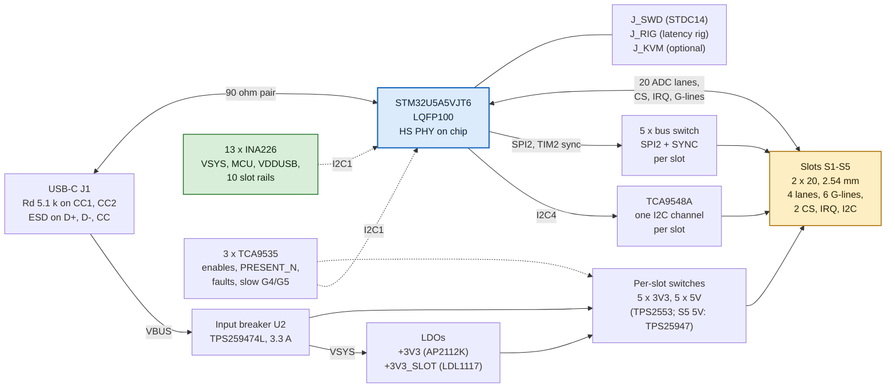

# PrettyCool Keyboard rev A testbed: SPEC (draft architecture of record)

> **Status (2026-11-26): Draft architecture of record, rev A testbed. Designed on paper, not captured: no schematic,
> layout, build or measurement yet.** Every part below is a **candidate**, picked on paper, with its JLC stock checked
> on 2026-11-26; stock changes daily. Figures marked *estimate* are arithmetic or a model, not a measurement. Claims
> marked **unverified** were not checked against a primary source. The MCU pin map is a draft: its pin numbers and
> alternate functions agree with the datasheet (§5.1), and the reference-manual items in §5.2 are still open.

This is the contract that the testbed's schematics, layout, coupons, latency rig and firmware will implement, in the
role [the caliper's SPEC](../../../caliper/hardware/design/SPEC.md) plays for the caliper. The net names, the coupon
slot pinout and the MCU pin map live in [nets.py](nets.py) (`python nets.py` checks that they agree with each
other). Change this file and `nets.py` together. When the schematic is generated (sheet modules under
`keyboard/hardware/design/sheets/`, drawn under the [wiring rule](../../../tools/README.md#wiring-rule)), a
`check_contract.py` will compare the netlist's MCU pins with `nets.MCU_PINS`, as the caliper's does.

It rests on the owner's decisions recorded in [concept.md](../../docs/concept.md) (the features, the testbed-first
staging, Zephyr) and the [rev A MCU decision record](../../docs/mcu.md) (2026-11-26).

## 1. Purpose and what rev A must prove

Rev A is a **motherboard plus plug-in coupons**, one coupon per sensing method, each coupon generated by compiler v0
([concept §7](../../docs/concept.md#_7-rev-a-testbed)). It is a measuring instrument, not a keyboard.

| Rev A is done when ([concept §7](../../docs/concept.md#_7-rev-a-testbed)) | What on this board serves it |
|---|---|
| Each coupon has a measured current and noise figure in the docs | A switched, current-limited 3.3 V and 5 V rail per slot, each with its own INA226 (§3.4), apart from the MCU's and the HS PHY's own supplies; a meter jumper per 3.3 V slot rail for µA ranges; four analog lanes per slot, 14-bit-capable on S1–S4 (S5: AN0 on ADC1/ADC2, AN1–AN3 on the 12-bit ADC4) (§4, §6) |
| The coil coupon says yes or no to stock-spring sensing | The slot's own I2C channel for five LDC1614-class converters (§4.5) |
| The shear coupon says whether a centring stem gives a usable pointing signal | Shared SPI with two chip selects per slot, plus G-lines as extra selects (§4.8) |
| The wheel coupon has a measured peak and average current | Slot S5: a 2 A 5 V rail on a 20 mΩ shunt, TIM1 for the DRV8316, ADC4 lanes for its current-sense outputs (§3.6, §4.8) |
| The battery gate picks a rev B chip from measured numbers | Per-rail current logs at 1 kHz and 8 kHz scan rates, exported with the scan mode and the coupon's identity (§8.5) |
| The compiler has generated and gated every coupon | One slot interface, one descriptor EEPROM per coupon, coupon design rules the compiler can check (§4.6, §4.9) |

Two things this board must also show, because rev A is where the platform risks get retired
([mcu.md](../../docs/mcu.md#bring-up-risks)): **8 kHz HID** (bInterval 1 at high speed) through Zephyr's STM32 USB
device driver, and a **scan engine** that fills a 125 µs frame (§6).

**Conditions before the schematic is committed** (owner, 2026-11-26; both open):

1. **The MCUs are reserved**: JLC's stock bought into a JLC private parts library, or 4–6 parts consigned. JLC had
   13 STM32U5A5VJT6 (C22455480) at $19.07 on 2026-11-26, DigiKey none before February–March 2027
   ([mcu.md](../../docs/mcu.md#what-the-verifier-corrected)). The same JLC API answer gives `canPresaleNumber` −4
   for this part, where other parts show about their stock (SN74CBTLV3125PWR 1101 in stock, 1100; RT1021 300, 300):
   the 13 may already be committed to other orders. The field is undocumented, so this is an inference,
   **unverified**. Next step: check on JLC's parts-order page whether any can be bought into a private library today;
   if not, plan consignment from another distributor (none had stock on 2026-11-26) or the RT1021.
2. **8 kHz HID is proven on the NUCLEO-U5A5ZJ-Q** with Zephyr's `usbd`: `in-polling-period-us = <125>`, bInterval 1,
   report rate and jitter measured for at least 10 minutes on Windows and Linux with CDC logging active
   ([mcu.md](../../docs/mcu.md#conditions-before-the-schematic-is-committed)). Nobody has published this for
   `udc_stm32`. If either fails, the NXP i.MX RT1021 (C5119758) is the fallback and this SPEC is redrawn for it.

**Out of rev A** (proposals the owner should confirm, §11): no battery and no charger (concept §7 lists "power and
charging"; the battery gate needs per-rail currents, not a cell, and the caliper's charger sheets can go straight to
rev B); no radio (the rev B side track measures BLE on an nRF54LM20 dev kit); no LSE crystal (§5.2).

## 2. Boards

| Board | Size (proposal) | Stack (proposal) | Carries |
|---|---|---|---|
| Motherboard | **190 × 150 mm** | 4-layer, 1.6 mm, ENIG, JLC's controlled-impedance stack (L1 signals and the HS pair, L2 solid GND, L3 power, L4 signals) | STM32U5A5VJT6, USB-C with the hand-routed 90 Ω pair, the power tree and 13 current monitors, five coupon slots (S1–S5), the I2C mux, three I/O expanders, five bus switches, the latency-rig header, the optional KVM header, SWD |
| Standard coupon | ≤ 58 × 60 mm | 4-layer, 1.6 mm (analog coupons want a solid ground layer) | Hall-effect (S1), TMR (S2), shear (S3) |
| Wide coupon | ≤ 80 × 60 mm | 4-layer, 1.6 mm; the coil coupon keeps copper-free layers under each coil ([concept §8](../../docs/concept.md#_8-conflicts-the-testbed-has-to-settle)) | Coil (S4), haptics (S5) |
| KVM coupon (optional) | ≤ 50 × 40 mm | its own choice | A second USB device path for host B (§7.4) |
| Latency rig | 100 × 80 mm | 4-layer, 1.6 mm (it carries a high-speed host link) | A high-speed USB host with microframe timestamps, the stimulus drivers, a ribbon to J_RIG (§7.3) |

The concept sketches drew a 160 × 110 mm motherboard, smaller coupons and 2 × 10 sockets; those were illustrative.
The sizes here replace them as proposals: a 2 × 20 socket (§4.1) needs a coupon edge of about 55 mm.

Every coupon carries the male half of the slot connector, a 2 kbit descriptor EEPROM at 0x50 on its own I2C
channel, its PRESENT_N strap to GND, one M3 support post, and an outline generated by the compiler.

**Default slot assignment.** S1 Hall-effect, S2 TMR, S3 shear, S4 coil, S5 haptics. All five slots are electrically
the same connector and pinout; any coupon fits any slot of its size or larger, with three differences: S4's G0–G3
are on TIM8 (PWM-capable), S5's G0–G5 are on TIM1 with its break input, and S5 has the 2 A 5 V rail and its
AN1–AN3 on ADC4 (§4.4).

How the motherboard hangs together (a block diagram of this draft, not a schematic):



*Block diagram of the draft motherboard: the power path (left), the measurement and control buses (I2C1 to the
monitors and expanders, I2C4 to the slot mux), and the slot fabric. Nothing here is captured or built.*

### 2.1 Candidate parts (JLC parts API, 2026-11-26)

Queried through the endpoint that [`tools/lcsc_check.py`](../../../tools/lcsc_check.py) uses. Stock is JLC's, price
is qty 1. All are JLC **extended** parts except the crystal (basic), so each unique part adds JLC's extended-part fee.

| Function | Part | LCSC | JLC stock | $ (qty 1) | Notes |
|---|---|---|---|---|---|
| MCU | STM32U5A5VJT6 (LQFP100) | C22455480 | 13 | 19.07 | Owner's pick; reserve before the schematic is committed (§1). JLC's API also reports `canPresaleNumber` −4 (§1) |
| Input breaker U2, S5 5 V breaker U5 | TPS259474LRPWR (VQFN-10 2 × 2) | C2864845 | 5803 | 1.35 | 2.7–23 V, 5.5 A, 28.3 mΩ typ, true reverse-current blocking, adjustable OVLO, power-good. A **circuit breaker**, latch-off: above I_LIM for longer than the C_ITIMER blanking interval, or at once above 2 × I_LIM, it turns off and stays off; it limits current actively only at start-up (TI ZHCSL91B, Device Comparison Table, §8.3.5.2). The TPS259470L of the same family limits current actively instead, with FLT in place of PG |
| Slot 3.3 V and S1–S4 5 V switches, KVM 5 V | TPS2553DBVR (SOT-23-6) | C55266 | 40431 | 0.54 | 2.5–6.5 V, 85 mΩ typ (135 mΩ max over temperature), adjustable current limit 75–1300 mA typ, 1.5 A maximum continuous load, constant-current limiting, FAULT output, active-high EN (TI SLVS841E). The latch-off TPS2553DBVR-1 (C111738, 6244) is the alternative. 10 per board |
| Current monitor | INA226AIDGSR (VSSOP-10) | C49851 | 37740 | 0.67 | 16-bit, 2.5 µV shunt LSB, 0–36 V common mode, 330 µA, 16 addresses (TI SBOS547). 13 per board |
| I2C mux | TCA9548APWR (TSSOP-24) | C130026 | 14661 | 0.86 | 8 channels, reset input |
| I/O expander | TCA9535PWR (TSSOP-24) | C130204 | 11879 | 1.28 | 16 I/O, open-drain INT, no internal pull-ups (TI SCPS201D). 3 per board. UMW second source C22396388 (16372, $0.49) |
| Bus switch | SN74CBTLV3125PWR (TSSOP-14) | C406866 | 1101 | 0.54 | 4 × FET switch, 7 Ω, Ioff, individual OE. 5 per board; the thinnest stock on this list after the MCU |
| 3.3 V always-on LDO | AP2112K-3.3TRG1 (SOT-23-5) | C51118 | 8695 | 0.17 | 600 mA, 250 mV dropout |
| 3.3 V slot LDO | LDL1117S33R (SOT-223) | C435835 | 43247 | 0.49 | 1.2 A, 60 µVrms (JLC listing). Lower-noise option if the slot budget stays under about 150 mA: TPS7A2033PDBVR, C2862740 (90355, $0.20; 300 mA, 10 µVrms) |
| HSE crystal | X322516MLB4SI, 16 MHz, 3225 | C13738 | 399712 | 0.09 | **Basic** part; 9 pF load, ±10 ppm (JLC listing) |
| USB-C receptacle | HRO TYPE-C-31-M-12 | C165948 | 404629 | 0.19 | 16-pin USB 2.0, the caliper's part |
| USB ESD | TPD4E05U06DQAR (USON-10) | C138714 | 29197 | 0.08 | 4 channels, 0.5 pF (JLC listing): D+, D−, CC1, CC2. Alternative: USBLC6-2SC6 C7519 (33014, $0.15; 3.5 pF per the listing), the caliper's |
| VBUS TVS | SMF5.0A (SOD-123FL) | C151296 | 55132 | 0.12 | As the caliper |
| VDDA ferrite | BLM18PG221SN1D (0603) | C80165 | 164706 | 0.01 | 220 Ω at 100 MHz |
| Slot socket (motherboard) | BOOMELE 2.54-2*20P female, 8.5 mm, THT | C5124634 | 6382 | 0.33 | 2.5 A per contact. Alternative HanElectricity 2541FV-2x20P-B C25503128 (1622, 3 A) |
| Slot header (coupon) | HanElectricity 2541WV-2x20P male, THT | C25503140 | 1520 | 0.14 | 3 A per contact |
| Coupon descriptor | M24C02-WMN6TP (SOIC-8) | C7562 | 217250 | 0.12 | On every coupon, not on the motherboard |
| SWD | Samtec FTSH-107-01-L-DV-K (STDC14) | C5307809 | 2371 | 3.70 | 14-pin 1.27 mm, ST's STDC14 layout (§7.2) |
| Rig header | CJT A2541WV-2x5P | C225520 | 8249 | 0.18 | §7.3 |
| KVM header | CJT A2541WV-2x6P | C225521 | 4303 | 0.24 | §7.4 |
| Meter jumpers | hanxia HX PZ2.54-1x2P ZZ | C32713268 | 121940 | 0.02 | One per 3.3 V slot rail (§3.4) |

## 3. Power tree

### 3.1 The tree

```
USB-C J1 VBUS ─ SMF5.0A ─ (≤ 10 µF) ─ TPS259474L breaker U2 (I_LIM 2.96 / 3.33 / 3.62 A, dV/dt soft start,
   │                                     OVLO ≈ 5.8 V, latch-off, PG → VSYS_PG)
   └─ 20 mΩ shunt (INA226 0x40, the whole board) → VSYS (5 V)
VSYS ─ AP2112K-3.3 U3 → +3V3 (always on: INA226 x 13, TCA9535 x 3, TCA9548A, bus switches, LEDs, pull-ups)
         +3V3 ─ 0.5 Ω (INA226 0x41) → +3V3_MCU (the five VDD pins, VBAT)
         +3V3 ─ 1 Ω   (INA226 0x42) → +3V3_USB (VDDUSB: the HS PHY's 3.3 V part)
VSYS ─ LDL1117S33R U4 → +3V3_SLOT ─┬─ BLM18PG221 + 1 µF + 100 nF → +3V3A (VDDA, VREF+)
                                   └─ TPS2553 x 5 (EN_3V3_Sn, 258 / 292 / 331 mA) ─ 0.24 Ω (INA226 0x44–0x48)
                                         ─ JP_3V3_Sn → +3V3_Sn
VSYS ─ TPS2553 x 4 (EN_5V_Sn, 524 / 577 / 638 mA) ─ 0.1 Ω (INA226 0x49–0x4C) → +5V_S1 … +5V_S4
VSYS ─ TPS259474L breaker U5 (EN_5V_S5, I_LIM 2.01 / 2.27 / 2.46 A, PG → S5_PG) ─ 20 mΩ (INA226 0x4D) → +5V_S5
VSYS ─ TPS2553 (EN_5V_KVM, 524 / 577 / 638 mA) → +5V_KVM (not measured per rail)
```

**Limits** are given as min / typ / max trip. Each minimum sits above the coupon rule it protects (250 mA, 500 mA,
S5 2 A; §4.9), so a coupon within its rule is never limited or tripped, and each maximum sits inside its INA226's
full scale (§3.4). The TPS2553 figures come from SLVS841E Eq. 1 (I_OS = 25230 / R^1.016, 23950 / R^0.977 and
22980 / R^0.94 mA, R_ILIM in kΩ) at R_ILIM = 90.9 kΩ for the 3.3 V rails and 45.3 kΩ for the 5 V rails; SLVS841E does
not state the input voltage behind them, and they are applied at 3.3 V as given (**unverified**). The TPS25947's
I_LIM = 3334 / R_ILM (ZHCSL91B Eq. 5): R_ILM = 1.47 kΩ for S5 and 1.0 kΩ for the input, with the spread interpolated
between the datasheet's 1.65 kΩ and 750 Ω rows (−11 % / +9 %, *estimate*). The input's threshold sits just above the
3.0 A a USB-C source can give at 5 V: the breaker catches faults, and the firmware's VSYS budget (§3.2) keeps the
board inside the source. All resistor values are proposals, to re-check at capture.

All the TPS2553 FAULT outputs are wired together into SLOT_FAULT_N (open drain, read by U_EXP2); the INA226 that has
crossed its alert limit says which rail it was.

**Why VDDA hangs off the slot LDO.** The lanes carry ratiometric sensor outputs (a Hall sensor's zero-field output
and sensitivity scale with its supply). VDDA and VREF+ come from the same regulator as the slot rails, so slow supply
movement is common to the sensor and the ADC reference and cancels to first order. The ferrite and capacitors keep
the slot switching out of VDDA at high frequency. Between the regulator and the coupon, the shunt, switch and jumper
drop I × (R_shunt + R_DS(on) + R_jumper): with 0.24 Ω and the TPS2553's 85 mΩ typ (135 mΩ max over temperature,
SLVS841E), about 3.3 mV (0.1 %) at 10 mA and 81–94 mV (2.5–2.8 %) at the 250 mA rule, plus the jumper's contact
resistance (*estimate*). The INA226's bus-voltage reading cannot correct that: its offset is ±7.5 mV max and its gain
error ±0.1 % max (SBOS547), more than the drop at sensor currents. The firmware corrects it from the current reading,
with each slot's series resistance calibrated against the ADC on the test coupon (§10 step 7). VDDA and VREF+ are not
monitored.

### 3.2 Power budget (*estimate*)

| Load | Rail | Current | Source of the figure |
|---|---|---|---|
| MCU at 160 MHz with ADCs, DMA, timers | +3V3_MCU | ≈ 25–45 mA | *estimate*: the core 14.5 mA typ at 160 MHz on the LDO (DS13543 Rev 2 Table 41, CoreMark), 19 mA max at 30 °C and 36 mA max at 85 °C (Table 38, peripherals off); the OTG_HS controller ≈ 4.5 mA (Table 65: 27.98 µA/MHz, Range 1, LDO); ADC12, ADC4, GPDMA1, TIM1, TIM2, TIM8, SPI2, I2C1 and I2C4 ≈ 5 mA together (Table 65). The datasheet's headline 18.5 µA/MHz is the SMPS part in Range 4 at 24 MHz (Table 44), not this LDO part at 160 MHz |
| HS PHY, 1.1 V part | +3V3_MCU (inside the chip, §3.3) | 7.7 mA typ HS idle, 9 mA transmit (10.5 / 12.2 max) | DS13543 Rev 2 Table 156. With the row above, ≈ 32–58 mA on the 0x41 shunt, inside its 164 mA full scale |
| HS PHY, 3.3 V part | +3V3_USB | 5.8 mA typ HS idle, 13.5 mA transmit | DS13543 Rev 2 Table 156 |
| 13 × INA226 | +3V3 | ≈ 4.3 mA | 330 µA typ each (SBOS547) |
| Expanders, mux, bus switches | +3V3 | under 1 mA | *estimate* |
| Base load, no slot powered | VBUS | ≈ 45 mA | *estimate*: the rows above at their typical values plus a few mA; under USB 2.0's 100 mA before configuration |
| Coupons, 3.3 V | +3V3_S1…S5 | ≤ 250 mA each (coupon rule; the switch trips at 258–331 mA); total budget ≤ 300 mA | *estimate*; the LDO's dissipation sets the total: (5.0 − 3.3) V × 0.3 A ≈ 0.5 W in a SOT-223 |
| Coupons, 5 V | +5V_S1…S4 | ≤ 500 mA each (coupon rule; the switch trips at 524–638 mA) | proposal |
| Haptics | +5V_S5 | 0.5–1 A detent peaks, 2 A rule (the breaker trips at 2.01–2.46 A) | the peaks are concept §8's *estimate* |

A sensor-only session would draw roughly 0.1–0.4 A from VBUS (*estimate*). USB 2.0 allows 100 mA until the host
configures the device, 500 mA after SET_CONFIGURATION with bMaxPower = 500 mA, and 2.5 mA in suspend. A USB 3.x port
gives this USB 2.0 device the same 500 mA, and a Type-C source seen through Rd alone gives Default USB Power, again
500 mA, unless it advertises 1.5 A or 3.0 A on CC (which rev A cannot read, §3.6). So the firmware (§8.4):

* powers no slot until the host has configured the device, which keeps the base load (≈ 45 mA) under 100 mA;
* keeps a **VSYS budget**: the base load plus the declared currents of every enabled rail stays at or under the
  source's capability, 500 mA unless the operator declares a 1.5 A or 3.0 A source, and never above 2.8 A, below the
  input breaker's minimum (§3.1). INA226 0x40's ALERT is set at that budget;
* keeps the sum of the 3.3 V slot currents under the slot LDO's 300 mA, and refuses to enable a slot whose descriptor
  asks for more than either budget has left;
* turns the slot rails off on USB suspend. The testbed still does not meet USB 2.0's 2.5 mA suspend limit (its base
  load stays near 45 mA): it is a bench instrument.

### 3.3 Keeping each coupon's current apart from the MCU and the HS PHY

* Each slot rail has its own switch, shunt and INA226, downstream of everything else. A slot's reading is the coupon
  plus two small motherboard contributions: the slot's I2C pull-ups (4.7 k to +3V3_S*n*, §4.2), which draw 0.70 mA per
  line while it is low, so about 0.7 mA while the bus is busy (*estimate*); and the INA226's own input currents, its
  IN− bias of 10 µA typ and its VBUS input's 830 kΩ, about 4 µA at 3.3 V (SBOS547). The firmware logs each frame's I2C
  activity on the slot's channel so that the battery gate can subtract the pull-ups (§8.5).
* The MCU's VDD pins and VBAT sit on their own shunt (+3V3_MCU), VDDUSB on another (+3V3_USB). The INA226s, expanders,
  mux and LEDs sit on +3V3 outside both.
* **The HS PHY's split on this package:** on the LQFP100 the PHY's 1.1 V supply (VDD11USB) has no pin; DS13543 says
  VDD11USB "is only available on specific packages". So its share (7.7 mA typ at HS idle) is drawn through the
  internal regulator and shows up on the **+3V3_MCU** shunt, not on +3V3_USB. That it is fed internally is an
  inference from the datasheet, **unverified** against RM0456. Bring-up separates the two by logging +3V3_MCU with
  the USB suspended and at HS idle.
* VDDA's own current (the ADCs, ≈ 1 mA class) is not measured; it sits between the slot LDO and its switches.
* **Meter jumper:** each +3V3_Sn passes through a 1 × 2 header (JP_3V3_Sn) after its shunt. A jumper closes it; take
  the jumper off to put an external meter (a Nordic PPK2 or a Joulescope class instrument) in series for µA-range
  and high-rate profiles. The INA226 still reads, which cross-checks the two above about 100 µA: its shunt offset is
  ±2.5 µV typ and ±10 µV max (SBOS547), ±10 µA typ and ±42 µA max on the 0.24 Ω shunt. Below about 100 µA the figure
  comes from the meter.

### 3.4 The current monitors (I2C1, 400 kHz, 2.2 k pull-ups to +3V3)

Full scale is 81.92 mV across the shunt and the LSB 2.5 µV (SBOS547), so both scale with 1/R. Addresses follow the
INA226's Table 2 (A1 and A0 strapped to GND, VS, SDA or SCL).

| Address | A1 / A0 | Rail | Shunt | Full scale | LSB | Switch, trip min / typ / max (§3.1) |
|---|---|---|---|---|---|---|
| 0x40 | GND / GND | VSYS | 0.02 Ω | 4.10 A | 125 µA | input breaker, 2.96 / 3.33 / 3.62 A |
| 0x41 | GND / VS | +3V3_MCU | 0.5 Ω | 164 mA | 5.0 µA | |
| 0x42 | GND / SDA | +3V3_USB | 1 Ω | 82 mA | 2.5 µA | |
| 0x44 | VS / GND | +3V3_S1 | 0.24 Ω | 341 mA | 10.4 µA | TPS2553, 258 / 292 / 331 mA |
| 0x45 | VS / VS | +3V3_S2 | 0.24 Ω | 341 mA | 10.4 µA | TPS2553, 258 / 292 / 331 mA |
| 0x46 | VS / SDA | +3V3_S3 | 0.24 Ω | 341 mA | 10.4 µA | TPS2553, 258 / 292 / 331 mA |
| 0x47 | VS / SCL | +3V3_S4 | 0.24 Ω | 341 mA | 10.4 µA | TPS2553, 258 / 292 / 331 mA |
| 0x48 | SDA / GND | +3V3_S5 | 0.24 Ω | 341 mA | 10.4 µA | TPS2553, 258 / 292 / 331 mA |
| 0x49 | SDA / VS | +5V_S1 | 0.1 Ω | 819 mA | 25 µA | TPS2553, 524 / 577 / 638 mA |
| 0x4A | SDA / SDA | +5V_S2 | 0.1 Ω | 819 mA | 25 µA | TPS2553, 524 / 577 / 638 mA |
| 0x4B | SDA / SCL | +5V_S3 | 0.1 Ω | 819 mA | 25 µA | TPS2553, 524 / 577 / 638 mA |
| 0x4C | SCL / GND | +5V_S4 | 0.1 Ω | 819 mA | 25 µA | TPS2553, 524 / 577 / 638 mA |
| 0x4D | SCL / VS | +5V_S5 | 0.02 Ω | 4.10 A | 125 µA | TPS259474L breaker, 2.01 / 2.27 / 2.46 A |

The 3.3 V slot shunts are 0.24 Ω so that the full scale (341 mA) covers the switch's maximum trip (331 mA).

The INA226's conversion time is 140 µs to 8.244 ms per sample, and averaging (1–1024 samples) multiplies it, up to
about 8.4 s (SBOS547). Run continuously on the shunt alone at 140 µs without averaging, one monitor gives a reading
about every 140 µs, enough to see the motor's detent peaks; averaged settings give the battery gate's mean currents.
**The bus sets how many rails can be followed that fast.** I2C1 runs at 400 kHz, the TCA9535's limit (SCPS201D). A
2-byte read with the register pointer already set is about 29 bit times, 73 µs, so the bus carries about 13,700 reads
per second in all (*estimate*). Following one rail at 140 µs takes about half of that, so at most one or two rails
run at 140 µs (for example S5 during a motor test) and the rest are averaged at 1 ms or slower, leaving room for
U_EXP2's alerts and faults. The three TCA9535 expanders (0x20–0x22) share this bus, which no coupon ever sees.
Every INA226 ALERT is wired into PM_ALERT_N (open drain, read by U_EXP2): a firmware over-current threshold set below
the switch's hardware limit, for example at the current the coupon's descriptor declares.

### 3.5 Inrush, protection and slot power rules

* **USB-C sink:** 5.1 kΩ Rd from CC1 and from CC2 to GND, each its own resistor. VBUS carries no more than 10 µF
  before the input breaker (USB 2.0's inrush limit); the breaker's dV/dt ramp charges VSYS's bulk.
* **Input breaker** (TPS259474L, U2): a circuit breaker, not a current limiter (ZHCSL91B). It limits current only at
  start-up. Above I_LIM (2.96 A min, §3.1) for longer than its C_ITIMER blanking interval, or at once above 2 × I_LIM,
  it turns off, and the latch-off variant stays off until VBUS is cycled, which cuts the MCU, USB and the logs. The
  firmware's VSYS budget (§3.2) keeps the board below it. The overvoltage lockout is a divider on OVLO (rising
  threshold 1.20 V, 1.183–1.223 V): target about 5.8 V, above USB-C's 5.5 V maximum and at or below the AP2112K's
  6.0 V recommended maximum (the TPS7A2033 alternative is rated 6 V, the TPS2553 6.5 V); with 1 % resistors it trips
  at about 5.65–5.95 V (*estimate*). True reverse-current blocking, so a coupon's motor cannot push current back into
  the host. Power-good to VSYS_PG. If a latching board-level trip proves too disruptive on the bench, the TPS259470L
  limits current actively instead.
* **Slot switches** (TPS2553): soft start and a constant-current limit per rail; a shorted coupon trips its own rail
  only. The coupon's bulk capacitance is charged at the switch's limit (coupon rules, §4.9). S5's U5 is a second
  TPS259474L breaker: above its I_LIM for longer than the blanking interval it latches off until EN_5V_S5 is driven
  low. Its C_ITIMER is chosen at capture for the motor's peak width (the datasheet's example: 2.38 nF for 2 ms).
* **Reset states** (TCA9535 pins are inputs after reset and have no pull-ups): 100 k pull-downs on every EN_* (rails
  off), 10 k pull-ups on every BUSEN_N_* (bus switches open), 100 k pull-downs on the S1–S4 G4/G5 lines, 10 k
  pull-up on MUX_RST_N, 10 k pull-down on KVM_RST_N (the KVM coupon held in reset).
* **Slot power rules** (firmware, §8.4): never power a slot before the host has configured the device, or while its
  PRESENT_N reads high, or beyond the VSYS and slot-LDO budgets (§3.2); power +3V3_Sn first, read the
  descriptor, then +5V_Sn if the descriptor asks for it; close the slot's bus switch only after its rails are up,
  open it before they go down; drive every MCU line into an unpowered slot low (or leave it a high-impedance input)
  so nothing back-powers a coupon through its ESD diodes. The slot's I2C pull-ups go to its own +3V3_Sn for the same
  reason, and IRQ_N has no motherboard pull-up. LED_Sn is lit while a slot is powered: **coupons are not hot-plugged**
  while their LED is on (the 2.54 mm headers have no make-first ground).

### 3.6 The haptics slot's motor peaks

* S5's 5 V rail is a second TPS259474L breaker (U5) at 2.27 A typ, 2.01 A min (R_ILM 1.47 kΩ, §3.1), on a 20 mΩ
  shunt; a TPS2553 cannot serve it (its adjustable limit ends at 1.3 A typ, and 1.5 A is its maximum continuous
  load, SLVS841E). Three +5V pins and the three GND pins beside them carry it (2.5 A per contact rating); the coupon
  returns its motor current through pins 4–6, away from the lanes.
* The detent peaks are 0.5–1 A by concept §8's *estimate*. INA226 0x4D samples them every 140 µs at its fastest (one
  of the one or two rails I2C1 can follow that fast, §3.4); a Kelvin pad pair across the shunt (TP_IS5+ / TP_IS5−)
  takes a scope or current probe for finer detail. Whether a conversion that integrates over 140 µs resolves the
  peaks depends on their width, which is not known.
* **The source:** S5 up to its 2 A rule needs a source that advertises 3.0 A on CC. With a 1.5 A source the VSYS
  budget (§3.2) leaves S5 about 1.4 A at most, less with other slots powered, and INA226 0x40's ALERT tells the
  firmware to turn S5 off if the motor draws more. Rev A only fits Rd, so the firmware cannot read the advertisement:
  the operator declares the source, an operating rule (and an open item, §11: the MCU's UCPD1 could read it, at the
  cost of two pins).
* **Supply margin:** under a 2 A load the motherboard itself drops about 0.2 V between J1 and the S5 pins
  (*estimate*: U2 at 28.3 mΩ typ ≈ 59 mV at 2.1 A, the 20 mΩ VSYS shunt ≈ 42 mV, U5 ≈ 57 mV, the 20 mΩ S5 shunt
  ≈ 40 mV, three contacts in parallel ≈ 15 mV), and the cable adds its own drop. From a source at USB's 4.75 V
  minimum the coupon may see 4.3–4.5 V. The DRV8316's minimum supply is near 4.5 V (**unverified**). The haptics
  coupon must check its margin, or bring its own supply input if it wants more than 5 V or 2 A.
* Braking energy cannot flow back into VSYS (U5 blocks reverse current), so the coupon must absorb it in its own bulk
  capacitance or clamp it.

### 3.7 MCU supply pins

From DS13543 Rev 2 Figure 23 (the LDO supply scheme of the non-SMPS parts): n × 100 nF + 10 µF on VDD; **4.7 µF (or
2 × 2.2 µF ±20 %), ESR under 20 mΩ at 3 MHz, rated ≥ 10 V on VCAP**; 100 nF + 1 µF on VDDA and on VREF+. VDDUSB takes
3.0–3.6 V (DS13543 §3.9.1); 100 nF + 1 µF (proposal). VBAT is tied to VDD with 100 nF (no backup cell).
VREF+ is tied to VDDA (+3V3A): VREFBUF stays off, because the lanes swing to the full 3.3 V.

## 4. The coupon slot interface

### 4.1 Connector

**2 × 20, 2.54 mm pitch**: a female through-hole socket on the motherboard (BOOMELE 2.54-2*20P, C5124634, 8.5 mm,
2.5 A per contact) and a male pin header on the coupon (HanElectricity 2541WV-2x20P, C25503140). Why this and not a
finer mezzanine:

* It takes repeated plugging by hand, and JLC assembles through-hole parts, so both halves can be fitted at the fab
  (to confirm for these two parts when ordering).
* Any breakout or evaluation module can be wired to a slot with jumper leads: the first "coupons" on the bench can be
  a TMAG5253 breakout on dupont wires.
* 2.5 A per contact carries the motor peaks on three pins.
* It probes with an ordinary scope hook.

The cost is size: 50.8 mm long, so a coupon edge of about 55 mm (§2). A 1.27 mm 2 × 20 SMD socket (Hong Cheng
HC-PM127-4.3H-2x20PS, C22436137, 2219 in stock, 1 A per contact) would halve the length if size wins later.

### 4.2 Pinout (one entry per pin, `nets.SLOT_PINS`)

Odd pins are one row, even pins the other. Directions are seen from the motherboard. On slot *n* the nets are
`+5V_Sn`, `+3V3_Sn`, `GND`, and `Sn_<signal>` for the rest.

| Pin | Signal | Dir | Net on slot *n* | Note |
|---|---|---|---|---|
| 1 | +5V | pwr | +5V_S*n* | switched 5 V; three pins carry the haptics slot's motor peaks (2.5 A per contact) |
| 2 | +5V | pwr | +5V_S*n* | |
| 3 | +5V | pwr | +5V_S*n* | |
| 4 | GND | gnd | GND | the motor current's return: the three GND pins next to +5V |
| 5 | GND | gnd | GND | |
| 6 | GND | gnd | GND | |
| 7 | +3V3 | pwr | +3V3_S*n* | switched 3.3 V: the sensors' supply and the lanes' ratiometric reference |
| 8 | +3V3 | pwr | +3V3_S*n* | |
| 9 | GND | gnd | GND | |
| 10 | GND | gnd | GND | |
| 11 | AN0 | in | S*n*_AN0 | analog lane 0 to an ADC channel (§4.4); 47 Ω + 1 nF C0G at the MCU pin |
| 12 | GND | gnd | GND | a ground opposite every lane |
| 13 | AN1 | in | S*n*_AN1 | analog lane 1 |
| 14 | GND | gnd | GND | |
| 15 | AN2 | in | S*n*_AN2 | analog lane 2 |
| 16 | GND | gnd | GND | |
| 17 | AN3 | in | S*n*_AN3 | analog lane 3 |
| 18 | GND | gnd | GND | |
| 19 | INJ | out | S*n*_INJ | latency-rig stimulus, from RIG_INJ through solder jumper JP_INJ*n* (open by default) |
| 20 | SYNC | out | S*n*_SYNC | scan frame tick (TIM2_CH1) through the slot's bus switch |
| 21 | GND | gnd | GND | |
| 22 | GND | gnd | GND | |
| 23 | SCK | out | S*n*_SCK | shared SPI2 through the slot's bus switch |
| 24 | MISO | in | S*n*_MISO | shared SPI2 through the slot's bus switch |
| 25 | MOSI | out | S*n*_MOSI | shared SPI2 through the slot's bus switch |
| 26 | GND | gnd | GND | |
| 27 | CS0_N | out | S*n*_CS0_N | per-slot SPI chip select (a GPIO) |
| 28 | CS1_N | out | S*n*_CS1_N | second per-slot chip select (a GPIO) |
| 29 | SCL | io | S*n*_SCL | the slot's own TCA9548A channel; 4.7 k pull-up to +3V3_S*n* |
| 30 | SDA | io | S*n*_SDA | |
| 31 | IRQ_N | in | S*n*_IRQ_N | per-slot interrupt on its own EXTI line; pull-up on the coupon |
| 32 | PRESENT_N | in | S*n*_PRESENT_N | tied to GND on the coupon; 100 k pull-up to +3V3 on the motherboard; read by U_EXP2 |
| 33 | G0 | io | S*n*_G0 | enable/select GPIO; S4: TIM8_CH1; S5: TIM1_CH1 |
| 34 | G1 | io | S*n*_G1 | S4: TIM8_CH2; S5: TIM1_CH2 |
| 35 | G2 | io | S*n*_G2 | S4: TIM8_CH3; S5: TIM1_CH3 |
| 36 | G3 | io | S*n*_G3 | S4: TIM8_CH4; S5: TIM1_CH1N |
| 37 | G4 | io | S*n*_G4 | S1–S4: slow, on expander U_EXP3; S5: TIM1_CH2N |
| 38 | G5 | io | S*n*_G5 | S1–S4: slow, on expander U_EXP3; S5: TIM1_CH3N |
| 39 | RSV | nc | – | reserved, not connected on the rev A motherboard |
| 40 | GND | gnd | GND | |

Thirteen grounds, one opposite each lane and between the power and signal groups.

### 4.3 What sits between a slot pin and the MCU (`nets.SLOT_PATH`)

| Signal | Path on the motherboard |
|---|---|
| AN0–AN3 | 47 Ω in series and 1 nF C0G to GND at the MCU pin (proposal). The MCU-side net is `Sn_ANk_ADC`. τ = (R_src + 47 Ω) × 1 nF, where R_src is the coupon's source impedance: from a stiff, buffered source (R_src of a few ohms) τ ≈ 47 ns and the lane settles to 14 bits in ≈ 0.5 µs; from a 1 kΩ source τ ≈ 1.05 µs and it takes ≈ 11 µs (*estimate*, §6.3). The 1 nF is the charge reservoir for the ADC's 5 pF sampling capacitor (DS13543 Table 97), whose kickback recovers through the same R_src + 47 Ω (§6.3) |
| SCK, MOSI, MISO, SYNC | One SN74CBTLV3125 per slot (U_BS*n*), all four OE_N tied to BUSEN_N_S*n* from U_EXP1, powered from the always-on +3V3: shared SPI2 and the frame tick reach only powered slots, and an unpowered coupon is isolated (the switch has Ioff, 0.25 ns propagation) |
| SCL, SDA | TCA9548A (U_MUX) channel *n* − 1; pull-ups to +3V3_S*n* |
| CS0_N, CS1_N, IRQ_N, G0–G3 | Straight to the MCU. S5's G4/G5 too |
| G4, G5 on S1–S4 | U_EXP3 outputs with 100 k pull-downs: slow, static selects (address straps, enables) |
| PRESENT_N | U_EXP2 input, 100 k pull-up to +3V3; U_EXP2's INT reaches the MCU as EXP_INT_N |
| INJ | Solder jumper JP_INJ*n* from RIG_INJ (J_RIG pin 9), open by default, plus a test pad |

### 4.4 Per-slot MCU map (`nets.SLOT_MCU`)

| Signal | S1 | S2 | S3 | S4 | S5 |
|---|---|---|---|---|---|
| AN0 | PC0 (ADC1/2 IN1, ADC4 IN1) | PA0 (ADC1/2 IN5) | PA4 (ADC1/2 IN9, ADC4 IN9) | PC4 (ADC1/2 IN13, ADC4 IN22) | PB2 (ADC1/2 IN17) |
| AN1 | PC1 (ADC1/2 IN2, ADC4 IN2) | PA1 (ADC1/2 IN6) | PA5 (ADC1/2 IN10, ADC4 IN10) | PC5 (ADC1/2 IN14, ADC4 IN23) | PD11 (ADC4 IN15) |
| AN2 | PC2 (ADC1/2 IN3, ADC4 IN3) | PA2 (ADC1/2 IN7) | PA6 (ADC1/2 IN11, ADC4 IN11) | PB0 (ADC1/2 IN15, ADC4 IN18) | PD12 (ADC4 IN16) |
| AN3 | PC3 (ADC1/2 IN4, ADC4 IN4) | PA3 (ADC1/2 IN8) | PA7 (ADC1/2 IN12, ADC4 IN20) | PB1 (ADC1/2 IN16, ADC4 IN19) | PD13 (ADC4 IN17) |
| G0 | PE2 | PD8 | PD0 | PC6 (TIM8_CH1) | PE9 (TIM1_CH1) |
| G1 | PE3 | PD9 | PD1 | PC7 (TIM8_CH2) | PE11 (TIM1_CH2) |
| G2 | PE4 | PD10 | PD2 | PC8 (TIM8_CH3) | PE13 (TIM1_CH3) |
| G3 | PE5 | PD14 | PD3 | PC9 (TIM8_CH4) | PE8 (TIM1_CH1N) |
| G4 | U_EXP3 P00 | U_EXP3 P02 | U_EXP3 P04 | U_EXP3 P06 | PE10 (TIM1_CH2N) |
| G5 | U_EXP3 P01 | U_EXP3 P03 | U_EXP3 P05 | U_EXP3 P07 | PE12 (TIM1_CH3N) |
| CS0_N | PE6 | PD15 | PD4 | PB12 | PE14 |
| CS1_N | PE1 | PD7 | PD5 | PC12 | PE7 |
| IRQ_N | PC14 (EXTI14) | PD6 (EXTI6) | PE0 (EXTI0) | PB5 (EXTI5) | PE15 (TIM1_BKIN; EXTI15) |
| SCK / MISO / MOSI / SYNC | U_BS1 | U_BS2 | U_BS3 | U_BS4 | U_BS5 |
| SCL / SDA | mux ch0 | mux ch1 | mux ch2 | mux ch3 | mux ch4 |
| PRESENT_N | U_EXP2 P00 | U_EXP2 P01 | U_EXP2 P02 | U_EXP2 P03 | U_EXP2 P04 |
| INJ | JP_INJ1 | JP_INJ2 | JP_INJ3 | JP_INJ4 | JP_INJ5 |

All 20 ADC-capable pins of the package are lanes. S1–S4 use ADC1/ADC2 channels IN1–IN16, which both 14-bit ADCs can
reach, so a step's four lanes convert two at a time (ADC1 and ADC2 in parallel); S1, S3 and S4 also reach ADC4, a
third converter. S5's AN0 is on ADC1/2 IN17; its AN1–AN3 are on ADC4 alone (12-bit), which suits the DRV8316's
current-sense outputs.

### 4.5 I2C on the slots

* I2C4 (400 kHz, 2.2 k pull-ups to +3V3) runs to a **TCA9548A at 0x70**: channels 0–4 are S1–S5, 5 is the KVM header
  (pull-ups on the KVM coupon), 6 and 7 go to test pads. Each coupon has a bus of its own, so **fixed-address parts
  can repeat across coupons**: a DRV2605L (0x5A, fixed) on the haptics coupon cannot meet another coupon's parts, and
  every coupon's descriptor EEPROM sits at 0x50.
* The mux is visible on every channel, so **coupons must not use 0x70**. The power-monitor bus (I2C1) is separate:
  its addresses (0x20–0x22, 0x40–0x4D) are free for coupons to use.
* **Several of one part on one coupon** still needs an address scheme on the coupon. For the coil coupon's five
  LDC1614s, which have only two addresses (0x2A with ADDR low, 0x2B with ADDR high, per TI's datasheet,
  **unverified** here): drive each one's ADDR from its own G-line (G0–G4), hold the selected one low and the others
  high, and talk only to 0x2A. A coupon can instead carry its own TCA9548A at 0x71–0x77.

### 4.6 Slot identity

* **Presence:** PRESENT_N is tied to GND on every coupon (a strap, not a resistor), so it works with the slot
  unpowered and back-powers nothing.
* **Identity:** an M24C02 (2 kbit) **descriptor EEPROM at 0x50** on the slot's own I2C channel, powered from the
  slot's +3V3. Once the host has configured the device (§3.2), the firmware powers +3V3_S*n* (its switch trips at
  258–331 mA, §3.1), reads the descriptor, and only then configures anything else. Compiler v0 writes the descriptor
  for each coupon it generates: format version, coupon type and revision, serial, the rails it needs and their
  limits, the lane map, each lane's source impedance and select scheme, its SPI and I2C devices, and its calibration.
  The format is an open item for the compiler (§11).
* **Why not a resistor divider:** every ADC-capable pin is already a lane (§4.4), so there is no channel left to read
  one, and a divider on a lane would load it.

### 4.7 Sync and marker lines

* **SYNC** (pin 20) is the frame tick, TIM2_CH1 on PA15, through each slot's bus switch: a coupon can start a
  conversion on it (a TMAG5170 trigger, say) or ignore it. The same net goes to J_RIG.
* **INJ** (pin 19) brings the latency rig's stimulus to a coupon: a resistor into a lane at a test pad, a small coil
  next to a sensor, whatever the coupon provides. JP_INJ*n* is open by default, so the rig reaches one slot at a time
  and nothing reaches a coupon by accident.

### 4.8 Which coupon uses what

| Coupon (default slot) | Rails | Lanes | G-lines | SPI | I2C (own channel) | IRQ_N |
|---|---|---|---|---|---|---|
| Hall-effect (S1): TMAG5253 per key, enable-gated with high-impedance outputs when off, aftertouch sites, two reference sensors, two thermistors | 3.3 V | AN0–AN3, up to eight sensors sharing each lane | G0–G2 = SEL[2:0] into a 3-to-8 decoder, G3 = SEL_EN (all off when low): 8 select steps × 4 lanes = 32 sites | – | descriptor | – |
| TMR (S2): the same keys on a TMR sensor | 3.3 V (5 V if the chosen sensor wants it) | as Hall | as Hall | – | descriptor | – |
| Shear (S3): TMAG5170 under a stock stem and under a centring-stem prototype | 3.3 V | spare, or analog reference sensors | G0–G1 as extra chip selects for more sites | TMAG5170s on CS0_N, CS1_N (their SPI clock limit from the datasheet) | descriptor | ALERT outputs, wired-OR open drain |
| Coil (S4): about 20 generated coils under stock and slug-stem switches, five LDC1614-class converters, a local 40 MHz reference | 3.3 V | AN0 for a thermistor, if fitted | G0–G4: ADDR of converters 1–5 (§4.5; G4 is a slow expander line on S1–S4, fine for a static select) | – | 5 × LDC1614 + descriptor | INTB outputs, wired-OR |
| Haptics (S5): DRV8316 (3x PWM first) + MT6701CT + gimbal motor; DRV2605L + LRA; capacitive strip on an I2C touch controller | 5 V (motor, LRA), 3.3 V (logic, encoder) | AN0: MT6701's analog output (optional); AN1–AN3: the DRV8316's current-sense outputs (**unverified** that its package brings them out) | G0–G2: INHA–INHC on TIM1_CH1–CH3; G3–G5: INLA–INLC, held high as enables in 3x PWM mode, TIM1_CH1N–CH3N in 6x | DRV8316 (SPI variant) on CS0_N, MT6701 SSI on CS1_N (output modes **unverified**) | DRV2605L 0x5A, the touch controller (polled), an I/O expander for nSLEEP and the enables, descriptor | DRV8316 nFAULT on TIM1_BKIN: a fault stops the PWM in hardware |
| KVM (J_KVM, optional) | +5V_KVM | – | – | – | mux ch5 | – (UART, §7.4) |

The capacitive strip needs an external touch controller because Zephyr has no TSC node for the STM32U5
([mcu.md](../../docs/mcu.md#bring-up-risks)).

### 4.9 Coupon rules (for compiler v0 to check)

* Draw at most 250 mA from +3V3 and 500 mA from +5V (S5: 2 A), and declare both in the descriptor. Each switch's
  minimum trip sits above these (§3.1). S5 at 2 A needs a source that advertises 3.0 A (§3.6).
* Bulk capacitance: at most 47 µF on +3V3 and 100 µF on +5V (S5: 470 µF), charged at the switch's current limit
  (proposals, to check against the switches' soft-start at capture).
* Tie PRESENT_N to GND; fit the descriptor EEPROM at 0x50 with A0–A2 to GND; avoid 0x70.
* No pull-up from a coupon to anything but its own +3V3_S*n*. IRQ_N is open drain with its pull-up on the coupon.
  MISO goes high-impedance when the coupon's chip selects are high.
* A lane's source impedance R_src (the sensor's output plus anything in series on the coupon, such as an analog mux)
  is declared in the descriptor, and the source must be stable driving the lane's 1 nF. The §6.3 timing assumes a
  stiff, buffered source of a few ohms. A higher R_src lengthens every select step ((R_src + 47 Ω) × 1 nF × ln 2^15)
  and needs a longer ADC sampling time to recover from the kickback (§6.3). For reference, DS13543 allows 47–100 Ω
  at 14 bits without an external capacitor (Table 98) and 1 kΩ at most (Table 97). A coupon whose sensor is not a
  stiff output buffers the lane. Sensors share a lane only if their outputs go high-impedance when disabled.
* Return the motor current through pins 4–6. Route the lanes over a solid ground.

## 5. MCU pin map (STM32U5A5VJT6, LQFP100)

**Draft.** Pin numbers and alternate functions agree with DS13543 Rev 2 and ST's pin data (§5.1); the RM0456 items
in §5.2 and §5.3 and the KiCad symbol's pin names are still to check before capture. The authoritative copy is
`nets.MCU_PINS` (pin name to net) with `nets.MCU_FUNC` (function, alternate function, Zephyr pinctrl node).

### 5.1 The map

Sources: pin numbers from ST's [STM32_open_pin_data](https://github.com/STMicroelectronics/STM32_open_pin_data)
(`mcu/STM32U5A5VJTx.xml`, master 45c0459, fetched 2026-11-26), which is the non-SMPS LQFP100: pin 48 is VCAP, so
PB11 is not bonded out. Alternate-function numbers and node names from hal_stm32's
[`dts/st/u5/stm32u5a5vjtx-pinctrl.dtsi`](https://github.com/zephyrproject-rtos/hal_stm32/blob/main/dts/st/u5/stm32u5a5vjtx-pinctrl.dtsi)
(main ba344b9, fetched 2026-11-26); every AF and node name in this table was checked against that file by script.
A second script read DS13543 Rev 2's own tables by column position: all 25 timer, bus and USB alternate functions
below agree with Tables 28 and 29 (AF0–AF7, AF8–AF15; the SWD pins are their reset-state AF0), and 69 pin numbers
agree with Table 27's non-SMPS LQFP100 column. The other 21 named pins (PA5, PA13, PA14, PB2–PB4, PB12, PC4, PC14,
PC15, PE7, PE8, PE13–PE15, PH0, PH1, PH3, VDDA, VREF+, VSSA) and the VDD and VSS rows were then checked by
hand-anchored parsing of the same column: all 100 pin numbers agree with Table 27.

| Pin | Name | Net | Function | Mode | Zephyr pinctrl node |
|---|---|---|---|---|---|
| 1 | PE2 | S1_G0 | GPIO | io | – |
| 2 | PE3 | S1_G1 | GPIO | io | – |
| 3 | PE4 | S1_G2 | GPIO | io | – |
| 4 | PE5 | S1_G3 | GPIO | io | – |
| 5 | PE6 | S1_CS0_N | GPIO | out | – |
| 7 | PC13 | EXP_INT_N | GPIO, EXTI13 | in | – |
| 8 | PC14-OSC32_IN | S1_IRQ_N | GPIO, EXTI14 | in | – |
| 9 | PC15-OSC32_OUT | LED_N | GPIO, sink only | out | – |
| 12 | PH0-OSC_IN | HSE_IN | RCC_OSC_IN (HSE) | analog | – |
| 13 | PH1-OSC_OUT | HSE_OUT | RCC_OSC_OUT (HSE) | analog | – |
| 15 | PC0 | S1_AN0_ADC | ADC1_IN1 / ADC2_IN1 / ADC4_IN1 | analog | `adc1_in1_pc0` |
| 16 | PC1 | S1_AN1_ADC | ADC1_IN2 / ADC2_IN2 / ADC4_IN2 | analog | `adc1_in2_pc1` |
| 17 | PC2 | S1_AN2_ADC | ADC1_IN3 / ADC2_IN3 / ADC4_IN3 | analog | `adc1_in3_pc2` |
| 18 | PC3 | S1_AN3_ADC | ADC1_IN4 / ADC2_IN4 / ADC4_IN4 | analog | `adc1_in4_pc3` |
| 23 | PA0 | S2_AN0_ADC | ADC1_IN5 / ADC2_IN5 | analog | `adc1_in5_pa0` |
| 24 | PA1 | S2_AN1_ADC | ADC1_IN6 / ADC2_IN6 | analog | `adc1_in6_pa1` |
| 25 | PA2 | S2_AN2_ADC | ADC1_IN7 / ADC2_IN7 | analog | `adc1_in7_pa2` |
| 26 | PA3 | S2_AN3_ADC | ADC1_IN8 / ADC2_IN8 | analog | `adc1_in8_pa3` |
| 29 | PA4 | S3_AN0_ADC | ADC1_IN9 / ADC2_IN9 / ADC4_IN9 | analog | `adc1_in9_pa4` |
| 30 | PA5 | S3_AN1_ADC | ADC1_IN10 / ADC2_IN10 / ADC4_IN10 | analog | `adc1_in10_pa5` |
| 31 | PA6 | S3_AN2_ADC | ADC1_IN11 / ADC2_IN11 / ADC4_IN11 | analog | `adc1_in11_pa6` |
| 32 | PA7 | S3_AN3_ADC | ADC1_IN12 / ADC2_IN12 / ADC4_IN20 | analog | `adc1_in12_pa7` |
| 33 | PC4 | S4_AN0_ADC | ADC1_IN13 / ADC2_IN13 / ADC4_IN22 | analog | `adc1_in13_pc4` |
| 34 | PC5 | S4_AN1_ADC | ADC1_IN14 / ADC2_IN14 / ADC4_IN23 | analog | `adc1_in14_pc5` |
| 35 | PB0 | S4_AN2_ADC | ADC1_IN15 / ADC2_IN15 / ADC4_IN18 | analog | `adc1_in15_pb0` |
| 36 | PB1 | S4_AN3_ADC | ADC1_IN16 / ADC2_IN16 / ADC4_IN19 | analog | `adc1_in16_pb1` |
| 37 | PB2 | S5_AN0_ADC | ADC1_IN17 / ADC2_IN17 | analog | `adc1_in17_pb2` |
| 38 | PE7 | S5_CS1_N | GPIO | out | – |
| 39 | PE8 | S5_G3 | TIM1_CH1N or GPIO | AF1 | `tim1_ch1n_pe8` |
| 40 | PE9 | S5_G0 | TIM1_CH1 | AF1 | `tim1_ch1_pe9` |
| 41 | PE10 | S5_G4 | TIM1_CH2N or GPIO | AF1 | `tim1_ch2n_pe10` |
| 42 | PE11 | S5_G1 | TIM1_CH2 | AF1 | `tim1_ch2_pe11` |
| 43 | PE12 | S5_G5 | TIM1_CH3N or GPIO | AF1 | `tim1_ch3n_pe12` |
| 44 | PE13 | S5_G2 | TIM1_CH3 | AF1 | `tim1_ch3_pe13` |
| 45 | PE14 | S5_CS0_N | GPIO | out | – |
| 46 | PE15 | S5_IRQ_N | TIM1_BKIN (EXTI15 usable only without gpio_pin_configure) | AF1 | `tim1_bkin_pe15` |
| 47 | PB10 | RIG_TRIG | TIM2_CH3 (input capture) | AF1 | `tim2_ch3_pb10` |
| 51 | PB12 | S4_CS0_N | GPIO | out | – |
| 52 | PB13 | SLOT_SCK | SPI2_SCK | AF5 | `spi2_sck_pb13` |
| 53 | PB14 | SLOT_MISO | SPI2_MISO | AF5 | `spi2_miso_pb14` |
| 54 | PB15 | SLOT_MOSI | SPI2_MOSI | AF5 | `spi2_mosi_pb15` |
| 55 | PD8 | S2_G0 | GPIO | io | – |
| 56 | PD9 | S2_G1 | GPIO | io | – |
| 57 | PD10 | S2_G2 | GPIO | io | – |
| 58 | PD11 | S5_AN1_ADC | ADC4_IN15 | analog | `adc4_in15_pd11` |
| 59 | PD12 | S5_AN2_ADC | ADC4_IN16 | analog | `adc4_in16_pd12` |
| 60 | PD13 | S5_AN3_ADC | ADC4_IN17 | analog | `adc4_in17_pd13` |
| 61 | PD14 | S2_G3 | GPIO | io | – |
| 62 | PD15 | S2_CS0_N | GPIO | out | – |
| 63 | PC6 | S4_G0 | TIM8_CH1 or GPIO | AF3 | `tim8_ch1_pc6` |
| 64 | PC7 | S4_G1 | TIM8_CH2 or GPIO | AF3 | `tim8_ch2_pc7` |
| 65 | PC8 | S4_G2 | TIM8_CH3 or GPIO | AF3 | `tim8_ch3_pc8` |
| 66 | PC9 | S4_G3 | TIM8_CH4 or GPIO | AF3 | `tim8_ch4_pc9` |
| 67 | PA8 | USB_SOF | OTG_HS_SOF | AF10 | `usb_otg_hs_sof_pa8` |
| 68 | PA9 | CON_TX | USART1_TX | AF7 | `usart1_tx_pa9` |
| 69 | PA10 | CON_RX | USART1_RX | AF7 | `usart1_rx_pa10` |
| 70 | PA11 | USB_DM | OTG_HS_DM | analog | `usb_otg_hs_dm_pa11` |
| 71 | PA12 | USB_DP | OTG_HS_DP | analog | `usb_otg_hs_dp_pa12` |
| 72 | PA13 | SWDIO | SWDIO | AF0 | `debug_jtms_swdio_pa13` |
| 76 | PA14 | SWCLK | SWCLK | AF0 | `debug_jtck_swclk_pa14` |
| 77 | PA15 | SLOT_SYNC | TIM2_CH1 | AF1 | `tim2_ch1_pa15` |
| 78 | PC10 | KVM_TX | UART4_TX | AF8 | `uart4_tx_pc10` |
| 79 | PC11 | KVM_RX | UART4_RX | AF8 | `uart4_rx_pc11` |
| 80 | PC12 | S4_CS1_N | GPIO | out | – |
| 81 | PD0 | S3_G0 | GPIO | io | – |
| 82 | PD1 | S3_G1 | GPIO | io | – |
| 83 | PD2 | S3_G2 | GPIO | io | – |
| 84 | PD3 | S3_G3 | GPIO | io | – |
| 85 | PD4 | S3_CS0_N | GPIO | out | – |
| 86 | PD5 | S3_CS1_N | GPIO | out | – |
| 87 | PD6 | S2_IRQ_N | GPIO, EXTI6 | in | – |
| 88 | PD7 | S2_CS1_N | GPIO | out | – |
| 89 | PB3 | SWO | SWO | AF0 | `debug_jtdo_swo_pb3` |
| 90 | PB4 | RIG_MARK | GPIO | out | – |
| 91 | PB5 | S4_IRQ_N | GPIO, EXTI5 | in | – |
| 92 | PB6 | I2C_SLOT_SCL | I2C4_SCL | AF5 | `i2c4_scl_pb6` |
| 93 | PB7 | I2C_SLOT_SDA | I2C4_SDA | AF5 | `i2c4_sda_pb7` |
| 94 | PH3-BOOT0 | BOOT0 | BOOT0 | in | – |
| 95 | PB8 | I2C_PM_SCL | I2C1_SCL | AF4 | `i2c1_scl_pb8` |
| 96 | PB9 | I2C_PM_SDA | I2C1_SDA | AF4 | `i2c1_sda_pb9` |
| 97 | PE0 | S3_IRQ_N | GPIO, EXTI0 | in | – |
| 98 | PE1 | S1_CS1_N | GPIO | out | – |

Supply and system pins:

| Pins | Name | Net |
|---|---|---|
| 11, 28, 50, 75, 100 | VDD | +3V3_MCU |
| 10, 27, 49, 74, 99 | VSS | GND |
| 6 | VBAT | +3V3_MCU |
| 22 | VDDA | +3V3A |
| 21 | VREF+ | +3V3A |
| 19, 20 | VSSA, VREF− | GND |
| 73 | VDDUSB | +3V3_USB |
| 48 | VCAP | VCAP (4.7 µF) |
| 14 | NRST | NRST (100 nF, J_SWD, reset button) |

### 5.2 Constraints behind the choices

* **USB:** OTG_HS DM/DP are PA11/PA12, an additional (analog) function, not an AF; the package has no REXT pin and no
  VDD11USB pin (ST pin data). VBUS sensing is not used (a bus-powered device); PA9 is the console instead.
* **HSE: a 16 MHz crystal on PH0/PH1**, as on the Nucleo (its devicetree: `clock-frequency = <DT_FREQ_M(16)>`, PLL1
  M 4, N 80, Q 2, R 2 for 160 MHz). The datasheet: the HS PHY's 60 MHz comes from its own PLL and "the clock source
  must use a HSE crystal oscillator" (DS13543 §3.55); the PHY PLL takes HSE, HSE/2, PLL1_P or PLL1_P/2. Zephyr's PHY
  driver (`drivers/usb/common/stm32/phy_u5otghs.c`, v4.5.0) picks the PHY's reference-clock setting for 16, 19.2, 20,
  24, 26 or 32 MHz and rejects anything else, so 16 MHz is in the list Zephyr accepts; the reference manual's own
  list (RM0456, SYSCFG) is **unverified**. Load capacitors ≈ 2 × (9 pF − stray) ≈ 8–12 pF for the X322516MLB4SI's
  9 pF load (*estimate*; check the oscillator margin per ST AN2867 at capture).
* **No LSE:** the testbed needs no RTC, and every pin is taken (§5.4). PC14 is S1's IRQ_N input and PC15 the status
  LED, which it sinks: PC13–PC15 may not source current, are limited to 2 MHz into 30 pF as outputs, and share 3 mA of
  source capability (DS13543 Table 27 notes, §5.3.15). PC13 is EXP_INT_N, an input. The devicetree keeps `clk_lse`
  disabled (§8.1). To fit an LSE later, S1_IRQ_N and LED_N move.
* **Debug:** SWD (PA13, PA14) and SWO (PB3) for ITM tracing of the scan engine. The other JTAG pins are reused: PA15
  (JTDI) is SLOT_SYNC and PB4 (NJTRST) is RIG_MARK. Both have pull-ups at reset; PA15's goes only to J_RIG and to bus
  switches held open, PB4's only to J_RIG.
* **BOOT0:** 10 k pull-down and a button to +3V3_MCU. The ROM bootloader can reflash "through the DFU" on USB OTG_HS
  in device mode (DS13543 §3.7; ST AN2606), a recovery path without SWD. AN2606 was not read: whether the ROM's
  USB DFU needs a particular HSE frequency, and which other interfaces it probes with BOOT0 high (on many STM32s
  they include SPI and I2C pins that are slot lanes or buses here), are **unverified** (§11).
* **UCPD dead-battery pull-downs:** after reset the UCPD's 5.1 kΩ Rd can switch onto PA15 and PB15 when PB5 and PB14
  read high (DS13543 Table 27, note 4). Here that is SLOT_SYNC and SLOT_MOSI, harmless until the firmware sets
  `PWR_UCPDR.UCPD_DBDIS` = 1 at boot (§8.4).
* **ADC:** all 20 ADC-capable pins are lanes (§4.4). Nothing else on the board gets an ADC channel, which is why slot
  identity is an EEPROM and VBUS is read by the INA226.
* **Timers:** TIM1 drives S5 (CH1–CH3 and CH1N–CH3N on PE8–PE13, the break input on PE15); TIM8 CH1–CH4 sit behind
  S4's G0–G3; TIM2 (32-bit) is the frame timer: CH1 drives SLOT_SYNC, CH3 captures the rig's RIG_TRIG.
* **Buses:** SPI2 shared by the slots; I2C1 for the power monitors and expanders (on PB8/PB9 as on the Nucleo); I2C4
  for the slot mux; USART1 on PA9/PA10 as the Nucleo's console; UART4 for the KVM link.

### 5.3 Interrupt lines

Each EXTI line serves one port's pin of that number, so every interrupt input has a line of its own (checked by
`nets.check()`):

| Net | Pin | EXTI line |
|---|---|---|
| S3_IRQ_N | PE0 | 0 |
| S4_IRQ_N | PB5 | 5 |
| S2_IRQ_N | PD6 | 6 |
| EXP_INT_N | PC13 | 13 |
| S1_IRQ_N | PC14 | 14 |
| S5_IRQ_N | PE15 | 15 (also TIM1_BKIN, below) |

A coupon that wants a G-line as an interrupt gets it only where that line number is free.

**S5_IRQ_N is also TIM1_BKIN** (PE15, AF1). Take the DRV8316's fault as TIM1's break interrupt (TIM1_BRK): the break
input stops the PWM in hardware. If EXTI15 is wanted as well, enable it with `gpio_pin_interrupt_configure` only,
which sets the EXTI line and trigger and leaves the pin's mode alone. Never call `gpio_pin_configure` on PE15:
Zephyr's `gpio_stm32` would switch it to input mode and disconnect TIM1_BKIN (`drivers/gpio/gpio_stm32.c`, v4.5.0).
That EXTI sees a pad in alternate-function mode is the usual STM32 GPIO behaviour, not checked in RM0456 here.

### 5.4 Pin budget

82 I/O pins, 82 used, none spare. Any new MCU signal takes a pin from something else: the cheapest donors are
USB_SOF (PA8), LED_N (PC15) and the KVM UART (PC10/PC11). Slow signals belong on the expanders, which have 7 free
pins (U_EXP2 P14–P17 and U_EXP3 P15–P17, after LED_S5).

### 5.5 The Nucleo is not this board

The NUCLEO-U5A5ZJ-Q carries the STM32U5A5ZJT6Q: LQFP144 and the SMPS variant. Its pins differ (bring-up maps the
scan experiments onto its Morpho and Arduino headers), and its supply currents are not the LQFP100's with the LDO.
The USB pins (PA11/PA12), the HSE frequency, the console (USART1 on PA9/PA10) and I2C1 on PB8/PB9 are the same.

## 6. Scan engine and timing budget for 8 kHz

All figures in this section are *estimates* by arithmetic; nothing has been measured. The point is to show where the
125 µs goes, and that the sensors, not the ADC, set how many keys share a lane: their enable-to-valid settling, as
the MCU verifier said ([mcu.md](../../docs/mcu.md#bring-up-risks)), and their output drive into the lane (§6.3).

### 6.1 The engine (proposal)

* **Frame:** 125 µs, one high-speed microframe, bInterval 1. TIM2 ticks the frame and is phase-locked to the USB SOF
  (the OTG_HS has an "SOF pulse internal connection to timer", DS13543 §3.55; which timer and trigger input is in
  RM0456, **unverified**). SLOT_SYNC shows the tick on every slot and on J_RIG.
* **Steps:** a second timer walks the select steps. Its update DMA writes the next select pattern to the slots'
  GPIO BSRR registers; a compare channel, delayed by the settling time, triggers ADC1 and ADC2 in dual simultaneous
  mode and ADC4 on its own. GPDMA1 moves the results to a double buffer. The CPU only processes finished frames.
* **Zephyr:** the `adc_stm32` driver has DMA and streaming support, but dual simultaneous mode and timer-triggered
  sequences are expected to need LL code; the scan engine is vendor-specific on every candidate anyway
  ([mcu.md](../../docs/mcu.md#split-advice-rev-b-and-the-dev-kit-side-track)).

### 6.2 What the ADCs give (DS13543 Rev 2)

* ADC1/ADC2 (14-bit): f_ADC up to 55 MHz, up to 2.5 Msps at 14 bits; conversion time t_s + N + 3 cycles (t_s from
  5 to 814 cycles), so 14 bits take t_s + 17 cycles; trigger latency t_LATR 3 / 7 / 13 cycles at prescaler ÷1 / ÷2 /
  ÷4 (Table 97). 5 pF sampling capacitor. Source impedance: 1 kΩ at most at 14 bits (Table 97), and 47 / 68 / 100 Ω
  for 142 / 145 / 170 ns of sampling at 14 bits without an external capacitor (Table 98).
* ADC4 (12-bit): up to 2.75 Msps at 12 bits, t_s + N + 0.5 cycles (t_s from 1.5 cycles), source ≤ 2.2 kΩ
  (Table 100). The "2.5 Msps" that [mcu.md](../../docs/mcu.md) quotes for all three ADCs is ADC1/ADC2's 14-bit figure.
* Working point used below: f_ADC = 40 MHz (HCLK 160 MHz / 4, inferred from the prescaler the Nucleo's devicetree
  sets) and t_s = 12 cycles, so **one 14-bit conversion takes 29 cycles = 0.725 µs**. (At 55 MHz and t_s = 5 it would
  be 0.40 µs.)

### 6.3 Per-step arithmetic (*estimate*)

One select step: enable one sensor per lane, wait for it to settle, let the lane RC settle, convert the lanes.

```
t_step = t_settle + t_RC + t_conv + t_dma
t_RC   = (R_src + 47 Ω) × 1 nF × ln(2^15)  ≈ 0.49 µs from a stiff source (R_src ≈ 0), to half an LSB at 14 bits
                                           ≈ 10.9 µs with R_src = 1 kΩ
t_conv = 2 × 0.725 µs                      = 1.45 µs  (4 lanes, 2 at a time on ADC1 + ADC2)
t_dma  ≈ 0.4 µs                            (t_LATR 13 cycles = 0.33 µs at ÷4, Table 97, plus the select write)
```

Frame split (proposal): the scan gets **80 µs**, processing (calibration, the behaviour layer) up to 20 µs, and at
least 25 µs is left for `hid_device_submit_report` and slack. At 160 MHz a frame is 20,000 CPU cycles. The select
steps stop at eight (G0–G2 decoded, §4.8).

**One slot (four lanes), stiff lane sources:**

| t_settle (sensor enable-to-valid) | t_step | Steps in 80 µs | Keys per slot | Scan time | Each sensor's on-time: duty at 8 kHz / 1 kHz |
|---|---|---|---|---|---|
| 1 µs (a gated sensor with 1 µs enable-to-valid) | 3.3 µs | 8 (decoder limit) | 32 | 27 µs | 2.7 % / 0.33 % |
| 5 µs | 7.3 µs | 8 (decoder limit) | 32 | 59 µs | 5.9 % / 0.73 % |
| 10 µs | 12.3 µs | 6 | 24 | 74 µs | 9.9 % / 1.2 % |
| 25 µs | 27.3 µs | 2 | 8 | 55 µs | 22 % / 2.7 % |
| 50 µs | 52.3 µs | 1 | 4 | 52 µs | 42 % / 5.2 % |

**All five slots in lockstep (20 lanes: 17 on ADC1/ADC2, so 9 conversions each, 3 on ADC4):** t_conv grows to
9 × 0.725 = 6.5 µs per step, giving 32 / 24 / 16 / 8 / 4 keys per slot for the same five settling times.

**The lane's source impedance** (R_src, §4.9) changes this. With R_src = 1 kΩ the lane's settling alone cuts the
one-slot table to 20 / 16 / 12 / 8 / 4 keys. The ADC's kickback makes it worse: at each sample the 5 pF sampling
capacitor shares charge with the 1 nF, a step of up to 3.3 V × 5 / 1005 ≈ 16 mV (82 LSB at 14 bits, worst case),
which recovers through R_src + 47 Ω during t_s. At t_s = 12 cycles (300 ns) it is down to 0.14 LSB with 47 Ω alone,
about 4 LSB at 100 Ω and about 62 LSB at 1 kΩ. A 1 kΩ source needs about 5.4 µs of sampling to reach half an LSB
(more if the ADC's sampling-time steps round it up; RM0456 not read), which leaves at most 12 / 8 / 8 / 4 / 4 keys.
So the coupons buffer their lanes, or the lane RC changes (a smaller capacitor, a longer t_s) once the sensors'
output drive into 1 nF is known (§11).

What it means:

* The TMAG5253's and the TMR candidates' enable-to-valid times, output impedance and stability into 1 nF are
  **unverified** (not read from their datasheets here). Bring-up step 3 (§10) measures them on a breakout before the
  Hall and TMR coupons fix their lane and select counts.
* The duty column is the battery gate's lever: a gated sensor's mean current is about I_on × t_step × f_scan + I_off.
  At 8 kHz a sensor is on eight times as often as at 1 kHz, which is the "8 kHz against battery" conflict of
  [concept §8](../../docs/concept.md#_8-conflicts-the-testbed-has-to-settle) in numbers. The coupon measures I_on and
  I_off; the gate does the rest. An always-on sensor (one switched by an analog mux rather than gated) draws I_on
  all the time: its duty is 100 %.
* With stiff sources the ADCs are not the limit: at this working point one ADC fits about 110 conversions in the
  80 µs window (200 at the full 2.5 Msps), and the busiest case above uses 16 per ADC for one slot (4 lanes × 8 steps
  on two ADCs) or 72 for all five slots in lockstep (9 per step × 8 steps).
* A scan locked to the report adds on average half a frame, 62.5 µs at 8 kHz
  ([concept §4.2](../../docs/concept.md#_4-2-latency-and-battery-gates), arithmetic); the rig measures the rest.

## 7. Interfaces

### 7.1 USB high-speed device (J1)

* HRO TYPE-C-31-M-12 (C165948). D+ on A6 and B6, D− on A7 and B7, joined at the connector. CC1 and CC2 each to 5.1 kΩ
  Rd. SBU unused. Shield to GND through 1 MΩ ∥ 4.7 nF (proposal).
* ESD: TPD4E05U06DQAR (C138714) on D+, D−, CC1 and CC2, at the connector; SMF5.0A on VBUS.
* **The pair:** 90 Ω differential (USB 2.0 nominal) on L1 over the unbroken L2 ground of JLC's controlled-impedance
  stack, width and gap from JLC's impedance calculator for the chosen stack. **Routed by hand before Freerouting**
  (which is not impedance-aware), length-matched, as short as the placement allows (target ≤ 30 mm: the MCU is
  rotated so pins 70/71 face J1), no vias, no stubs, no test points on the pair. Plan an enumeration and eye check at
  480 Mb/s at bring-up.
* The device enumerates as HID (keyboard, at 125 µs), a second HID or vendor interface for the testbed's raw data,
  and CDC ACM for logs (§8.3). OTG_HS has 9 bidirectional endpoints (`num-bidir-endpoints = <9>` in Zephyr's
  `stm32u5_usbotg_hs.dtsi`), enough for that set.

### 7.2 SWD (J_SWD, STDC14)

Samtec FTSH-107-01-L-DV-K (C5307809), ST's 14-pin STDC14 layout for STLINK-V3 probes. Pinout as understood from ST's
STLINK-V3 user manual (UM2448), **to verify** before capture:

| Pin | Net | Pin | Net |
|---|---|---|---|
| 1 | – | 2 | – |
| 3 | +3V3_MCU (target voltage) | 4 | SWDIO |
| 5 | GND | 6 | SWCLK |
| 7 | GND | 8 | SWO |
| 9 | – | 10 | – |
| 11 | GND (GND detect) | 12 | NRST |
| 13 | CON_RX (the probe's VCP into USART1_RX) | 14 | CON_TX |

A reset button sits on NRST and the BOOT0 button on PH3.

### 7.3 Latency rig (J_RIG)

The rig injects a stimulus at a sensor node and, as the USB host, timestamps the report
([concept §4.2](../../docs/concept.md#_4-2-latency-and-battery-gates)). To time 8 kHz it must be a **high-speed host
with microframe (125 µs) timestamps** ([mcu.md](../../docs/mcu.md#bring-up-risks)).

J_RIG, 2 × 5, 2.54 mm (CJT A2541WV-2x5P, C225520), a ribbon of up to about 150 mm; 33 Ω in series on the
motherboard's outputs:

| Pin | Net | Direction | Use |
|---|---|---|---|
| 1 | RIG_MARK | DUT → rig | toggled when the firmware queues a report (`hid_device_submit_report`) |
| 3 | RIG_TRIG | rig → DUT | the rig's stimulus edge, captured on TIM2_CH3: t0 on the DUT's own frame clock |
| 5 | SLOT_SYNC | DUT → rig | the DUT's frame tick |
| 7 | USB_SOF | DUT → rig | the OTG_HS SOF pulse: the DUT's view of the microframe |
| 9 | RIG_INJ | rig → slot | the stimulus, to one slot's INJ through its jumper |
| 10 | RIG_VREF | DUT → rig | +3V3 through 1 kΩ: a logic-level reference for the rig's buffers, not a supply |
| 2, 4, 6, 8 | GND | | |

**The rig board** (proposal, all **unverified**): candidates for its high-speed host are a Teensy 4.1 class board
(i.MX RT1062, a high-speed USB host port) or a second NUCLEO-U5A5ZJ-Q in host mode (the OTG_HS is dual-role in
silicon, DS13543 §3.55; Zephyr's host-side support for it is not checked). Whichever it is, the rig can be
calibrated against a reference 8 kHz device, for example an AT32F405 running libhmk (an option the owner left open;
libhmk's 8 kHz is its own claim, not measured here; [mcu.md](../../docs/mcu.md#the-at32f405-verdict)), and
cross-checked with a high-speed USB sniffer (Cynthion or ataradov's usb-sniffer, concept §4.2).

### 7.4 Optional KVM slot (J_KVM)

2 × 6, 2.54 mm (CJT A2541WV-2x6P, C225521). The KVM coupon is its own USB device to host B (its own MCU and an
isolator); the motherboard sends it host B's reports over UART4.

| Pin | Net | Pin | Net |
|---|---|---|---|
| 1 | +5V_KVM | 2 | +5V_KVM |
| 3 | GND | 4 | GND |
| 5 | KVM_TX (PC10, UART4_TX) | 6 | KVM_RX (PC11, UART4_RX) |
| 7 | GND | 8 | KVM_RST_N (U_EXP2) |
| 9 | KVM_SCL (mux ch5) | 10 | KVM_SDA (mux ch5) |
| 11 | KVM_PRESENT_N (U_EXP2) | 12 | GND |

+5V_KVM is an output only (a TPS2553, enabled by U_EXP1), so the KVM coupon cannot power the motherboard.
Powering the keyboard from host B alone is the open KVM power question of
[concept §8](../../docs/concept.md#_8-conflicts-the-testbed-has-to-settle), for the KVM coupon or rev B.

### 7.5 Test points

Kelvin pad pairs across every shunt; a pad on every lane (connector side), on SLOT_SYNC, RIG_MARK, USB_SOF, both I2C
buses, SPI2 and the mux's channels 6 and 7; VSYS, +3V3, +3V3_SLOT, +3V3A, VCAP. None on the USB pair.

## 8. Firmware contract

No firmware exists yet. This is what it will build on.

### 8.1 Versions and board

* **Zephyr v4.5.0** (commit 41d10b5), or a known-good `main` commit recorded with each result (`main` was
  17bf798 on 2026-11-26, [mcu.md](../../docs/mcu.md#sources)). hal_stm32 at the revision that Zephyr's `west.yml`
  pins; the node names in §5 come from hal_stm32 `main` ba344b9 and are to be re-checked against the pinned
  revision.
* **Bring-up board:** `nucleo_u5a5zj_q`. **Testbed board:** an out-of-tree board, proposed name `kbd_testbed_a`
  (target `kbd_testbed_a/stm32u5a5xx`), including `st/u5/stm32u5a5Xj.dtsi` and `st/u5/stm32u5a5vjtx-pinctrl.dtsi`.
* **Clocks:** HSE 16 MHz; PLL1 M 4, N 80, Q 2, R 2 = 160 MHz (as the Nucleo); `otghs_phy` from HSE (its reference
  setting found by the driver, §5.2); ADC prescaler 4 (§6.2). The OTG_HS runs only in voltage ranges 1 and 2
  (DS13543), and the MCU stays out of low-power states that gate the OTG clocks until that path is tested
  ([mcu.md](../../docs/mcu.md#bring-up-risks)). **`clk_lse` stays disabled**, as in the SoC default
  (`dts/arm/st/u5/stm32u5.dtsi`). Do not copy the Nucleo's `&clk_lse { status = "okay"; }` or its LSE-clocked `&rtc`
  (`nucleo_u5a5zj_q-common.dtsi`): PC14 is S1_IRQ_N and PC15 is LED_N (§5.2), and with no crystal Zephyr's clock
  init waits for LSERDY forever (`drivers/clock_control/clock_stm32_ll_u5.c`, v4.5.0, a loop with no timeout). If an
  RTC is ever enabled, it runs from the LSI.

### 8.2 USB at 8 kHz

A devicetree sketch (not compiled), after Zephyr's `samples/subsys/usb/hid-keyboard` and the Nucleo's board file:

```text
zephyr_udc0: &usbotg_hs {
	pinctrl-0 = <&usb_otg_hs_dm_pa11 &usb_otg_hs_dp_pa12>;
	pinctrl-names = "default";
	status = "okay";
};

&otghs_phy {
	status = "okay";
};

/ {
	hid_kbd: hid_kbd {
		compatible = "zephyr,hid-device";
		label = "TESTBED_KBD";
		protocol-code = "none";
		in-report-size = <64>;
		in-polling-period-us = <125>;
	};
};
```

`usbd_hid` encodes the high-speed bInterval as `USB_HS_INT_EP_INTERVAL(125)` = 1 (`include/zephyr/usb/usb_ch9.h`,
v4.5.0), the 125 µs the 8 kHz test needs. The test is condition 2 of §1; it also measures what each
`hid_device_submit_report` costs, which sets the frame's last 25 µs (§6.3).

### 8.3 Interfaces the host sees

HID keyboard (NKRO, at 125 µs); a vendor or HID interface streaming raw lane samples and per-frame stage timings
(capture, decision, queue, transmit: concept §4.2) for the testbed's open dataset; CDC ACM for logs, kept active
during the 8 kHz test. USART1 on J_SWD is the console; SWO carries ITM traces.

### 8.4 Board services and the coupon driver model

* **Devicetree describes the fixed hardware:** the INA226s (`ti,ina226`), the TCA9548A (`ti,tca9548a`, a node per
  channel), the TCA9535s (`nxp,pca95xx`; that it drives the TCA9535 is to check), the bus switches and rail enables
  as expander GPIOs, and five slot nodes of a binding to write (proposed `prettycool,coupon-slot`): the slot's
  `io-channels`, G-line, CS and IRQ GPIOs, its rail-enable, bus-switch and PRESENT_N GPIOs, its two INA226s and its
  I2C channel.
* **Coupons are found at run time, after USB configuration:** no slot is powered until the host has configured the
  device (bMaxPower = 500 mA, §3.2). Then, when PRESENT_N falls and the budgets allow it, the firmware powers
  +3V3_S*n*, reads the descriptor at 0x50, checks the coupon's declared currents against the VSYS budget (500 mA
  unless the operator declares a 1.5 A or 3.0 A source) and the slot LDO's 300 mA, picks the coupon driver it names
  (Hall lanes, TMR lanes, TMAG5170 shear, LDC1614 coil, haptics), powers +5V_S*n* if asked, closes the bus switch and
  registers the coupon's lanes and steps with the scan engine. Removal runs it backwards. On USB suspend every slot
  rail goes off. The slot power rules of §3.5 live here.
* **Early boot:** set `PWR_UCPDR.UCPD_DBDIS` = 1 (§5.2); drive every slot line low; keep all rails off; set INA226
  0x40's ALERT at the VSYS budget (§3.2) and the INA226 conversion settings within I2C1's budget (§3.4).
* **Motor:** the DRV8316 in **3x PWM mode first** (its own dead-time): TIM1 CH1–CH3 as PWM, G3–G5 as GPIO enables,
  and its nFAULT on TIM1's break input, taken as the TIM1_BRK interrupt (§5.3).
  Zephyr's `st,stm32-pwm` binding has `STM32_PWM_COMPLEMENTARY` but no dead-time property in v4.5.0, so 6x PWM waits
  until TIM1's dead-time setup is proven (LL code or a driver change).

### 8.5 What the gates read

* **Battery gate:** per-rail records from the INA226s (time, rail, current, bus voltage, conversion and averaging
  settings) tagged with the scan rate (1 or 8 kHz), the select duty, the coupon's descriptor (type, revision, serial)
  and the firmware version, exported over USB as CSV, with each frame's I2C activity on the slot's channel so that
  the pull-ups' share can be subtracted (§3.3). External-meter runs through JP_3V3_Sn are logged beside them.
  Figures stay *designed* until such a log replaces them ([concept §4.2](../../docs/concept.md#_4-2-latency-and-battery-gates)).
* **Latency gate:** the rig's log (t0 at the stimulus, t1 at the report's microframe), the DUT's per-frame stage
  timings and RIG_MARK edges; p50 and p99 of t1 − t0 per mode (1 kHz, 8 kHz) and per coupon.

## 9. Mechanical envelope (proposal)

* **Motherboard:** 190 × 150 mm, four M3 holes 4 mm in from the corners, on 10 mm standoffs. Two rows of slots:
  S1–S3 (standard) along the back, S4 and S5 (wide) and J_KVM along the front, and an uncovered strip between them
  for the MCU, USB-C (on the left edge), power, monitors, J_SWD, J_RIG and the test points.
* **Coupons:** mezzanines, their underside 11 mm above the motherboard top (8.5 mm socket plus a 2.5 mm header
  spacer, the concept model's figures), each held by its header and one M3 × 11 mm nylon spacer at the corner
  opposite. Motherboard parts under a coupon ≤ 6 mm tall; coupon bottom-side parts ≤ 2 mm. Keys on coupons at
  19.05 mm pitch.
* **Latency rig:** 100 × 80 mm on its own standoffs, beside the motherboard, on the J_RIG ribbon and a USB cable to
  J1.

## 10. Bring-up order

1. **Reserve the MCUs** (condition 1, §1).
2. **Nucleo, 8 kHz HID** (condition 2): Zephyr pinned, the USB samples first, then HID at 125 µs; enumerate at high
   speed, read bInterval 1 from the descriptors, measure the report rate and jitter for at least 10 minutes on
   Windows and Linux with CDC logging on, and the cost of `hid_device_submit_report`. Pass: no missed microframes in
   the run (proposal). Fail: fall back (§1) and record why.
3. **Nucleo, scan engine on breakouts:** TIM2 locked to SOF, the DMA select-and-convert loop with four lanes and
   eight steps, wired to the Nucleo's headers by jumper leads (the 2.54 mm slot pitch allows a breakout "coupon");
   measure the scan period and CPU load, and a TMAG5253's enable-to-valid settling and its output into the lane's
   1 nF (§6.3). An INA226 and a TPS2553
   on a breakout prove the measurement path.
4. **Latency rig v0** against a reference 8 kHz device (for example the AT32F405/libhmk option) and a high-speed
   sniffer.
5. **Motherboard power:** first power from a current-limited 5 V supply; input breaker, VSYS, both LDOs, VCAP, then
   the slot switches one by one into dummy loads (each trip point against §3.1), the INA226 readings against a meter,
   the reset states of the expanders.
6. **Motherboard MCU:** SWD, HSE and PLL, USB enumeration at high speed and an eye check, then the 8 kHz test again
   on this board.
7. **A test coupon first** (proposal: the compiler's first coupon): resistive loads on each rail, fixed dividers on
   the lanes, a descriptor EEPROM, an SPI loopback, PRESENT_N. It checks every slot and the monitors' accuracy before
   any sensor does, and calibrates each slot's series resistance (§3.1).
8. **Coupons:** Hall-effect, TMR, shear, coil, haptics (3x PWM, then 6x), and the KVM coupon if built.
9. **The gates:** battery logs at 1 and 8 kHz for every coupon; latency p50 and p99 per mode.

## 11. Open items and risks

Owners are roles: Owner (a decision or a purchase for the project owner), Hardware (schematic, layout, coupons),
Firmware, Rig (the latency rig) and Compiler (compiler v0).

| # | Item | Why it matters | Next step | Owner |
|---|---|---|---|---|
| 1 | Reserve the STM32U5A5VJT6 | 13 at JLC, none at DigiKey before Feb–Mar 2027; the JLC API reports `canPresaleNumber` −4 (13 in stock, apparently all committed; the field is undocumented, so **unverified**) | Check on JLC's parts-order page whether any can be bought into the private library today; private library or consignment of 4–6 before the schematic is committed; else the RT1021 | Owner |
| 2 | 8 kHz HID on `udc_stm32` | Unpublished; the platform's first gate | §10 step 2 | Firmware |
| 3 | Sensor enable-to-valid settling | Sets keys per lane at 8 kHz (§6.3); not read from any datasheet yet | Measure on a TMAG5253 and the TMR candidate (§10 step 3) | Hardware |
| 4 | The 90 Ω pair on JLC's stack | Freerouting is not impedance-aware | Hand-route, compute width and gap for the stack, eye check at bring-up | Hardware |
| 5 | HSE frequencies the PHY accepts | 16 MHz is in Zephyr's driver list; RM0456's list not read | Read RM0456 SYSCFG before capture; keep 16 MHz | Hardware |
| 6 | The PHY's 1.1 V current on the VDD shunt | LQFP100 has no VDD11USB pin; inferred, not read in RM0456 | Read RM0456; at bring-up log +3V3_MCU with USB suspended and at HS idle | Hardware, Firmware |
| 7 | 6x PWM and dead-time | No dead-time property in Zephyr's STM32 PWM binding | 3x PWM first; prove TIM1 dead-time in LL code | Firmware |
| 8 | Capacitive strip | No Zephyr TSC node for the U5 | External I2C touch controller on the haptics coupon; pick its part and address | Hardware (coupon) |
| 9 | The rig's high-speed host | Microframe timestamps needed; no candidate checked | Pick and prove a host; calibrate on a reference device (AT32F405/libhmk is one option) | Rig |
| 10 | Pin budget is full | 82 of 82 I/O used | New MCU signals must displace something (§5.4) | Hardware |
| 11 | No LSE | PC14/PC15 reused | Confirm, or move S1_IRQ_N and LED_N | Owner |
| 12 | USB-C source current unknown to the firmware | Rd only; the VSYS budget defaults to 500 mA, and S5 at its 2 A rule needs a 3.0 A source (§3.2, §3.6) | Operator declares the source for now; option: UCPD1 on PA15/PB15 (two pins) or a CC-detect chip | Owner, Hardware |
| 13 | Dropping the charger from rev A | Concept §7 lists "power and charging" | Confirm (§1) | Owner |
| 14 | Slot LDO budget | 300 mA total by dissipation (*estimate*); five 250 mA rules (switches tripping at up to 331 mA) could ask for more | Firmware budget check (§3.2); thermal check at capture | Hardware, Firmware |
| 15 | VBUS sag against the DRV8316's supply minimum | Near 4.5 V (**unverified**); the board drops about 0.2 V at 2 A plus the cable, so 4.3–4.5 V at the coupon from a 4.75 V source (*estimate*, §3.6) | Check on the haptics coupon; its own supply input if needed | Hardware (coupon) |
| 16 | Part details to confirm at capture | TPS2553 limit spread at VIN = 3.3 V; TPS25947 R_ILM spread between the table rows and C_ITIMER for the motor's peak width; whether a latching input breaker suits the bench (or the TPS259470L); the OVLO divider; TCA9535 under `nxp,pca95xx`; LDC1614 addresses; DRV8316 current-sense outputs; MT6701 output modes; STDC14 pinout; the KiCad symbol's pin names against `nets.LQFP100` | Read each datasheet when its sheet is written | Hardware |
| 17 | Scan engine in Zephyr | Dual simultaneous ADC and timer-triggered steps need LL code; the SOF-to-timer link is in RM0456 | Prototype on the Nucleo (§10 step 3) | Firmware |
| 18 | Descriptor format | The coupon driver model rests on it | Define in compiler v0; the test coupon carries the first one | Compiler |
| 19 | Bus-switch stock | SN74CBTLV3125PWR: 1101 at JLC | Buy with the MCUs, or name a second source | Owner |
| 20 | Sizes | 190 × 150 mm and the coupon envelopes are proposals | Settle with the first placement | Hardware |
| 21 | Lane source drive | The §6.3 timing assumes stiff lane sources; a 1 kΩ source cuts a slot of 1 µs sensors from 32 keys to 20, or 12 once the ADC's kickback is counted (§6.3) | Read the TMAG5253's and the TMR candidates' output impedance and capacitive-load limits; measure into 1 nF on a breakout (§10 step 3); revisit 47 Ω / 1 nF and t_s | Hardware |
| 22 | USB current rules | 100 mA before configuration, 500 mA after, 2.5 mA in suspend; the testbed's base load (≈ 45 mA, *estimate*) exceeds the suspend limit | Firmware sequencing of §3.2; measure the base load at bring-up | Firmware |
| 23 | ROM bootloader with BOOT0 high | ST AN2606 not read: the HSE the USB DFU needs, and which SPI and I2C pins it probes (here slot lanes and buses) | Read AN2606 before capture; keep slot rails off in DFU (the expanders' reset states already do) | Hardware |

## Sources

Fetched on 2026-11-26.

**ST**

* STM32U5Axxx datasheet DS13543 Rev 2 (July 2023), read from the copy JLC hosts for C22455480: features, §3.7 boot
  modes, §3.9 supplies, §3.47 timers, §3.55 OTG_HS, Figure 23 (supply scheme), Tables 27–29 (pins and alternate
  functions) and their notes, Tables 38, 41 and 44 (Run current on the LDO and the SMPS), Table 65 (peripheral
  currents), Tables 97, 98 and 100 (ADCs), Table 156 (OTG_HS current). ST's page: <https://www.st.com/resource/en/datasheet/stm32u5a5rj.pdf>
* ST pin data, STM32U5A5VJTx (LQFP100): <https://github.com/STMicroelectronics/STM32_open_pin_data/blob/master/mcu/STM32U5A5VJTx.xml>
  (master 45c04599)
* hal_stm32 pinctrl, STM32U5A5VJTx: <https://github.com/zephyrproject-rtos/hal_stm32/blob/main/dts/st/u5/stm32u5a5vjtx-pinctrl.dtsi>
  (main ba344b95)

**Zephyr v4.5.0** (tag object d6e5dc6a, commit 41d10b59)

* NUCLEO-U5A5ZJ-Q: <https://github.com/zephyrproject-rtos/zephyr/blob/v4.5.0/boards/st/nucleo_u5a5zj_q/nucleo_u5a5zj_q.dts>
  and <https://github.com/zephyrproject-rtos/zephyr/blob/v4.5.0/boards/st/nucleo_u5a5zj_q/nucleo_u5a5zj_q-common.dtsi>
* OTG_HS node: <https://github.com/zephyrproject-rtos/zephyr/blob/v4.5.0/dts/arm/st/u5/stm32u5_usbotg_hs.dtsi>
* U5 HS PHY driver: <https://github.com/zephyrproject-rtos/zephyr/blob/v4.5.0/drivers/usb/common/stm32/phy_u5otghs.c>
* STM32 USB device driver: <https://github.com/zephyrproject-rtos/zephyr/blob/v4.5.0/drivers/usb/udc/udc_stm32.c>
* HID class and the interval macro: <https://github.com/zephyrproject-rtos/zephyr/blob/v4.5.0/subsys/usb/device_next/class/usbd_hid.c>,
  <https://github.com/zephyrproject-rtos/zephyr/blob/v4.5.0/include/zephyr/usb/usb_ch9.h>
* Bindings: <https://github.com/zephyrproject-rtos/zephyr/blob/v4.5.0/dts/bindings/usb/zephyr,hid-device.yaml>,
  <https://github.com/zephyrproject-rtos/zephyr/blob/v4.5.0/dts/bindings/pwm/st,stm32-pwm.yaml>,
  <https://github.com/zephyrproject-rtos/zephyr/blob/v4.5.0/dts/bindings/sensor/ti,ina226.yaml>,
  <https://github.com/zephyrproject-rtos/zephyr/blob/v4.5.0/dts/bindings/i2c/ti,tca9548a.yaml>,
  <https://github.com/zephyrproject-rtos/zephyr/blob/v4.5.0/dts/bindings/gpio/nxp,pca95xx.yaml>
* U5 SoC devicetree: <https://github.com/zephyrproject-rtos/zephyr/blob/v4.5.0/dts/arm/st/u5/stm32u5.dtsi>,
  <https://github.com/zephyrproject-rtos/zephyr/blob/v4.5.0/dts/arm/st/u5/stm32u595.dtsi>
* HID keyboard sample: <https://github.com/zephyrproject-rtos/zephyr/blob/v4.5.0/samples/subsys/usb/hid-keyboard/app.overlay>
* U5 clock init (the LSE wait): <https://github.com/zephyrproject-rtos/zephyr/blob/v4.5.0/drivers/clock_control/clock_stm32_ll_u5.c>
* STM32 GPIO driver (pin mode against interrupt configuration): <https://github.com/zephyrproject-rtos/zephyr/blob/v4.5.0/drivers/gpio/gpio_stm32.c>

**TI datasheets** (the copies JLC hosts for the C-numbers in §2.1): INA226 (SBOS547), TPS2552/TPS2553 (SLVS841E),
TPS25947xx (ZHCSL91B), TCA9535 (SCPS201D), SN74CBTLV3125, TCA9548A.

**Stock:** the JLC parts API, <https://jlcpcb.com/api/overseas-pcb-order/v1/shoppingCart/smtGood/selectSmtComponentList>,
for every C-number on this page (its `stockCount` and the undocumented `canPresaleNumber`).

**This repository:** [concept.md](../../docs/concept.md), [mcu.md](../../docs/mcu.md) (the MCU research and its
verifier), [the caliper's SPEC](../../../caliper/hardware/design/SPEC.md) and [nets.py](../../../caliper/hardware/design/nets.py)
(the model for this file's form).
