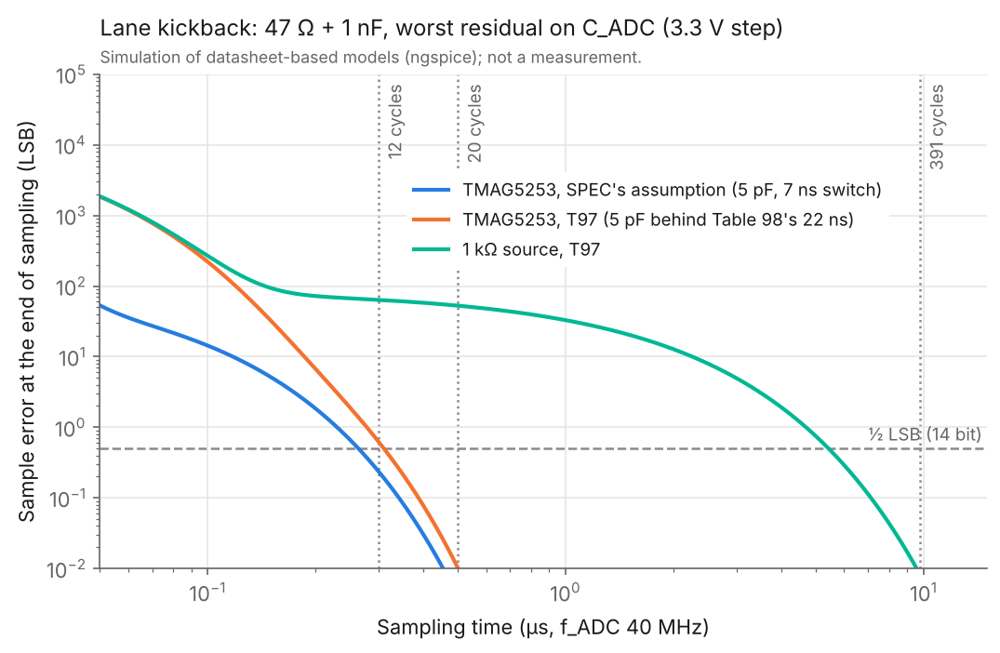
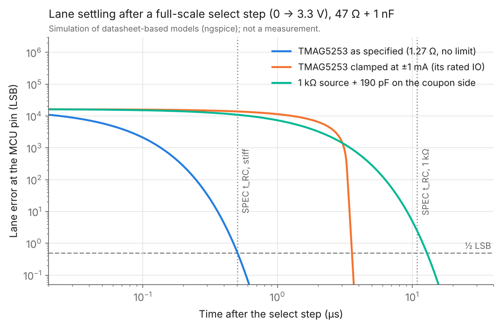
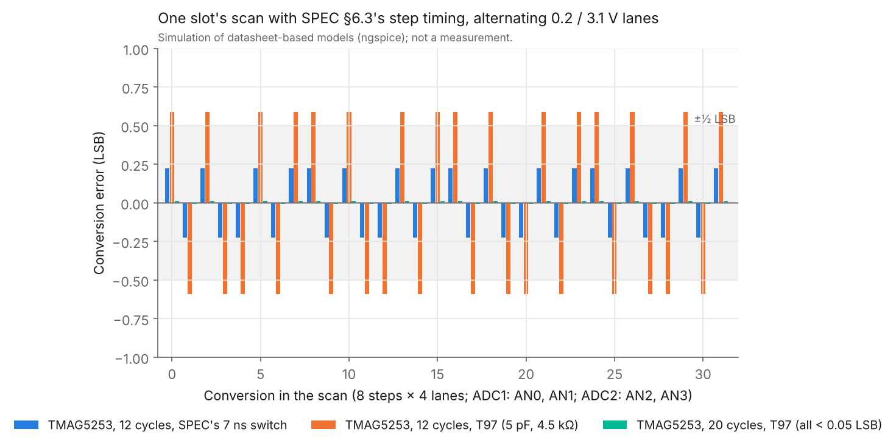
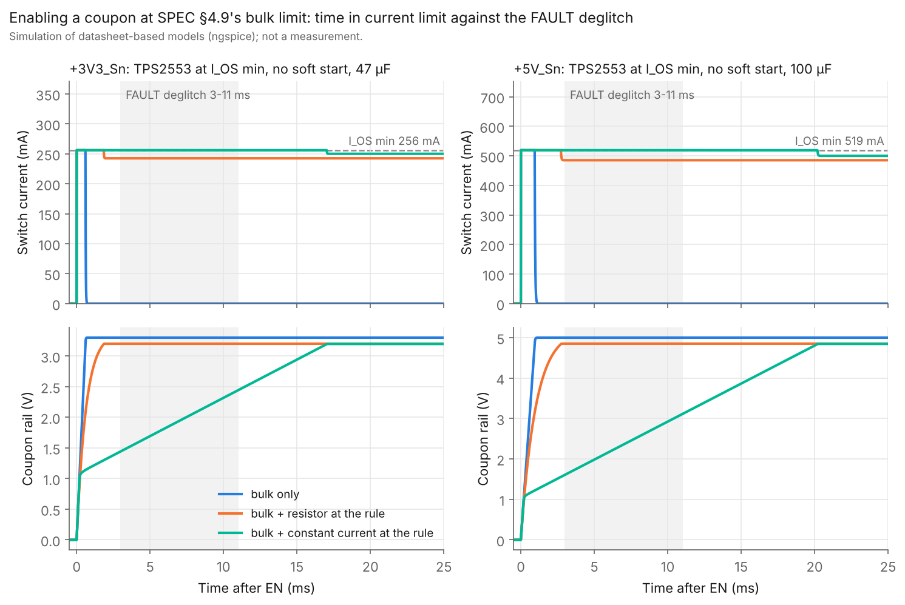
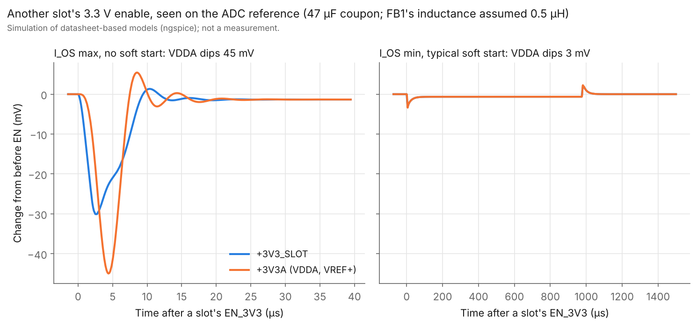
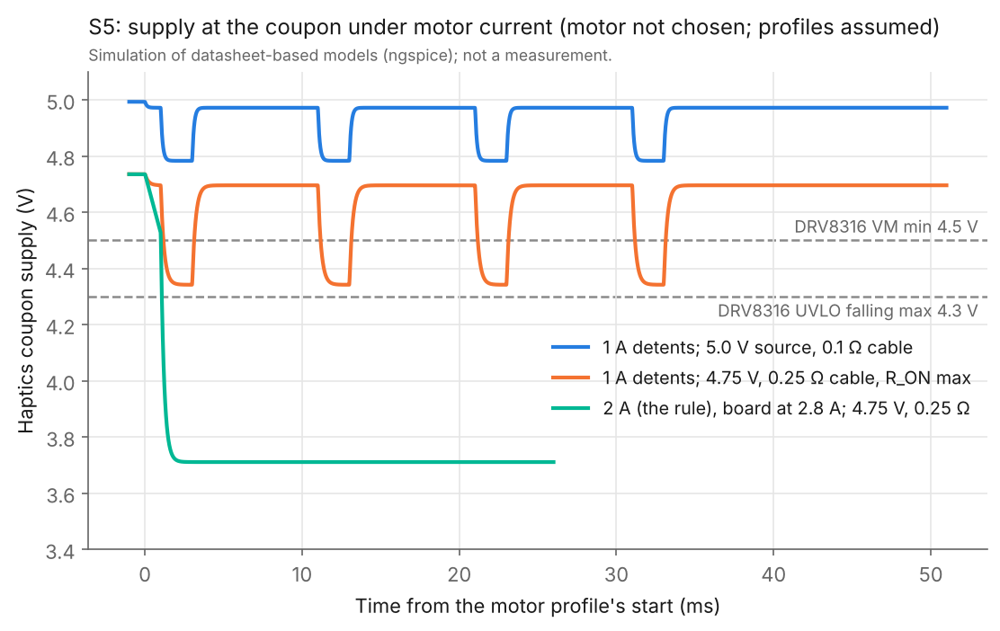
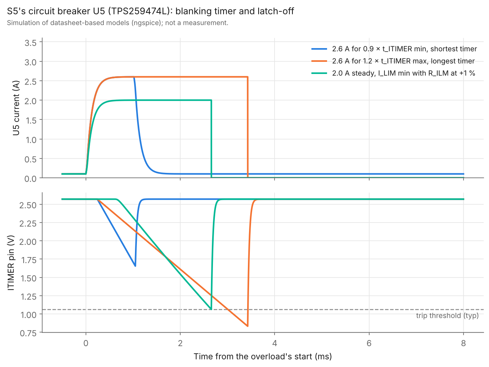
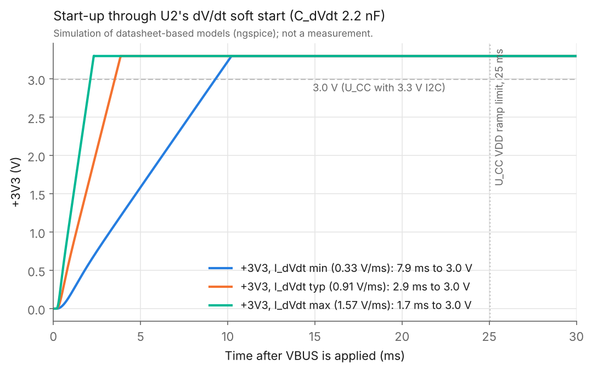
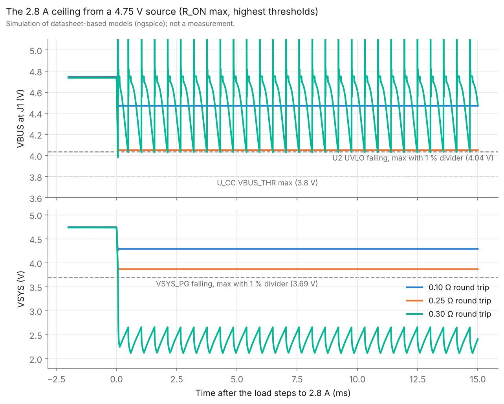
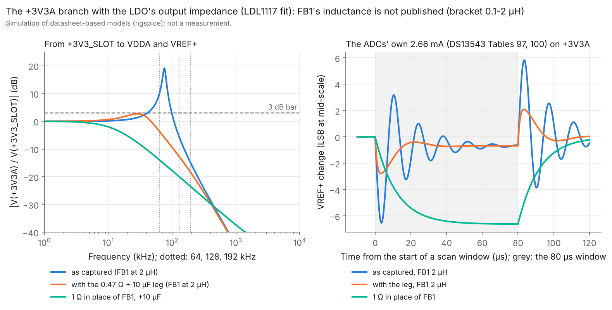

# keyboard/sim: SPICE benches for the margins SPEC computes by hand

**Status (2026-11-28): simulations of datasheet-based models. Nothing here is built or measured.** Each bench
checks the arithmetic and the assumptions behind a margin that [SPEC](../hardware/design/SPEC.md) relies on. A
passing test means "the margin holds for these models and these datasheet values", not "the board works". The
models are behavioural and written from datasheets (sources at the end). The one vendor model that could be used,
TI's TPS2553 model, cross-checks one of them. Bring-up (SPEC §10) is where the numbers become measurements.

The tool was reviewed on 2026-11-27 (see [Review](#review-2026-11-27)): every datasheet value was re-read, faults
were injected into copies of the netlist, the contract and SPEC to see that the tests fail, and the problems found
were fixed. The ADC model changed most: SPEC's 12-cycle sampling time is not supported once the sampling switch is
given the time constant that DS13543's own Table 98 implies.

## Contents

| File | What it is |
|---|---|
| `spice.py` | Runs ngspice in batch mode (`wrdata`), parses the waveforms, and gives interpolation, settle-time and crossing helpers. A transient that stops early counts as an error. |
| `design.py` | Every value a bench uses, with its source. Contract values (trip points, shunts, coupon rules, the 2.8 A ceiling) come from `nets.py` at run time. Capture values (lane RC, R_ILM, C_ITIMER, C_dVdt, UVLO and PG dividers, bulk and socket capacitors) come from the generated motherboard netlist. SPEC values (the coupon bulk rule, the §6.2 working-point sampling time, the §6.3 keys tables) are read from SPEC.md. Datasheet constants have citations. `provenance()` says where each value came from. `KBDSIM_NETLIST`, `KBDSIM_NETS` and `KBDSIM_SPEC` point the benches at other copies of those inputs (what-if runs and fault injection). |
| `powermodels.py` | Behavioural models: TPS2553 (soft start, I_OS limit, R_DS(on)), TPS259474L (EN/UVLO hysteresis, dV/dt, start-up limit, ITIMER, 2 × I_LIM fast trip, latch-off, reverse blocking), an LDO (dropout, and output impedance fitted to LDL1117 Figure 27), and the USB cable. |
| `powerpath.py` | The 5 V path as one netlist: source, cable, U2, the VSYS shunt and bulk, both LDOs, extra VSYS load, and optionally U5, the S5 shunt, the socket contacts and a haptics coupon. |
| `bench_lane.py` | Bench 1: the lane front end and the ADC sample-and-hold. Also `keys_table` (SPEC §6.3's arithmetic) and `min_sampling_cycles` (which sampling-time step a declared R_src needs). |
| `bench_slot.py` | Bench 2: a TPS2553 enabling a coupon, the VDDA disturbance, and the S5 breaker with motor profiles. Also `bulk_limit` (a start-up rule for compiler v0). |
| `bench_input.py` | Bench 3: start-up through U2, and the 2.8 A ceiling through a USB cable. |
| `bench_vdda.py` | Bench 4: the +3V3A branch (VDDA and VREF+ behind FB1) with the LDO's output impedance, and the damping options of the owner's decision D4 (2026-11-27). AC (transfer and impedance) and transient (the ADCs' own current, a scan's steps, another slot's load step). |
| `vendor.py` | Fetches TI's TPS2553 PSpice model (SLVM425B) into a local cache, checks its SHA-256, and patches it for ngspice. Not committed: see below. |
| `run_all.py` | Runs every bench, writes `plots/*.png`, and prints the tables below. |
| `tests/` | pytest: the margins (one test per SPEC claim), the tooling against closed-form answers, and the vendor cross-check. |

## Running

The toolchain venv has numpy, matplotlib and pytest. ngspice is the Ubuntu package (`apt-get install ngspice`;
ngspice-42 was used).

```sh
PY=/root/.venvs/kbd/bin/python
PYTHONDONTWRITEBYTECODE=1 $PY -m pytest keyboard/sim/tests -q -p no:cacheprovider   # about 1 minute
PYTHONDONTWRITEBYTECODE=1 $PY keyboard/sim/run_all.py          # tables on stdout, plots to keyboard/sim/plots/
$PY keyboard/sim/vendor.py fetch                               # optional: enables tests/test_vendor.py
PYTHONDONTWRITEBYTECODE=1 $PY -m pytest keyboard/sim/tests -q -p no:cacheprovider -m nospice   # < 1 s, no ngspice:
                                                               # contract vs capture vs SPEC vs datasheets

# what-if: the same suite against a proposed capture, contract or SPEC (nothing in the repository changes)
KBDSIM_NETLIST=/tmp/proposed.net KBDSIM_NETS=/tmp/nets.py KBDSIM_SPEC=/tmp/SPEC.md \
  PYTHONDONTWRITEBYTECODE=1 $PY -m pytest keyboard/sim/tests -q -p no:cacheprovider
```

Result on 2026-11-28 (`ngspice-42`), against the motherboard netlist recaptured on 2026-11-27 with the owner's
decisions of that evening (D2 key, D3 series resistors, D4 PGTH divider, damping leg and Kelvin sense): without the
vendor model, 73 passed, 1 skipped and 15 xfailed (`-m nospice`: 20 passed, 1 xfailed). Before the recapture it was
68 passed, 1 skipped and 18 xfailed. The three tests that waited for the recapture now run as ordinary tests and
pass: `test_damping_leg_is_captured` (0.47 Ω + 10 µF from +3V3A through VDDA_DAMP), `test_pgth_divider_follows_the_contract`
(100 k / 44.2 k) and `test_ceiling_compliant_cable_keeps_vsys_pg`, whose strict xfail applied only while the capture
had 39 k. Their expected-failure branches apply only to a netlist with none of D3's socket-side nets
(`design.predates_decisions_2026_11_27()`, for what-if runs against an older one with `KBDSIM_NETLIST`): a recaptured
netlist whose PGTH divider is back at 39 k, or whose damping leg is missing, marked DNP or of another value, fails.
The fifteen strict xfails left are the gaps listed under each bench; the recapture closed none of them.
`test_no_bench_line_hides_a_series_resistor` (2026-11-28) reads the netlist: no bench models a G-line or a chip
select, so D3's 100 Ω enter no simulation, and the lane bench's 47 Ω must be the whole path from each socket's lane
pin to its ADC pin. A resistor added in series with a lane, or a D3 resistor missing, of another value, marked DNP
or joined by another part on its socket-side net, fails it. The netlist reader skips parts marked DNP (they are not
on the assembled board), and `test_motherboard_netlist_is_there` fails when the netlist the benches read is missing,
so the capture tests cannot all turn into skips. The review of 2026-11-28 below has the faults.

**How the tests encode SPEC.** Each test asserts a margin that SPEC relies on, using today's contract and capture
values. Some margins do not hold. Those tests are marked `xfail(strict=True)`, and the reason names the gap. The
suite stays green on a known gap. It still fails on any change, in either direction:

* a design change that breaks a holding margin fails its test;
* a change that closes a gap makes its xfail pass, and strict mode reports that as a failure. Then the marker
  comes off, and SPEC and this README are updated.

`test_tooling.py` also cross-checks the contract against the capture and the tool against its sources:

* the trip points in `nets.SWITCH_TRIP` must match the datasheet equations at the R_ILIM and R_ILM values in the
  generated netlist;
* every capture value must come from the netlist (a part that is renamed, removed or moved must not fall back to a
  default quietly);
* the benches simulate S1's lane and switches, so all twenty lanes and every slot's R_ILIM and socket capacitors
  must match S1's;
* the datasheet constants are pinned to the values read on 2026-11-27, so an edit that drifts from a datasheet
  fails.

SPEC's working-point sampling time (§6.2) and its keys tables (§6.3) are read from SPEC.md, so a SPEC edit reaches
the lane tests: moving the working point to 20 cycles turns the sampling-time xfails into strict XPASS failures,
which is the cue to take the markers off.

## The benches

### 1. Lane front end (SPEC §4.3, §6.2, §6.3, §11 #21)

**Circuit.** Per lane:

1. A sensor: an ideal voltage behind its output model.
2. The coupon-side capacitance: 0 pF, or 190 pF (SPEC §4.3's "about 870 pF in all" with 680 pF).
3. 47 Ω, then 1 nF C0G (or 680 pF) and the pin's 5 pF (DS13543 Table 87, C_IO).
4. The sampling switch R_ADC, then C_ADC.

The scan follows SPEC §6.1–§6.3. All four lanes switch at the start of a step. After t_settle + t_RC
(SPEC's formula) and the 13-cycle trigger latency, ADC1 converts AN0 then AN1, and ADC2 converts AN2 then AN3,
at f_ADC 40 MHz with t_s + 17 cycles per conversion. Each conversion's error is C_ADC's voltage at the end of
sampling, minus the sensor's ideal value, in 14-bit LSB (201 µV).

**Source models.** TI publishes no SPICE model of the TMAG5253 that was found.

* `stiff`: the TMAG5253 as specified, a 1.27 Ω DC output resistance (SBASAI5E §6.5) with no limit.
* `limited`: the same, clamped at ±1 mA, its rated "Output continuous current" (§6.3). TI gives no peak or
  short-circuit current, so the real part lies between `stiff` and `limited`.
* `r1k`: a 1 kΩ source (Table 97 allows 1 kΩ at most at 14 bits, with a 4 LSB tolerance).
* `buf22`: the Hall coupon as captured (`sheets/coupon_hall.py`): an OPA2365 follower through 22 Ω, modelled as
  an ideal source behind 22 Ω.

**ADC model.** DS13543 gives C_ADC = 5 pF (Table 97) and no value for R_ADC (Figure 38 names it). Table 98
("Maximum RAIN for 14-bit ADC12", values without an external capacitor) does constrain it. Read as a single RC,
t_s = (R_AIN + R0) × C × ln(2^N / 2), its 8-, 10- and 12-bit rows give a slope of C = 13–14 pF (more than C_ADC:
the pad and switch capacitances are lumped in) and an intercept, the sampling network's own time constant
τ0 = R0 × C, of 17–23 ns (`design.adc_table98_fit()`). The three 14-bit rows are too few and too coarse to fit.
With a 1 nF lane capacitor the pad capacitance no longer matters, but τ0 still sets how fast C_ADC takes its share
back. Three brackets (`design.adc_brackets()`):

* `T97`, the reference for pass/fail: Table 97's 5 pF behind R_ADC = τ0,max / 5 pF ≈ 4.5 kΩ.
* `T98fit`, an upper bound: 14 pF behind τ0,max / 14 pF ≈ 1.6 kΩ, as if all of the fitted capacitance kicked back.
* `fast`: 5 pF behind 1.4 kΩ (7 ns), which is what SPEC §6.3's arithmetic implicitly assumes (the switch adds
  almost nothing). It does not reproduce Table 98: it would allow 8 bits at 47 Ω in about 35 ns where the table
  asks 123 ns. It is kept only to show where SPEC's 0.14 LSB comes from.

The bench before the review used `fast` as its 5 pF bracket, which is why it reported 0.24 LSB at 12 cycles and
"agrees".

**Residual on C_ADC before a sample.** `worst` is the rail opposite the lane (SPEC's 3.3 V bound), `hold` keeps
the previous channel's sample, and `zero` starts from 0 V. The SAR's real residual is not documented.

**Can catch:** a lane RC, sampling time, step timing or declared source impedance that leaves a conversion more
than ½ LSB off, given these models.

**Cannot catch:** the sensor's real output stage (its stability into the lane capacitor, slew, peak current,
15 kHz bandwidth), the SAR's real charge behaviour, charge injection from a mux, layout parasitics, or noise.







### 2. Slot power (SPEC §3.1, §3.5, §3.6, §4.9)

**A. Enabling a coupon.** The circuit, in order:

1. The TPS2553 from +3V3_SLOT (the LDL1117 model, with FB1 and the VDDA capacitors behind it) or from VSYS.
2. The 0.24 Ω or 0.1 Ω shunt, the meter jumper and the INA226's 830 kΩ bus input (SBOS547).
3. The motherboard's 1 µF socket capacitor and two or three socket contacts.
4. The coupon: bulk capacitance at SPEC §4.9's maximum (47 µF or 100 µF, read from SPEC's text), plus no load, a
   resistor at the rule, or a constant current at the rule from about 1 V up.

The corners are I_OS min and typ (from `nets.SWITCH_TRIP`, which already include the 1 % R_ILIM) and the soft
start. Soft start is either none (the datasheet gives no minimum rise time, so this is the bound) or typical.
The current limit ramps up over t_IOS (2 µs) after EN.

The question is whether the switch stays in current limit longer than the FAULT deglitch: 3 ms min, 7.5 ms typ,
11 ms max (SLVS841G). The latch-off TPS2553-1 would latch at that point. The plain TPS2553 asserts SLOT_FAULT_N.

**B. The haptics slot S5.** The whole path: source, cable, U2, VSYS, U5, the 20 mΩ shunt, three +5V and three
GND contacts, the 10 µF socket capacitor, and the coupon's 470 µF (30 mΩ ESR, assumed). The motor profiles are
assumptions standing in for an unchosen motor, except two figures: the 0.5–1 A peaks are concept §8's estimate,
and the 2 A rule is SPEC §4.9's. The motor draws nothing while its supply is below 3 V, like a driver in UVLO.
The results are checked against the DRV8316's limits (SLVSF16B): VM 4.5 V minimum, and UVLO falling at 4.1, 4.2
and 4.3 V (min, typ, max).

**Can catch:** a rule, trip point, timer or capacitor that puts a switch into FAULT or a breaker into latch-off
during a normal enable or motor peak.

**Cannot catch:**

* thermal shutdown (not modelled);
* the TPS2553's real soft-start curve (the datasheet gives a rise time);
* FB1's inductance (assumed 0.5 µH; the bead's datasheet gives only 100 MHz impedance and DC resistance);
* a hot plug: the rule is no plugging while LED_Sn is lit, and the datasheet gives no peak current inside t_IOS;
* the coupon's own regulators.









### 3. The input (SPEC §3.1, §3.2, §3.5, §3.8)

**Start-up.** VBUS is applied, and U2's EN/UVLO divider (100 k / 39 k from the netlist) enables it. U2's dV/dt
start (C_dVdt 2.2 nF) runs at I_dVdt 0.81, 2.21 and 3.82 µA (min, typ, max), giving 0.33, 0.91 and 1.57 V/ms.
The AP2112K then brings up +3V3 with a resistive 45 mA load. The check is +3V3 within U_CC's 25 ms VDD ramp.

**The 2.8 A ceiling.** The board steps from its base load to `nets.VSYS_BUDGET_MAX`:

* from a 4.75 V source, the minimum USB 2.0 §7.2.2 allows a high-power port;
* through 0.1, 0.25 and 0.3 Ω round trip. 0.25 Ω is a 3 A Type-C cable at its IR-drop limit: 500 mV on VBUS and
  250 mV on ground at its rated current, contacts included (Type-C R2.0 §4.4.1);
* with R_ON at its 45 mΩ maximum and every threshold at its highest.

The results are checked against U2's UVLO falling threshold, U2's PG falling threshold (the same divider on
VSYS_IN) and U_CC's VBUS_THR (3.8 V max, SLLSEQ8D). The dividers are 1 % parts, so the highest threshold seen at
VBUS combines the pin's maximum with the divider at its corner (top resistor high, bottom low): 4.035 V falling,
against 3.977 V with exact resistors. A check counts U2 as on only if it was on before the load step; before the
review, a divider that never let U2 start passed "U2 stays on".

**Can catch:** a divider, capacitor or ceiling that turns the board off, chatters, or keeps U_CC from starting.

**Cannot catch:** a real source's output impedance and current limit, cable inductance beyond the assumed 1 µH,
connector heating, the TUSB320 itself (no model), or the AP2112K's start-up foldback (50 mA typ at VOUT = 0). In
the 0.3 Ω case the VSYS level while U2 cycles is set by the load model (a constant current that lets go below
2.5 V), not by anything real; only the cycling itself is the finding.





### 4. The +3V3A branch (SPEC §3.1, §3.7; risks.md EL-5; owner decision D4)

**Circuit.** VSYS feeds the LDL1117 (the `ldo` model, its output impedance fitted to Figure 27), +3V3_SLOT carries
the captured 5.2 µF (C41 4.7 µF and five 100 nF), FB1 (BLM18PG221SN1D: 0.10 Ω DC resistance, max, Murata; its
inductance bracketed 0.1–2 µH) feeds +3V3A, and +3V3A carries the captured 2.2 µF (2 × (100 nF + 1 µF) at VDDA and
VREF+) and a 2 mA static load. Four variants: as captured; with the contract's damping leg (`nets.VDDA_DAMPING`,
0.47 Ω + 10 µF from +3V3A to GND); 1 Ω or 2.2 Ω in place of FB1 with 10 µF more on +3V3A.

**Stimuli.** AC: H(f) = V(+3V3A) / V(+3V3_SLOT) and the impedance at +3V3A, 1 kHz to 10 MHz. Transient: (a) the
ADCs' current at the start of an 80 µs scan window, 2.66 mA (DS13543 Table 97: ADC12 IDDA 980 µA + IDDV 160 µA, typ
at 2.5 Msps and 14 bits, twice; Table 100: ADC4 360 + 18 µA), a bound for the slower working point; (b) the same
current in eight conversion pulses per frame, at SPEC §6.3's 7.3 µs and 3.3 µs steps; (c) a 10.4 mA step on
+3V3_SLOT (four TMAG5253 at 2.6 mA switched on). Every disturbance is quoted at mid-scale: a change dV of VREF+ moves
the code of a ratiometric input at mid-scale by 2^13 × dV / 3.3 V (LSB).

**Brackets.** FB1 0.1, 0.3, 0.5, 1 and 2 µH; the LDO's fitted inductance × 0.5, 1 and 2; the +3V3A capacitors at
2.2 and 1.3 µF (DC bias); the leg's capacitor at 100 % and 47 % (DC bias). None of the DC-bias figures was read for
a particular part.

**The bars** (proposals, SPEC §3.7): peaking at most 3 dB with the leg at its nominal values over the whole bracket,
and at most 6 dB with its capacitor at 47 %; |Z| at +3V3A at most 1 Ω; the VREF+ swing inside a scan window from the
ADCs' own current at most 3 LSB at mid-scale.

**Can catch:** a filter that resonates in the scan's band, or that turns the ADCs' own current into a reference
error, given these models.

**Cannot catch:** the bead's real L(f, I_DC) and loss, the LDO's real control loop (only its fitted output
impedance), layout inductance, the ADC's real current waveform (Table 97's averages), the sensors' supply rejection.



## Results (ngspice-42, 2026-11-27)

Every figure is a simulation of the models above, not a measurement. Bold verdicts are gaps or new findings.
`run_all.py` prints these tables.

| Area | Case | SPEC says | Simulated | Verdict |
|---|---|---|---|---|
| Lane | Kickback error after SPEC's 12 cycles, TMAG5253 source, 1 nF, SPEC's assumption (a 7 ns switch: 5 pF, 1.4 kΩ) | 0.14 LSB | 0.24 LSB | agrees (< ½ LSB) |
| Lane | The same with Table 97's 5 pF behind the time constant Table 98 implies (R_ADC 4.5 kΩ) | 0.14 LSB | 0.63 LSB at 12 cycles, 0.010 at 20 | **exceeds ½ LSB at 12 cycles** |
| Lane | The same with all 14 pF of Table 98's single-RC fit kicking back (upper bound) | not considered | 1.78 LSB at 12 cycles, 0.032 at 20 | **exceeds ½ LSB at 12 cycles** |
| Lane | 1 kΩ source: error at 12 cycles; time to ½ LSB; error at 391 cycles | ≈ 62 LSB; ≈ 5.4 µs; fine | 64 LSB; 5.43 µs; 0.008 LSB | agrees |
| Lane | 680 pF alternative: worst kickback step at the pin; error after 12 cycles | ≈ 24 mV (3.3 V × 5/685) | 10.6 mV; 0.161 LSB | agrees (SPEC's figure is the instantaneous bound) |
| Lane | Hall coupon as captured (OPA2365 + 22 Ω): kickback after 12 / 20 cycles (T97; 14 pF bound) | coupon notes: ≈ 1 / 0.06 LSB | 2.43 / 0.14 LSB; 6.9 / 0.41 LSB | **needs 20 cycles, not SPEC's 12** |
| Lane | Select step 0 → 3.3 V to ½ LSB, TMAG5253 as specified (1.27 Ω) | t_RC ≈ 0.49 µs | 0.50 µs | agrees |
| Lane | The same if the TMAG5253 can source only its rated ±1 mA | stiff (0.49 µs) | 3.57 µs | **unsupported by the datasheet** (needs up to 70 mA) |
| Lane | Select step, 1 kΩ source; with 190 pF on the coupon side | t_RC ≈ 10.9 µs | 10.9 µs; 12.8 µs | agrees; **+18 % with coupon-side C** |
| Lane | Scan, 8 steps × 4 lanes, TMAG5253, 12 cycles, worst residual, SPEC's assumption (7 ns switch) | < ½ LSB | max 0.22 LSB | agrees |
| Lane | Scan, TMAG5253, 12 cycles, T97 bracket | < ½ LSB | max 0.59 LSB | **disagrees** |
| Lane | Scan, TMAG5253, 12 cycles, 14 pF upper bound | < ½ LSB | max 1.67 LSB | **disagrees** |
| Lane | Scan, TMAG5253, 20 cycles, T97 bracket | < ½ LSB | max 0.01 LSB | agrees |
| Lane | Scan, TMAG5253, 20 cycles, 14 pF upper bound | < ½ LSB | max 0.03 LSB | agrees |
| Lane | Scan, TMAG5253 clamped at ±1 mA, 12 cycles | < ½ LSB | max 8979.22 LSB | **disagrees** |
| Lane | Scan, Hall coupon's buffered lane (22 Ω), 12 cycles | §6.2 working point is 12 cycles | max 2.29 LSB | **disagrees** |
| Lane | Scan, Hall coupon's buffered lane (22 Ω), 20 cycles | < ½ LSB | max 0.13 LSB | agrees |
| Lane | Scan, 1 kΩ, 12 cycles | ≈ 62 LSB | max 60.19 LSB | agrees |
| Lane | Scan, 1 kΩ, 391 cycles, 190 pF coupon side | < ½ LSB | max 0.03 LSB | agrees |
| Lane | Scan, 1 kΩ, 391 cycles, pin leakage 500 nA (DS13543 Table 87, TT pin) | < ½ LSB | max 2.60 LSB | **a 2.6 LSB offset outside SPEC's budget** |
| Slot | +3V3_Sn enable, 47 µF, bulk only, I_OS min, no soft start | never limited or tripped within the rules | 0.60 ms in limit | no FAULT |
| Slot | +3V3_Sn enable, 47 µF, bulk only, I_OS typ, no soft start | never limited or tripped within the rules | 0.52 ms in limit | no FAULT |
| Slot | +3V3_Sn enable, 47 µF, bulk + R at rule, I_OS min, no soft start | never limited or tripped within the rules | 1.85 ms in limit | no FAULT |
| Slot | +3V3_Sn enable, 47 µF, bulk + R at rule, I_OS typ, no soft start | never limited or tripped within the rules | 1.11 ms in limit | no FAULT |
| Slot | +3V3_Sn enable, 47 µF, bulk + constant I at rule, I_OS min, no soft start | never limited or tripped within the rules | 17.06 ms in limit | **FAULT at min deglitch** |
| Slot | +3V3_Sn enable, 47 µF, bulk + constant I at rule, I_OS typ, no soft start | never limited or tripped within the rules | 2.61 ms in limit | no FAULT |
| Slot | +5V_Sn enable, 100 µF, bulk only, I_OS min, no soft start | never limited or tripped within the rules | 0.94 ms in limit | no FAULT |
| Slot | +5V_Sn enable, 100 µF, bulk only, I_OS typ, no soft start | never limited or tripped within the rules | 0.84 ms in limit | no FAULT |
| Slot | +5V_Sn enable, 100 µF, bulk + R at rule, I_OS min, no soft start | never limited or tripped within the rules | 2.74 ms in limit | no FAULT |
| Slot | +5V_Sn enable, 100 µF, bulk + R at rule, I_OS typ, no soft start | never limited or tripped within the rules | 1.83 ms in limit | no FAULT |
| Slot | +5V_Sn enable, 100 µF, bulk + constant I at rule, I_OS min, no soft start | never limited or tripped within the rules | 20.22 ms in limit | **FAULT at min deglitch** |
| Slot | +5V_Sn enable, 100 µF, bulk + constant I at rule, I_OS typ, no soft start | never limited or tripped within the rules | 5.14 ms in limit | **FAULT at min deglitch** |
| Slot | VDDA dip when another slot's 3.3 V rail enables (no soft start, I_OS max) | not considered | 45 mV (112 LSB at mid-scale) | **new**: do not switch rails during a run |
| S5 | S5, 1 A detent peaks, 5.0 V source, 0.1 Ω cable | – | 4.78 V min at the coupon | above DRV8316 VM 4.5 V |
| S5 | S5, 1 A detents, 4.75 V source, 0.25 Ω cable, R_ON max | – | 4.34 V min at the coupon | **below VM min 4.5 V** |
| S5 | S5 at its 2 A rule, 4.75 V at J1 (no cable), R_ON max | 4.3-4.5 V at the coupon from 4.75 V, plus the cable | 4.46 V min at the coupon | agrees with SPEC; **below VM min 4.5 V** |
| S5 | S5 at 2 A with the board at 2.8 A, 4.75 V, 0.25 Ω cable | 4.3-4.5 V at the coupon from 4.75 V, plus the cable | 3.71 V min at the coupon | **below DRV8316 UVLO (4.3 V max)** |
| S5 | 2.0 A steady (the rule) at U5's I_LIM min, without / with R_ILM's 1 % | trip min 2.01 A > 2 A rule | 2.014 A: holds; 1.994 A: trips after 2.66 ms | **latches off** with R_ILM 1 % high |
| S5 | 2.6 A for 1.02 ms, shortest ITIMER | blanking 1.13-3.19 ms | holds | agrees |
| S5 | 2.6 A for 3.83 ms, longest ITIMER | latches off after the blanking time | 3.43 ms | agrees |
| S5 | 10 A short on the coupon | fast trip at 2 × I_LIM | trips after 0.06 ms, peak 4.6 A | agrees |
| Input | +3V3 ramp (10 % to 3.0 V), I_dVdt min | within 25 ms (U_CC VDD) | 7.9 ms; inrush 68 mA | agrees |
| Input | +3V3 ramp (10 % to 3.0 V), I_dVdt typ | within 25 ms (U_CC VDD) | 2.9 ms; inrush 104 mA | agrees |
| Input | +3V3 ramp (10 % to 3.0 V), I_dVdt max | within 25 ms (U_CC VDD) | 1.7 ms; inrush 146 mA | agrees |
| Input | 2.8 A ceiling, 4.75 V source, 0.100 Ω cable | board runs at the ceiling | VBUS 4.44 V, VSYS 4.26 V; UVLO margin +403 mV, U_CC +639 mV | holds |
| Input | 2.8 A ceiling, 4.75 V source, 0.250 Ω cable | board runs at the ceiling | VBUS 4.05 V, VSYS 3.87 V; UVLO margin +14 mV, U_CC +249 mV | **UVLO margin only 14 mV** |
| Input | 2.8 A ceiling, 4.75 V source, 0.300 Ω cable | board runs at the ceiling | VBUS 3.98 V, VSYS cycling (load-model artifact); UVLO margin -52 mV, U_CC +183 mV | **U2 UVLO: turns off and chatters** |
| Input | 2.8 A ceiling, 5.00 V source, 0.250 Ω cable | board runs at the ceiling | VBUS 4.30 V, VSYS 4.12 V; UVLO margin +264 mV, U_CC +499 mV | holds |
| Input | Largest cable at 2.8 A from 4.75 V before U2's UVLO (max threshold, 1 % divider) | not stated | 255 mΩ round trip (276 mΩ with exact resistors) | a compliant 3 A cable is 250 mΩ |
| VDDA | +3V3_SLOT to +3V3A peaking, as captured (FB1 0.1 / 0.5 / 2 µH) | risks.md EL-5: resonance at 76-196 kHz | +6.4 dB at 316 kHz / +13.2 dB at 151 kHz / +19.1 dB at 76 kHz | **resonates in the scan's band** |
| VDDA | The same with the leg (0.47 Ω + 10 µF); whole bracket; capacitor at 47 % | D4: damp it | +0.6 dB / +0.4 dB / +2.7 dB; worst +2.7 dB; +5.9 dB | holds (≤ 3 dB) |
| VDDA | VREF+ swing inside a scan window from the ADCs' 2.66 mA, as captured, FB1 2 µH | – | 9.7 LSB at mid-scale | **exceeds 3 LSB** |
| VDDA | VREF+ swing inside a scan window from the ADCs' 2.66 mA, with the leg, FB1 2 µH | – | 2.4 LSB at mid-scale | holds (≤ 3 LSB) |
| VDDA | VREF+ swing inside a scan window from the ADCs' 2.66 mA, 1 Ω in place of FB1 | – | 5.6 LSB at mid-scale | **exceeds 3 LSB** |
| VDDA | VREF+ swing inside a scan window from the ADCs' 2.66 mA, 2.2 Ω in place of FB1 | – | 12.7 LSB at mid-scale | **exceeds 3 LSB** |

**SPEC §6.3's keys-per-slot table, recomputed.** `bench_lane.keys_table` reproduces each of SPEC's four key-count
rows exactly, as SPEC.md prints them (`test_keys_table_reproduces_spec`). The rows below substitute the simulated
settling. Each cell is keys per slot, with t_step in brackets.

| t_settle | 1 µs | 5 µs | 10 µs | 20 µs | 25 µs | 45 µs | 50 µs |
|---|---|---|---|---|---|---|---|
| SPEC (t_RC formula, 12 cycles) | 32 (3.4 µs) | 32 (7.4 µs) | 24 (12.4 µs) | 12 (22.4 µs) | 8 (27.4 µs) | 4 (47.4 µs) | 4 (52.4 µs) |
| TMAG5253, 20 cycles (this tool's recommendation) | 32 (3.8 µs) | 32 (7.8 µs) | 24 (12.8 µs) | 12 (22.8 µs) | 8 (27.8 µs) | 4 (47.8 µs) | 4 (52.8 µs) |
| TMAG5253 clamped at 1 mA, 12 cycles | 32 (6.4 µs) | 28 (10.4 µs) | 20 (15.4 µs) | 12 (25.4 µs) | 8 (30.4 µs) | 4 (50.4 µs) | 4 (55.4 µs) |

**Sampling time per declared source impedance** (`bench_lane.min_sampling_cycles`). This is the smallest
sampling-time step at 40 MHz after which the worst-case kickback is within ½ LSB, with the 1 nF lane. The `T97` row
is the one to use; the first row is SPEC's assumption, for comparison:

| Declared R_src (Ω) | 1.27 | 22 | 47 | 100 | 220 | 470 | 1000 | 2200 |
|---|---|---|---|---|---|---|---|---|
| min. sampling cycles, SPEC's assumption (5 pF, 7 ns switch) | 12 | 20 | 20 | 36 | 68 | 391 | 391 | 814 |
| min. sampling cycles, T97 (5 pF behind Table 98's time constant) | 20 | 20 | 36 | 36 | 68 | 391 | 391 | 814 |
| min. sampling cycles, 14 pF upper bound | 20 | 20 | 36 | 68 | 391 | 391 | 391 | 814 |

## Where the simulation disagrees with SPEC, and what would close each gap

These are recommendations for the owners of SPEC, `nets.py` and the capture. This tool changes none of them.

1. **ADC sampling time (SPEC §6.2, §6.3).** SPEC's 0.14 LSB after 12 cycles assumes a sampling switch that adds
   nothing. DS13543 gives no R_ADC, but its Table 98 puts the sampling network's own time constant at 17–23 ns.
   Behind Table 97's 5 pF that leaves 0.63 LSB after 12 cycles on a stiff lane (0.59 LSB over a whole scan), and
   1.8 LSB if all of Table 98's fitted 14 pF kicks back. The Hall coupon as captured (22 Ω buffer) leaves 2.4 LSB.
   20 cycles (500 ns) leave 0.01–0.03 LSB on a stiff lane and 0.14–0.41 LSB on the Hall coupon's lane, in every
   bracket. That adds 0.4 µs per step and changes no row of SPEC's keys table. Recommendation: make 20 cycles the
   working point, and have the firmware take each lane's SMPx from the descriptor's R_src (the `T97` row above).
   SPEC's "0.14 LSB" should say that it assumes an ideal switch.
2. **TMAG5253 drive (§6.3, §11 #21).** "t_RC ≈ 0.49 µs holds for it" needs up to 70 mA on a full-scale select
   step into 47 Ω + 1 nF. The datasheet rates the output at ±1 mA continuous and gives no peak current. If it were
   clamped at 1 mA, the step would take 3.6 µs. The Hall coupon's buffer sidesteps this. For any unbuffered
   coupon (AN2's R26 option), bring-up step 3 should measure the step, not only stability.
3. **t_RC and coupon-side capacitance (§6.3).** The formula counts only the 1 nF. With a 1 kΩ source, 190 pF
   on the coupon side adds 18 % (12.8 µs, not 10.9 µs). In a scan with 391-cycle sampling this is absorbed: the
   sample window keeps settling the lane.
4. **Pin leakage (§6.3).** DS13543 Table 87 allows 500 nA on a TT pin and 300 nA on an FT_t pin, VIN ≤ VDD. Four
   lanes are on TT pins (Table 27: PA3 = S2_AN3, PA4 = S3_AN0, PA5 = S3_AN1, PB0 = S4_AN2). Through 1 kΩ + 47 Ω,
   500 nA is a 2.6 LSB offset (1.6 LSB at 300 nA). It calibrates out only while it is stable over temperature.
   Through a buffered lane (R_src + 47 Ω ≈ 70 Ω) it is 0.17 LSB. Recommendation: add leakage to §6.3's error
   budget, and have compiler v0 flag a lane whose (R_src + 47 Ω) × 500 nA exceeds the budget it allows.
5. **Coupon start-up current (§4.9).** The rule caps bulk capacitance but not what a coupon draws while its rail
   rises. A coupon that takes its full rule current from about 1 V up keeps the TPS2553 in current limit for
   17–20 ms at the minimum I_OS. That asserts FAULT (the 3–11 ms deglitch) and would latch a TPS2553-1. TI's own
   model agrees qualitatively: with a constant 280 mA load into 47 µF at its typical limit, its FAULT asserts.
   Proposed rule for compiler v0: C_bulk × V_rail ≤ 3 ms × (I_OS,min − I_startup) (`bench_slot.bulk_limit`; the
   tests check it against the sim). For example, at most 51 µF on +3V3 if the coupon draws 200 mA during start-up.
   Alternatively, the coupon holds its loads off (a G-line enable) until the firmware has seen the rail up.
6. **VDDA during rail switching (new).** Enabling another slot's 3.3 V rail dips +3V3_SLOT, and through FB1 the
   ADC reference VDDA/VREF+:
   * about 3 mV with the TPS2553's typical soft start;
   * up to 35–45 mV if it had none (FB1's inductance assumed 0.1–1 µH). TI's Figure 6-3 shows a ramp of a few
     hundred µs into a short, so this bound is pessimistic.

   Recommendation: the firmware does not switch slot rails during a measurement run, and discards the conversions
   of the frame in which it does. The owner's damping leg (D4, bench 4) does not change this: it acts on the
   resonance, not on a rail that switches on.
7. **The haptics slot's supply (§3.6, §11 #15).** SPEC's 4.3–4.5 V at the coupon excludes the cable:
   * with a compliant 3 A cable at its limit and the board at its 2.8 A ceiling, the coupon sees about 3.7 V;
   * with 1 A detents alone, from 4.75 V through 0.25 Ω, it sees about 4.34 V.

   Both are against the DRV8316's 4.5 V minimum and its 4.1–4.3 V UVLO (SLVSF16B, now read: SPEC marks it
   **unverified**). Recommendation: the haptics coupon brings its own supply input or a boost stage, or the
   firmware caps S5 by the measured VBUS (INA226 0x40's bus voltage), not only by the advertised current.
8. **S5's trip point and R_ILM tolerance (§3.1).** SPEC widens the TPS2553 trips for a 1 % R_ILIM but not the
   TPS25947's. With 1.47 kΩ at +1 %, the interpolated minimum is 1.994 A, below the 2 A rule, and a coupon at its
   rule latches U5 off after about 2.7 ms. Recommendation: R_ILM about 1.40 kΩ (2.38 A typ; 2.09 A min with 1 %),
   which still sits inside INA226 0x4D's 4.1 A full scale. Or lower the S5 rule to 1.9 A. A higher U5 limit makes
   item 10 worse, so decide the two together.
9. **The 2.8 A ceiling and U2's dividers (§3.2, §3.5; the capture's 100 k / 39 k, 1 %).** At 2.8 A from 4.75 V
   through a compliant 3 A cable, VBUS at J1 is 4.05 V. U2's UVLO falling threshold referred to VBUS is 3.98 V at
   the pin's maximum with exact resistors, and 4.035 V with the 1 % divider at its corner: 14 mV of margin. VSYS_IN,
   at 3.92 V, is below the same divider's PG falling threshold, so VSYS_PG (a status input, U_EXP2 P12) can
   deassert while the board runs. A cable above 255 mΩ (276 mΩ with exact resistors) takes VBUS below UVLO, and
   U2 turns off and on repeatedly (0.3 Ω in the sim). Recommendation, one of:
   * lower the UVLO and PGTH thresholds, for example falling near 3.5–3.6 V. U_CC's VBUS_THR max is 3.8 V and
     Type-C's vSinkDisconnect max is 3.67 V, so check both;
   * lower the ceiling to about 2.3 A, which keeps PG with 100 mV of margin;
   * have the firmware scale the budget by the bus voltage it reads.

   Also say in SPEC that the board assumes a cable within Type-C's IR-drop limit.

   **Owner's decision D4 (2026-11-27):** U2's PGTH divider becomes 100 k / 44.2 k (`nets.INPUT_PGTH_DIVIDER`), so
   VSYS_PG falls at 3.51–3.64 V (3.46–3.69 V with 1 % resistors); the UVLO divider stays. With that divider in a
   copy of the netlist, `test_ceiling_compliant_cable_keeps_vsys_pg` passes (its marker applies only while the
   capture still has 39 k); the 14 mV UVLO margin is unchanged. SPEC §3.6 now states the load line. **Captured**
   (2026-11-27, R36 = 44.2 k): the suite runs against it, the compliant-cable row above no longer says VSYS_PG may
   fall, and the UVLO margin is still 14 mV (the UVLO divider was not part of D4).
10. **A short on S5 with the board near its ceiling (§3.5, §3.6; new).** After a fast trip the TPS25947 "tries to
    turn the HFET back on after a short de-glitch interval (30 µs) in a current limited manner" and, on a
    persistent fault, "stays in current limit ... and eventually enter[s] thermal shutdown" (SLVSFC9C §7.3.5.4;
    the L variant then latches, §7.3.8). Until then U2 carries U5's limit, up to 2.49 A with R_ILM's 1 %, plus the
    rest of the board, up to 0.8 A under the 2.8 A ceiling: 3.29 A, above U2's 2.93 A minimum. U2's blanking is
    1.13–3.19 ms; U5's time to thermal shutdown at about 11 W is several ms (Figures 6-36 and 6-37, read by eye).
    So U2 can latch the whole board off, USB and logs included. The foldback below VOUT = 1.9 V lowers U5's
    current by an amount the datasheet does not give, so this is unverified either way. The behavioural model
    latches U5 at the fast trip and cannot show it; `test_s5_short_at_the_ceiling_spares_the_input` is the
    arithmetic, as a strict xfail. Recommendation: while S5 is powered, the firmware keeps the rest of the board
    under U2's minimum less U5's maximum (about 0.45 A), or bring-up step 5 shorts S5 with the other slots
    loaded and records which breaker opens.

11. **The +3V3A branch (§3.1, §3.7; risks.md EL-5; new, bench 4).** As captured, FB1 and the 2.2 µF peak by
    6.4–19.1 dB at 76–316 kHz (FB1 0.1–2 µH), up to 21 dB with the capacitors derated, and the ADCs' own current
    swings VREF+ by up to 9.7 LSB at mid-scale inside a scan window. **The owner's decision D4 (2026-11-27)** was to
    damp it, with the option chosen from this model: a 0.47 Ω + 10 µF leg on +3V3A keeps the peaking within 2.7 dB
    over the bracket (5.9 dB with its capacitor at 47 %), |Z| within 0.62 Ω, and the ADC swing within 2.4 LSB, and
    leaves the DC impedance at FB1's 0.1 Ω. A resistor in place of FB1 removes the peaking but puts 1–2.2 Ω at DC,
    which turns the same ADC current into a 5.6–12.7 LSB swing. Chosen: the leg (`nets.VDDA_DAMPING`; SPEC §3.7).
    `tests/test_vdda.py` fails if it is removed from the contract or, once the motherboard is recaptured, from the
    netlist.

What holds, by these models:

* SPEC's lane arithmetic under its own assumption, the 680 pF alternative, 20-cycle sampling in every bracket, and
  the 1 kΩ / 391-cycle remedy;
* every enable with bulk only, or with a resistive load at the rule;
* U5's blanking window (1.13–3.19 ms) and its fast trip;
* the start-up: +3V3 in 1.7–7.9 ms, against 25 ms, with an inrush of 68–146 mA, far below I_LIM;
* the 2.8 A ceiling with a short cable or a 5 V source;
* the +3V3A branch with the contract's damping leg (bench 4).

## Assumptions without a document

* A socket contact is 20 mΩ: the BOOMELE datasheet copy has no text, and SPEC's own 15 mV for three contacts at
  2.1 A implies about 21 mΩ.
* The cable's loop inductance is 1 µH.
* The coupon bulk ESR is 5 mΩ for ceramics and 30 mΩ for S5's 470 µF.
* The base load is 45 mA (SPEC §3.2's estimate).
* FB1's low-frequency inductance is 0.5 µH.
* The LDO output impedance is fitted by eye to LDL1117 Figure 27 (a 75 mV dip for a 1 A step in 5 µs).
* The motor profiles stand in for an unchosen motor.
* The ADC's sampling network is a single R_ADC and C_ADC whose time constant is Table 98's intercept (see the
  ADC model above); DS13543 gives no R_ADC, and the SAR's real residual charge before a sample is unknown.
* Below their minimum input voltage the LDOs' outputs follow the input (scaled by tanh(VIN / 0.3 V)); neither
  datasheet says what they do there. Before the review the model switched on in a step at VIN = 0.5 V, which put a
  model-made spike into the start-up inrush (267 mA reported, 146 mA without it).

The smoothing widths in the models (1 mV and 1 mA; 2 mA at U5's ITIMER comparator) sit below every reported
margin. The tightest is the R_ILM case, 6 mA over a 1.994 A limit, where the comparator is 99.7 % on.

## TI's TPS2553 model (cross-check, not committed)

TI SLVM425B, "TPS2553 Unencrypted PSpice Transient Model Package" (SHA-256 615c68db…), is plain text but "All
rights reserved". It is "designed as an aid for customers of Texas Instruments" and provided "as is". So it is
not copied here. `vendor.py fetch` downloads it into `~/.cache/kbdsim` (or `$KBDSIM_CACHE`) and patches three
expressions for ngspice's PSpice mode. PSpice reads `&`, `|` and `^` inside IF() as boolean operators; ngspice
reads `^` as a power. Unpatched, the EN-polarity XNOR never passes.

Cross-check result: TI's model at its typical limit (287 mA) and the behavioural model given the same limit spend
2.62 ms and 2.75 ms in current limit (enable into 47 µF with a constant 250 mA load). TI's model ramps the
bulk-only inrush faster than the datasheet's typical rise time (225 mA against 162 mA). That is inside the bracket
the benches use (no soft start).

TI's TPS25947 model (SLVMDJ6A) is an encrypted library (`**$ENCRYPTED_LIB`), so U2 and U5 are behavioural only.

## Sources

Read on 2026-11-27. SHA-256 prefixes are of the copies read.

* ST DS13543 Rev 2 (STM32U5Axxx), ST's PDF as JLC hosts it for C22455480 (b5d3dd20): Table 27 (pin I/O
  structures: PA3, PA4, PA5 and PB0 are TT pins), Table 87 (C_IO 5 pF; Ilkg 150 nA FT, 300 nA FT_t, 500 nA TT),
  Table 97 (C_ADC 5 pF, t_LATR, t_CONV, RAIN 1 kΩ at 14 bits with "4 LSBs" tolerance, footnote 5), Table 98 (RAIN
  and sampling time, "Values without external capacitor"), Figure 38 (C_parasitic and Ilkg on the pin side of the
  analog switch, R_ADC and C_ADC behind it).
* TI TMAG5253 SBASAI5E (e3ddc027): §6.3 (CLoad 1 nF, IO ±1 mA), §6.5 (ROUT 1.27 Ω), §9 ("the current through OUT
  must not exceed the IO specification, including current going into an external ADC").
* TI TPS2552/TPS2553 SLVS841G, October 2026 (b6a2d18c): §6.5 (rDS(on), tr, I_OS rows, tIOS, FAULT deglitch, the
  135 °C thermal shutdown in current limit), §8.3.1, Eqs. 1–3, Figure 6-3 (enable into a short: the current ramps
  over a few hundred µs). SPEC cites revision E. The equations and limits used here are unchanged in G.
* TI TPS25947xx SLVSFC9C, May 2026 (8f96de38): §4 (TPS259474L is a circuit breaker with latch-off), §6.5 (RON,
  ILIM rows, ISCGain, ITIMER, IdVdt, UVLO, PGTH), §6.6 (tCB, tSC), §7.3.5.1–7.3.5.4 (the fast trip's 30 µs
  current-limited retry), §7.3.8 (thermal shutdown latches the L variant), Eqs. 4–6, Figures 6-36 and 6-37 (time
  to thermal shutdown against power). SPEC cites ZHCSL91B, the Chinese translation.
* TI INA226 SBOS547C (c9b67f88): VBUS input impedance 830 kΩ.
* TI TUSB320LAI SLLSEQ8D (62f7b3f6): VBUS_THR 2.95 / 3.3 / 3.8 V.
* TI DRV8316 SLVSF16B (39f1977b, from ti.com): §7.3 VVM 4.5 V min; VUVLO falling 4.1 / 4.2 / 4.3 V.
* ST LDL1117 DocID030319 Rev 3 (387b4375): dropout, ISC, Figure 27 (captioned VOUT = 5 V, but its conditions read
  VIN = 3.5 V, 10 mA to 1.2 A, COUT 4.7 µF); Figures 20–21 (stability plan: COUT 1 or 3.3 µF to 22 µF nominal),
  read for bench 4 on 2026-11-27. ST publishes no SPICE model of it that was found (st.com unreachable that day).
* ST DS13543 Rev 2, Table 97 (ADC12 IDDA_s and IDDV_s at 2.5 Msps, 14 bits: 980 and 160 µA typ) and Table 100
  (ADC4 IDDA and IDDV at 2.5 Msps: 360 and 18 µA typ), for bench 4.
* Diodes AP2112 DS39724 Rev. 2-2 (ef8d376f): AP2112-3.3 dropout and short-current limit.
* Murata BLM18PG221SN1D (349daf9c): DC resistance 0.10 Ω max; 220 Ω ±25 % at 100 MHz; no low-frequency
  inductance (bench 4 brackets it).
* USB 2.0 Specification (usb.org `usb_20_20250603.zip`, 5fe9c53c), §7.2.2: "The voltage supplied by
  high-powered hub ports is 4.75 V to 5.25 V"; VBUSD and VGNDD 125 mV.
* USB Type-C Cable and Connector Specification Release 2.0, August 2019 (usb.org, 87d15160), §4.4.1: "The
  maximum allowable cable IR drop for ground ... shall be 250 mV and for V BUS shall be 500 mV through the cable to
  the cable's maximum rated V BUS current capacity", contacts included. Table 4-3: vSinkDisconnect 3.67 V max.
  §4.8.1.2: a charger with a captive cable may be 0.75 × I / 3 V low at its plug.
* TI SLVM425B (TPS2553 PSpice model, 615c68db) and SLVMDJ6A (TPS25947, encrypted), from ti.com.
* This repository: SPEC.md, nets.py, the generated motherboard netlist, `sheets/mb_power.py`, `sheets/mb_slots.py`,
  `sheets/motherboard_parts.py` (the 1 % set resistors), `sheets/coupon_hall.py`, concept.md §2.3 and §8.

## Review (2026-11-27)

A second pass read every datasheet value against TI's and ST's PDFs (the hashes above match), ran every command
above from a clean state, looked at every plot, and injected faults into copies of the netlist, nets.py and SPEC.md
(`KBDSIM_*`, or a mirrored tree) to see whether the suite fails. What it found and changed:

| Found | Fixed |
|---|---|
| The 5 pF ADC bracket used R_ADC = 1.4 kΩ, borrowed from the 14 pF fit: a 7 ns switch that Table 98 does not support. With the time constant Table 98 implies, SPEC's 12 cycles leave 0.63 LSB, not 0.24 | `design.adc_brackets()` derives R_ADC from Table 98; the 12-cycle tests became strict xfails, a 20-cycle pass test was added, the lookup table changed (1.27 Ω now needs 20 cycles) |
| Pin leakage used 300 nA; four lanes are on TT pins, 500 nA | 500 nA; the offset is 2.6 LSB |
| U2's UVLO and PG dividers were taken as exact; they are 1 % parts | thresholds include the tolerance: the compliant-cable margin is 14 mV, not 72 mV (new strict xfail) |
| "U2 stays on" passed when U2 never turned on (a UVLO divider that blocks start-up, or a C_dVdt so large that the board is still starting at the load step) | the ceiling and S5 cases require U2 on before the step |
| Only S1's lane and switches were read; a wrong part on S2–S5 passed (fault F6 below) | tests compare all twenty lanes and every slot's switch parts with S1's |
| A capture value missing from the netlist fell back to a default quietly for 15 of 23 values | every capture value must come from the netlist |
| SPEC's t_s and keys tables were copied into the code, so a SPEC edit could not reach the tests | read from SPEC.md |
| The ITIMER corner patch could silently do nothing | it raises if it did not apply |
| The start-up inrush peak (267 mA) was a spike made by the LDO model switching on at VIN = 0.5 V | smooth LDO turn-on: 68–146 mA |
| U5's fast trip latches at once in the model; the datasheet retries in current limit until thermal shutdown | documented; the case it hides (item 10 above) is an arithmetic strict xfail |

**Fault injection** (each in a copy; "fails" counts the tests that failed or turned into strict XPASS):

| Fault | Before the review | After |
|---|---|---|
| F1 S1 AN0 lane capacitor 1 nF → 100 pF | 8 fail | 10 fail |
| F2 `VSYS_BUDGET_MAX` 2.8 → 3.0 A | 2 fail | 2 fail |
| F3 U2 UVLO bottom resistor 39 k → 33 k (U2 never turns on from 4.75 V) | 4 fail, but "compliant cable keeps U2 on" passed | 5 fail, that one included |
| F4 S1 R_ILIM (3.3 V) 90.9 k → 100 k, contract unchanged | 1 fails | 2 fail |
| F5 SPEC §4.9 bulk rule on +3V3 47 → 100 µF | 1 fails | 1 fails |
| F6 S3 AN0 lane capacitor 1 nF → 100 pF | **0 fail** | 1 fails |
| F7 U2 C_dVdt 2.2 → 47 nF (start-up far beyond 25 ms) | 14 fail, but "compliant cable keeps U2 on" and "a burst shorter than the blanking passes" passed with the board still off | 17 fail, those included |
| F8 SPEC §6.2 working point 12 → 20 cycles, nothing else | not read from SPEC (0 fail) | 6 fail: four sampling-time xfails turn into strict XPASS, the Hall-coupon gap closes, and SPEC's lockstep keys row no longer matches the arithmetic at 20 cycles |
| F9 SPEC §6.3 keys table, 10 µs row: 6 steps, 24 keys → 7, 28 | not read from SPEC (0 fail) | 1 fails |

The mirrored-tree driver used for these is not part of the tool; `KBDSIM_NETLIST`, `KBDSIM_NETS` and `KBDSIM_SPEC`
do the same job from the command line.

## Review (2026-11-28)

A review of the tools' sync to the owner's decisions of 2026-11-27 injected faults into copies of the recaptured
motherboard netlist (`KBDSIM_NETLIST`, `-m nospice`) and found four that passed. What each fault did, before and
after the fixes (an unchanged round trip of the netlist passes both times):

| Fault in the netlist copy | Before | After |
|---|---|---|
| D3 resistor R631 (S2 CS0_N) removed | `test_no_bench_line_hides_a_series_resistor` fails | the same |
| D3 resistor R938 (S5 G4) 100 Ω → 1 k | `test_no_bench_line_hides_a_series_resistor` fails | the same |
| R631 marked DNP (not on the assembled board) | **0 fail** | `test_no_bench_line_hides_a_series_resistor` fails |
| A 100 pF capacitor added on S2_CS0_N_J (D3: plain resistors) | **0 fail** | `test_no_bench_line_hides_a_series_resistor` fails |
| Damping-leg resistor R103 removed, or 0.47 → 0 Ω | `test_damping_leg_is_captured` fails | the same |
| Damping-leg capacitor C118 marked DNP | **0 fail** | `test_damping_leg_is_captured` fails |
| U2's PGTH bottom resistor R36 44.2 k → 39 k (D4 reverted) | **0 fail**: both PGTH tests reported expected failures | `test_pgth_divider_follows_the_contract` fails (and, with ngspice, `test_ceiling_compliant_cable_keeps_vsys_pg`) |
| R36 removed | `test_design_values_come_from_the_capture` fails | that one and `test_pgth_divider_follows_the_contract` |
| No netlist at all (`KBDSIM_NETLIST` naming no file) | **0 fail**: 4 skips, 3 expected failures | `test_motherboard_netlist_is_there` fails |

The fixes: `design.Netlist` reads KiCad 10's `dnp` property and `two_pin()` returns fitted parts only (no bench value
changes: `run_all.py`'s tables are identical, since the only DNP parts are the two 5.1 k Rd footprints on USB_CC1/2);
the D3 test checks that nothing but the resistor (and a test point) sits on each socket-side net and that the MCU
side reaches the MCU pin `nets.SLOT_MCU` names; the D4 tests excuse a mismatch only for a netlist that predates the
decisions. `keyboard/hardware/design/check_contract.py` (the hardware workflow's gate, not this tool) catches the
removed and changed parts and the extra capacitor, but not the two DNP faults (it does not read DNP).
